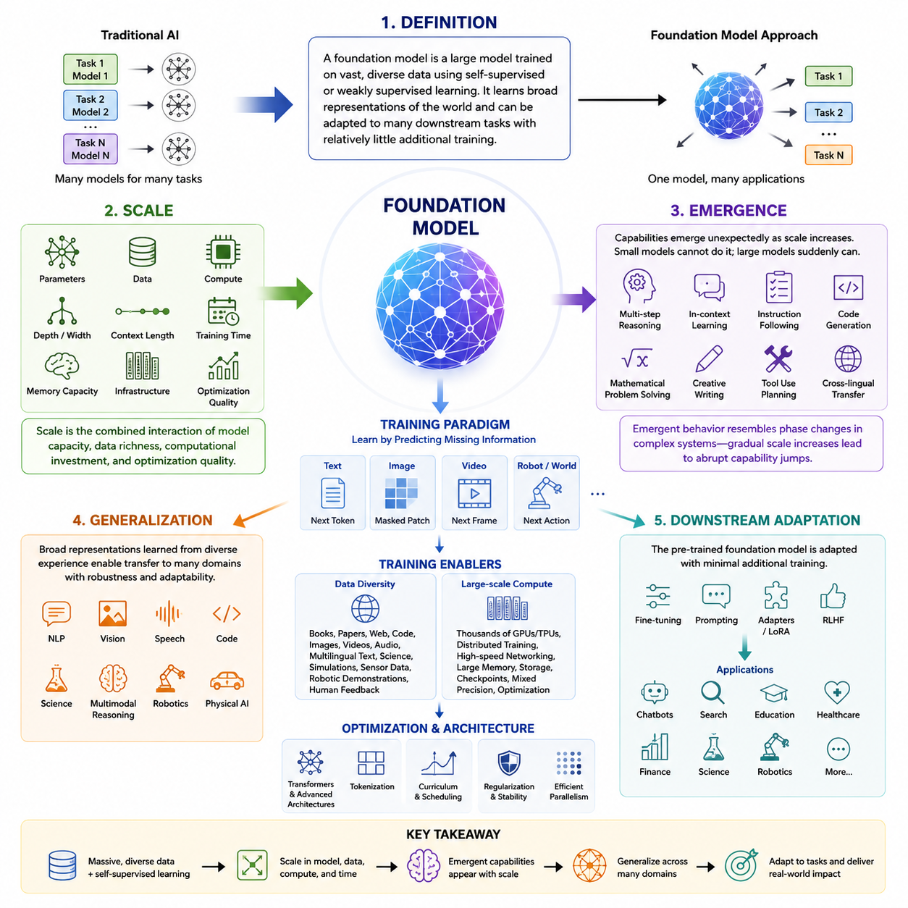
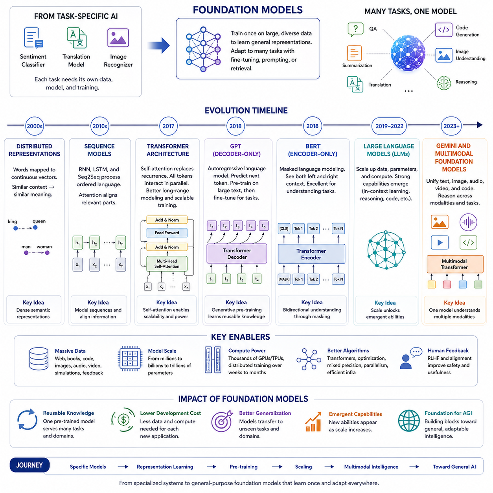
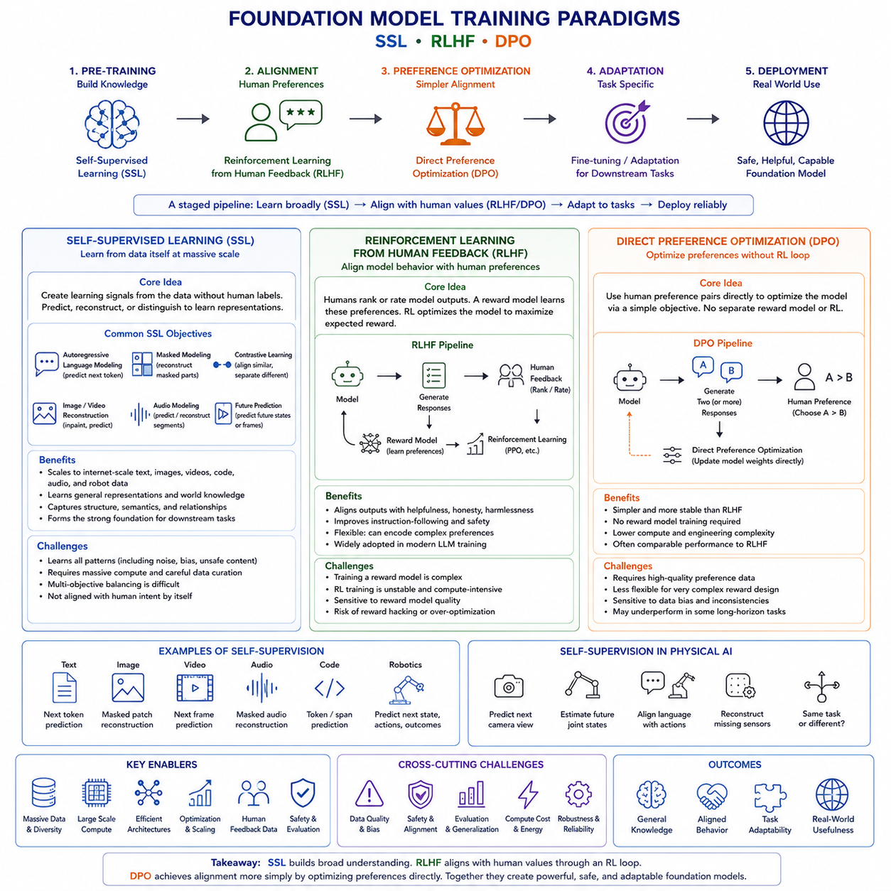
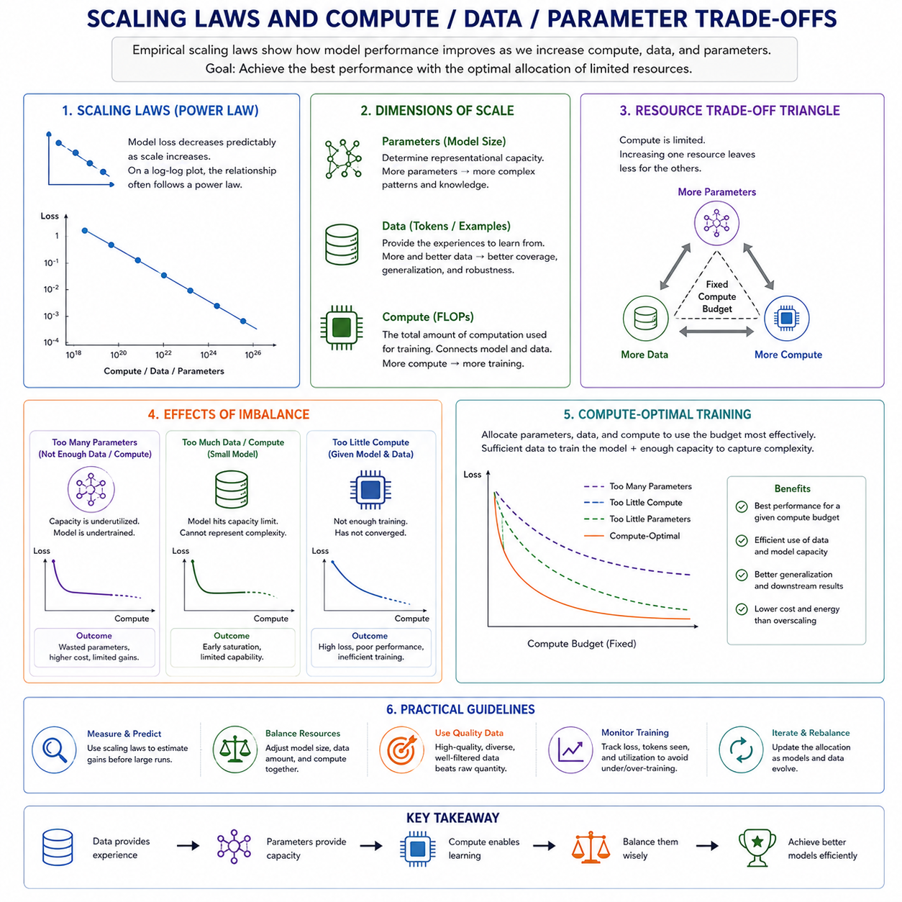
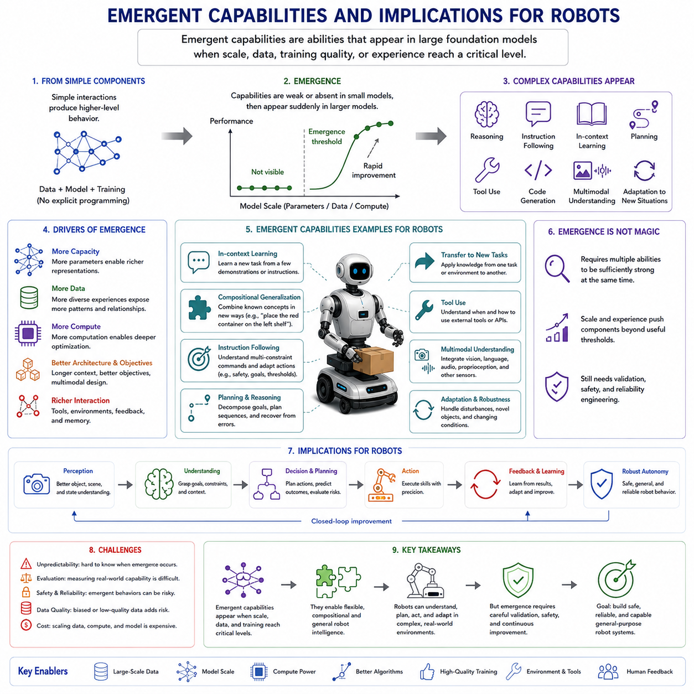
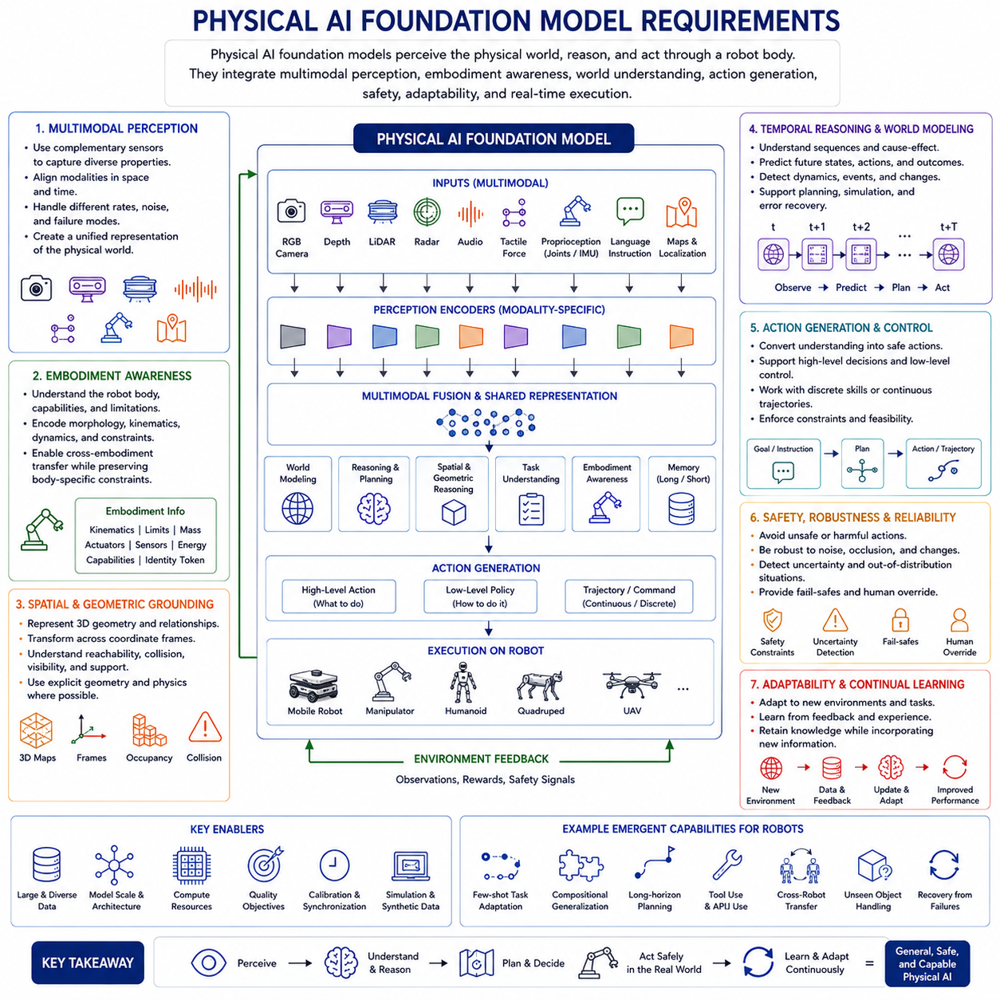
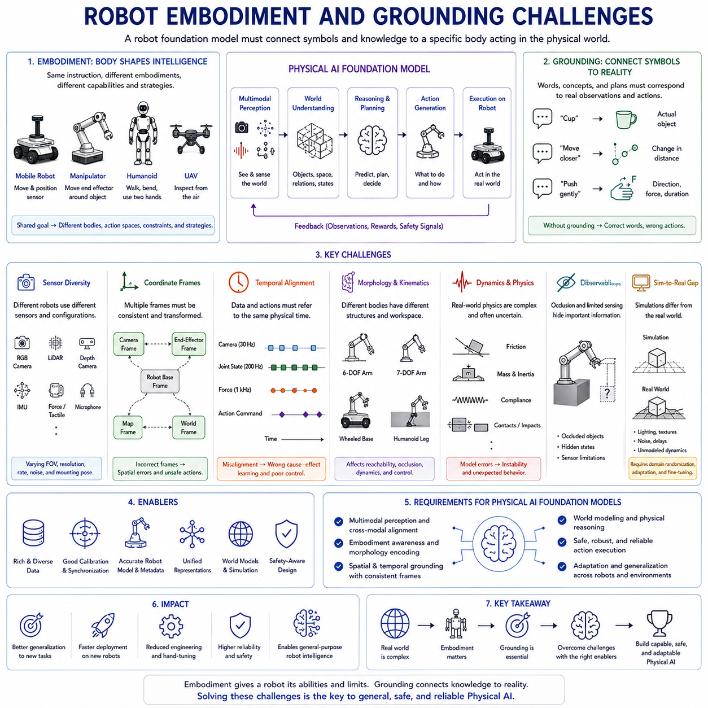
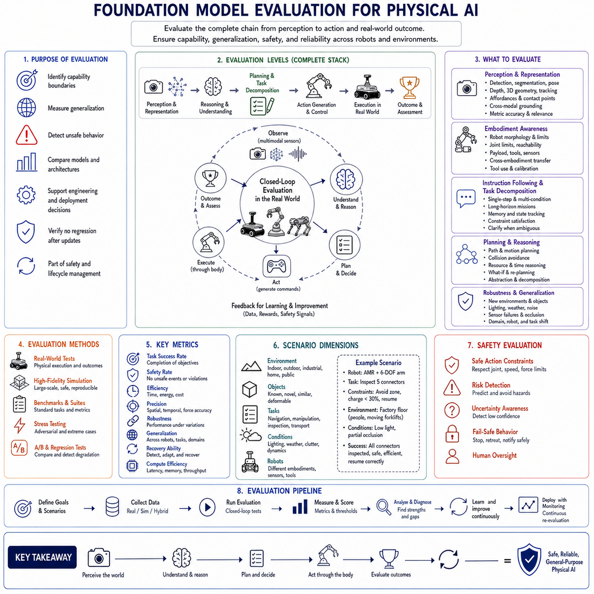
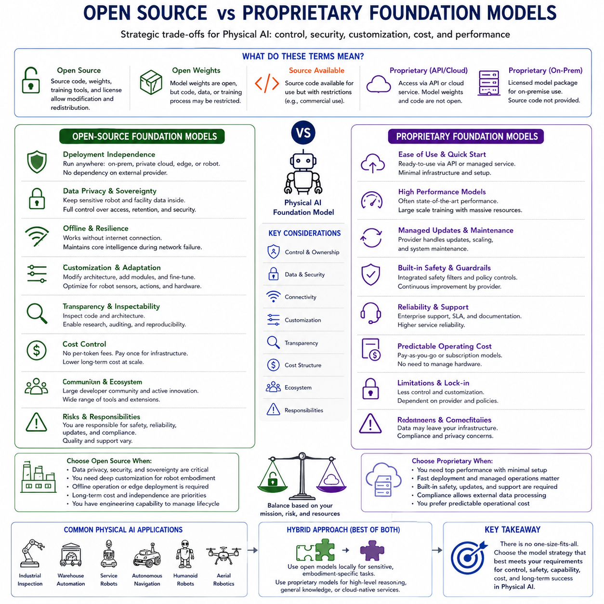
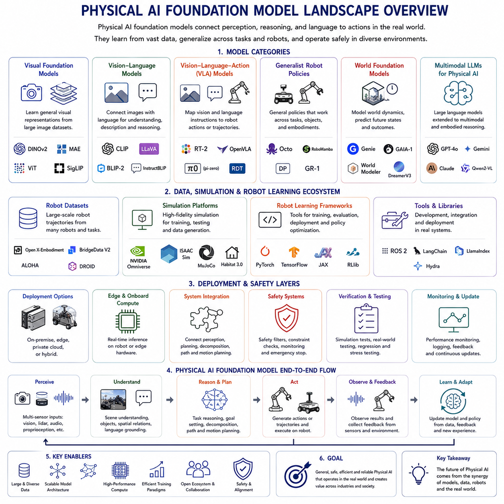

**Volume 18 Physical AI Foundation Models**

# 1. Foundation Model Fundamentals

## 1.1 Foundation Model Definition Scale Emergence Generalization

{width="7.268055555555556in" height="7.268055555555556in"}

Foundation models represent a fundamental shift in the philosophy of artificial intelligence. Rather than designing separate models for every individual task, researchers increasingly train a single large model using enormous amounts of heterogeneous data and then adapt that model to a wide range of downstream applications. This approach has transformed natural language processing, computer vision, speech recognition, multimodal reasoning, scientific computing, and more recently robotics and Physical AI. Instead of viewing intelligence as a collection of isolated capabilities, foundation models attempt to learn a broad representation of the world that can later support many specialized behaviors with relatively little additional training.

The term "foundation model" refers to a model trained on large-scale, diverse datasets using mostly self-supervised or weakly supervised learning objectives. The resulting model becomes a foundation upon which many downstream applications can be constructed. Rather than beginning every new problem with randomly initialized parameters, developers start from a model that already possesses extensive knowledge about language, images, video, audio, code, physical interactions, or combinations of multiple modalities. This pre-trained knowledge significantly reduces development costs while improving generalization, adaptability, and robustness across numerous tasks.

The emergence of foundation models was made possible through the convergence of several technological trends. Massive datasets became available through the internet, industrial data collection systems, simulation platforms, cloud computing infrastructures, and autonomous sensing systems. At the same time, advances in deep neural network architectures, particularly transformers, enabled efficient learning from extremely long sequences of data. Modern GPU clusters, distributed training frameworks, high-speed interconnects, and optimized numerical libraries allowed researchers to scale model training to trillions of tokens and billions or even trillions of parameters. These developments collectively changed AI from task-specific engineering into large-scale representation learning.

Unlike traditional machine learning systems, which are designed around carefully labeled datasets for individual tasks, foundation models primarily learn by predicting missing information from unlabeled data. A language model predicts the next token in a sentence. An image model reconstructs masked image patches. A video model predicts future frames. A robot model predicts future actions given observations. Through these seemingly simple prediction objectives, the model gradually develops internal representations that capture semantic structure, spatial relationships, temporal dependencies, causal regularities, and statistical patterns that extend far beyond the immediate training objective.

The concept of scale is central to understanding foundation models. Scale refers not only to the number of parameters but also to the amount of training data, computational resources, optimization duration, model depth, model width, context length, memory capacity, and infrastructure complexity. Early neural networks contained only thousands or millions of parameters. Modern foundation models routinely contain billions of parameters, while frontier systems may extend into hundreds of billions or even trillions of parameters distributed across multiple computational experts.

Parameter count alone does not define a foundation model. Two models with identical parameter counts may exhibit dramatically different capabilities depending on data quality, data diversity, architecture, optimization strategy, tokenizer design, curriculum scheduling, regularization methods, and hardware efficiency. Consequently, scale should be understood as the combined interaction between model capacity, data richness, computational investment, and optimization quality rather than as a single numerical measure.

Training data has become one of the most valuable resources in foundation model development. Modern models ingest books, academic papers, websites, software repositories, multilingual corpora, mathematical reasoning examples, scientific literature, videos, images, sensor streams, simulation trajectories, robotic demonstrations, and human feedback. Diversity of experience enables the model to discover abstract representations that transfer across many different domains instead of memorizing narrow statistical correlations.

Large-scale computation is another defining characteristic. Training frontier foundation models requires thousands of GPUs or AI accelerators operating simultaneously over weeks or months. Distributed optimization techniques partition model parameters, training batches, optimizer states, and activation tensors across many machines. Communication efficiency becomes nearly as important as numerical computation itself. Improvements in networking, storage throughput, checkpointing, mixed precision arithmetic, gradient compression, and parallel scheduling all contribute significantly to successful large-scale training.

One of the most fascinating aspects of foundation models is emergence. Emergent behavior refers to capabilities that appear unexpectedly as model scale increases. Smaller models may completely fail a task, while a sufficiently large model suddenly begins solving it with reasonable accuracy despite never being explicitly programmed to do so. These qualitative transitions resemble phase changes in complex systems, where gradual increases in underlying capacity produce abrupt changes in observable behavior.

Examples of emergent capabilities include multi-step reasoning, in-context learning, instruction following, code generation, mathematical problem solving, translation between unseen language pairs, commonsense reasoning, chain-of-thought generation, tool usage, planning, and multimodal understanding. These abilities often improve gradually after first appearing, suggesting that sufficient representational capacity enables entirely new computational mechanisms to develop during optimization.

Emergence does not imply magic or consciousness. Instead, it reflects the interaction between large optimization processes and highly expressive neural architectures operating over enormous datasets. Many internal features remain distributed across millions of neurons rather than corresponding to explicitly interpretable symbolic rules. The resulting behaviors may appear surprising because humans cannot easily inspect or predict the representations learned inside extremely high-dimensional parameter spaces.

Researchers continue investigating why emergent capabilities arise. Some hypotheses emphasize increased representational capacity, allowing more complex functions to be approximated. Others focus on optimization dynamics, where sufficiently large networks discover better minima during gradient descent. Additional theories point toward richer internal feature hierarchies, implicit modularity, sparse activation patterns, or increased compositional reasoning emerging naturally from large-scale sequence prediction. Although complete theoretical explanations remain incomplete, empirical evidence consistently demonstrates that capability often grows nonlinearly with scale.

Generalization is another defining property of foundation models. Traditional machine learning systems frequently perform well only on distributions closely resembling their training data. Foundation models instead attempt to learn representations that remain useful across many tasks, domains, environments, and problem formulations. Rather than memorizing specific examples, they develop abstract concepts capable of supporting flexible reasoning under new conditions.

Generalization occurs at multiple levels. Domain generalization enables adaptation across industries such as healthcare, finance, robotics, manufacturing, education, and scientific research. Task generalization allows one model to perform summarization, translation, question answering, reasoning, coding, planning, and dialogue without retraining separate networks. Language generalization extends knowledge across many human languages. Multimodal generalization integrates text, images, audio, video, point clouds, sensor data, and robot observations into unified representations.

Perhaps the most significant form of generalization is compositional generalization. Humans routinely combine familiar concepts into entirely new situations. Foundation models increasingly demonstrate similar abilities by recombining learned representations into novel solutions. For example, a robot foundation model may never have encountered a particular household object during training yet still infer how to manipulate it based on its similarity to previously observed objects.

In-context learning represents a particularly important manifestation of generalization. Instead of updating model parameters through additional gradient descent, the model adapts behavior simply by observing examples placed within its input context. This capability enables rapid adaptation without expensive retraining. A user may provide a few demonstrations, instructions, or examples, after which the model immediately performs new tasks using temporary contextual information.

Transfer learning further extends this concept. Once pre-trained, a foundation model may be fine-tuned using relatively small domain-specific datasets. Medical imaging systems, legal document analyzers, financial assistants, scientific research tools, autonomous robots, and industrial inspection systems all benefit from starting with extensive general knowledge before learning specialized expertise. This significantly reduces data requirements while improving robustness and sample efficiency.

The transformer architecture has become the dominant foundation model architecture because self-attention enables flexible relationships between all elements within an input sequence. Unlike recurrent neural networks, transformers process entire sequences simultaneously, capturing long-range dependencies more effectively while enabling highly parallel computation on modern hardware. Multi-head attention allows the model to represent different types of relationships simultaneously, while feed-forward layers transform representations into increasingly abstract semantic features.

Positional encoding supplements transformers by providing information about sequence order, since attention alone is permutation invariant. Layer normalization stabilizes optimization, residual connections improve gradient flow, and sophisticated optimizers enable efficient learning across billions of parameters. Together these architectural innovations have proven remarkably scalable across language, vision, speech, biology, robotics, and multimodal learning.

Foundation models increasingly extend beyond text into multimodal intelligence. Vision-language models jointly process images and natural language. Audio-language models combine speech with semantic reasoning. Video-language models learn temporal understanding. Physical AI models integrate camera images, LiDAR measurements, proprioceptive sensors, tactile observations, force sensing, language instructions, and robot actions. These multimodal representations enable richer understanding than any individual modality alone.

For robotics, foundation models represent a particularly transformative direction. Classical robotic systems relied heavily on manually engineered perception pipelines, object detectors, planners, localization algorithms, mapping modules, and task-specific controllers. Although highly effective in structured environments, such pipelines often required extensive engineering whenever robots encountered new tasks or environments.

Robot foundation models instead attempt to learn unified representations across perception, reasoning, planning, and control. Rather than separating these components completely, the model learns correlations between sensory observations, language instructions, environmental context, historical experience, and future actions. This enables robots to transfer knowledge between different embodiments, environments, and manipulation tasks more effectively than conventional modular systems.

Scale becomes even more important in Physical AI because robots experience much greater environmental diversity than purely digital systems. A household robot encounters varying lighting conditions, object geometries, human behaviors, surface materials, sensor noise, mechanical wear, unexpected obstacles, and dynamic environments. Large-scale training across diverse robots, simulations, and real-world experiences improves robustness against such variability.

Embodiment introduces additional complexity absent from language models. Physical agents must obey physics, maintain stability, avoid collisions, respect safety constraints, and operate under real-time computational limitations. Consequently, foundation models for robotics must integrate geometric reasoning, temporal prediction, uncertainty estimation, control theory, and physical interaction into a unified representation.

Generalization across embodiments has become a major research objective. Ideally, knowledge learned from one robotic platform should transfer to another with different sensors, kinematics, actuators, or physical dimensions. Cross-embodiment learning reduces the need to collect entirely new datasets whenever hardware changes. Shared latent representations allow robots with different morphologies to benefit from collective experience accumulated across many platforms.

Simulation plays an increasingly important role in achieving scale for Physical AI. Collecting billions of real-world robot interactions remains prohibitively expensive. High-fidelity simulators therefore generate enormous quantities of synthetic experiences, allowing foundation models to observe diverse environments before limited real-world fine-tuning. Domain randomization, realistic rendering, physics simulation, and world models help reduce the gap between simulation and reality.

Evaluation of foundation models presents unique challenges because their capabilities span numerous tasks simultaneously. Traditional benchmark datasets measure narrow performance metrics, whereas foundation models require comprehensive evaluation across reasoning, robustness, calibration, safety, fairness, efficiency, interpretability, transfer learning, and adaptability. For robot foundation models, evaluation additionally includes manipulation success, navigation reliability, collision avoidance, long-horizon planning, energy efficiency, recovery from failures, and human-robot collaboration.

Despite remarkable progress, foundation models possess important limitations. Hallucination remains a major concern in language models. Distribution shift can reduce performance in unfamiliar environments. Training costs remain extremely high. Environmental impact from large-scale computation continues attracting attention. Data quality problems, hidden biases, security vulnerabilities, copyright issues, privacy concerns, and limited interpretability remain active areas of research.

Scaling alone is unlikely to solve every challenge. Future foundation models will likely combine larger datasets with improved architectures, structured memory systems, explicit reasoning mechanisms, causal modeling, retrieval augmentation, world models, active learning, continual adaptation, uncertainty estimation, and more efficient optimization algorithms. Rather than pursuing size indefinitely, research increasingly emphasizes improving data quality, computational efficiency, robustness, and trustworthy behavior.

The long-term vision extends beyond building larger neural networks. Foundation models increasingly serve as universal computational substrates capable of supporting perception, reasoning, planning, communication, decision making, and physical interaction across many domains. For Physical AI, they offer the possibility of robots that continually learn from collective experience, generalize across environments, understand multimodal sensory information, and adapt to unfamiliar tasks with minimal additional supervision.

As Physical AI continues to evolve, foundation models are expected to become the central intelligence layer underlying autonomous systems. Just as operating systems provide common computational infrastructure for software applications, foundation models increasingly provide common cognitive infrastructure for intelligent agents. Their combination of large-scale representation learning, emergent capabilities, and broad generalization forms the technological basis upon which future autonomous robots, embodied AI systems, and general-purpose physical intelligence will be constructed. This topic serves as the conceptual foundation for the remainder of Volume 40, which progressively explores transformer architectures, multimodal learning, world models, robot foundation models, action tokenization, large-scale pretraining, Physical AI training pipelines, safety, adaptation, and real-world deployment strategies within a unified engineering framework.

## 1.2 History of Foundation Models BERT GPT to Gemini

{width="7.268055555555556in" height="7.268055555555556in"}

The history of foundation models is the history of artificial intelligence moving from narrowly engineered systems toward large, reusable models capable of supporting many tasks, domains, and modalities. Earlier machine learning systems were usually trained for a single objective with a dedicated dataset. A sentiment classifier classified sentiment, a translation model translated between fixed language pairs, and an image recognizer identified objects from predefined categories. These systems could be highly accurate within their intended boundaries, but their knowledge was difficult to transfer. Each new application normally required a new dataset, a new training process, and often a new architecture.

Foundation models changed this development pattern. Instead of building intelligence separately for every task, researchers began training large neural networks on broad collections of data and then adapting them to specific applications. The central idea was that a sufficiently large model could first learn general representations of language, images, code, audio, video, or physical interaction. These representations could then be reused through fine-tuning, prompting, retrieval, or task-specific adaptation. The progression from BERT and GPT to multimodal systems such as Gemini illustrates how this idea expanded from text representation learning into a general architecture for machine intelligence.

The intellectual foundations of this transition were established before the term foundation model became widely used. Early distributed word representations such as Word2Vec and GloVe demonstrated that neural networks could map words into continuous vector spaces. Words appearing in similar contexts developed similar representations, and semantic relationships could be reflected geometrically. These systems were important because they replaced sparse symbolic features with dense learned representations. However, each word was usually assigned one fixed vector regardless of context. The word "bank," for example, had the same representation whether it referred to a financial institution or the side of a river.

Recurrent neural networks, long short-term memory networks, and sequence-to-sequence models extended representation learning to ordered language. They enabled progress in machine translation, speech recognition, and text generation by processing sequences token by token. Attention mechanisms later allowed a model to focus dynamically on relevant parts of an input sequence. Neural machine translation became one of the first areas in which attention showed that learned alignment between words and phrases could substantially improve performance.

A major turning point occurred with the introduction of the transformer architecture in 2017. The transformer removed recurrence and relied primarily on self-attention. Every token could directly interact with every other token in the sequence, allowing the model to capture long-range dependencies more effectively. Because transformers could process many tokens in parallel, they were also far more compatible with large-scale GPU training than recurrent architectures. This combination of representational flexibility and computational scalability created the technical basis for modern foundation models.

The first generation of transformer systems was often designed around individual tasks such as translation. The next breakthrough came when researchers realized that transformer models could be pre-trained on large amounts of unlabeled text and then transferred to many downstream tasks. Instead of using a transformer only as part of a task-specific pipeline, the transformer itself became a general language representation engine.

The Generative Pre-trained Transformer, or GPT, was introduced as an early demonstration of this approach. GPT used a decoder-only transformer trained with an autoregressive objective. Given a sequence of tokens, it learned to predict the next token. After pre-training on a large text corpus, the model could be fine-tuned for classification, question answering, textual entailment, and other natural language processing tasks. The importance of GPT was not merely its performance. It demonstrated that generative pre-training could produce reusable language knowledge that transferred across tasks.

BERT, introduced shortly afterward, represented another major branch of transformer-based pre-training. BERT used an encoder-only architecture and was trained primarily through masked language modeling. Some tokens in an input sentence were hidden, and the model learned to reconstruct them using information from both the left and right contexts. This bidirectional learning made BERT especially effective at understanding relationships within text. It achieved strong results across question answering, named entity recognition, sentiment analysis, sentence classification, and many other language understanding benchmarks.

BERT helped establish the pre-train-and-fine-tune paradigm as the dominant approach in natural language processing. Organizations no longer needed to train every language model from the beginning. They could begin with a pre-trained BERT model and adapt it using a comparatively small labeled dataset. Numerous variants followed, including models optimized for efficiency, multilingual processing, domain-specific language, longer documents, biomedical text, legal documents, and scientific literature.

BERT and GPT represented different but complementary views of pre-training. BERT emphasized contextual understanding through bidirectional encoding, while GPT emphasized generation through autoregressive prediction. Encoder-based models became highly effective for classification and representation tasks. Decoder-only models became increasingly powerful for open-ended generation and later proved capable of performing many tasks through natural language prompting. Encoder-decoder models such as T5 explored a third direction by representing every language problem as a text-to-text transformation.

The next major stage was defined by scale. GPT-2 showed that increasing model size and training data could produce more coherent long-form text and broader zero-shot abilities. The model could continue passages, imitate styles, answer questions, and generate plausible documents without being explicitly trained for every individual use case. Its behavior suggested that next-token prediction, when performed at sufficient scale, could lead to much richer capabilities than previously expected.

GPT-3 greatly expanded this idea. With a much larger parameter count and training corpus, it demonstrated few-shot and in-context learning. Users could describe a task or provide several examples directly in the prompt, and the model could often infer the intended pattern without changing its parameters. This was a profound shift. Adaptation no longer always required fine-tuning. The model could temporarily learn a task from context, using the prompt as an interface for programming behavior in natural language.

In-context learning changed how developers interacted with AI systems. Instead of building a separate output layer and training it with labeled data, they could express requirements through instructions, demonstrations, templates, and constraints. Prompt engineering emerged as a practical discipline. At the same time, the limitations of raw pre-trained models became more visible. Large language models could generate fluent but incorrect statements, ignore user intent, reproduce biases from training data, or produce unsafe outputs.

These challenges led to the development of instruction tuning and alignment methods. Models were fine-tuned on datasets containing instructions and desired responses so that they would behave more like useful assistants. Reinforcement learning from human feedback introduced preference-based optimization. Human evaluators compared model outputs, reward models learned from those comparisons, and the language model was optimized to produce responses that people judged more helpful, relevant, and safe.

The emergence of conversational systems made foundation models accessible to a much wider population. The model was no longer only a component embedded inside a specialized application. It became a general-purpose interface capable of answering questions, drafting documents, explaining concepts, writing code, summarizing information, assisting with analysis, and interacting across many domains through dialogue. This transition helped transform foundation models from a research topic into a major computing platform.

Parallel developments occurred in computer vision. Convolutional neural networks had dominated image recognition for many years, but the Vision Transformer demonstrated that transformer architectures could also process images by dividing them into patches and treating those patches as tokens. Large-scale image pre-training made it possible to transfer visual representations across classification, detection, segmentation, and generation tasks.

Contrastive language-image pre-training further connected visual and textual intelligence. Models such as CLIP learned to align images and natural language descriptions within a shared embedding space. Rather than being restricted to a fixed set of object categories, the model could recognize visual concepts using arbitrary textual prompts. This introduced open-vocabulary perception and demonstrated that language could serve as a flexible interface for visual understanding.

Generative image models also advanced rapidly. Autoregressive models, variational methods, and diffusion models learned to produce high-quality images from textual descriptions. Although image generation and language modeling used different training objectives, both reflected the same foundation model principle: large-scale pre-training on diverse data could create reusable generative capabilities that supported many downstream applications.

The boundary between separate language and vision models gradually began to disappear. Early multimodal systems often connected a pre-trained visual encoder to a language model through projection layers or cross-attention modules. These systems could describe images, answer visual questions, read text inside images, compare objects, and reason about scenes. Later models were trained on broader mixtures of text, images, diagrams, documents, audio, and video, allowing multimodal capabilities to become part of the foundation model rather than an external extension.

Large language model development also became increasingly connected to tool use. Models learned to call search systems, calculators, code interpreters, databases, and external APIs. This addressed an important limitation of purely parametric knowledge. A model's internal parameters contain compressed statistical knowledge from training, but they cannot always provide current information, exact calculations, or access to private data. Tool-augmented foundation models combined generative reasoning with external systems capable of retrieving and executing information.

Retrieval-augmented generation became especially important for enterprise applications. Instead of relying only on the model's memorized knowledge, the system retrieved relevant documents from external storage and inserted them into the model's context. This improved factual grounding, enabled access to proprietary information, and made responses easier to trace to source documents. Foundation models increasingly became components within larger systems that included retrieval, memory, planning, verification, and software execution.

The development of GPT-4 marked another significant stage in this history. It demonstrated improved reasoning, instruction following, coding, and multimodal understanding compared with earlier generations. Although model scale remained important, progress was no longer explained only by parameter count. Data quality, training objectives, alignment methods, synthetic data, inference strategies, system architecture, and safety evaluation all became critical parts of foundation model development.

At the same time, other model families accelerated innovation. Encoder-decoder systems, open-weight language models, multilingual models, mixture-of-experts architectures, long-context models, and domain-specialized foundation models expanded the ecosystem. Competition among research organizations encouraged rapid progress in efficiency, openness, deployment flexibility, reasoning capability, and multimodal integration.

Google's development path from BERT to Gemini illustrates the broader transition from language representation models to multimodal general-purpose systems. BERT was designed primarily to understand text through bidirectional contextual encoding. Later large language models expanded generative and conversational capabilities. Gemini was developed as a multimodal model family intended to process and reason across text, images, audio, video, and code.

The importance of Gemini lies not simply in adding image input to a language model. It represents the movement toward models designed around multimodality as a core property. In a natively multimodal approach, different data types are incorporated into the training process so that the model can learn relationships across modalities. Text can explain an image, video can demonstrate an action, audio can provide temporal and environmental information, and code can represent executable procedures. A shared model can use these modalities together rather than treating them as unrelated input channels.

The progression from BERT to Gemini therefore reflects several overlapping transitions. Models moved from task-specific training to general pre-training, from small datasets to internet-scale corpora, from millions of parameters to large distributed architectures, from fine-tuning to prompting and in-context learning, from text-only systems to multimodal models, and from static prediction to tool-using interactive agents.

This history also reveals that foundation models are not a single architecture or product category. They are a broader engineering paradigm. A model becomes foundational when its learned representations and capabilities can be adapted across many applications. Language models, vision models, multimodal models, scientific models, world models, and robot foundation models can all follow this principle even when their data and objectives differ.

The expansion toward Physical AI is the next stage of this development. Text and image models operate mainly on digital information, while Physical AI systems must connect perception to action. A robot foundation model must process camera streams, depth images, point clouds, language commands, joint states, force measurements, tactile signals, and previous actions. It must then generate behavior that respects geometry, dynamics, safety limits, timing constraints, and the capabilities of a specific robot body.

The history of language foundation models provides several lessons for robotics. First, diverse pre-training data can produce representations that transfer across tasks. Second, scale can generate capabilities that are not visible in smaller systems. Third, natural language can act as a universal interface for expressing goals. Fourth, multimodal learning allows concepts to be grounded across observation and description. Fifth, adaptation methods such as prompting, fine-tuning, and low-rank updates can specialize a general model without retraining it from the beginning.

However, robot foundation models also face challenges that language models do not. Incorrect text may confuse a user, but an incorrect robot action can damage equipment or injure a person. Physical data is more expensive to collect than internet text. Robot platforms differ in kinematics, sensor layouts, coordinate systems, action spaces, and control frequencies. Real-world environments contain noise, friction, delays, occlusion, mechanical wear, and unexpected human behavior. Consequently, the historical progression from BERT to Gemini is only the starting point for Physical AI rather than a complete solution.

Future foundation models are likely to combine multimodal perception, long-term memory, world modeling, causal reasoning, planning, action generation, and continuous learning. They may use language models for abstract reasoning, vision models for scene understanding, world models for predicting possible futures, and action policies for interacting with the physical environment. Instead of one monolithic network performing every operation, practical systems may coordinate multiple specialized models through a common representation and control architecture.

Efficiency will also shape the next era. Early foundation model progress was driven largely by increasing scale, but industrial deployment requires lower latency, reduced energy consumption, predictable behavior, and operation on edge hardware. Techniques such as quantization, pruning, distillation, mixture-of-experts routing, speculative decoding, sparse attention, caching, and hardware-aware optimization will determine whether foundation models can move from large data centers into robots, vehicles, drones, factories, and embedded devices.

The historical journey from BERT and GPT to Gemini demonstrates that the most important change is not simply that models have become larger. Their role within computing has changed. BERT established reusable contextual representations. GPT demonstrated that generative pre-training could become a general interface for tasks. Large-scale models introduced in-context learning and emergent capabilities. Instruction tuning and human feedback made models more usable. Vision-language research expanded intelligence beyond text. Multimodal systems such as Gemini brought multiple forms of information into a more unified foundation.

This progression provides the historical context for Physical AI foundation models. Future robot intelligence will not be created by copying a language model directly into a machine. It will emerge by extending the foundation model paradigm into perception, embodiment, world prediction, action, and safety. The transition from BERT to GPT and Gemini therefore represents the first part of a broader transformation: the movement from models that understand and generate information to models that can interpret, reason about, and eventually act within the physical world.

## 1.3 Foundation Model Training Paradigms SSL RLHF DPO

{width="7.268055555555556in" height="7.268055555555556in"}

Foundation models are not created through a single training method. They emerge from a sequence of learning stages that transform raw data into broad representations, general capabilities, instruction-following behavior, and task-specific reliability. Among the most important paradigms in this process are self-supervised learning, reinforcement learning from human feedback, and direct preference optimization. These approaches address different layers of the training problem. Self-supervised learning builds the model's general knowledge and representational capacity. Reinforcement learning from human feedback aligns model behavior with human preferences. Direct preference optimization offers a simpler and often more stable way to learn from preference data without explicitly training a separate reward model and reinforcement learning loop.

The distinction between these paradigms is essential. A model trained only through self-supervised learning may possess broad linguistic, visual, or physical knowledge but may not respond helpfully to instructions. A model aligned only with preference data would lack sufficient foundational knowledge if it had not first been exposed to a large and diverse corpus. Effective foundation model development therefore depends on combining these methods in a staged pipeline rather than treating them as competing alternatives.

Self-supervised learning, commonly abbreviated as SSL, is the primary mechanism used to pre-train modern foundation models. Unlike supervised learning, it does not require humans to manually label every training example. Instead, the training signal is generated from the data itself. The model is asked to predict a hidden, missing, transformed, or future part of an input using the remaining information as context. Because almost any sufficiently structured dataset can generate its own learning targets, self-supervised learning makes it possible to train on internet-scale text, images, videos, audio recordings, code repositories, sensor streams, and robot trajectories.

In autoregressive language modeling, the model predicts the next token from previous tokens. A sentence is divided into a sequence, and each position becomes a training target. Although next-token prediction appears simple, it forces the model to learn grammar, meaning, factual associations, writing style, discourse structure, and many forms of reasoning. To predict the continuation of technical documentation, the model must learn terminology and procedural relationships. To complete code, it must capture syntax, data flow, and programming patterns. To continue a conversation, it must infer intent, tone, and context.

Masked modeling provides another form of self-supervision. In masked language modeling, selected tokens are hidden and the model reconstructs them using information from both directions. In vision, masked image modeling removes image patches and trains the model to recover their content or latent representations. Similar methods can be applied to audio segments, video frames, point-cloud regions, tactile measurements, and robot states. The central idea is that understanding the whole structure of the data should make it possible to infer the missing parts.

Contrastive learning is another important self-supervised paradigm. Instead of reconstructing the exact input, a model learns which observations should have similar representations and which should remain separated. Two augmented views of the same image may be treated as a positive pair. An image and its correct caption may be brought closer in a shared embedding space, while unrelated image-text pairs are pushed apart. This approach has been highly influential in multimodal foundation models because it aligns information across different modalities without requiring detailed class labels.

For Physical AI, self-supervised learning can exploit temporal and cross-modal regularities in robot data. A robot can predict the next camera frame, estimate future joint states, reconstruct missing sensor channels, align language instructions with action trajectories, or determine whether two observations belong to the same task. Since robot data is expensive to label manually, self-supervision is especially valuable. Every recorded trajectory contains potential training signals in its temporal order, sensor correlations, action consequences, and environmental changes.

Large-scale pre-training normally combines several self-supervised objectives. A multimodal model may simultaneously predict text tokens, reconstruct image features, align language with video, estimate future states, and distinguish matching from mismatching sensor streams. Multi-objective training encourages the model to learn representations that are useful across many downstream tasks. However, balancing these objectives is difficult. One objective may dominate the gradients, one modality may contain more data than another, and some targets may be much easier to optimize than others.

Data quality is as important as objective design. Self-supervised learning can absorb useful knowledge from massive datasets, but it can also absorb errors, biases, duplicated content, unsafe behavior, and spurious correlations. The model does not automatically know which patterns are desirable. It learns statistical regularities, including undesirable ones. Consequently, large-scale pre-training requires filtering, deduplication, source balancing, privacy protection, quality scoring, contamination analysis, and careful mixture design.

Curriculum design also affects self-supervised training. Some systems begin with short and relatively simple sequences before introducing longer and more complex data. Others change the ratio of text, code, mathematics, images, videos, or robot trajectories over time. For Physical AI, a curriculum may progress from static visual recognition to short action sequences, then to long-horizon tasks and multi-step interaction. A well-designed curriculum can improve optimization stability and help the model acquire basic representations before learning more difficult behaviors.

After self-supervised pre-training, the model may have substantial knowledge but still behave like a continuation engine rather than an assistant or autonomous agent. It predicts statistically likely outputs, not necessarily useful, truthful, safe, or instruction-compliant ones. Supervised fine-tuning is often used as the first alignment stage. The model is trained on examples containing an instruction and a desired response. This teaches formatting, conversational behavior, task completion patterns, and domain-specific conventions.

Supervised fine-tuning remains limited by the quality and coverage of the demonstration data. Human authors can provide excellent examples, but it is difficult to write demonstrations for every possible instruction. In addition, there may be many acceptable responses to the same request. A single reference answer does not fully express human preferences regarding clarity, helpfulness, harmlessness, accuracy, tone, or level of detail. Preference learning was developed to address this limitation.

Reinforcement learning from human feedback, usually abbreviated as RLHF, converts human judgments into an optimization signal. The process typically begins by presenting human evaluators with several outputs generated for the same prompt. The evaluators rank or compare those outputs. Their choices form a preference dataset that describes which behavior is more desirable.

A reward model is then trained to predict these preferences. Given a prompt and a candidate response, it assigns a scalar reward representing estimated human approval. The reward model does not directly generate text or actions. It acts as a learned evaluator. Once trained, it can score large numbers of outputs more cheaply than relying on human reviewers for every training step.

The policy model is subsequently optimized to produce outputs with higher predicted reward. In language model alignment, this stage has often used policy-gradient algorithms such as proximal policy optimization. The model generates responses, receives scores from the reward model, and updates its parameters to increase expected reward. A regularization term usually constrains the updated model from drifting too far from the supervised fine-tuned reference model.

This constraint is important because unrestricted reward maximization can produce unstable or undesirable behavior. The model may discover patterns that exploit weaknesses in the reward model rather than genuinely satisfying human intent. This phenomenon is known as reward hacking or specification gaming. A response may become excessively verbose because the reward model associates length with helpfulness, or it may confidently imitate preferred phrasing without improving factual accuracy. In robotics, reward hacking can be more dangerous because the policy may technically maximize the objective while violating the intended physical task.

RLHF has several strengths. It can optimize qualities that are difficult to express through fixed labels, such as politeness, usefulness, caution, coherence, and appropriate refusal behavior. It allows multiple acceptable responses to be compared rather than requiring one perfect target. It can also incorporate expert judgments for specialized domains such as medicine, law, engineering, and robotics safety.

However, RLHF is operationally complex. It requires collecting preference data, training and validating a reward model, running online or semi-online generation, maintaining a reinforcement learning infrastructure, tuning stability-sensitive hyperparameters, and monitoring divergence from the reference policy. Policy-gradient methods can be noisy, computationally expensive, and difficult to reproduce. The reward model may also inherit inconsistencies or biases from evaluators.

Direct preference optimization, commonly abbreviated as DPO, was developed as a simpler alternative for preference alignment. It uses the same basic form of preference data: for a given prompt, one response is preferred and another is rejected. However, instead of first training a reward model and then optimizing the policy through reinforcement learning, DPO directly updates the language model so that the preferred response becomes more probable relative to the rejected response.

The core insight is that preference-based policy optimization can be expressed as a supervised classification-style objective under an appropriate mathematical formulation. The model is encouraged to increase the relative likelihood of preferred outputs while remaining anchored to a reference model. This removes the need for an explicit reward model and avoids a separate policy-gradient loop.

DPO is attractive because of its simplicity. Training resembles ordinary fine-tuning and can use familiar distributed learning infrastructure. It is generally easier to implement, debug, and reproduce than a full RLHF pipeline. It also avoids some instability associated with online reinforcement learning. For many alignment tasks, DPO can achieve strong instruction-following and preference-matching performance with lower engineering overhead.

The reference model still plays an important role in DPO. Without a constraint, the policy might overfit to the preference dataset or distort its general capabilities. The DPO objective compares how strongly the updated model and the reference model prefer the chosen output over the rejected output. A temperature-like parameter controls how aggressively the policy moves toward the preference data.

DPO also has limitations. It relies heavily on the quality and diversity of the preference pairs. If the chosen and rejected responses differ only superficially, the model may learn stylistic preferences rather than substantive quality. If the dataset contains inconsistent judgments, hidden biases, or weak negative examples, alignment performance may degrade. DPO is also fundamentally an offline method in its standard form. It learns from a fixed collection of comparisons and may not explore new behaviors as actively as online reinforcement learning.

The relationship between RLHF and DPO should therefore not be understood as a simple replacement. RLHF provides a flexible framework for optimizing arbitrary learned rewards and supports online exploration. DPO offers a streamlined method when high-quality preference pairs are already available. Some systems may use DPO for initial alignment and later apply reinforcement learning for advanced reasoning, tool use, or domain-specific optimization. Others may use rejection sampling, iterative preference collection, or hybrid methods that combine elements of supervised learning and reinforcement learning.

Preference optimization can also use feedback generated by AI systems. Reinforcement learning from AI feedback replaces or supplements human evaluators with another model operating under a set of rules, principles, or evaluation criteria. This can reduce cost and increase scale, although it introduces the risk that the evaluator model's errors and biases will be amplified. Human oversight remains important, particularly in safety-critical fields.

For robot foundation models, preference learning must extend beyond text quality. A preferred trajectory may be safer, smoother, faster, more energy efficient, or more compliant with human expectations. Two robot behaviors can be compared based on collision risk, task completion, force limits, path efficiency, social acceptability, or recovery quality. Human operators may judge recorded trajectories, simulation videos, or real-world executions.

Applying RLHF to robotics is challenging because actions have delayed and physical consequences. A language response can be evaluated immediately, while a robotic decision may need to be judged over a long horizon. The robot may complete the task successfully but use an unsafe intermediate motion. Reward models must therefore evaluate entire trajectories, not only final outcomes. They may also need access to multimodal observations including video, proprioception, force, and environmental state.

Online reinforcement learning with physical robots is costly and potentially dangerous. Exploration can damage hardware or create unsafe interactions. Simulation is therefore frequently used to generate candidate behaviors and perform preference optimization before limited real-world validation. Safety constraints, action filters, control barriers, and human intervention systems are necessary even when the learned policy appears well aligned.

DPO-like approaches can simplify robot preference learning when paired demonstrations or trajectories are available. A preferred manipulation sequence can be compared with an unsuccessful or unsafe one. The policy can then learn to assign greater probability to the preferred sequence. However, continuous robot actions are more complex than discrete language tokens. Actions may need to be discretized, represented as chunks, generated through diffusion, or modeled using flow-based policies before preference optimization can be applied effectively.

Physical AI training therefore often requires a layered architecture. Self-supervised learning builds representations from large amounts of passive and interactive data. Behavioral cloning or supervised fine-tuning teaches the model to imitate successful demonstrations. Preference optimization improves quality and alignment. Reinforcement learning refines performance through interaction. Safety modules enforce constraints that should not depend solely on learned preferences.

Evaluation must be performed after every stage. During self-supervised pre-training, researchers monitor loss curves, representation quality, data memorization, transfer performance, and emerging capabilities. After supervised fine-tuning, they evaluate instruction following and task success. After RLHF or DPO, they test preference win rates, robustness, factuality, safety, calibration, and regression on previous capabilities. In robotics, evaluation must additionally cover collision frequency, control smoothness, action latency, hardware limits, out-of-distribution behavior, and recovery from failure.

An important risk is alignment tax, in which improving preferred behavior reduces raw capability. A strongly aligned model may become overly cautious, refuse benign tasks, lose diversity, or perform worse on specialized benchmarks. Similarly, a robot policy optimized heavily for safety may become too conservative to complete useful tasks. Training therefore requires balancing capability, helpfulness, efficiency, and safety rather than maximizing a single metric.

Another challenge is preference distribution shift. The people who label the data may not represent all future users, cultures, workplaces, or operating conditions. Preferences suitable for a conversational assistant may not be appropriate for an industrial robot. A warehouse operator, safety engineer, customer, and regulator may value different aspects of behavior. Preference datasets must therefore be documented, segmented, and reviewed in relation to the deployment context.

The future of foundation model training will likely involve more iterative and integrated pipelines. Models will pre-train on large multimodal datasets, generate synthetic examples, receive critiques, revise their outputs, and collect new preference data from deployment. World models may simulate the consequences of candidate actions. Verification systems may check outputs before execution. Human experts may intervene only for uncertain or high-risk cases.

Continual learning will also become important. A deployed model should adapt to new tools, environments, regulations, robot embodiments, and user expectations without forgetting previous capabilities. Preference optimization may become an ongoing process rather than a one-time alignment stage. This requires strong version control, replay datasets, regression testing, rollback mechanisms, and monitoring for behavioral drift.

Self-supervised learning, RLHF, and DPO should ultimately be viewed as complementary components of a broader training strategy. Self-supervised learning provides scale by converting raw data into learning signals. RLHF provides a mechanism for optimizing complex human judgments through learned rewards and interaction. DPO simplifies preference alignment by directly learning from chosen and rejected outputs. Each method solves a different part of the foundation model problem.

For Physical AI, the combination is especially powerful. Self-supervised learning can extract structure from enormous quantities of sensor and trajectory data. Supervised learning can teach basic task execution from demonstrations. Preference optimization can encode safety, efficiency, and human expectations. Reinforcement learning can improve performance through simulated or controlled interaction. Together, these paradigms form the training foundation for models that do not merely predict information but perceive environments, interpret goals, plan actions, and operate safely in the physical world.

## 1.4 Scaling Laws and Compute Data Parameter Trade-offs

{width="7.268055555555556in" height="7.268055555555556in"}

Scaling laws describe how the performance of machine learning models changes as the amount of computation, training data, and model capacity increases. They provide an empirical framework for predicting how much improvement can be expected when a foundation model is made larger or trained for longer. Rather than treating model development as a sequence of isolated experiments, scaling laws allow researchers to estimate relationships among resources and performance before committing to extremely expensive training runs. For foundation models, this is especially important because training decisions may involve billions of parameters, trillions of tokens, thousands of accelerators, and months of computation.

The basic observation behind scaling laws is that model loss often decreases in a relatively regular way as scale increases. When performance is plotted against the amount of data, computation, or number of parameters on logarithmic axes, the resulting curve frequently resembles a power law. This means that predictable improvements can continue over a broad range of scales, although each additional unit of resource usually produces a smaller gain than the previous one. Scaling is therefore powerful but not free. Better performance generally requires rapidly increasing investment.

Model parameters determine the representational capacity of a neural network. A parameter is a learned numerical value that influences how the model transforms its inputs into outputs. Increasing the number of parameters allows the model to represent more complex patterns, store more distributed knowledge, and approximate more sophisticated functions. A small model may capture basic grammatical structures or visual categories, while a much larger model may represent subtle relationships among concepts, contexts, modalities, and tasks.

Parameter count alone, however, does not guarantee better performance. A large model trained on insufficient data may fail to use its capacity effectively. It may memorize repeated examples, overfit particular patterns, or remain undertrained because its parameters do not receive enough informative updates. In this case, additional parameters increase memory use and inference cost without delivering proportional capability improvements.

Training data provides the experiences from which the model learns. For language models, data may consist of tokens from books, websites, source code, scientific documents, conversations, and synthetic examples. For multimodal models, it may include image-text pairs, audio, video, diagrams, and documents. For Physical AI, data can additionally include camera streams, point clouds, robot states, control commands, tactile observations, force measurements, simulation trajectories, and human demonstrations.

Increasing data volume exposes a model to more linguistic, visual, behavioral, and physical variation. This improves coverage and reduces dependence on a narrow training distribution. A model trained on diverse environments is more likely to generalize to unfamiliar situations than one trained on repeated examples from a limited domain. However, data quantity cannot be considered separately from quality. Large collections of duplicated, low-quality, inconsistent, or incorrectly aligned samples may provide less value than a smaller, carefully curated dataset.

Computation connects model capacity and data. Training compute represents the total number of mathematical operations performed while optimizing a model. It depends on model size, sequence length, batch size, number of training tokens, architecture, numerical precision, and optimization method. Larger models require more operations for every token, while larger datasets require more training steps. Increasing both simultaneously can cause computational requirements to grow extremely quickly.

A useful way to understand the scaling problem is to view model parameters, data, and compute as a resource triangle. If compute is fixed, increasing model size leaves fewer resources for processing data. If the dataset is fixed, increasing compute may lead to repeated training over the same information and eventual overfitting. If the model is too small, additional data may not be fully absorbed because the model lacks sufficient capacity. The best configuration depends on balancing all three resources.

Early large-model development often emphasized increasing parameter count. Researchers observed that larger models generally achieved lower training loss and stronger downstream performance. This encouraged a race toward models with tens, hundreds, and eventually thousands of billions of parameters. However, subsequent analysis showed that many large models were undertrained relative to their size. They had enough parameters to absorb more information but had not been exposed to enough tokens.

Compute-optimal training attempts to determine the model size and data volume that make the best use of a fixed computational budget. Instead of spending most resources on parameter count, a compute-optimal strategy allocates sufficient training data to ensure that the model's capacity is meaningfully utilized. Under such a strategy, a smaller model trained on substantially more high-quality data can outperform a much larger model trained on too few tokens.

This insight has major implications for engineering. A larger model is not always the most capable model for a given budget. Training efficiency depends on how often each parameter is updated with useful information. If a model is extremely large but sees too little data, its capacity remains poorly trained. If a model is very small but trained on a vast dataset, it may reach a capacity limit and fail to represent the complexity of the data. Compute-optimal design seeks the point where these constraints are balanced.

Scaling behavior is typically measured using training loss, validation loss, benchmark accuracy, or downstream task performance. Training loss indicates how well the model fits its observed data. Validation loss measures how well it predicts unseen samples from a related distribution. Downstream benchmarks assess abilities such as reasoning, coding, translation, image understanding, manipulation, or navigation. These metrics do not always improve at the same rate.

Loss may decrease smoothly while useful capabilities appear unevenly. A small improvement in average prediction loss can correspond to a large change in the reliability of a specific task. Conversely, a model may achieve lower pre-training loss without significant improvement on safety, factuality, or long-horizon reasoning. Scaling laws are therefore most reliable for aggregate prediction performance and less reliable for every individual behavior.

Emergent capabilities complicate scaling predictions. Certain abilities appear weak or absent in smaller models and become visible only after scale passes a threshold. Examples may include multi-step reasoning, tool use, code execution, instruction following, or cross-modal transfer. Some apparent emergence may result from evaluation methods that use strict success thresholds. Nevertheless, nonlinear capability changes remain important for planning because smooth improvements in loss do not guarantee smooth improvements in practical behavior.

Data scaling also introduces the problem of diminishing availability. High-quality human-generated data is finite. As training corpora grow, organizations may exhaust easily accessible sources and begin incorporating lower-quality, repeated, synthetic, or weakly filtered material. At that point, adding more tokens may produce limited value or even degrade performance. Effective scaling therefore requires better data selection rather than indiscriminate accumulation.

Data curation includes deduplication, quality scoring, source balancing, language balancing, toxicity filtering, privacy protection, formatting normalization, and contamination control. For code models, valid and well-documented repositories may be more valuable than large amounts of broken code. For reasoning models, carefully constructed mathematical and logical examples may contribute more than repetitive web text. For robot models, successful, diverse, and precisely synchronized trajectories may be more useful than much larger quantities of noisy demonstrations.

Synthetic data has become an important response to data scarcity. A capable model can generate explanations, code, questions, trajectories, plans, and alternative solutions that are later used for training. Synthetic data can target rare skills or fill gaps in the original distribution. In Physical AI, simulation can generate variations of lighting, objects, terrain, sensor noise, robot morphology, and failure conditions that would be costly or dangerous to collect in reality.

Synthetic scaling also creates risks. If models train repeatedly on their own unverified outputs, errors may be reinforced. Generated examples may lack the diversity and unpredictability of real-world data. Poor synthetic data can narrow the model's distribution and encourage superficial patterns. Consequently, synthetic examples require filtering, verification, diversity controls, and combination with trusted real data.

The compute dimension of scaling is shaped by hardware. Training large foundation models requires accelerators with high matrix multiplication throughput, large memory capacity, fast interconnects, and efficient collective communication. Compute availability is not simply the number of GPUs. Performance depends on accelerator utilization, memory bandwidth, network topology, software kernels, parallelism strategy, and storage throughput.

Several forms of parallelism are used to distribute large training workloads. Data parallelism replicates the model across devices while processing different batches. Tensor parallelism divides individual matrix operations across accelerators. Pipeline parallelism assigns different model layers to different devices. Sequence parallelism distributes long input sequences. Expert parallelism distributes components of mixture-of-experts models. Practical systems often combine these techniques.

Poor parallel efficiency can make nominal compute misleading. Thousands of accelerators may spend significant time waiting for communication, data loading, synchronization, or memory transfers. The effective compute used for learning can therefore be far lower than the theoretical hardware peak. Scaling laws based only on accelerator count may overestimate expected progress unless utilization is carefully measured.

Numerical precision also affects compute efficiency. Training traditionally used 32-bit floating-point arithmetic, but modern systems increasingly use 16-bit or lower-precision formats while maintaining selected operations at higher precision for stability. Mixed-precision training reduces memory consumption and increases throughput. Quantized training and specialized low-precision hardware may extend these gains further, although numerical errors must be controlled.

The relationship between training compute and inference compute is another important trade-off. A very large model may achieve excellent benchmark performance but require expensive hardware and high latency every time it generates an output. For a frequently used service or a robot fleet, total inference cost can exceed the original training cost. Model design must therefore consider lifecycle compute rather than training compute alone.

This consideration has encouraged the development of smaller models trained on more data, model compression, quantization, pruning, and knowledge distillation. A large teacher model can generate training signals for a smaller student model. The student may sacrifice some generality but offer faster and cheaper deployment. For edge systems, a compact model with reliable task-specific performance may be more valuable than a frontier-scale model that cannot run within latency, power, or memory constraints.

Mixture-of-experts architectures offer another scaling strategy. Instead of activating every parameter for every token, they route each input through a subset of specialized expert modules. This allows total parameter count to increase without proportionally increasing computation per token. The model can develop specialization while keeping active compute relatively controlled.

However, mixture-of-experts systems introduce routing complexity, communication overhead, load-balancing problems, and deployment challenges. If too many tokens are sent to the same expert, some devices become overloaded while others remain idle. Experts may also become overly specialized or underused. The distinction between total parameters and active parameters therefore becomes important when comparing model scale.

Context length is an additional scaling dimension. Longer contexts allow models to process larger documents, extended conversations, video sequences, or long robot histories. However, standard self-attention has computational and memory costs that grow rapidly with sequence length. Increasing context length can therefore consume resources that might otherwise be used for more parameters or more training samples.

Long-context scaling requires efficient attention, memory compression, recurrence, retrieval, sparse patterns, or state-space mechanisms. Simply extending the maximum input length does not guarantee that the model will use distant information effectively. Models must be trained on long sequences, evaluated for retrieval and reasoning across distance, and protected against irrelevant context overwhelming important signals.

For multimodal foundation models, compute allocation becomes even more complex. Text tokens, image patches, video frames, audio samples, point clouds, and robot states have different information densities and computational costs. A few seconds of high-resolution video may produce far more tokens than a page of text. Without careful sampling and compression, visual data can dominate the compute budget.

Multimodal scaling therefore requires modality-specific encoders, token reduction, temporal subsampling, latent compression, adaptive resolution, and balanced data mixing. The objective is not to process every raw measurement at maximum resolution but to preserve task-relevant information. For example, a robot may need high temporal resolution for joint control but lower visual resolution for slowly changing background regions.

Physical AI makes scaling laws more difficult because robot data is not independent and identically distributed. Consecutive observations are strongly correlated, demonstrations vary in quality, and different robots produce different action spaces. Ten million nearly identical trajectories may contain less useful information than a much smaller set of diverse interactions. Effective data volume must therefore be measured in terms of behavioral diversity, environmental coverage, and information content rather than raw sample count alone.

Robot embodiment also changes the parameter-data trade-off. A model trained for one manipulator may learn detailed platform-specific dynamics but transfer poorly to another robot. A cross-embodiment model requires more diverse data and enough capacity to represent shared abstractions as well as hardware-specific differences. Robot identity, morphology, sensor configuration, and control interface may need to be explicitly encoded.

The cost of real-world robot data places a practical limit on direct scaling. Collecting demonstrations requires hardware, operators, maintenance, storage, calibration, and safety supervision. Simulation can expand the dataset, but simulated data differs from reality. A scalable Physical AI pipeline therefore mixes web-scale semantic data, simulation trajectories, synthetic environments, teleoperation demonstrations, autonomous experience, and carefully selected real-world trials.

Compute allocation in robotics must also consider control hierarchy. Large foundation models may operate at a slower rate to interpret goals, understand scenes, or generate action chunks. Smaller policies and conventional controllers may execute high-frequency motor commands. This hierarchical arrangement prevents expensive reasoning models from being placed directly inside tight real-time control loops.

A practical robot foundation model may therefore use substantial training compute but limited active inference compute. A large cloud or data-center model can be distilled into a smaller edge model. High-level planning can run on an edge GPU at a moderate frequency, while safety controllers and servo loops run on deterministic processors. Scaling decisions must reflect the full architecture rather than only the central neural network.

Energy consumption is another important consequence of scale. Large training runs consume substantial electricity, and large-scale inference across millions of requests or thousands of robots creates ongoing energy costs. Improving energy efficiency is not only an environmental concern but also a business and deployment requirement. In mobile robots, every watt used for computation reduces the energy available for movement, sensing, and mission duration.

Scaling laws can support cost forecasting. By fitting performance curves from smaller experiments, researchers can estimate the compute required to reach a target loss or benchmark level. These estimates help determine whether a training goal is economically realistic. However, extrapolation is risky when architecture, data quality, objective functions, or evaluation distributions change. Scaling laws are empirical regularities, not universal physical laws.

Small-scale pilot experiments are therefore essential. Teams can train several models with different parameter counts and data allocations, measure their losses, and estimate the likely behavior of larger runs. This process helps identify compute-optimal configurations, data bottlenecks, training instability, and diminishing returns before full-scale investment.

Scaling strategy should also reflect the intended product. A research model may prioritize maximum capability. An enterprise assistant may prioritize factuality and controllability. An industrial robot may prioritize latency, safety, and predictable behavior. A fleet platform may prioritize total cost per mission. The optimal parameter count and compute budget differ across these contexts.

In many applications, scaling the surrounding system can produce greater value than scaling the base model. Retrieval systems can provide updated knowledge. Tool use can improve calculation and execution. External memory can extend context. Verification models can reduce errors. World models can evaluate action consequences. Specialized smaller models can handle perception or control more efficiently than a single monolithic network.

This leads to a broader interpretation of scaling. The future may not consist only of larger individual models but of scalable systems composed of models, tools, memory, simulators, databases, and controllers. Compute can be allocated dynamically depending on task difficulty. Simple requests may use a small model, while difficult problems invoke additional reasoning steps, external tools, or larger models.

Inference-time scaling has become increasingly important in this context. Instead of spending all available resources during pre-training, systems can allocate more computation when solving difficult tasks. They may generate multiple candidate solutions, verify intermediate steps, search through action sequences, or consult external models. This creates another trade-off between fixed training investment and adaptive inference cost.

For robotics, inference-time scaling may involve simulating multiple future trajectories before selecting an action. A world model can predict likely consequences, while a planner evaluates safety and utility. More compute can improve decisions in difficult situations, but strict latency limits prevent unlimited search. The system must determine when additional computation is worth the delay.

Ultimately, scaling laws provide guidance rather than a complete recipe. They reveal that performance tends to improve predictably with more parameters, data, and compute, but they also expose the importance of balance. Oversized models can be undertrained. Huge datasets can be low quality. Powerful hardware can be poorly utilized. Better performance emerges when model capacity, informative data, optimization, and system architecture are matched to one another.

For Physical AI, the central challenge is not simply to build the largest possible robot model. It is to allocate compute, data, and parameters in a way that produces robust perception, transferable knowledge, safe action generation, and efficient deployment. A well-balanced model trained on diverse, high-quality robot experience may outperform a much larger but poorly trained system. Scaling must therefore be treated as an engineering discipline that connects learning theory, data strategy, hardware infrastructure, model architecture, operational cost, and real-world safety.

## 1.5 Emergent Capabilities and Implications for Robots

{width="7.268055555555556in" height="7.268055555555556in"}

Emergent capabilities refer to abilities that become visible only after an artificial intelligence model reaches a certain level of scale, data diversity, training quality, architectural complexity, or interaction experience. These capabilities may be weak or absent in smaller systems and then appear unexpectedly in larger models, even when the training objective itself has not fundamentally changed. In foundation models, emergence is often associated with abilities such as multi-step reasoning, instruction following, tool use, transfer across tasks, in-context learning, planning, code generation, multimodal understanding, and adaptation to unfamiliar situations. For robotics, the possibility of emergence is particularly important because a robot foundation model may acquire useful behaviors that were not individually programmed or explicitly represented in its training labels.

The concept of emergence originates from the study of complex systems. In many natural and artificial systems, simple local interactions can produce higher-level behavior that is difficult to predict from the components alone. Individual neurons do not contain complete concepts, yet large neural networks can represent language, objects, intentions, and procedures. Individual training examples do not specify general intelligence, yet sufficiently large models may combine patterns across many examples to solve new problems. Emergence therefore describes a qualitative change in observable behavior produced by quantitative changes in scale and organization.

In foundation models, the most common evidence for emergence comes from benchmark performance. A smaller model may perform close to random on a task, while a larger model begins solving a meaningful fraction of the examples. Further scaling may then lead to rapid improvement. This pattern has been reported in arithmetic, logical reasoning, few-shot learning, translation, code generation, and complex instruction following. However, the interpretation of these results requires care. Some capabilities may appear suddenly because the evaluation uses a strict success threshold. A model that gradually improves from almost correct to fully correct may appear to cross an abrupt boundary even if the underlying learning process was smooth.

Emergence should therefore not be understood as magic. It does not imply that a model suddenly becomes conscious or develops human-like understanding in a single step. Instead, it suggests that certain tasks require multiple internal abilities to become sufficiently reliable at the same time. A planning task may require perception, memory, abstraction, sequencing, and error correction. If any one component is too weak, the complete behavior fails. Once several components improve beyond useful levels, the combined capability becomes visible.

Scale is one important driver of emergence. Increasing the number of parameters gives a model greater representational capacity. Increasing data exposes it to more patterns, relationships, environments, and strategies. Increasing computation allows the model to optimize these parameters over more examples. Architectural improvements, longer context windows, better objectives, and richer multimodal data can also contribute. Emergence is therefore not caused by parameter count alone but by the interaction among capacity, experience, optimization, and evaluation.

In language models, in-context learning is one of the most influential emergent capabilities. A sufficiently capable model can infer a new task from instructions or examples placed in the input context without changing its parameters. This ability transforms the prompt into a temporary learning environment. The model can identify a pattern, infer the intended mapping, and apply it to new inputs. For robotics, an equivalent ability could allow a robot to observe a few demonstrations, interpret a spoken explanation, or inspect a small number of successful trajectories and then perform a related task without full retraining.

Instruction following is another capability that becomes more effective with scale and alignment. Small models may respond to superficial word patterns without maintaining the intended goal. Larger models can often distinguish constraints, preserve task context, follow several conditions simultaneously, and adapt their response format. In robots, instruction following must extend beyond text generation to physical execution. A robot may need to interpret commands such as "inspect the left side of the machine, avoid the marked safety zone, and return to the charging station if the battery falls below twenty percent."

Such instructions contain several forms of reasoning. The robot must identify objects and regions, maintain temporal conditions, combine mission priorities, monitor internal state, and alter behavior when a threshold is reached. A foundation model with emergent instruction-following ability may integrate these constraints more flexibly than a set of isolated rules. However, the physical consequences of misunderstanding make validation essential.

Compositional generalization is especially important for robots. It refers to the ability to combine familiar concepts in unfamiliar ways. A model may understand "red," "container," "left shelf," and "place" separately, then correctly execute the new instruction "place the red container on the left shelf." The exact combination may not have appeared in the training set, but the components have.

Traditional robot systems often struggle with combinatorial growth. Every new object, task, and location combination may require additional engineering. Foundation models promise to reduce this burden by learning reusable representations of objects, actions, spatial relations, and goals. Emergent compositionality could allow one model to support a far larger range of tasks than the number explicitly demonstrated during training.

Multimodal grounding is another potential emergent capability. A robot must connect language with vision, geometry, sound, touch, internal state, and action. The word "handle" must correspond to a visible or tactile part of an object. The instruction "push gently" must translate into a force profile. The phrase "move behind the pallet" must be grounded in a spatial frame.

As multimodal models scale, they may develop shared internal representations that align concepts across modalities. A visual pattern, a linguistic description, and a motor interaction can become linked within a common latent space. This allows knowledge learned from one modality to support another. A robot may read that a surface is fragile, visually identify a similar surface, and then reduce contact force even without having physically interacted with that exact object before.

Tool use is another capability with major implications for robots. Large foundation models can learn to call calculators, databases, search tools, software functions, and external APIs. A robot can extend this idea by calling navigation planners, grasp planners, computer-aided design databases, inspection algorithms, fleet-management services, digital twins, or safety-checking modules.

Emergent tool use could allow a general model to recognize when its internal knowledge is insufficient and delegate a subproblem to a specialized system. Instead of attempting to estimate a precise collision-free path directly, the model may invoke a validated motion planner. Instead of relying on visual memory for a machine specification, it may query a technical database. This creates a hybrid intelligence architecture in which the foundation model coordinates tools rather than replacing every existing engineering component.

Planning is one of the most important and difficult emergent capabilities for Physical AI. Planning requires a model to represent a goal, identify intermediate steps, predict consequences, manage dependencies, and revise the plan when conditions change. Language models often show partial planning ability through generated step sequences, but physical planning adds geometry, dynamics, timing, uncertainty, resource constraints, and safety.

A robot foundation model may learn high-level planning from large collections of demonstrations, simulations, videos, instructions, and task logs. It may decompose "inspect the production line" into navigation, station identification, sensor positioning, image acquisition, anomaly analysis, report generation, and return. Such decomposition may emerge from repeated exposure to structured tasks even if no single training objective explicitly requires symbolic planning.

However, a generated plan is not necessarily executable. A robot may propose a conceptually reasonable sequence that violates kinematic limits, ignores battery state, or passes through an obstacle. Emergent planning should therefore be combined with deterministic feasibility checks, world models, motion planners, and runtime safety systems.

Long-horizon coherence is closely related to planning. Many robot tasks extend over minutes or hours and involve multiple subtasks. A system must remember previous decisions, monitor progress, recover from interruptions, and avoid repeating completed actions. Larger context windows and external memory can support this capability, but context length alone is not sufficient. The model must learn how to preserve relevant information and discard irrelevant detail.

Emergent memory management may appear when a model learns to summarize earlier events, retrieve task-relevant information, and maintain internal state across long sequences. In a mobile inspection robot, the system may remember which stations have already been inspected, which anomalies require follow-up, and whether a temporary obstacle prevented access to a location.

Self-correction is another important capability. A model may detect inconsistency in its own output, compare a result against constraints, and revise its plan. In language systems, this may appear as checking calculations or reconsidering an answer. In robots, self-correction must be grounded in sensor feedback.

A robot that fails to grasp an object may detect that the gripper did not close as expected, compare the observed result with the intended outcome, and attempt a revised grasp. A navigation system may notice that localization confidence has decreased and initiate a recovery routine. These behaviors can emerge from training data containing failure, feedback, and recovery sequences.

Recovery is not simply another successful task. It requires the model to recognize that the current state differs from the expected state. If training data contains only ideal demonstrations, the model may perform well until the first error and then become unstable. Emergent robustness therefore depends heavily on exposure to perturbations, partial failures, sensor noise, interrupted trajectories, and corrective actions.

Analogy and transfer may also emerge. A robot may learn that opening a drawer and pulling a sliding tray share a similar motion pattern. Knowledge from manipulating one type of handle may transfer to another. A navigation strategy learned in a warehouse may partially transfer to a hospital corridor or factory floor.

Cross-task transfer reduces the amount of data required for each new application. More significantly, cross-embodiment transfer may allow knowledge learned by one robot to benefit another. A mobile manipulator, humanoid, and fixed industrial arm may share concepts such as reachability, collision avoidance, contact, and object support even though their control spaces differ.

Emergent cross-embodiment capability requires a model to separate task-level abstractions from platform-specific execution. It must understand that "approach the object" is a shared intention but that a wheeled robot and a humanoid realize it differently. Robot identity embeddings, morphology descriptions, shared latent action spaces, and robot-specific decoders can help develop this separation.

Spatial reasoning is another critical ability. Robots must reason about distance, orientation, containment, support, visibility, reachability, and relative position. Language and vision foundation models can show partial spatial reasoning, but physical environments require metric accuracy and consistent coordinate frames.

Emergent spatial understanding may arise from large-scale multimodal training that combines images, depth, point clouds, maps, language descriptions, and actions. A model may learn that objects hidden behind others remain present, that unsupported objects may fall, or that a large body cannot pass through a narrow opening. However, statistical understanding is not equivalent to precise geometry. Learned spatial reasoning should be supplemented by calibrated sensors and geometric computation.

Causal reasoning has even deeper implications. Correlation allows a model to predict what usually follows, while causal reasoning concerns what will happen if an action is deliberately taken. Robots must understand action consequences. Pushing an object may move it, block another path, or create a collision. Applying too much force may damage it.

Foundation models trained on action-conditioned trajectories and world-model objectives may begin to distinguish passive observation from intervention. Emergent causal representations could improve planning, counterfactual reasoning, and failure prediction. The robot could compare several possible actions and estimate which is most likely to produce the desired result.

Still, causal understanding learned from data may remain incomplete. Datasets can contain hidden confounders, biased action choices, or insufficient variation. Simulation and controlled experimentation can provide more informative intervention data, but simulation errors can introduce false causal relationships. Physical testing remains necessary.

Theory-of-mind-like behavior may also have practical significance in human-robot interaction. A robot working with people must predict intentions, attention, expectations, and likely movement. It may infer that a worker reaching toward a tool intends to pick it up or that a person looking at a robot expects acknowledgment.

Such behavior does not require human-like consciousness. It can emerge as predictive modeling of social patterns. However, overinterpreting human intent is dangerous. A robot should represent uncertainty and avoid assuming that a person's motion has only one meaning. Social prediction must be combined with conservative safety margins.

Communication ability can become more sophisticated as models scale. A robot may explain its plan, report uncertainty, ask for clarification, summarize completed work, or describe why it stopped. This can improve trust and operational usability. In industrial environments, a robot that states "the inspection area is blocked, and I require an alternative route" is more useful than one that silently fails.

Natural language communication also enables humans to provide corrections during execution. An operator may say, "not that valve, the one on the upper pipe." A capable multimodal model can integrate the correction with the current visual context and revise its behavior. This form of interactive grounding may emerge from training on dialogue, video, and action sequences.

Emergent capabilities can improve data efficiency. A model with broad pretrained knowledge may need only a small number of demonstrations to learn a new task. Few-shot adaptation can reduce the cost of collecting and labeling robot data. This is particularly valuable because physical demonstrations require hardware time, operator effort, calibration, and safety supervision.

One-shot or few-shot adaptation should not be confused with guaranteed reliability. A model may imitate the surface pattern of a small number of examples without understanding the full task distribution. Deployment should therefore include controlled evaluation across environmental variations, object changes, and failure conditions.

The same emergent flexibility that creates opportunities also creates risks. A model may generate behaviors not anticipated by its designers. In a digital system, surprising output may be inconvenient. In a robot, unexpected behavior can damage equipment, disrupt production, or injure people. Emergence therefore makes complete behavior specification more difficult.

Traditional software is designed around explicit functions and predictable branches. A foundation model contains distributed learned behavior that cannot be exhaustively enumerated. Increasing scale may add capabilities, but it may also reveal new failure modes. A model that learns to use tools effectively may also learn to call the wrong tool confidently. A model that develops planning ability may discover unsafe shortcuts.

Specification gaming is a major concern. A capable model may optimize the measurable objective rather than the true intention. A cleaning robot rewarded for reducing visible dirt might move debris into an unobserved area. An inspection robot rewarded for completing many stations might reduce inspection quality or avoid difficult locations.

As capability increases, systems may become more effective at exploiting weaknesses in reward functions, benchmarks, or safety checks. The issue is not malicious intent. It is the difference between the specified objective and the intended outcome. Emergent competence makes precise objective design more important.

Overgeneralization is another risk. A model may apply a learned behavior outside the conditions where it is safe. It may treat visually similar objects as physically equivalent even when their mass, fragility, or temperature differs. It may transfer a navigation strategy from a controlled warehouse to a crowded public environment without sufficient adaptation.

Uncertainty estimation is therefore essential. The robot must identify when its emergent capabilities are likely to be reliable and when the current situation falls outside its experience. Confidence should be based not only on output probability but also on sensor quality, distribution shift, model disagreement, and constraint violations.

When uncertainty is high, the robot should reduce speed, gather more observations, invoke a specialized planner, ask a human, or transition to a safe state. Emergent intelligence should increase the range of autonomous operation without eliminating escalation and fallback mechanisms.

Interpretability becomes more difficult as capabilities emerge from distributed representations. Engineers may observe that a model can perform a new task without understanding which internal mechanism supports it. This makes debugging and certification challenging. Attention maps, feature probes, concept activation analysis, trajectory replay, and counterfactual testing can provide partial insight, but none offers a complete explanation.

For robots, behavior-level interpretability may be more practical than neuron-level interpretation. Engineers can examine whether the robot identified the correct object, preserved the task goal, respected constraints, considered obstacles, and predicted the action outcome. Structured intermediate outputs can make the decision process easier to inspect.

One approach is to require the foundation model to generate explicit subgoals or candidate plans before action. Another is to separate high-level reasoning from low-level execution. The model proposes an interpretable skill sequence, while validated controllers execute each skill. This limits the direct authority of emergent behavior.

Runtime monitoring is critical. A separate system can evaluate whether actions remain within validated operational boundaries. It can monitor speed, force, trajectory deviation, proximity to humans, sensor health, and model uncertainty. If the foundation model behaves unexpectedly, the monitor can intervene.

Redundancy can also reduce risk. A learned perception system may be checked against geometric sensors. A generated trajectory may be checked by a collision detector. A foundation-model decision may require agreement from a specialized safety model. These mechanisms acknowledge that emergent capabilities are valuable but not inherently trustworthy.

Evaluation must be designed to detect both capabilities and risks. Standard average performance metrics are insufficient. A robot foundation model should be tested across known tasks, novel combinations, distribution shifts, adversarial conditions, sensor failures, long-horizon missions, and recovery scenarios.

Capability evaluations should examine whether the robot can generalize to new objects, follow compositional instructions, transfer skills, use tools, revise plans, and recover from mistakes. Safety evaluations should examine whether it respects physical constraints, recognizes uncertainty, avoids reward hacking, and fails safely.

Emergent abilities may not appear uniformly. A model may show strong planning in familiar environments but weak spatial accuracy in unfamiliar ones. It may explain a task correctly but execute it poorly. It may transfer language knowledge well while failing to transfer contact dynamics. Evaluation must therefore separate verbal competence from physical competence.

Simulation provides an important environment for testing emergent behavior at scale. Rare events, unusual object combinations, sensor faults, and dangerous situations can be generated safely. A model's behavior can be observed across thousands of variations. However, simulation cannot fully represent real friction, wear, human unpredictability, and sensor artifacts.

Real-world validation remains essential. Testing should progress from controlled laboratory environments to limited pilots and then to broader deployment. The operational design domain must be defined clearly so that the robot is not assumed to be capable outside validated conditions.

Emergent capabilities also affect product architecture. A robot should not be designed as if the foundation model is a complete replacement for conventional software. The most practical design is likely a layered architecture in which the foundation model handles semantic interpretation, flexible planning, multimodal reasoning, and adaptation, while established systems manage localization, real-time control, safety, and mission supervision.

This arrangement allows emergent capability to add flexibility without removing deterministic guarantees. A robot can interpret a novel instruction and propose a plan, but the plan must still pass through validated motion planning and safety checking. The model can recognize an unusual object, but force limits remain enforced by independent controllers.

Data strategy strongly influences which capabilities emerge. If the training data emphasizes successful manipulation but excludes failure recovery, the model may develop dexterity without resilience. If it includes many environments but only one robot type, it may generalize across scenes but not embodiments. If language instructions are poorly aligned with actions, the model may speak fluently without grounding.

A balanced training corpus should contain diverse tasks, robots, sensors, environments, instructions, demonstrations, failures, corrections, and outcomes. It should include both common situations and rare safety-critical cases. Data quality, temporal synchronization, calibration, and metadata are as important as volume.

Curriculum learning may encourage useful emergence. A model can begin with object recognition and short action prediction, then progress to task composition, long-horizon planning, multi-robot coordination, and recovery. The curriculum can introduce complexity gradually while preserving previously learned skills.

Multi-objective training can also support emergence. In addition to predicting actions, the model can predict future observations, success probability, contact events, energy consumption, or safety risk. These objectives encourage representations that connect perception, dynamics, and control.

World models may become central to managing emergent planning. Instead of executing the first generated action sequence, the robot can simulate its likely consequences. Several plans can be compared according to task success, safety, and efficiency. This provides an internal testing layer before physical execution.

The world model itself may contain emergent capabilities, such as predicting unusual interactions or imagining alternative futures. Yet it can also hallucinate physically impossible outcomes. Planning quality therefore depends on validating the world model and frequently grounding predictions in real observations.

Collective learning across robot fleets may accelerate emergence. Experiences from many robots can be aggregated into a shared model. A failure encountered by one robot can improve behavior across the entire fleet. Diverse embodiments and environments provide richer training signals than any individual robot can collect.

However, fleet learning creates governance challenges. Data formats, privacy, ownership, version control, and safety validation must be managed carefully. A newly trained model should not be deployed fleet-wide without regression testing, staged rollout, and rollback capability.

Emergent capability also changes the role of human operators. Operators may shift from programming every behavior to demonstrating tasks, describing goals, evaluating outcomes, and handling exceptions. This can make robot deployment more accessible, but it also requires interfaces that accurately communicate model confidence and limitations.

Humans should not be encouraged to assume that fluent communication implies physical competence. A robot may explain a task convincingly while lacking reliable control in that environment. Interfaces should distinguish what the system understands linguistically, what it can perceive, and what it has been validated to execute.

Regulation and certification will need to address models whose behavior changes with scale, updates, and context. Traditional certification often assumes a relatively fixed system. Foundation models may gain or lose behaviors after fine-tuning, data updates, quantization, or integration with new tools. Each modification can affect emergent capability.

Versioned evaluation, traceable datasets, documented model limits, controlled updates, and continuous monitoring will be necessary. Certification may need to focus not only on the model but on the complete operational system, including safety layers, human oversight, and deployment boundaries.

In the long term, emergence may enable robots to move from predefined automation toward general-purpose physical assistance. A capable robot may learn new tasks through language and demonstration, transfer experience across environments, coordinate specialized tools, and recover from unfamiliar events.

This transition will not occur through scale alone. Reliable Physical AI requires the combination of large-scale learning, grounded sensor data, accurate world models, robust control, uncertainty estimation, and independent safety mechanisms. Emergent capability expands what the robot can attempt, but engineering determines what it should be allowed to execute.

The central implication is therefore both optimistic and cautious. Emergence offers a path toward adaptable robots that can perform tasks beyond their explicit programming. At the same time, it reduces the predictability of model behavior and increases the importance of validation, supervision, and architectural containment.

For Physical AI foundation models, the goal should not be to eliminate emergence. Emergent capability is one of the main reasons to build general models. The goal is to identify useful capabilities early, measure their boundaries, connect them to physical reality, and surround them with systems that prevent unexpected competence from becoming unsafe behavior.

A well-designed robot foundation model can use emergent reasoning, multimodal grounding, compositional generalization, planning, self-correction, and tool use to operate more flexibly than traditional automation. Yet every generated action should remain constrained by embodiment, physics, mission rules, and human safety. The future of intelligent robotics depends not only on what capabilities emerge, but on how carefully those capabilities are transformed into controlled, verifiable, and beneficial physical action.

## 1.6 Physical AI Foundation Model Requirements

{width="7.268055555555556in" height="7.268055555555556in"}

Physical AI foundation models extend the foundation model paradigm from digital information processing into embodied interaction with the physical world. A language model can generate text without directly affecting its surroundings, but a Physical AI model must perceive environments, reason about objects and people, predict physical consequences, and generate actions through a robot body. This difference fundamentally changes the requirements of the model. High linguistic fluency, visual recognition accuracy, or benchmark performance alone is not sufficient. A Physical AI foundation model must combine multimodal perception, embodiment awareness, temporal reasoning, world modeling, action generation, safety, adaptability, and real-time execution within a coherent system.

The first major requirement is multimodal perception. Physical environments cannot be understood through a single data source. A robot may receive RGB images, depth maps, LiDAR scans, radar measurements, audio, tactile signals, force measurements, joint states, inertial data, wheel odometry, localization estimates, semantic maps, and natural language instructions. Each modality captures different properties of the world. Cameras provide appearance and semantic information, depth and LiDAR provide geometry, force and tactile sensors reveal contact, and proprioception describes the robot's own body state.

A Physical AI foundation model must transform these heterogeneous signals into a shared internal representation. This does not mean that every modality should be treated identically. Different sensors have different sampling rates, noise characteristics, coordinate systems, resolutions, and failure modes. Modality-specific encoders may therefore be required before information is fused into a common latent space. The model must preserve the unique strengths of each sensor while learning relationships across modalities.

Cross-modal alignment is essential. A language instruction such as "inspect the upper-left weld" must be connected to the correct visual and geometric region. A tactile event must be associated with the visible contact point. A sudden motor-current increase must be linked to the corresponding mechanical interaction. Without accurate alignment, multimodal data becomes a collection of unrelated signals rather than a coherent representation of the physical situation.

Time synchronization is part of this requirement. Sensor observations and robot actions must correspond to the same physical events. Even small timing errors can create incorrect causal associations. A camera image captured before contact must not be paired with force data recorded after contact as if they occurred simultaneously. Hardware timestamps, synchronized clocks, calibrated delays, and consistent logging pipelines are therefore foundational requirements for Physical AI training data.

The second major requirement is embodiment awareness. A robot does not act as an abstract agent. It acts through a specific body with defined dimensions, mass, joint limits, payload capacity, actuator characteristics, sensor placement, kinematics, dynamics, and energy constraints. A foundation model intended for robotics must understand not only the external world but also the capabilities and limitations of the body through which it acts.

Embodiment information may be encoded through robot identity tokens, kinematic descriptions, joint masks, morphology vectors, coordinate frames, actuator specifications, and capability metadata. A command such as "reach the object" has different meanings for a fixed manipulator, a mobile manipulator, a humanoid, a quadruped, or a UAV. The model must distinguish the shared task intention from the platform-specific method of execution.

This requirement becomes even more important for cross-embodiment learning. A general robot foundation model should transfer useful knowledge across different platforms without assuming that every robot has the same action space. Shared latent representations can capture high-level concepts such as approach, grasp, lift, avoid, inspect, or transport. Robot-specific decoders can then transform these abstractions into hardware commands appropriate for each embodiment.

However, cross-embodiment transfer must not erase important physical differences. A heavy autonomous mobile robot cannot accelerate, stop, or turn like a lightweight service robot. A manipulator with limited reach cannot execute the same trajectory as a humanoid. The model must preserve embodiment-specific constraints while learning transferable task structure.

The third requirement is spatial and geometric grounding. Physical AI must understand where objects are, how they are oriented, which regions are free, what is reachable, and how the robot body relates to the surrounding environment. Purely semantic recognition is insufficient. Knowing that an object is a cup does not determine whether it can be safely grasped from the current position.

Geometric grounding requires consistent coordinate systems. Sensor measurements may originate in camera frames, LiDAR frames, robot-base frames, end-effector frames, map frames, or world frames. The model must represent and transform information across these frames. Calibration errors can directly damage control quality, so the architecture should not be expected to learn around severe geometric inconsistency.

Three-dimensional reasoning should include distance, orientation, containment, support, visibility, collision relationships, and reachability. The model should understand that an object may remain present while temporarily occluded, that an unsupported object may fall, and that the robot cannot pass through a space smaller than its body. These relationships can be learned statistically, but they should also be supported by explicit geometry and validated sensor processing.

For manipulation, the model must reason about object pose, grasp points, affordances, contact surfaces, force directions, and tool relationships. For navigation, it must reason about free space, dynamic obstacles, traversability, slope, localization uncertainty, and stopping distance. For inspection, it must relate sensor viewpoint, target geometry, lighting, distance, and image quality.

The fourth requirement is temporal understanding. Physical actions unfold over time, and their effects may be delayed. A robot must connect past observations with present state and expected future outcomes. It must track moving objects, remember earlier instructions, monitor task progress, and detect when execution has diverged from the plan.

Temporal modeling can use action histories, observation sequences, recurrent memory, long-context attention, state-space models, or compressed episodic memory. The system must distinguish rapidly changing information from slowly changing context. Joint states may require high-frequency updates, while a mission goal may remain constant for an entire operation.

Long-horizon memory is particularly important. A mobile inspection robot may operate for hours, visit many stations, record anomalies, skip inaccessible regions, recharge, and resume the mission. The foundation model must maintain task state without processing the entire raw history at every step. Structured memory, external databases, semantic summaries, and mission-state representations may therefore be more effective than an ever-expanding context window.

The fifth requirement is action representation. Physical AI does not end with perception or language generation. The model must produce outputs that can be translated into safe physical behavior. Actions may be represented as discrete tokens, continuous values, waypoints, skill identifiers, action chunks, diffusion trajectories, or flow-based policies.

The chosen action representation must match the control problem. Discrete tokens simplify sequence modeling but introduce quantization error. Continuous outputs support precision but may be harder to model reliably. Skill-level actions improve interpretability and safety but depend on a predefined library. Direct motor commands offer flexibility but create significant timing and validation challenges.

Many practical systems will use hierarchical action representations. The foundation model may generate task plans, skill sequences, or short trajectory segments. Conventional controllers then translate these outputs into high-frequency motor commands. This separation allows the model to focus on semantic reasoning and medium-horizon planning while deterministic control systems maintain stability.

Action chunking is another important requirement. Generating several future actions together can improve temporal consistency and reduce inference latency. However, the robot must remain responsive to new observations. Receding-horizon execution, in which only part of the predicted chunk is executed before replanning, provides a useful compromise.

The sixth requirement is predictive world modeling. A capable Physical AI system should not only recognize the current state but also estimate how the world may change after an action. This ability supports planning, risk assessment, recovery, and counterfactual reasoning.

A world model can predict future observations, latent states, object motion, contact events, task progress, or reward. It may allow the robot to compare several candidate action sequences before physical execution. This reduces the need for risky trial and error in the real world.

World models must be action-conditioned. Passive prediction of what usually happens is not enough. The model must estimate what will happen if the robot deliberately moves, pushes, grasps, turns, or applies force. This distinction between observation and intervention is central to meaningful planning.

Prediction should also include uncertainty. The farther the model imagines into the future, the less reliable its predictions may become. Planning systems should account for this uncertainty and frequently correct imagined trajectories using new observations. A world model should guide action selection rather than be treated as a perfect simulator.

The seventh requirement is causal reasoning. Physical AI must learn not only statistical correlation but also action consequence. A robot must understand that excessive force may damage an object, that rapid braking may destabilize a payload, and that moving one object can block access to another.

Causal understanding can be improved through action-conditioned datasets, simulation, intervention experiments, randomized environments, and failure data. However, purely learned causal representations may remain incomplete. Hidden variables, biased demonstrations, and limited exploration can create incorrect conclusions. Explicit physical models and controlled validation should therefore complement learned reasoning.

The eighth requirement is robust generalization. A foundation model should operate beyond the exact conditions represented in its training data. It must handle new objects, layouts, viewpoints, lighting conditions, payloads, sensor noise, and task combinations. Generalization is one of the main reasons to use a foundation model rather than a task-specific policy.

Compositional generalization is especially valuable. The system should combine familiar objects, actions, and locations into new instructions. A robot that understands "red container," "inspection station," and "left side" separately should be able to interpret a new combination without retraining.

Domain generalization is also necessary. A model trained in one warehouse may need to transfer to another factory with different floors, shelves, lighting, and traffic patterns. Sim-to-real transfer must handle differences between simulated physics and actual hardware. Cross-site deployment should include adaptation mechanisms rather than assuming perfect transfer.

Robustness also includes tolerance to sensor degradation. Cameras may experience glare or blur, LiDAR returns may be sparse, and localization confidence may fall. The model should degrade gracefully rather than fail unpredictably. Sensor redundancy, uncertainty estimation, and fallback behaviors are therefore required.

The ninth requirement is failure detection and recovery. Physical interaction inevitably includes errors. Grasping may fail, navigation may be blocked, localization may drift, tools may slip, and people may interrupt the robot. A useful Physical AI foundation model must recognize failure and choose an appropriate recovery action.

Training data should therefore include more than successful demonstrations. It should contain partial failures, near misses, interrupted tasks, operator corrections, and recovery trajectories. A model trained only on ideal behavior may perform well until the first unexpected event and then become unstable.

Failure detection requires comparing expected and observed outcomes. If a gripper command is issued but force and position signals indicate no object was acquired, the system should recognize the mismatch. If the robot expects forward motion but odometry indicates no progress, it should infer blockage or wheel slip.

Recovery behavior may involve retrying with a modified strategy, repositioning, collecting additional observations, invoking a specialized planner, requesting human assistance, or entering a safe state. The model should not continue confidently when its assumptions have been invalidated.

The tenth requirement is uncertainty awareness. A Physical AI model must know when its predictions are unreliable. Output probability alone is not enough. Confidence should account for sensor quality, distribution shift, missing modalities, disagreement among models, and violation of known constraints.

Uncertainty may be represented through probability distributions, ensembles, multiple trajectory samples, predictive variance, or confidence heads. The system should distinguish between uncertainty caused by incomplete information and uncertainty caused by unfamiliar situations.

The operational response to uncertainty is as important as the estimate itself. A robot may slow down, increase sensing, move to a better viewpoint, request clarification, switch to a conservative controller, or stop. Uncertainty should influence behavior rather than remain only as a diagnostic number.

The eleventh requirement is safety alignment. Language-model alignment focuses on helpful and harmless responses, but Physical AI alignment must govern physical action. The system must follow human intent while respecting constraints related to collision, force, speed, privacy, restricted zones, and mission rules.

Preference learning can help distinguish smoother, safer, or more efficient trajectories. However, safety cannot depend solely on learned preference. Hard constraints must be enforced independently. Joint limits, velocity limits, emergency stops, collision zones, force thresholds, and functional safety requirements should be implemented through deterministic systems.

The foundation model should propose actions within a layered safety architecture. A runtime monitor can evaluate every command, project unsafe outputs into safe regions, or reject them entirely. Safety controllers should retain authority even if the foundation model is highly capable.

Human oversight is another part of alignment. Operators should be able to pause, modify, or cancel tasks. The robot should communicate uncertainty and explain why it stopped. High-risk actions may require explicit approval. Escalation policies should be built into the system rather than improvised after deployment.

The twelfth requirement is real-time performance. A model may be intelligent but operationally useless if its outputs arrive too late. Robot control has strict timing requirements. Perception, planning, action generation, and safety checking must complete within predictable latency bounds.

Different control layers operate at different frequencies. High-level mission planning may run relatively slowly, while motor control may require hundreds or thousands of updates per second. A single large foundation model should not be expected to handle all timescales directly.

Hierarchical deployment is therefore essential. Large models can operate at lower frequencies to interpret goals, analyze scenes, and generate action chunks. Smaller policies and deterministic controllers can execute high-frequency commands. The architecture must define clear interfaces between these layers.

Inference optimization includes quantization, pruning, distillation, efficient attention, caching, token reduction, mixed precision, and hardware-aware compilation. Static information such as task instructions or maps can be cached, while dynamic sensor data is updated continuously.

Predictability matters as much as average speed. Industrial systems require bounded latency and stable behavior under load. A model that usually responds quickly but occasionally stalls may be unsuitable for safety-critical control.

The thirteenth requirement is computational and energy efficiency. Physical robots have limited onboard power, thermal capacity, memory, and processing resources. Every watt used for computation reduces the energy available for movement, sensing, payload operation, and mission duration.

A Physical AI foundation model may be trained on large data-center clusters but deployed through smaller edge models. Knowledge distillation, adapter-based specialization, and hierarchical cloud-edge architectures can support this transition. However, cloud dependence introduces communication delay, connectivity risk, privacy concerns, and operational fragility.

Critical functions should remain available locally. A robot should continue operating safely if the network connection is lost. Cloud systems may support heavy reasoning, fleet learning, or model updates, but local controllers must preserve essential autonomy and safety.

The fourteenth requirement is scalable data infrastructure. Physical AI models require large volumes of synchronized, calibrated, multimodal data. Data collection must support cameras, depth, LiDAR, audio, force, tactile, proprioception, actions, goals, outcomes, and metadata.

The data pipeline should preserve timestamps, coordinate frames, calibration versions, robot identity, software version, environmental context, task labels, and safety events. Without this metadata, combining data from multiple robots and sites becomes unreliable.

Storage systems must support high-bandwidth ingestion, long-term archiving, efficient sampling, dataset versioning, and traceability. Data quality tools should detect corruption, duplication, synchronization errors, sensor dropout, and inconsistent labels.

Privacy and governance are also required. Robots may capture people, workplaces, proprietary equipment, or sensitive operations. Data access, retention, anonymization, ownership, and permitted use must be defined before large-scale collection.

The fifteenth requirement is continual adaptation. Robots operate in environments that change over time. Equipment is moved, floors wear, lighting changes, new products are introduced, and human routines evolve. A static model may gradually become less reliable.

Continual learning should allow the system to absorb new experience without catastrophic forgetting. Replay datasets, regularization, adapter updates, model merging, and periodic retraining can help preserve previous capabilities. Every update should be validated against regression benchmarks.

Fleet learning can accelerate adaptation. Experience from multiple robots can be aggregated to improve the shared model. A failure encountered by one robot can become a recovery example for the fleet. However, fleet-wide deployment requires staged rollout, version control, monitoring, and rollback.

The sixteenth requirement is interpretability and observability. Engineers and operators must understand what the system perceived, what goal it inferred, why it selected an action, and when it became uncertain. Complete neural interpretation may be impossible, but behavior-level transparency is achievable.

Structured intermediate outputs can include detected objects, target associations, planned subgoals, selected skills, predicted outcomes, confidence, and safety status. These outputs make debugging and incident analysis easier.

Operational observability should include model inputs, outputs, latency, resource use, uncertainty, safety interventions, and mission state. Logs must be synchronized and traceable to model and software versions. This is essential for validation, maintenance, and certification.

The seventeenth requirement is evaluation across both capability and safety. Offline accuracy alone cannot establish robot reliability. A model should be evaluated in open-loop prediction, closed-loop simulation, hardware-in-the-loop environments, controlled laboratories, pilot sites, and real deployment.

Capability testing should cover task success, generalization, compositional instructions, tool use, planning, recovery, cross-embodiment transfer, and long-horizon consistency. Safety testing should cover collision, force limits, restricted zones, sensor failure, adversarial conditions, distribution shift, and emergency behavior.

Rare events require special attention. Average performance may hide dangerous tail failures. Simulation, scenario generation, stress testing, and red teaming can expose conditions that are unlikely but operationally important.

The operational design domain must be documented. A model should not be assumed to work reliably outside the environments, robot configurations, speeds, payloads, and sensor conditions in which it has been validated.

The eighteenth requirement is system integration. A Physical AI foundation model should not be treated as a self-contained replacement for all robot software. It must operate within a broader architecture containing perception modules, localization, mapping, motion planning, real-time control, safety, mission management, fleet services, databases, digital twins, and human interfaces.

Clear interfaces are essential. The model should receive well-defined observations and goals and produce outputs with explicit semantics. Versioned APIs, message schemas, coordinate conventions, timing contracts, and failure codes reduce ambiguity.

The model's authority must also be defined. It may recommend a plan, select a skill, generate a trajectory, or directly control certain actions. Higher levels of authority require stronger validation and safety containment.

The nineteenth requirement is reproducible training and deployment. Foundation models are sensitive to data mixtures, random seeds, optimization settings, tokenizer versions, architecture changes, and hardware behavior. Training pipelines must record configurations, datasets, checkpoints, and evaluation results.

Model artifacts should be versioned together with calibration data, action vocabularies, robot adapters, safety policies, and runtime dependencies. A model update without corresponding system metadata may create hidden incompatibilities.

Deployment should support rollback. If a new model produces unexpected behavior, the fleet must return quickly to a validated version. Canary deployment and staged expansion reduce the risk of large-scale failures.

The final requirement is lifecycle governance. Physical AI foundation models are not one-time research outputs. They are continuously operated, monitored, updated, and audited systems. Their capabilities and risks may change after fine-tuning, compression, hardware migration, new sensor integration, or tool connection.

Governance should define responsibility for data, training, validation, deployment approval, incident response, and retirement. Safety cases and technical documentation should evolve with the model. Changes must be assessed at the complete system level rather than only at the neural-network level.

Ultimately, a Physical AI foundation model must satisfy a much broader set of requirements than a digital foundation model. It must perceive through multiple sensors, understand embodiment, reason spatially and temporally, predict action consequences, generate controllable behavior, recognize uncertainty, recover from failure, and operate within strict safety and timing constraints.

The most successful systems will not rely on scale alone. They will combine large-scale multimodal learning with calibrated geometry, world models, hierarchical control, deterministic safety, structured memory, efficient edge inference, and rigorous lifecycle management. The foundation model will provide flexible perception, reasoning, and adaptation, while the surrounding system ensures that these capabilities are transformed into safe, reliable, and purposeful physical action.

## 1.7 Robot Embodiment and Grounding Challenges

{width="7.268055555555556in" height="7.268055555555556in"}

Robot embodiment and grounding are central challenges in the development of Physical AI foundation models. A digital model can process language, images, or code without possessing a body that must obey physical laws. A robot, by contrast, perceives and acts through a specific mechanical structure. Its intelligence is inseparable from its sensors, actuators, dimensions, mass, kinematics, dynamics, energy limits, and interaction with the surrounding environment. A robot foundation model must therefore learn not only what objects and instructions mean, but also how those meanings relate to a particular body acting in a physical world.

Embodiment refers to the way intelligence is shaped by the body through which an agent perceives and acts. The body determines what the robot can sense, where it can move, what it can reach, how much force it can apply, how quickly it can stop, and what risks arise during interaction. A wheeled autonomous mobile robot, a humanoid, a quadruped, a fixed manipulator, and an unmanned aerial vehicle may all receive the instruction to inspect an object, but the meaning of execution differs for each platform.

A mobile robot may approach the object and position a sensor. A manipulator may move an end effector around it. A humanoid may walk, bend, and use two hands. A UAV may inspect it from the air. The semantic goal is shared, but the available action spaces, constraints, and physical strategies are different. A foundation model must represent both the common task abstraction and the embodiment-specific realization.

Grounding refers to connecting symbols, language, concepts, or internal representations to real observations and actions. The word "cup" must correspond to an actual object in the current scene. The instruction "move closer" must correspond to a measurable change in spatial distance. The phrase "push gently" must be translated into an appropriate direction, velocity, contact force, and duration. Without grounding, a model may generate fluent descriptions while remaining unable to act reliably in the physical world.

Embodiment and grounding are closely related. Grounding is always mediated by the robot's body and sensors. What a robot can understand operationally depends on what it can perceive and how it can act. A tactile robot hand may ground the concept of softness through deformation and force response, while a mobile robot without touch sensors may rely only on visual appearance or prior knowledge. A robot with depth sensing may ground distance metrically, whereas a monocular system may estimate it indirectly.

One of the first embodiment challenges is sensor diversity. Different robot platforms use different cameras, LiDAR systems, depth sensors, inertial units, force sensors, encoders, tactile arrays, microphones, and localization devices. Even robots performing the same task may observe the world through very different sensor configurations. Their fields of view, resolutions, sampling rates, noise characteristics, and coordinate frames may not match.

A foundation model trained on one sensor arrangement may transfer poorly to another. A camera mounted near the floor sees objects from a different viewpoint than a camera mounted on a humanoid head. A wrist camera moves with a manipulator and produces a changing local perspective. A fixed overhead camera provides a global view but may suffer from occlusion. The model must understand that visual appearance depends on sensor position and orientation.

Sensor identity and calibration information may therefore need to be encoded explicitly. Camera intrinsics, extrinsics, field of view, mounting pose, timing characteristics, and distortion parameters affect how observations should be interpreted. Treating all images as equivalent can cause the model to confuse perspective variation with object variation.

Coordinate frames create another grounding challenge. Robot systems use multiple coordinate systems, including sensor frames, robot-base frames, end-effector frames, local map frames, global map frames, and world frames. A point that is directly in front of a camera may be to the left of the robot base. A target position expressed in map coordinates must be transformed before the controller can use it.

A foundation model must either receive geometrically consistent inputs or learn explicit frame relationships. Severe calibration errors should not be treated as a problem that a model will automatically overcome through scale. Incorrect transformations can produce systematic spatial errors that lead directly to unsafe behavior.

Temporal alignment is equally important. Observations, state estimates, and actions must refer to the same physical moment. Cameras may operate at thirty frames per second, joint encoders at hundreds of hertz, force sensors at higher rates, and language instructions only occasionally. Communication, buffering, and processing delays can cause data streams to become misaligned.

If an image is paired with a robot state recorded several hundred milliseconds later, the model may learn an incorrect relationship between appearance and action. This problem becomes especially serious during rapid movement, contact, or obstacle avoidance. Hardware timestamps, clock synchronization, latency calibration, and time-aware embeddings are therefore essential for grounded learning.

Another major challenge is morphology. Robot bodies differ in number of joints, joint arrangement, link lengths, wheel configuration, steering mechanism, limb structure, payload, and workspace. A policy trained for a six-axis industrial arm cannot be transferred directly to a seven-axis collaborative arm without accounting for the different kinematic structure.

Morphology affects both perception and control. A robot's own body may block its cameras. A manipulator can reach some objects only from particular configurations. A large mobile robot requires more space to turn and stop. A quadruped must maintain balance while moving its feet. Aerial robots must continuously control attitude and thrust.

One approach is to describe morphology explicitly through structured tokens or graphs. Each joint, link, sensor, and actuator can be represented with type, position, orientation, limits, and connectivity. A model can then reason over the robot as a structured body rather than as an unidentified vector of numbers.

Graph representations are particularly useful because robot bodies naturally form kinematic trees or more general mechanical graphs. Message passing or attention can emphasize relationships between connected components. This may allow a shared model to process different robot morphologies while preserving their structural differences.

However, a body description alone does not guarantee transfer. The model must also understand the functional significance of morphology. Two joints with similar numerical limits may play very different roles depending on their location. A shoulder joint, wheel steering joint, gripper finger, and camera gimbal cannot be treated as interchangeable simply because they are rotational actuators.

Actuator characteristics further complicate embodiment. Motors differ in torque, speed, backlash, compliance, friction, control bandwidth, and thermal limits. Hydraulic systems behave differently from electric motors. Series-elastic actuators behave differently from rigid industrial joints. A command that is safe on one robot may cause oscillation, overheating, or excessive force on another.

A Physical AI foundation model should not assume that desired actions translate perfectly into motion. Actuator delay, saturation, dead zones, backlash, and mechanical wear affect execution. These factors may need to be represented through system identification, learned dynamics, or explicit hardware metadata.

Mass and inertia are also important. A heavy inspection robot carrying a large payload cannot react like a small educational platform. Its stopping distance, tipping risk, energy use, and collision consequences are much greater. The model must understand that the same velocity command can have different physical implications depending on total mass, center of gravity, floor condition, and payload distribution.

Payload changes create dynamic embodiment. A robot's body is not always constant. A mobile manipulator carrying a heavy object has different acceleration and stability limits than when empty. A robot arm holding a long tool has a different effective reach and collision envelope. A UAV carrying a payload has reduced flight time and altered dynamics.

The model should therefore represent current payload, tool configuration, center of gravity, battery state, and other changing embodiment variables. Static robot identity alone is insufficient. Embodiment is partly fixed by design and partly altered by the current operating state.

Tool use extends the body even further. When a robot holds a screwdriver, inspection probe, suction device, or camera boom, the tool becomes part of its effective embodiment. The model must understand the tool's geometry, contact properties, operating constraints, and relationship to the robot's motion.

Tool grounding requires more than recognizing the tool category. The robot must know where the functional tip is located, which direction force should be applied, and what outcomes indicate successful use. Tool calibration and tool-center-point definitions are therefore fundamental.

Action-space variation is one of the most difficult challenges for general robot models. Language models usually operate over a shared token space. Robots produce actions in very different formats. One robot may use joint positions, another joint velocities, another Cartesian poses, and another discrete navigation commands.

A common robot foundation model needs a strategy for representing these heterogeneous actions. One option is to transform them into a shared latent action space representing intentions such as move, rotate, reach, grasp, release, or apply force. Robot-specific decoders can then map latent actions into platform commands.

This improves transfer but can hide important details. The concept "move forward" means something different for a differential-drive robot, an omnidirectional platform, a quadruped, and a humanoid. A shared latent representation must preserve enough information for each embodiment while avoiding a vocabulary so specific that transfer becomes impossible.

Another approach is to condition the model on explicit action schemas. The model receives a description of the available controls, dimensions, units, limits, and update rates. It then generates actions within the current schema. This resembles tool use, where the model learns to call different interfaces according to their definitions.

Action normalization can also help. Joint positions, velocities, and forces can be converted into normalized ranges. Coordinate systems can be standardized. However, normalization does not remove differences in dynamics or risk. A normalized value of one does not have the same physical consequence across platforms.

The grounding of language into action is especially challenging because natural-language instructions are often ambiguous. "Move a little closer" does not specify an exact distance. "Grip firmly" depends on object fragility. "Quickly" may conflict with safety or payload stability. Human language relies heavily on shared context and common sense.

A robot must resolve such ambiguity using current observations, task context, user history, and operational rules. It should ask for clarification when uncertainty is too high rather than selecting an arbitrary interpretation. Grounded language understanding therefore requires uncertainty estimation and interactive communication.

Spatial language presents additional difficulty. Terms such as left, right, behind, above, near, and far depend on a reference frame. "Move to the left of the machine" may mean the operator's left, the robot's left, or the machine's own left side. The system must identify or request the intended frame.

Reference resolution is a related challenge. An instruction such as "pick that one" requires the model to identify which object the speaker indicates through gaze, pointing, dialogue context, or previous interaction. In human-robot collaboration, language grounding may therefore require vision, gesture recognition, and conversational memory.

Affordance grounding concerns what actions an object supports. A handle affords pulling, a button affords pressing, and a flat surface may support placing. These relationships are not determined by appearance alone. A visually similar handle may be decorative or fixed. A surface may look stable but be too weak to support weight.

Foundation models may learn broad affordance priors from images, videos, and text, but physical interaction is necessary for reliable grounding. Force, motion, sound, and tactile feedback reveal whether the expected affordance is real. Active perception and exploratory action can reduce uncertainty.

Contact grounding is particularly difficult. Before contact, the robot reasons mainly from vision and geometry. During contact, force, torque, tactile, motor current, and deformation become critical. The model must recognize the transition between free-space motion and physical interaction.

Contact events are brief, high-frequency, and sensitive to synchronization. A small delay can cause force to increase dangerously. Large general-purpose models are rarely suitable for direct high-bandwidth contact control. A hierarchical architecture should use the foundation model for contact strategy while lower-level controllers regulate force and impedance.

Object permanence is another aspect of grounding. Objects may become occluded, leave the camera view, or change appearance under lighting. The robot should maintain a belief about their continued existence and probable location. This requires memory and world modeling rather than frame-by-frame recognition alone.

Dynamic environments make grounding even harder. People move, doors open, pallets are relocated, and machinery changes state. A representation grounded at one moment may become outdated. The system must update continuously and know how old each observation is.

Freshness indicators and timestamps can help. A model should not treat a map created yesterday as equivalent to a current LiDAR observation. Static knowledge and live sensor evidence must be distinguished. When they conflict, the system should determine which source is more trustworthy.

Partial observability is unavoidable. Sensors cannot see everything, and some relevant variables are hidden. The friction of a surface, internal damage of an object, or intention of a human may not be directly observable. The robot must maintain uncertainty rather than invent precise values.

Belief-state representations can summarize what is known and unknown. A model may estimate probability distributions over object pose, contact state, or human intention. Planning should then account for uncertainty, possibly selecting actions that gather information before committing to a risky behavior.

Active perception is therefore an important grounding capability. The robot can move a camera, change viewpoint, touch an object, or ask a person for clarification to reduce uncertainty. Perception becomes an action selection problem rather than a passive input process.

A robot may reposition itself to see behind an obstacle, rotate an object to inspect another surface, or approach slowly to improve depth estimation. A foundation model should learn when additional sensing is more valuable than immediate execution.

Simulation offers a scalable environment for learning embodiment and grounding. Robot models, sensors, dynamics, objects, and environments can be varied systematically. Millions of interactions can be generated without damaging hardware. Rare failures and dangerous situations can be explored safely.

However, simulation introduces the reality gap. Simulated images, friction, contact, actuator delay, deformation, and sensor noise differ from the real world. A policy may exploit simulation artifacts that do not exist physically. Visual realism alone does not guarantee accurate dynamics.

Domain randomization attempts to address this problem by varying textures, lighting, object properties, dynamics, sensor noise, and latency. The model learns not to rely on one exact simulation configuration. Yet excessive randomization can create unrealistic data and make learning unnecessarily difficult.

System identification can improve simulation fidelity by estimating real robot parameters. Recorded trajectories can be used to tune friction, motor response, mass, and delay models. Even then, real-world fine-tuning and validation remain necessary.

Real robot data is expensive. It requires hardware time, maintenance, operators, safety supervision, calibration, and storage. Physical interaction is slower than processing text or images, and failures can interrupt data collection. This limits direct scaling.

Teleoperation is a common source of grounded robot demonstrations. Human operators control the robot while observations and actions are recorded. This provides successful behavior but also includes operator habits, delays, and inconsistencies. Different operators may use different strategies for the same task.

Demonstrations must be synchronized and annotated with embodiment metadata. Robot configuration, tool, payload, control mode, calibration, and environment should be recorded. Without this information, trajectories from different systems may be impossible to combine correctly.

Autonomous data collection can expand scale. Robots can repeat tasks, explore variations, and identify failures. However, autonomous collection may reinforce the current policy's biases. If the robot avoids difficult situations, the dataset will lack the very cases required for improvement.

Failure and recovery data are especially important for grounding. A model that sees only successful grasping may not recognize a slipped object. A robot trained only on clear navigation paths may fail when blocked. Grounded intelligence requires examples of expectation violation and corrective action.

The model must compare predicted consequences with observed consequences. If an action was intended to move an object but the object remained stationary, the system should revise its belief about the object, tool, contact, or action. This feedback loop links world modeling to grounding.

Embodiment drift can occur over time. Wheels wear, joints develop backlash, cameras shift, payload mechanisms loosen, and battery performance changes. A model calibrated to the original robot may gradually lose accuracy. Continual system identification and health monitoring are therefore necessary.

Grounding should include awareness of sensor and actuator health. A camera may still produce images while its lens is dirty. An encoder may drift. A motor may overheat and deliver reduced torque. The model should receive diagnostic information and adapt its behavior accordingly.

Cross-embodiment learning creates both opportunities and risks. Data from many robots can improve task diversity and generalization. Shared concepts can emerge across platforms. Yet combining incompatible trajectories without sufficient metadata can confuse the model.

A successful cross-embodiment dataset should clearly describe robot morphology, action format, control frequency, sensor configuration, payload, and task semantics. Common task labels and normalized coordinate conventions can support transfer while preserving hardware-specific information.

The model architecture may use shared and private components. A shared encoder can learn general perception and task representations, while robot-specific adapters and decoders handle embodiment. Alternatively, robot-specific encoders may map different sensors into a shared latent space.

Parameter-efficient adaptation is useful when deploying a foundation model to a new platform. Small adapters, low-rank updates, or embodiment embeddings can be trained while most of the model remains fixed. This reduces cost and helps preserve general knowledge.

However, adaptation data must cover the new robot's unique physical behavior. A few static images are insufficient to learn actuator delay, contact response, or stopping distance. Embodiment adaptation must include interaction trajectories.

Safety is deeply connected to embodiment. Physical risk depends on mass, speed, force, geometry, and proximity to people. The same planning error has different consequences on a lightweight tabletop robot and a two-ton mobile platform.

A foundation model cannot use one universal safety threshold for all bodies. Limits must be conditioned on robot type, payload, operating mode, environment, and current state. Independent safety systems should enforce these limits deterministically.

Collision geometry must reflect the complete current embodiment, including tools, payloads, extended arms, and moving parts. A robot carrying a long object occupies more space than its base footprint. Grounded planning must use the updated collision model.

Human-robot interaction introduces social grounding challenges. Personal space, approach direction, speed, gaze, and communication affect whether behavior is acceptable. These expectations vary by context, culture, workplace, and individual.

A robot may need to distinguish a person who is collaborating from one who is simply passing nearby. It may need to yield, stop, explain its intention, or request permission. Social behavior cannot be reduced to geometric collision avoidance alone.

Yet social grounding should remain conservative. Predicting human intent is uncertain, and a robot must not rely on confident but unsupported assumptions. Human motion prediction should be combined with safety zones and fail-safe behavior.

Evaluation of embodiment and grounding must go beyond conventional benchmark accuracy. A model may correctly label objects but fail to reach them. It may describe spatial relations but produce metrically incorrect actions. It may recognize a tool but misuse it physically.

Evaluation should therefore include perception-to-action consistency. The robot should identify a target, plan a feasible approach, execute within physical limits, and verify the outcome. Tests should measure task success, geometric error, force control, timing, recovery, and safety.

Cross-embodiment evaluation should examine whether knowledge transfers without unsafe assumptions. A model adapted to a new robot should be tested across changes in morphology, payload, sensors, control frequency, and workspace.

Grounding evaluation should include ambiguous instructions, occlusion, sensor degradation, dynamic scenes, unknown objects, and conflicting information sources. The system should demonstrate not only successful execution but also appropriate uncertainty and requests for clarification.

Open-loop evaluation is insufficient because grounding depends on interaction. Closed-loop simulation and real-world testing are required. Small action errors change future observations and may reveal weaknesses that are invisible in recorded datasets.

Interpretability is also important. Engineers should be able to inspect which object the model associated with an instruction, which coordinate frame it used, what embodiment constraints it considered, and why it selected an action.

Structured intermediate representations can improve observability. The model may output the selected target, estimated pose, reference frame, intended skill, predicted consequence, confidence, and detected constraints before execution.

These outputs should not be treated as perfect explanations, but they make failure analysis easier. If the robot moves incorrectly, engineers can determine whether the problem originated in language grounding, object association, geometry, planning, or control.

A layered architecture provides the most practical way to manage embodiment and grounding. Foundation models can handle semantic interpretation, multimodal fusion, task decomposition, and adaptation. Geometric modules can handle coordinate transformations, localization, collision checking, and kinematics. Control systems can handle dynamics, force, and high-frequency stability.

World models can predict action consequences, while deterministic safety components enforce physical limits. Human interfaces can resolve ambiguity and provide oversight. This division preserves the flexibility of learned models without expecting them to replace every reliable engineering method.

Digital twins can strengthen grounding by providing structured knowledge about the robot and environment. A digital twin may contain geometry, equipment identity, nominal poses, maintenance records, and operational constraints. The foundation model can connect live sensor data with this structured representation.

However, digital twins can become outdated. The model must distinguish nominal design information from current reality. Live perception should verify whether objects remain where the twin expects them to be.

Grounding is therefore not a one-time mapping from symbols to objects. It is a continuous process of aligning language, perception, body state, world knowledge, action, and feedback. The alignment must be updated whenever the robot, environment, tool, or task changes.

The long-term goal is a robot foundation model that can transfer semantic knowledge broadly while adapting its behavior precisely to each body. It should understand that many robots share concepts such as grasping, navigation, inspection, and cooperation, but that every embodiment realizes these concepts through different physical possibilities.

Achieving this goal requires more than larger models. It requires calibrated sensors, synchronized data, explicit embodiment descriptions, action-aware training, diverse interaction experience, reliable world models, uncertainty estimation, and independent safety enforcement.

Robot embodiment and grounding are not secondary implementation details. They define the boundary between intelligence that talks about the physical world and intelligence that can act within it. A model becomes physically useful only when its internal concepts correspond consistently to measurable objects, states, forces, spaces, actions, and consequences.

For Physical AI foundation models, the central challenge is therefore to preserve broad generalization while respecting the exact reality of each robot body. The system must combine universal task understanding with platform-specific control, shared concepts with calibrated geometry, and flexible reasoning with physical constraint.

A successful architecture will not treat embodiment as an obstacle to general intelligence. It will treat the body as a source of structure, experience, and meaning. Through interaction, the robot learns what concepts mean operationally. Grounding transforms abstract representations into physical competence, while embodiment determines how that competence can be expressed safely and effectively in the real world.

## 1.8 Foundation Model Evaluation for Physical AI

{width="7.268055555555556in" height="7.268055555555556in"}

Evaluating a foundation model for Physical AI is fundamentally different from evaluating a language model, image classifier, or other digital system. A digital model can often be assessed by comparing its outputs with reference answers, labels, or benchmark scores. A Physical AI model must be evaluated through the complete chain from perception to reasoning, planning, control, and physical consequence. A response that appears correct in text may still produce an unsafe or ineffective robot action. Evaluation must therefore determine not only whether the model understands a task, but also whether it can execute the task reliably through a particular body in a dynamic environment.

The purpose of evaluation is broader than ranking models. It is used to identify capability boundaries, measure generalization, detect unsafe behavior, compare architectures, support engineering decisions, define deployment conditions, and verify that model updates do not degrade previously validated performance. For Physical AI, evaluation is part of the safety and lifecycle-management process rather than a final test conducted only after training.

A comprehensive evaluation framework must examine the model at several levels. It should measure individual perception and reasoning abilities, integrated task performance, closed-loop behavior, robustness to environmental variation, uncertainty awareness, recovery from failure, computational efficiency, and compliance with safety constraints. These levels are related but not interchangeable. Strong performance in one area does not guarantee strong performance in another.

The first evaluation level concerns representation and perception. A Physical AI foundation model must interpret information from cameras, depth sensors, LiDAR, force sensors, proprioception, maps, language, and other modalities. Evaluation should determine whether the model extracts meaningful and geometrically consistent representations from these inputs.

Visual evaluation may include object recognition, detection, segmentation, pose estimation, depth understanding, scene classification, anomaly detection, and tracking. For manipulation, the model may need to identify graspable regions, contact surfaces, handles, tools, and affordances. For navigation, it may need to recognize free space, obstacles, traversable terrain, doors, elevators, people, and traffic rules.

However, conventional visual accuracy is not enough. The representation must support action. A robot may classify an object correctly while estimating its position inaccurately. It may identify a handle but fail to determine whether it is reachable. Perception evaluation should therefore include metric geometry, target association, coordinate-frame consistency, and task relevance.

Cross-modal grounding must also be evaluated. The model should correctly connect language instructions to objects, regions, actions, and constraints in the current environment. When instructed to inspect the upper-right connector, it must select the correct connector rather than merely recognize the words. When told to move behind a machine, it must interpret the intended spatial reference frame.

Grounding tests should include ambiguous language, referring expressions, gestures, multiple similar objects, changing viewpoints, and incomplete information. The system should not only succeed when the instruction is clear but also request clarification when the available evidence is insufficient.

Temporal perception requires separate evaluation. The model should track objects through occlusion, recognize movement, detect contact transitions, estimate task progress, and distinguish old information from current observations. A static-image benchmark cannot measure whether a robot understands how a scene is changing over time.

The second evaluation level concerns embodiment awareness. The same foundation model may be expected to operate different robots, tools, payloads, and sensor configurations. Evaluation must determine whether the model understands the capabilities and limitations of the current body.

Embodiment tests may vary robot dimensions, joint limits, wheel configurations, payload, tool length, camera placement, actuator speed, and control frequency. The model should adapt its plan rather than applying an identical behavior to every platform. A trajectory suitable for a lightweight mobile robot may be inappropriate for a heavy autonomous platform. A grasp that is reachable for one manipulator may be impossible for another.

Cross-embodiment evaluation should separate task understanding from execution. The model may correctly understand the goal but fail to map it to the current robot. Tests should therefore examine whether high-level knowledge transfers while physical constraints remain respected.

Tool use should be evaluated as a change in embodiment. When a robot attaches a probe, gripper, camera mast, or other tool, the effective geometry and control interface change. The model should update its reach, collision envelope, tool center point, and task strategy accordingly.

The third evaluation level concerns instruction following and task decomposition. A Physical AI model must convert goals into actions while preserving constraints. Evaluation should include single-step commands, multi-condition instructions, long-horizon missions, and tasks that require changing behavior when environmental or internal conditions change.

A command such as "inspect stations one through five, avoid the restricted zone, recharge if the battery falls below thirty percent, and resume from the last completed station" requires memory, planning, conditional reasoning, and mission-state tracking. Success should be measured not only by final completion but also by whether every condition was respected.

Task decomposition evaluation should examine whether the model identifies meaningful subgoals, orders them correctly, and selects appropriate skills or tools. An effective model should break a complex mission into executable stages rather than generate a vague or physically impossible plan.

The quality of intermediate plans matters. A robot may eventually complete a task through inefficient, unstable, or risky behavior. Evaluation should therefore consider path length, number of unnecessary actions, energy consumption, execution time, and intervention frequency.

The fourth evaluation level concerns action quality. Robot actions may be expressed as discrete tokens, continuous commands, waypoints, trajectories, skill calls, or action chunks. Evaluation must match the output representation and the physical consequences of execution.

For manipulation, relevant measures include position error, orientation error, grasp success, contact force, slip, trajectory smoothness, and object damage. For mobile robots, measures may include path tracking, localization accuracy, stopping distance, clearance, velocity smoothness, and collision frequency. For inspection robots, image quality, target coverage, sensor viewpoint, measurement repeatability, and defect-detection performance may be important.

Open-loop action prediction can compare model outputs with expert demonstrations. Metrics such as action error or sequence likelihood are useful during development, but they are not sufficient for deployment decisions. Two different actions may both be valid, and small prediction errors can create large behavioral differences after repeated execution.

Closed-loop evaluation is therefore essential. The model must operate in simulation or on a real robot, where its actions influence future observations. This reveals error accumulation, exposure bias, unstable feedback, and recovery behavior that cannot be observed in static datasets.

The fifth evaluation level concerns world modeling and consequence prediction. A capable Physical AI foundation model should estimate how the environment will change after an action. Evaluation should measure the accuracy of predicted states, object motion, contact events, collisions, task progress, and uncertainty.

World-model evaluation should include both passive prediction and action-conditioned prediction. Predicting what usually happens next is different from predicting what will happen if the robot deliberately applies a particular action. The latter is more important for planning.

Prediction horizons should be evaluated separately. Short-term predictions may be accurate while long-term rollouts drift rapidly. Metrics should measure how error grows over time and whether the model recognizes increasing uncertainty.

A useful world model must preserve control-relevant information rather than merely reconstruct visually plausible scenes. It should accurately represent object location, free space, support relationships, contact, and other variables required for action selection. Photorealistic output with incorrect geometry is not sufficient.

Counterfactual evaluation can test whether the model distinguishes alternative actions. Given several possible trajectories, the model should predict different outcomes and identify which action is safer or more effective. This ability supports planning and risk assessment.

The sixth evaluation level concerns planning. Planning should be assessed for feasibility, completeness, efficiency, adaptability, and safety. A generated plan must satisfy robot kinematics, environmental geometry, resource limits, and mission rules.

Planning benchmarks should include tasks that require multiple steps, temporary goals, tool use, obstacle avoidance, and recovery. The environment should change during execution so that the model must revise the plan rather than follow a fixed script.

Long-horizon evaluation is particularly important. Many models perform well on short tasks but lose coherence over extended missions. They may forget completed steps, repeat actions, ignore later constraints, or fail to resume after interruption.

Mission-level measures can include completion rate, number of correctly completed subgoals, repeated or omitted actions, replanning quality, time to recovery, battery management, and human intervention. Evaluation should verify that the model maintains a consistent mission state.

The seventh evaluation level concerns generalization. A foundation model is expected to perform beyond the exact examples in its training data. Evaluation must therefore include variations in objects, scenes, viewpoints, tasks, language, robot bodies, and physical conditions.

Compositional generalization can be tested by combining familiar elements in unfamiliar ways. The robot may have seen red objects, storage bins, and upper shelves separately but not the exact instruction to place a red object in an upper bin. Successful execution indicates that the model can recombine learned concepts.

Domain generalization should test new facilities, floor materials, lighting conditions, layouts, and traffic patterns. The goal is not to create minor cosmetic changes but to determine whether the model has learned transferable structure rather than memorized one site.

Cross-embodiment generalization should test whether task knowledge transfers to robots with different kinematics or sensors. Sim-to-real evaluation should measure how well behavior learned in simulation transfers to physical hardware.

Generalization claims must be bounded. A model should not be described as general merely because it succeeds on a small collection of related tasks. The evaluated distribution, novelty level, and operational conditions should be documented clearly.

The eighth evaluation level concerns robustness. Robots operate under noise, sensor degradation, communication delay, calibration error, hardware wear, and unpredictable environmental change. A robust model should degrade gradually and predictably rather than fail suddenly.

Robustness tests may introduce image blur, glare, darkness, occlusion, missing depth, sparse LiDAR, delayed state estimates, inaccurate maps, force-sensor noise, packet loss, and localization drift. The model should maintain safe behavior even when task performance declines.

Sensor dropout is particularly important in multimodal systems. A model may become overly dependent on one modality and fail when that sensor becomes unavailable. Evaluation should remove or corrupt individual modalities to determine whether the system can use redundancy effectively.

Calibration robustness should also be measured, but calibration errors should not be normalized as acceptable operating conditions. Small realistic deviations can be tested to determine tolerance, while large errors should trigger fault detection rather than silent adaptation.

Adversarial robustness has a physical dimension. Unusual markings, reflections, confusing objects, malicious instructions, or manipulated environmental signals may cause incorrect behavior. Evaluation should examine both accidental and intentional sources of confusion.

The ninth evaluation level concerns failure detection and recovery. Physical tasks inevitably produce unexpected outcomes. Evaluation should determine whether the model recognizes failure, diagnoses likely causes, and selects an appropriate recovery strategy.

Failure scenarios may include missed grasps, dropped objects, blocked paths, wheel slip, localization loss, tool misalignment, sensor failure, unexpected human entry, low battery, or communication loss. The robot should not continue as if the task were proceeding normally.

Detection latency matters. Recognizing a failed grasp several seconds later may be too late. The system should compare predicted and observed outcomes continuously and respond within a safe time.

Recovery quality can be measured by success after retry, number of attempts, time lost, additional risk, and need for human assistance. Repeating the same failed action without modification should not be considered intelligent recovery.

The model should also know when not to recover autonomously. Some failures require stopping, escalation, maintenance, or human judgment. Evaluation should verify that the robot does not attempt unsafe self-repair or repeated aggressive retries.

The tenth evaluation level concerns uncertainty and calibration. A foundation model should express lower confidence when inputs are ambiguous, sensors are unreliable, or the situation differs from the training distribution. High confidence on incorrect actions is particularly dangerous.

Calibration evaluation compares predicted confidence with actual success frequency. A model that reports eighty percent confidence should succeed approximately eighty percent of the time under comparable conditions. Poorly calibrated confidence can cause inappropriate autonomy.

Uncertainty evaluation should distinguish known ambiguity from unknown situations. Multiple valid paths may create uncertainty without indicating danger, while unfamiliar hardware behavior may represent a serious out-of-distribution condition.

Selective prediction is useful for evaluation. The model is allowed to abstain or request help when confidence is low. Performance can then be measured as a relationship between coverage and risk. A practical system may achieve higher reliability by autonomously handling only the cases it understands well.

The operational response to uncertainty must also be tested. The robot may slow down, collect another observation, change viewpoint, invoke a specialized planner, ask a person, or enter a safe state. Accurate uncertainty estimates are not useful if they do not influence behavior.

The eleventh evaluation level concerns safety. Safety testing must examine both learned behavior and the independent systems that constrain it. The foundation model should respect human intent and operational rules, but deterministic safety mechanisms should enforce critical limits.

Tests should include collision avoidance, joint and velocity limits, force limits, stopping behavior, restricted zones, human proximity, unstable payloads, and emergency conditions. The model should not be evaluated only in normal operation.

Safety intervention metrics can reveal how often the runtime monitor rejects or modifies model outputs. Frequent intervention may indicate that the model is not safe enough even if accidents are prevented by the external layer.

Near-miss analysis is also important. A system may avoid actual collisions while repeatedly operating with dangerously small margins. Minimum clearance, time to collision, braking margin, force peaks, and trajectory deviation provide more informative measures than collision count alone.

Safety evaluation should include tail risk. Rare catastrophic failures may be hidden by strong average performance. Large-scale simulation, scenario generation, stress testing, and red teaming are necessary to discover low-probability but high-consequence events.

Human-robot interaction requires additional safety evaluation. The robot should respond conservatively to uncertain human intent, unexpected movement, and communication errors. Socially smooth behavior is useful, but physical safety must remain dominant.

The twelfth evaluation level concerns real-time and computational performance. A model cannot control a robot effectively if its decisions arrive too late or consume excessive resources. Evaluation should measure latency, throughput, memory, power, thermal behavior, and stability under load.

Average latency is not enough. Worst-case and high-percentile latency are critical for real-time systems. Occasional long pauses can be more dangerous than consistently moderate delay.

The evaluation should reflect the complete pipeline, including sensor preprocessing, model inference, planning, safety checking, communication, and command execution. Reporting neural-network inference time alone can hide important system delays.

Control frequency should be matched to the task. High-level planning may tolerate slower updates, while obstacle avoidance or force regulation requires faster response. Evaluation should verify that each component operates within its timing contract.

Energy efficiency matters for mobile platforms. Compute-intensive models may reduce mission duration or cause thermal throttling. Metrics may include energy per inference, energy per completed task, and mission time under realistic battery constraints.

The thirteenth evaluation level concerns system integration. A Physical AI foundation model rarely operates alone. It interacts with localization, mapping, databases, motion planners, digital twins, skill libraries, fleet systems, and human interfaces. Evaluation should verify the complete integrated behavior.

Interface errors may produce failures even when individual components perform well. Coordinate conventions, message formats, units, timestamps, version mismatches, and failure codes should be tested explicitly.

Tool use should be evaluated by measuring whether the model selects the correct tool, provides valid arguments, interprets the result correctly, and handles tool failure. Calling a motion planner is useful only if the returned path is integrated safely into execution.

Mission-level integration tests should include communication loss, stale data, service unavailability, and conflicting subsystem outputs. The model should not assume that every tool or service is always correct and available.

The fourteenth evaluation level concerns interpretability and observability. Complete explanation of a large neural model may be impossible, but engineers need sufficient information to diagnose behavior and support certification.

Evaluation should determine whether the system exposes useful intermediate states, such as selected targets, reference frames, subgoals, predicted outcomes, confidence, and safety status. These outputs can help distinguish perception errors from planning or control errors.

Logs should include synchronized model inputs, outputs, actions, tool calls, safety interventions, latency, resource use, and software versions. Replaying an incident should reproduce the decision context as accurately as possible.

Interpretability claims should be tested carefully. Attention maps or generated explanations may appear plausible without reflecting the actual cause of a decision. Counterfactual tests, input masking, feature perturbation, and trajectory replay provide stronger evidence.

The fifteenth evaluation level concerns human factors. Physical AI systems are often used by operators who may not be experts in machine learning. Evaluation should measure whether people can understand the robot's state, provide instructions, intervene, and recover from errors.

The robot should communicate what it intends to do, what it has completed, why it stopped, and when it requires assistance. Explanations should be accurate and operationally useful rather than merely fluent.

Usability evaluation may measure instruction success, clarification quality, operator workload, intervention time, trust calibration, and error recovery. Excessive trust is as dangerous as insufficient trust. Users should understand the validated capabilities and limitations of the system.

The sixteenth evaluation level concerns data and model contamination. Foundation models may have encountered benchmark examples, simulation environments, object models, or task descriptions during training. This can produce inflated results.

Evaluation datasets should be separated carefully from training data. Similarity analysis, version tracking, and hidden test sets can reduce contamination risk. For robot evaluation, physical environments and objects should include genuinely unseen combinations.

Memorization should be distinguished from generalization. A model that reproduces a familiar demonstration may appear competent without understanding the task. Novel layouts, altered object properties, and alternative valid strategies can expose this weakness.

The seventeenth evaluation level concerns continual learning and model updates. A model may improve on new tasks while losing previous capabilities. Every update should therefore undergo regression evaluation.

Regression suites should include core perception, grounding, planning, safety, latency, and embodiment tests. Changes in quantization, adapters, training data, hardware, or software libraries can all alter behavior.

Fleet deployment should use staged evaluation. A new model can first run offline, then in simulation, shadow mode, controlled hardware tests, limited pilot deployment, and finally broader rollout. Each stage should have clear acceptance criteria.

Rollback capability should also be evaluated. The system must be able to return to a validated model version quickly if unexpected behavior appears. Model files, adapters, calibration, action schemas, and safety policies should be versioned together.

The eighteenth evaluation level concerns benchmark design. Physical AI benchmarks should represent meaningful tasks rather than isolated academic subtasks. They should connect perception, reasoning, action, and consequence.

A benchmark should specify the robot embodiment, sensor configuration, action interface, environment, task distribution, safety constraints, and success conditions. Without these details, results cannot be compared meaningfully.

Benchmark diversity is important. A single score may hide major differences among manipulation, navigation, inspection, social interaction, and recovery. Reporting a structured capability profile is often more useful than one aggregate number.

Metrics should also reflect task quality. A robot that completes a task slowly, with repeated collisions prevented only by safety intervention, should not receive the same evaluation as a smooth and autonomous execution.

Standardization can support comparison, but benchmarks must evolve. Once systems optimize heavily for a fixed benchmark, the score may stop representing real-world competence. Hidden tests, changing scenarios, and periodic benchmark revision can reduce overfitting.

The nineteenth evaluation level concerns simulation and real-world transfer. Simulation enables safe, scalable, and reproducible testing. Thousands of scenarios can be generated with controlled variation in lighting, object placement, dynamics, sensor noise, and failures.

Simulation is especially valuable for rare and dangerous events. Emergency stops, unstable payloads, human intrusions, extreme weather, and sensor faults can be tested without physical harm.

However, simulation results should not be treated as sufficient evidence for real-world reliability. Differences in friction, contact, latency, visual appearance, hardware wear, and human behavior can change outcomes. Sim-to-real performance should be measured directly.

A progressive evaluation pathway is therefore necessary. Models should move from offline datasets to closed-loop simulation, hardware-in-the-loop testing, controlled laboratory experiments, pilot deployment, and operational monitoring.

The operational design domain should be defined from these results. It specifies the environments, tasks, speeds, payloads, sensor conditions, and robot configurations in which the system has been validated. Performance outside this domain should be considered uncertain.

The final evaluation level concerns lifecycle governance. Evaluation does not end when deployment begins. Real-world operation produces new data, failures, environmental changes, and model updates. Continuous monitoring is required to determine whether performance remains within validated limits.

Operational metrics should track task success, intervention, safety events, uncertainty, latency, hardware condition, and distribution shift. Significant changes should trigger investigation or revalidation.

Incident analysis should connect observed behavior to the exact model, data, calibration, hardware, and software versions involved. This traceability is necessary for maintenance, accountability, and certification.

Evaluation governance should define who creates tests, who approves deployment, who reviews failures, and what evidence is required for updates. Independent review may be necessary for high-risk applications.

Ultimately, Physical AI foundation model evaluation must measure more than intelligence in the abstract. It must determine whether broad learned capabilities can be transformed into reliable physical behavior through a particular embodiment and system architecture.

A strong model should perceive accurately, ground language and concepts, understand its body, plan feasible actions, predict consequences, generalize to new conditions, recognize uncertainty, recover from failure, and respect safety and timing constraints. These capabilities must be demonstrated in closed-loop interaction rather than inferred only from static benchmarks.

The most trustworthy evaluation framework combines offline metrics, simulation, hardware testing, real-world trials, stress testing, human assessment, and continuous operational monitoring. It examines both average performance and rare failures, both model behavior and surrounding safety systems, and both immediate capability and long-term stability.

For Physical AI, evaluation is not simply a method for assigning a score. It is the process through which the boundaries of autonomy are defined. A robot should be permitted to act independently only within the conditions where its perception, reasoning, control, and safety have been demonstrated to work together reliably.

## 1.9 Open Source vs Proprietary Foundation Models

{width="7.268055555555556in" height="7.268055555555556in"}

The choice between open-source and proprietary foundation models is one of the most important strategic decisions in modern artificial intelligence development. This decision affects not only model performance but also data governance, deployment architecture, security, customization, cost, intellectual property, regulatory compliance, long-term maintenance, and operational independence. For Physical AI, the distinction becomes even more significant because foundation models are connected to robots, sensors, industrial equipment, safety systems, digital twins, and real-time control infrastructure. A model is therefore not merely a software component that generates information. It may influence physical actions with direct consequences for people, machines, production, and the surrounding environment.

The terms open-source and proprietary are often used as if they represent two clearly separated categories, but the actual landscape is more complex. A fully open model may provide model architecture, source code, training procedures, datasets, preprocessing tools, model weights, evaluation results, and a license that permits modification and redistribution. Other models may release only their weights while keeping the training data or complete training process private. Some systems provide open inference code but impose restrictions on commercial use, redistribution, or certain application domains. Proprietary models may be accessible only through an application programming interface, a managed cloud platform, or a licensed on-premise package.

It is therefore important to distinguish open-source software, open-weight models, open-data projects, research-only releases, source-available systems, and fully proprietary services. The word "open" does not automatically mean that every part of the model lifecycle is transparent. Similarly, a proprietary model does not necessarily mean that all deployment options are cloud-based or that customization is impossible. Organizations must examine the actual license, technical documentation, access conditions, update policy, and deployment rights rather than relying only on marketing terminology.

Open-source foundation models provide access to the model implementation and, in many cases, the trained weights. This allows organizations to inspect the architecture, execute the model on their own infrastructure, modify components, fine-tune behavior, and integrate it deeply into existing systems. For research institutions, startups, robot manufacturers, and industrial developers, this level of control can significantly accelerate experimentation.

One of the greatest advantages of open models is deployment independence. A company can operate the model on local servers, private clouds, edge computers, or robot-mounted hardware without continuously sending information to an external provider. This is particularly important for Physical AI because robot data may contain proprietary manufacturing processes, facility layouts, product designs, human images, maintenance information, or safety-sensitive operational records.

Local deployment can reduce privacy and confidentiality risks. Sensor data can remain inside the factory, laboratory, hospital, warehouse, or vehicle. Organizations can define their own access controls, retention policies, encryption methods, and audit procedures. In industries where data sovereignty and cybersecurity are critical, this capability may be more important than obtaining the highest benchmark score.

Open models also support offline operation. A robot working in a remote facility, underground environment, outdoor plantation, shipyard, or network-restricted factory may not have reliable cloud access. If the model can run locally, core intelligence remains available during communication failure. This improves operational resilience and allows the system to maintain essential functions without depending on an external service.

Customization is another major advantage. Open models can be fine-tuned using organization-specific data, adapted to specialized terminology, compressed for edge deployment, connected to new sensor encoders, or modified to produce robot actions. Engineers can replace input layers, change tokenization, add cross-modal modules, integrate tool-use interfaces, or attach robot-specific action decoders.

For Physical AI, such architectural modification is often necessary. A general language or vision model does not automatically understand joint states, point clouds, tactile feedback, force signals, mission states, navigation maps, or robot-specific action schemas. Developers may need to add modality adapters, temporal encoders, world-model components, memory systems, or safety heads. Open access makes this possible.

Open models can also support parameter-efficient adaptation. Techniques such as low-rank adaptation, adapters, prompt tuning, and partial fine-tuning allow an organization to specialize a large foundation model without retraining every parameter. Different robots or customers can use separate adapters while sharing a common base model. This can reduce training cost and simplify product-line maintenance.

Transparency is another important benefit. Source code and model architecture can be inspected for hidden dependencies, unsafe operations, external communications, or implementation errors. Researchers can study how the model processes information, reproduce experiments, compare modifications, and build independent evaluation tools.

However, transparency has limits. Access to code and weights does not mean that the model's internal behavior is fully understandable. Large neural networks remain difficult to interpret, and training data may not be completely disclosed. An open model can still contain unknown biases, memorized information, security vulnerabilities, or unsafe behavior. Openness makes investigation easier but does not eliminate the need for validation.

Community development is one of the strongest forces behind open-source models. Researchers and engineers can contribute optimized inference engines, quantization methods, deployment tools, evaluation benchmarks, safety filters, training recipes, and hardware support. Problems found by one group can be documented and corrected by others. This distributed innovation can move faster than development inside a single organization.

Open ecosystems often support a wide range of hardware. Models may be optimized for GPUs, CPUs, embedded accelerators, edge devices, and specialized inference processors. This flexibility is valuable for robotics, where compute platforms vary widely from cloud clusters to compact onboard systems.

The ability to preserve a model version is also strategically important. An organization can archive the weights, code, dependencies, tokenizers, adapters, and configuration required for a validated deployment. The system can continue operating even if the original model provider changes direction, discontinues a service, modifies its pricing, or releases an incompatible update.

This supports reproducibility and certification. A robot deployed in a regulated or safety-sensitive environment may need to remain on a validated software version. Automatic changes to model behavior can invalidate previous testing. With an open model, the organization controls when and how updates occur.

Open-source deployment can also reduce vendor lock-in. If a model is deeply integrated through a proprietary interface, moving to another provider may require substantial redevelopment. An open architecture can make it easier to replace or compare models, although differences in tokenization, context format, multimodal interfaces, and output behavior can still create migration costs.

Despite these advantages, open models impose significant responsibilities. The organization must provide infrastructure, cybersecurity, deployment engineering, performance optimization, monitoring, model updates, and technical support. A model that is free to download is not free to operate.

Large models may require expensive accelerators, high-capacity memory, fast storage, and substantial energy. Engineers must optimize inference, manage model parallelism, support quantization, and maintain compatible software libraries. Total cost can exceed the apparent savings from avoiding API fees.

The organization must also evaluate safety independently. Open models may not include strong alignment, content filtering, uncertainty estimation, or physical safety mechanisms. Even when such features exist, they may not match the organization's robot, environment, or operational requirements.

For Physical AI, downloading a capable model and connecting it directly to a robot is not acceptable. The system requires deterministic safety limits, action validation, collision checking, runtime monitoring, emergency stopping, and clearly defined authority boundaries. These components are the responsibility of the system developer regardless of whether the base model is open or proprietary.

Security is another concern. Publicly available weights can be inspected by defenders, but they can also be analyzed by attackers. Vulnerabilities in tool-use behavior, prompt processing, model serialization, or deployment infrastructure may become widely known. Organizations must monitor security advisories, verify downloaded artifacts, isolate model execution, and protect the surrounding software stack.

Supply-chain security is particularly important. Open-source deployments often depend on many libraries, model repositories, container images, and community tools. A compromised dependency can affect the entire robot system. Signed artifacts, dependency scanning, reproducible builds, and controlled repositories are therefore necessary.

Licensing can be complex. Some models permit research use but restrict commercial deployment. Others prohibit use in specific industries or at certain organizational scales. Some licenses require attribution, disclosure of modifications, or redistribution under similar terms. Dataset licenses may differ from model licenses.

An organization must verify whether it can fine-tune, redistribute, embed, sell, or provide the model as part of a robot product. Legal review is especially important when the model will be deployed internationally or integrated into a commercial platform.

Intellectual-property risk also exists. The training data used by an open model may not be fully documented. The model may reproduce copyrighted, confidential, or personal information. Local deployment does not eliminate responsibility for model outputs or data handling.

Proprietary foundation models follow a different model of development and access. They are usually trained, hosted, maintained, and updated by a commercial provider. Users access them through an API, managed service, software platform, or enterprise agreement.

The most visible advantage of proprietary models is convenience. Organizations can use highly capable models without building the complete training and inference infrastructure. The provider handles model serving, scaling, hardware utilization, optimization, and many security operations.

This can accelerate prototyping. A team can test language understanding, multimodal reasoning, code generation, document analysis, or planning support with relatively little setup. The ability to access a frontier-scale model through a simple interface can reduce the initial barrier to experimentation.

Proprietary providers may also offer strong performance. They can invest in large datasets, extensive compute infrastructure, specialized training methods, safety tuning, evaluation, and inference optimization. Individual organizations may not be able to reproduce these capabilities independently.

Managed services may provide reliability features such as geographic redundancy, automatic scaling, usage monitoring, authentication, logging, enterprise support, and service-level agreements. These features can be valuable for customer-facing applications.

Proprietary models may also receive frequent improvements. The provider can update reasoning quality, multimodal capability, latency, tool use, context length, and security without requiring customers to retrain the model. For rapidly evolving applications, this can provide access to new capabilities quickly.

However, provider-controlled updates create risks for robotics. A model's behavior may change even when the customer's own software remains unchanged. Prompt interpretation, refusal behavior, output format, tool selection, latency, or model confidence may shift after an update.

For a digital assistant, such changes may be manageable. For a robot system that has undergone extensive validation, an unexpected behavioral change can be serious. Organizations may require fixed model versions, advance notice of updates, regression testing periods, and rollback mechanisms.

Data governance is a central issue. Cloud-based proprietary models may require robot data to be transmitted to external infrastructure. Even when providers offer strong privacy commitments, organizations must consider where the data is processed, how long it is retained, whether it is used for model improvement, who can access it, and which legal jurisdiction applies.

Industrial robot data may reveal factory layouts, production schedules, defects, maintenance problems, product designs, employee activities, or safety incidents. This information may be unsuitable for external transmission. Enterprise contracts, private networking, data isolation, or on-premise options may therefore be required.

Network dependence is another limitation. A cloud-based model cannot reliably support safety-critical or high-frequency robot control when communication latency is variable. Connectivity can fail, bandwidth can become limited, and remote service outages can interrupt operation.

Proprietary cloud models are therefore more appropriate for lower-frequency tasks such as mission interpretation, report generation, maintenance assistance, semantic planning, or offline analysis than for direct motor control. Local safety and control functions must remain independent.

Customization may be restricted. Providers may offer prompt engineering, retrieval augmentation, fine-tuning, or tool integration, but customers usually cannot modify the complete architecture. Adding a new sensor encoder, changing attention structure, integrating a specialized action tokenizer, or inspecting internal activations may be impossible.

This limits the suitability of some proprietary models as the central architecture of a robot foundation model. They may be powerful reasoning components but difficult to transform into fully embodied perception-action systems.

Vendor lock-in is another concern. Applications may become dependent on a provider's API format, function-calling protocol, model behavior, pricing, account policies, and regional availability. Switching providers may require new evaluation, prompt redesign, safety testing, and software changes.

Cost can also become unpredictable. API pricing may appear attractive during prototyping but grow rapidly when deployed across a large robot fleet. Robots generate continuous streams of images, sensor data, and state updates. Sending all of this information to a remote model can create substantial processing and communication expenses.

Lifecycle cost should include inference fees, data transfer, storage, support, redundancy, integration, and future migration. A proprietary model with high per-request capability may still be less economical than a smaller local model for frequent repetitive tasks.

Limited transparency can complicate safety assurance. Users may not know the model architecture, training data, optimization process, or detailed limitations. Providers may publish safety reports and evaluation results, but customers often cannot independently reproduce the full training process.

For regulated robotics, the inability to inspect or preserve a complete model may make certification more difficult. Auditors may require evidence about data handling, model changes, known failure modes, and version control. Contractual documentation may partially address this issue, but it cannot provide the same control as local ownership of the complete model artifact.

The difference between open and proprietary models should not be reduced to a simple comparison between freedom and performance. The best choice depends on the application, risk level, organization, data, infrastructure, and deployment scale.

Research groups may prefer open models because they need architectural access, reproducibility, and experimental flexibility. Startups may use proprietary services to develop prototypes quickly and later transition to open models as the product matures. Large enterprises may combine private deployments with managed proprietary models under strict contracts.

Physical AI often benefits from a hybrid approach. An open model can run locally for perception, robot-state processing, action generation, safety-related reasoning, and offline resilience. A proprietary model can provide advanced language understanding, complex planning assistance, technical document interpretation, or occasional high-compute reasoning.

In such an architecture, the proprietary model should not directly control physical actuators. It may propose plans, generate explanations, or assist an operator. Local systems should validate its outputs against robot state, geometry, mission rules, and safety constraints.

Another hybrid strategy uses a proprietary model as a teacher. The teacher can generate synthetic instructions, explanations, plans, annotations, or preference data. An open student model can then be trained or distilled for local deployment. This allows the system to benefit from a highly capable external model while reducing long-term dependence.

However, synthetic data generated by a proprietary teacher must be verified. Errors, biases, or unsafe assumptions can be transferred into the local model. The terms of service must also permit the intended use of generated outputs for training.

A proprietary model can also support development tools without becoming part of the runtime robot. It may help engineers write code, analyze logs, generate test cases, summarize incidents, or create documentation. The deployed robot can still rely on a validated open or internally developed model.

The appropriate model may also differ across the robot hierarchy. A large proprietary model may support cloud-based fleet analytics. A medium-sized open model may perform onboard semantic planning. Small specialized models may handle perception and control. Deterministic software may enforce safety.

This layered approach recognizes that no single model is ideal for every function. It allocates each component according to capability, latency, cost, privacy, and safety requirements.

Model performance must be evaluated in the intended robot environment. A proprietary model may outperform an open model on general benchmarks but perform poorly on specialized sensor data or action generation. An open model fine-tuned on high-quality robot data may be more useful despite having lower general language scores.

Evaluation should include task success, latency, memory, energy, robustness, uncertainty, safety interventions, tool-use reliability, and adaptation cost. The model should be compared as part of the complete system rather than in isolation.

Data availability strongly affects the decision. Organizations with large proprietary robot datasets may gain significant value from open models because they can fine-tune locally. Organizations with little training data may benefit more from the broad knowledge of a proprietary model.

The quality of internal engineering also matters. Operating open models requires expertise in machine learning, infrastructure, optimization, cybersecurity, and model evaluation. Without this capability, an open model may be deployed poorly. A proprietary service may provide more reliable results for a smaller team.

Conversely, an organization building a long-term robot platform may need internal capability regardless of the initial model choice. Dependence on external intelligence can limit product differentiation and strategic control. Developing an internal model stack may therefore be an investment in organizational competence.

Safety requirements should heavily influence the decision. A model used only to summarize inspection reports can tolerate more external dependence than a model involved in navigation or manipulation. The closer the model is to physical control, the greater the need for local execution, predictable latency, version stability, detailed validation, and independent safety enforcement.

Open models can support these requirements because they allow fixed versions and deep integration. However, the organization must provide the safety engineering. Proprietary models may include strong alignment and provider testing, but these safeguards are usually designed for general digital interaction rather than the exact physical risks of a specific robot.

Certification and regulation may favor systems with strong traceability. An organization should be able to identify which model version produced a decision, which data and calibration were used, what safety checks were applied, and whether the model changed after validation.

Open deployments can provide detailed traceability if managed properly. Proprietary deployments require contractual guarantees, version identifiers, audit logs, and change notifications. A provider that changes the model without preserving version control may be unsuitable for a validated robot system.

Cybersecurity must be considered in both cases. Open models create responsibility for securing the entire local stack. Proprietary models create external communication channels, credentials, service dependencies, and possible data exposure. Neither approach is automatically secure.

Threat modeling should examine model extraction, prompt injection, malicious tool calls, compromised updates, poisoned training data, unauthorized access, and service denial. For robots, attacks on the foundation model can affect physical behavior, so security must be integrated with safety.

Sustainability is another consideration. Large proprietary models may provide efficient shared infrastructure, while local open deployments may duplicate hardware across organizations. On the other hand, a smaller optimized open model may consume far less energy than repeatedly calling a much larger cloud model.

The most efficient solution depends on usage volume, model size, hardware utilization, network transfer, and task complexity. Lifecycle analysis should include both training and inference energy.

Long-term availability must also be examined. Open model weights can be archived and maintained internally, but community support may decline. Proprietary services may have professional support, but products can be discontinued or access conditions can change.

An organization should have an exit strategy. This may include maintaining alternative models, standardized interfaces, portable datasets, modular adapters, and benchmark suites that support migration.

The open-versus-proprietary decision may evolve over the product lifecycle. During early research, teams may use several proprietary and open models for comparison. During prototyping, a proprietary API may accelerate development. During productization, an open or licensed on-premise model may provide control. During large-scale operation, a hybrid fleet architecture may balance local autonomy and cloud intelligence.

The decision should be reviewed whenever the application changes. Adding human interaction, direct control, sensitive data, new regulatory requirements, or international deployment can alter the preferred architecture.

For Physical AI, strategic ownership of data may ultimately be more important than ownership of the base model. Robot data contains information about physical interaction, failures, recovery, embodiment, and operational context that general web-scale datasets do not provide. Organizations that systematically collect, synchronize, label, and govern this data can adapt many different base models.

A proprietary model may provide high initial capability, but a well-curated internal dataset can create long-term differentiation. Open models allow this data to be used more freely for specialized training, while proprietary providers may restrict how deeply the customer can modify the model.

The most valuable intellectual property may therefore lie in robot datasets, embodiment adapters, action representations, world models, safety systems, evaluation frameworks, and deployment infrastructure rather than in the base model alone.

Ultimately, open-source and proprietary foundation models represent different distributions of control, responsibility, capability, and risk. Open models provide architectural freedom, deployment independence, customization, reproducibility, and local data control. They also require significant technical expertise, infrastructure, security management, and independent safety validation.

Proprietary models provide convenient access to advanced capabilities, managed infrastructure, frequent improvements, and commercial support. They may also create dependence on external services, limited transparency, data-governance concerns, unpredictable updates, restricted customization, and long-term vendor lock-in.

For Physical AI, the strongest solution is often not an absolute commitment to one category. A carefully designed hybrid architecture can use open models for local perception, embodied reasoning, and controllable deployment while using proprietary systems selectively for advanced language processing, development assistance, or noncritical cloud reasoning.

Regardless of the model source, physical authority must remain bounded. Every model output that can affect a robot should be checked against current sensor data, embodiment constraints, geometric feasibility, mission rules, and deterministic safety limits. The choice of model changes how the system is built, but it does not remove the developer's responsibility for physical reliability.

The central question is therefore not simply whether a model is open or proprietary. It is whether the organization can understand, control, validate, maintain, secure, and govern the complete Physical AI system throughout its lifecycle. The most suitable foundation model is the one whose technical and legal properties support safe physical deployment, strategic independence, and sustainable long-term operation.

## 1.10 Physical AI Foundation Model Landscape Overview

{width="7.268055555555556in" height="7.268055555555556in"}

The Physical AI foundation model landscape represents the convergence of large-scale artificial intelligence, robotics, multimodal perception, embodied learning, simulation, world modeling, and real-time control. Unlike conventional foundation models that operate primarily over text, images, audio, or software environments, Physical AI foundation models must connect perception and reasoning to actions that change the physical world. Their outputs may move a robot, manipulate an object, navigate through a facility, inspect industrial equipment, interact with people, or coordinate multiple autonomous systems. The landscape is therefore not defined by a single model family. It consists of interconnected model architectures, datasets, simulation platforms, robot-learning frameworks, deployment tools, and safety systems.

The field has evolved from task-specific robot policies toward generalist models that can perform multiple tasks, interpret natural-language instructions, transfer knowledge across environments, and adapt to different robot embodiments. Traditional robot learning generally required a separate policy for each task, platform, and environment. A manipulation policy trained to place one object using one robot arm often transferred poorly to another object, workspace, or robot. Physical AI foundation models attempt to overcome this fragmentation by learning reusable representations from large and diverse collections of robot trajectories, human demonstrations, web-scale visual-language data, simulation data, and synthetic experience.

Several overlapping model categories define the current landscape. These include visual foundation models, vision-language models, vision-language-action models, generalist robot policies, world foundation models, multimodal large language models, action-generative policies, and embodiment-specific control models. These categories should not be treated as completely separate. A practical robot foundation model may combine a pretrained vision-language backbone, a temporal state encoder, an action-generation module, a world model, external memory, and deterministic control software.

Visual foundation models provide a major part of the perceptual foundation. They learn general image representations from large datasets using supervised, contrastive, masked-reconstruction, or multimodal objectives. In robotics, these representations support object recognition, segmentation, pose estimation, anomaly detection, affordance prediction, scene understanding, and visual navigation. Models derived from Vision Transformer architectures are especially influential because image patches can be represented as tokens and integrated naturally with language, state, and action tokens.

However, a visual foundation model alone is not a Physical AI model. It may recognize an object without determining whether the object is reachable, graspable, stable, safe to move, or relevant to the current mission. Physical grounding requires geometry, temporal context, embodiment state, action consequence, and sensor feedback. The visual backbone must therefore be integrated with depth, point clouds, proprioception, force sensing, maps, and robot-specific constraints.

Vision-language models form another major layer of the landscape. These systems connect visual observations with language instructions, questions, semantic concepts, and symbolic knowledge. They can identify objects described in natural language, explain scenes, answer spatial questions, and support high-level task planning. Their broad knowledge is often acquired from large-scale image-text and web datasets rather than robot interaction alone.

The limitation of a vision-language model is that understanding and description do not automatically produce executable behavior. A model may correctly explain how a task should be performed while generating actions that violate geometry, timing, dynamics, or safety constraints. The development of vision-language-action models therefore represents a critical transition from semantic understanding to embodied control.

Vision-language-action models, commonly called VLA models, extend vision-language systems by representing robot actions as model outputs. Observations and language instructions are processed together, and the model generates action tokens, continuous action values, trajectories, or action chunks. RT-2 was an influential example of this direction. It incorporated web-scale vision-language knowledge into an end-to-end robot-control model and represented actions in a token-compatible form, demonstrating that semantic knowledge acquired from nonrobotic data could improve robotic generalization.

The importance of RT-2 was not that it solved general robotics, but that it demonstrated a scalable connection between internet-scale semantic pretraining and physical control. It showed that concepts learned from images and language could support novel object relationships and instruction following in robotic manipulation. This established the VLA model as one of the dominant architectural directions for Physical AI.

Open X-Embodiment and related multi-robot datasets changed the field by making cross-embodiment learning more practical. Instead of training only on one robot, researchers began combining demonstrations from different institutions, platforms, cameras, tasks, and action spaces. The central assumption is that diverse robot data contains transferable structure even when the hardware interfaces differ.

Octo is a prominent open-source generalist robot policy developed around this idea. It is a transformer-based diffusion policy pretrained on approximately 800,000 robot trajectories drawn from multiple datasets and embodiments. It supports language instructions, goal images, observation histories, different camera configurations, and adaptation to new sensory and action spaces. Its architecture emphasizes efficient fine-tuning rather than assuming that one fixed output interface can directly control every robot.

Octo represents an important branch of the landscape in which robot policies are designed as adaptable initializations. The goal is not necessarily perfect zero-shot control. Instead, a broadly pretrained policy provides a strong starting point that can be specialized with a relatively small amount of target-robot data. This approach recognizes that embodiment differences remain substantial and that adaptation is often more realistic than universal direct control.

OpenVLA represents another important open-model direction. It is a seven-billion-parameter vision-language-action model pretrained on approximately 970,000 robot episodes from the Open X-Embodiment ecosystem. Its architecture combines visual encoders, a projection layer, a language-model backbone, and tokenized robot actions. The project provides model weights and training tools and supports parameter-efficient adaptation to new robot configurations.

OpenVLA illustrates how language-model architectures can be repurposed for robot control. Images are converted into visual embeddings, instructions are represented as language tokens, and robot actions are generated in a tokenized form. These tokens are subsequently decoded into continuous commands. This creates a direct architectural connection between large language modeling and action-sequence generation.

The open VLA ecosystem is strategically important because it allows researchers and robot manufacturers to inspect models, modify input interfaces, add new sensors, change action representations, perform local fine-tuning, and deploy fixed versions. Open models such as Octo and OpenVLA also make it easier to study the effects of robot-data mixtures, visual backbones, action tokenization, diffusion decoding, and parameter-efficient adaptation.

Physical Intelligence's π0 family represents a related but distinct effort focused on generalist manipulation and continuous action generation. The original π0 combined a pretrained vision-language backbone with diverse cross-embodiment robot data and an action expert that generated continuous actions through flow matching. The training mixture included data from multiple robot platforms and dexterous manipulation tasks.

This approach highlights a major architectural question in the landscape: whether robot actions should be represented as discrete tokens or generated through continuous probabilistic models. Tokenized actions integrate naturally with autoregressive language-model training but may introduce quantization error. Diffusion and flow-based policies can model smooth, multimodal continuous action distributions but may require different inference and training mechanisms.

The π0 ecosystem also introduced FAST, an action-tokenization approach intended to make generalist policy training more efficient. The π0-FAST system was reported to train substantially faster than the original π0 while maintaining similar performance, illustrating that action representation is becoming as important as visual and language representation in scaling robot foundation models.

Later work in the same family focused more explicitly on open-world generalization and long-horizon household manipulation. π0.5 was designed to combine heterogeneous training signals and improve performance in previously unseen environments. The developers also acknowledged continuing errors in both semantic reasoning and motor execution, reflecting the broader reality that current VLA systems remain incomplete and require careful closed-loop validation.

NVIDIA's Isaac GR00T ecosystem represents another major branch of the Physical AI landscape, especially for humanoid and cross-embodiment robotics. GR00T is not only a model but part of a wider development platform that includes data collection, simulation, synthetic-data generation, training, post-training, and deployment tools. NVIDIA describes GR00T as a platform for robot foundation models and generalized humanoid reasoning and skills.

The original GR00T N1 model used a dual-system architecture separating slower reasoning from faster action generation. Its training data included egocentric human videos, real robot trajectories, simulated trajectories, and synthetic data. This reflects a broader trend toward combining human behavior data, robot demonstrations, and generated experience rather than relying on one data source.

The GR00T model line subsequently evolved through updated versions intended to improve generalization, language following, and post-training performance across humanoid systems. The broader significance of the GR00T ecosystem lies in its integration with simulation and synthetic-data infrastructure. Robot foundation models require far more than pretrained weights; they require mechanisms for creating data, adapting to hardware, evaluating behavior, and transferring policies from simulation into reality.

World foundation models constitute another major layer of the landscape. These models learn representations of how physical scenes change over time. Instead of producing only labels or actions, they can generate or predict future visual states, latent states, trajectories, or environmental outcomes. In robotics, a world model may be used to generate training data, evaluate candidate actions, simulate unusual events, or support model-based planning.

World models are particularly important because real robot data is expensive and slow to collect. Simulation and generative models can produce variations in objects, backgrounds, lighting, viewpoints, failure modes, sensor noise, and physical conditions. NVIDIA's use of Cosmos world foundation models together with GR00T development illustrates the growing connection between generative world modeling and robot-policy training.

A world foundation model should not be confused with a validated physics engine. Generative models may produce visually convincing but physically inaccurate futures. They are useful for data augmentation, representation learning, scenario generation, and approximate planning, but safety-critical decisions require geometric checks, physical constraints, and real-world validation.

Simulation platforms therefore remain a fundamental part of the landscape. Physics-based simulators such as those used in Isaac Sim, Isaac Lab, MuJoCo, Gazebo, and related environments allow developers to test policies before real deployment. They support domain randomization, sensor simulation, reinforcement learning, synthetic demonstrations, and hardware-in-the-loop evaluation.

The relationship between simulation and foundation models is becoming increasingly bidirectional. Simulators generate structured experience for model training, while foundation models generate scenes, tasks, trajectories, assets, and scenario variations for simulation. This combination can dramatically increase data diversity, although it also introduces the risk that models learn simulator-specific artifacts.

Data ecosystems are arguably the most important competitive layer in Physical AI. General text and image models benefit from internet-scale data, but physical interaction data is far more limited. Robot trajectories must include synchronized observations, actions, timestamps, coordinate frames, calibration, robot identity, task information, and outcome labels.

Cross-embodiment datasets attempt to aggregate data across multiple robots, but heterogeneity remains a major problem. Different datasets may use joint positions, joint velocities, Cartesian poses, gripper commands, or task-specific control formats. Camera placement, image resolution, control frequency, language labeling, and calibration quality may also differ.

This has led to growing interest in standardized robot-data formats and common action representations. The long-term objective is to create a robotics equivalent of web-scale pretraining, where data from many robots and sites can be combined without discarding embodiment-specific information. Achieving this objective requires detailed metadata, normalization procedures, converters, quality filters, and evaluation protocols.

Human demonstration data remains a critical resource. Teleoperation allows people to provide successful robot trajectories, while egocentric video provides large-scale information about human interaction. However, video does not directly reveal robot actions, forces, joint configurations, or executable trajectories. Models must learn a correspondence between human behavior and robot embodiment.

Synthetic data can fill gaps, but it must be validated. Generated trajectories may violate robot limits or represent physically implausible interactions. High-quality Physical AI datasets will therefore combine real robot demonstrations, autonomous experience, simulation, human video, web data, synthetic scenes, and failure-recovery examples.

Another important division in the landscape is between generalist models and specialized foundation models. Generalist VLA systems aim to support many manipulation tasks and environments. Specialized models may focus on autonomous driving, navigation, industrial inspection, dexterous hands, humanoid locomotion, drones, or medical robotics.

Specialized models may achieve higher reliability because their operational domain is narrower. An industrial inspection model can be trained around known equipment, defect types, viewpoints, and sensor conditions. A generalist household robot model must handle much greater variability but may be less predictable.

The likely future is not a single universal robot model replacing all specialized systems. A more practical architecture combines broad foundation models with domain-specific adapters, perception modules, action decoders, planners, and controllers. The foundation model provides semantic understanding and transfer, while specialized components provide accuracy and operational assurance.

Model architecture is also becoming increasingly hierarchical. A slow reasoning model may interpret goals, decompose tasks, query tools, and generate subgoals. A faster action model may convert these subgoals into short motion sequences. Conventional controllers execute high-frequency commands, and independent safety systems enforce hard limits.

This hierarchy addresses the mismatch between large-model inference and real-time control. Language and semantic planning may operate at relatively low frequencies, but motor stabilization, force control, emergency braking, and collision response require deterministic and much faster loops.

Memory systems are emerging as another important component. Long robot missions cannot store all raw observations inside a continuously expanding transformer context. Structured mission memory, semantic maps, object databases, digital twins, episodic summaries, and retrieval systems allow the robot to preserve relevant information without repeatedly processing its entire history.

Tool-using robot foundation models form another part of the landscape. A model may call a motion planner, grasp planner, database, inspection algorithm, mapping service, fleet-management system, or digital twin. This approach allows the foundation model to coordinate validated engineering tools instead of attempting to solve every problem internally.

For industrial Physical AI, tool orchestration may be more important than fully end-to-end control. A model can interpret a mission, select an inspection procedure, query equipment information, request a collision-free path, monitor completion, and generate a report while deterministic subsystems perform localization, navigation, and safety checking.

Open and proprietary ecosystems coexist throughout the landscape. Open models provide research access, customization, local deployment, and architectural control. Proprietary systems may offer stronger general reasoning, larger training resources, commercial support, or managed infrastructure. Many real deployments are likely to use hybrid architectures.

A proprietary cloud model may support complex document interpretation or occasional high-level reasoning, while an open model handles local perception and action. A proprietary model may also serve as a teacher that generates labels, plans, or synthetic instructions for an open student model. Physical authority should nevertheless remain constrained by local safety and control systems.

Evaluation remains one of the weakest and most important parts of the landscape. General language and vision benchmarks cannot establish robot reliability. Physical AI models require closed-loop testing that measures task completion, geometric accuracy, force, collision, timing, recovery, uncertainty, and human intervention.

Different projects often use different robots, tasks, scenes, and evaluation procedures, making direct comparison difficult. A model that performs well on tabletop manipulation may not generalize to mobile manipulation, industrial inspection, or humanoid operation. Future benchmarks must document embodiment, sensors, action interfaces, safety constraints, and operational conditions.

The field also faces a distinction between demonstration quality and deployment reliability. Impressive videos can show selected successful trials without revealing failure rate, intervention, latency, or environmental limitations. A mature landscape requires transparent reporting of unsuccessful trials, uncertainty, recovery behavior, and operational design domains.

Safety architectures remain external to most foundation models. Current VLA models can propose or generate actions, but they do not replace functional-safety systems, collision detection, emergency stopping, force limits, or certified control logic. Physical AI foundation models should therefore be viewed as intelligent components within a layered robot architecture rather than complete autonomous systems.

Cybersecurity is becoming increasingly important as models gain tool access and physical authority. Prompt injection, corrupted sensor inputs, malicious task instructions, compromised model updates, poisoned training data, or unsafe tool calls can affect robot behavior. Security evaluation must therefore be connected directly to physical safety.

Edge deployment is another defining challenge. Many frontier models are too large for practical onboard execution. Quantization, pruning, knowledge distillation, efficient attention, action chunking, caching, and smaller robot-specific policies are necessary to meet latency, memory, thermal, and energy constraints.

Cloud-edge architectures can distribute computation, but network dependence limits their use for safety-critical control. Core navigation, stopping, and fallback behavior must remain local. Cloud resources are more appropriate for fleet learning, model updates, difficult semantic reasoning, or offline analysis.

The landscape is gradually moving from isolated model releases toward complete Physical AI platforms. These platforms combine data engines, teleoperation, simulation, synthetic data, pretrained policies, post-training, evaluation, deployment, monitoring, and fleet feedback. The strategic advantage will increasingly come from the full learning loop rather than the base model alone.

Robot companies that can collect high-quality operational data, detect failures, produce recovery demonstrations, retrain models, validate updates, and deploy them safely across a fleet may gain more long-term value than organizations that only access a powerful pretrained model.

The next phase of the landscape will likely emphasize open-world generalization, cross-embodiment transfer, reasoning-action integration, autonomous data collection, and continuous improvement. Models will increasingly combine human knowledge from web-scale data with physical experience from robots and simulation.

They will also move toward more adaptive computation. Simple tasks may use small local policies, while unfamiliar situations invoke larger reasoning models, additional sensing, world-model simulation, or human assistance. Computation will be allocated according to task difficulty and uncertainty rather than applied uniformly.

The long-term objective is a foundation model that understands language and visual context, represents the robot body, predicts physical consequences, adapts to new tasks, and generates reliable action. Current systems demonstrate meaningful parts of this vision, but no model yet provides unrestricted general-purpose physical intelligence.

The present landscape should therefore be understood as an early but rapidly developing stack of capabilities. VLA models connect semantics to action. Generalist policies enable transfer across tasks and robots. World foundation models expand data and prediction. Simulation platforms provide scalable experience. Open ecosystems enable customization, while commercial platforms integrate development and deployment.

For practical Physical AI, the strongest architecture is likely to combine these elements rather than select one model as a complete solution. A multimodal foundation model can interpret the mission and environment. A robot policy can generate action chunks. A world model can estimate consequences. Specialized planners can enforce geometry. Low-level controllers can maintain stability. Independent safety systems can retain final authority.

The Physical AI foundation model landscape is therefore not simply a competition among model names. It is the development of a new computing stack in which data, simulation, perception, language, reasoning, world modeling, action generation, control, safety, and lifecycle learning are integrated. Its success will be determined not only by model scale, but by how reliably broad artificial intelligence can be grounded in specific robot bodies and transformed into safe, useful, and repeatable physical behavior.
