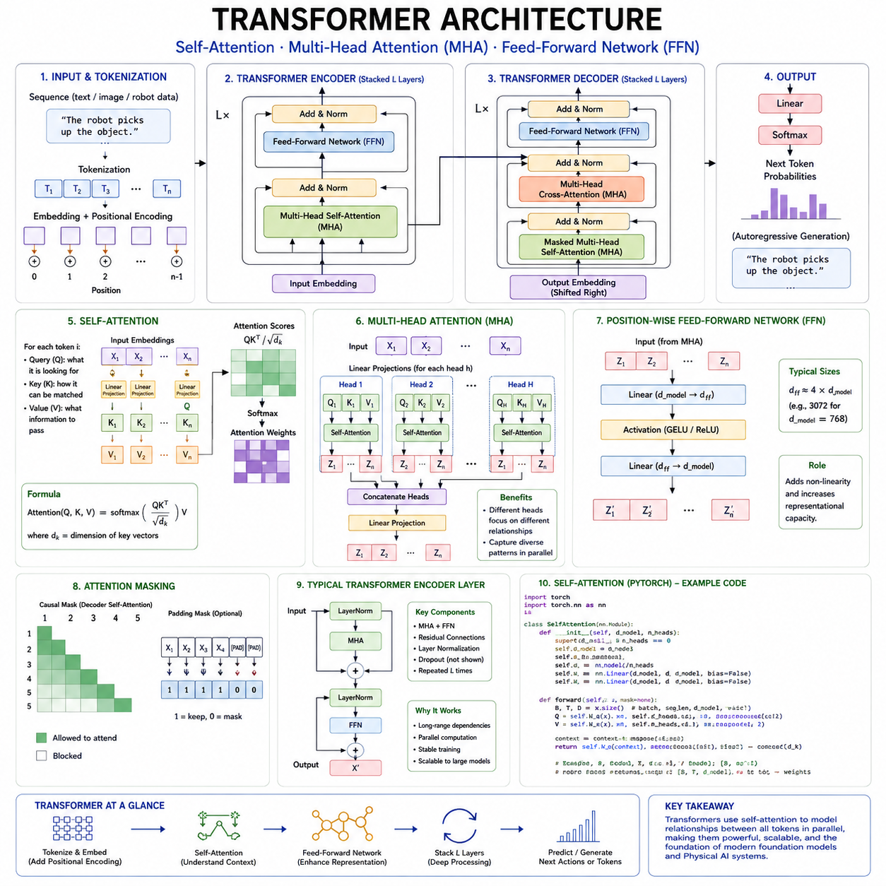
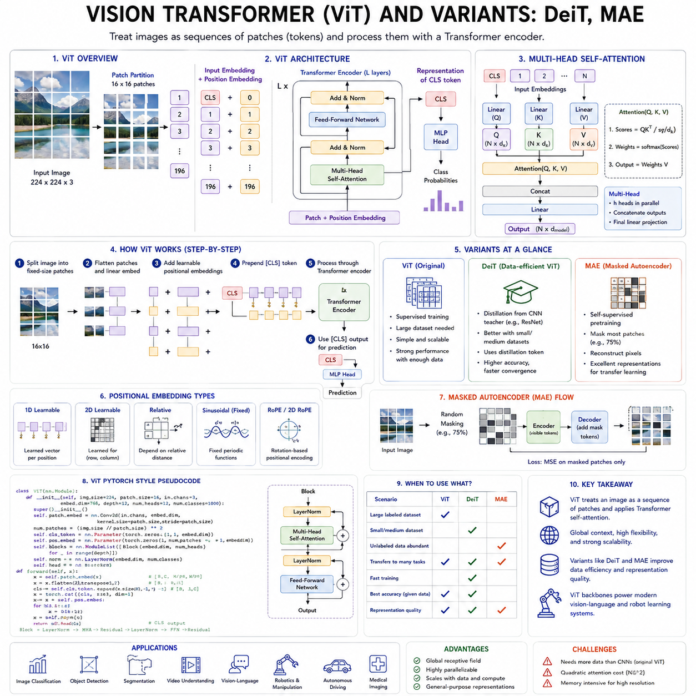
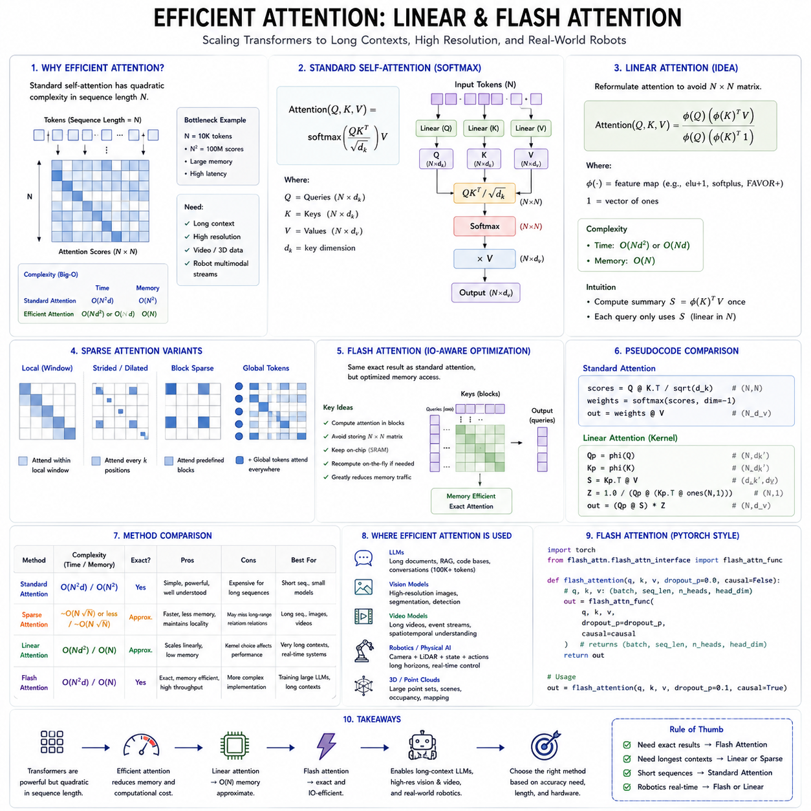
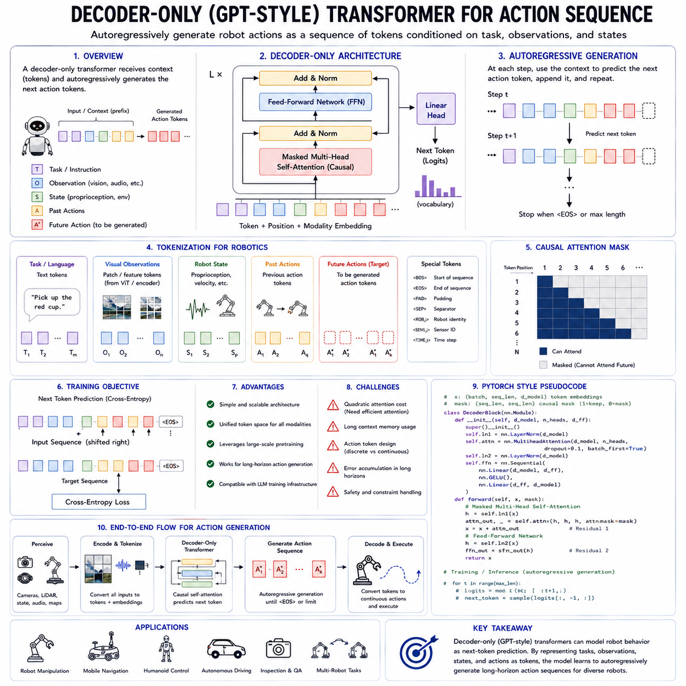
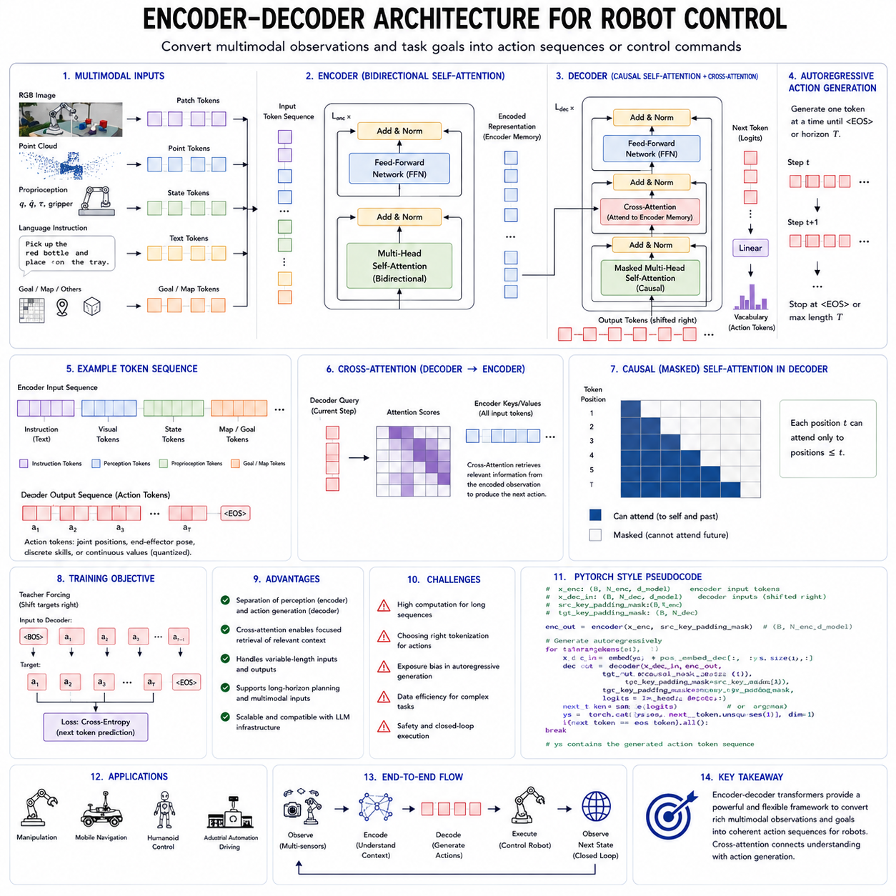
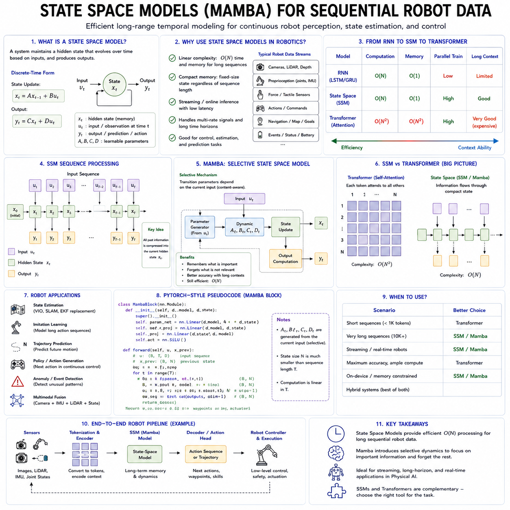
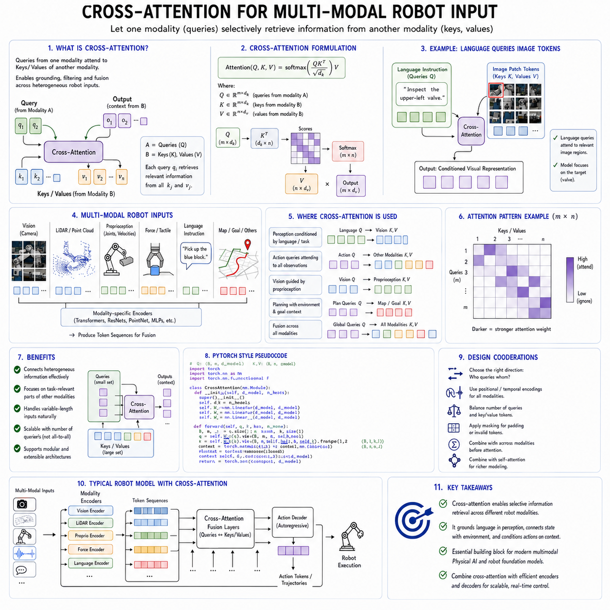
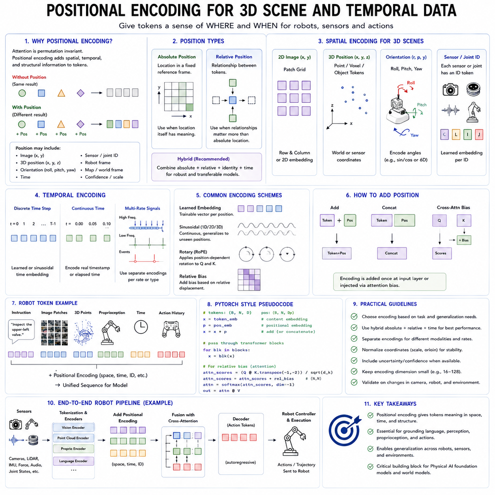
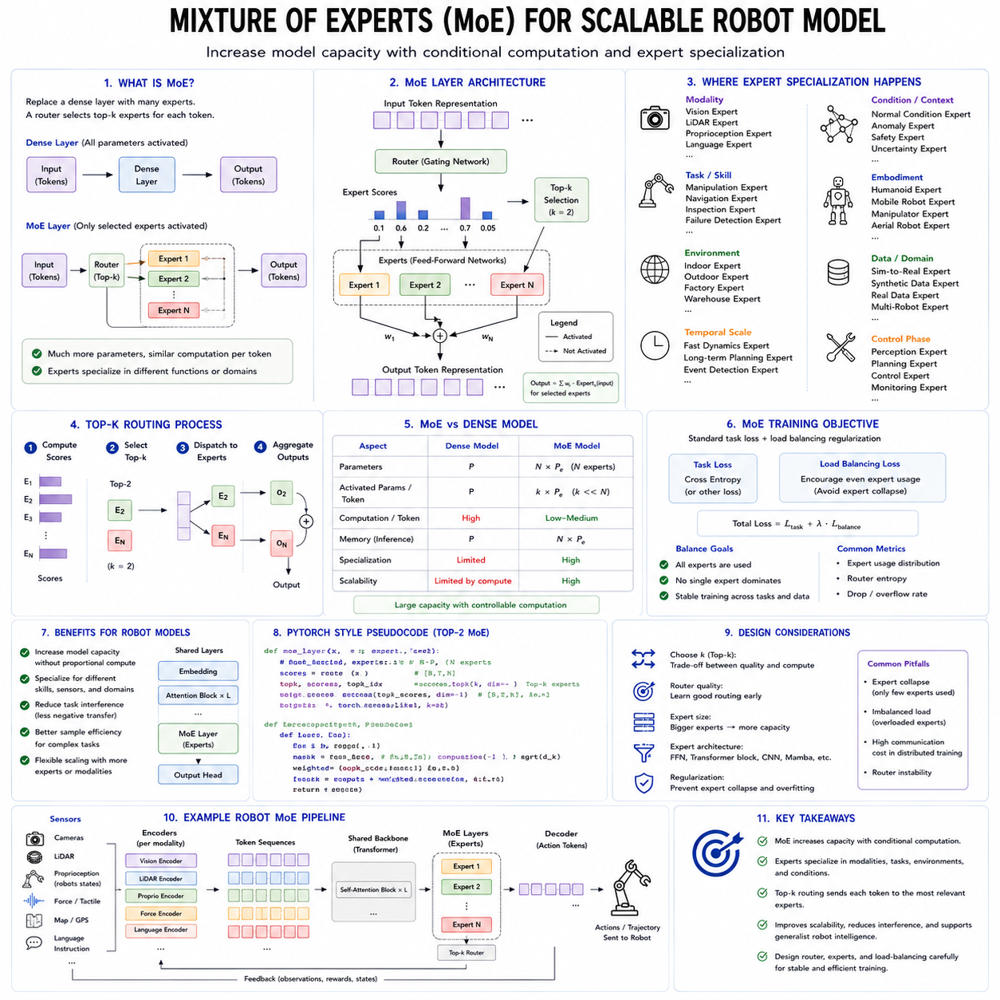
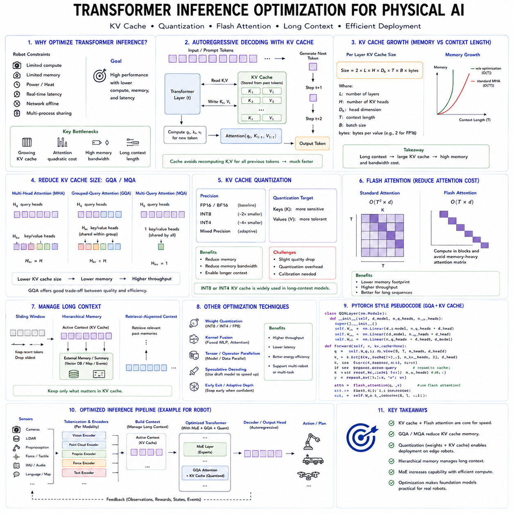

**Volume 18 Physical AI Foundation Models**

# 2. Transformer Architectures

## 2.1 Transformer Architecture Self Attention MHA FFN [w/Code]

{width="7.268055555555556in" height="7.268055555555556in"}

The transformer architecture is the computational foundation of most modern foundation models. It supports large language models, vision transformers, multimodal systems, world models, vision-language-action models, and an increasing number of robot learning architectures. Its importance comes from its ability to represent relationships across long sequences while remaining highly parallelizable on modern accelerators. Unlike recurrent neural networks, which process information sequentially, transformers can analyze many elements of an input at the same time and determine how strongly each element should interact with every other element.

A transformer does not treat an input as an indivisible object. It first converts the input into a sequence of tokens. In language, tokens may correspond to words, subwords, punctuation marks, or individual characters. In computer vision, an image may be divided into patches that function as visual tokens. In robotics, tokens may represent camera features, point-cloud regions, proprioceptive states, actions, language instructions, time steps, or compressed multimodal observations. Once tokenized, each element is converted into a vector embedding that can be processed by the network.

The transformer repeatedly applies a stack of layers to these embeddings. Each layer normally contains an attention sublayer and a position-wise feed-forward network. Residual connections and normalization operations support stable optimization and preserve information as it moves through the network. By stacking many such layers, the model gradually transforms low-level token representations into increasingly contextual and abstract representations.

The defining operation of the transformer is self-attention. Self-attention allows each token to examine other tokens in the same sequence and determine which of them are relevant to its current representation. This is fundamentally different from a fixed convolutional filter or a recurrent hidden state. The relationship between two tokens is calculated dynamically from their content. The same word, image patch, or robot state can therefore interact differently depending on the surrounding context.

Consider a sentence containing the word "bank." To determine whether it refers to a financial institution or the side of a river, the model must examine nearby words such as "money," "loan," "water," or "shore." Self-attention gives the token representing "bank" a mechanism for assigning larger importance to contextually relevant words. In a robot task, a token representing "grasp" may need to attend to the target object, the gripper state, the instruction, and nearby obstacles. The attention pattern changes according to the current scene and task.

The self-attention process begins by transforming every input token into three vectors known as the query, key, and value. These vectors are produced through learned linear projections. Although they originate from the same input embedding, they serve different functional roles.

The query vector represents what the current token is looking for. The key vector represents the information by which another token can be matched. The value vector contains the information that will be transferred if that token is considered relevant. Attention therefore resembles a content-addressable retrieval process. A query is compared with many keys, and the corresponding values are combined according to the resulting similarity scores.

For each token, the query is compared with the keys of all tokens in the allowed attention region. The most common similarity measure is a dot product. A large dot product indicates that the query and key are strongly aligned, while a smaller value indicates weaker relevance. The raw scores are divided by the square root of the key dimension. This scaling prevents the dot products from becoming excessively large as vector dimensionality increases, which would otherwise cause unstable gradients after the softmax operation.

The scaled scores are passed through a softmax function, converting them into normalized attention weights. These weights sum to one for each query. The model then computes a weighted sum of the value vectors. The result becomes a context-sensitive representation of the current token. Instead of representing only its original content, the token now incorporates information selected from the entire sequence.

This operation can be expressed compactly as attention applied to the query, key, and value matrices. The query-key product produces the relationship scores, scaling controls numerical magnitude, softmax generates normalized weights, and multiplication by the value matrix aggregates contextual information. Although the equation is concise, it implements a flexible form of learned communication among tokens.

When the query, key, and value are all generated from the same sequence, the operation is called self-attention. When the query comes from one sequence and the keys and values come from another, it is called cross-attention. Self-attention models relationships within language, images, robot trajectories, or sensor streams. Cross-attention connects different sources, such as language instructions with visual observations or action tokens with encoded environmental features.

The allowed attention region depends on the model architecture. Encoder models usually use bidirectional attention, allowing every token to attend to tokens on both sides. This is useful when the entire input is available and the objective is understanding or representation learning. Decoder-only language models use causal attention, which prevents a token from seeing future tokens during autoregressive generation. Each position can attend only to itself and earlier positions.

Causal masking is essential for next-token prediction. Without it, the model could directly observe the answer during training. A mask is applied to the attention scores before softmax, assigning extremely negative values to prohibited future positions. Their resulting attention weights become effectively zero. During inference, the model generates one token at a time, repeatedly using the preceding tokens as context.

In robotics, causal attention is valuable when predicting future actions from past and present observations. A robot policy must not use sensor measurements that have not yet occurred. However, bidirectional attention can still be used for offline trajectory analysis, representation learning, data reconstruction, or behavior evaluation when the complete trajectory is available. The choice of attention mask therefore reflects the temporal and operational requirements of the task.

A single attention operation can learn useful relationships, but it may be limited if all token interactions are compressed into one similarity space. Multi-head attention addresses this issue by running several attention operations in parallel. Each head has its own query, key, and value projections, allowing it to learn a different type of relationship.

One attention head may focus on local syntactic dependencies, while another captures long-range semantic relationships. In vision, one head may track object boundaries while another relates distant regions belonging to the same object. In robotics, different heads may specialize in target-object relations, collision risks, temporal dependencies, language grounding, kinematic constraints, or human motion.

The outputs of the heads are concatenated and transformed through another learned linear projection. This produces a unified representation containing information from several relational perspectives. Multi-head attention therefore increases the expressive power of the architecture without requiring each head to operate in the full model dimension.

The number of attention heads is an architectural design choice. More heads can represent more relationship types, but each head receives a smaller subspace if the total embedding dimension remains fixed. Too few heads may limit diversity, while too many may produce redundant or poorly utilized heads. Modern architectures therefore balance head count, head dimension, memory use, computational efficiency, and hardware compatibility.

Not every attention head develops a clearly interpretable function. Some heads are highly specialized, while others appear redundant. Researchers have shown that certain heads can sometimes be removed with limited performance loss. Nevertheless, multi-head attention remains effective because it provides multiple independent channels through which the model can organize relationships.

Attention supports long-range dependency modeling because any token can directly interact with another token in a single layer. Recurrent networks may need to propagate information through many sequential steps, increasing the risk of information loss. Convolutional networks need multiple layers or large kernels to connect distant positions. Self-attention creates a direct path between distant elements, making it well suited to long documents, extended conversations, videos, and robot trajectories.

This flexibility has a computational cost. Standard self-attention compares every token with every other token, so its computation and memory requirements grow approximately with the square of the sequence length. Doubling the number of tokens can increase the attention matrix size by roughly four times. This becomes a major limitation for long documents, high-resolution images, extended videos, dense point clouds, and long-horizon robot data.

Several efficient attention methods have been developed to reduce this cost. Sparse attention restricts each token to selected local or global regions. Windowed attention divides the sequence or image into smaller neighborhoods. Linear attention reformulates the operation to avoid explicitly creating the full attention matrix. Flash Attention improves memory access patterns and computes exact attention more efficiently on GPUs. Retrieval mechanisms move some information outside the immediate context and fetch only relevant memories.

For Physical AI, efficient attention is especially important because multimodal robot observations can generate extremely long sequences. A robot may process several camera streams, LiDAR data, joint states, force measurements, task instructions, maps, and recent actions simultaneously. Converting all raw information into full-resolution tokens would be computationally prohibitive. Practical systems therefore use modality-specific encoders, temporal subsampling, spatial compression, latent tokens, and selective attention.

Attention alone is not sufficient to create a transformer layer. After tokens exchange information through attention, each token passes through a feed-forward network, commonly abbreviated as FFN. This network is applied independently to every token position using the same learned parameters. It does not directly mix information across positions. Instead, it transforms the features contained within each contextualized token.

A conventional feed-forward network contains two linear transformations with a nonlinear activation function between them. The first projection expands the hidden dimension into a larger intermediate dimension. The activation introduces nonlinearity, allowing the network to model complex functions. The second projection reduces the representation back to the original model dimension.

The intermediate dimension is typically several times larger than the embedding dimension. This expansion gives the model a high-capacity feature space in which it can transform and recombine information. The attention sublayer determines where information should come from, while the feed-forward network determines how that information should be processed. These roles are complementary.

Earlier transformer architectures frequently used the rectified linear unit as the activation function. Later systems adopted Gaussian error linear units, gated linear units, and variants such as SwiGLU or GEGLU. Gated feed-forward networks use one projection to control how much of another projected representation should pass through. These mechanisms often improve optimization and model quality, although they can change parameter count and computational cost.

The feed-forward network contains a large portion of a transformer's parameters. In many models, its parameter count exceeds that of the attention projections. Consequently, the FFN acts partly as a distributed knowledge store. Some internal neurons respond to particular concepts, patterns, or features, although knowledge is usually spread across many parameters rather than localized in one easily identifiable unit.

The position-wise nature of the FFN makes it computationally efficient. All tokens can be processed in parallel using large matrix multiplications, which map effectively onto GPUs and AI accelerators. The same operation is applied to every token, but the output differs because each token contains a different context-dependent representation after attention.

A transformer layer normally combines attention and the feed-forward network with residual connections. A residual connection adds the input of a sublayer to its output. Rather than forcing each layer to reconstruct the complete representation, the sublayer only needs to learn a useful modification. This improves gradient flow and allows very deep networks to be trained more reliably.

Normalization is also essential. Layer normalization standardizes features within each token representation, helping stabilize activation scales during training. Two major arrangements are commonly used. In post-normalization architectures, normalization is applied after the residual addition. In pre-normalization architectures, the input is normalized before entering the attention or feed-forward sublayer. Pre-normalization often improves the stability of very deep transformer training.

The ordering of these components influences optimization behavior. A typical pre-normalized block first normalizes the input, applies multi-head attention, adds the result through a residual connection, normalizes again, applies the feed-forward network, and performs another residual addition. Repeating this structure many times creates the transformer backbone.

Transformers also require positional information because self-attention alone does not inherently understand sequence order. Without positional encoding, the same set of tokens would produce similar attention relationships regardless of their arrangement. Language, video, control trajectories, and spatial data all depend strongly on order and position.

Absolute positional embeddings assign a representation to each sequence position. Sinusoidal encodings use mathematical functions that allow the model to distinguish positions. Relative positional methods represent the distance between tokens rather than only their absolute indices. Rotary positional embeddings rotate query and key features according to token position and have become common in decoder-only language models.

For vision and Physical AI, positional encoding can represent two-dimensional image coordinates, three-dimensional locations, camera viewpoints, time stamps, joint indices, sensor identities, or robot coordinate frames. A multimodal robot transformer may require several positional systems simultaneously. It must distinguish where information originated, when it was observed, which sensor produced it, and how it relates to the robot body.

Encoder-only, decoder-only, and encoder-decoder transformers use the same core components in different arrangements. Encoder-only models process complete input sequences with bidirectional self-attention and produce contextual representations. They are useful for classification, retrieval, perception, and representation learning.

Decoder-only models use causal self-attention and generate sequences autoregressively. They have become dominant in large language models because many tasks can be represented as conditional generation. In robotics, decoder-only transformers can generate action tokens or action chunks after receiving observations and instructions as context.

Encoder-decoder models contain separate stacks. The encoder processes the input, while the decoder generates the output. The decoder uses causal self-attention over previously generated tokens and cross-attention to access encoder representations. This arrangement is useful for translation, multimodal generation, and robot control systems in which observations are encoded separately from actions.

Cross-attention is particularly important in vision-language-action models. Visual encoders may transform images into visual tokens, while a language encoder or decoder processes instructions. Cross-attention enables action queries to retrieve relevant information from both modalities. For example, when instructed to "pick up the red cup," the model must connect the linguistic representation of "red cup" with the correct visual region and then generate an appropriate action sequence.

Transformer training relies on large-scale gradient-based optimization. During the forward pass, embeddings move through attention and feed-forward layers to produce output probabilities or latent predictions. A loss function compares these outputs with training targets. Backpropagation computes gradients for every projection, normalization parameter, embedding, and feed-forward weight. An optimizer updates the model to reduce future loss.

The architecture scales effectively because its main operations are matrix multiplications. These operations can be distributed across many accelerators using data, tensor, pipeline, sequence, and expert parallelism. Mixed-precision arithmetic further improves throughput and reduces memory consumption. This hardware compatibility is one of the main reasons transformers displaced many earlier sequence architectures.

However, larger transformers create substantial memory demands. Training requires storage not only for model parameters but also for gradients, optimizer states, and intermediate activations. Attention matrices become especially expensive for long sequences. Techniques such as gradient checkpointing, activation recomputation, parameter sharding, optimizer-state partitioning, and Flash Attention are therefore essential in large-scale training.

Inference introduces different constraints. In an autoregressive decoder, previously computed key and value vectors can be stored in a key-value cache. When generating the next token, the model reuses this cached information instead of recomputing the entire sequence. This significantly reduces computation but increases memory usage as the context grows.

For robot deployment, key-value caching can preserve recent sensory and action history, but continuously changing observations create additional complexity. Old tokens may become irrelevant, while new high-frequency sensor data rapidly expands the cache. Robot systems may need sliding windows, memory compression, event-based token selection, or hierarchical memory to maintain real-time performance.

The basic transformer architecture is powerful, but it does not automatically guarantee grounded reasoning, safe behavior, or physical understanding. Self-attention learns statistical relationships in the data. If training data lacks meaningful physical interaction, the model may learn language-level descriptions of motion without understanding dynamics. Physical AI therefore requires training objectives and datasets that connect observations, actions, and consequences.

Robot transformers can use attention to combine language goals, visual scenes, proprioceptive feedback, and previous actions. The feed-forward layers transform these combined representations into features useful for planning and control. Output heads may predict discrete action tokens, continuous controls, trajectory waypoints, value estimates, or future latent states.

A hierarchical robot architecture may place a large transformer at the high-level decision layer. It interprets instructions, recognizes objects, selects skills, and generates action chunks. Lower-level controllers then convert those decisions into precise motor commands. This arrangement uses the transformer's representational flexibility while preserving deterministic real-time control and safety mechanisms.

Transformers can also support cross-embodiment learning. Robot observations and actions from different platforms can be represented as tokens with embodiment-specific metadata. Attention allows the model to identify shared task structure, while feed-forward networks transform information into common latent representations. Additional adapters or action decoders can map those representations to the control space of each robot.

Despite their flexibility, transformers have limitations. Their predictions can be difficult to interpret, attention weights do not always provide reliable explanations, and large models require significant data and computation. They can memorize spurious correlations, behave unpredictably outside the training distribution, and produce overconfident outputs. For physical systems, these risks require uncertainty estimation, independent safety controllers, runtime monitoring, and validated fallback behavior.

The evolution of transformers continues through efficient attention, mixture-of-experts feed-forward layers, multimodal tokenization, state-space hybrids, recurrent memory, and hardware-aware architectures. Yet the original structure remains recognizable. Tokens exchange information through self-attention, multiple heads capture diverse relationships, feed-forward networks transform contextual features, and residual-normalization pathways enable deep and stable learning.

Understanding these components is essential for designing Physical AI foundation models. Self-attention determines how information from different times, sensors, objects, instructions, and actions should interact. Multi-head attention allows the model to represent several relationships simultaneously. Feed-forward networks provide the nonlinear capacity required to transform these relationships into useful internal knowledge. Together, they form the central computational mechanism through which transformer-based systems perceive context, combine modalities, predict sequences, and generate actions.

## 2.2 Vision Transformer ViT and Variants DeiT MAE [w/Code]

{width="7.268055555555556in" height="7.268055555555556in"}

The Vision Transformer, commonly abbreviated as ViT, represents one of the most important architectural shifts in modern computer vision. For many years, convolutional neural networks dominated image recognition, detection, segmentation, and visual representation learning. Their success came from strong inductive biases such as locality, translation equivariance, and hierarchical feature extraction. However, the transformer architecture demonstrated that image understanding could also be formulated as sequence modeling. By dividing an image into patches and treating those patches as tokens, a transformer can process visual information using the same self-attention mechanisms originally developed for language.

The central idea of ViT is conceptually simple. An input image is divided into a regular grid of fixed-size patches. Each patch is flattened into a vector and projected into a learned embedding space. These patch embeddings form a sequence, similar to the token sequence of a language model. Positional information is then added so that the model can distinguish where each patch came from in the original image. The resulting sequence is processed by a standard transformer encoder composed of multi-head self-attention, feed-forward networks, normalization, and residual connections.

Suppose an image has a height and width of 224 pixels and is divided into patches of 16 by 16 pixels. This produces 14 patches along each dimension and therefore 196 visual tokens. Each patch contains the pixel values from a small rectangular region of the image. After flattening and projection, the patch becomes a vector with the same hidden dimension used throughout the transformer. The image is no longer represented as a two-dimensional array of pixels inside the transformer. It becomes an ordered sequence of visual tokens.

A special classification token is often inserted at the beginning of the sequence. This token does not correspond to a particular image region. Instead, it participates in self-attention with all patch tokens and gradually collects information about the full image. After the transformer encoder processes the sequence, the final representation of the classification token is passed to a prediction head for tasks such as image classification. Alternative designs may use global average pooling over all patch tokens rather than relying on a dedicated classification token.

Positional embeddings are essential because self-attention alone does not know the spatial arrangement of image patches. Without positional information, exchanging two patch tokens would not inherently change the model's interpretation. Learned absolute positional embeddings were used in the original ViT design, although later systems introduced relative positions, rotary encodings, two-dimensional biases, and hierarchical spatial encodings. These techniques help the transformer preserve geometric relationships among regions.

The transformer encoder applies self-attention across all patch tokens. Each patch can therefore exchange information directly with every other patch in the image. This global interaction is one of the major differences between ViT and conventional convolutional networks. A convolutional layer initially observes only a local neighborhood and requires deeper layers to combine information across distant regions. A ViT can establish a relationship between distant patches in a single attention layer.

This global interaction is useful for understanding object structure and scene context. A patch containing part of a wheel can attend to another distant patch containing the vehicle body. A region containing a person can be related to an object being held elsewhere in the image. For robotic perception, a patch showing a gripper can directly attend to a target object, nearby obstacle, work surface, or human hand. Self-attention allows such relationships to be computed dynamically rather than being constrained by a fixed convolutional kernel.

Multi-head self-attention enables the model to represent several kinds of visual relationships simultaneously. One attention head may focus on local texture, another on object boundaries, another on repeated patterns, and another on large-scale scene structure. The outputs of these heads are combined and transformed into a unified representation. As layers accumulate, the model develops progressively richer visual abstractions.

The feed-forward network inside each transformer layer applies nonlinear feature transformation independently to every token. Attention determines which patches should communicate, while the feed-forward network determines how the resulting information should be transformed. Residual connections preserve earlier representations and support stable deep learning, while layer normalization controls activation scales.

ViT showed that transformers could achieve excellent image recognition performance when trained on sufficiently large datasets. This qualification was important. Compared with convolutional neural networks, ViT contains weaker built-in assumptions about image locality and translation. A convolutional architecture assumes that nearby pixels are strongly related and that the same pattern can appear at different positions. ViT must learn more of these relationships from data.

As a result, early Vision Transformers often required large-scale pretraining to outperform strong convolutional networks. When training data was limited, they could be less sample efficient. With enough data, however, their flexibility became a major advantage. They could learn global relationships, scale effectively with model size, and transfer well to many downstream tasks.

The scaling behavior of ViT helped establish the transformer as a general visual backbone. Larger models, larger datasets, and longer training schedules produced strong improvements. Pretrained ViT models could be fine-tuned for image classification, object detection, semantic segmentation, instance segmentation, pose estimation, visual question answering, and multimodal learning. The same patch-based representation also provided a natural connection to language transformers.

Despite these strengths, the original ViT architecture had limitations. Global self-attention grows quadratically with the number of tokens. If image resolution increases, the number of patches can grow rapidly. Reducing patch size improves spatial detail but also increases sequence length and compute cost. For example, reducing a patch from 16 by 16 pixels to 8 by 8 pixels produces four times as many tokens for the same image.

This trade-off is especially important for dense visual tasks. Classification may tolerate relatively large patches because it only needs a global label. Detection and segmentation require precise spatial detail. Robotics may require recognition of small objects, narrow free spaces, cable edges, tool tips, grasp points, and safety-critical obstacles. Practical vision transformers therefore use hierarchical processing, local windows, multi-scale feature pyramids, adaptive resolution, or hybrid convolution-transformer architectures.

The Data-efficient Image Transformer, known as DeiT, was developed to address one of ViT's main weaknesses: its dependence on extremely large private training datasets. DeiT demonstrated that carefully designed training strategies could make Vision Transformers competitive using a more accessible dataset scale. Its contribution was not a completely different transformer backbone but a more efficient training methodology.

DeiT improved training through stronger data augmentation, regularization, optimization, and knowledge distillation. Techniques such as random augmentation, mixup, cutmix, repeated augmentation, stochastic depth, label smoothing, and carefully tuned learning schedules helped reduce overfitting and improve generalization. These methods showed that transformer performance depended not only on architecture and dataset size but also on the full training recipe.

One of the most distinctive components of DeiT was the distillation token. Traditional knowledge distillation trains a smaller student model to imitate the probability outputs or intermediate features of a larger teacher model. DeiT introduced an additional token that learns from the teacher's predictions while the classification token learns from the ground-truth label.

The distillation token participates in self-attention just like other tokens. It can gather information from all image patches, but its optimization target is related to the teacher model. This allows the transformer student to absorb knowledge from a strong teacher, often a convolutional neural network. In effect, the student learns both from labeled data and from the teacher's inductive biases.

This design is important because convolutional networks and transformers may make different errors and attend to different visual features. A transformer distilled from a convolutional teacher can benefit from the teacher's strong local feature extraction while retaining the transformer's global modeling ability. DeiT therefore became an example of combining architectural paradigms rather than treating them as mutually exclusive.

Knowledge distillation also has practical importance for edge deployment. A large teacher model may be used during offline training, while a smaller student model is deployed on a robot, vehicle, drone, or embedded device. The student can approximate much of the teacher's visual knowledge while requiring less memory, lower latency, and less energy.

Although supervised ViT and DeiT models achieved strong results, they still depended on class labels or teacher predictions. Masked Autoencoders, commonly abbreviated as MAE, introduced a powerful self-supervised approach for visual transformer pretraining. MAE adapts the concept of masked modeling from language to images.

In masked language modeling, part of a sentence is hidden and the model predicts the missing tokens. MAE applies a related principle to image patches. A large proportion of image patches is removed from the input, and the model learns to reconstruct the missing visual information. This creates training targets directly from unlabeled images, allowing massive image collections to be used without manual annotation.

A distinctive feature of MAE is its asymmetric encoder-decoder architecture. The encoder processes only the visible patches rather than receiving mask tokens for every missing region. Because most patches can be removed, the encoder operates on a much shorter sequence. A lightweight decoder then receives the encoded visible patches together with mask tokens and reconstructs the full image.

This asymmetry makes MAE computationally efficient. If 75 percent of image patches are masked, the expensive encoder processes only the remaining 25 percent. The decoder is smaller and used only during pretraining. After pretraining, the decoder can be discarded, and the encoder becomes the visual backbone for downstream tasks.

The high masking ratio is important. Neighboring pixels and patches are highly redundant, so masking only a small region may make reconstruction too easy. The model could fill in missing content through local interpolation without learning deep semantic structure. By hiding a large fraction of the image, MAE forces the encoder to infer object shape, scene layout, texture, and context from limited visible information.

The reconstruction target can be raw pixel values or normalized patch representations. Although pixel reconstruction may appear low-level, successful performance requires meaningful understanding when most of the image is missing. The model must infer what structures are likely to occupy unobserved regions. Through this process, the encoder learns features that transfer effectively to classification, detection, segmentation, and other visual tasks.

MAE differs from contrastive learning. Contrastive methods learn representations by bringing related image views closer and pushing unrelated views apart. MAE instead reconstructs missing information. Contrastive learning emphasizes invariance across augmentations, while masked reconstruction emphasizes modeling the internal structure of an image. These paradigms can also be combined or used in complementary pretraining stages.

For Physical AI, masked visual modeling is highly relevant because robot data is abundant but often weakly labeled. Robots continuously collect camera images, depth frames, thermal images, occupancy maps, and point clouds during operation. Manually labeling every frame is unrealistic. MAE-style training can transform this passive sensor data into a self-supervised learning resource.

A robot perception model can be trained to reconstruct missing image patches, occluded depth regions, absent point-cloud clusters, or temporarily unavailable sensor channels. This can improve robustness to occlusion, sensor dropout, glare, shadows, motion blur, and partial observation. It also encourages the model to infer scene structure rather than depend entirely on local texture.

The relationship among ViT, DeiT, and MAE reflects three major stages in the evolution of visual transformers. ViT established that images could be processed as token sequences using transformer encoders. DeiT showed that careful training and knowledge distillation could improve data efficiency. MAE demonstrated that large-scale self-supervised visual learning could be achieved through masked reconstruction.

These models share a common patch-token backbone but differ in training objective and deployment role. ViT is primarily an architectural concept and supervised visual backbone. DeiT is a data-efficient supervised and distilled training strategy. MAE is a self-supervised pretraining framework that produces transferable visual encoders.

In practical systems, these approaches are not necessarily used separately. A visual encoder may first undergo MAE pretraining on a large collection of unlabeled images, then be fine-tuned using labeled data with a DeiT-style training recipe. Knowledge distillation may later compress the model for edge deployment. This creates a complete pipeline from self-supervised representation learning to supervised adaptation and efficient inference.

Vision Transformers also integrate naturally with multimodal foundation models. Visual patch tokens can be projected into the representation space of a language model. Cross-attention or unified self-attention can then connect image regions with words, instructions, questions, and actions. This architecture forms the basis of many vision-language and vision-language-action systems.

In a robot foundation model, the visual encoder may be a ViT or one of its hierarchical variants. It converts camera observations into visual tokens. These tokens are fused with language tokens, proprioceptive states, action history, and task context. A policy decoder then generates actions, trajectories, or action chunks.

The choice of patch size and visual resolution is critical for robotics. Large patches reduce compute but may lose small safety-critical details. Small patches preserve more information but increase sequence length and latency. One solution is multi-resolution processing. A low-resolution global view can capture scene context, while selected high-resolution crops focus on targets, tools, obstacles, or human hands.

Temporal information adds another challenge. Standard ViT processes a single image. Robot behavior depends on motion and change over time. Video transformers extend patch tokenization across frames, producing spatiotemporal tokens. However, the number of tokens can become extremely large. Temporal subsampling, tubelet embeddings, factorized attention, recurrent memory, and latent compression are often used to manage this cost.

Depth and three-dimensional information can also be incorporated. RGB images may be combined with depth maps, stereo features, LiDAR projections, or point-cloud tokens. Modality embeddings indicate which sensor produced each token, while geometric positional encodings preserve camera calibration and spatial relationships. This allows the transformer to reason not only about appearance but also about distance and shape.

ViT-based models can support visual navigation by identifying free space, landmarks, obstacles, and semantic regions. They can support manipulation by detecting objects, estimating affordances, finding grasp points, and tracking contact regions. They can support inspection robots by analyzing surface defects, thermal patterns, structural components, or anomalies across large images.

However, transformer attention should not be confused with guaranteed visual explanation. Attention maps can show which patches influence a representation, but they do not always provide a complete causal interpretation. A model may rely on spurious backgrounds, textures, or dataset artifacts. Visualization tools, occlusion testing, concept analysis, and counterfactual evaluation remain important for validating visual models.

Robustness is another concern. Vision Transformers may be sensitive to distribution shifts in lighting, camera properties, weather, viewpoint, background, or object appearance. Self-supervised pretraining can improve transfer, but it does not eliminate these problems. Industrial and robotic deployment requires testing under blur, noise, occlusion, compression, sensor failure, and unfamiliar environments.

Latency and memory also constrain deployment. Large ViT models can require substantial compute, especially at high resolution. Quantization, pruning, distillation, token merging, early exiting, and efficient attention can reduce cost. Edge systems may use a compact DeiT-style model, while larger MAE-pretrained encoders run in data centers or offline training pipelines.

The future of visual transformer design is moving toward adaptive computation. Instead of processing every image patch equally, models may identify which regions require detailed analysis. Background regions can be compressed, while uncertain or task-relevant regions receive more compute. For robotics, this resembles active perception: the model allocates attention according to the current goal, safety risk, and expected information value.

Another direction is the integration of visual transformers with world models. A ViT encoder can transform current observations into latent tokens, while a temporal model predicts how those tokens will change after an action. Masked modeling can extend from reconstructing missing image patches to predicting missing future states. This creates a bridge between static perception and action-conditioned imagination.

The distinction among ViT, DeiT, and MAE therefore extends beyond historical model names. They represent three essential principles for Physical AI. ViT provides flexible global visual reasoning. DeiT demonstrates the value of efficient training and teacher-guided compression. MAE provides a scalable way to learn from unlabeled sensory experience.

Together, these methods form a powerful foundation for visual intelligence in robots. A Physical AI system can use masked pretraining to learn from large stores of raw robot video, distillation to transfer knowledge into an edge-efficient model, and transformer attention to connect visual regions with language, state, memory, and action. Their combined use enables a transition from isolated image classification toward general-purpose visual perception that supports reasoning and physical interaction.

## 2.3 Efficient Attention Linear Flash Attention [w/Code]

{width="7.268055555555556in" height="7.268055555555556in"}

The success of transformer architectures is closely tied to the effectiveness of the self-attention mechanism. Self-attention enables every token to interact directly with every other token, allowing models to capture long-range dependencies, integrate contextual information, and build highly expressive internal representations. However, this flexibility comes with a significant computational cost. As transformer models continue to grow in parameter count, context length, image resolution, video duration, and multimodal complexity, the attention mechanism itself increasingly becomes the primary computational bottleneck. Efficient attention mechanisms were developed to overcome this limitation while preserving as much of the representational power of standard attention as possible.

The computational complexity of conventional self-attention grows approximately with the square of the sequence length. If a sequence contains N tokens, the attention matrix contains N multiplied by N similarity scores. Every token compares itself with every other token, producing quadratic growth in both computation and memory. For short sequences this cost is manageable, but for long documents, high-resolution images, extended videos, large point clouds, and robot sensor histories, the quadratic relationship rapidly becomes impractical.

To understand why this occurs, consider the attention calculation itself. Query vectors are multiplied by key vectors to generate similarity scores between every pair of tokens. These scores are normalized through the softmax function before being multiplied by value vectors to produce contextual representations. Although each individual operation is relatively simple, the attention matrix becomes enormous as the number of tokens increases. A sequence containing one thousand tokens requires one million pairwise attention scores. A sequence of ten thousand tokens requires one hundred million scores. Memory usage and computation therefore increase dramatically.

Foundation models increasingly require long contexts. Modern language models process books, software repositories, scientific documents, conversations, legal records, and retrieval-augmented knowledge bases containing tens of thousands or even hundreds of thousands of tokens. Vision transformers process increasingly detailed images, while video transformers process hundreds or thousands of frames. Physical AI systems combine camera streams, LiDAR observations, robot states, force sensors, language instructions, maps, action histories, and world models into long multimodal sequences. Standard attention quickly becomes prohibitively expensive under these conditions.

The challenge is therefore not whether attention is useful, but how its computational efficiency can be improved without significantly reducing model capability. Researchers have approached this problem from several directions. Some methods reduce the number of token comparisons. Others reorganize computation to avoid explicitly constructing the full attention matrix. Some exploit hardware characteristics, while others approximate the attention operation mathematically. Together these developments are often referred to as efficient attention.

One broad category consists of sparse attention methods. Instead of allowing every token to attend to every other token, sparse attention restricts interactions to carefully selected subsets. A token may attend only to nearby neighbors, periodically spaced positions, global summary tokens, or learned important regions. Since many natural signals exhibit locality, restricting attention often preserves most useful information while reducing computation substantially.

Window-based attention follows this principle by dividing the sequence or image into local neighborhoods. Tokens interact only within their own windows, greatly reducing the number of pairwise comparisons. Hierarchical architectures can later exchange information between windows through shifting, merging, or global layers. This approach has proven especially successful in vision transformers because nearby image patches frequently contain the strongest visual relationships.

Another family of methods seeks to approximate full attention mathematically. Rather than explicitly computing every query-key similarity, these approaches reformulate the attention equation into operations whose complexity grows linearly rather than quadratically with sequence length. These methods are collectively known as linear attention.

Linear attention begins by observing that the softmax attention equation contains matrix multiplications whose order can sometimes be rearranged if suitable mathematical transformations are introduced. Instead of constructing the complete attention matrix, linear attention applies feature mappings to queries and keys that allow computation to be reorganized into smaller intermediate operations. The resulting complexity grows approximately in proportion to the number of tokens rather than its square.

This reduction is significant for long-context applications. Suppose the sequence length doubles. Standard attention requires roughly four times as much computation, whereas an ideal linear attention mechanism requires only approximately twice as much. The computational savings become increasingly important as context length continues to grow.

Different linear attention methods implement this idea in different ways. Some replace softmax with alternative kernel functions. Others approximate exponential similarity using random feature projections. Some employ positive feature mappings that preserve normalization properties. Others derive recurrent formulations that process sequences incrementally. Although these methods differ mathematically, they all share the objective of avoiding explicit construction of the full attention matrix.

Kernel-based linear attention is one common approach. Instead of computing exponential similarities directly through softmax, the query and key vectors are transformed into higher-dimensional feature representations. Inner products in this transformed space approximate the desired attention relationships. Because the transformed features can be accumulated efficiently, the computational cost scales linearly with sequence length.

Random feature methods extend this principle by approximating kernel functions using randomized projections. Rather than calculating exact similarity, they estimate it through stochastic feature representations. Increasing the number of random features generally improves approximation quality but also increases computational cost. This creates another trade-off between efficiency and accuracy.

Some linear attention models replace explicit pairwise interaction with recurrent state updates. Instead of storing relationships among all previous tokens, they maintain a compressed summary state that is updated as new tokens arrive. This allows streaming inference with constant memory requirements regardless of sequence length. Such approaches are particularly attractive for continuous sensor processing and online robotics.

However, linear attention also introduces challenges. Exact softmax attention has several desirable mathematical properties that approximations may not fully preserve. Approximation errors can accumulate over long sequences, potentially reducing model quality. Some linear methods perform well for certain tasks but less effectively for complex reasoning requiring precise global relationships. Consequently, efficient attention methods must balance computational savings against representational fidelity.

Another major direction focuses not on approximating attention mathematically but on implementing exact attention much more efficiently on modern hardware. FlashAttention represents the most influential development in this category. Rather than changing the mathematical definition of attention, FlashAttention reorganizes computation to minimize memory movement while preserving exact numerical results.

The motivation behind FlashAttention comes from hardware architecture. Modern GPUs possess extremely high computational throughput but are often limited by memory bandwidth rather than arithmetic capability. Standard attention repeatedly transfers large intermediate matrices between high-bandwidth memory and on-chip memory. These memory transfers consume significant time and energy, often dominating overall runtime.

FlashAttention addresses this bottleneck through careful tiling of matrix operations. Instead of materializing the entire attention matrix in memory, computation is divided into smaller blocks that fit within fast on-chip shared memory. Each block is loaded, processed, normalized, and accumulated before moving to the next block. Intermediate attention matrices never need to be fully stored in external memory.

This approach dramatically reduces memory traffic while preserving exactly the same attention outputs produced by conventional softmax attention. The improvement comes not from changing the algorithm mathematically but from changing how computation is scheduled on the hardware. Consequently, FlashAttention achieves higher throughput, lower memory consumption, and improved scalability without sacrificing model accuracy.

An important innovation in FlashAttention is numerically stable online softmax computation. Traditional implementations compute all attention scores before applying softmax normalization. FlashAttention instead computes normalization incrementally across blocks while maintaining exact numerical equivalence. This enables block-wise processing without introducing approximation errors.

FlashAttention therefore demonstrates that algorithmic efficiency and hardware efficiency are equally important. Even mathematically identical algorithms may differ substantially in practical performance depending on memory access patterns, cache utilization, synchronization overhead, and kernel fusion. As model size increases, hardware-aware optimization becomes increasingly essential.

Subsequent versions introduced additional improvements. FlashAttention-2 improved parallel workload distribution across GPU threads and streaming multiprocessors, increasing utilization and reducing synchronization overhead. Better scheduling allows larger models to achieve higher effective throughput without modifying the underlying attention computation.

More recent implementations further optimize support for variable sequence lengths, causal masking, grouped query attention, multi-query attention, mixed precision arithmetic, and increasingly large hardware configurations. FlashAttention continues evolving alongside GPU architectures, demonstrating the close relationship between machine learning algorithms and computer architecture.

Grouped Query Attention, commonly abbreviated as GQA, represents another efficiency improvement. Traditional multi-head attention gives every attention head its own queries, keys, and values. Multi-Query Attention shares keys and values across multiple query heads, reducing memory requirements during inference. Grouped Query Attention provides an intermediate compromise by allowing groups of query heads to share keys and values. Many recent large language models employ GQA because it substantially reduces key-value cache size while preserving most model quality.

Inference efficiency has become especially important because deployed foundation models often spend far more total computation during inference than during training. Millions of user requests or thousands of robots continuously generate new attention computations. Reducing inference latency and memory therefore directly lowers operational cost.

Key-value caching further improves autoregressive inference. During text generation, previously computed key and value vectors remain unchanged. Instead of recomputing attention for the entire prefix after every generated token, the model stores previous keys and values in memory. Each new token computes attention only against the cached representations. This reduces computational redundancy but increases memory usage as the context becomes longer.

Efficient attention techniques interact naturally with key-value caching. FlashAttention accelerates computation using cached representations. Grouped Query Attention reduces cache size. Quantization compresses cached tensors. Sliding-window attention limits cache growth by discarding distant tokens. Memory compression summarizes older context into compact latent representations. Together these methods enable long-context deployment on practical hardware.

Sliding-window attention provides another useful compromise. Instead of allowing unlimited attention across the entire sequence, each token attends only to a recent window of preceding tokens. This assumption reflects the observation that nearby context is often most relevant. Long-range information can be preserved through summary tokens, recurrent memory, retrieval systems, or hierarchical representations.

Retrieval-augmented attention offers a complementary solution. Rather than storing all previous tokens directly inside the attention window, external memory systems retrieve only relevant information when necessary. This effectively separates long-term memory from immediate working memory. Large language models increasingly combine retrieval with attention to extend useful context beyond the fixed transformer window.

Hierarchical attention reduces computational cost by representing information at multiple spatial or temporal resolutions. Lower layers process fine-grained local details, while higher layers summarize increasingly larger regions. Visual transformers often merge image patches into progressively larger tokens. Video transformers compress temporal information similarly. Hierarchical processing reduces sequence length while preserving global structure.

Token pruning represents another adaptive strategy. During inference, some tokens contribute very little to the final prediction. Token pruning methods identify unimportant tokens and remove them dynamically, allowing computation to focus on informative regions. In images, background patches may be discarded. In language, redundant tokens may receive less processing. For robotics, static environmental regions may require much less computation than moving objects or human interactions.

Token merging follows a related idea. Instead of removing tokens entirely, similar neighboring tokens are combined into a smaller set of representative tokens. This preserves more information while reducing sequence length. Adaptive tokenization may continually merge and split tokens depending on scene complexity.

Physical AI places unique demands on efficient attention because robot perception involves multiple sensing modalities operating simultaneously. A mobile robot may process RGB cameras, depth sensors, LiDAR scans, inertial measurements, force sensors, wheel odometry, language instructions, semantic maps, localization estimates, and historical trajectories. Simply concatenating every measurement into one transformer sequence quickly becomes computationally infeasible.

Practical robot architectures therefore distribute computation hierarchically. Local perception modules compress raw sensory data into compact latent representations before transformer integration. Attention operates primarily on informative latent tokens rather than raw sensor measurements. Temporal subsampling further reduces sequence length by selecting key frames or important events instead of processing every observation.

Event-driven attention offers another promising direction for robotics. Rather than updating attention uniformly at fixed frequencies, computation is triggered only when significant environmental changes occur. Static scenes require little recomputation, whereas rapidly changing situations receive increased computational resources. This adaptive allocation improves both efficiency and energy consumption.

Cross-modal attention introduces additional complexity. Language instructions attend to visual observations. Robot state attends to environmental features. Planned actions attend to predicted future states. Efficient implementations must optimize not only self-attention within modalities but also interactions across modalities. Selective routing, modality-specific compression, and hierarchical fusion help manage these computational demands.

Video transformers illustrate many efficient attention concepts simultaneously. A naive transformer treating every pixel patch in every frame as an independent token becomes prohibitively expensive. Practical architectures therefore use tubelet embeddings that combine neighboring patches across time, factorized attention separating spatial and temporal computation, temporal pooling, hierarchical frame representations, or latent video compression. These strategies preserve motion understanding while maintaining feasible computational requirements.

Large multimodal foundation models increasingly combine several efficient attention techniques simultaneously. FlashAttention accelerates exact computation. Grouped Query Attention reduces inference memory. Sparse attention limits unnecessary interactions. Sliding windows control context growth. Retrieval augments long-term memory. Quantization reduces numerical precision. Hierarchical tokenization compresses high-dimensional sensory input. No single optimization solves every problem, but together they enable practical large-scale deployment.

Hardware evolution also influences efficient attention research. GPUs continue increasing computational throughput faster than memory bandwidth. Specialized tensor processors, AI accelerators, and emerging memory architectures further change performance characteristics. Efficient algorithms increasingly co-design computation with hardware capabilities rather than treating hardware as an abstract execution platform.

Compiler technology plays an important role as well. Modern machine learning compilers fuse operations, optimize memory allocation, schedule kernels efficiently, and generate hardware-specific implementations. An identical transformer model may achieve substantially different throughput depending on compiler optimization alone. Consequently, efficient attention extends beyond mathematical algorithms into software systems engineering.

Training efficiency and inference efficiency are related but distinct objectives. Some methods primarily reduce training memory requirements, enabling larger batch sizes or longer contexts. Others mainly accelerate autoregressive generation. Robot foundation models often require optimization for both because large-scale pretraining occurs offline while low-latency control occurs online.

Evaluation of efficient attention requires more than measuring throughput. Accuracy, robustness, numerical stability, scalability, hardware portability, implementation complexity, and energy efficiency must all be considered simultaneously. An attention mechanism that is theoretically efficient but difficult to optimize on real hardware may offer limited practical benefit. Likewise, a highly optimized kernel that supports only one hardware platform may reduce portability.

The future of efficient attention will likely involve adaptive computation rather than fixed computational patterns. Models may dynamically decide which tokens deserve global attention, which require only local processing, and which can be safely compressed or ignored. Computational resources will increasingly follow information content rather than sequence position alone.

For Physical AI, adaptive attention aligns naturally with intelligent behavior. A robot navigating an empty hallway requires relatively little visual reasoning, whereas manipulating fragile objects near humans requires much more detailed analysis. Efficient attention mechanisms allow computational effort to increase only when environmental complexity justifies additional processing.

Ultimately, efficient attention represents a transition from purely algorithmic model design toward integrated optimization across mathematics, software, hardware, and application requirements. Linear attention demonstrates how mathematical reformulation can reduce asymptotic complexity. FlashAttention demonstrates how exact algorithms can become dramatically faster through hardware-aware implementation. Together they illustrate that future foundation models will depend not only on larger networks but also on increasingly sophisticated methods for allocating computational resources efficiently.

For next-generation foundation models and Physical AI systems, efficient attention is no longer merely an optimization technique. It is an enabling technology that makes long-context reasoning, multimodal perception, large-scale world modeling, and real-time robotic intelligence computationally feasible. As sequence lengths, sensor diversity, and model capabilities continue expanding, efficient attention mechanisms will remain one of the central innovations supporting scalable artificial intelligence.

## 2.4 Decoder Only GPT Architecture for Action Seq [w/Code]

{width="7.268055555555556in" height="7.268055555555556in"}

The decoder-only transformer architecture, commonly associated with the GPT family, has become one of the most influential structures in modern foundation models. Its original strength was autoregressive language generation, in which the model predicts the next token based on all previously observed tokens. The same principle can be extended beyond language. If robot observations, goals, states, and actions are represented as tokens, a decoder-only transformer can generate an action sequence in much the same way that a language model generates a sentence.

This idea is important for Physical AI because many robotic tasks can be expressed as sequential decision problems. A robot receives observations, interprets a task, considers its previous actions, and selects the next action. The action may be a discrete command, a continuous control value converted into tokens, a waypoint, a motion primitive, or a temporally extended action chunk. By modeling these elements as an ordered sequence, the decoder-only transformer provides a unified architecture for predicting future behavior.

A decoder-only transformer is composed of repeated transformer decoder blocks. Each block normally contains causal self-attention, a feed-forward network, residual connections, and normalization. Unlike an encoder-decoder architecture, there is no separate encoder stack. All input and output information is placed into a single token sequence, and the model predicts the next token autoregressively.

In a language model, the sequence may contain words or subword tokens. In an action-generation model, the sequence can contain task instructions, image-derived tokens, robot states, previous actions, rewards, goals, and future action tokens. The model receives a prefix containing available context and generates the continuation one token at a time or one action chunk at a time.

Causal self-attention is the defining mechanism of the architecture. Every token can attend only to itself and earlier tokens in the sequence. It cannot access future tokens during training or inference. This causal restriction ensures that the model learns to predict future actions using only information that would have been available at execution time.

Suppose a robot has received the instruction to pick up an object. The context may include language tokens describing the goal, visual tokens representing the scene, proprioceptive tokens representing the robot state, and action tokens representing previous movements. The decoder-only model attends across this entire history and predicts the next action token. After that token is produced, it becomes part of the context for predicting the following action.

The process continues until the model generates an end-of-sequence token, a task-completion token, or a fixed number of actions. In this way, robot behavior is treated as conditional sequence generation. The model does not require a separately engineered planner for every task. Instead, planning behavior is learned from the statistical relationships among instructions, observations, states, and actions in the training data.

The decoder-only design offers several practical advantages. It is conceptually simple, highly scalable, and compatible with the same training infrastructure used for large language models. The entire problem is represented as next-token prediction. Different input types can be converted into tokens and placed into one sequence. The model then uses the same self-attention mechanism to integrate all available context.

This unified formulation reduces architectural fragmentation. Traditional robot systems often use separate modules for language understanding, perception, planning, behavior selection, and action prediction. A decoder-only action model can combine these functions within one autoregressive backbone, although lower-level control and safety modules may still remain separate.

The first step is tokenization. Language instructions are tokenized using a standard text tokenizer. Images may be converted into visual tokens by a vision transformer or other visual encoder. Point clouds may be represented as learned region tokens. Proprioceptive states may be projected into embeddings. Actions may be discretized into tokens or represented through continuous output heads.

The ordering of these tokens is important. One possible sequence may begin with task tokens, followed by observation tokens, state tokens, and previous action tokens. Another design may interleave observations and actions over time. A trajectory can be represented as a sequence of repeated blocks, with each block containing observation, state, and action information for one time step.

Interleaved trajectory representation preserves temporal relationships. The model can learn that a particular observation was followed by a particular action and that the action caused a subsequent change in the environment. This is valuable for learning action-conditioned dynamics and implicit planning.

Special tokens can indicate modality, time step, robot identity, sensor type, episode boundary, or task completion. These tokens help the model distinguish between different forms of information. For cross-robot training, embodiment tokens may specify the robot platform, joint configuration, or action space.

Positional encoding is also essential. The model must know not only the order of tokens but also which tokens belong to the same time step and modality. A robot sequence may require temporal positions, spatial positions, sensor identities, and action indices simultaneously. Learned embeddings, rotary positional encodings, relative position biases, and structured time embeddings can be combined to represent these relationships.

The causal attention mask determines which tokens can access which information. In a simple autoregressive sequence, each token attends to all preceding tokens. More structured masks can be used when certain observations should be visible to multiple future actions or when different modalities require different access patterns.

For example, visual tokens from the current observation may be fully visible to the next action tokens, while future observations remain hidden. Language instructions may be visible throughout the episode. Previous action tokens may be visible to all later tokens. A carefully designed mask allows the model to preserve causality while still using multimodal context effectively.

Action representation is one of the most important design decisions. Language tokens are naturally discrete, but robot actions are often continuous. A manipulator may require joint positions, velocities, gripper commands, and end-effector poses. A mobile robot may require linear velocity, angular velocity, steering angle, or waypoint coordinates.

One approach is discretization. Continuous action values are divided into bins, and each bin is assigned a token. The model predicts the token corresponding to the desired action value. This makes action prediction compatible with standard language-model training using categorical cross-entropy loss.

Discretization simplifies training but introduces quantization error. Fine bins improve precision but increase vocabulary size and make learning more difficult. Coarse bins reduce complexity but may produce jerky or inaccurate control. Nonuniform binning can allocate more resolution to important action ranges.

Another approach is to use a hybrid model. The transformer generates a contextual representation, and a continuous output head predicts real-valued actions. The decoder remains autoregressive at the sequence level, but the final action output is modeled with regression, Gaussian distributions, mixture models, diffusion processes, or flow-based policies.

The action sequence may be generated one time step at a time. However, single-step generation can be slow and may accumulate errors. Action chunking addresses this issue by predicting several future actions together. A chunk may contain a short trajectory covering several control steps.

Action chunking improves temporal consistency because the model generates a coherent local motion rather than independent commands. It also reduces the number of autoregressive decoding steps, which lowers latency. However, larger chunks reduce the frequency at which the policy reacts to new observations.

This creates a trade-off between responsiveness and temporal coherence. Short chunks adapt quickly to environmental changes but require more inference. Long chunks are computationally efficient and smooth but may become inappropriate if the scene changes unexpectedly. Receding-horizon execution offers a compromise by generating a chunk, executing only part of it, and then replanning from updated observations.

Training a decoder-only action model typically uses teacher forcing. During training, the model receives the true previous actions and predicts the next action. This makes optimization efficient because all prediction positions can be computed in parallel under the causal mask.

At deployment time, however, the model receives its own previously generated actions rather than ground-truth actions. Errors can therefore accumulate. This difference between training and inference is known as exposure bias. Behavioral cloning models are particularly vulnerable because a small mistake can move the robot into states not represented in the training data.

Several techniques can reduce exposure bias. Training data can include recovery demonstrations, perturbations, and failure cases. Scheduled sampling can gradually replace ground-truth actions with model-generated actions during training. Online data collection can add trajectories from the current policy. Reinforcement learning and preference optimization can further refine the policy beyond pure imitation.

The decoder-only architecture can model long-range dependencies in action sequences. A robot may need to remember an instruction issued many seconds earlier, track an object through temporary occlusion, or maintain progress toward a long-term goal. Self-attention allows action generation to depend on distant context more directly than many recurrent models.

However, long robot trajectories create significant computational and memory costs. Standard self-attention grows quadratically with sequence length. Continuous high-frequency sensor streams can produce extremely large contexts. Efficient attention, sliding windows, memory compression, retrieval, and hierarchical temporal modeling are therefore important.

A common solution is to separate high-level and low-level timescales. The decoder-only transformer generates high-level actions or action chunks at a moderate frequency. A low-level controller executes precise motor commands at a much higher frequency. This prevents the transformer from processing every servo-level update.

For example, a high-level model may generate end-effector waypoints at several hertz, while a conventional controller interpolates and tracks them at hundreds or thousands of hertz. This arrangement preserves real-time stability while allowing the foundation model to handle semantic interpretation and long-horizon planning.

Decoder-only action models can also condition on returns, rewards, or desired outcomes. In offline reinforcement learning, a trajectory may be represented as a sequence containing return-to-go, state, and action tokens. The model learns to generate actions conditioned on a desired future return.

This transforms reinforcement learning into sequence modeling. Instead of explicitly learning a value function and policy through temporal-difference methods, the model predicts actions based on historical trajectories and desired performance. The approach can work well when large offline datasets are available, although it depends heavily on the quality and coverage of those datasets.

Goal conditioning can be expressed through language, target images, coordinates, symbolic task tokens, or desired terminal states. The model learns to generate different action sequences depending on the provided goal. This supports multitask learning because one architecture can represent many behaviors.

Multimodal conditioning is especially important for robot foundation models. Visual observations provide information about objects and spatial structure. Language specifies the intended task. Proprioception describes the robot body. Previous actions provide temporal context. The decoder-only transformer combines these sources through causal self-attention.

There are several ways to insert visual information. A visual encoder can produce a sequence of image tokens that is placed before action tokens. The visual encoder may be frozen, fine-tuned, or trained jointly. A projection layer aligns the visual feature dimension with the transformer embedding space.

Another strategy uses visual tokens repeatedly throughout the trajectory. Each time step includes a new group of observation tokens followed by action tokens. This gives the model updated perception during execution but increases sequence length substantially.

Visual token compression is therefore important. A raw image may generate hundreds or thousands of patch tokens. Latent resampling modules, pooling, token merging, region selection, or object-centric representations can reduce the sequence to a smaller set of informative tokens.

Object-centric tokens are particularly useful for manipulation. Instead of representing every image patch equally, the system can encode objects, grippers, hands, tools, and obstacles as distinct entities. The decoder can then attend to task-relevant relationships more efficiently.

The decoder-only architecture also supports tool and skill tokens. A robot may have a library of low-level skills such as navigate, reach, grasp, lift, open, place, or inspect. The transformer can generate skill tokens rather than direct motor commands. Each skill token invokes a specialized controller.

This hybrid approach combines learned high-level planning with reliable low-level execution. It also improves interpretability because the generated sequence corresponds to meaningful actions. However, it depends on the availability and quality of the skill library.

Direct action generation offers greater flexibility because the model is not restricted to predefined skills. It can produce novel trajectories and adapt to new situations. Yet direct control also increases safety risk and data requirements. Many practical systems therefore combine both approaches, using skill-level planning for common tasks and continuous action generation for fine manipulation.

Cross-embodiment learning is another important application. A single decoder-only model can be trained on trajectories from different robots. Embodiment tokens identify the platform, while action tokenizers map different control spaces into a shared representation.

A common latent action space can represent intentions such as move forward, rotate, reach, close gripper, or apply force. Robot-specific decoders then translate these latent actions into hardware commands. This enables knowledge transfer across robot morphologies.

However, cross-embodiment modeling is difficult because identical action tokens may have different physical meanings on different platforms. A small mobile robot, a heavy outdoor AMR, a quadruped, and a manipulator have different dynamics, constraints, and control frequencies. The model must distinguish shared task structure from embodiment-specific execution.

Robot identity embeddings, kinematic descriptions, joint masks, capability vectors, and normalized coordinate systems can help. Training data must also contain sufficient overlap in tasks and environments for transfer to occur.

The decoder-only model can incorporate world-modeling behavior implicitly. By predicting observation or state tokens in addition to actions, the model learns how the environment changes over time. It can then generate imagined future trajectories conditioned on candidate actions.

A combined sequence may include observation, action, next observation, and reward tokens. The model learns the joint distribution over trajectories. During planning, it can sample possible action sequences and predicted outcomes, then select the most desirable trajectory.

This resembles model-based planning but uses a unified autoregressive model. The same transformer can function as a policy, dynamics model, and trajectory generator depending on the prompt and decoding procedure.

However, autoregressive rollout can accumulate prediction errors. A small error in a predicted state affects subsequent predictions, causing trajectories to drift away from reality. Grounded execution therefore requires frequent replanning using new observations.

Decoding strategy strongly affects action quality. Greedy decoding selects the most probable action token at each step. This is deterministic and efficient but may produce overly conservative behavior. Sampling introduces diversity but can generate unsafe actions. Beam search explores multiple sequences but increases latency.

For robot control, unrestricted sampling is usually inappropriate. Temperature limits, top-k filtering, action masks, feasibility constraints, and safety filters can restrict candidate actions. A planner may generate several action sequences and then evaluate them using a value model, world model, or safety checker.

Constrained decoding can enforce robot limits. Invalid joint commands, unreachable positions, excessive velocities, or unsafe regions can be removed before action selection. This combines learned generation with deterministic rules.

Uncertainty estimation is also important. The model may produce a probability distribution over action tokens. High entropy can indicate uncertainty. Multiple sampled trajectories can reveal disagreement. An external confidence model can evaluate whether the current situation resembles the training distribution.

When uncertainty is high, the robot may slow down, request human assistance, switch to a safe controller, gather additional observations, or stop. A decoder-only policy should therefore be embedded within a larger safety architecture rather than being allowed unrestricted control.

Inference latency is a major practical concern. Autoregressive generation is sequential because each token depends on previous outputs. Long action sequences can therefore be slow. Action chunking, parallel action heads, speculative decoding, caching, and model compression can reduce this cost.

The key-value cache stores attention keys and values from earlier tokens, avoiding repeated computation. This improves generation speed but increases memory use. For long robot episodes, sliding windows or compressed memory are needed to prevent unlimited cache growth.

Quantization reduces model and cache memory by using lower-precision numerical formats. Pruning removes unimportant parameters. Knowledge distillation transfers behavior from a large model into a smaller student. Low-rank adaptation can specialize the model to a particular robot without full retraining.

A large decoder-only action model may be trained in a data center and then distilled into an edge-deployable policy. The large model can provide broad generalization and reasoning, while the smaller model satisfies latency and power constraints.

Training data determines the ultimate behavior of the model. Demonstrations should cover diverse objects, environments, camera viewpoints, robot states, task instructions, and failure recovery. Repeated successful trajectories alone may not teach the model how to respond when something goes wrong.

Negative examples and interrupted demonstrations can be valuable. The model can learn to distinguish safe and unsafe actions, detect failed grasps, recover from localization error, and respond to unexpected obstacles. Preference data can further teach the model which of several successful behaviors is smoother, safer, or more efficient.

Data synchronization is essential. Visual observations, robot states, and actions must correspond accurately in time. Even small timing errors can teach incorrect causal relationships. Hardware timestamps, synchronized clocks, and calibrated sensor pipelines are therefore important for high-quality action-sequence training.

The loss function may combine several objectives. The primary term predicts action tokens. Additional terms may predict future states, task completion, rewards, uncertainty, contact events, or success probabilities. Multi-objective training can improve representation quality but requires careful weighting.

Evaluation must go beyond token prediction accuracy. A model can achieve low action-token loss while still producing unstable physical behavior. Real evaluation should measure task success, collision frequency, control smoothness, recovery capability, latency, energy use, generalization, and safety.

Open-loop evaluation compares predicted actions with recorded actions. Closed-loop evaluation executes the model in simulation or reality. Closed-loop testing is more informative because small prediction errors can change future observations. Simulation provides scale and safety, while real-world testing validates transfer.

The decoder-only architecture has limitations. It can be data hungry, computationally expensive, and sensitive to distribution shift. Autoregressive error accumulation remains a major challenge. Long contexts increase memory cost, and next-token prediction does not inherently guarantee optimal planning.

Nevertheless, its simplicity and scalability make it highly attractive. The same architecture can model language, perception, state, action, and reward as a unified sequence. It can be pretrained on broad multimodal datasets, fine-tuned on robot demonstrations, aligned through preference optimization, and deployed as a generalist policy.

For Physical AI, the decoder-only GPT-style architecture represents a bridge between foundation models and sequential control. It transforms robotic behavior into a generative modeling problem. Instructions become conditioning tokens, observations become context, actions become outputs, and trajectories become the training language of embodied intelligence.

The most effective implementations will not rely on the transformer alone. They will combine decoder-only sequence generation with visual encoders, world models, memory systems, safety constraints, low-level controllers, and runtime monitoring. Within such a layered system, the decoder-only transformer can serve as the central decision engine that converts multimodal context into coherent action sequences.

## 2.5 Encoder Decoder Architecture for Robot Control [w/Code]

{width="7.268055555555556in" height="7.268055555555556in"}

The encoder-decoder architecture is one of the most important structural patterns for converting complex observations into meaningful outputs. In natural language processing, it was originally used to transform an input sequence in one language into an output sequence in another. In robotics, the same idea can be extended to a much broader problem: converting multimodal observations, task goals, environmental context, and robot state into actions, trajectories, or control commands. The encoder interprets the current situation, while the decoder generates the behavior that should follow from that interpretation.

This separation is useful because perception and control have different computational roles. The encoder must organize information from cameras, LiDAR, depth sensors, proprioception, force sensors, maps, and language instructions. The decoder must transform the encoded representation into a temporally coherent sequence of actions. By separating these responsibilities, the architecture can use different tokenization methods, attention masks, temporal resolutions, and optimization objectives for input understanding and output generation.

A typical robot encoder receives several types of information. Visual observations may be converted into patch tokens by a vision transformer. Point clouds may be partitioned into local regions and encoded as geometric tokens. Joint positions, velocities, torques, and gripper states may be projected into proprioceptive embeddings. Language instructions may be tokenized using a text tokenizer. Navigation goals, object poses, maps, and safety constraints can be represented as additional structured tokens.

These inputs are not naturally expressed in the same format. Camera images are spatially dense, language is sequential, proprioception is low-dimensional and high-frequency, and point clouds are unordered sets in three-dimensional space. The encoder must therefore align heterogeneous information within a common latent representation. Modality-specific front-end networks often process each source before the resulting features are combined.

The encoder is commonly built from transformer blocks using bidirectional self-attention. Because the complete current observation is available, each input token can attend to all other relevant input tokens. A language token describing "red container" can attend to visual regions containing red objects. A gripper-state token can attend to a target-object token. A navigation goal can attend to obstacles, localization estimates, and semantic map regions.

Bidirectional attention is advantageous for perception because the encoder does not need to preserve a future-generation constraint within the current observation. All available information can be integrated simultaneously. This allows the encoder to construct a contextual representation in which the meaning of each token depends on the full observed scene.

The decoder receives the encoded representation and generates an output sequence. In robot control, this output may consist of action tokens, end-effector poses, joint commands, waypoints, skill identifiers, force targets, or action chunks. The decoder typically uses causal self-attention over previously generated outputs and cross-attention over the encoder representation.

Causal self-attention ensures that each output step depends only on earlier generated actions. Cross-attention allows the decoder to retrieve information from the encoded observation whenever needed. This combination separates two forms of dependency. Self-attention models temporal relationships within the action sequence, while cross-attention connects each action to the relevant parts of the environment and task.

For example, consider a robot instructed to pick up a bottle and place it on a tray. The encoder may represent the language instruction, the bottle, the tray, the gripper pose, nearby obstacles, and the current joint configuration. During decoding, an initial action query may attend strongly to the bottle and gripper. Later action queries may attend to free space along the lifting path. Final action queries may attend to the tray location and orientation.

Cross-attention therefore acts as a dynamic information-retrieval mechanism. The decoder does not need to compress every detail of the input into one fixed vector. At each action step, it can selectively access the encoder tokens most relevant to the current stage of execution. This is one of the major advantages of transformer-based encoder-decoder architectures over early sequence-to-sequence models that relied on a single bottleneck representation.

The encoder output may preserve token-level structure. Visual regions, object representations, sensor states, and instruction tokens remain individually accessible. The decoder can attend to different subsets as the task progresses. This makes the architecture well suited to long-horizon robot tasks in which different environmental features become important at different times.

The choice of encoder representation strongly affects control quality. A dense visual encoder may preserve detailed spatial information but produce too many tokens for real-time decoding. A highly compressed encoder may be efficient but lose small objects, narrow gaps, or precise grasp geometry. Robot systems therefore need to balance representation detail against computational cost.

Object-centric encoding is one possible solution. Instead of passing every image patch into the decoder, the perception system produces tokens representing objects, surfaces, obstacles, tools, humans, and robot parts. These tokens can include category, pose, size, velocity, uncertainty, and affordance information. The decoder then reasons over a compact scene representation.

However, object-centric encoding depends on reliable detection and segmentation. Unknown objects or ambiguous regions may be lost if the perception system commits too early to fixed categories. Dense latent encoding is more flexible but less interpretable and more expensive. Hybrid encoders can preserve a small number of object tokens together with selected dense visual features.

Spatial representation is especially important for robot control. Language transformers mainly model one-dimensional token order, while robots operate in three-dimensional geometry. Positional encodings may therefore include image coordinates, depth, world coordinates, camera poses, robot-frame coordinates, and temporal stamps. Relative geometric encodings can represent distances and orientations between objects, sensors, and robot links.

The encoder may also include kinematic structure. Joint tokens can be connected according to the robot's physical chain. Attention masks or graph-based biases can emphasize relationships between adjacent links. End-effector tokens can include forward-kinematic information. This helps the model distinguish physically connected robot components from unrelated numerical state variables.

Temporal information can be incorporated by encoding multiple observation frames. A single image may not reveal object velocity, contact changes, or motion intent. A sequence of recent observations allows the encoder to estimate dynamics and track events over time. However, temporal expansion greatly increases token count.

Temporal compression methods can reduce this cost. The encoder may process each frame independently and then aggregate frame-level features. Factorized attention can separate spatial and temporal processing. Recurrent memory can summarize older observations. Event-based selection can retain only frames containing meaningful changes.

The decoder can produce actions in several forms. Discrete action tokens are convenient because they support standard categorical prediction. Continuous actions are more natural for precise robot control. A decoder may therefore generate latent action tokens that are later transformed by a continuous control head.

For manipulation, the decoder may predict end-effector position, orientation, gripper state, force, or joint targets. For a mobile robot, it may generate linear and angular velocities, curvature commands, or local waypoints. For a quadruped, it may generate body velocity targets, footstep locations, or gait parameters. For a UAV, it may generate attitude targets, thrust commands, or trajectory segments.

Direct low-level control is possible but not always desirable. Transformer inference may not satisfy the strict timing and determinism required by motor-control loops. A common architecture uses the decoder for high-level or mid-level control while conventional controllers handle fast servo execution.

The decoder may generate action chunks rather than individual control commands. An action chunk contains a short sequence of future actions. This reduces autoregressive decoding cost and improves local motion consistency. The robot can execute part of the chunk before requesting a new prediction.

Receding-horizon control is especially compatible with the encoder-decoder structure. At each cycle, the encoder processes the latest observations, and the decoder generates a future action sequence. Only the first part is executed. The system then observes the resulting state, re-encodes the environment, and decodes a revised plan.

This approach combines learned sequence generation with continuous feedback. It reduces error accumulation because the model repeatedly conditions on new real-world observations. It also allows the robot to respond to moving obstacles, failed grasps, human intervention, or unexpected changes.

The encoder-decoder architecture can represent hierarchical control. The encoder builds a shared world representation, while different decoders produce outputs at different levels. One decoder may generate symbolic skills, another may generate trajectories, and another may estimate task success or risk.

A high-level decoder can output commands such as approach, grasp, lift, inspect, or place. A trajectory decoder can transform those commands into waypoints. A low-level controller can then convert the waypoints into motor commands. This hierarchy improves modularity and can simplify safety validation.

Multiple decoders can also share one encoder. A perception encoder may support action generation, value estimation, uncertainty prediction, object tracking, and future-state forecasting simultaneously. Multi-task learning can improve the encoder by forcing it to preserve information useful for several objectives.

For example, one decoder may predict actions, another may predict future observations, and another may estimate collision probability. The shared encoder learns representations that connect control with dynamics and risk. However, multi-task training requires careful balancing because one objective may dominate the gradients or encourage features that harm another task.

An encoder-decoder robot model can be trained through supervised imitation learning. The encoder receives recorded observations and goals, while the decoder predicts expert actions. Teacher forcing supplies the true previous actions during training, allowing all decoder positions to be optimized efficiently.

At deployment time, the decoder uses its own previous outputs. This creates exposure bias. If the model makes a small error, later actions may be conditioned on states that were rarely represented in the demonstration dataset. Recovery data, perturbation training, scheduled sampling, online fine-tuning, and reinforcement learning can reduce this problem.

The architecture is also compatible with offline reinforcement learning. Rewards, return-to-go values, or desired outcomes can be included in the encoder input. The decoder then generates actions conditioned on a target level of performance. Alternatively, a value decoder can evaluate candidate action sequences generated by the policy decoder.

Preference optimization can be applied when several trajectories accomplish the same task with different quality. Human operators may prefer one sequence because it is safer, smoother, faster, or more energy efficient. The decoder can be fine-tuned to increase the probability of preferred trajectories relative to rejected ones.

For Physical AI, safety must not depend only on learned preference. Hard constraints should be enforced outside or alongside the neural model. Joint limits, speed limits, collision zones, force thresholds, and emergency-stop conditions should be checked by deterministic safety components.

The decoder can receive safety-related encoder tokens, but an independent runtime safety layer should still validate outputs before execution. Invalid or dangerous actions can be rejected, projected into a safe region, or replaced by a fallback command. This creates a layered architecture in which the learned model proposes actions and the safety system authorizes them.

Cross-attention patterns can offer limited interpretability. Engineers may inspect which visual or state tokens influenced a generated action. If the decoder produces a grasp command, attention may indicate whether it focused on the correct object and gripper region.

However, attention weights should not be treated as complete causal explanations. A model may rely on hidden distributed features that are not obvious from attention maps. Interpretability should therefore include counterfactual testing, input masking, feature attribution, trajectory replay, and failure analysis.

The encoder-decoder design is particularly useful for multimodal robot control because it naturally separates observation processing from action generation. Different encoders can process vision, language, proprioception, audio, touch, and maps before combining their outputs. The decoder can access the fused representation through cross-attention.

Some systems use one shared multimodal encoder. Others use several specialized encoders followed by a fusion module. A shared encoder may encourage stronger cross-modal alignment, while specialized encoders can preserve modality-specific inductive biases and reduce training difficulty.

Early fusion combines tokens before deep processing. This allows rich interaction among modalities but can be computationally expensive. Late fusion processes each modality separately and combines higher-level features. This is more efficient but may miss low-level cross-modal relationships. Intermediate fusion often provides a practical compromise.

For example, camera and depth features may be fused early because they are geometrically aligned. Language may be fused later through cross-attention. Proprioception may be inserted repeatedly because it changes at a higher frequency than the task instruction. The optimal fusion strategy depends on the robot and task.

Cross-embodiment learning can also use an encoder-decoder structure. A shared encoder represents the task and environment in an embodiment-independent space. Robot-specific decoders then generate actions appropriate for each platform.

This separation is attractive because perception and task semantics may transfer more easily than motor commands. A manipulator, humanoid, mobile robot, and quadruped may observe the same object and understand the same instruction, even though they require very different action sequences.

Embodiment-specific tokens can inform the encoder about robot capabilities, dimensions, sensor placement, kinematics, payload, and control limits. The decoder then interprets the shared scene representation in relation to the current body.

Alternatively, each robot may have a specialized encoder and share a common decoder operating in a normalized latent action space. This can be useful when sensory configurations vary more than task structure. The design choice depends on which components are expected to generalize across platforms.

The encoder-decoder architecture is also suitable for world-model-based control. The encoder transforms current observations into a latent state. A predictive decoder generates future latent states conditioned on candidate actions. Another decoder may generate the actions themselves.

The model can simulate several possible futures and select the action sequence with the best predicted outcome. This supports planning without requiring every candidate trajectory to be executed physically. However, prediction errors can accumulate, so imagined trajectories must be regularly corrected with real observations.

Latent-state prediction is often more efficient than reconstructing full-resolution images. The model only needs to preserve information relevant to control, such as object position, free space, contact, and task progress. Yet overly compressed latent spaces may omit unexpected hazards or details that later become important.

A robust system may therefore combine predictive latent representations with selective reconstruction. The world model predicts compact future states while auxiliary decoders reconstruct key visual, geometric, or contact features. This provides both efficiency and diagnostic visibility.

Training data quality is critical. The encoder must see diverse environments, sensor conditions, object appearances, and robot states. The decoder must see successful actions, recoveries, near failures, and safe responses to uncertainty. A dataset containing only ideal demonstrations may produce brittle behavior.

Synchronization is especially important because the architecture learns relationships between observations and actions. Camera frames, joint states, force readings, and commands must be aligned accurately in time. If timestamps are inconsistent, the decoder may learn actions associated with the wrong physical state.

Calibration is equally important. Camera intrinsics, extrinsics, robot coordinate frames, and sensor transformations must be known or consistently represented. Geometric inconsistency increases the burden on the model and can damage transfer across robots and environments.

The encoder-decoder model can be pretrained before task-specific fine-tuning. Visual encoders may be pretrained through masked image modeling. Language components may be initialized from a language foundation model. Proprioceptive and action representations may be pretrained through trajectory reconstruction or next-state prediction.

Multimodal pretraining can align language, vision, state, and action before full policy training. For example, the model can learn to match instructions with demonstrations, predict whether a trajectory satisfies a goal, reconstruct missing sensor channels, or forecast future states.

After pretraining, supervised fine-tuning teaches task-specific control. Preference optimization can improve behavior quality. Reinforcement learning in simulation can refine long-horizon performance. Limited real-world adaptation can then correct remaining simulation-to-reality differences.

The architecture supports parameter-efficient adaptation. A large shared encoder can remain mostly frozen while small adapters or low-rank modules specialize the model for a new robot. A robot-specific decoder can be trained without modifying the complete foundation model.

This reduces training cost and helps prevent catastrophic forgetting. It also simplifies fleet deployment because a common perception and reasoning backbone can support multiple hardware variants.

Inference efficiency remains a major challenge. The encoder may process hundreds or thousands of sensory tokens, while the decoder generates multiple action steps. High-resolution vision and long histories increase latency and memory use.

Efficient attention, token pruning, latent resampling, mixed precision, quantization, and knowledge distillation can reduce this cost. The encoder can update slow-changing scene information less frequently while refreshing high-frequency state tokens more often.

Caching can also help. Language instructions and static map features do not need to be re-encoded at every control cycle. Their representations can be cached, while dynamic camera and proprioceptive inputs are updated. Cross-attention allows the decoder to combine cached and current information.

Asynchronous processing may further improve performance. Vision encoders can run at camera frequency, state encoders at control frequency, and language encoders only when a new instruction arrives. A fusion layer combines the most recent available representations.

However, asynchronous operation creates timing challenges. The decoder must know the age of each representation. Timestamp embeddings and freshness indicators can help prevent outdated observations from being treated as current.

Evaluation must include both representation quality and closed-loop control performance. Encoder benchmarks can measure object recognition, language grounding, spatial reasoning, and state estimation. Decoder evaluation can measure action error, trajectory smoothness, and sequence likelihood.

Closed-loop evaluation is more important than open-loop prediction alone. A model may accurately imitate recorded actions but behave poorly when its own decisions alter future observations. Simulation and real-world execution should therefore measure success rate, collision frequency, completion time, energy use, recovery behavior, uncertainty handling, and human intervention frequency.

Out-of-distribution evaluation is essential. The robot should be tested with unfamiliar objects, lighting, backgrounds, viewpoints, layouts, payloads, and sensor noise. The encoder must produce meaningful representations, and the decoder must avoid overconfident unsafe actions when the situation is unfamiliar.

Uncertainty can be modeled at both stages. The encoder can estimate confidence in object, pose, and scene representations. The decoder can estimate uncertainty over action sequences. High uncertainty may trigger additional sensing, slower execution, human assistance, or a conservative fallback policy.

The encoder-decoder architecture has important limitations. Its separate stacks can increase parameter count and latency compared with a decoder-only model. Cross-attention adds computational cost. Training several modalities jointly is difficult, and the model may learn shortcuts instead of physical causality.

The separation between encoding and decoding can also create an information bottleneck. If the encoder discards information that later becomes important, the decoder cannot recover it. Careful token preservation, skip connections, multi-scale features, and recurrent re-encoding can reduce this risk.

Despite these limitations, the architecture remains highly attractive for robot control because it mirrors the logical structure of the problem. The robot must first interpret the world and then generate behavior. The encoder provides a contextual representation of the task, environment, and body. The decoder transforms that representation into a temporally organized action sequence.

For Physical AI foundation models, the encoder-decoder architecture provides a flexible bridge between multimodal perception and embodied action. It supports language-conditioned control, object-centric manipulation, navigation, cross-embodiment transfer, world-model planning, action chunking, and hierarchical execution.

Its most effective use is within a layered robot system. The encoder combines perception and context, the decoder generates goals or trajectories, conventional controllers execute precise movements, and independent safety modules supervise the entire process. In this arrangement, the encoder-decoder transformer becomes the central translation mechanism that converts an understanding of the physical world into controlled and purposeful robot behavior.

## 2.6 State Space Models Mamba for Sequence Robot Data [w/Code]

{width="7.268055555555556in" height="7.268055555555556in"}

State space models have emerged as an important alternative to transformer architectures for processing long sequential data. Their relevance is especially strong in robotics, where a system must continuously interpret streams of camera features, joint states, force measurements, LiDAR observations, navigation states, actions, mission events, and environmental changes. Unlike many digital tasks that operate on short, isolated inputs, robot intelligence depends on maintaining useful information across long periods while responding quickly to new observations. State space models provide a mathematical framework for representing this temporal evolution through a compact internal state.

A state space model describes a dynamic system using an internal state that changes over time. The state summarizes information from previous inputs and determines how the system responds to future inputs. At each time step, the model receives an observation, updates its hidden state, and produces an output. This structure closely resembles the basic problem faced by a robot. A robot observes the world, updates its belief about the environment and its own condition, and then generates an action or prediction.

In a classical linear state space formulation, the hidden state at one time step is transformed into the state at the next time step through a transition function. The current input influences this transition, and an output function maps the hidden state into an observable prediction. Although the basic equations may be linear, modern state space models introduce learnable parameters, nonlinear transformations, selective mechanisms, and deep neural architectures.

The central benefit of this formulation is that the complete history does not need to remain explicitly available. Past information is compressed into the current state. This makes state space models attractive for long-duration sequences because memory usage does not necessarily grow in proportion to the full sequence length during streaming inference.

Robotic data naturally fits this sequential structure. A mobile robot continuously receives odometry, inertial measurements, localization estimates, obstacle information, mission commands, battery status, and actuator feedback. A manipulator receives joint positions, velocities, torques, camera observations, force signals, gripper states, and contact events. A Physical AI model must combine these signals over time rather than treat every observation independently.

A single sensor frame rarely contains enough information to determine the correct action. An image may show an object but not reveal whether it is moving. A force reading may indicate contact but not whether the force is increasing or decreasing. A joint position may show the current configuration but not the direction of motion. Temporal modeling allows the system to interpret trends, transitions, and causal relationships.

Recurrent neural networks were early neural approaches to this problem. They update a hidden state sequentially and can theoretically preserve information from earlier observations. Long short-term memory networks and gated recurrent units introduced gates that help control which information should be stored, updated, or forgotten.

However, traditional recurrent models often struggle with very long dependencies. Their sequential computation limits parallel training, and gradients may vanish or become unstable across long sequences. Transformers addressed many of these limitations through self-attention, which allows direct interaction among all tokens.

Self-attention has become the dominant mechanism for foundation models because it supports flexible global context and highly parallel training. Yet its computation and memory typically grow quadratically with sequence length. This becomes expensive when processing hours of robot operation, high-frequency telemetry, long video streams, or multi-sensor histories.

State space models offer a different compromise. They can process sequences with computation that grows approximately linearly with sequence length. During online inference, they can update a compact state as each new input arrives. This can provide low and predictable latency for continuously operating robots.

Modern structured state space models were developed to combine the efficiency of recurrence with the trainability of convolutional and parallel sequence models. They are based on continuous-time dynamical systems that are discretized for digital computation. Carefully designed state transition structures allow the model to capture long-range dependencies without explicitly computing all pairwise token interactions.

The hidden state can be understood as a learned memory of the sequence. Instead of storing every past token, the model transforms the history into a compressed representation. Different dimensions of this state may represent slow trends, recent changes, periodic behavior, task progress, or latent environmental conditions.

For robotics, this compact memory is valuable because many relevant variables evolve at different speeds. Motor current may change within milliseconds. Object motion may develop over seconds. Battery condition and mission progress may evolve over minutes or hours. A state space model can learn multiple temporal timescales within the same architecture.

Mamba is a modern selective state space model designed to improve the ability of state space architectures to process content-dependent sequences. Traditional linear state space models use transition parameters that are largely fixed after training. They process every input using the same underlying dynamics. This is computationally efficient, but it may limit their ability to decide which specific pieces of information should be remembered or ignored.

Mamba introduces input-dependent selectivity. The model can modify aspects of its state update according to the current input. In practical terms, the system can learn to preserve important events, discard irrelevant repetition, and adjust its temporal behavior depending on the content of the sequence.

This selectivity is critical for robot data. Most robot sensor streams contain extensive redundancy. A camera observing an empty corridor may produce many nearly identical frames. Joint states may remain stable while a robot waits. LiDAR scans may change only slightly in a static environment. Processing and remembering every observation equally would waste computation and memory.

At the same time, certain brief events may be extremely important. A sudden force spike may indicate collision. A short visual appearance may reveal a person entering the path. A brief localization inconsistency may signal map failure. A mission command may change the robot's objective. A selective state space model can learn to treat such events differently from routine observations.

Mamba's selective mechanism allows parameters involved in the state update to depend on the input token. This creates a form of dynamic filtering. The model can determine how strongly new information should influence its state, which parts of previous memory should persist, and how the state should contribute to the output.

This resembles gating in recurrent networks, but Mamba is designed around structured state space computation that can be implemented efficiently on modern accelerators. Its architecture supports parallel training across full sequences while retaining recurrent execution for streaming inference.

This dual form is particularly useful. During training, sequences can be processed efficiently in parallel, taking advantage of GPU throughput. During deployment, a robot can process one observation at a time while maintaining a compact recurrent state. The training and inference modes represent the same learned dynamics through different computational forms.

Mamba is often described as having linear sequence complexity. This means that increasing the sequence length approximately doubles the main sequence-processing work rather than increasing it fourfold, as may occur with full self-attention. The practical benefit depends on implementation, hardware, state dimension, and surrounding model components, but the scaling advantage becomes meaningful for long sequences.

Memory efficiency is equally important. A transformer may need to store key and value representations for many previous tokens during autoregressive or streaming inference. This key-value cache can grow continuously with context length. A state space model instead updates a fixed-size state, allowing memory requirements to remain more stable.

For a long-running mobile robot, this means that temporal context can continue without storing every previous observation. The robot can maintain information about recent motion, task progress, obstacles, and sensor conditions through its internal state.

However, compression creates a trade-off. A fixed-size state cannot preserve every detail from an arbitrarily long history. The model must learn what information is relevant. If important information is overwritten or compressed incorrectly, it may not be recoverable later.

Self-attention provides direct access to earlier tokens, whereas a recurrent state provides only the compressed result of previous updates. This makes selective memory design central to the performance of Mamba-based systems.

Robot sequences are also multimodal. A single time step may include visual tokens, joint states, force values, action commands, map information, and language context. These modalities differ greatly in scale, frequency, structure, and importance. A Mamba-based robot model must decide how to organize them into a sequence or how to process them through separate state space modules.

One approach is early fusion. All modality features are projected into a shared embedding space and placed into one chronological sequence. Modality embeddings identify whether each token represents vision, proprioception, action, force, or language. The state space model then learns temporal relationships across all inputs.

This architecture is conceptually simple and can learn direct cross-modal dependencies. A force spike can be linked to the preceding gripper command and the current image. A localization change can be connected to wheel odometry and visual landmarks.

However, early fusion can create extremely long sequences. A camera may generate hundreds of visual patch tokens per frame, while proprioceptive state may require only a few values. If every modality is represented at full resolution, visual information may dominate the sequence and computational cost.

A more practical strategy uses modality-specific encoders. A vision transformer, convolutional network, or visual state space model compresses images into a small set of latent tokens. A point-cloud encoder processes geometric data. A state encoder handles proprioception. The compressed representations are then passed to a shared temporal Mamba module.

This separates spatial and temporal processing. The visual encoder determines what is present in each frame, while the state space model tracks how relevant features change over time. Such separation can improve efficiency and make the architecture easier to adapt to different sensors.

Another design uses separate state space streams for each modality. Vision, proprioception, force, and action histories are processed independently before being fused at higher layers. This preserves modality-specific temporal characteristics.

For example, force sensing may require a short, high-frequency state, while mission context requires long memory. Separate modules can operate at different sampling rates and state dimensions. A fusion layer then combines their outputs for planning or action generation.

Multi-rate processing is highly relevant to robotics. Sensors rarely operate at the same frequency. Cameras may run at thirty or sixty hertz, LiDAR at ten or twenty hertz, motor encoders at hundreds or thousands of hertz, and language instructions only when a user issues a command.

A naive sequence model may resample everything to one common frequency, but this can waste data or lose important temporal detail. State space models can support asynchronous or hierarchical updates in which each stream maintains its own state and contributes new information when available.

Timestamp embeddings and elapsed-time information can be included so that the model understands irregular sampling intervals. This is important when communication delay, dropped packets, or computational load changes the timing between observations.

Continuous-time state space formulations are especially attractive for irregular robot data because they naturally represent dynamics over time. The state transition can depend on the elapsed interval between measurements rather than assuming a fixed sampling period.

In practice, many neural state space architectures are implemented in discrete time, but time-delta conditioning can approximate this capability. A model can distinguish between two observations separated by ten milliseconds and two observations separated by one second.

Mamba can also support temporal compression. High-frequency data can be processed into short-term states, while selected summaries are passed into a slower long-term model. This resembles the hierarchy of robot control itself.

A fast module may monitor motor current, joint motion, and contact. A slower module may track object interaction and local task progress. A mission-level model may maintain station sequence, battery management, and long-term goals. State space models can be used at one or several of these levels.

Sequence length is especially challenging for robot video. A one-hour mission at thirty frames per second contains more than one hundred thousand frames. If every frame is divided into many patch tokens, the total sequence becomes enormous.

Visual state space architectures can reduce this burden by processing images or video using state space operations rather than full spatial-temporal attention. Spatial scanning strategies can transform two-dimensional images into ordered sequences, while temporal modules track changes across frames.

However, image structure differs from language order. A two-dimensional image does not have one natural sequence direction. Visual Mamba variants therefore use multiple scan directions, hierarchical processing, local windows, or structured spatial state updates to preserve relationships across height and width.

For robot video, the architecture must preserve both spatial detail and temporal continuity. A small obstacle may occupy only a few pixels but remain safety-critical. Excessive spatial compression can remove such information.

Multi-scale processing can help. Low-resolution global features provide scene context, while selected high-resolution regions preserve objects, hands, tools, obstacles, or defect areas. The temporal state model can allocate more capacity to regions relevant to the task.

Mamba is also relevant to proprioceptive and action sequences. These signals are lower-dimensional than images but often require high-frequency, low-latency processing. Joint states, velocities, torques, motor currents, and commands form structured time series with strong dynamics.

A state space model can learn motion patterns, identify changes in control response, and estimate latent physical conditions. It may detect wheel slip, actuator degradation, oscillation, unusual friction, or payload changes from temporal patterns.

For manipulation, force and torque histories can reveal contact state. The model can distinguish free motion, initial contact, stable grasp, slip, obstruction, or excessive loading. Selective memory may preserve brief contact transitions that would be lost through simple averaging.

For autonomous mobile robots, a Mamba-based temporal model may process odometry, IMU, localization residuals, wheel currents, LiDAR features, and navigation commands. It can learn patterns associated with normal driving, ramps, wheel slip, collision, blocked motion, or localization drift.

The model should not replace validated localization or control algorithms without careful verification. Instead, it can provide learned residual estimation, anomaly detection, context memory, or high-level action prediction.

State space models are naturally suited to streaming anomaly detection. The system maintains a representation of expected temporal behavior and identifies deviations. Because the state summarizes recent dynamics, the model can detect anomalies that are not visible in a single sample.

For industrial inspection robots, such anomalies may include unusual vibration, unstable sensor positioning, repeated docking error, camera obstruction, abnormal motor load, or inconsistent inspection duration. Detection can trigger slower movement, recalibration, maintenance, or human review.

Mamba can also be used for action generation. A model can receive observation and goal sequences and produce future actions. Because the architecture is causal, each action can depend on the accumulated state of previous observations and actions.

Actions may be generated one step at a time, but this can create latency and error accumulation. Action chunking allows the model to output several future control steps together. A Mamba backbone can encode long historical context, while an action head predicts a local trajectory.

The fixed-size recurrent state makes action generation attractive for long missions because the model does not need an indefinitely growing attention cache. It can continue updating its internal state while repeatedly producing action chunks.

However, purely recurrent action generation may have difficulty retrieving a specific event from far in the past. If a robot must recall an exact instruction, object identifier, or earlier observation, compressed state alone may be insufficient.

External memory and retrieval can address this limitation. The Mamba state handles continuous temporal dynamics, while a structured memory stores discrete events, mission records, maps, object identities, and operator instructions. The model can retrieve relevant information when required.

This hybrid design reflects the difference between implicit and explicit memory. The state space model provides implicit temporal context. Databases, semantic maps, mission-state machines, or vector stores provide explicit long-term memory.

Transformers and Mamba should not always be treated as mutually exclusive. Hybrid architectures can use attention where direct token-to-token interaction is valuable and state space layers where long-range streaming efficiency is more important.

For example, a vision-language module may use transformer attention to align instructions with current visual objects. A Mamba module may track these objects and robot states over time. An action decoder may use cross-attention to retrieve task-relevant details from structured memory.

Another hybrid design alternates attention and state space layers. Attention supports flexible global interaction within a local context, while Mamba compresses information across longer periods. This can preserve both precise retrieval and efficient temporal modeling.

The best architecture depends on the task. Short manipulation episodes with rich visual relationships may benefit strongly from attention. Long navigation missions and telemetry streams may benefit more from state space memory. A general Physical AI system may require both.

Training Mamba-based robot models requires carefully constructed sequences. Data must include synchronized observations, robot states, actions, timestamps, task goals, and outcomes. Temporal errors can be especially damaging because the model learns state transitions directly.

If actions are paired with delayed observations, the model may infer incorrect dynamics. If sensor clocks drift, it may learn false relationships between force, motion, and visual change. Hardware timestamping and calibrated data pipelines are therefore essential.

Sequence segmentation is another issue. Robot datasets are often divided into episodes, but the boundaries may not correspond to meaningful state resets. Resetting the hidden state at every arbitrary file boundary can remove useful context.

Conversely, carrying state across unrelated episodes can contaminate learning. The dataset should identify task starts, failures, interruptions, charging events, operator takeover, and environment changes. Special boundary tokens or reset signals can control the model state.

Training should include both successful and unsuccessful trajectories. A model exposed only to ideal demonstrations may learn normal progression but fail to recognize deviation. Failure and recovery sequences teach the state model how expected dynamics change when execution goes wrong.

Teacher forcing can be used when training action-generating models. The model receives the correct previous actions while predicting later actions. At deployment, it receives its own generated actions, which creates exposure bias.

Online data collection, perturbation training, scheduled sampling, and closed-loop fine-tuning can reduce this problem. The model should experience states caused by its own mistakes and learn how to recover.

Self-supervised objectives are useful because robot data is abundant but weakly labeled. A Mamba model can predict future states, reconstruct masked time segments, identify temporal order, estimate missing sensor channels, or distinguish synchronized from misaligned data.

Masked temporal modeling requires the model to infer missing observations from surrounding context. This can produce representations of motion, task progression, and sensor relationships. Future-state prediction encourages understanding of dynamics.

Contrastive objectives can align different modalities across time. A visual observation and the corresponding proprioceptive state should be closer than unrelated pairs. Action-conditioned objectives can teach how control commands influence future observations.

World-model training is another major use. Mamba can encode historical context and predict future latent states under candidate actions. Its efficient recurrence allows long rollouts, although prediction errors may still accumulate.

The model can be trained to predict control-relevant features rather than full images. Object pose, free space, contact state, localization confidence, and task progress may be more useful than photorealistic reconstruction.

Uncertainty estimation remains necessary. A deterministic recurrent state may produce confident predictions even when the input is unfamiliar. Ensembles, probabilistic output heads, latent distributions, or multiple trajectory samples can represent uncertainty.

The model should recognize when its compressed state no longer represents the environment reliably. Sensor failure, abrupt environment changes, long interruptions, or previously unseen dynamics may invalidate the state.

State reset and recovery mechanisms are therefore important. The system may reinitialize part of the state after localization recovery, tool change, robot restart, or mission transition. Other parts, such as task instructions or long-term mission memory, may need to persist.

A single undifferentiated state may make selective reset difficult. Structured architectures can maintain separate states for perception, embodiment, task progress, and control. Each state can be reset or updated according to different events.

Interpretability is challenging because the hidden state is distributed across many learned dimensions. Engineers may know that the state carries temporal information without knowing which variables correspond to specific physical concepts.

Auxiliary prediction heads can improve observability. The state can be used to predict object status, contact state, task stage, localization confidence, or failure probability. These outputs provide evidence about what information the model preserves.

Probing experiments can test whether the state contains information about earlier events. For example, researchers can measure whether the model remembers a mission command, a passed inspection station, or a temporary obstacle after many subsequent observations.

Counterfactual testing can examine how changing one earlier input affects later predictions. This helps identify whether the model relies on physically relevant history or superficial correlations.

Robustness evaluation should include missing samples, irregular timing, sensor noise, drift, occlusion, and long-duration operation. A model that performs well on short clean episodes may fail when its hidden state accumulates errors over several hours.

Long-horizon state drift is a significant concern. Small update errors may accumulate and gradually distort the internal representation. Periodic grounding with explicit localization, digital twins, known landmarks, or task-state databases can correct this drift.

Robots frequently have opportunities for such resets. Docking stations, inspection markers, AprilTags, mapped landmarks, known poses, or operator confirmations can provide reference points. The learned state should integrate these explicit corrections.

Safety validation must consider the possibility that the state contains outdated or incorrect information. A robot should not rely only on memory when current sensors contradict it. Recent high-confidence observations and deterministic safety sensors should receive priority.

Mamba-based models should remain inside a layered safety architecture. They may estimate context, predict actions, or detect anomalies, but independent systems must enforce speed limits, collision avoidance, force limits, emergency stops, and functional-safety requirements.

Latency predictability is one of the main deployment advantages of recurrent state updates. Each new token or time step can be processed using a similar amount of work. This is useful for real-time systems that require bounded execution time.

However, the complete pipeline may still include expensive vision encoders, action decoders, retrieval systems, and planners. Evaluation should measure end-to-end latency rather than only the state space layer.

Hardware optimization is important. Mamba's practical performance depends on efficient implementations of selective scanning, memory access, kernel fusion, and numerical precision. A theoretically linear model may not be fast if the implementation underuses the target accelerator.

Edge deployment may use quantization, pruning, reduced state dimensions, distillation, and hardware-specific kernels. The model should be evaluated on the actual robot compute platform rather than only on data-center GPUs.

Energy efficiency can be a major benefit for mobile robots. A compact temporal model may process continuous telemetry with less memory transfer and lower power than a large transformer maintaining a long attention cache.

A practical architecture may keep a lightweight Mamba model running continuously while invoking a larger multimodal transformer only for difficult semantic reasoning. The state space model monitors routine operation and detects when higher-level intelligence is needed.

This adaptive architecture reduces average computational cost. Empty corridors, stable manipulation, or routine patrol may use the lightweight model. Novel objects, conflicting instructions, or unexpected failures may trigger a more capable reasoning system.

Cross-embodiment learning is another potential application. A shared state space backbone can process normalized histories from different robots, while embodiment embeddings describe morphology, sensors, actuators, and action spaces.

Robot-specific input adapters map raw data into a shared latent representation. Robot-specific output heads convert the shared state into appropriate actions. The temporal backbone learns common patterns such as approaching, stopping, contact, blockage, and task completion.

Yet differences in dynamics remain substantial. The same observed trend may have different implications for a heavy AMR, a humanoid, and a manipulator. Embodiment-conditioned transitions can allow the state update to depend on the current robot body.

Tool and payload changes should also condition the model. A robot carrying a heavy inspection unit has different motion dynamics from an empty platform. A manipulator holding a long probe has a different collision envelope and contact response.

The model state can include payload, tool identity, battery condition, actuator temperature, and health diagnostics. These variables connect temporal sequence modeling with dynamic embodiment awareness.

Fleet learning can provide large amounts of sequence data. Logs from many robots contain repeated missions, failures, recoveries, environmental changes, and maintenance events. Mamba-based models may be well suited to learning long-term operational patterns from such data.

However, fleet data is heterogeneous. Software versions, sensor configurations, calibration, control settings, and operating conditions differ. Metadata must be preserved so that the model does not confuse system changes with environmental behavior.

Model updates require regression testing. A new Mamba model may improve long-horizon prediction while degrading rapid collision detection or action responsiveness. Evaluation should cover multiple temporal scales.

Benchmarks for state space robot models should include sequence length, streaming latency, memory use, temporal prediction, event retention, recovery, and closed-loop task performance. Comparing only offline loss is insufficient.

Event-retention tests can determine whether the model remembers rare but important information after long periods of routine data. For example, an early instruction may specify that a particular zone must not be entered later in the mission.

Selective forgetting should also be evaluated. The model should discard outdated obstacle information when the environment changes while preserving persistent mission constraints. Remembering everything is not always desirable.

Long-context evaluation should use genuinely long sequences rather than repeating short patterns. The model must process real changes in task, environment, sensor state, and action consequence.

Closed-loop tests are necessary because temporal prediction errors alter future observations. A model that performs well on logged data may behave differently when its own actions influence the sequence.

Simulation provides scalable long-duration testing. Robots can operate for virtual hours under changing weather, traffic, payload, sensor faults, and mission events. Hidden-state stability and recovery can be examined without risking hardware.

Real-world validation remains essential because actuator behavior, sensor noise, communication delay, and physical contact differ from simulation. State space models may be especially sensitive to systematic differences in temporal dynamics.

The role of Mamba in Physical AI should therefore be understood as part of a broader architecture rather than as a universal replacement for transformers. Its strengths lie in efficient sequence processing, streaming operation, compact temporal memory, and content-dependent state updates.

Its limitations include compressed-history access, difficulty retrieving exact distant details, state drift, and dependence on careful sequence design. Transformers provide flexible global interaction, while explicit memory provides reliable event storage. Conventional control and estimation provide physical guarantees.

A strong robot architecture can combine these methods. Visual and language transformers interpret current semantic context. Mamba tracks long-term temporal evolution. Databases and mission-state machines store explicit facts. World models predict consequences. Controllers execute stable motion. Safety systems constrain physical authority.

For Physical AI foundation models, this combination can support continuous operation without allowing context and memory cost to grow indefinitely. The robot can maintain a compact understanding of its recent dynamics while retrieving precise historical information when necessary.

State space models also encourage a more physically meaningful view of sequence learning. Instead of treating robot operation as a large collection of independent tokens, they model the robot and environment as a dynamic system with an evolving latent state.

This perspective aligns naturally with control theory, filtering, system identification, and world modeling. It creates opportunities to combine learned representations with known physical structure rather than separating modern foundation models from classical robotics.

Mamba extends this perspective by allowing the dynamics of memory to depend on the current input. Important events can influence the state strongly, while redundant observations can be filtered. This selectivity is well matched to long, repetitive, event-driven robot data.

The long-term value of Mamba for robotics will depend on whether it can preserve safety-critical information, adapt across embodiments, integrate multimodal inputs, and remain stable over real operational timescales. These questions require systematic evaluation rather than conclusions based only on language or vision benchmarks.

For sequential robot data, state space models offer a path toward scalable temporal intelligence. They can process long sensor histories, maintain streaming memory, detect dynamic changes, predict future states, and support action generation with controlled computational cost.

Their greatest contribution may not be replacing every attention layer. It may be enabling robot foundation models to operate continuously, efficiently, and responsively while combining short-term physical dynamics with long-term mission context.

A successful Physical AI system will use state space memory where temporal continuity matters, attention where flexible relational reasoning is needed, explicit memory where exact recall is required, and deterministic control where physical guarantees are essential. Within such a layered architecture, Mamba can serve as a central temporal backbone that transforms continuous robot experience into a compact, adaptive, and actionable representation of the evolving physical world.

## 2.7 Cross Attention for Multi Modal Robot Input [w/Code]

{width="7.268055555555556in" height="7.268055555555556in"}

Cross-attention is one of the most important architectural mechanisms for integrating heterogeneous information in Physical AI foundation models. A robot rarely receives information in a single unified format. It may simultaneously process RGB images, depth maps, LiDAR scans, joint positions, motor currents, force measurements, tactile signals, audio, language instructions, navigation goals, digital-twin data, and previous actions. These inputs differ in dimensionality, temporal frequency, coordinate system, uncertainty, and semantic meaning. Cross-attention allows one group of representations to selectively retrieve information from another group, making it possible to combine these diverse modalities without forcing every signal into one undifferentiated sequence.

The basic idea of cross-attention is similar to self-attention, but the sources of the query, key, and value vectors are different. In self-attention, all three are generated from the same sequence. Each token compares itself with other tokens in that sequence and aggregates relevant information. In cross-attention, the query vectors are generated from one modality or processing stream, while the key and value vectors are generated from another. This allows one representation to ask what information it needs from a different representation.

For example, a language token representing the instruction "inspect the upper-left valve" may serve as a query. Visual tokens representing image regions provide the keys and values. Through cross-attention, the language representation can assign higher weight to image regions that are likely to contain the specified valve. The output becomes a language-conditioned visual representation that connects the symbolic instruction with a physical target in the current scene.

The same mechanism can operate in the opposite direction. Visual object tokens can query language tokens to determine which features are relevant to the current task. A robot may detect many objects, but only some matter for the instruction. Cross-attention allows the visual representation to be filtered by task context rather than treating every detected object as equally important.

This selective interaction is central to multimodal grounding. A robot must not merely process language and vision in parallel. It must connect words to visible objects, actions to body states, force signals to contact points, and map locations to current observations. Cross-attention provides a learnable mechanism for building these connections.

A simple multimodal architecture may contain separate encoders for each input type. A vision encoder converts images into patch tokens or object tokens. A language encoder converts instructions into text embeddings. A proprioceptive encoder represents joint positions, velocities, torques, battery state, and actuator condition. A geometric encoder processes LiDAR or point-cloud data. A temporal encoder summarizes recent actions and observations.

Cross-attention layers then allow these encoded streams to exchange information. The model does not need to combine all raw inputs at the beginning. Each modality can first preserve its own structure and inductive bias. Fusion occurs after useful representations have been extracted.

This separation is valuable because multimodal robot data is highly heterogeneous. Images contain dense spatial information. Language contains symbolic and sequential information. Proprioception is low-dimensional but changes rapidly. Force and tactile signals are event-driven and often require high temporal resolution. LiDAR contains sparse geometric structure. Maps and digital twins may remain mostly static.

Treating all of these inputs as if they were identical tokens can make training inefficient and may weaken modality-specific information. Cross-attention enables controlled fusion between specialized representations.

The direction of cross-attention matters. In one design, a small set of task or action queries attends to a large collection of sensor tokens. This is efficient because only a limited number of output tokens need to aggregate information. The queries may represent future actions, object slots, trajectory points, or latent control states.

For example, an action decoder may contain one query for each future control step in an action chunk. These queries attend to visual, language, and robot-state tokens. Each action query retrieves the information needed to generate the corresponding movement. Early queries may focus on the current target and robot pose, while later queries may focus on the goal location or expected contact state.

In another design, sensor tokens query task or language tokens. This can condition perception on the mission. A visual encoder may generate hundreds of image tokens, but each token can attend to a compact instruction representation. The resulting features emphasize task-relevant objects and suppress irrelevant background information.

Bidirectional cross-attention combines both directions. Language queries vision, and vision queries language. Repeated interaction allows the modalities to refine each other. The language stream becomes visually grounded, while the visual stream becomes task aware.

This iterative refinement is useful when the initial instruction is ambiguous or when several similar objects are present. The model may first identify candidate objects, then use spatial language and task context to narrow the selection. Additional cross-attention layers can progressively resolve the target.

Cross-attention is also important for combining vision with proprioception. A robot must interpret visual observations in relation to its own body. An object may be visible but unreachable. A target pose may be valid in world coordinates but unsafe from the current joint configuration.

Visual tokens can attend to robot-state tokens to become embodiment aware. The model can learn that an object near the edge of the image is accessible only if the base moves, or that a particular grasp direction is incompatible with the current wrist orientation.

Conversely, robot-state queries can attend to visual tokens. A gripper-state token may retrieve information about the object currently between the fingers. A mobile-base state token may attend to obstacles and path boundaries. This creates perception that is conditioned on the current physical configuration.

Cross-attention between vision and geometry is another major application. RGB images provide semantic and appearance information, while depth, LiDAR, and point clouds provide metric structure. A robot needs both. An image may reveal that an object is a box, while depth data determines its distance and shape.

Image tokens can query geometric tokens to retrieve depth and spatial information. Geometric tokens can query image features to acquire semantic labels or texture information. The fused representation connects what an object is with where it is and how it is shaped.

Accurate calibration is essential for this process. If image and LiDAR observations refer to inconsistent coordinate frames, cross-attention may learn unreliable associations. Positional encodings should include camera coordinates, depth, world coordinates, sensor identity, and timestamp information.

Explicit projection between sensor frames can improve fusion. A LiDAR point can be projected into an image plane, or an image feature can be associated with a three-dimensional ray. Cross-attention then operates over geometrically meaningful candidate relationships rather than learning every association from scratch.

This hybrid combination of explicit geometry and learned attention is often more reliable than purely implicit fusion. The model can use known sensor calibration to restrict possible correspondences while still learning how strongly different features should influence the final representation.

Force and tactile data introduce a different form of multimodal fusion. Before contact, vision and geometry dominate. During contact, force, torque, motor current, and tactile measurements become more informative. Cross-attention can dynamically shift attention according to the phase of interaction.

An action or contact query may initially attend to visual features describing the target surface. As the gripper approaches, it may attend more strongly to distance and proprioception. At contact, force and tactile tokens may dominate. This phase-dependent fusion is important for manipulation.

The model must learn that different modalities become reliable at different moments. Vision may be affected by occlusion during grasping, while tactile signals become more useful. Force sensors may detect contact but provide little semantic information about object identity. Cross-attention allows the model to combine these complementary strengths.

Temporal alignment is critical when using cross-attention across sensor streams. Camera frames, force samples, joint states, and actions may be recorded at different frequencies. A current force measurement should not attend equally to visual features captured several seconds earlier unless the model explicitly understands that delay.

Timestamp embeddings, relative-time encodings, and freshness indicators can help. Each token can include information about when it was measured and how old it is. Cross-attention scores can then reflect both semantic relevance and temporal consistency.

Asynchronous cross-attention can support sensors that update at different rates. A language instruction may remain valid for an entire mission and does not need to be recomputed at every control cycle. Static map tokens may be cached. Dynamic image and state tokens are updated more frequently. The action decoder can attend to the most recent available representation from each stream.

However, stale information must be handled carefully. A map may indicate that a corridor is clear, while current LiDAR shows an obstacle. The model should prioritize recent and reliable sensor evidence. Cross-attention can learn this preference if token representations include freshness and confidence.

Confidence-aware cross-attention is an important extension. Sensor tokens can include uncertainty estimates, data-quality scores, or health indicators. A blurred camera frame, low-confidence localization estimate, or noisy force measurement should contribute less to decision making.

Attention scores alone do not automatically represent trustworthy confidence. A model may attend strongly to an unreliable but visually salient feature. Explicit quality embeddings and sensor-validation modules can reduce this risk.

Cross-attention can also integrate structured knowledge from maps, databases, and digital twins. A robot observing an industrial machine may query a digital-twin representation containing component identities, nominal poses, maintenance history, inspection procedures, and restricted regions.

Live visual tokens provide current evidence, while digital-twin tokens provide prior knowledge. Cross-attention can align the observed object with its expected identity and location. This supports semantic localization, inspection planning, and anomaly detection.

The relationship between live data and stored knowledge must remain conditional. Digital twins may be outdated. Equipment may have moved or been modified. The model should not force current observations to match an incorrect nominal representation.

Cross-attention can compare the two sources and identify disagreement. A large mismatch between live sensor features and digital-twin features may indicate an environmental change, calibration problem, or data error. Such disagreement should trigger verification rather than silent fusion.

Language-to-map cross-attention is useful for navigation. A command such as "go to the second inspection station near the compressor room" requires semantic map understanding. Language queries can retrieve map nodes, room labels, object landmarks, and mission metadata.

The resulting grounded goal can then be passed to a navigation planner. The foundation model does not need to directly generate every wheel command. Cross-attention helps translate human intent into a structured navigation target that deterministic planning software can use.

Cross-attention between mission state and perception is equally important. A robot may observe the same environment differently depending on its current task phase. During navigation, free space and obstacles are most important. During docking, fiducial markers and alignment features matter more. During inspection, target surfaces and image quality dominate.

Mission-state tokens can query sensor features to select task-relevant information. Sensor tokens can also attend to mission state so that their representations become phase aware. This prevents the model from treating perception as a context-independent process.

Hierarchical cross-attention is useful for complex robots. A high-level task model may attend to compact semantic tokens, while a lower-level action model attends to detailed geometric and state features. Different layers operate at different temporal and spatial resolutions.

At the mission level, the model may need room identity, task progress, battery state, and operator instructions. At the trajectory level, it needs local obstacles, current pose, and target geometry. At the contact level, it needs force, tactile, and joint feedback.

Using one giant attention layer for all information can be inefficient and difficult to validate. Hierarchical fusion allows each control layer to receive the information appropriate to its role.

Latent query architectures provide another efficient solution. Instead of allowing every sensor token to attend to every other token, a small set of learned latent queries gathers information from all modalities. These latent tokens become a compressed multimodal representation.

This approach is useful when image or point-cloud inputs contain thousands of tokens. The latent queries act as an information bottleneck. They can represent task objects, spatial regions, action context, or scene summaries.

The number and meaning of latent queries may be fixed or learned. Some queries may specialize in objects, others in robot state, and others in environmental risk. However, specialization is not guaranteed unless the training objective encourages it.

Object-query architectures are particularly useful for manipulation. Each query can represent a candidate object or interaction target. The queries attend to image, depth, language, and map tokens. The resulting object representations can include identity, pose, affordance, uncertainty, and task relevance.

Action queries can then attend to object representations rather than raw image patches. This reduces computational cost and improves interpretability. Engineers can inspect which object representation influenced a grasp or placement action.

Cross-attention also supports multi-camera systems. Robots may use front, rear, side, wrist, overhead, or stereo cameras. Each camera produces a different view with possible overlap and occlusion.

A shared query can attend across all camera streams and select the most informative view. Camera identity, calibration, timestamp, and field of view should be encoded. The model can learn that a wrist camera is useful for precise manipulation while a fixed external camera provides global context.

Camera selection may change during execution. During approach, a wide-angle camera may dominate. Near contact, a wrist camera becomes more important. If one camera is occluded, another view can compensate.

However, multi-camera cross-attention can become computationally expensive because the number of visual tokens grows rapidly. Token pooling, region selection, object-level compression, and hierarchical fusion are often required.

LiDAR and camera fusion for mobile robots presents similar challenges. LiDAR provides reliable geometry but limited semantic information. Cameras provide rich semantics but may be sensitive to lighting. Cross-attention can combine the two for obstacle classification, free-space estimation, and navigation.

Radar may provide velocity and long-range detection under poor visibility. Audio may indicate machinery state, alarms, or human commands. Thermal cameras may reveal overheating equipment. Cross-attention can extend to these modalities as long as their timing, calibration, and uncertainty are represented.

The flexibility of cross-attention is one of its greatest strengths, but it can also create architectural complexity. Every modality pair could theoretically have its own cross-attention block. A system with vision, language, LiDAR, force, audio, maps, and proprioception would contain many possible interactions.

A fully connected fusion architecture may be expensive and difficult to train. It may also learn spurious relationships. Designers must decide which modalities should interact directly, at what layers, and at what frequency.

Sparse or routed cross-attention can reduce this cost. A routing module decides which modalities or token groups are relevant for the current task. Only selected interactions are computed.

For example, tactile data may be ignored during free navigation but activated during manipulation. Detailed map features may be unnecessary for stationary inspection. Audio processing may become important only when an alarm or voice command is detected.

Dynamic routing supports adaptive computation. The model spends more resources when the environment or task requires it. However, routing errors can hide critical information. A robust system should preserve safety-critical sensor paths even when the learned router considers them unimportant.

Cross-attention can also be constrained by known structure. An action query for the left gripper may attend primarily to left-arm joints, nearby image regions, and related force sensors. A navigation query may attend to base state and local-map tokens rather than unrelated manipulator details.

Structured attention masks reduce computation and encode physical relationships. They can reflect kinematic connectivity, sensor placement, spatial proximity, mission authority, or causal order.

These masks should not be overly rigid. Unexpected interactions can occur. A manipulator movement may affect base stability, or a payload may block a camera. The architecture should preserve some ability to model cross-system dependencies.

Cross-attention is commonly used in encoder-decoder architectures. Multimodal encoders produce representations of observations and goals, while an action decoder uses cross-attention to generate control outputs. Each decoder layer can retrieve sensor information relevant to the current action step.

This structure supports autoregressive action generation. The decoder attends to previous actions through causal self-attention and to observations through cross-attention. The two mechanisms play different roles. Self-attention preserves temporal consistency in the action sequence, while cross-attention grounds each action in the environment.

Action-chunk generation can use multiple decoder queries representing several future steps. These queries attend jointly to the encoded context. Because they are generated together, the resulting motion can be smoother and more coherent than independent single-step predictions.

Cross-attention is also compatible with diffusion and flow-based action models. A noisy action trajectory is progressively refined while attending to multimodal context. At each denoising step, the action representation retrieves information from vision, language, and robot state.

This is useful for multimodal action distributions. Several trajectories may be physically valid. A diffusion-based decoder can represent this diversity better than a deterministic regression head.

The conditioning information must remain stable and correctly aligned throughout the generation process. If the encoded sensor state becomes outdated while a long action trajectory is being generated, the result may be unsafe. Receding-horizon execution and frequent re-encoding reduce this risk.

Cross-attention is also important for world models. Future-state queries can attend to current observations, actions, and mission goals. The model predicts how relevant parts of the environment may evolve.

A world model may contain separate queries for object motion, contact, robot pose, collision risk, and task progress. Each query retrieves different information from the current multimodal context.

This structured prediction can be more useful than generating a complete future image. A collision-risk query needs geometry, velocity, and action information. A task-progress query needs mission state, object status, and previous actions.

Cross-attention can support counterfactual planning by conditioning the same observed context on different candidate actions. Each candidate action sequence queries the environment representation and produces a predicted outcome.

The planner can compare task success, risk, energy, and uncertainty. Cross-attention therefore becomes part of the interface between perception, action, and consequence prediction.

Training cross-attention models requires accurately aligned multimodal data. The model must see which language instruction corresponds to which task, which image corresponds to which robot state, and which action produces which outcome.

Poor synchronization can cause the attention mechanism to learn incorrect associations. A force signal may be connected to the wrong image frame. A language label may describe a task different from the recorded trajectory. A map pose may be based on an outdated calibration.

Data pipelines should preserve timestamps, coordinate frames, sensor identities, calibration versions, action schemas, and task boundaries. Multimodal fusion quality cannot exceed the quality of the underlying alignment.

Missing modalities are common in real systems. A camera may fail, a force sensor may be unavailable, or a map may not exist. Training should include modality dropout so that the model does not depend completely on one input source.

When a modality is missing, the model should know that it is unavailable rather than receiving a zero vector that could be misinterpreted as a valid measurement. Missing-modality tokens or masks should be explicit.

Cross-attention robustness should be tested by removing, delaying, corrupting, or replacing modalities. The system should maintain safe behavior and reduce confidence when important evidence is lost.

Modality imbalance is another training problem. Large visual streams can dominate smaller state or force streams. The model may learn shortcuts from the most statistically predictive modality and ignore others.

Balanced sampling, modality-specific normalization, auxiliary losses, and attention regularization can encourage meaningful use of all relevant inputs. For example, a contact-state prediction loss can force the model to use force and tactile features rather than relying only on images.

Cross-modal contrastive learning can improve alignment before action training. Matching image, language, state, and action segments can be brought closer in latent space, while unrelated segments are separated. This gives the cross-attention layers a better starting representation.

Masked multimodal modeling can also help. The model may reconstruct a missing sensor stream from the others. Predicting force from vision and action, or predicting visual change from state and action, encourages learning of physical relationships.

However, reconstruction ability should not be confused with measurement reliability. A predicted force value cannot replace a certified safety sensor during operation. Learned cross-modal prediction is useful for representation and anomaly detection, but deterministic safety must use actual validated measurements.

Interpretability is often associated with cross-attention because attention weights can be visualized. Engineers may inspect which image regions, sensor tokens, or instruction words influenced a decision.

Such visualizations can help diagnose obvious errors. If a grasp action attends to the wrong object, the problem may involve target grounding. If a navigation command ignores obstacle tokens, the model may have learned an unsafe shortcut.

However, attention weight is not a complete explanation. Information can be transformed through residual pathways, feed-forward networks, and earlier layers. A token with low visible attention weight may still influence the output indirectly.

Interpretability should therefore combine attention inspection with input masking, counterfactual perturbation, feature attribution, action replay, and behavioral testing. Removing a supposedly important modality should change the output in a predictable way.

Cross-attention models can become overconfident when multiple modalities agree for the wrong reason. For example, a map and image may both contain outdated information. Agreement does not guarantee correctness if the sources are correlated.

Independent sensor validation and source-quality modeling are therefore important. The system should distinguish multiple independent confirmations from repeated copies of the same assumption.

Safety-critical cross-attention should prioritize current physical evidence. Emergency sensors, collision detectors, joint-limit checks, and force thresholds should not be represented only as ordinary learned tokens whose influence can be ignored.

Hard safety constraints should bypass or override the learned fusion mechanism. Cross-attention can provide context for planning, but final command authorization must remain deterministic.

Latency is another major consideration. Cross-attention between large query and sensor sets can be expensive. If a decoder has many action queries and the visual encoder produces thousands of tokens, computation grows rapidly.

Token compression is therefore essential. Images can be reduced through pooling, object extraction, latent resampling, or region selection. Point clouds can be summarized into clusters or geometric features. Long state histories can be compressed using recurrent or state-space models.

Cached cross-attention can improve efficiency for static information. Language instructions, robot descriptions, and maps may remain unchanged over several control cycles. Their key and value representations can be computed once and reused.

Dynamic sensor features must still be refreshed. The system should track which cached tokens are valid and invalidate them when the task, tool, robot configuration, or environment changes.

Quantization, mixed precision, kernel fusion, efficient attention implementations, and hardware-specific optimization can reduce runtime cost. Evaluation must be performed on the actual robot computing platform because performance on a data-center GPU may not reflect edge deployment.

Energy consumption is also important. Continuously performing full multimodal fusion may consume significant onboard power. Adaptive cross-attention can reduce average cost by activating detailed fusion only when needed.

For routine navigation, compressed vision and state features may be sufficient. During docking or manipulation, higher-resolution cross-attention may be activated. This connects computational allocation to task difficulty.

Cross-attention is also relevant to cross-embodiment learning. A shared task or language representation can attend to different embodiment descriptions. Robot-specific state and sensor tokens provide information about morphology, kinematics, payload, and available actions.

The model can learn a common concept such as "approach the object" while producing different implementations for a wheeled base, humanoid, or aerial robot. Embodiment queries retrieve the task information relevant to the current body.

Robot-specific action decoders can attend to a shared multimodal context. This separates transferable perception and semantics from platform-specific control.

However, the same modality may have different meanings across robots. A joint-state vector for one arm cannot be interpreted using another arm's kinematics. Sensor and action schemas must be clearly encoded.

Tool changes can be handled similarly. Tool-description tokens, calibration, geometry, and capability information become additional context. Action queries attend to the active tool representation when generating movements.

Cross-attention can also support fleet-level reasoning. A central model may process summaries from several robots, mission goals, map information, and resource states. Fleet-level queries can assign tasks, resolve conflicts, or coordinate shared spaces.

The raw sensor streams of every robot should not necessarily be fused centrally. Local models can compress observations into semantic events, confidence, task state, and risk summaries. Cross-attention at the fleet level can then operate over these compact representations.

This preserves bandwidth and reduces complexity. It also maintains local autonomy when network communication is unavailable.

Multi-robot cross-attention must represent robot identity and time clearly. A localization update from one robot should not be confused with another. Delayed messages should not be treated as current state.

Security must also be considered. Malicious or corrupted inputs from one subsystem could influence the entire multimodal representation. Tool outputs, language instructions, map updates, and external databases should be validated before entering the attention context.

Prompt injection in a visual sign, document, or external data source could alter robot behavior if all text is treated as authoritative instruction. The system must distinguish operator commands, environmental text, database content, and untrusted observations.

Authority embeddings or protected instruction channels can help. High-priority mission commands should be separated from descriptive text found in the environment. Cross-attention should not erase these authority boundaries.

Evaluation of multimodal cross-attention should cover more than final task success. Researchers should measure grounding accuracy, modality contribution, robustness to missing sensors, temporal alignment, geometric consistency, latency, energy use, and safety intervention.

Target-selection tests can verify whether language attends to the correct object. Embodiment tests can determine whether visual targets are interpreted according to robot reach and geometry. Contact tests can examine whether force and tactile data influence action appropriately.

Ablation studies can remove individual modalities to reveal dependence. If performance remains unchanged after removing force data from a contact task, the model may not be using that modality meaningfully.

Attention-quality metrics should be interpreted carefully. High overlap with human-selected regions does not necessarily guarantee correct action. Closed-loop execution remains the final test.

Long-horizon evaluation is also necessary. The relevance of modalities changes over time. A model may initially ground a target correctly but later lose the connection during occlusion or task transition.

Memory systems can preserve important cross-modal associations. An object identifier established through vision and language can be stored in a mission memory. When the object becomes temporarily hidden, the robot can maintain its identity and expected location.

Cross-attention can retrieve this stored association later. This is more reliable than depending only on a continuously compressed hidden state.

The integration of cross-attention with state space models is a promising direction. Mamba or other temporal models can summarize long sensor histories, while cross-attention connects the current action or task queries to selected historical states, visual objects, and explicit memory.

This hybrid structure combines efficient streaming memory with flexible multimodal retrieval. State-space layers handle continuous temporal evolution, and cross-attention handles relational alignment among modalities.

The integration with graph neural networks is another useful direction. Robot bodies, objects, rooms, and task dependencies can be represented as graphs. Cross-attention connects unstructured sensory features to structured nodes.

For example, image features may attend to object nodes in a scene graph. Action queries may attend to both the scene graph and the robot kinematic graph. This supports reasoning about physical relationships and action constraints.

Cross-attention may also become more adaptive. Future systems may dynamically create queries according to uncertainty, task phase, or detected events. A new object may create an object query. A force anomaly may create a diagnostic query. A human request may create a clarification query.

This event-driven query generation can focus computation on meaningful changes rather than processing every modality uniformly. It also aligns with the event-driven nature of physical interaction.

The long-term objective is not simply to combine more sensors. It is to create a coherent representation in which each modality contributes according to its reliability, relevance, timing, and physical meaning.

Cross-attention is valuable because it provides selective communication among specialized representations. It allows language to retrieve visual evidence, actions to retrieve body and environment state, force signals to retrieve contact context, and mission goals to retrieve relevant memories.

Its success depends on more than the attention equation itself. Accurate calibration, synchronization, modality-specific encoders, uncertainty modeling, hierarchical control, token compression, safety architecture, and closed-loop evaluation are all required.

A large cross-attention model cannot compensate reliably for incorrect sensor frames, delayed data, missing safety checks, or poorly defined action semantics. Multimodal intelligence must be built on disciplined systems engineering.

For Physical AI foundation models, cross-attention should therefore be understood as a central integration mechanism rather than a complete solution. It connects information that must remain distinct but coordinated.

The strongest robot architectures will use cross-attention to ground semantic goals in current perception, connect perception to embodiment, combine complementary sensors, and condition action generation on the most relevant evidence.

At the same time, deterministic geometry, control, monitoring, and safety systems must validate the resulting decisions. Cross-attention provides flexible multimodal reasoning, while the surrounding robot architecture ensures that this reasoning becomes controlled, reliable, and physically meaningful action.

In this role, cross-attention forms one of the key bridges between foundation-model intelligence and embodied operation. It transforms separate streams of vision, language, state, geometry, force, memory, and mission context into a coordinated representation of what the robot should perceive, understand, and do next.

## 2.8 Positional Encoding 3D Scene and Temporal [w/Code]

{width="7.268055555555556in" height="7.268055555555556in"}

Positional encoding is a fundamental component of transformer-based and token-based Physical AI models because attention mechanisms do not naturally understand where information is located or when an event occurred. A transformer can compare tokens according to their content, but without additional structure it does not automatically know that one image patch is above another, that an object is three meters in front of the robot, that a force event occurred after contact, or that two observations were captured several seconds apart. Positional encoding supplies this missing spatial and temporal organization.

In language models, position is commonly represented as the order of words in a one-dimensional sequence. Robotics requires a much richer representation. Robot observations may contain two-dimensional image coordinates, three-dimensional object positions, rotations, sensor poses, joint configurations, map locations, trajectory points, timestamps, elapsed time, and motion history. These variables exist in different coordinate systems and evolve at different rates. A Physical AI foundation model must therefore represent position across space, time, embodiment, and sensor geometry.

The importance of positional encoding arises from a basic property of attention. Self-attention is permutation invariant unless token order or geometry is provided explicitly. If the same set of tokens is rearranged, the attention mechanism can produce the same result because it compares content rather than sequence order. This is useful when processing unordered sets, but problematic when spatial arrangement matters.

For example, a robot may receive image tokens representing a door, a person, and a wall. Their identities alone are insufficient. The model must know whether the person is in front of the door, behind the wall, or outside the robot's path. Similarly, two joint-state tokens with identical values may represent different joints and therefore have completely different physical meanings. Position, identity, and structural context must be encoded.

The simplest form of positional encoding assigns a position vector to every token and adds or concatenates it with the token's content embedding. In a one-dimensional sequence, the position may be an integer index. In a robot system, the positional vector may include image coordinates, depth, world position, sensor identity, orientation, timestamp, and confidence.

Absolute positional encoding represents the location of a token in a fixed reference system. In an image, absolute position may correspond to horizontal and vertical patch coordinates. In a map, it may correspond to global x, y, and z coordinates. In a robot trajectory, it may correspond to the time step or absolute timestamp.

Absolute encodings are useful when location itself has meaning. A fixed overhead camera may always observe a loading zone in the lower-right portion of the image. A known inspection station may have a stable global map coordinate. A robot joint has a fixed position in the kinematic chain.

However, absolute position alone often generalizes poorly when the camera, robot, or environment changes. An object located in the upper-left image region for one camera may appear in the lower-right for another. A machine may be installed at different global coordinates in different factories. The model should often understand relationships rather than memorize fixed positions.

Relative positional encoding represents the displacement or relationship between tokens. Instead of describing only where each object is, the model encodes that one object is above, behind, near, or rotated relative to another. In attention mechanisms, relative position can be added to the attention score or used to modify keys and values.

Relative encoding is especially important for robotics because tasks are often relational. A command may refer to the valve above the motor, the box behind the pallet, the inspection point to the left of the connector, or the object closest to the gripper. These concepts depend on pairwise relationships rather than fixed world locations.

Relative position can also improve transfer across environments. The relationship between a gripper and a target object may remain meaningful even when both move to a different location. A navigation policy can reason about the relative position of obstacles and the robot without memorizing the map coordinates of every obstacle.

Two-dimensional positional encoding is widely used for images. A Vision Transformer divides an image into patches and represents each patch as a token. The model must know the row and column associated with each patch. This may be encoded by combining horizontal and vertical position vectors.

Learned two-dimensional embeddings assign trainable vectors to each patch location. They can capture dataset-specific spatial regularities but may have difficulty when image resolution or patch count changes. Interpolation can adapt learned embeddings to new resolutions, although the resulting representation may not perfectly preserve the original geometry.

Sinusoidal positional encoding uses mathematical functions with different frequencies. It provides a continuous structure that can be evaluated at positions not seen during training. In two dimensions, separate sinusoidal functions can represent horizontal and vertical coordinates.

The periodic structure allows the model to infer relative displacement through combinations of frequencies. However, standard sinusoidal encoding was developed primarily for sequence order and may not represent metric geometry directly. Additional depth and camera information are often needed for robot perception.

Rotary positional embedding applies position-dependent rotations to query and key vectors. The attention score then reflects relative token displacement. Rotary approaches are widely used in large language models and can be extended to images, videos, and three-dimensional data.

For vision, rotary encoding may be applied separately along horizontal and vertical axes. For three-dimensional scenes, rotations can be extended to x, y, and z coordinates. This provides a structured method for representing relative spatial relationships without simply adding a position vector to token content.

Three-dimensional positional encoding is necessary when robot perception includes depth cameras, stereo vision, LiDAR, point clouds, occupancy maps, or reconstructed scenes. A token may represent a point, voxel, object, surface region, or scene node with a position in three-dimensional space.

The most direct method is to embed the Cartesian coordinates x, y, and z. The raw coordinates may be normalized and projected through a neural network. Fourier features can map coordinates into multiple frequencies, allowing the model to represent both broad spatial variation and fine geometric detail.

Coordinate normalization must be designed carefully. A global map may span hundreds of meters, while manipulation requires millimeter-level precision. Using one scale for all tasks may either lose fine detail or create unstable numerical ranges.

Multi-scale coordinate encodings can address this issue. Coarse encodings represent room, station, or map-level location, while fine encodings represent local object geometry and contact points. The model can reason simultaneously about global navigation and local manipulation.

Hierarchical spatial encoding is especially useful for mobile manipulators. A target can be represented relative to the building, room, mobile base, manipulator base, end effector, and tool center point. Each level contributes different information.

A robot instructed to inspect a component may first navigate to the correct station using global coordinates. It then positions its base using local map coordinates. The manipulator approaches the component in the robot frame and controls contact in the tool frame. A single undifferentiated position representation is unlikely to support all these stages effectively.

Coordinate-frame identity must therefore be encoded explicitly. A vector such as x equals one meter has no meaning unless the reference frame is known. It may represent one meter in front of the camera, the robot base, the map origin, or the end effector.

Frame-aware positional encoding can include frame identifiers, transformation matrices, sensor poses, or parent-child relationships. The model may receive positions transformed into a common frame, but retaining the original frame identity can still be useful for understanding sensor geometry and uncertainty.

Transforming all observations into one shared world frame simplifies fusion but depends on accurate calibration and localization. If the robot's estimated pose is wrong, every transformed observation may become inconsistent. The model should therefore receive transformation confidence or covariance when possible.

Local-frame representations are often more robust for control. A target represented relative to the current robot pose remains meaningful even if the global localization estimate shifts slightly. Relative geometry can support reactive behavior while global coordinates support mission planning.

Three-dimensional orientation introduces additional complexity. Position alone does not describe object pose. Robots must represent rotations of cameras, tools, objects, joints, and coordinate frames. Orientation may be expressed through Euler angles, rotation matrices, axis-angle vectors, or quaternions.

Euler angles are intuitive but suffer from discontinuities and singularities. A small physical rotation can correspond to a large numerical change when angles wrap around. Rotation matrices avoid some discontinuities but contain redundant values and require orthogonality constraints.

Quaternions provide a compact representation without gimbal lock, but the quaternions q and minus q represent the same physical rotation. Neural networks must handle this double representation carefully. Six-dimensional continuous rotation representations are sometimes used because they are easier to learn and can be converted into valid rotation matrices.

Orientation embeddings can be combined with position embeddings to represent full six-degree-of-freedom poses. For manipulation, the model may encode both the target object pose and the end-effector pose. Relative pose encoding then represents the transformation required to align them.

Rigid-body transformations belong mathematically to the special Euclidean group SE(3). Architectures that respect SE(3) geometry can improve generalization. SE(3)-equivariant models produce outputs that transform consistently when the input scene is translated or rotated.

Equivariance is valuable because physical laws and robot tasks often remain unchanged under coordinate transformation. If an object and robot are rotated together, the predicted grasp should rotate correspondingly. A model that must relearn the same interaction for every orientation is inefficient.

Equivariant positional encoding can use relative displacement vectors, distances, spherical harmonics, and group representations. These methods preserve geometric structure more explicitly than arbitrary learned embeddings.

However, strict equivariance is not always appropriate. Gravity creates a privileged vertical direction. Camera orientation affects image appearance. Factory maps contain fixed global directions and restricted zones. The architecture must distinguish symmetries that should be preserved from environmental structure that should remain absolute.

Distance encoding is another essential component. Euclidean distance between tokens can influence attention directly. Nearby points may be more relevant for contact, collision, or local geometry than distant points.

Radial basis functions can transform distances into smooth embeddings. Several distance scales can represent fine local structure and broad scene relationships. Attention may be restricted or biased according to spatial proximity.

Local spatial attention reduces computation for large point clouds. A point or object token attends primarily to nearby neighbors rather than every token in the scene. This reflects the locality of many physical interactions.

Yet long-range relationships still matter. A remote moving vehicle may influence navigation, and a distant mission target may determine the current plan. Hierarchical attention can combine local geometric reasoning with global semantic context.

Point clouds are naturally unordered. Their tokens do not have a predefined sequence. Three-dimensional positional encoding provides the structure needed for attention to reason about point relationships. Point coordinates, surface normals, intensity, timestamp, and sensor origin may all be included.

LiDAR point clouds also contain scan-specific structure. Points are collected at slightly different times as the sensor rotates. Treating the full scan as simultaneous can create distortion when the robot or environment moves.

Time-aware point encoding can include the acquisition time of each point. Motion compensation may transform points into a common temporal reference, while residual timing information remains available to the model.

Voxel-based representations divide space into regular three-dimensional cells. Each voxel has a discrete spatial index and may contain occupancy, semantic, or feature information. Three-dimensional grid positional encodings can be applied similarly to image patch encodings.

Voxel grids simplify convolution and attention but can consume large amounts of memory, especially at high resolution. Sparse voxel methods process only occupied regions. Multi-resolution voxel hierarchies can preserve local detail while covering large environments.

Object-centric representations reduce spatial complexity further. Instead of encoding every point, the model represents detected objects or components as tokens. Each token includes class, position, orientation, size, velocity, uncertainty, and affordances.

Object-level positional encoding supports relational reasoning and long-horizon memory. A robot can track the identity and pose of a machine component even when individual image patches change. However, object extraction may fail for unknown or partially observed structures.

Hybrid representations can retain both object tokens and selected dense geometric features. Object tokens support semantic planning, while dense features preserve precise local geometry for manipulation and inspection.

Scene graphs provide another structured representation. Objects, surfaces, rooms, robot links, and task elements become graph nodes. Edges represent spatial, functional, or causal relationships such as above, connected to, inside, supported by, or reachable from.

Graph positional encoding can use node identity, graph distance, edge type, and geometric displacement. A transformer or graph neural network can then reason over the structured scene.

For industrial inspection, a scene graph may connect a machine, its panels, valves, welds, connectors, and inspection points. The robot can interpret a language instruction by attending to the corresponding graph node and then grounding that node in live sensor data.

Temporal positional encoding is as important as spatial encoding. Robot systems operate through sequences of observations and actions. The model must know not only what happened but when it happened and in what order.

The simplest temporal encoding assigns an integer time-step index. This works when data is sampled at a constant rate. However, robot sensors often operate asynchronously, and observations may be delayed, dropped, or captured at irregular intervals.

Absolute timestamps can preserve actual timing. A token may include time since mission start, global clock time, or sensor acquisition time. Absolute time is useful for logging, scheduling, and synchronizing multiple systems.

Relative temporal encoding represents the delay between tokens. This is often more relevant to dynamics. The difference between two observations separated by ten milliseconds and two separated by one second is physically significant even if their sequence indices differ by one in both cases.

Elapsed-time embeddings allow a model to process irregular sampling. The transition between states can depend on the actual time interval. This is especially useful for state space models, event-based sensors, packet loss, and asynchronous multimodal fusion.

Temporal Fourier features can encode continuous time at several frequencies. High frequencies represent fast changes such as vibration or contact, while low frequencies represent mission progress or battery trends.

Robot systems contain multiple temporal scales. Motor control may operate at kilohertz frequencies. Force control may operate at hundreds of hertz. Cameras may operate at tens of hertz. Mission planning may update every second or minute.

A single temporal encoding may not represent all these scales effectively. Hierarchical temporal encoding can separate fast control time, local task time, and mission time. Tokens can carry multiple temporal coordinates simultaneously.

For example, a joint-state token may include the exact sensor timestamp, time since the current action began, time since the current skill started, and time since the mission began. These values provide different forms of temporal context.

Phase encoding is another useful concept. A manipulation sequence may contain approach, contact, grasp, lift, transport, and placement phases. Two observations occurring at similar absolute times in different tasks may play different functional roles.

Task-phase tokens can complement timestamps. The model can learn that force signals should be interpreted differently during free-space motion and contact. Mission-state information provides a semantic temporal coordinate.

Periodic behavior requires special representation. Walking, wheel rotation, vibration, and repetitive industrial motion contain cycles. Sinusoidal temporal features can represent phase within a periodic process.

For a quadruped, gait phase influences which feet should contact the ground. For rotating machinery, vibration phase may help identify abnormal patterns. For a mobile robot, wheel rotation patterns may reveal slip or mechanical defects.

Temporal order must also remain causal during action generation. A model should not use future observations to generate a current action during deployment. Causal attention masks prevent information from later time steps from influencing earlier predictions.

During offline representation learning, bidirectional temporal attention may be useful because the complete sequence is available. The model can reconstruct missing segments using both past and future context. However, deployment models must be designed so that unavailable future information is not required.

This distinction between offline and online processing should be explicit. A model may perform well in offline evaluation while depending on future frames, making it unsuitable for real-time control.

Video positional encoding combines spatial and temporal structure. Each visual token has image coordinates and a frame time. A straightforward representation uses separate embeddings for horizontal position, vertical position, and time.

Factorized positional encoding reduces complexity by treating space and time separately. Spatial attention processes relationships within each frame, while temporal attention tracks corresponding features across frames.

Joint spatiotemporal encoding treats each video patch as a token in a three-dimensional grid of time, height, and width. This provides flexible interaction but creates very long sequences.

Robotics often requires additional information beyond the video grid. Camera motion, robot pose, depth, and sensor frame influence how visual changes should be interpreted. A pixel moving across the image may reflect object motion, camera motion, or both.

Egomotion-aware positional encoding includes the robot or camera pose associated with every frame. Visual tokens can then be related in a common coordinate system. This helps distinguish scene motion from sensor motion.

For a wrist camera, camera pose changes continuously with the robot arm. The model should know the forward-kinematic transform of the camera at each frame. Otherwise, the same object may appear to move even while remaining physically stationary.

Pose-conditioned visual tokens can combine patch coordinates with camera intrinsics, camera extrinsics, depth, and timestamp. This provides a geometric ray representation describing where each visual observation originates and which direction it observes.

Ray-based positional encoding is useful for multi-camera fusion. A visual feature can be associated with a ray from the camera center into three-dimensional space. Tokens from different cameras can be compared through their geometric rays rather than only their image coordinates.

When depth is available, the ray can be converted into a three-dimensional point estimate. When depth is uncertain, the model may represent a distribution along the ray.

Uncertainty should be part of positional encoding. Robot positions, object poses, depth estimates, and timestamps are not perfectly known. Localization may have covariance, object detection may have pose uncertainty, and network delay may create timing uncertainty.

A model that receives only the estimated position may treat an uncertain estimate as exact. Confidence, covariance, or quality embeddings allow attention to account for reliability.

Uncertainty can affect spatial attention. Two object positions with overlapping uncertainty regions may be treated as possible matches even if their mean coordinates differ. A navigation system may increase safety margin when obstacle position is uncertain.

Temporal uncertainty is also important. Sensor timestamps may be precise, but processing latency or communication delay can make the effective observation age uncertain. Freshness indicators can help the model decide whether to rely on an observation.

Positional encoding must also represent the robot's own structure. Joint tokens require identity and location within the kinematic chain. Simply placing joint values in a sequence may cause the model to depend on an arbitrary ordering.

Kinematic positional encoding can include parent joint, child link, joint type, axis, link length, and graph depth. Attention can then reflect physical connectivity.

Relative transformations between robot links provide more meaningful structure than sequence index alone. A shoulder and wrist joint may be distant in the token list but strongly connected through the kinematic chain.

Graph distance can be added as an attention bias. Adjacent links may receive stronger interaction, while global attention remains available for whole-body coordination.

For cross-embodiment learning, morphology-aware positional encoding is essential. Different robots have different numbers of joints and link arrangements. Fixed learned embeddings tied to one joint index do not transfer well.

Structured morphology descriptors allow a common model to process different bodies. Each actuator or sensor token carries information about its physical role and connection rather than only its position in a fixed vector.

The action space also requires positional structure. An action token may correspond to a joint, end-effector dimension, future trajectory step, or skill phase. The model must know which actuator and time horizon each output controls.

Future-action queries can include temporal offsets. A query for the next control step differs from a query for a step one second into the future. Relative future-time encoding allows an action decoder to generate coherent trajectories.

Trajectory positional encoding can represent waypoint order, elapsed time, arc length, and reference frame. For mobile robots, curvature and heading relationships are important. For manipulators, relative end-effector poses and joint configurations must remain consistent.

Diffusion and flow-based action models also require temporal position. Each action point has a place in the predicted trajectory, while the denoising process introduces a separate diffusion-time coordinate. The model must distinguish physical trajectory time from generation time.

These two temporal dimensions should be encoded separately. Physical time describes when the robot will execute the action. Diffusion time describes the current stage of iterative trajectory refinement.

Mission memory introduces another positional domain. Stored events may be indexed by time, location, object identity, task phase, or causal relationship. A robot may need to retrieve an inspection result from a specific station visited earlier.

Spatiotemporal memory encoding can combine the event's map location, timestamp, mission stage, and semantic identity. Retrieval can then use both content and context.

An operator may ask, "Return to the location where the abnormal vibration was detected." The model must connect the event description with the stored spatial coordinate and time. This requires memory tokens grounded in both space and temporal history.

Digital twins add nominal positional structure. Equipment components may have designed poses and hierarchical relationships. Live sensor observations must be aligned with these stored positions.

Positional differences between live and nominal data can indicate displacement, damage, calibration error, or outdated twin information. The model should preserve both values rather than replacing one with the other.

Absolute digital-twin coordinates are useful for planning, while relative residual encodings represent deviations from the expected pose. Inspection models can focus on these residuals when detecting anomalies.

Positional encoding also affects generalization. A model may overfit to fixed camera locations, map orientations, or image regions. Data augmentation and coordinate randomization can reduce this dependence.

Random translations, rotations, camera poses, and time offsets encourage the model to learn relative structure. However, augmentations must respect physical meaning. Arbitrary vertical rotation may be inappropriate when gravity matters.

Canonicalization is another strategy. Objects or local scenes can be transformed into a standard frame before encoding. A grasp model may represent every object relative to its estimated principal axes.

Canonicalization simplifies learning but depends on reliable pose estimation. Symmetric objects may not have a unique canonical orientation. Errors in canonicalization can propagate into control.

The architecture can combine canonical and original coordinates. The canonical frame supports generalization, while the original frame preserves the information required for execution.

Training positional encodings requires varied data. If a robot sees a task only from one viewpoint, the model may treat the viewpoint as part of the task definition. Cross-site, cross-camera, and cross-embodiment data are needed to separate semantic meaning from position.

Self-supervised objectives can improve spatial and temporal representation. A model may predict relative pose between frames, reconstruct masked coordinates, identify whether sensor streams are synchronized, or estimate future object positions.

Contrastive learning can align observations of the same object from different viewpoints. Tokens describing the same physical location should have related representations even when image appearance changes.

Cycle consistency can verify geometric relationships. A transformation from camera A to camera B and back to camera A should return approximately to the original position.

Temporal-order prediction can test whether the model understands sequence direction. However, trivial cues such as motion blur may create shortcuts, so tasks should be designed carefully.

Positional encoding errors can create serious physical failures. A model may select the correct object but use the wrong coordinate frame. It may confuse robot-left with operator-left or treat an outdated obstacle location as current.

Evaluation must therefore separate semantic recognition from geometric grounding. Metrics should include position error, orientation error, frame-selection accuracy, temporal alignment, trajectory consistency, and closed-loop task success.

Cross-frame tests can vary camera mounting, robot pose, and map orientation. The model should preserve task performance after coordinate transformations that do not alter the underlying problem.

Temporal tests can introduce irregular sampling, dropped frames, delayed observations, and variable control rates. The model should respond according to actual elapsed time rather than only sequence index.

Long-horizon tests should determine whether temporal representations remain stable over extended missions. Clock drift, accumulated localization error, and memory compression can gradually distort positional context.

Explicit synchronization and periodic spatial anchoring can reduce drift. Robots may use mapped landmarks, docking stations, GNSS, AprilTags, calibration targets, or digital-twin references to re-establish position.

The model should integrate these corrections without discarding valid local context. A sudden localization update may shift the global frame while local object relationships remain unchanged.

Interpretability is also relevant. Engineers should be able to identify which coordinate frame, timestamp, or relative relationship influenced an action. Structured intermediate outputs can expose target pose, reference frame, observation age, and uncertainty.

Attention visualization may show whether a trajectory query focuses on spatially relevant tokens, but this should not be treated as complete proof. Counterfactual position changes provide stronger evidence.

If the target object is moved while all other inputs remain fixed, the generated action should change consistently. If the timestamp is altered to indicate stale data, the model should reduce reliance on that observation.

Robust positional encoding must handle missing information. Depth may be unavailable, global localization may fail, or a sensor transform may be uncertain. The model should represent the missing coordinate explicitly rather than inserting a misleading default value.

Fallback behavior may use relative image geometry, local odometry, or active perception. The robot can move to obtain a better view or reinitialize localization before continuing.

Safety systems must not depend solely on learned positional encoding. Collision checking, joint limits, force limits, and emergency stopping require validated geometry and real-time measurements.

The foundation model can use positional representations for semantic planning and action generation, but deterministic modules should verify that the resulting coordinates and trajectories are valid.

Latency and computational cost also influence positional encoding design. Large pairwise relative-position tables can be expensive for long sequences or dense point clouds. Factorization, sparse neighborhoods, low-rank biases, and hierarchical processing reduce cost.

Static positional information can be cached. Robot morphology, camera calibration, map structure, and digital-twin geometry may remain unchanged over many cycles. Dynamic object pose and robot state must be updated continuously.

The system must invalidate cached geometry when a sensor is recalibrated, a tool changes, or the robot configuration is modified. Position is meaningful only when associated with the correct version of the physical system.

For edge deployment, positional features should be efficient to compute. Complex equivariant operations may provide geometric benefits but increase runtime and implementation complexity. The design should match the precision and latency required by the task.

A high-level mission model may use coarse room-level positions, while a manipulation controller requires precise six-degree-of-freedom poses. Applying the most expensive representation everywhere is unnecessary.

Hierarchical positional encoding is therefore one of the most practical strategies for Physical AI. It separates global location, local geometry, embodiment structure, trajectory time, and mission history while preserving transformations among them.

At the global level, the model represents buildings, rooms, stations, and restricted zones. At the local level, it represents obstacles, targets, and robot pose. At the manipulation level, it represents object surfaces, grasp points, contact frames, and tool pose. At the temporal level, it represents sensor time, action phase, and mission progress.

Cross-attention can connect these levels. A mission query can attend to global map tokens. A navigation query can attend to local geometry. A grasp query can attend to object and end-effector poses. A recovery query can attend to past event locations and timestamps.

State space models can maintain temporal position through continuous hidden-state updates. Transformers can perform flexible relational reasoning using relative encodings. Graph models can preserve kinematic and scene structure. Equivariant networks can maintain geometric consistency.

These approaches are complementary. No single positional representation is optimal for every robot modality and task.

The long-term goal is a unified spatiotemporal representation that allows a Physical AI model to understand where every relevant entity is, how it is oriented, how reliable that estimate is, when it was observed, how it has moved, and how it relates to the robot's body and mission.

Such a representation should generalize across camera positions, robot platforms, facilities, and task durations. It should preserve millimeter-scale local precision while supporting building-scale navigation and hour-scale memory.

Achieving this requires more than adding a standard position vector to tokens. It requires coordinate-frame discipline, calibrated transformations, relative geometry, orientation-aware encoding, temporal synchronization, uncertainty modeling, and hierarchical architecture.

Positional encoding is therefore not a minor implementation detail. It is the mechanism that transforms unordered multimodal tokens into a structured representation of the physical world.

For Physical AI foundation models, spatial and temporal position determine whether semantic intelligence can become physically meaningful. A model may recognize a valve, understand an inspection instruction, and generate a plausible plan, but it cannot act reliably unless it knows which valve, where it is, how the robot is positioned relative to it, and whether the observation remains current.

The strongest robot architectures will combine absolute coordinates for stable reference, relative encodings for transferable relationships, equivariant structure for geometric consistency, temporal encodings for dynamics, and explicit frame and uncertainty information for operational reliability.

Within such an architecture, positional encoding becomes the common language connecting perception, memory, embodiment, planning, and control. It allows the robot to organize what it sees and remembers into a coherent three-dimensional and temporal world in which safe and purposeful action can be generated.

## 2.9 Mixture of Experts MoE for Scalable Robot Model [w/Code]

{width="7.268055555555556in" height="7.268055555555556in"}

Mixture of Experts, commonly abbreviated as MoE, is an architectural approach designed to increase model capacity without requiring every parameter to participate in every computation. This property makes MoE especially relevant to scalable robot foundation models, which must process highly diverse tasks, sensor modalities, robot bodies, environments, and control requirements. A single robot model may need to understand language, interpret images, process point clouds, track temporal state, plan missions, manipulate objects, navigate through facilities, detect failures, and coordinate specialized tools. Training one dense model to perform all these functions can become computationally expensive and may create interference among tasks. MoE addresses this problem by dividing parts of the network into multiple specialized expert modules and using a learned router to select which experts should process each input.

In a conventional dense neural network, every input passes through the same parameters. If a transformer contains a large feed-forward network, all tokens activate that feed-forward network regardless of whether they represent language, vision, force measurements, navigation state, or robot actions. Increasing the parameter count increases both model capacity and the computation required for each token.

An MoE layer replaces a single dense component with several experts. Each expert is usually a neural subnetwork with the same input and output dimensions but independently learned parameters. A routing mechanism evaluates each token or feature and assigns it to one or more experts. Only the selected experts are activated, while the remaining experts do not participate in that computation.

This creates sparse conditional computation. The total number of parameters can grow substantially while the active computation per token remains relatively limited. A robot model may therefore contain many specialized capabilities without evaluating all of them at every time step.

The basic MoE structure usually contains a router, a collection of experts, and a method for combining expert outputs. The router receives a token representation and generates scores for the available experts. A top-k selection rule chooses the highest-scoring experts. Their outputs are weighted and combined to produce the result.

If top-1 routing is used, each token is processed by one expert. This minimizes computation but creates a hard specialization decision. Top-2 or top-k routing allows several experts to contribute, improving flexibility at the cost of additional computation and communication.

For robot foundation models, expert specialization can emerge along several dimensions. Experts may specialize by modality, task, embodiment, environment, temporal scale, control phase, or safety function. One expert may become strong at visual object understanding, another at force interpretation, another at mobile navigation, and another at manipulation planning.

Experts may also specialize in more subtle ways. Some may process static spatial structure, while others process rapid temporal changes. Some may handle familiar routine conditions, while others focus on anomalies or uncertain observations. Some may learn general semantic knowledge, while others learn robot-specific dynamics.

This ability to divide representation and computation is valuable because Physical AI contains many partially related but nonidentical problems. Navigation and manipulation share concepts such as geometry, obstacle avoidance, uncertainty, and action consequence, but their sensor patterns and control spaces differ. A dense model may struggle to preserve both shared knowledge and specialized competence.

MoE provides a possible compromise. Shared layers can learn common representations of language, vision, task goals, and physical context. Expert layers can then specialize in different operational domains. This preserves transfer while reducing destructive interference among tasks.

Task interference is a major challenge in generalist robot learning. A model trained to improve dexterous manipulation may lose performance on mobile navigation. Fine-tuning for one robot embodiment may alter behavior on another. Training on large volumes of visually simple navigation data may dominate smaller but more complex contact-rich manipulation datasets.

Experts can isolate some of these updates. Data from a particular task may primarily train the experts selected for that task, while other experts remain less affected. This reduces, but does not eliminate, catastrophic forgetting and negative transfer.

Modality-specific routing is one natural application. Visual patch tokens, language tokens, proprioceptive tokens, force measurements, map tokens, and action tokens can be routed to different experts. A vision expert may learn spatial appearance patterns, while a proprioceptive expert learns joint and actuator dynamics.

However, strict modality separation can be limiting. Robot intelligence depends on cross-modal relationships. A force event must be interpreted in relation to a visual contact point and the previous action. A language instruction must be connected to geometry and embodiment.

A better design may include both modality-specific and shared multimodal experts. Some experts preserve specialized processing, while others integrate information across modalities. The router can determine whether a token requires local modality processing or cross-modal reasoning.

For example, routine visual background tokens may be handled by efficient vision experts. A token associated with a task-relevant object may be routed to a multimodal expert that also considers language, geometry, and robot state. This allows expensive cross-modal reasoning to be reserved for important information.

Task-based specialization is another possibility. Experts may specialize in navigation, grasping, inspection, docking, locomotion, human interaction, or recovery. A task or mission token can influence routing so that the model activates experts appropriate to the current objective.

During a mobile inspection mission, navigation experts may dominate while the robot travels between stations. As the robot approaches a docking point, precision-alignment experts become more active. During inspection, visual-quality and anomaly-analysis experts may receive more tokens. If a failure occurs, recovery experts may be activated.

This dynamic change in expert usage reflects the changing computational needs of robot operation. The model does not need to apply detailed manipulation reasoning while moving through an empty corridor, nor does it need long-range navigation reasoning during stable contact inspection.

Embodiment-specific experts are especially relevant to cross-robot foundation models. Different robots have different morphology, sensors, actuators, payload, dynamics, and action spaces. One expert may specialize in wheeled mobile robots, another in manipulators, another in humanoids, and another in aerial robots.

A shared backbone can learn general task and scene representations, while embodiment experts translate these representations into body-specific reasoning. Robot identity, morphology tokens, action schemas, and hardware metadata can condition the router.

Within one embodiment, further specialization may occur. A heavy autonomous mobile robot has different braking, turning, and payload behavior from a lightweight service platform. The router may select different experts according to total mass, center of gravity, tool configuration, or operating mode.

Tool changes can also influence routing. A manipulator using a gripper requires different action interpretation from one using a probe, suction tool, or camera boom. Tool-specific experts can learn contact behavior, calibration, geometry, and success conditions.

Environment specialization may emerge when robots operate in factories, warehouses, hospitals, homes, outdoor sites, or agricultural fields. These environments contain different visual patterns, surfaces, obstacles, human behavior, and operational rules.

Environment-specific experts can improve local competence, but excessive specialization can harm generalization. A factory expert may overfit to fixed layouts or lighting. The architecture should preserve shared experts that learn transferable physical and semantic structure.

Hierarchical MoE can balance global and local knowledge. High-level experts may specialize in general domains such as navigation or manipulation. Lower-level experts may specialize in specific robot types, sensors, or environments.

A token may first be routed to a broad task family and then to a more specialized expert. For example, a manipulation token may be sent to a manipulation group and then to a force-control, grasp-planning, or tool-use expert.

Hierarchical routing reduces the number of experts that must be compared at once. It can also make specialization easier to interpret. However, routing errors at an early level can prevent the correct lower-level expert from receiving the token.

Robot models also operate across several temporal scales. High-frequency sensor streams describe motor and contact dynamics. Medium-duration sequences describe skills such as grasping, docking, or traversing a doorway. Long-duration context describes mission progress, battery management, and task history.

Temporal-scale experts can process these different patterns. Fast experts may specialize in short local dynamics, while slow experts maintain long-range context. State space models, recurrent modules, transformers, or temporal convolutions can be used as different expert types.

Experts do not need to have identical internal architectures. A heterogeneous MoE may contain a vision transformer expert, a Mamba-based temporal expert, a graph expert for robot morphology, and a geometric expert for point clouds.

This architectural diversity can match different data structures more naturally. A language or visual-semantic task may benefit from attention, continuous telemetry from state space modeling, and kinematic reasoning from graph computation.

However, heterogeneous experts complicate routing and system optimization. Their latency, memory use, output characteristics, and hardware requirements may differ. The router must consider not only semantic relevance but also execution cost.

Cost-aware routing is therefore important for robotics. A robot has limited onboard computation, energy, memory, and thermal capacity. The most accurate expert may not always be the most appropriate if it cannot meet the required deadline.

The router may incorporate latency budgets, current processor load, battery level, communication availability, and task criticality. Routine observations can be sent to lightweight experts, while difficult or uncertain situations activate larger experts.

This creates adaptive computation. The model uses more resources when the task is complex and fewer when the situation is predictable. Such behavior is highly desirable for edge-deployed Physical AI.

A robot traveling through a mapped, empty corridor may use a small local-navigation expert. A crowded intersection, unexpected obstacle, or localization inconsistency may activate a larger multimodal reasoning expert. A difficult manipulation task may use more experts than a routine pick-and-place operation.

Cloud-edge MoE architectures can distribute experts across computing locations. Frequently used, latency-sensitive experts can remain on the robot. Larger experts can run on an edge server or cloud platform for noncritical reasoning.

For example, local experts may handle obstacle awareness, motion context, and fallback behavior. Remote experts may analyze complex technical documents, perform large-scale scene reasoning, or generate mission-level alternatives.

The router must account for network delay and service availability. A remote expert should never be required for emergency stopping or high-frequency control. If communication fails, the robot must continue safely with local experts.

Expert placement becomes an optimization problem involving capability, latency, bandwidth, privacy, energy, and fault tolerance. The same logical MoE model may be deployed differently depending on the robot and operating site.

Sparse computation does not automatically reduce total memory. All expert parameters may still need to be stored, even if only a subset is active. A large MoE model may therefore exceed the memory capacity of an onboard computer.

Expert partitioning, quantization, offloading, and selective loading can address this problem. Only frequently used experts may remain in GPU memory, while others are stored in slower memory or remote systems.

Dynamic expert loading introduces latency. The system must predict which experts are likely to be needed and prefetch them before activation. Mission context and task phase can support this prediction.

A mobile robot approaching an inspection station may preload the relevant docking and inspection experts. After completing the task, those experts can be replaced by navigation experts.

Expert caching is another strategy. Recently used experts remain available because robot tasks often have temporal continuity. Abrupt expert switching may be rare under normal operation.

The router is the central component of an MoE system. Poor routing can waste capacity, create instability, and send important tokens to inappropriate experts. Router design is therefore as important as expert design.

A simple router uses a linear projection followed by a softmax over experts. More advanced routers may consider task tokens, robot identity, modality, confidence, sensor health, time, and system load.

Contextual routing can evaluate groups of tokens rather than each token independently. A complete image frame, sensor packet, object representation, or action chunk may be routed together. This can preserve consistency and reduce communication overhead.

Token-level routing is flexible but may split related information across experts. If different patches of the same object are processed by unrelated experts, the representation may become fragmented.

Object-level or sequence-level routing can maintain coherence. An object token and its associated geometry, language reference, and history can be sent to the same expert group.

Different routing granularities may coexist. Low-level visual tokens can use token routing, while task and action representations use sequence-level routing. The appropriate granularity depends on the model layer and function.

Load balancing is a major training challenge. Without additional constraints, the router may send most tokens to a small number of experts. Popular experts become overloaded, while others receive little data and fail to learn useful specialization.

Load-balancing losses encourage more even expert utilization. They penalize routing distributions that concentrate too heavily on a few experts. Capacity limits can also restrict how many tokens each expert receives.

However, perfectly equal routing is not always desirable. Robot data may be genuinely imbalanced. Navigation tokens may be far more common than rare failure-recovery tokens. Forcing equal usage may send data to unsuitable experts.

The objective should balance computational efficiency with meaningful specialization. Rare but safety-critical experts may need dedicated training even if they are not frequently used during ordinary operation.

Expert capacity determines how many tokens an expert can process in one batch. If the capacity is exceeded, extra tokens may be dropped, rerouted, or processed through a fallback expert. Token dropping can be especially dangerous in Physical AI if important sensor or safety information is discarded.

Critical tokens should receive protected routing. Emergency signals, collision indicators, mission constraints, and high-uncertainty events should not be removed because of expert overload.

Priority-aware routing can reserve capacity for important tokens. Low-priority redundant visual tokens may be compressed or delayed, while safety-relevant tokens are processed immediately.

A shared dense fallback path is another useful mechanism. If routing fails or expert capacity is unavailable, the token still passes through a general-purpose network. This reduces catastrophic failure caused by sparse routing.

The router itself can become unstable during training. Small representation changes may cause tokens to switch experts abruptly. This can make optimization noisy and produce inconsistent behavior.

Router regularization, noise injection, temperature control, expert dropout, and gradual specialization can improve stability. Some systems begin training with more uniform routing and allow stronger specialization later.

Expert initialization also matters. If all experts begin identically and receive similar data, they may remain redundant. Random initialization can create diversity, but specialization may still be arbitrary.

Experts can be initialized from pretrained modules with known roles. A vision expert may begin from a visual foundation model, while a temporal expert begins from a sequence model. This gives the router meaningful alternatives from the beginning.

Alternatively, experts can share a common initialization and specialize through data. This may improve compatibility among experts but requires careful routing objectives.

Expert diversity should be measured rather than assumed. Two experts may receive different token sets while learning nearly identical functions. Representation similarity, output behavior, task performance, and routing patterns can reveal whether true specialization has emerged.

Some redundancy is useful for fault tolerance. If only one expert can handle a critical situation, its failure becomes a single point of weakness. Multiple partially overlapping experts can provide alternative paths.

Redundant expert routing can support uncertainty estimation. If several experts independently process the same important token, disagreement among their outputs may indicate uncertainty or distribution shift.

This resembles an ensemble, but MoE experts are trained as parts of one model and are not necessarily independent. Router confidence and expert disagreement should therefore be interpreted carefully.

Safety-critical decisions may use top-k routing with several experts rather than top-1 routing. A navigation decision can combine geometric, semantic, and safety-oriented experts. If they disagree strongly, the system can slow down or request additional sensing.

MoE can support uncertainty-aware escalation. A lightweight expert may process a routine input first. If its confidence is low, the router activates additional experts or a larger reasoning model.

This staged computation reduces average cost while preserving capacity for difficult situations. It is similar to a medical triage system or a layered robot safety architecture.

The first stage may answer whether the situation is familiar and low risk. Later stages perform deeper multimodal reasoning, world-model simulation, or human consultation.

The router must not use model confidence blindly. Neural confidence can be poorly calibrated. Sensor quality, out-of-distribution detection, expert disagreement, and physical constraint checks should influence escalation.

Expert specialization can also align with tool use. One expert may specialize in calling motion planners, another in digital-twin queries, another in inspection algorithms, and another in maintenance databases.

A high-level router selects the reasoning expert and the external tool appropriate to the current subproblem. The foundation model becomes an orchestrator of both internal experts and external engineering services.

For example, a semantic expert may interpret an operator instruction. A mapping expert grounds the destination. A planning expert calls a navigation planner. A monitoring expert evaluates mission progress. A reporting expert summarizes the result.

This architecture resembles a modular robot software system but uses learned routing and shared representations. It can preserve the advantages of modularity while supporting flexible coordination.

However, learned routing should not replace explicit authority boundaries. A model expert should not be allowed to call a high-risk actuator interface simply because the router assigns it a high score. Tool permissions and physical authority must be enforced independently.

MoE is also relevant to multimodal fusion. Instead of one shared feed-forward network processing every fused token, experts can specialize in visual-language alignment, vision-geometry fusion, state-action reasoning, or force-contact interpretation.

Cross-attention layers may produce fused representations, and MoE layers may then process them according to their content. An object-related token can activate a semantic-geometric expert, while an action token activates an embodiment-control expert.

The reverse arrangement is also possible. Modality-specific experts first process inputs, and cross-attention later connects their outputs. The ordering determines whether specialization occurs before or after multimodal integration.

Early expert routing can reduce computation by filtering raw data. Late expert routing provides richer context for selecting the correct expert. Hybrid systems may route at several layers.

MoE can be integrated with vision-language-action models. The visual-language backbone may contain MoE feed-forward layers, while the action decoder contains task- or embodiment-specific experts.

Language and vision tokens may activate broad semantic experts. Action tokens may activate manipulation, navigation, or locomotion experts. Robot identity and action schema condition the routing decisions.

For action generation, expert switching must remain temporally coherent. If consecutive action tokens are routed to very different experts, the resulting trajectory may become discontinuous or unstable.

Sequence-consistency losses can encourage adjacent action steps to use compatible experts. Action chunks can be routed as units rather than as independent tokens.

A gating schedule can also limit expert switching during a skill. Once the model begins a grasp or docking maneuver, the selected expert set may remain active until a meaningful phase transition occurs.

This resembles a hybrid dynamical system in which each expert represents a control mode. The router determines mode transitions. Such transitions must be stable and physically meaningful.

MoE therefore has conceptual connections to classical behavior trees, skill libraries, finite-state machines, and gain-scheduled control. The difference is that the routing boundaries and expert representations are learned from data rather than completely programmed.

Combining learned experts with explicit skill states can improve reliability. The mission system defines the allowed skill phase, while the router selects among experts valid for that phase.

For example, only docking-related experts may be available during final alignment. This prevents an unrelated expert from producing a conflicting behavior.

Expert routing can also incorporate physical constraints. A candidate expert may be rejected if it does not support the current robot, tool, payload, or control frequency.

Capability metadata can describe the valid domain of each expert. The router proposes experts, while a deterministic compatibility layer verifies that they are allowed.

Training data quality strongly influences expert formation. If task labels, embodiment metadata, sensor identities, or failure states are missing, the router may specialize according to accidental correlations.

An expert may learn one camera viewpoint rather than one physical skill. Another may specialize by dataset source rather than robot behavior. Such specialization can reduce generalization.

Balanced and well-documented datasets are therefore essential. Metadata should include robot type, action schema, task, environment, tool, payload, sensor configuration, control rate, and outcome.

Routing supervision can be used when expert roles are known. A manipulation token can be encouraged to use manipulation experts. However, excessive supervision may prevent the model from discovering useful shared structure.

Weak supervision can provide broad groups while allowing finer specialization to emerge. Some experts may be reserved for general use, while others are encouraged toward specific domains.

Self-supervised pretraining can also use MoE. Experts may specialize in predicting different sensor channels, temporal scales, masked regions, or future states.

A visual expert may reconstruct appearance, a geometric expert predicts depth, a dynamics expert predicts future state, and a semantic expert aligns language and images. Shared representations can be learned before action training.

During action fine-tuning, the router can reuse these specializations. However, experts may need adaptation because representation tasks and control tasks have different requirements.

Continual learning is another area where MoE may help. New experts can be added for new robots, tasks, or environments while preserving existing experts. This can reduce interference with previously learned capabilities.

A new inspection tool may receive a dedicated adapter or expert. The router learns when to use it, while the shared backbone and older experts remain mostly unchanged.

Expandable MoE architectures can support long-term fleet evolution. As new robot types are introduced, the model grows through specialized experts instead of retraining the complete system.

However, uncontrolled expansion creates complexity. Too many experts increase storage, routing cost, validation burden, and deployment difficulty. Expert pruning, merging, and retirement become necessary.

Experts with similar behavior can be merged. Rarely used or obsolete experts can be removed. New experts can be distilled into smaller modules after specialization stabilizes.

Lifecycle management should treat each expert as a versioned component. Changes to one expert may affect only a subset of tasks, but router behavior can cause broader effects. Regression testing must cover both expert performance and routing decisions.

A new expert may unexpectedly attract tokens previously handled safely by another expert. Even if the new expert performs well on its target task, it can degrade unrelated behavior by changing router competition.

Router and expert versions should therefore be recorded together. Deployment logs should identify which experts processed important tokens and generated actions.

Interpretability is a potential advantage of MoE. Expert routing patterns can provide a coarse view of model behavior. Engineers may observe that navigation experts were active during travel and inspection experts during image acquisition.

This is more understandable than a fully dense network, but expert names do not guarantee actual function. An expert labeled for navigation may learn dataset-specific visual patterns instead.

Behavioral probing is required. Experts should be tested on controlled inputs to determine what information and tasks they actually handle.

Routing visualization can show which experts process modalities, objects, actions, and time periods. Sudden expert changes may reveal uncertainty or instability.

Expert-level ablation can test importance. Removing one expert and observing performance changes can reveal whether specialization is meaningful and whether fallback paths exist.

MoE creates new failure modes. A router may send critical data to the wrong expert. An expert may become overloaded. Communication between devices may fail. Expert outputs may be inconsistent. A malicious input may manipulate routing.

Safety analysis must include these possibilities. The model should detect router uncertainty, expert unavailability, capacity overflow, and abnormal expert switching.

A safe fallback model can maintain minimum functionality when the MoE system fails. This fallback may be smaller and less capable but highly validated.

For a mobile robot, fallback behavior may include stopping, returning to a known safe location, or using a conventional navigation stack. For manipulation, it may involve releasing force safely or withdrawing the tool.

MoE should not be placed directly inside hard real-time control without careful validation. Sparse expert dispatch may create variable latency, especially when experts run on different hardware.

High-frequency motor loops require predictable timing. MoE is more naturally suited to perception, semantic reasoning, skill selection, medium-horizon action generation, and mission planning.

If MoE is used in a time-sensitive action policy, expert placement and routing must guarantee bounded latency. The worst-case path matters more than average throughput.

Communication overhead is a major issue in distributed MoE training and inference. Tokens must be sent to selected experts, which may reside on different devices. This all-to-all communication can become the main bottleneck.

In data centers, high-speed interconnects can support distributed experts. On robots, communication resources are much more limited. Expert parallelism must be designed around the actual hardware topology.

Local grouping can reduce communication. Experts that frequently cooperate can be placed on the same accelerator. Mission-level experts can run on a separate processor from perception experts.

Token batching improves throughput during training but is less available during real-time inference, where batch sizes may be small. MoE efficiency measured in large training batches may not translate directly to robot deployment.

Edge-oriented MoE should therefore be evaluated with realistic batch size, sequence length, sensor rate, and control deadline. A sparse model can be slower than a dense model if routing overhead dominates.

Quantization can reduce expert memory and computation. Different experts may use different precision levels according to sensitivity. A semantic expert may tolerate lower precision, while a geometric or action expert may require higher precision.

Expert-specific compression is another advantage. Frequently used experts can receive more optimization effort. Rare experts can be stored in compressed form and activated only when needed.

Knowledge distillation can convert a large MoE teacher into a smaller dense or sparse student for deployment. The teacher provides broad capability during training, while the student is optimized for a specific robot.

Alternatively, individual experts can be distilled into robot-specific policies. A large general MoE model becomes a source of specialized edge models.

This creates a practical development pipeline. Broad cross-embodiment learning occurs in a large model, while deployment uses only the experts or distilled behaviors relevant to each product.

MoE evaluation must go beyond aggregate accuracy. The system should be evaluated for expert utilization, routing stability, load balance, latency, memory, energy, specialization, fallback behavior, and closed-loop task performance.

Per-task evaluation should identify which experts are used and whether expert selection changes appropriately with task phase. Cross-embodiment tests should verify that routing respects robot identity and physical constraints.

Robustness tests should corrupt modalities, change environments, alter payloads, delay sensors, and introduce unfamiliar tasks. The router should increase uncertainty or activate general experts rather than confidently selecting an inappropriate specialist.

Expert overload should be tested directly. The system must preserve critical tokens and maintain safe behavior when many inputs request the same expert.

Long-horizon evaluation should examine routing drift. A model may begin a mission with appropriate experts but gradually shift as internal representations change. Expert usage should remain consistent with actual operational context.

Closed-loop testing is essential. Routing decisions affect actions, which change future observations and routing. Small errors can create feedback loops.

Simulation can generate many task and failure combinations, but real robot testing remains necessary because execution latency, sensor noise, communication, and physical dynamics influence expert selection.

MoE can also support fleet-level specialization. Experts may be trained from data generated by different sites or robot groups. A global router selects shared or site-specific experts.

This allows local adaptation without completely fragmenting the model. Common knowledge remains in shared experts, while site experts capture local layout, terminology, equipment, or traffic patterns.

Privacy-preserving training may keep certain experts local. A company can share a general backbone while training private experts on confidential factory data.

Federated or distributed learning can update experts without centralizing all raw data. However, routing compatibility and model consistency become challenging.

A site-specific expert may perform well locally but behave unpredictably when combined with an updated global router. Versioning and validation are essential.

The relationship between MoE and modular robotics is strategically important. Traditional robot systems use clearly separated modules for perception, planning, control, safety, and mission management. End-to-end foundation models attempt to learn broad mappings across these boundaries.

MoE offers a middle path. It preserves a shared learned model while allowing internal specialization. However, learned experts should not be confused with certified software modules. Their boundaries and behavior are probabilistic and data-dependent.

The most reliable architecture may combine learned MoE reasoning with explicit system modules. Experts interpret scenes, select skills, predict outcomes, and generate candidate actions. Deterministic planners, controllers, and safety monitors validate and execute them.

An MoE navigation expert may propose a route strategy, but a motion planner checks collision geometry. A manipulation expert may propose a grasp, but a controller enforces force and joint limits. A recovery expert may suggest retrying, but the mission manager decides whether autonomous recovery is permitted.

In this layered architecture, MoE increases cognitive capacity without receiving unrestricted physical authority.

The long-term promise of MoE for Physical AI is scalable specialization. A robot foundation model can grow to include more tasks, embodiments, modalities, and environments without requiring every computation to use the full model.

It can activate language experts for instruction understanding, vision experts for scene interpretation, geometry experts for spatial reasoning, temporal experts for long histories, embodiment experts for robot-specific constraints, and action experts for different skills.

The router becomes a learned computational policy that decides where intelligence should be applied. This decision can depend on content, task, uncertainty, hardware, and operational risk.

The central challenge is ensuring that specialization remains stable, interpretable, efficient, and safe. Sparse activation alone does not guarantee better robotics. Poor routing, expert imbalance, inconsistent timing, weak metadata, or unsafe fallback behavior can outweigh the capacity benefits.

Successful MoE robot models will therefore require carefully designed routing, protected safety paths, balanced training data, expert lifecycle management, hardware-aware deployment, and extensive closed-loop validation.

They will also require a clear separation between learned conditional computation and deterministic physical constraints. Experts may recommend, predict, and plan, but safety systems must retain final authority.

For scalable robot foundation models, Mixture of Experts provides a powerful way to combine broad shared intelligence with specialized physical competence. It allows one model family to serve multiple robots and tasks while controlling computation.

Its greatest value may not be simply increasing parameter count. It may be enabling a Physical AI system to allocate the right kind of reasoning to the right sensor, task, embodiment, and moment.

Within a hierarchical robot architecture, MoE can become the mechanism that connects general knowledge with specialized action. Shared representations provide transfer, experts provide depth, routing provides adaptability, and deterministic systems provide operational reliability.

In this role, Mixture of Experts supports a future in which robot foundation models scale not only by becoming larger, but by becoming more organized, selective, resource-aware, and responsive to the diverse physical conditions under which intelligent robots must operate.

## 2.10 Transformer Inference Optimization KV Cache Quant [w/Code]

{width="7.268055555555556in" height="7.268055555555556in"}

Transformer inference optimization is essential for deploying foundation models in Physical AI systems. Large transformer models can provide strong capabilities in language understanding, multimodal perception, task planning, action generation, and robot coordination, but their computational and memory requirements can exceed the resources available on robot-mounted computers. A model that performs well on a data-center GPU may become too slow, too power-hungry, or too memory-intensive when deployed on an autonomous mobile robot, manipulator, drone, or humanoid platform. Inference optimization therefore determines whether a transformer remains a research prototype or becomes a practical component of a real robot system.

Physical AI imposes stricter requirements than many cloud-based applications. A robot must respond within bounded time, operate under limited electrical power, manage heat, continue functioning during network interruption, and share computation with localization, perception, planning, control, logging, and safety processes. Average throughput alone is not sufficient. The system must maintain predictable latency even when context length increases, several sensor streams arrive simultaneously, or the robot enters a computationally demanding situation.

Transformer inference consists of several computational stages. Input data is converted into tokens or embeddings, processed through attention and feed-forward layers, and finally decoded into language, plans, actions, trajectories, or structured outputs. In autoregressive models, one token is generated after another. Each new token depends on the previously processed context. Without optimization, the model would repeatedly recompute representations for all earlier tokens at every generation step.

The key-value cache, commonly called the KV cache, was introduced to avoid this repeated computation. In a transformer attention layer, each token produces query, key, and value vectors. During autoregressive generation, the keys and values of previous tokens do not change. They can therefore be stored and reused when the next token is generated.

At each new decoding step, the model computes the query, key, and value for the newest token. The new query attends to all previously stored keys, and the corresponding values are combined to produce the attention output. The new key and value are then appended to the cache. This reduces the amount of repeated computation and makes incremental generation much faster.

The KV cache is one of the main reasons large autoregressive models can generate output at practical speed. However, it introduces a major memory cost. Cache size grows with the number of transformer layers, attention heads, hidden dimensions, batch size, and context length. A large model processing a long robot mission history may require several gigabytes of KV-cache memory even when the model weights have already been compressed.

This creates a critical trade-off for Physical AI. Longer context allows a model to remember instructions, recent observations, task progress, action history, detected objects, and failures. However, maintaining all previous tokens in the KV cache consumes memory and increases attention computation at each decoding step.

A robot foundation model should therefore avoid placing every raw observation into one continuously growing autoregressive context. High-frequency camera frames, LiDAR features, joint states, and telemetry can generate enormous token sequences. Even a highly optimized KV cache cannot scale indefinitely.

Hierarchical memory is more practical. The active transformer context should contain only task-relevant recent information. Older observations can be compressed into summaries, object memories, mission states, semantic maps, or external databases. Precise events that may be needed later can be stored in structured memory and retrieved when relevant.

This approach separates working memory from long-term memory. The KV cache serves as fast working memory for the current reasoning and action window. External memory preserves long-duration mission information without requiring every historical token to remain inside the attention context.

KV-cache optimization begins with reducing the amount of data stored for each token. Multi-head attention normally stores separate key and value vectors for every attention head. Multi-query attention uses multiple query heads but shares one key and one value head across them. Grouped-query attention provides a compromise by allowing groups of query heads to share key and value heads.

These approaches substantially reduce KV-cache size and memory bandwidth. Grouped-query attention is especially attractive because it retains more representational flexibility than fully shared multi-query attention while using much less memory than standard multi-head attention.

For robot deployment, grouped-query attention can improve both latency and memory efficiency. The benefit is greatest when context is long or when several model instances must run on the same accelerator. However, converting an existing model from conventional multi-head attention to grouped-query attention usually requires architectural training or careful adaptation.

KV-cache quantization provides another optimization. Instead of storing keys and values in full 16-bit precision, the cache can be represented using 8-bit, 4-bit, or mixed-precision formats. This reduces memory consumption and the bandwidth required to read cached values during attention.

Cache quantization is different from weight quantization. Weight quantization compresses the fixed model parameters, while KV-cache quantization compresses the dynamic activation memory created during inference. Both may be required for long-context deployment.

Keys and values can have different numerical sensitivities. Some dimensions may contain outliers or require higher precision. Per-channel, per-head, or per-token scaling can preserve accuracy better than using one global scale for the entire cache.

A mixed approach may store recent tokens at higher precision and older tokens at lower precision. Recent observations may be more important for current robot behavior, while older context may tolerate approximation. This creates a temporal precision hierarchy.

Cache eviction is another important mechanism. When the context reaches a predefined limit, the system must decide which tokens to remove. A simple sliding window discards the oldest tokens and retains only the most recent context.

Sliding-window attention is effective for local temporal dependencies, but it may remove important long-term instructions. A robot may receive a safety restriction at the beginning of a mission that remains relevant hours later. Purely age-based eviction could discard this information.

Attention-sink methods preserve selected initial or special tokens while evicting ordinary history. Persistent tokens can represent the system instruction, mission goal, robot identity, safety rules, or task constraints. Recent tokens are retained in a moving window, while stable global context remains available.

Importance-based eviction attempts to preserve tokens judged relevant by attention scores, learned memory policies, semantic importance, or task metadata. For example, successful docking references, abnormal events, operator corrections, and unresolved tasks may be retained longer than repetitive sensor descriptions.

However, learned importance estimates can fail. Safety-critical information should not depend entirely on a model deciding that a token is important. Persistent mission constraints and safety policies should be stored in explicit protected memory.

Paged KV-cache management organizes cache blocks similarly to virtual memory. Instead of allocating one large contiguous buffer for every sequence, cache blocks are allocated and reused dynamically. This reduces memory fragmentation and improves utilization when several requests or robot agents have different context lengths.

Paged attention is particularly useful in server environments, fleet systems, and edge servers processing requests from multiple robots. It enables higher concurrency and more efficient batching. On a single robot, the benefit may be smaller but still useful when separate model processes handle mission planning, operator dialogue, and action generation.

Prefix caching can reuse KV states for context shared across requests. Robot identity, system instructions, morphology descriptions, tool specifications, maps, and mission policies may remain unchanged over many inference cycles. Their key and value representations can be computed once and reused.

This reduces repeated prefill computation. If a robot repeatedly sends a similar context containing the same system prompt and embodiment description, prefix caching can significantly lower latency.

Cache invalidation must be carefully managed. A stored prefix becomes invalid if the robot tool, sensor calibration, mission, software version, or safety policy changes. Reusing an outdated cache can create hidden inconsistency even if the token text appears similar.

The prefill and decoding stages of transformer inference have different performance characteristics. Prefill processes the initial input sequence and can use high parallelism because all input tokens are known. Decoding generates one or a small number of new tokens at a time and is often limited by memory bandwidth and KV-cache access.

Physical AI workloads may alternate between these stages. A robot may receive a new image, point-cloud summary, or mission update that requires a significant prefill, followed by a short action-generation phase. Efficient deployment should optimize both stages rather than focusing only on tokens per second during long text generation.

Chunked prefill divides a long input context into smaller blocks. This can reduce peak memory, improve scheduling, and prevent one large request from blocking other tasks. On a robot, chunking can allow urgent perception or safety processes to continue while a large semantic context is being encoded.

The system must nevertheless preserve consistent temporal ordering. Sensor data should not be arbitrarily chunked in ways that separate actions from corresponding observations or destroy synchronization.

Continuous batching combines tokens from different inference requests into shared GPU operations. This greatly improves server throughput, but robot inference often uses small batch sizes and latency-sensitive requests. Large batches can increase waiting time.

A fleet edge server may benefit strongly from continuous batching because requests from many robots can be processed together. An onboard model may instead prioritize immediate single-request latency.

Scheduling policies should therefore reflect the deployment environment. A cloud service may maximize throughput, while an autonomous robot must prioritize deadline compliance. A high-priority obstacle or fault query should not wait behind low-priority report generation.

Weight quantization is the most widely used method for reducing transformer inference cost. Model weights trained in 16-bit or 32-bit precision can be represented using fewer bits. Common formats include 8-bit integer, 4-bit integer, and various low-precision floating-point representations.

Quantization reduces model storage, memory bandwidth, and often energy consumption. A 4-bit representation can theoretically reduce weight memory to approximately one quarter of a 16-bit representation, although scales, metadata, and implementation overhead reduce the practical gain.

Weight-only quantization stores weights at low precision while keeping activations in 16-bit or another higher-precision format. This is easier to deploy because activations can contain dynamic ranges and outliers that are difficult to quantize.

Weight-only 8-bit quantization usually produces a relatively small accuracy loss. Four-bit weight quantization provides greater compression but requires more careful calibration, grouping, and outlier handling.

Group-wise quantization divides weight matrices into groups and assigns separate scale factors to each group. Smaller groups usually preserve accuracy better because they adapt to local numerical ranges, but they require more scaling metadata.

Per-channel quantization assigns scales to individual output channels. This is often more accurate than per-tensor quantization, particularly when different channels have very different value distributions.

Symmetric quantization represents values around zero using a shared positive and negative range. Asymmetric quantization also includes a zero-point and can represent distributions that are not centered. Symmetric schemes are often simpler and faster, while asymmetric schemes may better fit certain activations.

Post-training quantization applies quantization after the model has been trained. A calibration dataset is used to estimate appropriate ranges and scales. This method is relatively inexpensive because it does not require full retraining.

The quality of the calibration dataset is crucial. A robot model calibrated only on text may perform poorly when processing image embeddings, action tokens, force features, or unusual mission contexts. Calibration should represent the modalities, sequence lengths, robot tasks, and operating conditions expected during deployment.

Physical AI calibration should include normal and difficult cases. Long contexts, rare sensor events, strong force signals, low-light visual features, failure recovery, and cross-modal fusion may create activation ranges that are absent from ordinary examples.

Quantization-aware training simulates low-precision behavior during training or fine-tuning. The model learns parameters that remain robust after quantization. This generally provides better accuracy than post-training quantization, especially at very low precision.

However, quantization-aware training requires additional data, computation, and engineering. For large foundation models, full retraining may be impractical. Parameter-efficient fine-tuning or low-rank adaptation can be combined with quantization-aware methods to reduce cost.

Activation quantization is more difficult than weight quantization because activations depend on the current input. Outliers can appear dynamically. Quantizing activations to 8 bits may be practical, while 4-bit activation quantization is considerably more challenging.

Smooth scaling methods redistribute numerical range between weights and activations. Large activation values can be absorbed partly into the weights, making activations easier to quantize. This can enable efficient integer matrix multiplication.

The effectiveness of activation smoothing depends on model architecture and data. Multimodal robot models may have very different activation distributions across vision, language, proprioception, and action layers. One global calibration strategy may be insufficient.

Layer-wise mixed precision can preserve sensitive components at higher precision while aggressively quantizing less sensitive layers. Embedding layers, attention output projections, normalization layers, and action heads may require different treatment.

For robot action generation, the final output layers may be particularly sensitive. A small numerical error in language generation may change wording, but a similar error in a continuous control output can alter position, force, or velocity.

Therefore, action decoders and safety-relevant prediction heads may remain in 16-bit precision even when most of the backbone uses 4-bit weights. This modest memory cost may provide significantly better physical reliability.

Quantization should be evaluated using task-level metrics rather than only model perplexity or embedding similarity. A small change in offline prediction loss may produce a large reduction in closed-loop robot success.

Testing should include action smoothness, trajectory error, collision margin, force peaks, grounding accuracy, uncertainty calibration, and failure recovery. A quantized model that preserves text quality but degrades geometric precision may be unacceptable.

Quantization can also affect confidence estimates. The model may become more or less certain after numerical compression. If uncertainty controls whether the robot acts autonomously or requests help, recalibration is necessary.

Model compression may introduce systematic biases. Rare tasks, long contexts, or unusual sensor combinations may degrade more than common inputs. Evaluation should therefore include tail cases and distribution shift.

Low-rank factorization is another inference optimization. Large weight matrices can be approximated as products of smaller matrices. This reduces parameter count and multiplication cost if the original matrix has sufficient low-rank structure.

Low-rank adaptation modules are usually introduced for fine-tuning, but they can also support modular deployment. A shared quantized base model can remain fixed, while robot-specific low-rank adapters provide specialization.

Different adapters can support different embodiments, tools, factories, or tasks. Only the active adapter needs to be loaded, reducing update and storage cost compared with maintaining a complete model for every robot.

Adapter fusion can combine several specializations, but it increases computation and may create interference. A routing mechanism may choose which adapter to use according to robot identity and mission phase.

Pruning removes weights, channels, attention heads, or entire layers judged unnecessary. Unstructured pruning creates sparse weight matrices by removing individual values. This can reduce parameter count but often fails to improve inference speed unless the hardware supports efficient sparse operations.

Structured pruning removes complete channels, neurons, heads, or blocks. It produces smaller dense matrices that are easier to accelerate on standard hardware. However, structured removal may cause greater accuracy loss.

Attention-head pruning can remove redundant heads. Some heads may have little effect on the target robot tasks. Yet a head that appears unimportant on average may become critical in rare grounding or safety conditions.

Feed-forward layers contain a large fraction of transformer parameters and computation. Width pruning or neuron pruning can reduce their cost. Knowledge distillation is often needed afterward to recover performance.

Layer dropping removes entire transformer blocks. Early-exit architectures allow the model to stop computation at an intermediate layer when the input is simple. More difficult inputs continue through deeper layers.

Adaptive depth is attractive for robots. Routine instructions or familiar scenes may require little computation. Ambiguous or dangerous situations can use the full model.

Early-exit confidence must be calibrated carefully. A shallow output that is confidently wrong can be dangerous. Sensor quality, out-of-distribution detection, and physical constraint checks should influence the decision to exit early.

Speculative decoding accelerates autoregressive generation by using a smaller draft model to propose several future tokens. A larger target model verifies these tokens in parallel. Accepted tokens reduce the number of expensive sequential target-model calls.

This technique is useful for text and structured token generation. For robot planning, a small action or plan model could propose a sequence that a larger model verifies.

However, verification must ensure physical consistency. Accepting language tokens differs from accepting actions that influence robot motion. A verified action chunk should still pass through geometry, dynamics, and safety checks.

The draft model should be aligned with the target model and the deployment domain. A generic small language model may propose poor robot actions even if it produces fluent text.

Parallel decoding can also generate several candidate plans or action sequences simultaneously. A world model, planner, or safety evaluator can rank them. This increases compute but may improve decision quality.

Beam search is often used in sequence generation but can be expensive and may reduce diversity. For physical action, the highest-probability sequence is not necessarily the safest or most efficient. Candidate evaluation should include task cost and risk rather than likelihood alone.

Action chunking reduces the number of inference calls. Instead of generating one action at every control step, the model generates a short sequence of future actions. This improves throughput and temporal consistency.

The robot should not blindly execute a long chunk. Receding-horizon control executes only part of the sequence before obtaining new observations and generating an updated chunk.

Chunk length creates a trade-off. Longer chunks reduce inference frequency but respond more slowly to environmental changes. Shorter chunks improve reactivity but increase computation.

Dynamic chunk length can adapt to uncertainty. In a predictable open corridor, the model can generate a longer motion segment. Near people, obstacles, or contact, it should generate shorter segments and replan frequently.

Token reduction is especially important for multimodal transformers. A high-resolution image can produce thousands of patch tokens. Multiple cameras, video frames, and point clouds can overwhelm attention and cache memory.

Visual token pooling compresses nearby patch features. Object-centric tokenization converts dense images into a smaller set of object or region tokens. Learned resamplers use latent queries to gather relevant visual information.

Task-conditioned token pruning removes image regions unlikely to affect the current mission. During docking, alignment markers and platform boundaries may be retained while distant background regions are discarded.

Token pruning must preserve small safety-critical objects. A thin cable, human hand, or low obstacle may occupy few pixels but strongly influence safe action. Purely saliency-based pruning may remove these features.

Multi-resolution token processing can preserve a low-resolution global view while retaining high-resolution tokens in selected regions. This balances scene context with local precision.

Temporal token compression summarizes repeated frames or stable robot states. A stationary scene does not require every identical observation to remain in the context. State-space models, recurrent encoders, or temporal pooling can produce compact history representations.

Event-driven tokenization creates tokens only when meaningful changes occur. A new obstacle, force spike, mission update, or sensor fault generates an event token. Routine unchanged telemetry can remain in a compact state.

This approach matches the nature of robotic operation, where most data may be repetitive but rare events are important. It also reduces the burden on the transformer.

Flash Attention and related optimized attention kernels reduce memory movement and improve computational efficiency. Standard attention may materialize the full attention-score matrix in memory, which becomes expensive for long sequences. Tiled algorithms compute attention in smaller blocks and avoid storing unnecessary intermediate results.

These methods often provide substantial speed and memory improvements without changing model outputs significantly. They are especially effective during prefill and training, but optimized decoding kernels can also improve inference.

Kernel fusion combines multiple operations such as normalization, projection, activation, and residual addition into fewer GPU kernels. This reduces memory reads, writes, and launch overhead.

Small edge workloads can be dominated by overhead rather than arithmetic. Fused kernels can therefore improve latency even when the theoretical number of operations is unchanged.

Operator compatibility is important. A model architecture may include custom attention, rotary embeddings, MoE routing, or multimodal layers that are not supported by optimized runtimes. Deployment frameworks may fall back to slower implementations.

Optimization should begin during model design rather than after training. Architectures built only from supported operations are easier to compile and accelerate.

Graph compilation converts the model into an optimized execution graph. Constant folding, operator fusion, memory planning, and hardware-specific kernel selection can reduce overhead. Static shapes simplify compilation, but robot inputs often have variable token counts and sequence lengths.

Shape bucketing uses a limited set of predefined input sizes. Sensor data is padded or compressed to the nearest supported shape. This improves compiler optimization while retaining some flexibility.

Dynamic shapes provide greater generality but may reduce performance. The deployment architecture should identify which dimensions truly need to vary.

Memory allocation should also be predictable. Frequent dynamic allocation can cause fragmentation and latency spikes. Preallocated buffers and fixed maximum capacities are useful for real-time systems.

CPU-GPU data transfer can become a bottleneck. Camera preprocessing, tokenization, model inference, and control output may occur on different processors. Copying data repeatedly reduces performance and increases latency variability.

Zero-copy memory, pinned buffers, unified memory, and hardware-accelerated preprocessing can reduce transfer overhead. The best strategy depends on the robot compute platform.

Sensor preprocessing should be integrated into the performance analysis. Image resizing, normalization, point-cloud conversion, compression, and coordinate transformation may consume significant time.

A model that performs inference in twenty milliseconds is not a twenty-millisecond system if preprocessing and communication require another eighty milliseconds.

Pipeline parallelism can overlap sensor preprocessing, inference, planning, and action execution. While one frame is being processed, the next frame can be captured and the previous action can be executed.

Careful synchronization is necessary. Excessive pipelining can increase effective observation age. The system may respond quickly to an old frame rather than slowly to a current one.

Observation-to-action latency is therefore more important than model-only latency. It measures the time from physical sensor acquisition to actuator command availability.

Age of information is another useful metric. It indicates how old the underlying observation is when the robot uses the resulting decision. A low computation time does not guarantee fresh information if buffering is excessive.

Thermal management is part of inference optimization. Robot computers operate in enclosed platforms and may share cooling with other electronics. Sustained model inference can cause thermal throttling, increasing latency during long missions.

Benchmarking should therefore include extended operation rather than only short bursts. Clock frequency, power consumption, temperature, and latency should be monitored over realistic mission duration.

Dynamic frequency scaling can reduce energy during low-demand periods and increase performance during difficult situations. However, frequency changes can create latency variation.

An inference scheduler can allocate compute according to task phase. During routine navigation, a smaller model or lower update rate may be sufficient. During manipulation or human interaction, more resources can be activated.

Model cascading is another useful strategy. A small local model processes ordinary cases. A larger model is invoked only when confidence is low, the task is unfamiliar, or additional reasoning is needed.

This approach can reduce average energy and latency. It also supports graceful degradation when the larger model is unavailable.

The small model must be able to identify when escalation is required. A poorly calibrated local model may confidently handle a case beyond its ability.

The cascade should use multiple signals, including uncertainty, sensor quality, novelty, task risk, and disagreement between models. Critical conditions may always require the stronger path.

Cloud offloading can provide access to larger models, but it introduces latency, privacy, cost, and availability concerns. Robot systems should not depend on remote inference for emergency behavior or core control.

A hybrid architecture can perform immediate local action and request remote assistance for complex mission reasoning. The remote response may influence later planning but should not block safe local operation.

Data transmitted to the cloud should be minimized and protected. Instead of sending raw video, the robot may send selected images, semantic summaries, or anonymized features.

The system must also verify remote outputs. A cloud model may lack accurate knowledge of the current physical state. Every remote recommendation must be grounded again in current local sensor data.

Inference optimization should preserve deterministic safety boundaries. A quantized, pruned, or accelerated foundation model remains a probabilistic component. It should propose goals, skills, trajectories, or action chunks within a controlled interface.

A runtime safety layer must check collision, speed, acceleration, force, workspace, restricted zones, and robot state. Optimization must never remove these checks to improve latency.

Safety processing itself should be optimized separately using deterministic algorithms and dedicated hardware where necessary. Emergency stopping cannot wait for a large transformer.

Redundant low-level safety sensors should operate independently of the foundation model. The model can improve behavior but should not become the only mechanism preventing harm.

Version control becomes more complex after optimization. A quantized model, pruned model, compiled engine, and original checkpoint may behave differently. They must be treated as separate model artifacts.

The deployment package should record the base model, quantization scheme, calibration dataset, precision settings, compiler version, runtime library, hardware target, and optimization flags.

Changing the inference runtime can alter numerical behavior even if the model weights remain the same. Regression testing is required after software or driver updates.

KV-cache format and management policy should also be versioned. Cache quantization, eviction, prefix reuse, and memory limits can influence model behavior in long contexts.

Reproducibility requires deterministic test sequences, fixed preprocessing, and recorded hardware conditions. Some low-precision kernels may produce small nondeterministic differences.

For language output, minor numerical variation may be acceptable. For robot control, a small difference can cause another action branch. Closed-loop validation must therefore measure behavioral stability.

Benchmarking should use realistic robot workloads. Standard language-model tests based on long text generation may not reflect multimodal robot inference.

A realistic benchmark may include image encoding, short language instructions, state-token updates, long mission memory, action-chunk generation, tool calls, and repeated control cycles.

Metrics should include time to first output, per-step decoding latency, prefill latency, KV-cache memory, total model memory, power, temperature, observation age, deadline misses, and task success.

Percentile latency is important. The median may be low while rare long delays violate control requirements. Ninety-fifth, ninety-ninth, and worst-case latency should be reported.

Performance should be measured under competition from other robot processes. Localization, mapping, camera drivers, logging, and user interfaces consume shared resources.

A model benchmarked alone may perform differently inside the complete robot. Resource contention, memory pressure, and thermal load must be included.

Quantization evaluation should compare multiple precision configurations. A fully 4-bit model may offer maximum compression, while a mixed 4-bit and 8-bit system may provide a better balance.

The correct choice depends on the task. High-level report generation can tolerate more compression than precision docking or manipulation planning.

Different robot models may use different optimized variants of the same foundation model. A high-end platform can use a larger mixed-precision model, while a low-cost platform uses a distilled and quantized student.

The models should still expose compatible interfaces. Shared action schemas, tool calls, memory formats, and safety contracts simplify product-line maintenance.

Knowledge distillation is a powerful way to create these deployment variants. A large teacher model generates target distributions, reasoning traces, plans, action candidates, or latent representations. A smaller student learns to reproduce the relevant behavior.

The student does not need to match the teacher in every domain. It can specialize in the tasks required by a particular robot. This often provides better edge performance than compressing a general model without specialization.

Distillation data should include failure cases and uncertain conditions, not only successful routine examples. Otherwise, the student may imitate normal behavior but fail to recognize when escalation is needed.

A deployment model may also use retrieval and tools to compensate for reduced internal capacity. Instead of storing every map, procedure, or technical fact in its weights, it can retrieve structured information as needed.

This reduces model size and supports updates without retraining. However, retrieval and tool calls add latency and require robust failure handling.

Frequently accessed information can be cached locally. Rare or large documents can remain in external storage. The runtime should distinguish between data required for immediate action and data suitable for delayed retrieval.

Transformer inference optimization is therefore not one technique but a coordinated design process. KV caching reduces repeated attention computation. Cache compression and eviction control long-context memory. Quantization reduces model and activation cost. Pruning, distillation, token reduction, and adaptive depth reduce unnecessary computation. Optimized kernels and graph compilation improve hardware efficiency.

These techniques interact. A heavily quantized model may become memory-efficient but remain slow because visual token count is too high. A pruned model may be fast but lose rare-event capability. A large KV cache may negate the memory benefit of weight compression.

Optimization must therefore be evaluated at the system level. The objective is not the smallest model, the highest token throughput, or the lowest average latency in isolation. The objective is reliable robot intelligence within the actual limits of compute, power, heat, memory, timing, and safety.

For Physical AI, the most effective architecture is usually hierarchical. A compact model processes continuous sensor and state information. A larger transformer is invoked for semantic reasoning and difficult decisions. External memory preserves long-term context. Deterministic planners and controllers execute validated actions. Safety systems retain final authority.

Within this architecture, the KV cache should hold only the active reasoning context, not the complete history of the robot. Quantization should be aggressive where numerical tolerance exists and conservative where geometry, actions, or safety are sensitive. Token compression should remove redundancy without discarding small but critical physical evidence.

Inference scheduling should adapt to mission phase and uncertainty. Routine operation should use efficient local computation. Complex or unfamiliar situations can allocate more model depth, more experts, larger context, additional sensors, or remote assistance.

The long-term goal is not merely to make large transformers run faster. It is to transform foundation-model capability into predictable, energy-efficient, real-time intelligence that can operate continuously on physical machines.

A successfully optimized transformer should maintain semantic understanding, multimodal grounding, temporal context, planning quality, and uncertainty awareness while fitting within the constraints of the robot platform. Its output should arrive before the decision deadline, and its behavior should remain stable under long contexts, sensor load, and extended operation.

Transformer inference optimization therefore forms a bridge between model architecture and robot product engineering. It connects neural-network design with hardware selection, memory planning, software scheduling, thermal management, safety validation, and lifecycle control.

For Physical AI foundation models, KV-cache design and quantization are not merely implementation details. They directly determine how much context the robot can maintain, how quickly it can react, how long it can operate, and which level of intelligence can be deployed locally.

The strongest systems will combine compressed model weights, efficient attention, managed KV memory, multimodal token reduction, adaptive computation, and rigorous closed-loop testing. Through this combination, transformer models can move beyond data-center demonstrations and become practical, controllable, and reliable components of real-world robot systems.
