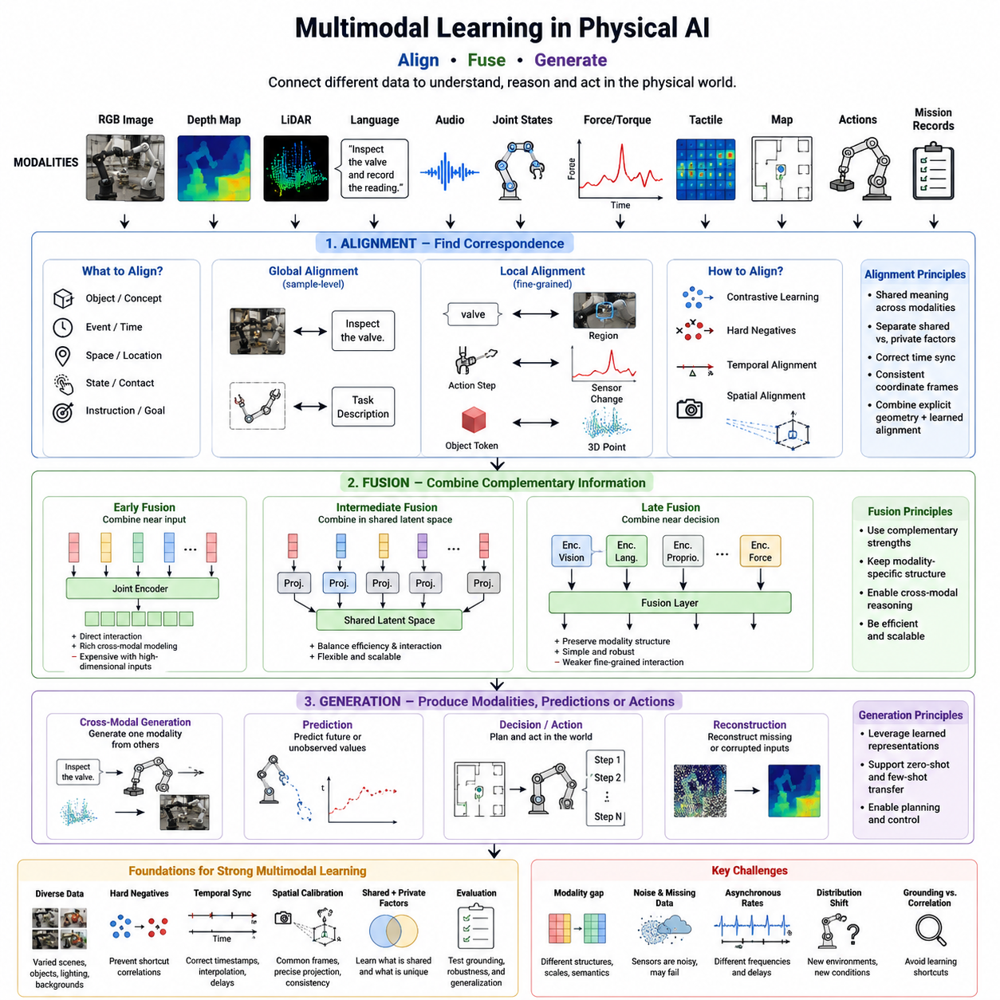
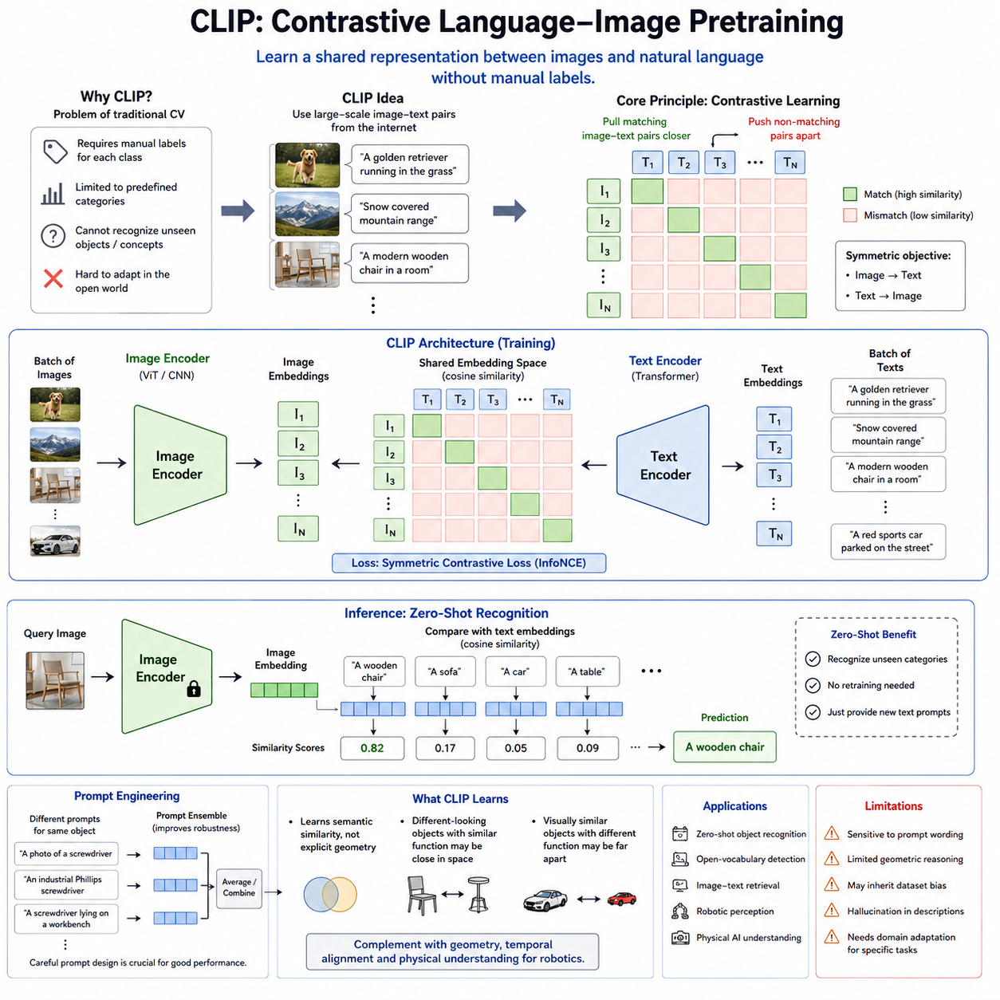
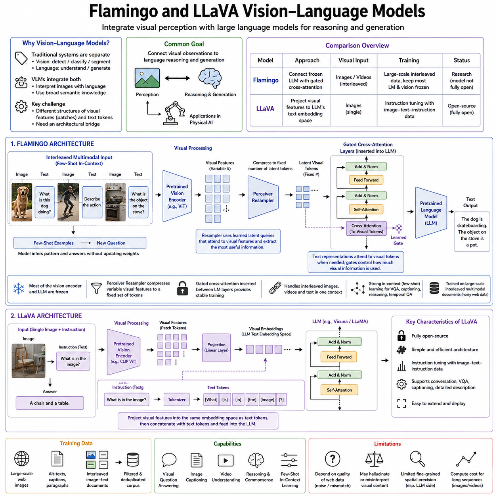
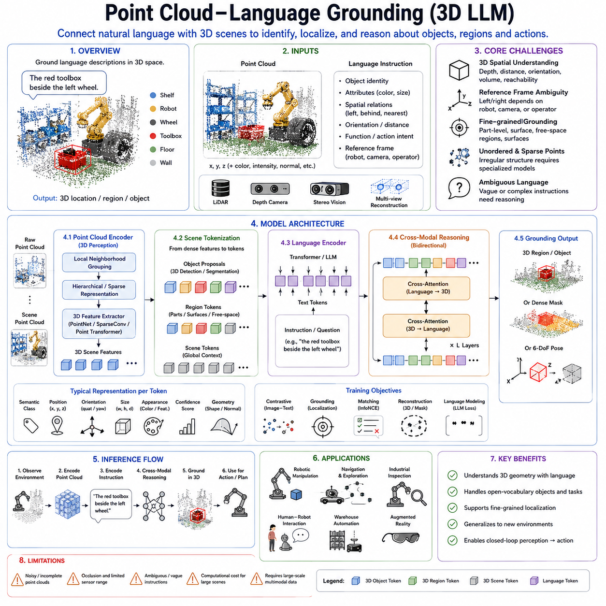
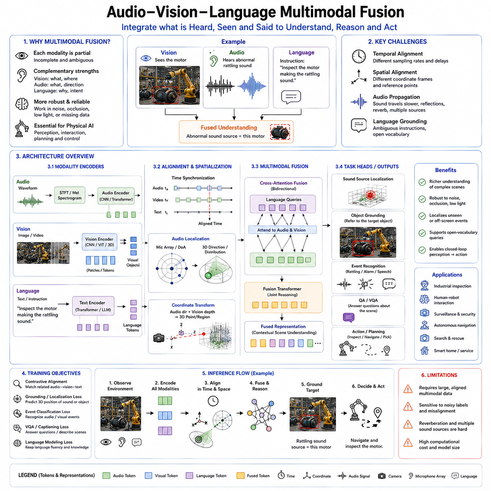
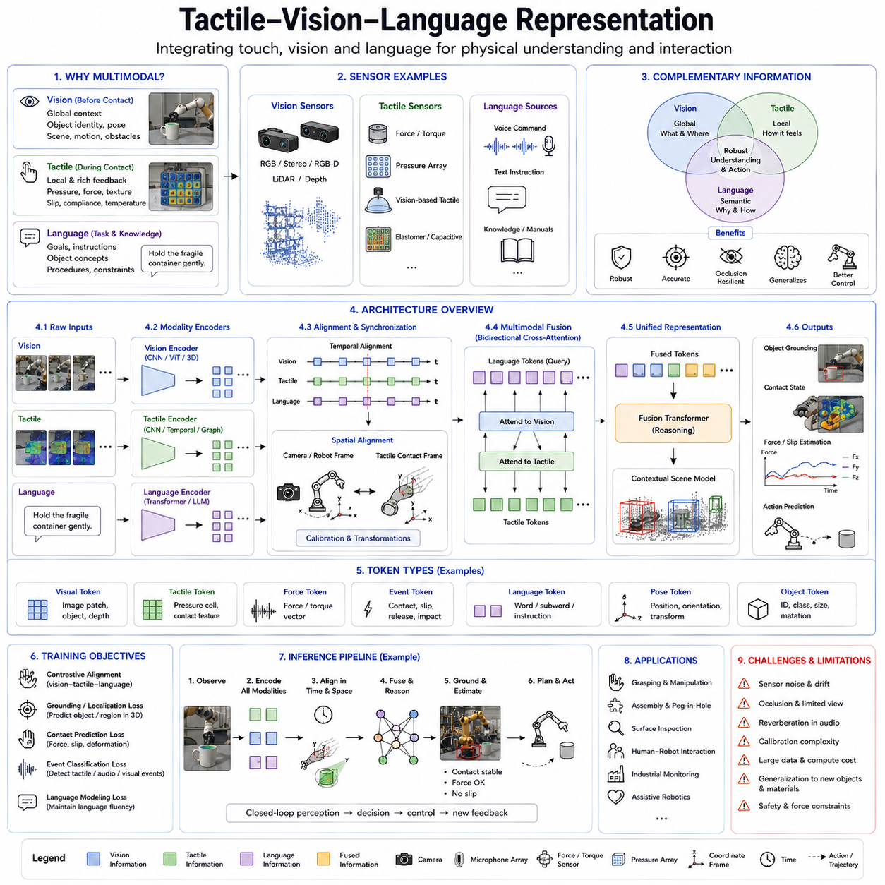
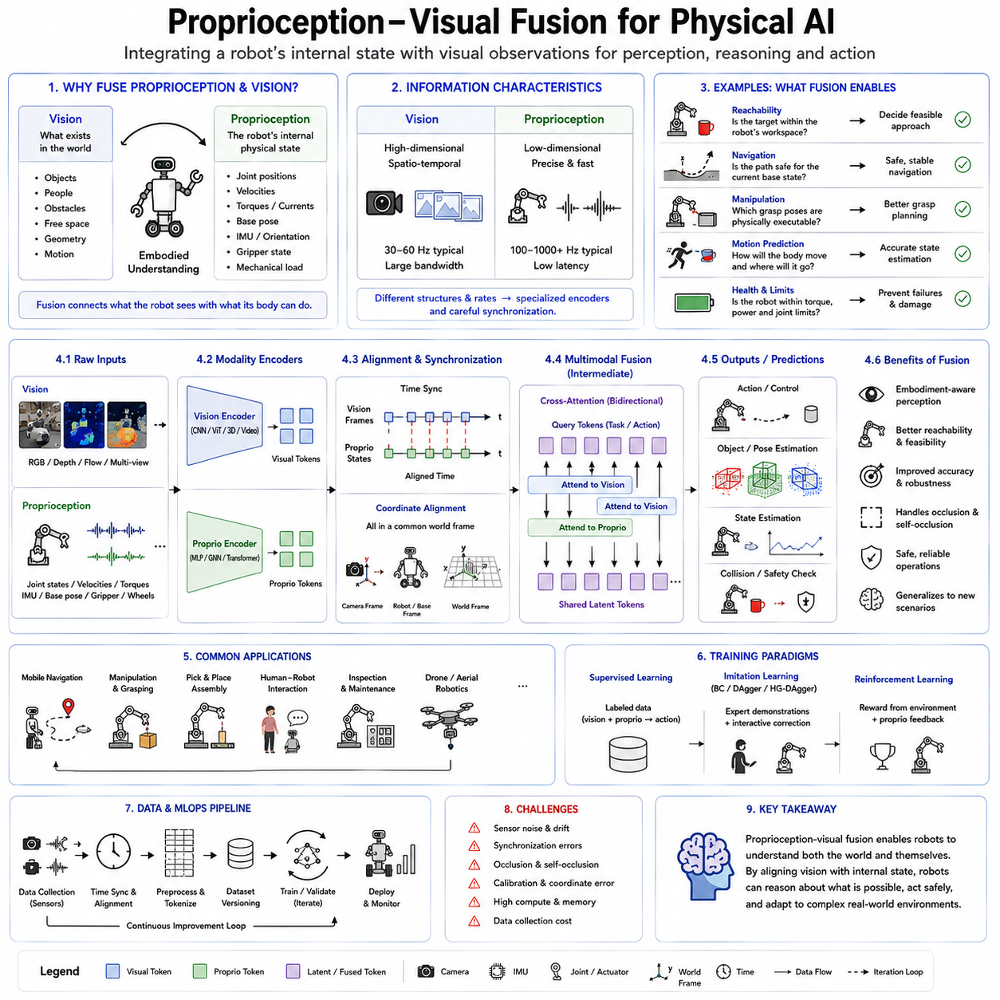
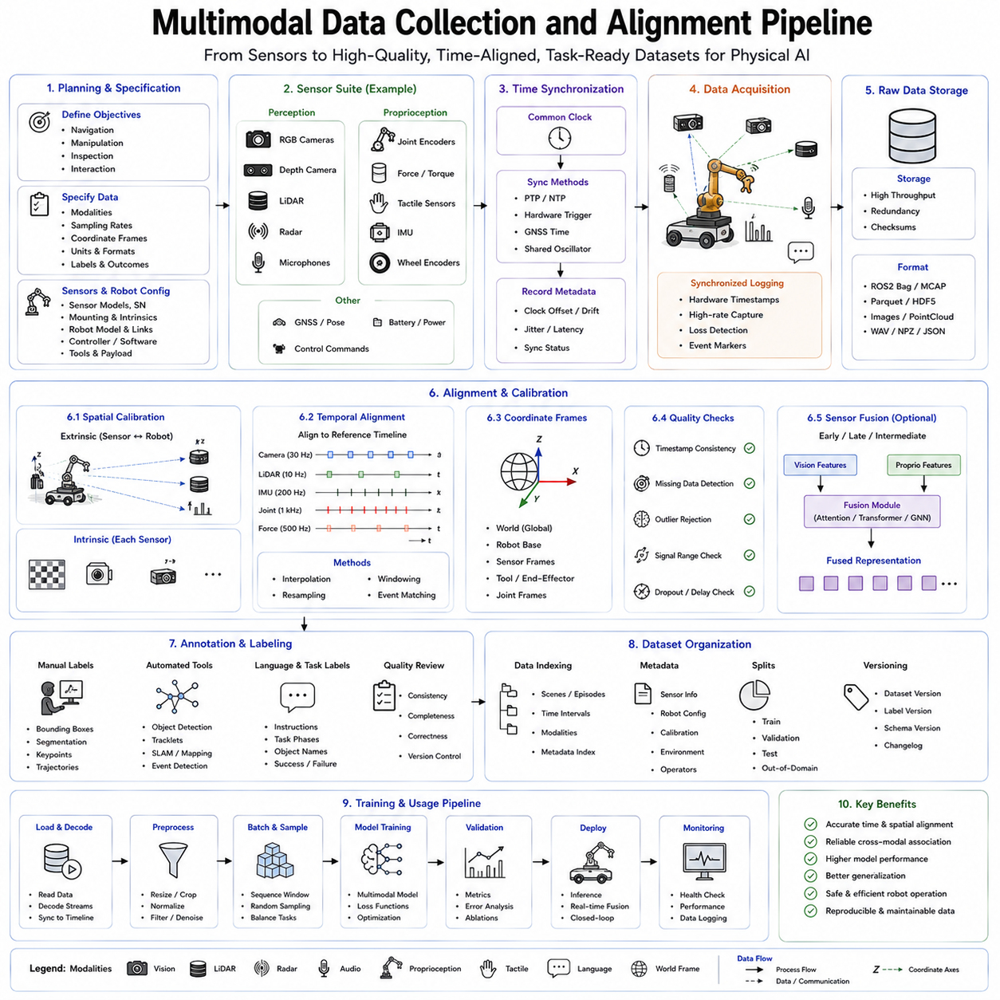
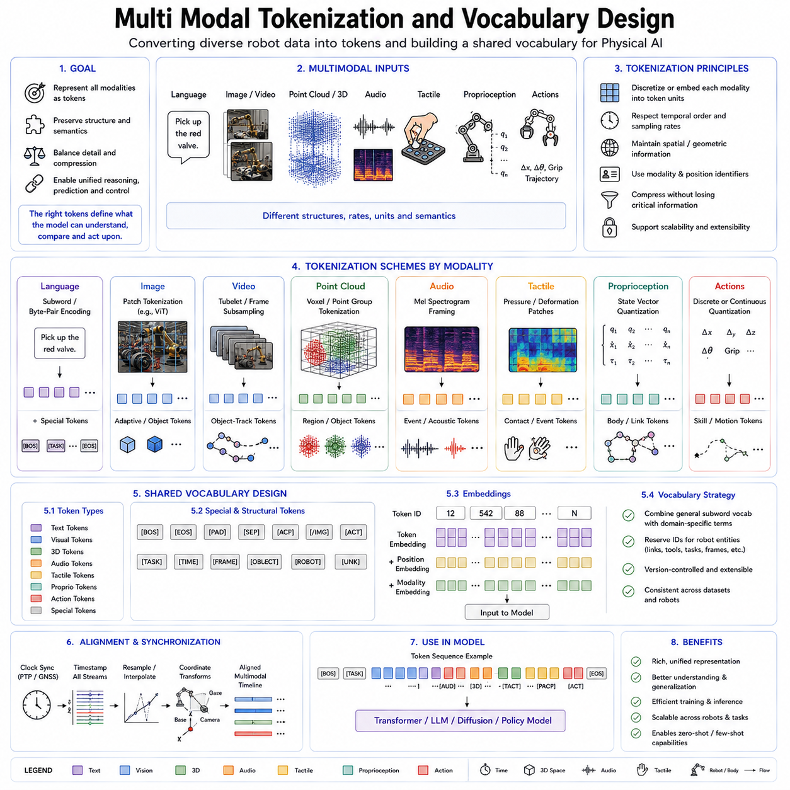
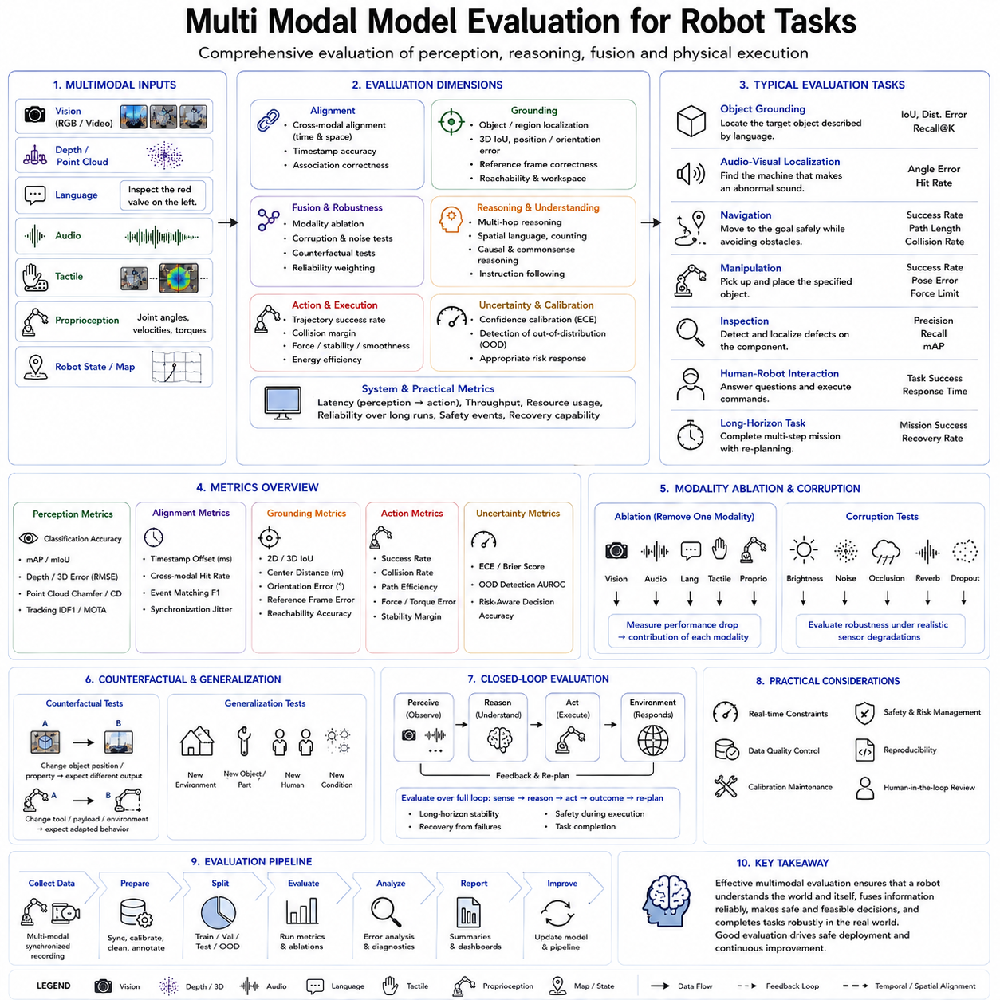

**Volume 18 Physical AI Foundation Models**

# 3. Multimodal Learning

## 3.1 Multimodal Learning Theory Alignment Fusion Generation

{width="7.268055555555556in" height="7.268055555555556in"}

Multimodal learning is the study of how an artificial intelligence system can learn from, connect, and generate information across different forms of data. In Physical AI, these modalities may include RGB images, depth maps, LiDAR scans, language instructions, audio, joint states, force signals, tactile measurements, maps, robot actions, and mission records. Each modality describes only part of the physical situation. A camera provides appearance, depth sensors provide geometry, proprioception describes the robot's body, force sensing reveals contact, and language expresses goals or constraints. Multimodal learning attempts to combine these partial views into a coherent representation that supports perception, reasoning, planning, and action.

The theoretical challenge begins with the fact that modalities are not naturally comparable. An image is a dense spatial array, language is a symbolic sequence, a point cloud is an unordered geometric set, and a force signal is a continuous time series. Their scales, sampling rates, noise characteristics, and semantic meanings differ. A multimodal model must therefore learn both modality-specific structure and cross-modal relationships. If the model forces every input into one uniform representation too early, it may lose important structure. If it processes every modality independently for too long, it may fail to discover meaningful interactions.

A useful way to understand multimodal learning is through three central processes: alignment, fusion, and generation. Alignment determines which elements across modalities correspond to each other. Fusion combines complementary evidence into a shared or coordinated representation. Generation produces one modality, prediction, or action from information contained in other modalities. These processes are closely connected, but each solves a different problem.

Multimodal alignment identifies relationships between observations that refer to the same object, event, concept, time, or physical state. In a robot system, the word "valve" must align with a visible component, its three-dimensional position, and possibly an inspection target stored in a digital twin. A force increase must align with the moment when the gripper contacts an object. A navigation instruction must align with a location in a semantic map.

Alignment may be global or local. Global alignment connects complete samples, such as an image and its caption or a robot trajectory and its task description. Local alignment connects smaller elements, such as individual words with image regions, action steps with sensor changes, or object tokens with three-dimensional points. Local alignment is more difficult but more useful for physical interaction because actions depend on specific objects and spatial relationships rather than only general scene meaning.

Contrastive learning is one of the most widely used alignment methods. Representations of related modality pairs are pulled closer together in a shared latent space, while unrelated pairs are pushed apart. An image of a robotic gripper holding a component should be close to the corresponding language description and distant from an unrelated instruction. This encourages the model to learn semantic correspondence without requiring a detailed label for every feature.

However, contrastive alignment can learn shortcuts. If all factory images contain similar backgrounds, the model may associate the background with certain instructions instead of understanding the task. Strong multimodal learning therefore requires diverse data, difficult negative examples, geometric variation, and tests that separate true grounding from superficial correlation.

Temporal alignment is especially important in robotics. Sensors operate at different frequencies and may contain delays. Camera frames, joint states, force readings, and motor commands must be synchronized accurately. If a force spike is paired with the wrong image or action, the model may learn an incorrect physical relationship. Timestamps, interpolation, hardware synchronization, and relative-time encoding are therefore part of multimodal learning, not merely data-engineering details.

Spatial alignment is equally critical. Camera features, depth points, LiDAR measurements, robot links, and map locations may use different coordinate frames. Cross-modal learning becomes unreliable if these frames are inconsistent. Known calibration can be used to project observations into a common geometric frame, while learned models refine uncertain associations. Combining explicit geometry with learned alignment is generally more reliable than expecting a neural network to infer all spatial transformations from data.

Alignment does not always mean forcing modalities into identical representations. Some information is shared, while other information is modality-specific. Language may describe purpose and intent that cannot be observed directly from an image. Tactile sensing may reveal surface friction that is visually invisible. A strong representation should separate shared semantic factors from private modality-specific factors.

Fusion is the process of combining aligned information. Early fusion combines modalities near the input stage. Features are projected into a common space and processed together. This allows direct interaction among modalities but may be inefficient when one modality, such as video, produces far more tokens than others.

Late fusion processes each modality independently and combines the outputs near the decision stage. This preserves modality-specific structure and simplifies implementation, but it may miss detailed interactions. A model may know what an object looks like and what the robot state is, yet fail to understand how the current joint configuration affects access to that object.

Intermediate fusion is often the most practical approach. Each modality first passes through a specialized encoder, after which cross-attention, shared latent tokens, gating, or multimodal transformer layers exchange information. This provides a balance between specialization and interaction.

Cross-attention is a central fusion mechanism. Queries from one modality retrieve relevant keys and values from another. A language instruction can query image regions, an action query can retrieve robot-state and geometric information, and a contact-state query can retrieve force and tactile evidence. Cross-attention allows information exchange to depend on the current task rather than combining all features uniformly.

Gated fusion provides another approach. The model learns how strongly each modality should contribute. During free-space motion, vision and geometry may dominate. During contact, force and tactile signals may become more important. If a camera becomes blurred or a sensor fails, the gate can reduce its contribution.

Reliable gating requires uncertainty information. A modality should not receive high weight simply because its features are strong. Sensor confidence, calibration quality, observation age, and fault status should influence fusion. Multimodal agreement does not automatically guarantee correctness because several modalities may share the same underlying error.

Fusion can be symmetric or asymmetric. Symmetric fusion treats modalities as equal information sources. Asymmetric fusion uses one modality to condition another. In robotics, language often provides the goal while vision provides evidence. Robot state may define physical constraints while the map provides global structure. These roles are different, so asymmetric fusion is often appropriate.

A shared latent space can support transfer across tasks and modalities. Images, language, states, and actions are projected into representations that express common concepts such as object identity, reachability, motion, contact, and task progress. The model can then reuse knowledge learned from one modality to interpret another.

Nevertheless, complete unification can be harmful. Low-level motor currents and high-level language should not necessarily occupy the same representational scale. Hierarchical multimodal models therefore maintain several latent spaces. A semantic space represents objects and goals, a geometric space represents position and shape, a temporal space represents dynamics, and an action space represents executable behavior.

Multimodal generation uses one or more modalities to produce another modality or a physical output. Image captioning generates language from vision. Text-to-image models generate visual content from language. In Physical AI, generation may include action generation from vision and instructions, future-state generation from current observations and candidate actions, or missing-sensor reconstruction from other modalities.

Vision-language-action models are a major example. The model receives visual observations and language instructions and generates robot actions. The generated output may be discrete action tokens, continuous control values, trajectories, skill calls, or action chunks. This extends multimodal generation beyond digital content into physical behavior.

Action generation requires stronger constraints than text generation. A plausible sentence only needs semantic coherence, but a robot action must satisfy kinematics, dynamics, timing, collision limits, tool geometry, and safety rules. Multimodal generative models must therefore operate inside a larger control architecture that validates their outputs.

World models represent another form of generation. They predict how the environment may change after an action. A model may generate future images, object poses, contact states, robot trajectories, or latent scene representations. This supports planning because candidate actions can be compared before execution.

The quality of a generated future should not be judged only by visual realism. A scene may look convincing while containing incorrect geometry or physics. For robotics, control-relevant accuracy is more important. Object position, free space, contact, velocity, support relationships, and collision risk must be represented correctly.

Conditional generation also allows missing modality reconstruction. If a depth sensor temporarily fails, the model may estimate depth from RGB images and motion history. If a camera is occluded, object state may be estimated from previous observations and proprioception. Such reconstruction can improve robustness, but predicted values should not be treated as equivalent to validated measurements in safety-critical functions.

Generative models are often probabilistic because the physical future may be uncertain. Several grasp trajectories may all be valid, and an object may move in different ways. Diffusion models, flow-based models, autoregressive models, and latent-variable models can represent multiple possible outcomes.

The model should express uncertainty rather than collapse every situation into one confident prediction. Multiple generated candidates can be evaluated by planners, world models, and safety constraints. High uncertainty may trigger additional sensing, slower execution, or human assistance.

The relationship among alignment, fusion, and generation is cyclical. Good alignment supports meaningful fusion. Good fusion creates representations that improve generation. Generated predictions can then be compared with actual observations to improve future alignment and representation learning.

For example, a robot aligns a language instruction with an object, fuses visual geometry with joint state, and generates a grasp trajectory. After execution, force and tactile feedback reveal whether the grasp succeeded. The difference between predicted and observed outcomes becomes a learning signal for improving all three stages.

Self-supervised learning is important because multimodal robot data is expensive to label. Models can learn by predicting one modality from another, reconstructing masked segments, matching synchronized streams, detecting temporal misalignment, or forecasting future observations.

Cross-modal prediction encourages physical understanding. Predicting visual change from action and robot state teaches action consequence. Predicting force from vision and motion teaches contact relationships. Predicting language descriptions from trajectories teaches task semantics.

However, the model may exploit easy statistical shortcuts. Careful objective design is needed to ensure that the learned representation captures causal and physical relationships rather than dataset regularities.

Multimodal learning must also handle missing and corrupted modalities. Real robots experience sensor failure, packet loss, glare, occlusion, calibration drift, and communication delay. Training should include modality dropout and degraded inputs so that the model does not rely completely on one sensor.

When information is missing, the system should represent absence explicitly and reduce confidence. A zero vector should not be mistaken for a valid measurement. The model may continue using other modalities, request another observation, or enter a safe state.

Evaluation should measure each of the three central processes. Alignment can be tested through object grounding, temporal correspondence, and coordinate consistency. Fusion can be evaluated by modality ablation, sensor corruption, and task-conditioned relevance. Generation can be evaluated through action success, future prediction, geometric accuracy, and uncertainty calibration.

Final task success alone is insufficient. A robot may succeed by using one dominant modality while ignoring others. Ablation studies reveal whether each modality contributes meaningfully. Counterfactual tests can determine whether changing language, geometry, or force input changes the output appropriately.

Closed-loop evaluation is essential because generated actions alter future observations. A model that performs well on recorded data may fail when its own errors influence the next state. Simulation and real-robot testing should therefore examine recovery, robustness, latency, and safety intervention.

Multimodal models should remain part of a layered architecture. Learned alignment and fusion provide flexible interpretation, while deterministic geometry, control, and safety systems enforce physical constraints. Language grounding should identify the target, but collision checking must verify the trajectory. Generated actions may propose movement, but low-level controllers must maintain stability.

The long-term goal of multimodal learning for Physical AI is not merely to place several sensor types inside one network. It is to construct a coherent model of the robot, environment, task, and physical consequences.

Such a model should know which observations describe the same entity, how different sensors complement one another, which information is reliable, how actions transform the world, and when additional evidence is required.

Alignment provides correspondence, fusion provides integrated understanding, and generation converts understanding into prediction and action. Together, they form the theoretical foundation through which multimodal data becomes embodied intelligence.

A successful Physical AI foundation model will preserve modality-specific structure while learning shared concepts. It will integrate information according to relevance and confidence, generate physically feasible outputs, and update its beliefs through closed-loop interaction.

In this way, multimodal learning becomes the bridge between heterogeneous robot sensors and coherent autonomous behavior. It allows separate streams of vision, language, geometry, force, state, time, and action to become a unified but structured representation of the physical world.

## 3.2 CLIP Contrastive Image Text Pretraining [w/Code]

{width="7.268055555555556in" height="7.268055555555556in"}

Contrastive Language-Image Pretraining (CLIP) represents one of the most influential breakthroughs in multimodal foundation models because it demonstrated that large-scale image and language understanding could be learned without relying on manually annotated classification labels. Instead of treating computer vision as a collection of independent recognition tasks with predefined categories, CLIP learns a shared semantic representation between images and natural language. This shift fundamentally changed how visual intelligence is trained and laid the foundation for modern vision-language models that support open-world recognition, multimodal reasoning, robotic perception, and Physical AI.

Before CLIP, most computer vision systems depended on supervised learning using carefully labeled datasets such as ImageNet. Each image belonged to one predefined class, and the model learned to classify images into those fixed categories. Although highly successful, this approach had important limitations. The number of object classes was limited, creating new categories required additional annotation, and recognition systems struggled with objects or concepts outside the training vocabulary. Robots operating in real environments cannot assume that every possible object has been manually labeled in advance. A warehouse robot, household assistant, or industrial inspection robot continuously encounters unfamiliar tools, components, containers, signs, and situations. A more flexible learning paradigm was therefore required.

CLIP addresses this limitation by replacing manually assigned category labels with naturally occurring image-text pairs collected from large-scale internet data. Instead of learning that an image belongs to class number 143, the model learns that an image corresponds to a descriptive sentence or phrase. The textual description may include object identity, attributes, actions, relationships, materials, colors, context, or abstract concepts. This allows visual representations to become grounded in language rather than fixed numerical labels.

The core principle behind CLIP is contrastive learning. During training, a batch contains many image-text pairs. Each image should become close to its matching text representation while remaining distant from all other text descriptions in the batch. Similarly, each text representation should become close to its corresponding image while remaining separated from unrelated images. Through this objective, the model gradually learns a shared embedding space in which semantically related images and language occupy nearby positions.

The CLIP architecture is conceptually simple but remarkably powerful. Two separate encoders are trained simultaneously. An image encoder converts visual input into a feature vector, while a text encoder converts language into another feature vector. These vectors are projected into a common latent embedding space. Similarity between image and text is usually computed using cosine similarity after feature normalization. Training minimizes a symmetric contrastive loss that encourages correct image-text matching in both directions.

The image encoder may use convolutional neural networks or Vision Transformers. Early CLIP implementations demonstrated that Vision Transformers generally scale better as model size and training data increase. The text encoder is typically based on the Transformer architecture and processes tokenized natural language descriptions. Although both encoders specialize in different input modalities, the contrastive objective gradually aligns their semantic representations.

Unlike traditional classification models, CLIP does not require explicit object labels during inference. Instead, a user can describe arbitrary categories using natural language prompts. Images are compared against text embeddings generated from these prompts, and the closest description determines the prediction. This capability is commonly known as zero-shot classification because the model can recognize categories that were never explicitly introduced as supervised training classes.

Zero-shot recognition dramatically changes deployment flexibility. Rather than retraining a vision model whenever new object categories appear, engineers only need to provide new textual descriptions. A robot deployed in a factory may initially recognize motors, gears, valves, and connectors. Later, new components can often be recognized simply by adding descriptive prompts without retraining the entire visual system.

Prompt engineering therefore becomes an important aspect of CLIP inference. Different textual descriptions of the same object may produce different embedding representations. A prompt such as "a photo of a screwdriver" may produce different results from "an industrial Phillips screwdriver lying on a workbench." Careful prompt design can improve recognition accuracy by matching the language distribution encountered during pretraining.

Prompt ensembles further improve robustness. Multiple textual descriptions representing the same semantic concept are encoded separately, and their embeddings are averaged or combined before similarity computation. This reduces sensitivity to wording variations and allows richer semantic descriptions.

Although prompt engineering improves performance, it also reveals a limitation. The model\'s understanding depends partly on linguistic formulation. Ambiguous language or poorly designed prompts may reduce recognition quality even when the visual information is sufficient.

CLIP learns semantic similarity rather than explicit geometric understanding. Two visually different objects that serve similar purposes may become close in embedding space because their textual descriptions overlap. Likewise, visually similar objects serving different functions may become separated if language distinguishes them clearly. This property supports semantic reasoning but does not automatically provide accurate physical understanding.

For Physical AI, semantic alignment is extremely valuable. Robots often receive instructions expressed in natural language. Connecting language with visual perception allows the robot to ground commands such as "pick up the blue wrench," "inspect the emergency valve," or "avoid damaged containers." Instead of treating language and vision as separate systems, CLIP provides a common semantic space that supports grounding between human instructions and observed objects.

Grounding refers to connecting symbolic descriptions with physical reality. A language model may understand the word "cup," while a vision model detects pixels. CLIP bridges these representations by learning that particular visual features correspond to particular linguistic concepts. This alignment provides an essential building block for embodied intelligence.

However, CLIP alone does not solve complete grounding. It identifies semantic correspondence but does not estimate precise object pose, physical dimensions, grasp points, or contact forces. Additional perception modules remain necessary for robotic manipulation.

CLIP embeddings are highly transferable. Once trained, the visual encoder can support many downstream tasks including image retrieval, object detection, semantic segmentation, visual search, scene understanding, and robot perception. Rather than training separate feature extractors for every application, one pretrained representation can support diverse tasks through lightweight adaptation.

Image retrieval illustrates this capability. Given a text description, the model retrieves visually similar images from a large database. Conversely, given an image, the model retrieves semantically related textual descriptions. Industrial robots may search maintenance manuals using observed components, while inspection systems retrieve historical cases with similar defects.

Semantic search is another important application. Traditional retrieval depends on exact keywords, whereas CLIP retrieves information based on conceptual similarity. A robot searching for "protective gloves" may retrieve images labeled "safety gloves" even if the wording differs. This flexibility supports robust human-robot interaction.

CLIP also improves data organization. Large robot datasets containing millions of images can be indexed using learned embeddings rather than manually assigned categories. Similar observations naturally cluster together, simplifying dataset exploration, anomaly detection, and experience retrieval.

The contrastive objective encourages global semantic consistency but provides limited fine-grained localization. CLIP recognizes that an image contains a wrench but does not necessarily indicate which pixels belong to the wrench. Localization requires additional methods such as region proposals, object detectors, segmentation networks, attention visualization, or grounding models built upon CLIP representations.

Open-vocabulary detection extends CLIP toward localization. Instead of restricting object detectors to fixed categories, visual region proposals are compared with text embeddings. This allows detection of previously unseen categories described by language. Open-vocabulary detection is particularly attractive for robotics because robots cannot anticipate every object encountered during deployment.

Vision-language grounding models further improve localization by connecting words with image regions. Rather than predicting only global similarity, they estimate spatial correspondence between textual phrases and visual evidence. Such grounding supports manipulation, navigation, inspection, and human-robot collaboration.

CLIP has also influenced robot imitation learning. Demonstrations containing images and language can be encoded into shared semantic representations. Similar tasks performed in different environments become easier to compare because language provides high-level semantic structure while images provide environmental detail.

One challenge in robotics is domain shift. Internet images used during CLIP pretraining differ substantially from robot camera images. Industrial cameras, depth sensors, fisheye lenses, thermal imagers, and warehouse lighting create distributions that differ from consumer photography. Without adaptation, recognition performance may decline.

Domain adaptation techniques address this problem. Fine-tuning on robot-specific data, adapter modules, prompt tuning, feature alignment, and self-supervised refinement allow pretrained CLIP representations to adapt while preserving their general semantic knowledge.

Prompt tuning has become particularly attractive because only a small number of learnable prompt parameters must be optimized. The large pretrained model remains frozen while prompts adapt the embedding space to a new domain. This greatly reduces computational cost compared with full model retraining.

Adapter tuning introduces small trainable modules between transformer layers. These adapters specialize CLIP for industrial inspection, warehouse automation, autonomous driving, agricultural robotics, or medical robotics without modifying the entire backbone network.

Although CLIP demonstrates remarkable generalization, it has several limitations. It inherits biases present in internet-scale training data. Cultural imbalance, language imbalance, visual stereotypes, and uneven geographic representation may influence predictions. Robots operating in safety-critical environments require careful evaluation of such biases.

Another limitation concerns physical reasoning. CLIP recognizes semantic concepts but does not directly understand mechanics, mass, friction, deformability, or stability. It may identify a chair without estimating whether the chair supports weight. It may recognize a tool without understanding how it should be manipulated.

Physical interaction requires geometric reasoning beyond semantic alignment. Robots must estimate pose, depth, contact surfaces, reachable regions, collision risk, articulation, and dynamic behavior. CLIP provides semantic understanding but not complete physical knowledge.

Temporal understanding is also limited because CLIP processes individual image-text pairs rather than continuous video. Robot tasks frequently involve evolving scenes, motion prediction, object tracking, and long-term temporal dependencies. Video-language models extend CLIP concepts into sequential representations that incorporate temporal context.

Another challenge involves sensor diversity. Physical AI systems integrate RGB cameras, depth cameras, LiDAR, radar, thermal imaging, tactile sensing, proprioception, and force sensors. Standard CLIP primarily aligns images with language. Future multimodal foundation models must align many additional sensing modalities within a unified semantic representation.

Several successor models have expanded CLIP\'s ideas. ALIGN demonstrated that even larger web-scale datasets improve contrastive learning. LiT separated image and text training through locked-image tuning. SigLIP introduced sigmoid-based contrastive objectives. EVA-CLIP improved visual encoder scaling. OpenCLIP provided open-source implementations trained on publicly available datasets, accelerating research across academia and industry.

These models illustrate that the contrastive learning paradigm is highly scalable. Larger datasets, stronger encoders, improved optimization, and better data filtering consistently improve representation quality. Nevertheless, increasing scale alone does not solve grounding, reasoning, or physical interaction.

Vision-language models such as Flamingo, BLIP, BLIP-2, PaLI, Kosmos, and GPT-4-class multimodal systems build upon CLIP-like alignment principles while introducing cross-attention, multimodal transformers, instruction tuning, and autoregressive generation. Rather than producing only embeddings, these models generate language, answer questions, follow instructions, and perform multimodal reasoning.

For robotics, CLIP frequently serves as the perception backbone while larger multimodal models perform reasoning and planning. The perception module converts raw observations into semantic embeddings. Higher-level reasoning modules combine these embeddings with language, memory, world models, and planning algorithms.

This layered architecture reflects the separation between recognition and decision making. CLIP determines what the robot observes. Planning modules determine what the robot should do. Control systems determine how those decisions become executable physical motion.

Evaluation of CLIP-based systems should extend beyond image classification accuracy. Zero-shot recognition, retrieval performance, cross-modal alignment quality, robustness under lighting variation, domain transfer, prompt sensitivity, adversarial robustness, localization capability, and calibration should all be considered.

Robot-specific evaluation should further measure grounding accuracy, task completion, object retrieval, instruction following, manipulation success, and robustness under sensor degradation. Closed-loop experiments provide more meaningful evaluation than offline image benchmarks because robot actions influence future observations.

Data quality strongly influences contrastive learning. Incorrect image-text pairs introduce noisy supervision that weakens semantic alignment. Large-scale filtering, deduplication, caption refinement, and quality estimation therefore play essential roles during dataset construction.

Negative sampling is equally important. Effective contrastive learning requires informative negative examples rather than random unrelated pairs. Hard negatives force the model to distinguish visually similar but semantically different concepts, improving embedding discrimination.

Batch size also affects contrastive performance because each batch supplies negative examples. Larger batches generally improve representation quality by exposing the model to more diverse negative comparisons. Distributed training therefore became an important engineering component of CLIP-scale learning.

Temperature scaling controls similarity sharpness during contrastive optimization. Appropriate temperature values balance separation between positive and negative pairs. Poor temperature selection can produce unstable optimization or reduced embedding quality.

Interpretability remains an active research area. Although embedding similarity provides semantic correspondence, understanding exactly which visual evidence contributes to alignment remains challenging. Attention visualization, saliency analysis, embedding probing, and feature attribution methods help reveal learned representations but do not fully explain model reasoning.

Future Physical AI foundation models will likely extend CLIP beyond static image-language alignment into unified multimodal world representations. Images, videos, depth maps, LiDAR observations, robot states, tactile sensing, audio, actions, maps, and language may all share coordinated latent representations. Rather than learning isolated modality pairs, future systems will learn complete models of embodied interaction.

In these systems, contrastive learning will remain an important training objective but will be combined with reconstruction, prediction, imitation learning, reinforcement learning, world modeling, and generative objectives. Alignment will become one component of a larger embodied learning framework.

Ultimately, CLIP demonstrated that semantic understanding emerges naturally when visual observations and language descriptions are aligned at massive scale. Its success transformed computer vision from closed-set recognition toward open-world semantic understanding and established contrastive multimodal learning as a central paradigm for foundation models.

For Physical AI, CLIP provides the semantic bridge between perception and language. Although additional geometric reasoning, temporal modeling, and physical interaction mechanisms remain necessary, CLIP established the principle that robots can learn visual concepts through language rather than fixed labels. This idea continues to influence nearly every modern vision-language foundation model and forms one of the essential theoretical foundations upon which future embodied intelligence systems will be built.

## 3.3 Flamingo and LLaVA Vision Language Models [w/Code]

{width="7.268055555555556in" height="7.268055555555556in"}

Flamingo and LLaVA represent two influential approaches to building vision-language models that combine visual perception with the reasoning and generation capabilities of large language models. Both systems demonstrate that a pretrained language model can be extended to interpret images without discarding the knowledge already learned from large-scale text data. Their architectures, training strategies, and degrees of openness differ, but together they helped establish the modern vision-language model as a central component of multimodal artificial intelligence and an important foundation for Physical AI.

Traditional visual models classify, detect, or segment objects, while language models interpret and generate text. These systems were historically developed as separate components. A robot might use one model to detect a valve, another to recognize its state, and a rule-based system to connect that information to a written instruction. Vision-language models attempt to integrate these capabilities so that visual observations can be interpreted directly through natural language and combined with broad semantic knowledge.

The central challenge is that visual and language representations have different structures. An image encoder produces spatial features or patch tokens, while a language model processes a sequence of text tokens. Simply concatenating the two does not guarantee that the language model will understand which visual features correspond to objects, attributes, relationships, or events. An architectural bridge is needed to transform and inject visual information into the language model.

Flamingo was designed as a few-shot vision-language model capable of processing interleaved sequences of images, videos, and text. Instead of training a complete multimodal model from the beginning, Flamingo connected a pretrained visual encoder to a pretrained language model while keeping most of their original parameters fixed. This approach preserved the broad visual and linguistic knowledge already contained in the component models and reduced the cost of multimodal training.

The visual input in Flamingo is first processed by a pretrained vision encoder. Images or video frames are converted into a large collection of visual features. Since the number of visual tokens may be large and may vary across inputs, Flamingo uses a Perceiver Resampler to convert them into a fixed number of compact visual tokens.

The Perceiver Resampler contains learned latent queries that attend to the visual features. These queries extract the information considered most useful for later language generation. The result is a compact representation with a consistent size, regardless of the original image resolution or number of video frames.

This resampling mechanism is important for computational efficiency. Feeding every raw image patch directly into a large language model would create long sequences and high memory costs. The latent visual tokens provide an information bottleneck that compresses the scene while preserving important semantic content.

Flamingo then introduces gated cross-attention layers into the frozen language model. At selected positions between language-model layers, text representations attend to the visual tokens. The language model can therefore retrieve image information when needed while continuing to process language through its original self-attention and feed-forward structure.

The cross-attention is gated so that the newly added visual pathway initially contributes only a small amount. During multimodal training, the gates learn how strongly visual information should affect the language representation. This stabilizes optimization because the pretrained language model is not immediately disrupted by randomly initialized multimodal components.

Flamingo can process multiple images and text segments in an interleaved context. A prompt may contain an image, a question, another image, an explanation, and additional examples. The model learns to associate each text segment with the relevant preceding visual information.

This interleaved structure supports in-context learning. A user can provide several visual examples with answers and then ask the model to solve a new example without updating its weights. Flamingo demonstrated that the few-shot abilities of large language models could extend into the visual domain.

For example, a prompt may show several images of animals with textual labels followed by an unlabeled image. The model can infer the expected response format and classify the new image. More complex prompts may provide examples of visual question answering, scene description, or temporal interpretation.

Video processing is another important capability. Flamingo can encode several frames from a video and treat them as visual context. This allows the language model to answer questions about events, actions, and changes over time, although the degree of temporal understanding depends on the frame sampling and training data.

The architecture preserves a clear separation between vision and language. The visual encoder extracts perceptual features, the Perceiver Resampler compresses them, and gated cross-attention inserts them into language reasoning. This modularity allows the pretrained components to remain largely unchanged.

Flamingo also showed the value of training on large collections of interleaved multimodal data rather than only image-caption pairs. Conventional image-text datasets provide one image associated with one caption. Interleaved documents contain several images and paragraphs with more complex contextual relationships.

Such data can teach a model to maintain references across multiple visual and textual elements. However, web-derived interleaved data is noisy. Images may not correspond exactly to nearby text, and documents may contain irrelevant or ambiguous relationships. Large-scale filtering and robust training objectives are therefore necessary.

LLaVA, which stands for Large Language and Vision Assistant, follows a more accessible and instruction-oriented approach. It connects a pretrained vision encoder with a large language model and trains the combined system to follow multimodal instructions. LLaVA became particularly influential because it demonstrated that a relatively simple architecture and carefully generated instruction data could produce strong visual conversational abilities.

In a typical LLaVA architecture, an image is processed by a pretrained CLIP vision encoder. The encoder generates visual patch features that contain semantic information aligned with language. A lightweight projection layer maps these visual features into the embedding dimension expected by the language model.

The projected visual tokens are inserted into the language-model input sequence. The language model then processes image tokens and text tokens together. Unlike Flamingo, which introduces repeated gated cross-attention layers, early LLaVA implementations relied on a simpler visual projection interface and the language model's existing transformer structure.

This simplicity made LLaVA easier to reproduce, fine-tune, and extend. Researchers could combine an available vision encoder with an open large language model and train the connecting projection layer using multimodal data.

LLaVA training commonly occurs in two stages. The first stage aligns the visual features with the language model. Image-caption pairs teach the projection layer how to translate visual encoder outputs into representations that the language model can interpret.

During this alignment stage, much of the vision encoder and language model may remain frozen. The model learns the basic correspondence between visual tokens and language concepts without changing all parameters.

The second stage performs visual instruction tuning. The model is trained on conversations in which an image is accompanied by user questions or instructions and detailed assistant responses. These examples teach the model not only to describe images but also to answer questions, reason about scenes, explain relationships, and follow conversational requests.

High-quality multimodal instruction data is difficult and expensive to create manually. LLaVA popularized the use of powerful language models to generate synthetic visual instruction data from image descriptions and structured information. The generated conversations may ask about objects, attributes, spatial relationships, causes, possible actions, or detailed scene interpretation.

Synthetic instruction generation substantially reduces data-creation cost, but it introduces risks. If the teacher model receives incomplete visual information or inaccurate captions, it may generate questions and answers that are not grounded in the actual image. The student model can then learn hallucinated relationships.

Data filtering, human review, grounding checks, and balanced task construction are therefore important. A large quantity of synthetic data does not automatically produce a reliable visual assistant.

LLaVA is designed for visual conversation. A user can upload an image and ask several follow-up questions. The model retains the image context while interpreting later dialogue. This supports interactive analysis rather than one-time classification.

The model may describe a scene, identify objects, compare regions, explain possible events, or interpret diagrams and documents. These abilities make it useful as a general visual assistant and as a component in higher-level robot reasoning.

Flamingo and LLaVA share the general principle of connecting a pretrained vision encoder with a pretrained language model. Both avoid training the complete system from random initialization. Both use an intermediate mechanism to transform visual features into a form that language processing can use.

Their architectural emphasis differs. Flamingo uses a Perceiver Resampler and gated cross-attention inserted repeatedly into the language model. This design supports interleaved images, video, and few-shot multimodal prompting.

LLaVA uses a simpler projection-based connection and emphasizes instruction tuning and visual dialogue. Its accessibility helped create a broad open research ecosystem and many later variants.

Flamingo can be understood as an architecture focused on flexible multimodal context and in-context learning. LLaVA can be understood as an architecture focused on instruction following and conversational visual reasoning.

Neither model directly understands the physical world in the complete robotic sense. They process visual appearance and language but do not automatically possess metric geometry, robot embodiment, force feedback, or executable action representations.

For Physical AI, they provide a semantic reasoning layer rather than a complete control system. A robot can use a Flamingo-like or LLaVA-like model to interpret a scene, answer an operator's question, recognize task-relevant objects, or generate a high-level plan.

Additional modules must convert the resulting semantic interpretation into physically grounded behavior. Depth estimation, object pose estimation, mapping, kinematics, trajectory planning, collision checking, control, and safety monitoring remain necessary.

A robot instructed to "inspect the loose connector beside the red cable" may use a vision-language model to identify the likely target. A geometric perception system then estimates its three-dimensional pose. A planner determines whether the robot can reach it, and a controller executes the motion.

The vision-language model helps determine what the instruction refers to, but validated robotics components determine how to act safely.

Vision-language models are particularly useful for open-vocabulary perception. A robot may encounter objects that were not included in a fixed detector's training classes. Language-conditioned visual models can search for objects based on flexible descriptions.

They can also connect observations with procedures and documentation. An inspection robot may observe a machine component and retrieve a relevant maintenance instruction. A mobile robot may interpret signs, labels, room names, or operator notes.

Visual question answering supports remote supervision. An operator can ask whether an inspection image contains corrosion, whether a path is blocked, or which tool lies near a work area. The model can summarize the visual evidence in natural language.

However, hallucination is a major limitation. Vision-language models may generate confident descriptions of objects or relationships that are not present in the image. This occurs because the language model is optimized to produce plausible text and may rely on prior knowledge when visual evidence is weak.

Hallucination is especially dangerous in Physical AI. Incorrectly claiming that a path is clear, a valve is closed, or a person is absent can produce unsafe decisions. Model output must therefore be treated as a hypothesis requiring verification.

Grounding mechanisms can reduce hallucination. Region-level visual features, object detectors, segmentation masks, depth information, and explicit coordinate references can connect language output more strongly to observed evidence.

Models can also be required to provide bounding regions, object identifiers, or confidence estimates rather than only free-form text. The surrounding system can verify whether the referenced object actually exists and whether the geometric estimate is reliable.

Another limitation is spatial precision. Vision-language models may understand general relations such as left, above, or near, but perform poorly on exact coordinates, counting, orientation, or fine geometric distinctions.

Robotic action often requires millimeter-level accuracy, while language reasoning usually operates at a much coarser level. High-resolution geometric modules should therefore complement the vision-language model.

Temporal reasoning also remains difficult. A few sampled video frames may omit critical motion or contact events. Long robot missions generate more temporal data than a standard vision-language context can retain.

Video encoders, state space models, external memory, event summaries, and trajectory representations can extend the temporal capabilities of these systems.

Embodiment information is another missing component. The same scene may imply different actions for a wheeled robot, humanoid, drone, or manipulator. A target may be visible but unreachable by the current robot.

Physical AI systems can add robot-state tokens, morphology descriptions, action capabilities, tool information, and map context to the multimodal prompt. Cross-attention or specialized adapters can connect semantic understanding with embodiment.

Fine-tuning on robot-specific data is often necessary. Internet images and general visual conversations differ from onboard camera views, industrial lighting, fisheye distortion, motion blur, depth sensors, and contact-rich manipulation scenes.

Parameter-efficient methods such as low-rank adaptation, adapters, and prompt tuning allow a general vision-language model to specialize without retraining all parameters. Different adapters can support separate robots, environments, or inspection domains.

The visual encoder may also require adaptation. CLIP features are semantically strong but may overlook fine defects, small fasteners, transparent objects, or subtle surface damage. Domain-specific perception models can provide additional high-resolution features.

A practical architecture may combine global vision-language understanding with specialized detectors. The general model interprets the task and scene, while dedicated algorithms identify defects, estimate poses, or measure dimensions.

Tool use greatly extends the usefulness of Flamingo- and LLaVA-style models. The model can call object detectors, optical character recognition, depth estimation, map services, digital twins, databases, or motion planners.

Instead of generating unsupported answers, it can request precise information from validated tools. A question about a component's distance can trigger a depth calculation. A request to navigate can call a path planner.

This converts the vision-language model into an orchestrator of specialized capabilities. Its strength lies in interpreting goals, selecting tools, integrating results, and communicating with humans.

The model should not have unrestricted authority to call every tool. Safety-sensitive interfaces require permissions, argument validation, and deterministic constraints. An external text instruction found in an image should not be treated as an authorized robot command.

Prompt injection through visual content is a real security concern. A sign, document, or screen in the environment may contain text intended to manipulate the model. The system must distinguish trusted operator instructions from untrusted environmental text.

Evaluation of vision-language models for robotics should include more than conversational quality. Object grounding, spatial consistency, temporal understanding, hallucination rate, confidence calibration, robustness to image degradation, and resistance to misleading visual text are important.

Task-level evaluation should measure whether the model identifies the correct object, selects the appropriate tool, provides a valid plan, and supports successful closed-loop execution.

Ablation tests can remove visual evidence to determine whether the model relies on the image or merely on language priors. Counterfactual images can test whether the response changes when an object is moved, removed, or replaced.

Closed-loop tests are essential because a robot's actions change the visual scene. A model may describe static images well but fail to maintain object identity after movement, occlusion, or viewpoint change.

Memory systems can preserve grounded object identities and mission context across interactions. Instead of repeatedly interpreting the scene from scratch, the model can retrieve previous object records, poses, observations, and task outcomes.

Flamingo's interleaved multimodal context and LLaVA's instruction-tuned conversational behavior represent complementary directions that continue to influence later systems. Modern multimodal models often combine compact visual resampling, cross-attention, unified token processing, instruction tuning, tool use, video understanding, and external memory.

Their broader contribution was to demonstrate that large language models can become visual reasoning systems through carefully designed interfaces and multimodal training. They transformed vision from a separate classification subsystem into information that can participate directly in language-based reasoning.

For Physical AI, this enables natural interaction between people and robots. Operators can specify goals in ordinary language, ask questions about observed conditions, request explanations, and receive reports based on visual evidence.

The models can also support semantic planning by converting complex instructions into structured subgoals. Yet every subgoal must still be grounded in current geometry, robot state, and safety constraints.

The long-term evolution of these architectures is likely to connect vision-language reasoning more directly with action, world modeling, tactile sensing, and continuous temporal memory. The result will move beyond models that merely discuss images toward systems that understand how visual scenes relate to physical possibilities and consequences.

Flamingo and LLaVA therefore occupy an important position in the development of multimodal foundation models. Flamingo demonstrated efficient integration of visual context into a frozen language model through latent resampling and gated cross-attention. LLaVA demonstrated the effectiveness of simple visual projection combined with large-scale visual instruction tuning.

Together, they established architectural and training principles that remain central to modern multimodal systems. For Physical AI, their greatest value lies in providing broad semantic understanding and natural-language interaction while serving as one layer within a larger embodied architecture.

A reliable robot system will use such models to interpret, explain, and plan, but it will combine them with calibrated perception, explicit geometry, temporal state, deterministic control, and independent safety systems. Through this layered approach, vision-language intelligence can contribute to physically grounded and operationally trustworthy autonomous behavior.

## 3.4 Point Cloud Language Grounding 3D LLM [w/Code]

{width="7.268055555555556in" height="7.268055555555556in"}

Point cloud-language grounding is the process of connecting natural-language descriptions with objects, regions, relationships, and actions represented in three-dimensional space. It extends conventional vision-language grounding beyond two-dimensional images by allowing an artificial intelligence system to reason about depth, distance, orientation, volume, reachability, and spatial structure. For Physical AI, this capability is essential because robots do not operate only on flat images. They move through three-dimensional environments, manipulate objects with physical dimensions, avoid obstacles, inspect structures, and coordinate actions relative to their own bodies.

A point cloud is a collection of three-dimensional points representing the surfaces of objects and environments. Each point usually contains x, y, and z coordinates and may also include color, intensity, surface normal, timestamp, or semantic features. Point clouds can be generated by LiDAR, depth cameras, stereo vision, structured-light sensors, or multi-view reconstruction. Unlike images, point clouds are generally sparse, irregular, and unordered. They therefore require specialized neural architectures that preserve geometric relationships without assuming a fixed pixel grid.

Language provides a complementary form of information. A person can describe a target as "the red toolbox beside the left wheel," "the upper connector on the control panel," or "the empty space between the pallet and the wall." These expressions contain object identity, attributes, relative position, orientation, function, and task intent. Point cloud-language grounding attempts to identify which three-dimensional entity or region corresponds to such a description.

This grounding problem is more difficult than simple object classification. A model must not only recognize a toolbox but also distinguish the correct toolbox among several candidates. It must interpret spatial expressions such as above, behind, nearest, inside, connected to, or reachable from. It may also need to understand the viewpoint from which left and right are defined.

The reference frame is particularly important. "Left of the robot" differs from "left in the camera image" or "left from the operator's viewpoint." A reliable 3D grounding model must represent coordinate frames explicitly and determine which frame the instruction uses.

Point cloud encoders form the perceptual foundation of 3D-language models. Early approaches such as PointNet processed individual points and aggregated them into a global representation using permutation-invariant operations. Later architectures introduced local neighborhoods, hierarchical sampling, graph structures, sparse convolutions, and transformer-based attention.

Local geometric structure is essential because objects are defined by relationships among nearby points. Surface curvature, edges, corners, holes, and connected components cannot be understood by treating every point independently. Hierarchical encoders therefore group points into local regions and gradually build object-level and scene-level representations.

Sparse voxel encoders convert point clouds into occupied cells within a three-dimensional grid. Sparse convolution processes only occupied regions, reducing computation compared with dense volumetric grids. This representation is effective for large scenes such as warehouses, factories, roads, and buildings.

Point transformers apply attention directly to point features while incorporating relative three-dimensional position. Each point or local region attends to nearby geometric information. Relative coordinates, distance, and direction influence the attention weights, allowing the model to learn shape and spatial relationships.

For language grounding, raw point-level features are often compressed into object tokens, region tokens, or scene tokens. Object proposals may be produced through 3D detection or segmentation. Each token can include semantic class, position, orientation, dimensions, appearance, confidence, and geometric features.

Object-centric representations make language grounding more efficient. Instead of comparing a phrase with millions of points, the model compares it with a smaller set of candidate objects. However, this approach depends on the quality of object detection and may fail when the target is an unknown object, part of an object, free-space region, or surface feature.

Dense grounding preserves more geometric detail. A phrase may correspond to a handle, weld, valve stem, shelf opening, or damaged surface rather than a complete object. Point-level or region-level grounding is therefore necessary for precise inspection and manipulation.

Language is usually encoded by a transformer-based text encoder or large language model. The resulting text tokens represent object names, attributes, spatial relations, actions, and contextual constraints. Cross-attention can connect these language tokens with three-dimensional scene tokens.

In one common design, language tokens query 3D object or region features. The word representing the target object may attend strongly to matching semantic features, while spatial-relation words attend to relative position and scene structure. The model produces a relevance score for each candidate region.

The opposite direction is also useful. Three-dimensional object tokens can attend to the language instruction, allowing their features to become task aware. An object representation may emphasize color, function, or position depending on which properties appear in the instruction.

Bidirectional cross-attention can progressively refine both modalities. Language becomes grounded in the observed scene, while scene representations become conditioned on the current task. This is valuable when the instruction is ambiguous or contains several relational clauses.

For example, the instruction "select the small valve above the large pipe and nearest to the red panel" requires multiple reasoning steps. The model must identify valves, compare size, determine vertical relationships with pipes, measure distance to the panel, and select the unique candidate satisfying all constraints.

Scene graphs provide a structured method for representing these relationships. Objects and regions become graph nodes, while edges represent relations such as above, below, connected to, inside, supporting, touching, or near. Language expressions can then be matched with graph structures.

A graph representation is especially useful in industrial environments where components have clear functional and structural relationships. A machine may contain panels, motors, connectors, cables, pipes, valves, and inspection points. The model can ground language by reasoning over this hierarchy rather than relying only on visual similarity.

Digital twins can provide additional prior knowledge. A digital twin may contain component identifiers, designed positions, dimensions, inspection procedures, and connectivity. Live point clouds can be aligned with the digital-twin geometry, and language can refer to either nominal or observed components.

This combination enables commands such as "inspect connector J4 on the upper-right control board." The language refers to a named digital component, while the live point cloud provides its current physical pose. The system must align the stored model with current sensor data before acting.

Alignment errors are a major concern. Incorrect calibration, localization drift, partial observation, or environmental changes can cause the live point cloud and digital twin to disagree. The model should preserve confidence and detect mismatch rather than forcing an incorrect correspondence.

Three-dimensional large language models, often called 3D LLMs, extend language models so that they can process 3D scene representations. Instead of receiving only text or image tokens, the model receives point-cloud, object, voxel, mesh, or scene-graph tokens projected into the language-model embedding space.

A simple architecture uses a pretrained 3D encoder followed by a projection layer that maps scene features into the embedding dimension of a large language model. The projected tokens are inserted into the language context, allowing the model to answer questions or generate descriptions about the scene.

More advanced architectures use cross-attention between language tokens and 3D features. This avoids placing every point token directly into the language sequence and allows the model to selectively retrieve geometric information.

Latent resampling can compress a large point cloud into a fixed number of scene tokens. Learned queries attend to the 3D features and produce compact representations of objects, regions, and global structure. This improves scalability for large environments.

The training process often begins with alignment between 3D data and language. Point clouds may be paired with object labels, captions, room descriptions, question-answer pairs, or reconstructed scene annotations. Contrastive learning brings related 3D and text representations closer together.

Instruction tuning then teaches the model to follow natural-language requests about three-dimensional scenes. Example tasks may include object identification, scene description, spatial question answering, counting, navigation reasoning, and target localization.

High-quality 3D-language data is limited compared with image-text data. Collecting point clouds requires specialized sensors, calibration, reconstruction, and annotation. Descriptions must refer accurately to three-dimensional geometry rather than only visible appearance.

Synthetic data and simulation can expand training coverage. Virtual environments provide exact object poses, segmentation, relationships, and camera parameters. Language descriptions and question-answer pairs can be generated automatically.

However, simulated geometry may differ from real sensor data. Real point clouds include noise, missing surfaces, reflective materials, motion distortion, and occlusion. Models trained only in clean simulation may fail in physical environments.

A strong training mixture should therefore combine simulation, scanned indoor scenes, outdoor LiDAR data, robot demonstrations, CAD models, and real-world interaction data. Domain randomization and sensor-noise simulation can improve transfer.

Multi-view images can supplement point clouds with appearance information. Point clouds provide geometry, but color and texture may be sparse or unreliable. Image features can be projected into three-dimensional points or object regions.

This creates a multimodal 3D representation combining shape, color, language, and robot state. A red handle and a gray handle may have identical geometry but different semantic relevance to the instruction. Image features help distinguish them.

Depth cameras provide denser local geometry than long-range LiDAR but have limitations with transparent, reflective, dark, or distant surfaces. LiDAR provides robust range measurements but often lacks fine appearance. Combining sensors improves grounding reliability.

Robot embodiment must also be integrated. A grounded object may be visible but unreachable. A free-space region may be geometrically open but too narrow for the robot. A manipulation target may require an orientation beyond the robot's joint limits.

Embodiment-aware 3D grounding adds the robot pose, dimensions, kinematic structure, tool geometry, payload, and action capabilities to the model. Language grounding then becomes action conditioned rather than purely semantic.

For navigation, the model may ground a destination in the point cloud or semantic map. The phrase "move to the open area beside the second shelf" becomes a three-dimensional goal region. A conventional planner can then compute a collision-free path.

For manipulation, the model may ground a target object or part and estimate a task-relevant pose. A separate grasp planner determines contact points, approach direction, and collision constraints.

For inspection, grounding may identify a surface, component, or region of interest. The robot must then select a viewpoint satisfying distance, angle, focus, lighting, and occlusion requirements.

This illustrates the difference between semantic grounding and executable grounding. Semantic grounding answers what and where. Executable grounding additionally determines whether and how the robot can act.

Affordance grounding extends the task further. An instruction may refer not only to an object but to a possible interaction, such as "the handle that can be pulled," "the surface that should be scanned," or "the opening through which the probe can be inserted."

Affordances depend on geometry, material, articulation, and task context. A 3D model must identify functional regions rather than only object categories. Training data should include interactions, contact points, motion directions, and success outcomes.

Temporal 3D grounding is required when scenes change. Objects may move, people may enter the workspace, and the robot itself changes viewpoint. A model must preserve object identity across point clouds and update their positions.

Scene flow, tracking, temporal transformers, and state space models can link consecutive observations. Language references such as "the box moved earlier" or "return to the previous inspection point" require temporal memory.

Long robot missions cannot store every point cloud inside the language-model context. Current geometry should remain in active memory, while older observations are compressed into object tracks, map updates, events, or mission records.

A 3D LLM can retrieve these memories when needed. An operator may ask, "Where was the damaged container first detected?" The system must connect the language query with a stored object identity, time, and map location.

Uncertainty is essential because point clouds are incomplete. Occluded surfaces are missing, distant points are sparse, and segmentation may be ambiguous. A model should distinguish observed geometry from inferred geometry.

Confidence may be represented for object detection, pose, depth, alignment, and language grounding. If multiple candidate objects match the instruction, the system should ask for clarification or obtain another viewpoint.

Active perception can reduce uncertainty. The robot may move its camera, rotate its base, or approach the target to collect additional point-cloud data. Grounding then becomes an interactive process rather than a single prediction.

Hallucination remains a risk in 3D LLMs. A language model may generate a plausible description of an object that is not present or infer geometry unsupported by the point cloud. Free-form answers should therefore be linked to explicit scene tokens or object identifiers.

A reliable system can require that every grounded reference include a 3D bounding box, segmentation mask, point set, pose estimate, or scene-graph node. This allows downstream components to verify the physical target.

Spatial reasoning must also be tested carefully. Language models may perform well on common relational phrases but fail on exact distance, orientation, containment, or viewpoint-dependent left-right relations.

Evaluation should separate semantic recognition from geometric accuracy. Metrics may include object-selection accuracy, 3D intersection over union, center-position error, orientation error, relation classification, and reference-frame correctness.

Robot-specific evaluation should include reachability, navigation success, grasp success, viewpoint quality, collision avoidance, and closed-loop task completion. A model that identifies the correct object but provides an unusable target pose is not sufficient.

Robustness tests should include sparse point clouds, sensor noise, missing views, reflective objects, calibration errors, moving objects, and unfamiliar environments. The model should reduce confidence when evidence is weak.

Cross-domain evaluation is also important. A system trained on indoor room scans may not generalize to factories, outdoor sites, or cluttered maintenance spaces. The structure and scale of environments vary significantly.

Open-vocabulary 3D grounding is one of the most promising applications. Instead of relying on a fixed set of 3D detector classes, the system can search for objects using arbitrary language descriptions.

This allows a robot to find unusual tools, newly installed equipment, temporary obstacles, or site-specific components without retraining the complete detector. Text embeddings provide semantic flexibility, while 3D features provide physical location.

Yet open vocabulary does not guarantee physical competence. The model may recognize a "ladder" but not determine whether it is stable or climbable. Physical attributes require additional sensing and learned interaction knowledge.

Tool use can improve 3D LLM reliability. The language model can call a point-cloud segmenter, pose estimator, collision checker, digital-twin service, map server, or motion planner.

Instead of estimating distance from language reasoning, it can request an exact geometric calculation. Instead of claiming that a target is reachable, it can call an inverse-kinematics solver.

This positions the 3D LLM as an orchestrator of semantic and geometric tools. Its role is to interpret the request, identify relevant entities, choose appropriate services, and integrate the results.

Authority boundaries remain essential. Environmental text, labels, or scanned documents should not automatically become executable commands. Trusted operator instructions must be separated from untrusted scene content.

3D-language systems may also be vulnerable to incorrect map data or poisoned digital-twin information. Every external source should include provenance, version, and confidence.

Efficient deployment is challenging because point clouds can contain millions of points. Downsampling, voxelization, object extraction, sparse attention, and latent resampling are required before language reasoning.

The model should preserve small but important structures such as cables, fasteners, handles, cracks, or thin obstacles. Excessive compression may remove exactly the features needed for inspection or manipulation.

Hierarchical processing is therefore practical. Coarse scene tokens support room-level understanding and navigation, object tokens support semantic grounding, and dense local features support precise action.

A large language model does not need to process all dense geometry directly. It can reason over compact semantic tokens and request high-resolution geometric analysis for selected targets.

This division reduces computation and improves interpretability. Engineers can identify which object or scene node the model selected before physical action begins.

The long-term objective of point cloud-language grounding is to connect human concepts with executable three-dimensional reality. A robot should understand not only that an operator mentioned a valve, but which valve, where it is, how it is oriented, whether it is reachable, and what interaction is possible.

Three-dimensional large language models provide a flexible semantic interface to complex spatial environments. They can interpret instructions, answer questions, connect live observations with maps and digital twins, and support high-level planning.

Their strengths lie in language understanding, open-vocabulary semantics, relational reasoning, and tool orchestration. Their weaknesses include incomplete geometry, hallucination, limited precision, sensor dependence, and insufficient physical validation.

For Physical AI, the most reliable architecture combines a 3D LLM with calibrated point-cloud perception, explicit coordinate transformations, object tracking, kinematic reasoning, motion planning, and deterministic safety systems.

The 3D LLM identifies and explains the intended target. Geometric modules estimate its precise physical state. Planning systems determine feasible actions. Controllers execute the motion, while independent safety systems enforce limits.

Within this layered architecture, point cloud-language grounding becomes the bridge between human spatial concepts and robot action. It transforms descriptions such as "the upper valve behind the pipe" into a verified three-dimensional entity that a robot can inspect, approach, or manipulate.

As datasets, sensors, scene representations, and multimodal architectures improve, 3D LLMs will move from describing static scans toward maintaining persistent, interactive, and action-aware models of the physical world. This development will form a central foundation for robots that can understand natural language directly in the geometry of their operating environments.

## 3.5 Audio Vision Language Multi Modal Fusion [w/Code]

{width="7.268055555555556in" height="7.268055555555556in"}

Audio-vision-language multimodal fusion is the process of combining acoustic signals, visual observations, and natural-language information into a coordinated representation that supports perception, reasoning, interaction, and action. In Physical AI, these three modalities provide complementary views of the environment. Vision describes visible objects, geometry, motion, and spatial relationships. Audio reveals events, machinery conditions, speech, direction, and activity that may be hidden from cameras. Language expresses human goals, semantic knowledge, operating procedures, constraints, and explanations. Their integration allows a robot to understand situations that cannot be interpreted reliably through any single modality.

A robot operating in a factory may see a motor, hear an abnormal vibration, and receive an instruction to inspect the source of the noise. A service robot may observe several people while listening for the person who called its name. A patrol robot may hear breaking glass outside the camera's field of view and rotate toward the estimated sound direction. These examples show that multimodal fusion is not simply the addition of more sensors. It is the construction of relationships among what is seen, what is heard, and what is described or requested through language.

The modalities differ greatly in structure. Images are dense spatial arrays, audio is a continuous temporal waveform, and language is a symbolic token sequence. Their sampling rates, dimensionality, uncertainty, and physical meanings are also different. A camera may operate at thirty frames per second, a microphone may record tens of thousands of samples per second, and a language instruction may arrive only once during a mission. A multimodal architecture must preserve the useful structure of each modality while creating a shared interface for reasoning.

Audio is usually transformed before being processed by a neural model. Raw waveforms may be divided into short windows and converted into spectrograms, mel spectrograms, or learned acoustic tokens. A spectrogram represents how signal energy varies across frequency and time. This allows convolutional networks, audio transformers, or other sequence models to identify speech, alarms, impacts, machinery noise, footsteps, and environmental events.

Visual input is typically processed by a convolutional network, Vision Transformer, video encoder, or object-centric perception model. The output may consist of image patch tokens, object tokens, motion features, scene representations, or tracked entities. Language is processed by a text encoder or large language model that represents instructions, questions, descriptions, procedures, and task context.

The first major challenge is cross-modal alignment. The model must determine which audio event corresponds to which visual object, time interval, or language concept. A metallic impact may align with a tool falling in the image. A spoken command may align with the person whose mouth is moving. A high-frequency mechanical sound may align with a rotating motor visible in the scene.

Temporal synchronization is essential. Audio and video streams must refer to the same physical moment. Even a small delay can create incorrect associations between sound and action. If a collision sound is paired with an image captured too early or too late, the model may learn the wrong cause.

Hardware timestamps, calibrated buffering, clock synchronization, and relative-time encoding help preserve alignment. The model may also learn small residual delays caused by microphone distance, signal processing, network transmission, or camera exposure.

Audio naturally contains propagation delay. Sound travels much more slowly than light, so a distant event is visible before its sound reaches the microphone. In large environments, this delay may become relevant. A physically informed system can consider estimated distance when aligning visual and acoustic observations.

Spatial alignment is also important. Cameras observe directions through image coordinates, while microphone arrays estimate sound direction using time differences between channels. A sound-source location may be represented as an angle, probability distribution, or three-dimensional region.

Audio-visual localization connects the estimated sound direction with visual objects or regions. If several machines are visible, the acoustic model may indicate which one is producing the abnormal sound. If the source is outside the current field of view, the robot may rotate its camera or body to investigate.

Microphone arrays provide more spatial information than a single microphone. Beamforming can emphasize sounds from a selected direction, while direction-of-arrival estimation identifies possible source angles. These geometric results can be encoded as spatial tokens and fused with visual features.

However, acoustic localization is affected by reverberation, reflections, background noise, multiple sound sources, and microphone placement. A hard factory surface may create echoes that make a sound appear to come from the wrong direction. Confidence and environmental acoustic properties should therefore be included in the fusion process.

Language grounding adds a semantic layer. An operator may say, "Inspect the motor making the rattling sound," or "Go to the person calling for assistance." The model must align the language description with both audio and visual evidence.

The word "rattling" may correspond to a particular acoustic pattern. The word "motor" may correspond to visual object candidates. The complete instruction requires the model to find the object satisfying both conditions. Language therefore acts as a query over the fused audio-visual scene.

Cross-attention is a common fusion mechanism. Language queries can attend to acoustic tokens and visual tokens. An instruction token representing "alarm" may attend to high-energy periodic audio features and to visible warning lights or control panels.

Audio tokens can also query vision. An acoustic event may retrieve visual objects that are spatially and semantically consistent with the sound. Visual tokens can query audio to determine whether a visible object is active, producing noise, or associated with speech.

Bidirectional cross-attention allows repeated refinement. Audio helps select the relevant visual object, vision helps interpret the acoustic source, and language provides the task context. This is useful when each individual modality is ambiguous.

For example, a camera may show three pumps with similar appearance. Audio indicates that one pump produces an irregular bearing sound. Language specifies that the robot should inspect the pump nearest to the left wall. The fused model combines acoustic abnormality, visual object identity, and spatial instruction to identify the correct target.

Early fusion combines audio, visual, and language features near the input stage. All features are projected into a common embedding space and processed together. This allows direct interactions but can be computationally expensive because audio and video produce large numbers of tokens.

Late fusion processes each modality independently and combines their final predictions. An audio classifier may detect an alarm, a vision model may detect smoke, and a decision module may combine the results. This is simple and modular but may miss detailed relationships between the modalities.

Intermediate fusion is often more practical. Specialized encoders first extract modality-specific features. Cross-attention, shared latent tokens, gating, or multimodal transformer layers then combine the compressed representations. This preserves specialized perception while enabling detailed semantic interaction.

Shared latent queries provide an efficient approach. A small set of learned tokens attends to audio, video, and language features and creates a compact multimodal representation. Some latent tokens may represent people, machines, events, risks, or task-relevant regions.

Object-centric fusion can reduce complexity further. Instead of combining every image patch and every audio frame, the system creates visual object tokens and acoustic event tokens. The model then reasons about relationships between objects and sounds.

An object token may include identity, pose, motion, and visual confidence. An acoustic event token may include sound class, time interval, frequency pattern, direction, loudness, and uncertainty. Language can connect these structured entities.

Audio-event detection is an important capability. Robots may need to recognize alarms, impacts, glass breaking, human calls, footsteps, engine faults, pneumatic leaks, electrical arcing, or unusual vibration. Many of these events may be invisible or occur outside the camera view.

Vision provides contextual validation. A loud impact in a factory may be ordinary if a press machine is operating, but unusual if it occurs near a stationary storage area. Audio meaning therefore depends on visual and task context.

Conversely, audio can disambiguate visual observations. A person may be partially occluded but still identifiable through speech. A machine may appear visually normal while producing abnormal sound. A vehicle hidden behind an obstacle may be detected acoustically before becoming visible.

Speech introduces both semantic and acoustic information. Automatic speech recognition converts audio into text, but the raw acoustic stream also contains speaker direction, identity, emotion, urgency, and environmental context.

A robot may need to determine not only what was said but who said it and where the speaker is located. Audio-visual speaker association connects voice activity with face or body motion. Language understanding then interprets the spoken instruction.

Speech recognition errors can create dangerous misunderstandings. Industrial noise, accents, reverberation, masks, and multiple speakers reduce accuracy. The system should preserve recognition confidence and may request confirmation for important commands.

Trusted command channels must be separated from environmental speech. A robot should not treat any overheard conversation, recorded audio, or broadcast message as an authorized instruction. Speaker identity, authentication, role, and mission state should influence command acceptance.

Audio prompt injection is also possible. A malicious or accidental recording may contain instructions intended to manipulate an AI system. Speech content should be classified as trusted operator input, environmental language, media playback, or unknown source before it can affect robot behavior.

Audio-visual-language models can support human-robot interaction. A robot may track a speaking person, maintain conversational attention, interpret gestures, answer questions about the environment, and explain its observations.

Visual cues such as gaze, pointing, posture, and object interaction help resolve linguistic references. When a person says, "Bring me that tool," gaze or pointing may indicate the intended object. Audio identifies the speaker and command, while vision grounds the reference.

The model should also understand conversational turn-taking. Voice activity, pauses, facial motion, and language context indicate whether a person has finished speaking or expects a response. This makes interaction more natural and reduces interruption.

Industrial monitoring is another major application. Machines produce characteristic acoustic signatures under normal operation. Changes in frequency, rhythm, amplitude, or transient behavior may indicate wear, imbalance, looseness, leakage, or impact.

Vision can identify which machine is active and observe external symptoms such as vibration, smoke, loose components, or fluid leakage. Language connects the observations to maintenance procedures and diagnostic knowledge.

A multimodal inspection model may hear an abnormal sound, locate the likely source, visually inspect the relevant component, retrieve a maintenance manual, and generate a structured report. This combines sensing, grounding, reasoning, and communication.

However, acoustic diagnosis should not rely only on semantic language generation. Signal-processing tools may calculate spectral peaks, harmonics, envelope features, or vibration patterns more accurately. The multimodal model can call these tools and integrate their results.

Tool use improves reliability. The model may invoke beamforming, speech recognition, source separation, sound classification, object detection, tracking, optical character recognition, digital-twin lookup, or maintenance databases.

Instead of estimating every property internally, the model orchestrates specialized algorithms. It interprets the task, selects tools, connects their outputs, and explains the result.

Source separation is important when several sounds occur simultaneously. A factory robot may hear speech, motors, ventilation, alarms, and impacts at the same time. Neural separation models attempt to isolate individual acoustic sources.

Visual information can guide separation. If the model identifies a speaking person or active machine, it can emphasize the sound associated with that visual source. This is called audio-visual source separation.

The separated sound can then be classified or transcribed more accurately. However, incorrect visual association may cause the model to suppress the true source. Confidence and alternative hypotheses should be maintained.

Audio-visual event localization can operate over time. A video may contain several events, and the model must determine when each sound begins and ends and which visual object is responsible. Temporal attention or state space models can preserve event histories.

Long-duration robot operation creates a memory challenge. Continuous audio and video cannot remain indefinitely inside a transformer context. The system should compress routine streams and preserve only important events, object tracks, speech segments, anomalies, and mission-relevant summaries.

Event-based memory may store the time, location, source, confidence, visual evidence, transcription, and action outcome. An operator can later ask, "Where was the unusual motor sound first detected?" The model retrieves the corresponding event record.

State space models can summarize continuous acoustic and visual dynamics efficiently. Cross-attention can then retrieve selected historical events when language queries require exact recall.

Multimodal generation includes producing language from audio and vision, generating actions from fused observations, or predicting future sensory states. A robot may summarize a noisy scene, describe who is speaking, or generate an inspection response.

Action generation may use an audio event as a trigger. Breaking glass may cause the robot to stop, orient toward the source, acquire visual confirmation, and notify an operator. A human distress call may trigger navigation to the speaker.

Such actions must be validated by safety and mission systems. A detected sound is uncertain and may have several explanations. The robot should gather additional evidence rather than immediately perform a high-risk action.

Active perception is particularly useful. When audio suggests an unseen event, the robot can rotate, move, zoom, or reposition its microphone and camera. New observations reduce uncertainty and improve grounding.

The fusion system should decide which sensing action is most informative. If sound direction is uncertain, the robot may rotate the microphone array. If the visual source is occluded, it may move to another viewpoint.

Uncertainty-aware fusion is essential. Each modality should include confidence, quality, and freshness. Audio may be unreliable because of noise, vision because of darkness, and language because of ambiguity.

Gating mechanisms can adjust modality contribution dynamically. In a dark environment, audio may receive more weight. In a loud factory, visual evidence may dominate. During a spoken interaction, language and speaker localization become more important.

Agreement between modalities can increase confidence, but correlated errors remain possible. A flashing screen and alarm sound may both be generated by a test system rather than a real emergency. Mission context and external validation remain necessary.

Missing modalities should be handled explicitly. A camera may be blocked, a microphone may fail, or speech recognition may be unavailable. The model should know which modality is absent rather than interpreting a zero vector as a valid observation.

Modality dropout during training improves robustness. The model learns to continue with partial information while reducing confidence. It may request another observation, switch sensors, or enter a safe mode.

Dataset construction is difficult because audio, video, and language must be accurately aligned. Training examples require synchronized recordings, sound labels, visual annotations, language descriptions, spatial information, and sometimes action outcomes.

Internet video provides large-scale data but often contains edited audio, background music, narration, or off-screen sound. The acoustic and visual streams may not represent the same physical event. Data filtering is therefore critical.

Robot-specific data is even more valuable because it contains onboard microphone characteristics, camera viewpoints, motor noise, environmental reverberation, and task context. However, collecting and labeling such data is expensive.

Simulation can generate controlled audio-visual scenes with exact source positions, object identities, room geometry, and event timing. Yet realistic acoustic simulation is difficult. Reverberation, material absorption, microphone response, and mechanical vibration must be modeled accurately.

A strong training mixture should combine web video, speech data, environmental sound datasets, simulated environments, industrial recordings, and real robot operation. Domain adaptation is necessary when deployment acoustics differ from training conditions.

Self-supervised learning can exploit natural audio-visual correspondence. Sounds and images recorded at the same time are treated as related, while mismatched segments become negative examples. The model learns which visual events are likely to produce which sounds.

Cross-modal prediction is another objective. The system may predict future audio from visual motion, predict visual events from sound, reconstruct masked audio using video, or generate language descriptions from both modalities.

However, synchronization alone does not guarantee causality. Background music may coincide with visual activity without being physically caused by it. Hard negative examples and causal evaluation are needed.

Evaluation should separately measure alignment, fusion, and task performance. Audio-visual localization can be measured by source-direction accuracy or spatial overlap. Speech grounding can be evaluated by identifying the correct speaker or referenced object.

Fusion robustness can be tested by adding noise, occluding the camera, introducing competing speakers, delaying one modality, or removing sensor channels. The model should reduce confidence and rely on alternative evidence appropriately.

Language generation should be evaluated for factual grounding and hallucination. A model should not claim that an alarm occurred or a person spoke when the evidence is absent.

Robot-level evaluation should include successful source localization, correct target selection, appropriate sensing action, navigation success, anomaly detection, response latency, and safety intervention.

Closed-loop evaluation is necessary because the robot can actively change its viewpoint and acoustic position. A model that performs well on fixed recordings may fail when its own motion changes the observations.

Latency is important because audio events may require rapid response. The complete pipeline includes audio buffering, feature extraction, visual processing, fusion, reasoning, planning, and action execution.

Long audio windows improve classification but delay detection. Short windows respond quickly but contain less context. Dynamic window length can provide fast initial detection followed by more detailed analysis.

Edge deployment requires efficient encoders, token compression, quantization, and event-driven processing. Continuously running a large multimodal transformer on raw audio and video may consume excessive power.

A lightweight acoustic monitor can detect meaningful events and activate the larger multimodal model only when needed. Routine video can also be compressed into object and motion tokens.

This hierarchical design reduces average computational cost. Local deterministic or compact models handle continuous monitoring, while a larger foundation model performs semantic interpretation and complex reasoning.

Safety-critical signals should remain independent of the multimodal model. Certified alarms, collision sensors, emergency buttons, and protective systems must not rely only on learned audio-visual interpretation.

The foundation model can provide context and reduce false alarms, but it should not override validated safety mechanisms. Its outputs remain probabilistic hypotheses.

The long-term objective of audio-vision-language fusion is to create robots that understand physical events through multiple complementary forms of evidence. Such robots should know what happened, where it happened, what produced it, how certain the interpretation is, and how the event relates to the current mission.

Audio extends awareness beyond the camera's field of view. Vision provides spatial and object grounding. Language connects observations with human intent, semantic knowledge, and explanation.

Together, these modalities support more robust perception than any one stream alone. Their integration enables robots to communicate naturally, localize hidden events, diagnose equipment, identify speakers, interpret alarms, and select appropriate actions.

A reliable Physical AI architecture will combine specialized audio and visual encoders, synchronized temporal representations, spatial calibration, cross-attention, uncertainty-aware gating, external memory, tool use, and deterministic safety validation.

Within this architecture, audio-vision-language fusion becomes a bridge between sound, visible reality, and human meaning. It transforms separate acoustic, visual, and linguistic signals into a coherent understanding of events in the physical world and supports robot behavior that is more aware, explainable, and responsive.

## 3.6 Tactile Vision Language Representation [w/Code]

{width="7.268055555555556in" height="7.268055555555556in"}

Tactile-vision-language representation is the study of how touch, visual perception, and natural-language knowledge can be combined into a unified but structured model of physical interaction. In Physical AI, these three modalities provide different forms of evidence about objects, environments, and actions. Vision describes appearance, shape, position, motion, and visible context. Tactile sensing reveals contact, pressure, texture, slip, compliance, temperature, and local surface geometry. Language expresses goals, object concepts, task procedures, constraints, and explanations. Their integration enables robots to move beyond merely recognizing objects toward understanding how those objects can be physically handled.

Vision is powerful before contact. A camera can identify a cup, estimate its approximate position, observe its handle, and detect nearby obstacles. However, visual information becomes less reliable when the robot approaches or grasps the object. The hand may block the camera, transparent or reflective surfaces may confuse depth estimation, and the actual contact condition may remain invisible. Tactile sensing becomes especially important at this stage because it provides direct information about the interaction between the robot and the object.

A robot may visually identify a box and generate a grasp plan, but only tactile feedback can confirm whether the fingers have made stable contact, whether the object is slipping, whether excessive force is being applied, or whether the surface is softer than expected. Language then connects these observations to task meaning. An instruction such as "hold the fragile container gently" implies that the robot should interpret tactile pressure and compliance differently from a command to lift a rigid metal part.

Tactile sensing includes several technologies and signal formats. Force and torque sensors measure interaction forces at the wrist, joint, or tool. Pressure arrays measure contact distribution across a surface. Capacitive, piezoresistive, optical, magnetic, and elastomer-based sensors estimate deformation and local pressure. Vision-based tactile sensors use an internal camera to observe the deformation of a soft contact surface.

The output of a tactile sensor may be a scalar force value, a multidimensional wrench, a dense pressure map, an image-like deformation pattern, or a temporal sequence. These representations differ significantly from conventional RGB images and language tokens. A multimodal model must preserve their physical meaning while creating a shared interface for reasoning.

Tactile data is highly local. A camera may observe an entire scene, while a tactile sensor usually describes only the small region currently in contact. This difference creates a complementary relationship. Vision provides global context and predicts where contact may occur. Touch provides detailed local evidence about what actually happened.

The relationship between visual and tactile observations is not always direct. The object surface visible before grasping may become occluded during contact. The contact point may lie on the rear or underside of the object. The tactile sensor may therefore observe a region that was never clearly visible.

Cross-modal representation learning must connect the contact signal with the object identity, estimated surface, gripper pose, and action history. Accurate robot kinematics and coordinate transformations help associate tactile observations with positions in the visual or three-dimensional scene.

Temporal alignment is also essential. Contact forces can change within milliseconds, while cameras may operate at tens of frames per second. If tactile and visual streams are aligned only by frame number, the model may connect a slip event with the wrong motion or object pose.

Hardware timestamps, synchronized control logs, relative-time encoding, and interpolation are necessary for learning correct physical relationships. High-frequency tactile signals may be processed by a local temporal encoder and then summarized into compact event tokens for multimodal reasoning.

A tactile event token may represent first contact, increasing pressure, stable grasp, incipient slip, full slip, collision, surface transition, release, or unexpected impact. These event-level representations are more efficient than inserting every raw tactile sample into a large transformer context.

Vision encoders typically produce image patches, object tokens, depth features, or three-dimensional scene representations. Tactile encoders may use convolutional networks for tactile images, temporal transformers for sensor sequences, state space models for continuous streams, or graph models for distributed sensors across a robotic hand.

Language is usually encoded by a transformer-based text encoder or large language model. Language tokens may describe object identity, material, expected interaction, required force, task phase, or safety constraints. Cross-attention can then connect language with visual and tactile representations.

A language query such as "grasp the soft object without deforming it" can attend to visual tokens to identify the object and to tactile tokens to monitor deformation and pressure. The model must combine what the object appears to be with what the contact actually feels like.

Vision can also query tactile information. An object representation may retrieve recent contact features to update its estimated material, stability, or pose. A visually ambiguous object may be classified more accurately after touch.

Tactile tokens can query visual information as well. A pressure pattern may indicate edge contact, but vision can determine which object edge is involved. The combined representation becomes more informative than either modality alone.

Bidirectional cross-attention is useful because the modalities refine each other. Vision predicts contact location and object geometry. Touch corrects visual uncertainty and confirms physical state. Language provides the task-dependent interpretation of both.

For example, the same tactile pressure may have different meanings under different instructions. During a secure industrial grasp, increasing force may be acceptable. During manipulation of a fragile object, the same force may indicate danger. Language conditions the interpretation of tactile evidence.

Representation learning may use a shared latent space. Visual, tactile, and language features associated with the same object or interaction are brought closer together. A tactile pattern produced by touching rubber should align with visual examples and language descriptions related to softness, elasticity, and high friction.

Contrastive learning can support this alignment. Matching visual-tactile-language observations are treated as positive examples, while unrelated combinations are treated as negatives. The model learns that a rough metallic surface should not align with language describing smooth fabric.

However, contrastive learning may exploit shortcuts. A particular robot gripper, background, or sensor configuration may become associated with specific materials or tasks. Diverse objects, viewpoints, sensors, forces, and environments are necessary to encourage physically meaningful representation.

Cross-modal prediction provides another learning objective. The model may predict tactile feedback from visual appearance and planned action. It may predict object motion from tactile contact and robot state. It may generate a language description of a surface from visual and tactile evidence.

Predicting touch from vision is useful because the robot can estimate likely friction, hardness, or contact behavior before acting. However, visual appearance does not uniquely determine physical properties. Two objects with similar appearance may have different mass, compliance, or surface treatment.

Therefore, predicted tactile properties should be treated as prior beliefs rather than confirmed measurements. Actual touch updates those beliefs after contact.

Predicting visual change from tactile and action history teaches the model how contact affects objects. A lateral force combined with tactile slip may predict that the object will move. Stable pressure across several fingers may indicate a secure grasp.

Language generation from tactile information can support explainability. A robot may report that an object feels softer than expected, that the grip is unstable, or that contact occurred earlier than predicted. Such explanations help operators understand physical failures.

The quality of these explanations depends on grounding. A language model may generate plausible tactile descriptions even when sensor evidence is weak. Every tactile claim should therefore be connected to measurable signals, confidence, and contact location.

Tactile-vision-language representation is especially important for material understanding. Vision may suggest whether an object is metal, plastic, fabric, wood, rubber, or glass, but touch provides evidence about texture, stiffness, friction, temperature, and deformability.

Material properties influence grasp planning and control. A smooth object may require greater normal force or a different contact strategy. A soft object may require lower force and larger contact area. A brittle object may require careful acceleration and vibration control.

Multimodal models can represent these properties as probabilistic attributes rather than fixed labels. The robot may believe that an object is likely to be rigid but update this estimate after detecting deformation.

Slip detection is one of the most important tactile tasks. Slip may appear as rapid changes in pressure, vibration, shear force, or marker motion inside a vision-based tactile sensor. Visual motion may also show that the object is moving relative to the gripper.

Combining vision and touch improves reliability. Tactile sensing can detect early slip before large visual motion occurs, while vision confirms the global direction and consequence of the movement.

A slip-aware language-conditioned policy can respond according to task context. It may tighten the grasp, change finger position, slow the motion, place the object down, or request assistance.

Contact localization is another key capability. The system must identify where the robot touched the object and which robot surface made contact. Tactile arrays provide local coordinates, while kinematics transform them into the robot or world frame.

Visual and three-dimensional scene models can associate the contact with an object surface. This supports tasks such as insertion, surface following, edge tracing, and defect inspection.

Pose estimation can be improved through tactile feedback. Vision may provide an approximate object pose, while contact reveals the exact relationship between the gripper and object. A sequence of contacts can refine pose through tactile servoing.

Tactile servoing uses contact information to adjust movement continuously. During insertion, the robot may detect asymmetric pressure and correct alignment. During surface following, it maintains a desired contact force while adapting to local geometry.

Language can specify the desired interaction mode. Instructions such as "insert until fully seated," "follow the seam," or "press lightly against the surface" define different tactile goals.

The representation should therefore include not only observed contact but desired contact. Target force, allowable deformation, contact region, expected duration, and task phase can be encoded as language-conditioned control context.

Affordance understanding also benefits from multimodal representation. Vision may identify a handle, button, cable, fabric edge, or lid. Touch can determine whether the component moves, clicks, bends, or resists force.

Language describes the intended affordance, such as pulling, pressing, turning, sliding, folding, or inserting. The model must connect the visible part with the tactile response expected from the action.

An affordance is not a static object property. It depends on the robot body, tool, direction, force, and task. A handle may be graspable by one gripper but not another. A button may be pressable only from a certain angle.

Embodiment information must therefore be included. Robot-hand geometry, finger configuration, sensor placement, joint limits, tool type, and force capability influence interpretation and action.

Cross-embodiment learning is difficult because different robotic hands produce different tactile signals. A two-finger gripper, anthropomorphic hand, suction tool, and tactile probe do not share the same sensor layout or contact mechanics.

Morphology-aware encodings can describe sensor location, finger identity, link structure, contact frame, and available action space. A shared model can then learn higher-level concepts such as stable contact or slip while using robot-specific adapters for raw signals.

Object-centric memory can preserve tactile experience. After touching an object, the robot can store estimated material, friction, stiffness, grasp quality, and successful contact regions. Future interactions can retrieve this information.

This is valuable for repeated industrial tasks. A robot may learn that a specific component is more slippery than its visual appearance suggests or that a particular grasp point produces unstable contact.

Memory should include the context under which the observation was made. Friction may depend on surface contamination, temperature, humidity, tool condition, or object orientation. Stored tactile experience should not be treated as universally valid.

Digital twins can also be enriched with tactile information. A component model may contain expected stiffness, contact regions, insertion force, or fastening torque. Live tactile observations can be compared with these nominal values.

A difference between expected and measured contact may indicate misalignment, wear, obstruction, damage, or incorrect assembly. The multimodal model can explain the discrepancy and recommend additional inspection.

Tactile data is useful for anomaly detection. Unexpected force peaks, asymmetric pressure, unusual vibration, or repeated slip may indicate a problem even when vision appears normal.

Vision helps determine whether the anomaly comes from the object, the robot, or the environment. Language connects the pattern with diagnostic procedures and maintenance knowledge.

A robot inserting a connector may detect higher-than-normal resistance. Visual inspection may show no obvious obstruction. The system can stop, withdraw, inspect alignment, and report an abnormal insertion-force profile.

Such decisions should not rely solely on a large generative model. Deterministic force limits, collision thresholds, and emergency withdrawal behaviors must remain active independently.

Tactile-vision-language models should operate within a layered control architecture. The foundation model interprets the task, estimates object properties, identifies contact state, and proposes actions. Low-level controllers regulate force, position, velocity, and impedance.

Safety systems enforce maximum force, joint limits, speed, workspace, and collision constraints. The multimodal model provides context but does not replace validated control and protection mechanisms.

Data collection is a major challenge. High-quality training data must include synchronized images, tactile measurements, robot state, actions, language descriptions, object identity, contact location, and task outcome.

Manual annotation of tactile events is expensive. Contact labels may require expert interpretation, and many important states occur briefly. Automatic labels can be derived from force thresholds, object motion, control state, or simulation, but these labels may be imperfect.

Robot demonstrations provide valuable multimodal sequences. Human teleoperation or kinesthetic teaching can connect language instructions, visual scenes, tactile feedback, and successful actions. Failed demonstrations are also important because they reveal slip, collision, excessive force, and recovery behavior.

Simulation can generate exact contact labels, forces, poses, and material parameters. It allows large-scale variation in objects, friction, stiffness, and actions. However, realistic tactile simulation remains difficult.

Real sensors contain deformation, hysteresis, temperature effects, wear, drift, electronic noise, and manufacturing variation. Contact mechanics may differ from simplified simulation. Sim-to-real transfer therefore requires domain randomization and real-world adaptation.

Self-supervised learning can reduce annotation requirements. The model can predict future tactile signals, reconstruct masked contact regions, align touch with visual motion, or distinguish synchronized from mismatched interaction sequences.

Tactile data naturally provides a learning signal because it records the physical consequence of action. The robot can compare predicted and observed contact to improve its internal model.

Uncertainty must be represented explicitly. Tactile sensors may saturate, drift, lose calibration, or produce ambiguous signals. Visual observations may be occluded. Language instructions may be unclear.

The fusion system should account for sensor health, calibration confidence, observation age, and task risk. When tactile evidence is unreliable, the robot may reduce force, move more slowly, or obtain another contact.

Active touch is an important form of active perception. The robot may intentionally tap, squeeze, slide, press, or rotate an object to obtain information. The chosen action should maximize useful information while respecting safety constraints.

A light tap may estimate rigidity. A controlled squeeze may estimate compliance. Sliding contact may reveal texture and friction. Small exploratory motion may determine whether a component is loose.

Language can guide active touch. An instruction to determine whether a package is empty, soft, sealed, or securely attached requires different exploratory actions.

The model must balance information gain with task cost and risk. Excessive exploration may damage fragile objects or slow production. World models and uncertainty estimates can help select efficient sensing actions.

Evaluation should measure more than classification accuracy. Important metrics include contact detection, slip prediction, material recognition, force estimation, pose refinement, grasp stability, insertion success, tactile grounding, uncertainty calibration, and recovery performance.

Modality ablation can determine whether the model uses vision, touch, and language meaningfully. If performance remains unchanged after tactile input is removed from a contact-rich task, the model may be relying on visual shortcuts.

Counterfactual tests can modify tactile signals, object appearance, or instructions. A model should respond differently when an object becomes softer, when slip begins, or when the instruction changes from firm grasping to gentle handling.

Closed-loop evaluation is essential because tactile predictions affect control, which changes future contact. Small errors can create unstable force feedback or repeated slip.

Real-robot tests should include unseen objects, changing friction, sensor noise, occlusion, imperfect calibration, and variable payload. The system should reduce confidence and enter safe behavior when conditions exceed its training distribution.

Efficient deployment is also important. High-frequency tactile streams cannot be processed continuously by a large language model. Local encoders should compress raw signals into contact states, events, or latent summaries.

A hierarchical design may use a fast tactile controller for millisecond-level response, a medium-rate multimodal model for grasp and manipulation state, and a slower language model for reasoning, planning, and explanation.

This separation preserves real-time control while still benefiting from foundation-model intelligence. The language model does not need to participate directly in every force-control update.

The long-term goal of tactile-vision-language representation is to create robots that understand objects not only by how they look but also by how they feel and how they should be handled.

Such a robot should connect visible shape with contact geometry, tactile signals with material properties, language with task intent, and action with physical consequence.

Vision provides anticipation, touch provides confirmation, and language provides semantic and procedural context. Together, they support robust interaction with objects whose physical properties cannot be determined from appearance alone.

A reliable Physical AI architecture will combine specialized visual and tactile encoders, synchronized temporal processing, coordinate-frame alignment, cross-attention, uncertainty-aware fusion, embodiment models, external memory, deterministic force control, and independent safety systems.

Within this architecture, tactile-vision-language representation becomes the bridge between perception and physical interaction. It transforms separate visual, contact, and linguistic signals into a grounded understanding of what an object is, how it is being touched, how it is responding, and what the robot should do next.

## 3.7 Proprioception Visual Fusion for Physical AI [w/Code]

{width="7.268055555555556in" height="7.268055555555556in"}

Proprioception-visual fusion is the process of combining a robot's internal physical-state information with visual observations of the surrounding environment. This capability is fundamental to Physical AI because a robot cannot act reliably by seeing the external world alone. It must also understand the position of its joints, the motion of its body, the orientation of its mobile base, the state of its actuators, and the relationship between its current configuration and the objects it observes. Vision describes what exists around the robot, while proprioception describes the robot's own body and motion within that environment. Their integration creates an embodied representation that connects perception with physically executable action.

Proprioception refers to the sensing of a robot's internal state. Depending on the robot platform, proprioceptive signals may include joint positions, joint velocities, motor currents, actuator torques, wheel speeds, steering angles, inertial measurements, base orientation, gripper opening, end-effector pose, contact estimates, battery condition, and mechanical load. These measurements allow the robot to estimate its posture, movement, balance, and control condition without relying entirely on external sensors.

The concept is similar to biological proprioception. Humans can estimate the location and motion of their arms and legs without continuously looking at them. A person can reach toward an object while maintaining an internal awareness of the hand's approximate position. A robot requires a comparable internal representation to coordinate its sensors, actuators, and physical actions.

Vision provides information that proprioception cannot supply. Cameras reveal objects, people, obstacles, free space, target locations, surface appearance, and environmental motion. Depth cameras, stereo systems, and visual reconstruction can provide additional geometric information. However, vision alone does not indicate whether an observed target is reachable, whether the robot is already moving toward it, whether the current joint configuration permits the required approach, or whether the body is mechanically stable.

An object may appear close in an image while remaining outside the manipulator's reachable workspace. A clear path may be visually detected while the mobile base is turning too quickly to follow it safely. A grasp point may be visible, but the wrist orientation or joint limits may prevent the planned motion. Proprioception-visual fusion resolves these ambiguities by relating external observations to the robot's current physical configuration.

The two modalities have substantially different structures. Visual input is high-dimensional, spatially dense, and relatively slow. Proprioceptive input is usually lower-dimensional, temporally precise, and directly connected to control. A camera may provide tens of frames per second, while joint encoders and inertial sensors may update hundreds or thousands of times per second.

A multimodal architecture should therefore use specialized encoders for each modality. Visual information may be processed by convolutional neural networks, Vision Transformers, video encoders, or object-centric models. Proprioceptive data may be processed by multilayer perceptrons, temporal transformers, recurrent networks, state space models, or graph neural networks representing the robot's kinematic structure.

The visual encoder may produce image-patch tokens, object tokens, depth features, motion features, or three-dimensional scene representations. The proprioceptive encoder may produce tokens corresponding to individual joints, robot links, actuators, wheels, the mobile base, the end effector, or a compressed whole-body state.

Fusion can occur at several stages. Early fusion combines visual and proprioceptive features near the input. This enables direct interaction, but the large number of visual tokens may dominate the smaller state representation. Late fusion processes each modality independently and combines the results near the output. This is modular and easier to validate, but it may miss detailed relationships between the observed environment and the robot's body.

Intermediate fusion is often more suitable for Physical AI. Each modality is first processed by an appropriate encoder, after which cross-attention, gating, shared latent tokens, or multimodal transformer layers connect the compact representations. This approach preserves modality-specific structure while allowing task-relevant interaction.

Cross-attention enables one modality to selectively retrieve information from another. A visual object token may query robot-state tokens to determine whether the object is reachable. An action query may attend simultaneously to target geometry and current joint configuration. A mobile-base token may retrieve obstacle or path-boundary information from visual observations.

The reverse direction is also useful. Proprioceptive tokens can query visual representations. An end-effector token may attend to the object near the gripper. A wheel-state token may attend to terrain or road boundaries. A camera-pose token may retrieve the image region corresponding to the current viewing direction.

Bidirectional fusion makes visual features embodiment-aware and proprioceptive features environment-aware. The same visual scene may imply different actions under different robot configurations. A cup on a table may be reachable when the arm is in a neutral configuration but unreachable when the shoulder is near a joint limit. Although the image has not changed, the physically feasible action set has changed.

Coordinate alignment is a fundamental requirement. Visual observations may be expressed in image, camera, depth-sensor, or world coordinates. Proprioceptive information may be expressed in joint space, robot-base coordinates, link-local frames, or end-effector coordinates.

Forward kinematics converts joint positions into robot-link and end-effector poses. Camera calibration connects image observations with the robot frame. Depth estimation or three-dimensional reconstruction provides metric positions for visually observed targets. Without accurate transformations, a model may associate an object with the wrong robot link or misinterpret movement.

Coordinate-frame identity should therefore be represented explicitly. A position is meaningful only when its reference frame is known. Transformation confidence and calibration uncertainty should also be included because small errors can produce significant motion errors near contact.

Camera pose is frequently determined by proprioception. A wrist-mounted camera moves with the manipulator, while a head-mounted camera changes orientation with the robot's neck or body. A stationary object may move across the image simply because the camera is moving.

Egomotion-aware fusion uses joint state, base motion, and camera extrinsics to distinguish sensor motion from environmental motion. This capability is necessary for visual tracking, scene reconstruction, visual servoing, and world modeling.

For a wrist camera, the model should receive the arm configuration and camera pose associated with every frame. Otherwise, it may incorrectly conclude that an object moved when only the camera changed position.

Temporal alignment is equally important. Proprioceptive measurements usually update much faster than camera frames. Visual observations also contain exposure, transmission, and preprocessing delays. If an old image is combined with the latest joint state without accounting for time, the model may construct an inconsistent physical situation.

Hardware timestamps, clock synchronization, interpolation, observation-age encoding, and motion compensation help align the streams. Visual features should be associated with the robot state at the image-exposure time rather than the time at which processing is completed.

Proprioceptive history is often more useful than a single measurement. Velocity, acceleration, oscillation, actuator load, and motion intent are temporal properties. State space models or temporal encoders can compress recent body motion into a useful representation.

Visual history is also needed to estimate object movement, optical flow, interaction progress, and environmental change. Effective fusion therefore connects temporal representations rather than relying only on isolated images and state vectors.

For mobile robots, proprioception-visual fusion supports odometry, localization, navigation, and terrain adaptation. Wheel encoders and inertial sensors provide rapid motion estimates, while vision provides landmarks, object motion, and scene structure.

Wheel odometry may fail because of slip, while visual odometry may fail under low texture, darkness, glare, or rapid motion. Combining these signals produces a more reliable estimate than either modality alone.

An inertial measurement unit provides high-frequency acceleration and rotation information. Vision supplies slower but globally informative corrections. This principle forms the basis of visual-inertial odometry and visual-inertial simultaneous localization and mapping.

On uneven terrain, vision can identify slopes, steps, loose surfaces, or obstacles. Proprioception reveals wheel slip, body vibration, pitch, roll, and motor load. Together, they support terrain understanding and adaptive motion.

A surface that appears visually safe may produce excessive slip or vibration. The robot can update its terrain estimate using proprioceptive evidence and adjust speed, steering, suspension, or route selection.

For legged robots, fusion is particularly important. Vision predicts footholds, terrain height, gaps, stairs, and obstacles. Proprioception describes body orientation, joint configuration, gait phase, balance, and contact state.

The usefulness of a foothold depends on the current position of the leg, the center of mass, and the locomotion phase. A multimodal policy must therefore combine visual terrain features with the robot's dynamic body state.

High-frequency stabilization should remain in a fast local controller. A foundation model may provide terrain-conditioned goals, gait selection, or recovery strategies, but it should not replace validated balance and motor-control loops.

For robotic manipulators, proprioception-visual fusion supports reaching, grasping, insertion, visual servoing, and object tracking. Vision identifies the target and estimates its pose, while proprioception determines the current arm, wrist, and gripper configuration.

The relative transformation between the end effector and the target is often more useful than the target's absolute position. Control policies can use this relative representation to generate coordinated motion.

Visual servoing continuously reduces the difference between a desired visual state and the observed state. Proprioception allows the controller to map visual error into physically meaningful joint or end-effector commands.

During reaching, the fused model can consider visual targets, joint limits, self-collision, and obstacle geometry. During grasping, it can estimate whether the gripper is aligned and whether the finger opening is appropriate.

Occlusion becomes important near contact. The robot hand may block the target from the camera. Proprioception maintains the gripper pose, while memory and tracking preserve an estimate of the target state.

However, proprioception describes only the robot's motion, not the complete response of the object. An object may move after contact, requiring updated vision, force sensing, or tactile feedback. Proprioception-visual fusion should therefore remain part of a larger multimodal architecture.

Language can be added to form a vision-proprioception-language model. Language provides goals such as "reach behind the box," "move slowly near the person," or "keep the camera facing the control panel."

The same visual scene and body state may require different behavior depending on the instruction. Language determines which object, robot link, motion constraint, or safety condition is currently relevant.

An action decoder can use future-action queries that attend to visual features, proprioceptive state, and language instructions. The resulting action sequence is conditioned on the goal, environment, and current embodiment.

Embodiment representation is central to this process. A fixed list of joint values is not sufficient for general robot learning. Each joint token may include joint identity, parent and child links, axis, limits, actuator type, sensor location, and control capability.

Graph-based representations can encode the robot as a kinematic structure. Visual objects can attend to relevant robot links or end effectors. An action involving the left arm should emphasize the left-arm joints and the geometry surrounding that arm.

Morphology-aware representations also support cross-embodiment learning. Different robots have different numbers of joints, link lengths, wheel arrangements, sensors, and action spaces. A state vector designed for one platform does not transfer naturally to another.

A shared model can process structured robot descriptions while using embodiment-specific adapters. Shared layers learn general concepts such as reachability, visual targeting, balance, collision avoidance, and body-environment relationships. Adapters translate those concepts into platform-specific actions.

Tool changes also modify the relationship between vision and proprioception. A gripper, probe, camera boom, suction tool, or welding device has different geometry and capabilities. The active tool configuration must therefore be included in the state representation.

A visible target may be reachable using a long inspection probe but unreachable with a short gripper. The model must condition geometric reasoning on the current tool's dimensions, orientation, and operating constraints.

Proprioception can help detect visual errors. If a vision system predicts that the robot is stationary while wheel encoders and inertial sensors indicate motion, the observations are inconsistent. Similarly, if a visual tracker reports leftward end-effector motion while kinematics predicts rightward motion, synchronization, calibration, or tracking may be incorrect.

Cross-modal consistency checking is therefore valuable for diagnosis and safety. The model can compare predicted visual change with measured robot motion and identify unexpected disagreement.

A world model can predict future visual observations from the current scene, proprioceptive state, and planned action. Differences between prediction and reality may indicate object movement, collision, wheel slip, actuator failure, or perception error.

Self-supervised learning can use these relationships without requiring extensive manual labels. A model may predict future images from state and action, estimate state changes from observed motion, reconstruct missing measurements, or determine whether visual and proprioceptive streams are synchronized.

Contrastive learning can align visual observations with corresponding body states or action sequences. Matching observations and states are brought closer in latent space, while mismatched combinations are separated.

However, simple visual-state alignment may be ambiguous because several body configurations can observe similar scenes. Object-conditioned and action-conditioned objectives are more informative. The model may align the visible gripper pose with forward kinematics or align observed motion with the executed action.

The fused representation should preserve both shared and modality-specific information. Vision contains object identity, color, texture, and scene context that proprioception cannot provide. Proprioception contains internal actuator and joint information that may be invisible to cameras.

A useful architecture therefore maintains a common embodied-scene representation while preserving private visual and proprioceptive features. Shared features describe relationships between the robot and the environment. Private features retain detailed appearance or actuator dynamics.

Uncertainty-aware fusion is necessary. Vision may become unreliable because of blur, darkness, glare, occlusion, or reflective objects. Proprioception may become unreliable because of encoder faults, backlash, wheel slip, thermal drift, or calibration error.

Each modality should include confidence, timestamp, estimated noise, and sensor-health information. Gating mechanisms can adjust their contribution dynamically.

In darkness, the system may rely more strongly on proprioception and stored maps. During wheel slip, it should reduce reliance on wheel odometry and increase reliance on visual motion. During temporary occlusion, it may use kinematic prediction and memory.

Agreement between modalities can increase confidence, but correlated errors remain possible. Incorrect camera calibration can make both visual and proprioceptive interpretations appear mutually consistent while still being wrong. Independent validation and redundant sensing remain necessary.

Missing modalities should be represented explicitly. A failed camera, missing encoder, or delayed inertial packet should not be replaced with an ordinary zero vector that the model could misinterpret as a valid measurement.

Modality dropout during training improves robustness. The model learns to operate with partial information while lowering confidence, slowing motion, or requesting additional sensing.

Proprioception-visual fusion also supports anomaly detection. Unexpected current, torque, joint error, vibration, or slip can be interpreted in relation to the visual scene and the current task.

High motor current may be normal while climbing a visible slope but abnormal on a flat floor. Unexpected manipulator torque near an object may indicate early contact or collision. Vision helps identify the likely physical source.

Language and maintenance knowledge can convert these measurements into diagnostic explanations. The robot may report that resistance occurred earlier than expected or that wheel slip was detected on a visually wet surface.

Such explanations must remain grounded in measured telemetry. A generative model should not invent faults or causes unsupported by the sensor evidence.

Object-centric memory can store relationships between visual entities and previous robot configurations. A robot may remember that a route produced slip, that a shelf was difficult to reach from a particular base position, or that a camera viewpoint caused severe occlusion.

This experience supports future planning. When facing a similar task, the robot can retrieve earlier body states, actions, and outcomes.

Stored experience should include robot type, tool, payload, environment, calibration version, and sensor conditions. A successful configuration for one robot may not transfer directly to another.

Digital twins can provide expected kinematic, geometric, and operational information. Live visual and proprioceptive data can be compared with nominal robot and environment states.

Differences may indicate moved equipment, incorrect tool attachment, joint-calibration error, deformation, or map changes. The model should retain both observed and nominal information rather than forcing them to agree.

Training data should include synchronized images, robot state, actions, calibration parameters, task descriptions, and outcomes. Accurate temporal and geometric alignment is often more important than raw data volume.

Robot demonstrations provide useful examples linking perception, internal state, and successful action. Failed demonstrations are equally valuable because they contain collisions, unreachable targets, wheel slip, joint-limit violations, and recovery behavior.

Simulation can generate exact robot states, object poses, camera transforms, and actions across many embodiments and environments. However, real systems contain sensor noise, actuator delays, backlash, vibration, motion blur, and calibration imperfections that may be absent from simulation.

Domain randomization, sensor-noise modeling, and real-world fine-tuning are therefore necessary for effective transfer.

Evaluation should measure more than offline prediction accuracy. Relevant metrics include visual-servoing error, reachability prediction, target-pose accuracy, localization drift, trajectory success, terrain classification, slip detection, and closed-loop task completion.

Modality-ablation tests reveal whether both streams are used meaningfully. If removing joint state has little effect on reaching, the model may be memorizing visual patterns. If removing vision does not affect obstacle-rich navigation, the policy may be overfitting to previously observed trajectories.

Counterfactual tests can change the robot configuration while keeping the scene fixed. The predicted action should change when a joint approaches its limit or when the base orientation changes.

The visual scene can also be modified while maintaining the same body state. Moving an obstacle or target should produce a consistent change in the planned action.

Closed-loop testing is essential because every action changes both vision and proprioception. Small prediction errors can accumulate into drift, oscillation, instability, or collision.

Real-robot evaluation should include unknown environments, camera disturbance, encoder noise, changing payload, moving obstacles, and calibration variation. The system should reduce confidence and transition to safe behavior when observations become inconsistent.

Efficient deployment requires hierarchical processing. High-frequency joint and inertial signals should be handled by local estimators and controllers. Visual processing can operate at a lower rate, while a larger multimodal foundation model consumes compressed visual and body-state tokens.

The reasoning model does not require every raw encoder sample. It may receive summaries such as current pose, velocity, joint-limit margin, reachability, slip probability, motion phase, and uncertainty.

This design preserves responsiveness and reduces computational load. Hard real-time control remains separated from slower semantic reasoning.

Deterministic safety systems must retain final authority. Joint limits, collision prevention, speed restrictions, stability control, actuator protection, and emergency stopping cannot depend only on a learned fusion model.

The foundation model may interpret context and propose actions, but validated planners and controllers must verify physical feasibility before execution.

The long-term goal of proprioception-visual fusion is to provide Physical AI systems with a coherent understanding of both the external environment and their own bodies within it.

Such a robot should understand not only where an object appears but whether it can reach the object, how its current motion affects perception, which body part should act, and how the environment may change in response.

Vision provides external evidence, while proprioception provides embodied state. Their fusion connects seeing with acting.

A reliable Physical AI architecture will combine specialized visual and proprioceptive encoders, synchronized temporal processing, explicit coordinate transformations, morphology-aware representation, cross-attention, uncertainty-aware fusion, external memory, deterministic control, and independent safety mechanisms.

Within this architecture, proprioception-visual fusion becomes the bridge between environmental perception and embodied action. It transforms camera observations and internal robot signals into a grounded understanding of where the robot is, what surrounds it, which actions are physically possible, and what the robot should do next.

## 3.8 Multi Modal Data Collection and Alignment Pipeline [w/Code]

{width="7.268055555555556in" height="7.268055555555556in"}

A multimodal data collection and alignment pipeline is the complete engineering process used to acquire, synchronize, calibrate, validate, organize, and prepare heterogeneous robot data for training Physical AI models. Modern robots may collect RGB images, depth maps, LiDAR scans, radar measurements, audio, tactile signals, joint states, force and torque values, inertial measurements, control commands, language instructions, maps, and task outcomes. These streams describe the same physical interaction from different perspectives, but they differ in format, frequency, coordinate system, latency, uncertainty, and semantic meaning. A reliable pipeline must transform them into a coherent dataset in which every observation is connected to the correct time, place, robot state, action, and task context.

The quality of multimodal alignment is often more important than the total amount of collected data. A very large dataset with inaccurate timestamps, incorrect calibration, inconsistent coordinate frames, or weak task labels may teach the model false physical relationships. If a force peak is paired with the wrong video frame, the model may learn an incorrect contact event. If a camera image is associated with an outdated robot pose, visual grounding may become geometrically inconsistent. If language instructions are linked to the wrong trajectory, the model may learn misleading action semantics.

The pipeline should therefore begin with a clear data specification. Before recording, engineers must define which modalities are required, why they are needed, how frequently they should be sampled, which coordinate frames they use, and how they will support the target learning objectives. Data collected without a defined purpose can become expensive to store but difficult to use.

A navigation dataset may require camera images, LiDAR, wheel odometry, inertial measurements, global pose, control commands, map context, and obstacle annotations. A manipulation dataset may require multi-view images, depth, joint positions, gripper state, force and torque, tactile measurements, object pose, tool configuration, and task outcome. An inspection dataset may additionally require component identifiers, digital-twin references, image-quality parameters, defect labels, and viewpoint metadata.

The data specification should include units, numerical precision, expected ranges, coordinate conventions, naming rules, compression formats, and missing-data policies. A joint angle must be clearly identified as degrees or radians. A force value must specify the sensor frame and sign convention. A pose must indicate whether it represents the transformation from the robot to the world or from the world to the robot.

Sensor selection affects the entire pipeline. Sensors should provide the accuracy, field of view, update rate, range, and environmental robustness required by the task. Their interfaces must also support reliable timestamps and calibration. A high-resolution sensor is not necessarily useful if it produces excessive latency or cannot be synchronized with the rest of the system.

Each sensor should have a unique identifier and a versioned configuration record. The record may include model name, serial number, firmware version, calibration date, mounting location, intrinsic parameters, sampling rate, exposure settings, gain, resolution, and communication interface. This metadata allows engineers to reproduce the physical configuration and identify changes that may affect the dataset.

Robot configuration must be recorded with similar care. The dataset should identify the robot platform, morphology, link dimensions, actuator types, tool, payload, controller version, safety settings, and software build. A trajectory collected with one gripper or payload may not represent the dynamics of another configuration.

Time synchronization is one of the most important components of the pipeline. Multimodal sensors rarely operate at the same frequency. Cameras may generate data at thirty or sixty frames per second, LiDAR at ten or twenty scans per second, tactile sensors at hundreds of hertz, and joint encoders at one kilohertz or more.

Every data item should contain a timestamp generated as close as possible to the physical measurement. The time at which a camera image is exposed is more meaningful than the time at which the processed image reaches the logging computer. The time at which a motor command is applied is different from the time at which the controller calculated it.

Hardware timestamping is generally more reliable than software timestamping because it reduces uncertainty caused by operating-system scheduling, buffering, network transmission, and driver latency. Sensors should use a common clock whenever possible.

Clock synchronization methods may include Precision Time Protocol, Network Time Protocol, GNSS time, trigger signals, shared oscillators, or hardware synchronization lines. The appropriate method depends on the required accuracy. Millisecond-level synchronization may be sufficient for slow navigation, while contact-rich manipulation may require microsecond- or sub-millisecond-level timing.

Synchronization quality should be measured rather than assumed. The dataset should record clock offset, drift, jitter, packet delay, and synchronization status. If two sensors temporarily lose synchronization, the affected data should be marked.

Software synchronization is still necessary when hardware synchronization is unavailable. Streams can be aligned through nearest timestamps, interpolation, resampling, or window-based aggregation. However, the alignment method should reflect the physical properties of the signal.

A joint position can often be interpolated between nearby samples. A collision event or discrete contact transition should not be averaged across a long interval. A LiDAR scan may require motion compensation because its points are collected over time rather than simultaneously.

Observation age should also be tracked. A visual feature may be generated fifty milliseconds after image exposure because of preprocessing. The model should know the timestamp of the original observation and not only the time at which the feature became available.

Spatial calibration is the second major alignment problem. Each sensor observes the world from a different location and orientation. Camera images, depth maps, LiDAR points, tactile measurements, and robot joint states must be connected through coordinate transformations.

Camera intrinsic calibration estimates focal length, principal point, lens distortion, and related imaging parameters. Extrinsic calibration estimates the rigid transformation between the camera and another frame, such as the robot base, end effector, LiDAR, or world coordinate system.

Depth-camera calibration should include the relationship between color and depth sensors. LiDAR-camera calibration connects three-dimensional points with image pixels. Microphone-array calibration identifies the position and orientation of each microphone. Tactile-sensor calibration connects local pressure coordinates with the corresponding robot link or fingertip frame.

Calibration parameters should be versioned and stored with the dataset. If a camera is moved, a tool is replaced, or a robot structure is repaired, the previous calibration may no longer be valid. Data recorded under different calibration versions should not be mixed without clear metadata.

Calibration uncertainty should also be represented. Extrinsic parameters are estimates, not perfect values. Small rotational errors can create large spatial displacement at long range. Models and downstream tools should receive confidence or covariance where practical.

Online calibration monitoring can detect changes during operation. A fixed relationship between a camera and robot link should remain consistent. If observed landmarks or known geometry no longer match the expected transformation, the system may indicate mechanical movement or calibration drift.

Coordinate frames should follow a clear hierarchy. Typical frames may include world, map, odometry, robot base, individual links, end effector, tool center point, camera, LiDAR, radar, and tactile sensor. The relationship among these frames should be recorded in a transformation tree.

Frame names must be stable and unambiguous. A generic label such as "camera" is insufficient when several cameras are present. The dataset should identify front camera, rear camera, wrist camera, and inspection camera separately.

Raw data collection should preserve as much original information as practical. Compression, filtering, and feature extraction may remove details that later become important. Raw images, point clouds, waveforms, and telemetry should be stored when storage capacity allows, while processed versions are generated as separate derived artifacts.

Lossless or lightly compressed formats are preferable for calibration and scientific analysis. More aggressive compression may be used for long-term storage, but its effect on fine defects, audio frequencies, depth precision, or tactile patterns should be measured.

The logging system should be designed for high throughput and failure tolerance. It must handle several streams without dropping data or blocking robot control. Logging should run separately from hard real-time control so that storage delays do not affect safety or motion.

Buffers can absorb temporary write delays, but excessive buffering increases the risk of data loss and makes timestamps harder to interpret. The system should monitor buffer occupancy, storage speed, dropped packets, and disk health.

Every recording session should contain a manifest. The manifest identifies the robot, sensors, calibration versions, software versions, operator, environment, task, start and end time, weather or lighting conditions, and known anomalies.

Mission and task context should be logged as structured events. A complete dataset should not contain only sensor streams. It should indicate when a task started, which instruction was active, which subtask was being performed, when contact occurred, whether the action succeeded, and why it failed.

State-machine transitions provide useful semantic boundaries. Navigation, approach, alignment, grasp, lift, inspection, recovery, and completion states can be stored as event markers. These markers help segment long recordings into meaningful episodes.

Language data requires careful treatment. Spoken or written instructions should be recorded with timestamp, speaker or source, authentication status, original wording, normalized wording, and linked task. Automatic speech recognition results should remain separate from the original audio because the transcription may contain errors.

Operator corrections are valuable learning signals. If a person changes a target, cancels an action, or explains a failure, the correction should be linked to the preceding observations and actions. This enables preference learning, instruction refinement, and recovery modeling.

Action data should distinguish commanded, planned, and executed motion. A planner may generate a trajectory that the controller modifies because of limits or disturbances. The final actuator command may differ from the original plan.

The dataset should therefore record high-level goals, planned trajectories, controller references, actual joint motion, actuator output, and safety intervention. This allows the model to learn the difference between intended and realized behavior.

Outcome labels should include more than success or failure. Partial success, timeout, human intervention, collision avoidance, slip, unreachable target, perception error, planning failure, and communication loss provide more informative supervision.

Automatic event detection can support labeling. Force thresholds may identify contact, object tracking may identify movement, controller states may identify completion, and safety logs may identify limit violations. However, automatic labels should include confidence because thresholds can produce errors.

Human annotation remains important for semantic and ambiguous events. Annotators may identify target objects, task intent, unusual behavior, failure causes, or scene relationships. Annotation tools should display synchronized multimodal streams so that decisions are based on full context rather than one sensor.

Annotation guidelines must be precise. Different annotators may interpret "contact," "slip," "blocked path," or "successful grasp" differently. Definitions, examples, and conflict-resolution procedures improve consistency.

Inter-annotator agreement should be measured. Low agreement indicates that the label is ambiguous or the instructions are insufficient. Such labels may need refinement rather than simply increasing annotation volume.

Data segmentation converts continuous recordings into training examples. Segments may be defined by fixed time windows, state transitions, events, skills, or complete episodes. The segmentation strategy should match the learning task.

Short windows are useful for contact detection or local control. Longer windows are required for task planning, temporal reasoning, and recovery. Hierarchical datasets may preserve both fine-grained steps and full mission episodes.

Segment boundaries should avoid separating causes from consequences. A window describing a grasp failure should include the approach, contact, slip, and recovery rather than only the final dropped object.

Multimodal alignment tables can link every sample or segment to corresponding data across streams. An image may be associated with the nearest robot state, recent audio window, LiDAR scan, active instruction, and action command.

The alignment table should record not only the selected correspondence but also the time difference and alignment method. This allows later filtering based on synchronization quality.

For irregular streams, continuous-time representations may be preferable. Instead of forcing every modality into one fixed frequency, the model receives timestamps and learns from asynchronous events. This avoids artificial duplication or interpolation.

Quality assurance should be applied throughout the pipeline. Automated checks can identify missing files, corrupted frames, impossible values, repeated timestamps, unit errors, calibration mismatch, and abnormal sampling rates.

Physical consistency checks are particularly valuable. Joint positions should remain within limits. Camera motion should be compatible with robot kinematics. Object motion should not exceed physically plausible speed without explanation. LiDAR points projected into the camera should align with visible structure.

Cross-modal consistency checks can detect hidden errors. A motor command indicating motion should correspond to changing proprioception. A contact force should occur near a physical object. Speech transcription should align with detected voice activity.

Data visualization remains important even in automated pipelines. Engineers should inspect synchronized video, point clouds, state plots, audio, and event markers. Many timing or calibration errors become obvious when modalities are viewed together.

Dataset cleaning should remove or mark unusable data rather than silently modifying it. Corrupted files, severe desynchronization, missing calibration, sensor saturation, and operator mistakes should be documented.

Data should be assigned quality levels. High-quality samples may support precise control training, while lower-quality samples may remain useful for semantic pretraining or robustness experiments. A single binary keep-or-delete decision may waste valuable information.

Normalization and preprocessing should be reproducible. Image resizing, depth scaling, point-cloud filtering, audio normalization, joint-state scaling, and language tokenization should be defined in versioned code.

Training, validation, and test splits must avoid leakage. Consecutive frames from the same episode should not be randomly distributed across splits because they are nearly identical. Splits should be created by mission, object instance, environment, robot, site, or time period depending on the generalization objective.

Cross-site evaluation is important for Physical AI. A model trained and tested in the same factory may rely on background or layout shortcuts. Holding out complete environments provides a more realistic test of transfer.

Cross-embodiment splits can test whether representations generalize to different robots. Cross-object splits evaluate open-world manipulation. Cross-condition splits test lighting, weather, payload, surface, or sensor changes.

Data balancing should consider both frequency and importance. Routine navigation may generate millions of examples, while rare collisions, failures, or recovery events are much less common. Uniform sampling can cause the model to ignore rare but critical situations.

Targeted collection, replay, simulation, oversampling, and weighted objectives can increase the influence of rare events. Synthetic data may expand failure coverage, but real examples remain necessary for validation.

Privacy, security, and access control are also part of the pipeline. Robot data may contain people, voices, documents, facility layouts, equipment identifiers, and proprietary procedures.

Sensitive information should be minimized, anonymized, encrypted, and stored according to policy. Access logs and dataset permissions should identify who can view or modify each data category.

Data provenance is essential. Every derived example should be traceable to its original recording, calibration, preprocessing version, annotation source, and transformation history. This allows errors to be corrected and models to be audited.

Dataset versions should be immutable once released for training. Corrections should produce a new version rather than silently changing existing files. Model records should identify exactly which dataset version was used.

Continuous data collection introduces distribution drift. Sensors age, environments change, tools are replaced, software is updated, and operators use new terminology. The pipeline should monitor whether recent data differs significantly from the original training distribution.

Drift detection can compare embedding distributions, sensor statistics, failure rates, and task performance. Significant changes may trigger additional labeling, recalibration, or model retraining.

Active learning can prioritize which data should receive human review. The system can select uncertain, novel, high-risk, or disagreement cases rather than labeling every sample uniformly.

Fleet learning can combine data from multiple robots. Shared schemas, synchronized metadata, coordinate conventions, and version management are required so that recordings remain comparable.

Local site information may need to remain private. Federated or distributed learning can update models without transferring all raw data, although consistency and validation become more complex.

The final training dataset should expose both raw and structured views. Raw streams support future research, while structured episodes support efficient model training. Object tracks, scene graphs, event records, aligned sensor windows, and action chunks can all be generated as derived representations.

The pipeline should support multiple learning objectives. Contrastive learning may align modalities. Reconstruction may recover masked signals. Prediction may estimate future states. Imitation learning may map observations to actions. Language modeling may connect instructions with trajectories.

A single dataset can support these objectives only if timing, geometry, task semantics, and provenance are preserved. Prematurely reducing data to fixed labels can limit future use.

Evaluation data should be collected with the same care as training data. Benchmark episodes should include representative normal tasks, difficult conditions, rare failures, and distribution shifts. They should remain separated from model-development data.

Closed-loop evaluation requires more than recorded datasets, but high-quality aligned logs remain essential for analyzing why the robot succeeded or failed. Every action, observation, state estimate, safety intervention, and operator correction should be reconstructable.

Efficient storage and retrieval become important as dataset size grows. Hierarchical storage may keep recent or frequently used data on fast disks while archiving raw data in slower storage. Metadata indexes allow users to search by task, object, sensor, failure, location, or quality.

Embedding-based retrieval can identify semantically or physically similar episodes. An engineer may search for all cases involving wheel slip, failed connector insertion, or unexpected human intervention.

The long-term goal of the multimodal data pipeline is not merely to record as much robot data as possible. It is to create trustworthy evidence of physical interaction that can be reused for learning, evaluation, diagnosis, and continuous improvement.

A reliable pipeline must know what was observed, when it was observed, where the sensor was located, what the robot was doing, which instruction was active, how certain the measurements were, and what happened afterward.

Temporal synchronization connects events across sensors. Spatial calibration connects observations across coordinate frames. Semantic annotation connects raw measurements with tasks and outcomes. Provenance connects every derived example with its source.

Together, these mechanisms transform independent sensor logs into a coherent multimodal dataset. This dataset becomes the foundation on which vision-language-action models, world models, robot policies, anomaly detectors, and Physical AI foundation models are trained.

The strongest Physical AI systems will therefore treat data collection and alignment as part of the model architecture rather than as a separate preliminary step. Poorly aligned data places a hard limit on intelligence, regardless of model size.

Within a complete robot learning system, the multimodal data collection and alignment pipeline becomes the bridge between physical experience and machine learning. It converts continuous, asynchronous, noisy robot operation into structured and verifiable training evidence from which grounded, generalizable, and safe behavior can emerge.

## 3.9 Multi Modal Tokenization and Vocabulary Design [w/Code]

{width="7.268055555555556in" height="7.268055555555556in"}

Multimodal tokenization is the process of converting heterogeneous information such as language, images, video, point clouds, audio, tactile signals, proprioception, maps, and robot actions into discrete or continuous units that a foundation model can process. Vocabulary design determines how these units are represented, identified, organized, and connected across modalities. In Physical AI, tokenization is not merely a preprocessing step. It defines what aspects of the physical world the model can express, compare, remember, predict, and control.

Language models operate on text tokens derived from words, subwords, characters, or byte sequences. A multimodal robot model must extend this principle to sensory and action data. Visual patches may become image tokens, point-cloud regions may become geometric tokens, audio windows may become acoustic tokens, joint states may become proprioceptive tokens, and motor commands may become action tokens. The model then processes these units through a shared or coordinated architecture.

The main difficulty is that each modality has a different structure. Language is symbolic and sequential. Images are dense and spatial. Point clouds are sparse and unordered. Audio is continuous and temporal. Tactile signals are local and high frequency. Robot actions may be continuous, discrete, hierarchical, or embodiment specific. A single tokenization method cannot preserve all of these structures equally well.

Effective multimodal tokenization must balance compression and information preservation. A token sequence that is too detailed becomes computationally expensive. A sequence that is overly compressed may lose small obstacles, subtle defects, short contact events, or precise action information. The correct token granularity depends on the task, physical risk, available hardware, and required temporal or spatial accuracy.

Text tokenization usually relies on subword vocabularies. Common words may be represented by one token, while rare technical terms are divided into smaller units. For Physical AI, the text vocabulary should handle robot terminology, component identifiers, coordinate names, tool labels, fault codes, units, and operational commands.

Generic language tokenizers may divide specialized terms into inefficient or ambiguous fragments. A component name such as "J4_connector," a robot frame such as "base_link," or a command such as "emergency_stop" may be split into many unrelated tokens. Domain-specific vocabulary extensions can improve efficiency and preserve semantic meaning.

However, adding every component name or site-specific term to the vocabulary is impractical. A hybrid design can preserve general subword tokenization while reserving structured tokens for frequently used robot entities, frames, tools, tasks, and safety states.

Special tokens are useful for identifying modality boundaries and data roles. Tokens such as image start, image end, audio start, robot state, action start, task goal, map context, and safety constraint indicate how each sequence segment should be interpreted.

Without explicit modality identifiers, numerically similar vectors from different sensors may be confused. A value representing joint angle should not be interpreted as an image feature or audio amplitude. Modality embeddings, type embeddings, and source identifiers help preserve these distinctions.

Visual tokenization commonly divides an image into fixed patches. Each patch is projected into a visual embedding and processed by a transformer. Smaller patches preserve detail but produce longer sequences. Larger patches reduce computation but may hide small objects or defects.

For robot navigation, coarse visual tokens may be sufficient for walls, corridors, and large obstacles. Inspection or manipulation may require finer resolution around connectors, cracks, cables, fasteners, and contact regions. A fixed visual resolution is therefore inefficient across all tasks.

Adaptive visual tokenization can allocate more tokens to task-relevant areas. A low-resolution representation preserves global context, while selected regions are encoded at higher resolution. Language instructions, object proposals, motion cues, or uncertainty can guide this selection.

Object-centric tokenization represents detected or tracked objects rather than raw image patches. Each object token may contain semantic identity, bounding region, pose, dimensions, motion, confidence, and appearance features.

Object tokens make high-level reasoning more efficient because the model can reason directly about entities such as people, tools, machines, and containers. However, object-centric processing depends on successful detection and may miss unknown objects, free space, surface defects, or object parts.

A hierarchical visual vocabulary can include scene tokens, object tokens, part tokens, and dense local tokens. Scene tokens support global understanding, object tokens support semantic planning, part tokens support manipulation, and dense features support precise physical interaction.

Video tokenization adds a temporal dimension. Encoding every patch from every frame creates extremely long sequences. Temporal subsampling, tubelet tokens, motion tokens, event tokens, and compressed track representations reduce this cost.

A tubelet token represents a small spatial region across several consecutive frames. This captures local motion while reducing the number of independent tokens. Object-track tokens preserve the identity and movement of entities over time.

Event-driven video tokenization creates new tokens only when meaningful changes occur. A person entering the scene, an object moving, a warning light activating, or an obstacle appearing can generate event tokens. Stable background information remains compressed.

Point-cloud tokenization must handle irregular three-dimensional geometry. Raw point tokens preserve detail but are computationally expensive and sensitive to varying point density. Voxelization groups points into three-dimensional cells and produces sparse geometric tokens.

Local point clusters can also become region tokens. Each region may include centroid, size, orientation, surface features, color, density, and semantic information. Hierarchical grouping creates point, region, object, and scene-level tokens.

The vocabulary of a 3D model should distinguish physical entities from coordinate values. A token may represent an object category, while continuous embeddings represent its position and dimensions. Converting every coordinate into a discrete symbol may reduce precision.

Spatial quantization divides the physical environment into bins. Position, distance, angle, and size can be represented by discrete tokens. This enables language-like generation of poses and trajectories, but quantization error must be controlled.

Coarse spatial bins may be sufficient for navigation goals such as room or zone selection. Manipulation requires much finer precision. A hierarchical spatial vocabulary can represent a coarse region first and a local offset afterward.

Relative coordinates are often more useful than global coordinates. The position of an object relative to the robot, camera, end effector, or target may remain stable across environments. Tokens should clearly identify the reference frame.

A position token without coordinate-frame information is ambiguous. The vocabulary should therefore include frame identifiers such as map frame, robot base, camera, tool center point, or object-local frame.

Audio tokenization can use waveform segments, spectral patches, learned codec units, phonetic tokens, or acoustic event tokens. Raw waveforms preserve complete information but create long sequences. Spectrogram patches provide a structured time-frequency representation.

Speech and environmental sound may require different vocabularies. Speech tokenization emphasizes phonetic and linguistic content, while environmental audio requires event classes, frequency patterns, source direction, intensity, and duration.

A unified acoustic encoder may generate continuous embeddings, while higher-level discrete tokens represent speech segments, alarms, impacts, machine sounds, or source changes. This reduces the amount of audio information passed to a large multimodal model.

Audio tokens should preserve timing. A sound event must be connected to the correct visual frame, robot state, and action. Temporal position embeddings or explicit timestamps can represent when the event occurred.

Tactile tokenization faces a similar challenge. High-frequency pressure maps, force signals, and tactile images cannot all be transmitted directly to a large model. Local encoders can transform them into contact-state tokens.

Examples include no contact, first contact, stable pressure, excessive force, edge contact, incipient slip, full slip, impact, deformation, and release. Continuous features can preserve detailed pressure distribution and force direction.

The tactile vocabulary should not completely replace raw physical values. A token such as "high pressure" is task dependent. The same force may be normal for a metal component but dangerous for a fragile package. Continuous values, units, sensor limits, and language context remain necessary.

Proprioceptive tokenization represents the robot's internal state. One approach uses a single vector containing all joint positions, velocities, and actuator states. This is efficient but tightly coupled to one robot morphology.

A more general design creates tokens for individual joints, links, wheels, sensors, end effectors, and tools. Each token contains identity, state, limits, parent-child relationships, and uncertainty.

Graph-based tokenization reflects the kinematic structure of the robot. Joint and link tokens form nodes, while mechanical connections form edges. This supports robots with different numbers of joints and body configurations.

Morphology tokens can describe link length, joint axis, actuator type, payload capacity, sensor location, and action capability. A general Physical AI model can use these tokens to understand the embodiment on which it is operating.

Action tokenization is one of the most important vocabulary-design problems. Robot actions may be represented as joint positions, velocity commands, torques, end-effector poses, trajectories, skills, or symbolic task commands.

Continuous actions preserve precision but are difficult to generate directly with a language-style decoder. Discrete action tokens simplify autoregressive modeling but introduce quantization error.

Uniform action quantization divides each action dimension into fixed bins. This is simple but may waste resolution in rarely used ranges and provide insufficient precision near sensitive control regions.

Data-dependent quantization can allocate more tokens to frequently used or physically important ranges. Vector quantization can represent common multidimensional action patterns as learned codebook entries.

A learned action vocabulary may contain motion primitives such as approach, align, grasp, lift, rotate, insert, retract, and stop. These high-level tokens can be combined with continuous parameters specifying direction, distance, force, speed, or target pose.

Hierarchical action tokenization is particularly useful. A skill token specifies what type of action should occur, while parameter tokens specify how it should be executed. A low-level controller then converts the result into real-time actuator commands.

This separation avoids requiring a foundation model to generate every motor update. The model can produce a short sequence such as approach target, align tool, insert slowly, monitor force, while deterministic controllers handle the precise execution.

Action chunking also reduces sequence length. Instead of representing one control command per time step, a token or latent vector can represent a short segment of future actions. The chunk must remain short enough to allow replanning when the environment changes.

Vocabulary design must address shared and modality-specific tokens. A fully shared vocabulary may encourage cross-modal transfer, but a visual region and an action command should not be treated as interchangeable symbols.

One approach uses separate modality vocabularies with projection into a shared embedding space. Another approach uses one global token space with reserved ranges for text, vision, audio, state, and action.

Separate vocabularies preserve specialized structure and reduce accidental collisions. A shared space simplifies autoregressive generation and enables direct modeling of mixed sequences. Hybrid designs are often most practical.

A hybrid vocabulary can contain universal semantic tokens, modality-specific tokens, structural tokens, and continuous embeddings. Universal tokens represent concepts such as object identity, movement, contact, failure, and completion. Modality-specific tokens preserve raw perceptual or action information.

Structural tokens describe sequence organization. They may identify episode start, observation, instruction, plan, action, outcome, error, recovery, and episode end. This creates a machine-readable grammar for robot experience.

For example, a training episode may contain a task token, language instruction, visual observations, robot-state tokens, action tokens, and an outcome token. The model learns not only individual modalities but also the causal and temporal structure connecting them.

Role tokens can distinguish measured, predicted, planned, and executed values. A planned trajectory should not be confused with the actual robot motion. A predicted force should not be treated as a sensor measurement.

Source tokens can identify whether information comes from a camera, operator, digital twin, simulator, perception module, controller, or memory database. Provenance becomes part of the model input.

This is important for safety. A text instruction observed on a wall should not have the same authority as a verified operator command. Trust-level and authorization tokens can distinguish executable instructions from untrusted environmental content.

Temporal token design is essential because robot data is asynchronous. Absolute timestamps can be encoded directly, but large numerical values may be difficult for a model to use. Relative-time tokens often provide more useful relationships.

Tokens can represent elapsed time since the previous event, age of observation, expected duration, deadline, or control period. Continuous time embeddings can complement discrete temporal categories.

Irregular event streams should not always be forced into fixed time steps. An asynchronous vocabulary can represent events only when they occur, each with a timestamp or time-delta embedding.

This reduces redundancy in stable periods while preserving rare and important events. However, continuous sensor dynamics may still require local sequence encoders before event extraction.

Spatial and temporal resolution should be task dependent. A navigation instruction may tolerate decimeter-level position tokens and second-level temporal summaries. Insertion and contact tasks may require millimeter and millisecond resolution.

Dynamic tokenization can change granularity according to mission phase. Coarse tokens may be used during long-distance travel, while fine geometric, tactile, and action tokens are activated near contact.

Uncertainty should also be tokenized or embedded. Sensor confidence, calibration quality, ambiguity, and out-of-distribution scores affect how information should be interpreted.

A visual object token with low confidence should not have the same influence as a verified object. An uncertain pose may require active sensing before action.

Uncertainty can be represented through continuous confidence values, categorical reliability tokens, probability distributions, or multiple candidate tokens. Preserving multiple hypotheses may be safer than selecting one uncertain interpretation too early.

Missing information requires explicit vocabulary elements. A missing sensor value should not be represented by zero because zero may be physically meaningful. Tokens such as missing, delayed, invalid, saturated, or not calibrated can describe sensor state.

Mask tokens are useful for self-supervised learning. The model learns to reconstruct masked image regions, action segments, audio intervals, or robot states from surrounding multimodal context.

Vocabulary size affects both model capacity and efficiency. A very small vocabulary causes long sequences and ambiguous tokens. An excessively large vocabulary increases embedding memory, sparsity, and training difficulty.

Frequently used concepts should have compact representations, while rare concepts can be composed from smaller tokens. Domain-specific expansion should be controlled by measured frequency and utility.

Learned vector-quantized vocabularies can discover recurring sensory or action patterns automatically. A codebook maps continuous encoder outputs to discrete latent tokens. This allows transformer models to process compressed sensory sequences.

However, codebook tokens may be difficult to interpret. A token identifier does not automatically correspond to a human-understandable concept. Codebook collapse may also occur when only a small subset of entries is used.

Commitment losses, codebook balancing, hierarchical codebooks, and semantic supervision can improve learned token usage. Researchers should evaluate both reconstruction quality and downstream physical performance.

Tokenizer training data strongly influences the resulting vocabulary. A tokenizer trained mainly on normal navigation may poorly represent collisions, contact, failure, or recovery. Rare but safety-critical events should be included.

Cross-embodiment data is also important. A vocabulary learned on one robot may encode body-specific patterns that do not transfer to another. Morphology-aware and action-normalized representations improve generalization.

Token order affects model interpretation. A multimodal sequence may be organized by modality blocks, chronological events, task hierarchy, or causal structure. Each ordering has advantages.

Modality-block ordering groups all images, states, and actions separately. This is simple but may weaken temporal correspondence. Chronological ordering preserves event flow but creates rapidly changing modality types.

Interleaved chronological sequences are often suitable for robot experience. An observation is followed by state, action, result, and updated observation. Structural tokens make this sequence understandable.

Causal masking should reflect the intended learning task. During action prediction, the model must not access future observations. During representation learning, bidirectional attention may be allowed.

A single dataset may therefore require several tokenized views. Autoregressive policy learning uses causal sequences, while masked modeling or contrastive pretraining uses bidirectional context.

Positional encoding must reflect more than one-dimensional token order. Visual tokens require two-dimensional position. Point-cloud tokens require three-dimensional coordinates. Video and robot trajectories require time.

Factorized positional encodings can represent modality position, spatial position, temporal position, coordinate frame, and hierarchy separately. This is often more effective than forcing all information into one scalar sequence index.

Token compression must be evaluated using task-level metrics. High reconstruction quality does not guarantee successful robot behavior. A tokenizer may reconstruct visual appearance while losing small obstacles or contact-relevant geometry.

Evaluation should include semantic retention, geometric precision, temporal accuracy, action smoothness, rare-event preservation, and closed-loop task success.

Modality-ablation tests can reveal whether token design preserves useful cross-modal relationships. If removing proprioceptive tokens does not affect reachability prediction, the representation may not connect body state with vision.

Counterfactual tests can modify one token group while preserving others. Changing a tool token should alter the reachable action set. Changing a safety-constraint token should modify the plan. Changing a tactile-slip token should trigger a different control response.

Vocabulary consistency across training and deployment is essential. Tokenizer versions, codebooks, normalization parameters, coordinate conventions, and special-token definitions must be recorded.

Changing the tokenizer can alter model behavior even when the model architecture remains unchanged. A new visual patch size, action binning scheme, or text vocabulary may invalidate existing checkpoints.

Tokenizers and models should therefore be versioned together. Conversion tools may be needed when migrating datasets or models to a revised vocabulary.

Efficient edge deployment benefits from token reduction. Local sensor encoders can convert raw streams into compact tokens before passing them to a large foundation model. This reduces memory, bandwidth, and inference cost.

However, compression should remain reversible enough for validation. Critical decisions may require access to the original sensor data or high-resolution local features.

A hierarchical architecture can keep raw control and safety data in local deterministic systems while providing semantic summaries to the foundation model. The model receives enough information for planning without controlling every low-level detail.

The long-term objective of multimodal tokenization is to create a vocabulary through which a Physical AI system can represent both meaning and physical reality. The vocabulary must describe objects, spaces, body state, contact, motion, uncertainty, goals, actions, and outcomes.

A successful design will not force all modalities into an identical form. It will preserve the structure that makes each modality useful while creating shared interfaces for alignment, reasoning, memory, and generation.

Text tokens provide semantic composition. Visual and geometric tokens provide environmental evidence. Audio and tactile tokens provide events and physical interaction. Proprioceptive tokens provide embodiment. Action tokens provide executable intent.

Structural, temporal, spatial, confidence, source, and authority tokens connect these elements into a coherent robot experience.

For Physical AI, vocabulary design ultimately determines what the model is capable of thinking about. Information omitted during tokenization cannot be recovered by a larger transformer. Poor action bins limit control precision, weak spatial tokens limit grounding, and missing uncertainty tokens encourage overconfidence.

A reliable multimodal foundation model will therefore treat tokenization as part of system architecture, not as a fixed preprocessing utility. Token granularity, vocabulary structure, coordinate frames, temporal encoding, authority, and physical precision must all be designed according to the robot's tasks and risks.

Within this architecture, multimodal tokenization becomes the bridge between continuous physical experience and foundation-model computation. It transforms heterogeneous sensor streams, body states, instructions, and actions into structured units from which grounded perception, reasoning, prediction, and safe embodied behavior can emerge.

## 3.10 Multi Modal Model Evaluation for Robot Tasks [w/Code]

{width="7.268055555555556in" height="7.268055555555556in"}

Evaluating a multimodal model for robot tasks requires more than measuring whether it can classify images, answer questions, or predict actions on a recorded dataset. A Physical AI system receives information from vision, language, depth, point clouds, audio, tactile sensors, proprioception, maps, and robot-state histories, and it must transform this information into physically meaningful decisions. Evaluation must therefore examine whether the model aligns modalities correctly, combines them according to reliability and task relevance, produces feasible outputs, and supports safe closed-loop behavior.

A central principle is that evaluation should separate perception quality from final task success. A robot may complete a task even when one modality is ignored, or it may fail because of a controller despite producing a correct semantic interpretation. Measuring only the final success rate makes it difficult to identify which part of the multimodal system is responsible. Evaluation should therefore include alignment, grounding, fusion, reasoning, prediction, action generation, uncertainty, latency, and physical execution.

Cross-modal alignment measures whether related information from different modalities refers to the same object, event, time, or state. A language instruction describing a valve should align with the correct visual object and three-dimensional region. A force spike should align with the correct contact event and robot action. An abnormal sound should align with the machine that produced it. Alignment errors can cause physically incorrect behavior even when individual modality encoders perform well.

Temporal alignment should be evaluated under realistic sensor delays and update rates. Camera frames, joint states, tactile measurements, audio, and control commands rarely arrive simultaneously. Tests should determine whether the model associates observations with the correct physical moment when timestamps contain jitter, delay, dropped packets, or clock drift. The system should reduce confidence when synchronization quality becomes poor.

Spatial grounding evaluates whether language and perception are connected to correct physical locations. Metrics may include object-selection accuracy, two-dimensional or three-dimensional intersection over union, center-position error, orientation error, depth error, coordinate-frame correctness, and distance to the true target. For manipulation and inspection, millimeter-scale errors may be more important than general semantic accuracy.

Grounding should also be evaluated relative to the robot embodiment. Correctly identifying an object is not sufficient if the selected target is unreachable, outside the tool workspace, or approached from an unsafe direction. Embodiment-aware evaluation should measure reachability prediction, tool compatibility, joint-limit margin, collision feasibility, and viewpoint accessibility.

Fusion quality determines whether the model uses each modality meaningfully. Modality-ablation tests remove vision, language, tactile information, audio, depth, or proprioception and measure how performance changes. If removing an important modality produces almost no effect, the model may be relying on shortcuts or dominant inputs.

Corruption tests provide a stronger assessment. Vision can be degraded with darkness, blur, glare, occlusion, or compression. Audio can contain noise, reverberation, and competing sources. Point clouds can become sparse or miscalibrated. Tactile sensors can drift or saturate. Proprioception can contain delay, slip, encoder noise, or missing joints. A robust model should adjust modality weights, lower confidence, request additional sensing, or enter a safe operating mode.

Counterfactual evaluation examines whether the model responds correctly when one relevant factor changes. Moving an obstacle while keeping the instruction unchanged should alter the planned path. Changing the instruction from firm grasping to gentle handling should modify force and motion. Changing the robot tool should change the reachable action set. These tests reveal whether the model understands causal relationships rather than memorizing correlations.

Multimodal reasoning should be tested with tasks requiring information from more than one stream. A robot may need to identify the pump producing an abnormal sound, select the connector described by language and geometry, or determine that an object is visually similar to a known component but physically softer according to tactile feedback. Such tasks prevent the model from succeeding through a single dominant modality.

Evaluation should distinguish semantic reasoning from metric reasoning. A model may correctly understand that an object is behind another object but still fail to estimate the exact pose required for action. Spatial language, counting, orientation, containment, relative distance, and reference-frame interpretation should be tested separately.

Action evaluation should measure physical feasibility rather than only prediction similarity. A generated trajectory may differ from a demonstration but still complete the task successfully. Conversely, a numerically similar trajectory may violate collision, force, or stability constraints. Useful metrics include trajectory completion, path efficiency, collision margin, joint-limit violation, action smoothness, peak force, energy use, and control stability.

For action-token or action-chunk models, evaluation should examine temporal consistency. Consecutive outputs should not create abrupt changes in velocity, force, or control mode. Longer action chunks should be tested under environmental changes to determine whether the robot can interrupt, replan, and recover.

Uncertainty calibration is essential. The model should know when visual evidence is weak, language is ambiguous, sensors disagree, or a situation is outside the training distribution. Calibration metrics can compare confidence with actual correctness, but robot evaluation must also measure whether uncertainty produces appropriate behavior.

A well-calibrated robot should slow down, obtain another viewpoint, ask for clarification, call a specialized tool, or request human assistance when uncertainty is high. Confidently incorrect action is more dangerous than an uncertain prediction that triggers verification.

Hallucination should be measured explicitly in vision-language and 3D-language systems. The model should not claim that an object, person, alarm, defect, or free path exists without supporting sensor evidence. Grounded outputs should reference object identifiers, image regions, point sets, poses, or sensor events that downstream systems can verify.

Tool-use evaluation should determine whether the model selects appropriate external capabilities. It may call an object detector, depth estimator, inverse-kinematics solver, digital twin, motion planner, or maintenance database. Tests should examine tool selection, argument correctness, result interpretation, failure handling, and permission compliance.

Safety evaluation must remain separate from average task performance. Rare but severe failures can be hidden by high mean success. Tests should include unexpected human entry, obstacle appearance, communication loss, sensor failure, excessive force, actuator error, localization loss, and contradictory instructions.

The model should preserve safety constraints during long and complex tasks. A restriction given at the beginning of a mission should remain active after many observations and actions. Memory evaluation should test whether important goals, prohibitions, object identities, and failure histories are retained without allowing obsolete information to dominate current decisions.

Latency and computational performance are also part of robot evaluation. The complete observation-to-action delay should include sensor exposure, communication, preprocessing, tokenization, model inference, planning, and command generation. Model-only inference time is insufficient.

Average latency should be accompanied by percentile and worst-case values. Rare delays may violate control deadlines even when the mean is low. Evaluation should also measure observation age, power consumption, memory, thermal behavior, and performance under simultaneous localization, mapping, logging, and control workloads.

Offline evaluation on recorded datasets is useful for repeatability and large-scale comparison, but it cannot fully represent robot behavior. Recorded data does not change in response to model actions. A model may appear accurate offline but enter unfamiliar states when its own small errors accumulate.

Simulation enables controlled closed-loop testing across many environments, failures, and rare events. It can provide exact geometry, state, and outcome labels. However, simulation may omit real sensor noise, contact mechanics, network delay, calibration drift, and human unpredictability.

Real-robot closed-loop evaluation is therefore necessary. The robot should be tested with unseen objects, different lighting, changing payloads, sensor degradation, moving people, environmental variation, and repeated long-duration operation. Evaluation should measure not only task completion but recovery behavior and safety intervention.

Generalization should be tested across objects, environments, sites, robots, tools, and task formulations. Random frame-level splits are insufficient because neighboring frames are nearly identical. Entire missions, object instances, environments, or robot platforms should be held out.

Cross-embodiment evaluation is particularly important for foundation models intended to support multiple robots. The model should distinguish shared concepts such as reachability, contact, and navigation from body-specific action spaces. Performance should be tested with new joint structures, tool geometries, payloads, or sensor configurations.

Rare-event evaluation must be intentionally designed. Routine navigation or successful manipulation may dominate the dataset, while collisions, slip, failed insertion, sensor disagreement, and recovery occur infrequently. Dedicated test sets should ensure that these safety-critical cases receive sufficient attention.

Interpretability can support evaluation but should not be treated as proof of correctness. Attention maps, routing patterns, retrieved memories, selected tools, and grounded object references may help engineers understand model behavior. They should be combined with behavioral tests and physical verification.

Failure analysis should classify whether an error originated in sensing, synchronization, grounding, fusion, reasoning, planning, control, or safety enforcement. A single task-failure label provides little guidance for improving the system.

Evaluation artifacts should be reproducible and versioned. The model checkpoint, tokenizer, sensor preprocessing, calibration, prompt, runtime, hardware, dataset version, and safety configuration should all be recorded. Small deployment changes can alter multimodal behavior.

A complete benchmark should contain normal operation, difficult conditions, ambiguous instructions, corrupted sensors, unfamiliar objects, delayed observations, and safety-critical events. It should combine offline metrics, simulation, hardware-in-the-loop testing, and real-robot trials.

The ultimate objective is not to prove that a multimodal model performs well on a static benchmark. It is to determine whether the full Physical AI system can perceive accurately, reason across modalities, recognize uncertainty, generate feasible behavior, recover from errors, and remain safe under real operating conditions.

A reliable evaluation framework therefore connects semantic quality with physical consequence. Alignment metrics determine whether information corresponds correctly. Grounding metrics determine whether meaning is connected to real entities. Fusion tests determine whether modalities are used appropriately. Closed-loop trials determine whether the resulting behavior succeeds.

Within Physical AI, multimodal model evaluation becomes the bridge between model capability and operational trust. It transforms abstract accuracy into evidence that a robot can understand its environment, its body, its instructions, and the consequences of its actions well enough to operate reliably in the physical world.
