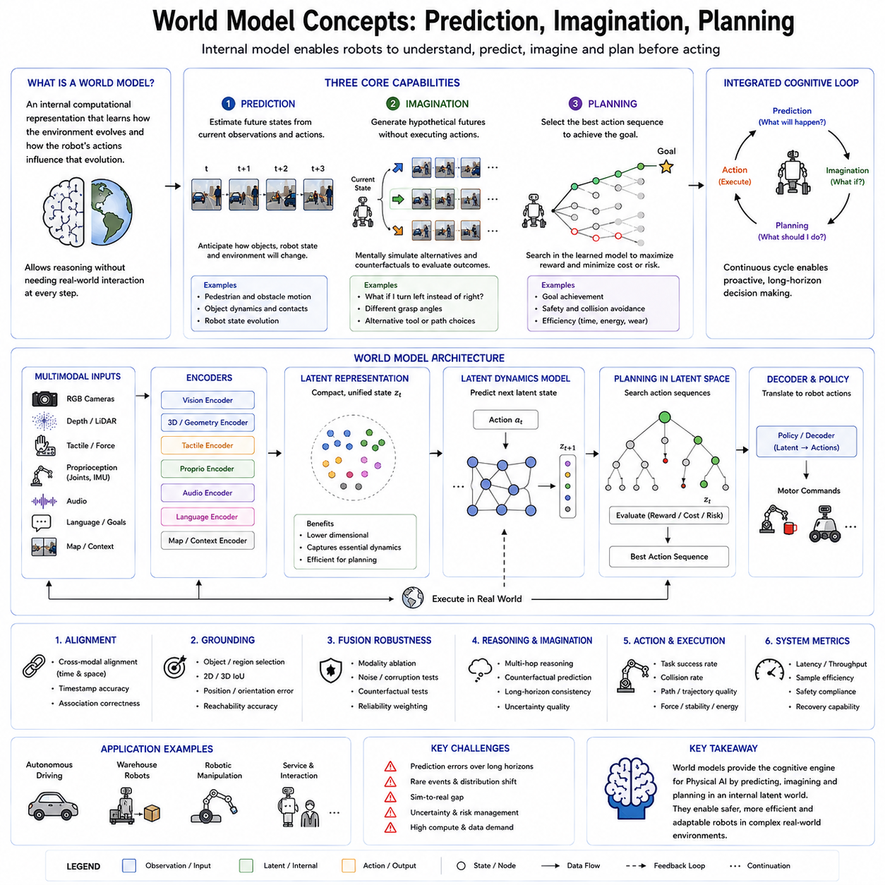
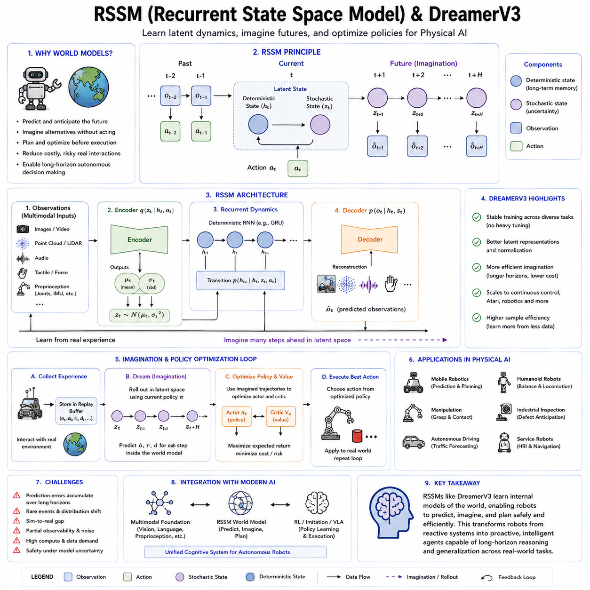
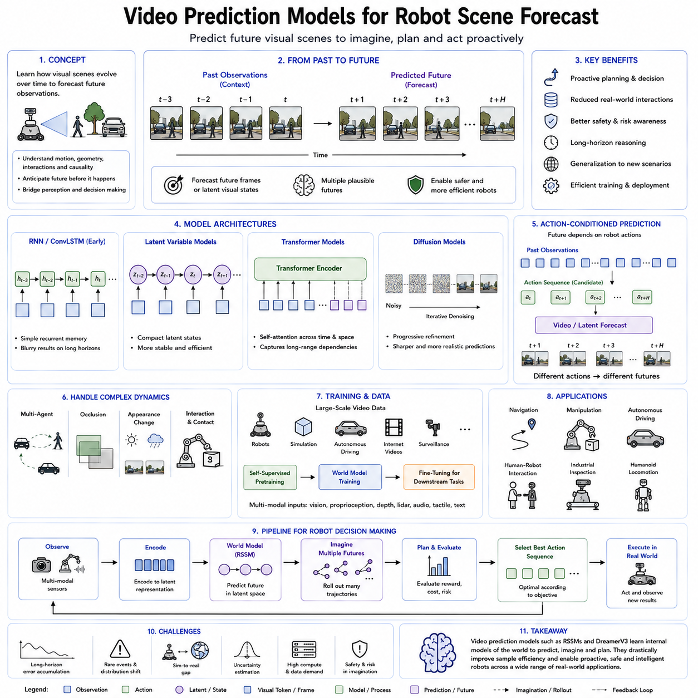
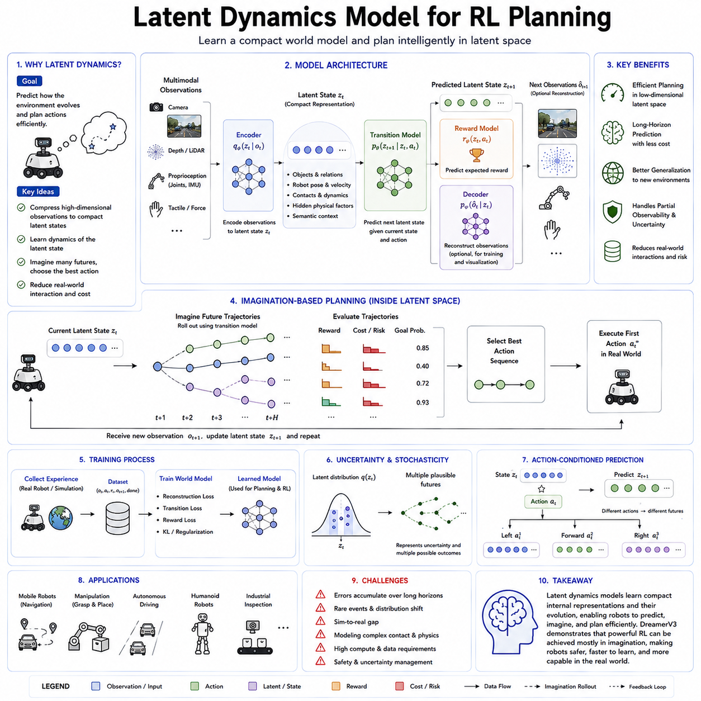
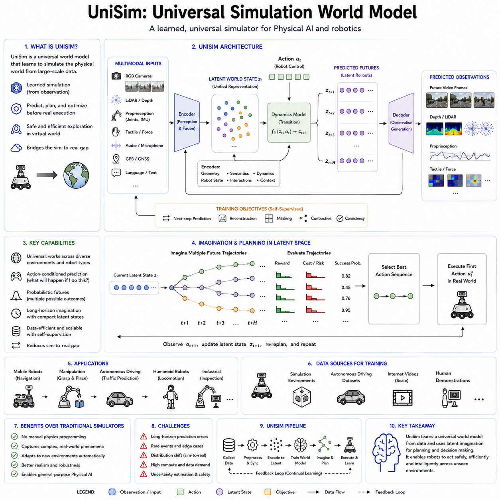
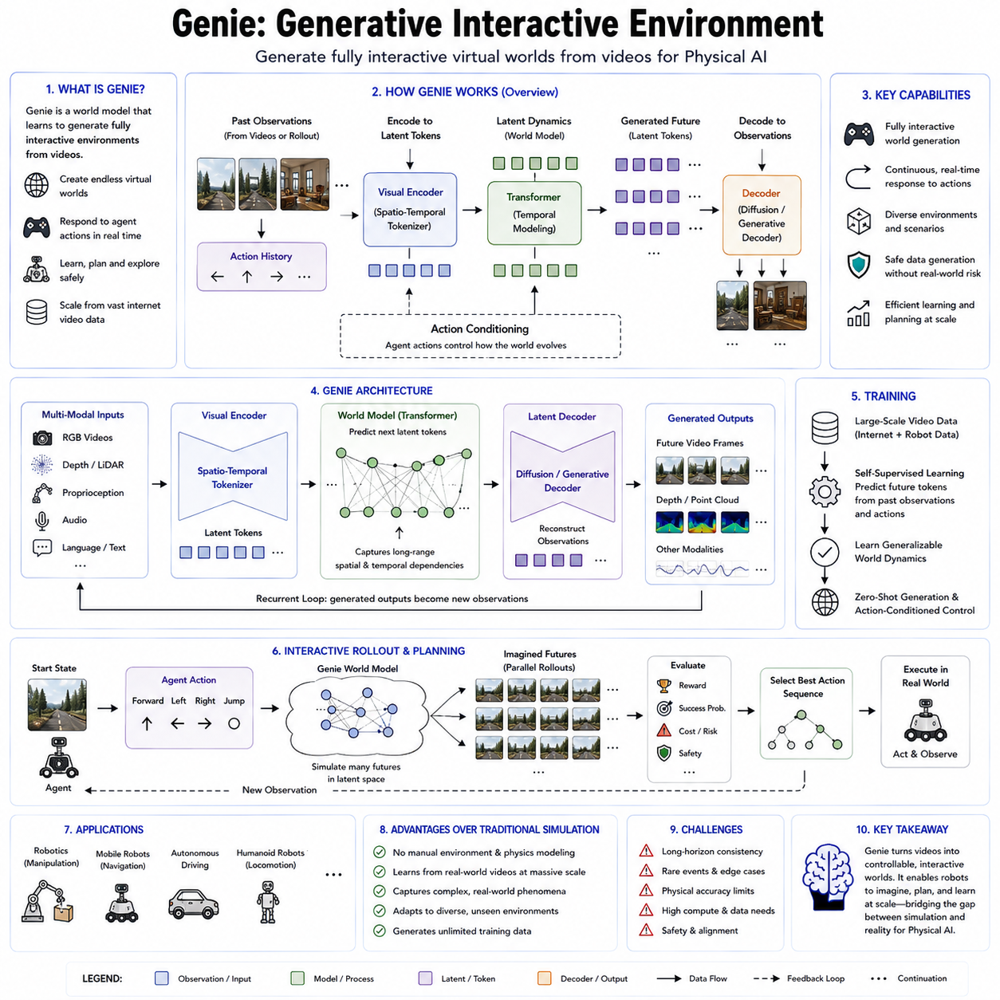
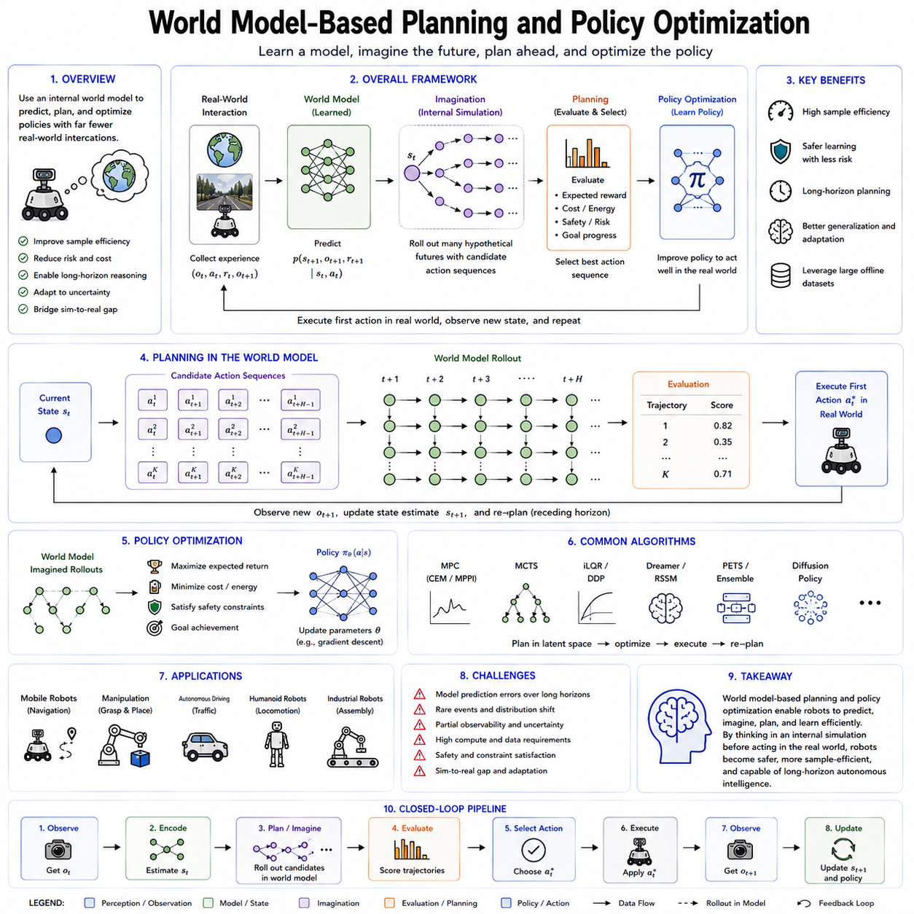
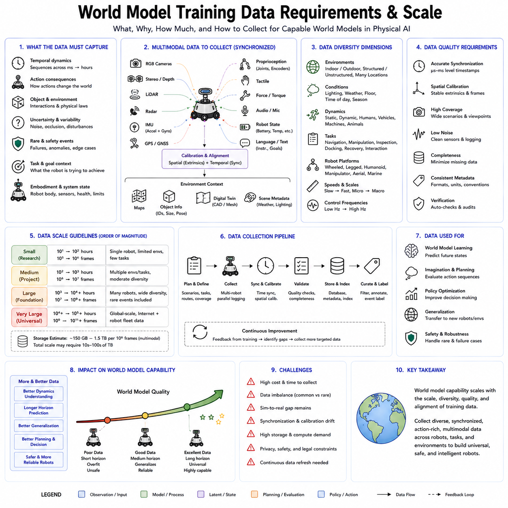
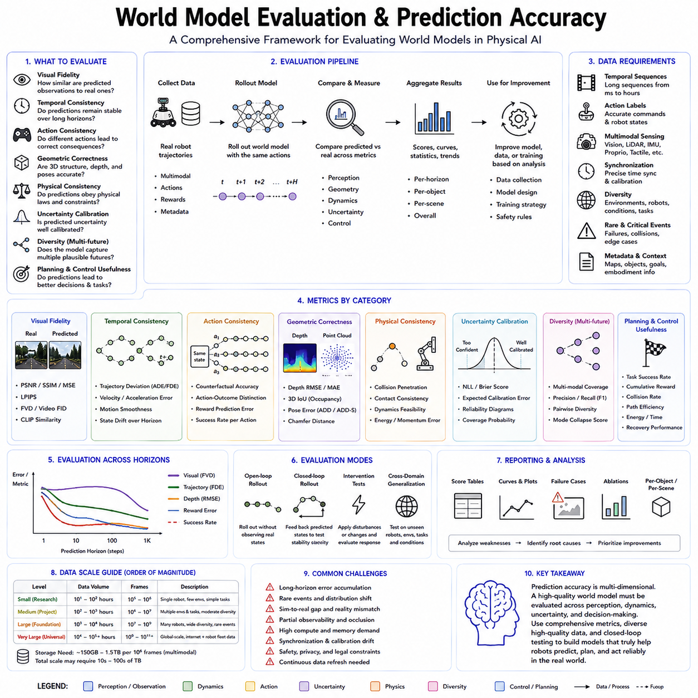
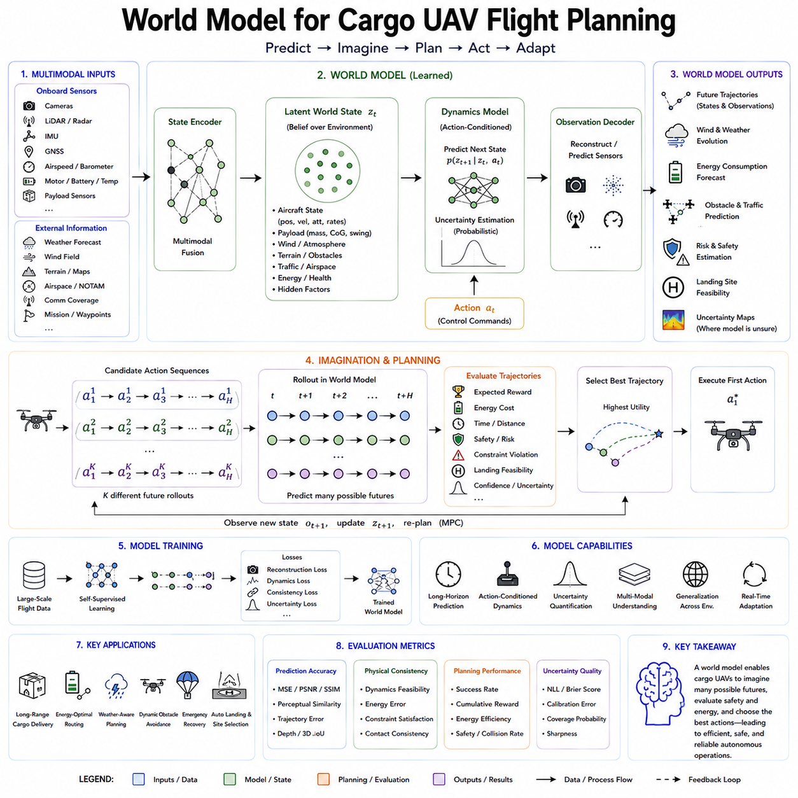

**Volume 18 Physical AI Foundation Models**

# 4. World Models

## 4.1 World Model Concepts Prediction Imagination Planning

{width="7.268055555555556in" height="7.268055555555556in"}

A world model is an internal computational representation that enables an intelligent agent to understand, predict, and reason about its environment without requiring direct interaction with the physical world at every step. Within the context of Physical AI and robot foundation models, a world model serves as the cognitive engine that allows robots to anticipate future events, imagine alternative outcomes, and evaluate multiple action sequences before executing them. Rather than simply reacting to sensory inputs, a robot equipped with a world model develops an internal understanding of how the environment evolves over time and how its own actions influence that evolution.

The concept of a world model originates from both cognitive science and control theory. Humans continuously build mental models of the surrounding world through observation and experience. These internal models allow people to predict the consequences of their actions, estimate hidden states, imagine hypothetical situations, and plan complex tasks before acting. Modern Physical AI seeks to reproduce similar capabilities using large-scale neural networks trained from massive multimodal data collected from real robots, simulation environments, videos, demonstrations, and interactive experiences.

Prediction is the first fundamental capability provided by a world model. Prediction refers to estimating future states based on current observations and candidate actions. Instead of only recognizing what currently exists, the model attempts to forecast what is likely to happen next. For a mobile robot, prediction includes estimating future positions of pedestrians, moving vehicles, dynamic obstacles, and changes in the environment. For a robotic manipulator, prediction involves anticipating object motion, grasp stability, contact dynamics, and possible collisions during manipulation. Accurate prediction reduces uncertainty and enables safer, more efficient autonomous behavior.

Unlike traditional perception systems that analyze only the present moment, predictive models explicitly learn temporal dynamics. They discover how objects move, how physical interactions unfold, and how environmental states evolve over time. This temporal understanding enables robots to react proactively rather than reactively. A warehouse robot, for example, can slow down before a human worker unexpectedly crosses its path because its world model predicts the future trajectory instead of waiting until the obstacle fully blocks the route.

The second core capability is imagination. In artificial intelligence, imagination does not imply consciousness or creativity in the human sense. Instead, it refers to the ability to generate hypothetical future scenarios inside an internal model. The robot can mentally simulate multiple possible futures without physically executing each action. This internal simulation dramatically improves learning efficiency because expensive or dangerous experiments no longer need to occur in the real world.

Imagination enables counterfactual reasoning, allowing the robot to ask questions such as "What would happen if I moved left instead of right?" or "What if I grasped the object from another angle?" Each hypothetical scenario can be evaluated within the learned latent space of the world model before selecting the safest or most efficient action. This capability is particularly valuable for industrial robots operating around expensive equipment, autonomous vehicles navigating crowded roads, and service robots interacting closely with humans.

Planning represents the third major function of a world model. Planning is the process of selecting an action sequence that maximizes the probability of successfully achieving a goal while minimizing cost, time, energy consumption, or safety risk. Rather than searching directly in the physical environment, modern planners increasingly search inside the learned latent state generated by the world model. Because latent representations are significantly smaller than raw sensor data, planning becomes computationally more efficient while preserving essential information about the environment.

A planning algorithm repeatedly predicts future states, evaluates expected rewards, compares multiple candidate trajectories, and selects the most promising sequence of actions. This process is similar to how experienced chess players mentally simulate many possible moves before deciding on one. The world model acts as an internal simulator that allows planning to occur rapidly without requiring expensive interaction with reality.

Prediction, imagination, and planning form a tightly integrated cognitive loop. Prediction estimates what is likely to occur next, imagination generates alternative possibilities beyond the most probable future, and planning chooses the optimal sequence of actions according to task objectives. Together, these capabilities transform robots from reactive systems into proactive decision-makers capable of long-horizon reasoning and autonomous problem solving.

Modern world models typically operate within latent spaces rather than directly modeling every pixel or sensor measurement. High-dimensional multimodal observations from RGB cameras, depth sensors, LiDAR, tactile sensors, force sensors, proprioception, and language instructions are first encoded into compact latent representations. The latent dynamics model then predicts how these hidden representations evolve after each action. Finally, planning algorithms optimize trajectories inside this latent space before decoding the resulting policy into executable motor commands.

Recent advances in transformer architectures, diffusion models, recurrent state-space models, and generative video models have significantly improved the capability of world models. Systems such as DreamerV3, Genie, UniSim, and other latent dynamics models demonstrate that learned simulations can approach the fidelity required for real robotic decision making. Instead of relying solely on manually designed physics engines, these systems learn environmental dynamics directly from experience, enabling adaptation to previously unseen tasks and environments.

In Physical AI foundation models, world models are increasingly integrated with multimodal foundation models, Vision-Language-Action architectures, reinforcement learning, imitation learning, and large-scale self-supervised pretraining. Language provides semantic goals, visual perception supplies environmental observations, proprioceptive sensing describes robot states, and the world model integrates these diverse information sources into a coherent predictive representation. The result is an intelligent system capable of understanding both physical dynamics and task semantics simultaneously.

Despite remarkable progress, world models remain imperfect approximations of reality. Prediction errors accumulate over long planning horizons, rare events remain difficult to model, and distribution shifts between simulation and reality can degrade performance. Consequently, uncertainty estimation, online adaptation, continual learning, and safety-aware planning remain active areas of research. Future Physical AI systems will likely combine learned world models with symbolic reasoning, explicit physics models, and continual interaction with the real world to produce increasingly robust, trustworthy, and general-purpose autonomous robots.

## 4.2 RSSM Recurrent State Space Model DreamerV3 [w/Code]

{width="7.268055555555556in" height="7.268055555555556in"}

Recurrent State-Space Models (RSSMs) represent one of the most influential architectures for modern world models in reinforcement learning and Physical AI. Their primary objective is to learn an internal representation of environmental dynamics that enables an intelligent agent to predict future observations, estimate hidden states, imagine hypothetical trajectories, and optimize policies without requiring continuous interaction with the real environment. RSSMs combine probabilistic state-space modeling with recurrent neural networks, allowing them to capture both deterministic temporal dependencies and stochastic uncertainties that naturally exist in physical systems. DreamerV3 is one of the most successful implementations of this approach and demonstrates that high-performance reinforcement learning can be achieved almost entirely within a learned latent world model.

Traditional reinforcement learning algorithms often require millions of interactions with the real environment before learning an effective policy. Such extensive exploration may be acceptable in simulation but becomes prohibitively expensive, slow, or even dangerous for physical robots. Every failed manipulation attempt, collision, or navigation error consumes time, energy, and hardware lifetime while potentially introducing safety risks. RSSMs address this limitation by learning an internal predictive model from collected experience. Once trained, the model enables the robot to perform most of its policy optimization inside imagination rather than through direct interaction with reality.

The underlying principle of an RSSM is to represent the environment using latent states rather than raw sensor observations. Camera images, LiDAR scans, force measurements, tactile signals, proprioceptive information, and other high-dimensional sensory inputs are compressed into compact latent variables that retain task-relevant information while discarding unnecessary details. These latent states provide a significantly more efficient representation for prediction, planning, and policy learning than operating directly on raw observations.

An RSSM generally consists of three tightly connected components: a deterministic recurrent state, a stochastic latent state, and observation models. The deterministic component maintains long-term temporal memory using recurrent neural network structures such as Gated Recurrent Units (GRUs). This memory summarizes historical information and captures long-range dependencies that cannot be inferred from a single observation. The stochastic component represents uncertainty and ambiguity in the environment. Since many real-world situations are inherently uncertain, multiple future outcomes may be possible even under identical current observations. By explicitly modeling probability distributions over latent variables, RSSMs can represent these alternative futures instead of producing only a single deterministic prediction.

Observation models connect the latent representation with the external world. The encoder transforms raw observations into latent variables, while the decoder reconstructs observations from the latent space. During training, reconstruction errors encourage the latent representation to preserve information necessary for accurately describing the environment. Simultaneously, transition models learn how latent states evolve when the robot performs actions, allowing the world model to predict future latent states over extended horizons.

A distinguishing feature of RSSMs is the integration of representation learning and dynamics learning into a unified probabilistic framework. Rather than separately learning visual perception, physical dynamics, and policy optimization, the model jointly optimizes all components through end-to-end learning. This integration allows latent representations to become increasingly specialized for prediction and decision making instead of merely reconstructing sensor data.

Dreamer introduced a new paradigm in which reinforcement learning occurs almost entirely within imagination generated by the world model. Instead of repeatedly interacting with the real environment, the agent first learns an RSSM from collected experience. Once the latent dynamics become sufficiently accurate, thousands of imagined trajectories can be generated entirely inside the learned latent space. Policy optimization and value estimation are then performed using these imagined rollouts, dramatically improving sample efficiency.

DreamerV3 significantly extends previous Dreamer versions by improving robustness, scalability, and generalization across diverse environments without requiring extensive hyperparameter tuning. Earlier reinforcement learning algorithms often required environment-specific parameter adjustments to achieve good performance. DreamerV3 introduces architectural improvements and normalization techniques that enable a single configuration to perform consistently across continuous control tasks, Atari games, robotics environments, and many other domains.

One important innovation in DreamerV3 is its emphasis on stable representation learning across highly diverse observations. The latent world model must simultaneously encode visual appearance, physical dynamics, temporal consistency, reward structure, and task-relevant semantics while remaining computationally efficient. DreamerV3 achieves this through improved optimization strategies that maintain stable latent representations even during long training processes involving millions of environment transitions.

Another major contribution is the efficient use of imagined rollouts. Since imagination occurs within compact latent spaces instead of pixel space, computational requirements are substantially reduced. Thousands of hypothetical futures can be evaluated much faster than would be possible using image-level simulations or physics engines. This efficiency enables long-horizon planning while reducing GPU computation and memory consumption.

For Physical AI, RSSMs and DreamerV3 provide several important advantages. Mobile robots can predict pedestrian movement, estimate future obstacle configurations, and evaluate alternative navigation paths before execution. Manipulation robots can imagine multiple grasp strategies, estimate contact dynamics, and select stable manipulation trajectories. Autonomous vehicles can forecast surrounding traffic behavior and optimize driving decisions using internally simulated future scenarios. Humanoid robots can anticipate balance changes, evaluate locomotion stability, and coordinate whole-body movements through predictive internal simulation.

RSSMs also naturally support partially observable environments. Real robots rarely observe the complete environment because sensors have limited fields of view, measurement noise, occlusions, and communication delays. The recurrent hidden state accumulates information over time, allowing the robot to infer hidden variables that cannot be directly measured at the current moment. This capability is particularly valuable for long-duration autonomous missions where complete environmental information is never available.

Despite their remarkable success, RSSMs remain approximate models of reality. Prediction accuracy gradually decreases over long imagination horizons because small modeling errors accumulate through repeated latent transitions. Rare events, unexpected environmental changes, and complex contact dynamics remain challenging to learn accurately. Consequently, uncertainty estimation, online adaptation, continual learning, and hybrid integration with explicit physics models remain active research directions for future world-model architectures.

As Physical AI foundation models continue to evolve, RSSMs are increasingly combined with transformer architectures, multimodal representation learning, diffusion-based action generation, and Vision-Language-Action models. Future systems will likely integrate symbolic reasoning, semantic memory, large language models, and latent world models into unified cognitive architectures capable of understanding, predicting, planning, and acting across highly complex real-world environments. In this vision, DreamerV3 represents not merely a reinforcement learning algorithm but an important milestone toward general-purpose autonomous intelligence built upon learned internal models of the physical world.

## 4.3 Video Prediction Models for Robot Scene Forecast [w/Code]

{width="7.268055555555556in" height="7.268055555555556in"}

Video prediction models are a class of generative world models that learn to forecast the future evolution of visual scenes from sequences of past observations. Instead of predicting only abstract latent states or scalar variables, these models estimate how an entire scene will appear over the coming seconds by generating future image frames or latent visual representations. Within Physical AI, video prediction serves as a bridge between perception and decision making because it allows robots to anticipate environmental changes before they actually occur. By internally simulating future visual observations, robots gain the ability to plan proactively rather than merely reacting to current sensor inputs.

The concept of video prediction originates from the observation that intelligent behavior requires understanding not only the present state of the environment but also how that state evolves over time. Humans continuously imagine how objects, people, and surrounding environments will move in the near future. A person catching a ball predicts its trajectory before extending a hand. A driver anticipates how surrounding vehicles will behave before changing lanes. A warehouse worker estimates where another robot will arrive before entering an intersection. These predictive abilities are fundamental to efficient interaction with dynamic environments, and video prediction models seek to provide similar capabilities for autonomous robots.

Unlike traditional computer vision systems that analyze individual frames independently, video prediction models explicitly learn temporal dynamics across consecutive observations. They model how objects translate, rotate, deform, appear, disappear, or interact over time. The objective is not simply image generation but understanding the underlying physical processes responsible for visual change. This distinction is particularly important because accurate prediction requires reasoning about motion, geometry, causality, and physical constraints rather than memorizing image patterns.

Early video prediction approaches relied primarily on recurrent neural networks and convolutional Long Short-Term Memory (ConvLSTM) architectures. These models encoded a sequence of images into hidden states and generated future frames recursively. Although effective for relatively simple motion patterns, they often suffered from blurry predictions because minimizing pixel reconstruction loss encouraged averaging across multiple possible futures. As prediction horizons increased, accumulated errors gradually degraded image quality and motion realism.

The introduction of variational latent variable models significantly improved predictive capability. Instead of directly generating pixels, these methods learned compact latent representations describing scene dynamics. Latent variables encoded object motion, environmental changes, and hidden factors influencing future observations. Since latent representations capture semantic information rather than individual pixel values, prediction became more stable and computationally efficient while reducing unnecessary visual detail.

Transformer architectures further advanced video prediction by replacing recurrent processing with self-attention mechanisms capable of modeling long-range spatial and temporal dependencies. Every frame can attend to previous observations regardless of temporal distance, allowing the model to capture complex interactions among multiple moving objects. Transformers also scale effectively with large datasets, making them particularly suitable for foundation models trained on millions of video sequences collected from robots, autonomous vehicles, simulation environments, surveillance systems, and internet-scale multimedia sources.

More recently, diffusion models have emerged as one of the most powerful approaches for video generation and forecasting. Rather than predicting future frames in a single step, diffusion models iteratively denoise latent representations until realistic future scenes emerge. This progressive generation process enables sharper visual quality, greater temporal consistency, and improved modeling of uncertainty. Since multiple future outcomes may be physically plausible, diffusion-based video prediction naturally supports diverse hypotheses instead of forcing the model to commit to only one deterministic future.

Video prediction models may operate directly in pixel space or within learned latent spaces. Pixel-space prediction reconstructs complete future images but requires significant computational resources because every pixel must be generated. Latent-space prediction instead forecasts compressed feature representations extracted by visual encoders. These latent dynamics preserve task-relevant information while dramatically reducing computational complexity. Modern Physical AI systems increasingly favor latent video prediction because planning and policy optimization can occur efficiently within compact feature spaces before optional reconstruction into visual images.

An important characteristic of robot scene forecasting is action-conditioned prediction. Future observations depend not only on environmental dynamics but also on the robot\'s own actions. A mobile robot turning left observes a different future scene than one moving forward. A manipulator extending its arm changes camera viewpoints, object positions, and contact conditions. Consequently, modern video prediction models receive both sensory observations and candidate control actions as inputs. The predicted future therefore reflects how the environment is expected to evolve under specific action sequences, making the model suitable for planning and reinforcement learning.

Another critical capability is modeling interactions between dynamic agents. Real environments rarely contain only static objects. Humans, vehicles, robots, animals, and moving machinery continuously influence one another. Effective video prediction models must capture multi-agent interactions, collision avoidance behavior, cooperative motion, and social navigation patterns. Rather than independently forecasting each object, advanced architectures learn relational dynamics describing how one agent\'s actions influence the trajectories of others.

Prediction uncertainty plays a central role in scene forecasting. Future events are inherently probabilistic because multiple outcomes may be consistent with the current observations. A pedestrian approaching an intersection may continue straight, turn left, or stop unexpectedly. A moving obstacle may accelerate or decelerate. Instead of generating only a single predicted future, probabilistic video prediction models estimate distributions over possible futures. These uncertainty estimates allow downstream planning algorithms to account for risk, avoid dangerous assumptions, and select actions that remain safe across multiple plausible scenarios.

Training video prediction models requires large-scale sequential datasets containing synchronized visual observations, robot actions, timestamps, and optionally depth information, semantic labels, force measurements, or proprioceptive signals. Self-supervised learning plays an essential role because future frames naturally provide supervision without requiring manual annotation. By predicting unseen future observations from past sequences, the model automatically learns temporal structure, object permanence, motion regularities, and physical consistency. This makes video prediction an attractive pretraining objective for robot foundation models.

Video prediction is closely related to world models but differs in emphasis. A world model aims to capture the complete dynamics of an environment, including latent physical states, rewards, goals, and action consequences. Video prediction focuses specifically on forecasting future visual observations. However, modern world models increasingly integrate video prediction as one component of a larger predictive architecture. Visual forecasting supplies interpretable future observations that complement latent dynamics models used for planning and policy optimization.

In mobile robotics, video prediction improves autonomous navigation by forecasting pedestrian trajectories, obstacle movements, traffic flow, and environmental changes before they occur. Warehouse robots can anticipate congestion at intersections, autonomous forklifts can estimate pallet movement, and delivery robots can predict door openings or human crossings. Instead of responding only after new sensor measurements arrive, these robots proactively modify speed, direction, and path selection based on predicted future scenes.

For robotic manipulation, video prediction enables anticipation of object motion during grasping, pushing, insertion, assembly, and deformable object handling. The robot can estimate how an object will rotate after contact, predict slippage before it occurs, and evaluate whether a planned manipulation sequence is likely to succeed. Predictive visual simulation significantly reduces trial-and-error exploration while improving safety and execution efficiency.

Autonomous driving systems also benefit extensively from video prediction. Future camera observations help estimate vehicle trajectories, lane occupancy, traffic signal evolution, cyclist behavior, and pedestrian intentions. Combined with LiDAR, radar, and high-definition maps, predicted video sequences contribute to safer trajectory planning under highly dynamic urban conditions. Similar techniques extend naturally to cargo UAVs, agricultural robots, construction machines, and humanoid robots operating in crowded environments.

Recent foundation models increasingly unify video prediction with multimodal learning. Visual observations are combined with language instructions, proprioceptive sensing, tactile feedback, audio signals, and semantic memory to construct richer predictive representations. Instead of forecasting only images, future models predict entire multimodal experiences describing how the environment will appear, sound, feel, and respond to robot actions. Such integrated prediction forms an important step toward general-purpose embodied intelligence capable of reasoning across perception, action, and language within a unified world model.

Despite substantial progress, video prediction remains a challenging research area. Long-horizon predictions accumulate errors, small inaccuracies in motion estimation can amplify over time, and rare events remain difficult to anticipate because they appear infrequently in training data. Occlusions, lighting changes, weather variations, sensor noise, and complex physical interactions further increase prediction difficulty. Ongoing research therefore focuses on uncertainty-aware forecasting, diffusion-based generative models, transformer-based temporal reasoning, physics-informed learning, multimodal world models, and continual adaptation from real-world experience.

As Physical AI foundation models continue to evolve, video prediction is expected to become a core capability supporting autonomous reasoning, planning, and decision making. Rather than serving only as a computer vision task, future video prediction models will function as dynamic simulators embedded within robot cognition. By allowing robots to internally visualize multiple possible futures before acting, these models provide a critical foundation for safer, more intelligent, and more autonomous robotic systems operating across diverse real-world environments.

## 4.4 Latent Dynamics Model for RL Planning [w/Code]

{width="7.268055555555556in" height="7.268055555555556in"}

Latent dynamics models represent one of the most important developments in modern model-based reinforcement learning and Physical AI. Instead of predicting future observations directly in high-dimensional sensory spaces such as images, point clouds, or raw sensor measurements, latent dynamics models learn compact internal representations that capture the essential structure of the environment. Planning and decision making are then performed within this compressed latent space, allowing intelligent agents to reason about future consequences efficiently while avoiding the enormous computational cost associated with modeling every observable detail. As a result, latent dynamics models have become a foundational technology for world models, autonomous robotics, and large-scale Physical AI foundation models.

The central motivation behind latent dynamics modeling is the observation that raw sensory data contains enormous redundancy. A high-resolution camera image may contain millions of pixel values, yet only a small subset of the information is actually relevant for making decisions. Similarly, LiDAR scans, depth images, tactile measurements, force sensors, and proprioceptive observations all contain details that may not directly influence the robot\'s task. Rather than learning to predict every pixel or measurement, latent dynamics models seek to discover compact representations that preserve task-relevant physical information while eliminating unnecessary complexity.

The concept originates from representation learning and state-space modeling. A robot first transforms multimodal observations into a latent state using an encoder network. This latent state is not directly interpretable as an image or physical measurement but instead represents a compressed description of the environment. The latent representation may encode object identities, spatial relationships, robot configuration, velocities, contact conditions, semantic context, environmental constraints, and hidden physical variables that cannot be observed directly. The objective is to produce an internal state that is both information-rich and computationally efficient.

Once the latent representation has been constructed, the latent dynamics model learns how this internal state evolves over time under different robot actions. Instead of predicting future images, the model predicts future latent states. These transitions are governed by learned dynamics functions that approximate how the environment changes in response to control commands and external events. Because latent vectors are significantly smaller than raw observations, long-horizon prediction becomes considerably more efficient while maintaining the information necessary for planning.

A latent dynamics model typically consists of four tightly integrated components. The encoder transforms observations into latent variables. The transition model predicts how latent states evolve after actions are applied. The reward model estimates expected rewards associated with predicted states, while the decoder optionally reconstructs observations from latent representations when visual interpretation or reconstruction loss is required. During training, these components are optimized jointly so that the latent representation becomes useful not only for reconstruction but also for prediction, policy learning, and decision making.

One of the greatest advantages of latent dynamics models is their ability to support imagination-based planning. Since future latent states can be generated internally without interacting with the physical world, reinforcement learning algorithms can simulate thousands of possible action sequences inside the learned world model. Every imagined trajectory represents a hypothetical future that can be evaluated according to expected rewards, safety constraints, task completion probability, energy consumption, or execution time. The robot therefore performs extensive reasoning before committing to physical actions.

Compared with pixel-level prediction, latent dynamics modeling dramatically reduces computational complexity. Predicting future RGB images requires generating millions of pixel values for every timestep. In contrast, latent spaces often contain only hundreds or thousands of numerical features. This reduction allows planners to simulate much longer time horizons while consuming substantially less memory and computation. For robots operating under real-time constraints, such computational efficiency is essential because planning must occur within milliseconds rather than seconds.

Another important benefit is improved generalization. Raw sensory observations often vary because of lighting conditions, camera viewpoints, sensor noise, weather, background appearance, or other irrelevant environmental changes. These superficial variations may complicate learning if prediction occurs directly in observation space. Latent representations instead focus on invariant properties that remain important across different conditions. Consequently, latent dynamics models often generalize more effectively to unseen environments than pixel-based prediction systems.

Latent dynamics models are particularly valuable for partially observable environments. Physical robots rarely have access to complete environmental information at every moment. Objects may become temporarily occluded, sensors have limited fields of view, measurements contain noise, and communication delays may prevent immediate observation updates. To address these limitations, many latent dynamics models incorporate recurrent neural networks or transformer memory mechanisms that accumulate information across time. The resulting latent state summarizes both current observations and historical experience, allowing the robot to infer hidden environmental variables even when direct measurements are unavailable.

Reinforcement learning planning within latent spaces follows a cyclic process. The robot first observes the current environment and encodes sensory information into a latent state. Candidate action sequences are then simulated using the latent transition model. For every predicted trajectory, the reward model estimates cumulative future returns while optional value networks estimate long-term outcomes beyond the planning horizon. Planning algorithms compare alternative trajectories and select the action sequence with the highest expected utility. After executing one or more actions in the real world, new observations are incorporated into the latent representation, and the planning cycle repeats continuously.

Model Predictive Control (MPC) integrates naturally with latent dynamics models. Instead of planning an entire mission only once, MPC repeatedly optimizes future action sequences inside the latent world model while executing only the first action of the selected plan. After receiving updated observations, planning is repeated using the new latent state. This receding horizon strategy enables robots to adapt continuously to changing environments while maintaining computational efficiency.

Several optimization algorithms are commonly used for latent-space planning. Gradient-based optimization computes action sequences by differentiating expected rewards through the latent dynamics model. Sampling-based planners evaluate thousands of randomly generated candidate trajectories before selecting the most promising one. Evolutionary optimization methods iteratively improve action populations without requiring gradient information. More recently, diffusion-based planners and transformer-based action generators have demonstrated remarkable performance by directly generating optimized action trajectories conditioned on latent environmental states.

The success of latent dynamics models depends heavily on the quality of learned representations. If the latent space fails to preserve information relevant for future decision making, planning performance deteriorates regardless of the optimization algorithm. Consequently, representation learning has become an active research area. Self-supervised learning objectives encourage latent variables to capture temporal consistency, object permanence, causal relationships, controllable factors, and physical interactions. Contrastive learning, masked prediction, predictive coding, and multimodal alignment further improve representation quality without requiring extensive manual annotations.

Latent dynamics models also support uncertainty estimation. Since future environmental evolution is inherently probabilistic, many architectures represent latent states using probability distributions rather than deterministic vectors. Bayesian neural networks, variational inference, ensemble models, and stochastic latent variables provide confidence estimates for future predictions. During planning, uncertainty can be incorporated into risk-sensitive decision making, allowing robots to avoid actions whose predicted outcomes remain highly uncertain. This capability is particularly important for safety-critical applications involving autonomous driving, industrial manipulation, healthcare robotics, and human-robot collaboration.

In Physical AI, latent dynamics models provide significant advantages across multiple robotic domains. Mobile robots use latent planning to navigate dynamic environments while anticipating obstacle motion and traffic flow. Manipulation robots predict object behavior during grasping, pushing, insertion, and assembly tasks without requiring expensive physical experimentation. Quadruped robots estimate terrain dynamics before foot placement, improving locomotion stability on uneven ground. Humanoid robots reason about whole-body balance, contact transitions, and coordinated movement through predictive latent simulations. Autonomous drones forecast future flight conditions while compensating for environmental disturbances and vehicle dynamics.

Large-scale robot foundation models increasingly integrate latent dynamics with multimodal representation learning. Visual observations, language instructions, force sensing, tactile information, proprioception, semantic maps, and mission objectives are encoded into unified latent spaces where planning occurs across multiple information modalities simultaneously. Rather than treating perception, reasoning, and action as separate modules, these architectures learn joint representations supporting end-to-end autonomous decision making. Such unified latent world models are expected to become a fundamental component of future Vision-Language-Action systems and general-purpose embodied intelligence.

Despite their remarkable advantages, latent dynamics models still face significant challenges. Prediction errors accumulate over long planning horizons, causing imagined trajectories to gradually diverge from reality. Rare events and unexpected environmental changes remain difficult to model accurately because they appear infrequently in training data. Contact-rich manipulation, deformable object interactions, fluid dynamics, and complex multi-agent behaviors continue to present substantial modeling difficulties. Furthermore, ensuring that latent representations remain interpretable while preserving computational efficiency remains an open research problem.

Current research therefore focuses on improving latent representation quality, integrating explicit physical constraints with learned dynamics, developing uncertainty-aware planning algorithms, enabling continual online adaptation, and scaling latent world models using transformer architectures and foundation model pretraining. Emerging approaches combine symbolic reasoning, causal inference, diffusion generative models, graph neural networks, and multimodal transformers within unified latent dynamics frameworks capable of reasoning across perception, language, action, and long-term memory.

As Physical AI progresses toward increasingly autonomous robotic systems, latent dynamics models are expected to serve as the computational core of intelligent planning. Rather than reacting directly to raw sensory observations, future robots will continuously build compact internal representations of the world, imagine alternative futures, evaluate competing strategies, estimate uncertainty, and optimize actions before interacting with reality. This ability to reason efficiently within latent representations provides a practical pathway toward scalable, sample-efficient, and general-purpose robot intelligence capable of operating safely and effectively across diverse real-world environments.

## 4.5 UniSim Universal Simulation World Model [w/Code]

{width="7.268055555555556in" height="7.268055555555556in"}

Universal Simulation (UniSim) represents a new generation of world models that aim to unify perception, prediction, simulation, and planning within a single learned framework. Unlike conventional robotics simulators that depend on manually designed physics engines and handcrafted environmental models, UniSim learns to simulate the physical world directly from large-scale multimodal data. Its objective is to construct a universal predictive environment where intelligent agents can safely explore, learn, plan, and optimize behaviors before interacting with the real world. As Physical AI continues to evolve toward increasingly general-purpose robot intelligence, UniSim demonstrates how learned simulation can become the computational foundation for autonomous reasoning and decision making across many different robotic domains.

Traditional simulation environments such as Gazebo, MuJoCo, Isaac Sim, Webots, or Unity-based simulators rely heavily on explicit physical modeling. Engineers manually define rigid-body dynamics, friction coefficients, collision geometries, sensor characteristics, lighting conditions, and object behaviors. While these simulators provide accurate physical computation under known assumptions, they often require significant engineering effort to model every new environment. Furthermore, manually constructed simulations frequently exhibit a simulation-to-reality gap because numerous real-world phenomena remain difficult to model precisely, including complex contact dynamics, deformable materials, weather conditions, sensor imperfections, and unpredictable human behavior.

UniSim approaches simulation from a fundamentally different perspective. Rather than explicitly programming every physical rule, the system learns environmental dynamics directly from observation. Massive collections of videos, robot trajectories, autonomous driving datasets, multimodal sensor recordings, human demonstrations, and interactive experiences become the training data from which the simulation model infers how the physical world behaves. Instead of relying solely on predefined equations, UniSim develops statistical representations capable of predicting realistic future states under a wide variety of situations.

The central concept behind UniSim is the construction of a universal world model capable of representing many different environments using a common latent representation. Indoor warehouses, factories, office buildings, outdoor roads, agricultural fields, construction sites, airports, hospitals, and domestic environments all become different instances of the same underlying predictive framework. Rather than training completely separate simulation systems for every application, a universal simulator learns shared physical principles while adapting to domain-specific characteristics through conditioning information.

At the core of UniSim lies multimodal representation learning. Modern robots perceive the environment through numerous sensing modalities, including RGB cameras, stereo vision, LiDAR, radar, depth cameras, inertial measurement units, tactile sensors, force sensors, wheel encoders, joint encoders, GPS or GNSS receivers, microphones, and language instructions. UniSim integrates these heterogeneous observations into unified latent representations that describe both the geometry and semantics of the environment. Because planning occurs within these shared representations, information from one sensing modality can complement uncertainty in another, resulting in more robust environmental understanding.

Temporal modeling is another defining characteristic of UniSim. The system must not only recognize the current scene but also understand how it evolves over time. Moving vehicles, walking pedestrians, robotic manipulators, conveyor systems, opening doors, changing traffic lights, weather transitions, and object interactions all follow dynamic processes that unfold continuously. UniSim therefore learns temporal dynamics capable of predicting future environmental states over both short and long planning horizons. These predictions provide the foundation for proactive robot behavior rather than purely reactive control.

Unlike conventional simulators that execute deterministic physical equations, UniSim incorporates probabilistic reasoning into simulation. Real environments contain unavoidable uncertainty arising from noisy sensors, hidden variables, human decisions, changing weather, unexpected disturbances, and incomplete observations. Instead of generating only one future, UniSim estimates distributions over multiple plausible futures. Such probabilistic simulation enables downstream planning algorithms to evaluate risk, quantify confidence, and select actions that remain safe even when future outcomes cannot be predicted with certainty.

One of UniSim\'s most important capabilities is action-conditioned simulation. Environmental evolution depends not only on external events but also on the actions chosen by the robot itself. A mobile robot turning left will observe different future scenes than one accelerating forward. A robotic arm approaching an object from different angles changes future contact dynamics. A drone adjusting altitude experiences different visual perspectives and aerodynamic conditions. Consequently, UniSim predicts future environments conditioned on candidate control sequences, allowing planners to evaluate the consequences of alternative decisions before executing them in reality.

Large-scale self-supervised learning enables UniSim to exploit enormous quantities of unlabeled data. Every observed sequence naturally provides supervision because future observations are already contained within recorded experiences. During training, the model predicts unseen future sensor measurements, reconstructs missing observations, estimates latent environmental states, and learns long-term temporal consistency without requiring manually annotated labels. This scalability makes UniSim particularly suitable for robot foundation models trained on millions of hours of robotic interaction and internet-scale video data.

UniSim also supports imagination-based reinforcement learning. Once the universal simulation model has learned sufficiently accurate dynamics, reinforcement learning algorithms can perform policy optimization entirely within the learned simulation environment. Thousands of hypothetical trajectories are generated internally, allowing robots to evaluate rewards, safety constraints, energy consumption, mission completion probability, and execution efficiency before interacting with physical hardware. This dramatically reduces the amount of real-world experimentation required while simultaneously improving learning efficiency and operational safety.

Another important contribution of UniSim is its ability to support cross-domain generalization. Traditional simulators are usually constructed for specific tasks or environments, requiring extensive redesign whenever robots are deployed in new locations. A universal simulation model instead captures physical principles that remain valid across multiple domains. Concepts such as gravity, object permanence, collision dynamics, momentum, friction, visibility, and geometric constraints apply whether a robot operates in a warehouse, hospital, airport, or factory. By learning these shared principles, UniSim provides significantly stronger transfer capabilities than domain-specific simulation systems.

For autonomous driving, UniSim enables vehicles to predict surrounding traffic behavior, estimate future occupancy, simulate lane changes, evaluate emergency maneuvers, and analyze rare traffic scenarios that would be difficult or dangerous to reproduce physically. Instead of relying solely on recorded data, the simulator generates realistic hypothetical situations that improve policy robustness under highly dynamic conditions.

Industrial robotics benefits similarly from universal simulation. Robotic manipulators can evaluate assembly strategies, optimize grasp sequences, estimate contact forces, and simulate collaborative interactions with human workers before physical execution. Warehouse robots can predict congestion, coordinate fleet movements, and optimize task allocation within simulated environments. Construction robots can analyze changing site conditions while agricultural robots forecast crop growth, terrain changes, and environmental variability over extended periods.

Humanoid robots represent another important application area. Because humanoids interact with highly unstructured environments, exhaustive manual simulation becomes nearly impossible. UniSim enables humanoids to learn walking strategies, manipulation behaviors, whole-body coordination, and social interaction policies within continuously evolving simulated environments generated directly from real-world experience. Such learning significantly reduces hardware wear while accelerating the acquisition of complex motor skills.

Recent advances in transformer architectures, diffusion models, graph neural networks, neural radiance fields, Gaussian splatting, and latent world models have substantially improved the realism of learned simulation. Transformer-based temporal reasoning captures long-range dependencies between events. Diffusion models generate highly realistic future observations while naturally modeling uncertainty. Neural scene representations reconstruct complex three-dimensional geometry from sparse observations. Graph neural networks represent interactions among multiple dynamic agents. Together these technologies enable UniSim to simulate increasingly realistic environments with high visual fidelity and physically plausible dynamics.

A particularly valuable feature of UniSim is its integration with digital twins. Physical infrastructure, manufacturing systems, logistics facilities, and robot fleets can be mirrored continuously inside learned simulation environments. Real-time sensor streams update the latent world model while simulation predicts future operational states. This combination enables predictive maintenance, operational optimization, anomaly detection, mission planning, and resource allocation using continuously synchronized digital representations of the physical world.

Despite its remarkable promise, UniSim also faces significant technical challenges. Long-horizon prediction errors accumulate over time, causing simulated trajectories to diverge gradually from reality. Rare safety-critical events remain difficult to learn because they occur infrequently within training data. Highly deformable materials, complex fluid dynamics, chemical processes, and intricate human social interactions continue to exceed the capabilities of current learned simulation models. Moreover, maintaining computational efficiency while representing environments of increasing complexity remains an ongoing research problem.

Future UniSim systems are expected to combine learned world models with explicit physics engines, symbolic reasoning, causal inference, semantic memory, and large language models. Rather than replacing traditional simulation completely, learned simulation will increasingly complement analytical physical models where each approach performs best. Foundation models will provide semantic understanding and general reasoning, while universal simulation will provide predictive environmental dynamics and action evaluation. Together these technologies will form unified cognitive architectures capable of perception, imagination, planning, reasoning, and autonomous execution across diverse physical environments.

As Physical AI progresses toward increasingly capable general-purpose robots, UniSim illustrates a fundamental transition from manually engineered simulation toward learned universal environmental modeling. Instead of programming every physical interaction explicitly, future intelligent systems will continuously learn, refine, and expand their internal simulations through experience. Universal simulation world models therefore represent not merely a new simulation technology but a foundational computational framework for scalable robot intelligence, enabling autonomous systems to understand, predict, and safely interact with the real world across an unprecedented range of tasks and environments.

## 4.6 Genie Generative Interactive Environment [w/Code]

{width="7.268055555555556in" height="7.268055555555556in"}

Generative Interactive Environments, exemplified by Google\'s Genie family of models, represent a significant milestone in the evolution of world models for Physical AI. Unlike conventional simulators that rely on manually constructed environments or traditional world models that primarily predict future observations, Genie aims to generate fully interactive virtual worlds directly from visual observations. These generated environments are not merely passive videos but dynamic worlds that respond to the actions of an intelligent agent. This capability transforms static visual data into interactive simulations where robots can explore, learn, plan, and acquire new behaviors without requiring explicit environment engineering. As Physical AI progresses toward increasingly autonomous systems, generative interactive environments provide a scalable foundation for learning from the enormous quantity of visual data available across the internet and real-world robotic deployments.

The motivation behind Genie originates from one of the fundamental limitations of robotics. Collecting real-world interaction data is expensive, time-consuming, and potentially unsafe. Every robotic experiment requires physical hardware, controlled environments, human supervision, maintenance, and considerable operational costs. Traditional simulation partially addresses this problem by allowing robots to practice inside virtual environments. However, building realistic simulators requires extensive manual modeling of geometry, physics, object properties, lighting conditions, textures, and interaction rules. Such engineering efforts limit scalability because every new environment demands significant human labor.

Genie proposes a radically different approach. Instead of explicitly programming environments, the model learns to generate interactive worlds directly from large collections of videos. During training, Genie observes millions of visual sequences containing objects, people, vehicles, animals, buildings, natural environments, and countless forms of motion. Through self-supervised learning, it discovers the underlying temporal and spatial regularities governing environmental evolution. Rather than memorizing videos, Genie learns a generative model capable of producing entirely new interactive environments that obey learned physical and semantic constraints.

A defining characteristic of Genie is that it generates controllable environments rather than fixed future predictions. Traditional video prediction estimates what is likely to happen next given previous observations. Genie extends this idea by conditioning future generation on agent actions. The generated world therefore evolves according to control inputs such as moving forward, turning, reaching, grasping, pushing, or navigating. Every action influences the generated environment, allowing the model to function as an interactive simulator instead of a passive predictor. This interaction capability makes Genie particularly valuable for reinforcement learning, planning, and autonomous robot training.

The underlying architecture combines advances in generative modeling, latent representation learning, transformer-based sequence modeling, and world model research. Visual observations are first encoded into compact latent representations describing both scene geometry and semantic structure. Instead of predicting pixels directly, Genie models the evolution of these latent representations under different actions. Generative decoders subsequently reconstruct realistic visual observations from latent states, producing coherent videos that maintain spatial consistency, temporal continuity, and physically plausible object interactions.

Transformer architectures play an essential role in Genie because they efficiently model long-range dependencies across both space and time. Unlike recurrent neural networks that process observations sequentially, transformers employ self-attention mechanisms allowing every spatial region and every timestep to interact with every other element. Consequently, Genie captures complex relationships among multiple moving objects, environmental structures, lighting changes, and long-duration behavioral patterns. This capability is particularly important when simulating realistic robot environments where future states depend upon events occurring many seconds earlier.

Another important component is latent tokenization. Instead of representing visual scenes as dense pixel arrays, Genie converts images into discrete or continuous latent tokens that summarize essential environmental information. These latent tokens behave similarly to language tokens in large language models. The model predicts future latent tokens conditioned on both previous observations and agent actions. This token-based representation significantly reduces computational complexity while preserving semantic information necessary for planning and interaction.

Action conditioning distinguishes Genie from conventional generative video models. In passive video generation, future frames depend solely upon previous observations. In Genie, every generated future also depends on control actions selected by the intelligent agent. If the agent walks toward an object, the visual perspective changes accordingly. If the agent rotates, the environment rotates consistently. If the robot reaches toward an object, the generated interaction reflects the anticipated consequences of that action. Consequently, Genie provides a dynamic simulation environment suitable for policy learning rather than merely producing visually realistic animations.

One remarkable aspect of Genie is its ability to learn from unlabeled internet videos. Traditional robot learning requires demonstrations paired with action labels, state measurements, and carefully synchronized sensor recordings. Genie instead exploits the enormous quantity of publicly available videos that contain no explicit control information. By learning latent dynamics and inferring plausible action structures from visual changes alone, the model transforms passive observations into interactive environments. This dramatically expands the available training data for Physical AI because virtually every video becomes a potential source of environmental knowledge.

For reinforcement learning, Genie functions as a learned simulator supporting imagination-based policy optimization. Once trained, reinforcement learning agents can interact with generated environments rather than physical robots. The policy repeatedly performs actions inside the simulated world, receives generated observations, evaluates rewards, and improves decision making through millions of virtual interactions. Since these simulations occur entirely inside the learned model, robots acquire experience much more rapidly while avoiding hardware wear, operational costs, and safety risks associated with real-world exploration.

Genie also contributes significantly to embodied intelligence. Embodied agents require continuous interaction between perception, action, and environmental dynamics. Static image recognition cannot provide sufficient understanding because intelligent behavior depends upon how the environment responds to actions over time. Genie creates interactive worlds where embodied agents continuously perceive, act, observe consequences, update internal beliefs, and refine future behavior. This closed interaction loop closely resembles how biological organisms learn through exploration and experience.

For robotic manipulation, generative interactive environments enable robots to practice grasping, pushing, insertion, assembly, tool usage, and contact-rich interactions inside learned simulations. Instead of manually constructing digital twins for every object, Genie generates plausible object behavior from previously observed experiences. Robots therefore develop manipulation strategies across diverse scenarios before transferring policies to physical hardware. Similar benefits extend to mobile robots learning navigation, obstacle avoidance, door opening, elevator interaction, warehouse logistics, and human-aware navigation.

Autonomous driving represents another promising application. Genie can generate interactive traffic environments where surrounding vehicles, pedestrians, cyclists, and infrastructure respond dynamically to the autonomous vehicle\'s actions. Such simulations expose driving policies to rare situations, dangerous events, and unusual environmental conditions that occur infrequently in real datasets. The resulting increase in scenario diversity substantially improves policy robustness and generalization.

Humanoid robots may benefit even more because of their need to operate in highly unstructured human environments. Walking through crowded buildings, manipulating household objects, assisting people, climbing stairs, opening doors, and using everyday tools require enormous behavioral diversity. Generative interactive environments provide effectively unlimited opportunities for practice by continuously synthesizing new environmental configurations and interaction scenarios. Instead of memorizing fixed training environments, humanoids learn adaptable skills capable of transferring across many different real-world settings.

Another important capability of Genie is supporting continual learning. As robots collect additional experiences during deployment, newly observed interactions can be incorporated into the generative model. The interactive environment therefore evolves continuously, becoming increasingly accurate as more data become available. This adaptive simulation process reduces the gap between learned environments and reality while supporting lifelong improvement of robot policies.

Genie also naturally complements multimodal foundation models. Visual observations can be integrated with language instructions, semantic goals, tactile sensing, proprioception, force feedback, and audio information to generate richer interactive environments. Language may specify desired tasks such as "pick up the red container," while the generated environment provides realistic object behavior and environmental responses. This integration connects Vision-Language-Action architectures with world models, allowing robots to interpret instructions, imagine outcomes, and execute behaviors within a unified cognitive framework.

Despite its impressive capabilities, Genie remains an evolving research direction. Generated environments may accumulate prediction errors during long interaction sequences, eventually diverging from real physical dynamics. Highly precise physical phenomena such as deformable object manipulation, complex fluid interactions, microscopic assembly, or detailed contact mechanics remain challenging for purely learned generative models. Furthermore, ensuring long-term temporal consistency, maintaining object permanence, and preserving causal correctness across extended simulations continue to require substantial research.

Current research focuses on improving controllability, increasing simulation fidelity, integrating explicit physics constraints, extending prediction horizons, reducing computational requirements, and combining generative world models with symbolic reasoning and traditional simulation engines. Future versions of Genie are expected to generate richer three-dimensional environments, support multiple interacting robots, incorporate real-time sensor feedback, and operate seamlessly across visual, tactile, linguistic, and physical modalities. Such developments will significantly expand the capability of Physical AI systems to learn autonomously from generated experience rather than relying solely on expensive real-world data collection.

As world models continue to mature, generative interactive environments are likely to become a central component of robot foundation models. Rather than treating simulation, perception, planning, and reinforcement learning as separate technologies, Genie demonstrates how these capabilities can be unified inside a single learned generative system. By transforming passive visual observations into interactive virtual worlds, Genie provides a scalable computational platform where intelligent agents can safely imagine, explore, practice, and optimize behaviors before acting in reality. This represents an important step toward general-purpose embodied intelligence capable of understanding and interacting with the physical world through continuously learned internal simulations.

## 4.7 World Model Based Planning and Policy Opt [w/Code]

{width="7.268055555555556in" height="7.268055555555556in"}

World Model-Based Planning and Policy Optimization represents one of the most important paradigms in modern reinforcement learning and Physical AI. Instead of relying exclusively on trial-and-error interaction with the physical environment, an intelligent agent first constructs an internal model of the world and then uses this model to predict future outcomes, evaluate alternative action sequences, and optimize its decision-making policy. This approach significantly improves sample efficiency, reduces operational risk, and enables robots to perform long-horizon reasoning before executing actions in reality. As robot foundation models continue to evolve toward increasingly general-purpose intelligence, world model-based planning is becoming a fundamental computational mechanism that connects perception, prediction, reasoning, planning, and autonomous control.

Traditional model-free reinforcement learning learns policies directly from interactions with the environment. An agent repeatedly performs actions, receives rewards, observes resulting states, and gradually improves its behavior through extensive experience. Although this approach has demonstrated remarkable success in games and simulation, it often requires millions or even billions of interactions before converging to effective policies. Such extensive exploration is impractical for physical robots because every experiment consumes energy, causes hardware wear, increases maintenance costs, and may expose both the robot and surrounding humans to unnecessary safety risks. Consequently, improving learning efficiency has become a central objective of modern Physical AI research.

World model-based approaches address this challenge by separating environmental understanding from policy optimization. The first stage focuses on learning a predictive model describing how the environment evolves under different actions. Once the world model has achieved sufficient accuracy, the second stage performs planning and policy optimization primarily inside the learned model rather than through repeated real-world interaction. Since internal simulation is considerably cheaper than physical experimentation, robots can evaluate thousands of hypothetical futures before executing only the most promising actions in reality.

The world model serves as an internal simulator that predicts future environmental states conditioned on current observations and candidate actions. Unlike static perception systems that describe only the present situation, the world model estimates how objects move, how contacts develop, how environmental dynamics evolve, and how the robot\'s own actions influence future states. Every prediction provides an opportunity to evaluate alternative decisions without exposing the physical system to unnecessary risk. This predictive capability transforms robots from reactive systems into proactive decision makers capable of anticipating future consequences before they occur.

Planning within a world model begins by encoding the current observations into an internal state representation. This representation may consist of latent variables, probabilistic state estimates, semantic maps, object-centric representations, or multimodal embeddings combining vision, language, proprioception, tactile sensing, and environmental context. Candidate action sequences are then generated and propagated through the learned dynamics model. Each predicted trajectory represents one possible future that can be evaluated according to expected rewards, safety constraints, mission objectives, energy consumption, execution time, or operational efficiency. The planner ultimately selects the action sequence that maximizes long-term expected utility.

Policy optimization complements planning by improving the robot\'s decision-making function over repeated interactions. Rather than planning every action from scratch, policy optimization learns a mapping from observations or latent states directly to control actions. Initially, planning algorithms generate high-quality trajectories inside the world model. These optimized trajectories subsequently become training data for policy learning, allowing neural networks to approximate computationally expensive planning algorithms. As training progresses, policies gradually acquire the ability to produce effective actions immediately while retaining the predictive knowledge encoded within the world model.

One of the primary advantages of world model-based planning is imagination. Instead of physically executing every possible behavior, the robot mentally simulates multiple hypothetical futures inside its learned internal model. This imagination process resembles human reasoning during decision making. Before crossing a busy street, humans naturally imagine several possible traffic situations. Before grasping an object, people mentally estimate whether the grasp will succeed. Similarly, robots equipped with world models evaluate many alternative futures before selecting an action. Such internal simulation substantially reduces the amount of physical experimentation required while improving operational safety.

Model Predictive Control (MPC) represents one of the most widely adopted planning strategies within learned world models. Rather than optimizing an entire mission once, MPC repeatedly predicts future trajectories over a finite planning horizon while executing only the first selected action. After receiving updated observations from the real environment, the planning process restarts using the newly estimated state. This receding horizon strategy allows robots to continuously adapt to environmental changes, moving obstacles, sensor uncertainty, and unexpected disturbances while maintaining computational tractability.

Several optimization algorithms are commonly employed during world model planning. Gradient-based trajectory optimization computes optimal action sequences by differentiating expected rewards through differentiable world models. Sampling-based planners generate thousands of candidate trajectories and select those with the highest expected returns. Evolutionary optimization iteratively improves populations of action sequences using biologically inspired search strategies. More recently, diffusion-based planners and transformer-based trajectory generators have emerged as powerful alternatives capable of producing high-quality action sequences directly from learned latent representations.

Planning quality depends heavily upon prediction accuracy. If the world model incorrectly estimates future environmental dynamics, the planner may optimize trajectories that perform well only inside the simulated environment while failing in reality. Consequently, uncertainty estimation has become an essential component of world model-based planning. Rather than producing single deterministic predictions, many modern architectures estimate probability distributions over future states. Planning algorithms then consider both expected rewards and prediction uncertainty, preferring trajectories that remain robust even under uncertain future conditions. Risk-sensitive planning significantly improves safety in autonomous driving, industrial automation, healthcare robotics, and human-robot collaboration.

World model-based planning naturally supports long-horizon reasoning. Many robotic tasks require sequences of dozens or even hundreds of coordinated actions before rewards become observable. Warehouse robots must navigate complex logistics networks while avoiding congestion. Manipulation robots perform multistage assembly operations involving grasping, insertion, alignment, fastening, and inspection. Humanoid robots complete household activities requiring navigation, object manipulation, and human interaction. Direct reinforcement learning often struggles with these sparse-reward problems because meaningful feedback arrives only after long action sequences. World models alleviate this challenge by predicting intermediate future states, allowing planners to reason about delayed consequences throughout the planning horizon.

Hierarchical planning further enhances computational efficiency by decomposing complex tasks into multiple abstraction levels. High-level planners operate on semantic goals such as "deliver the package," "inspect the machine," or "prepare the assembly station." Intermediate planners determine navigation routes, object selection strategies, or manipulation sequences. Low-level controllers execute motor commands while maintaining stability, collision avoidance, and dynamic feasibility. World models support every layer of this hierarchy by predicting future outcomes at different temporal and semantic resolutions. This multi-level reasoning architecture enables scalable autonomous behavior across increasingly complex missions.

Latent world models have become particularly important because planning directly within raw sensory observations remains computationally expensive. High-resolution images, point clouds, force measurements, tactile arrays, and multimodal sensor streams contain enormous quantities of redundant information. Latent representations compress these observations into compact feature spaces that preserve decision-relevant information while eliminating unnecessary detail. Planning within latent spaces significantly reduces computational complexity, enabling robots to evaluate much longer planning horizons in real time while maintaining high prediction quality.

Modern robot foundation models increasingly integrate planning with multimodal reasoning. Language instructions define mission objectives, visual observations describe environmental conditions, proprioceptive sensing represents robot configuration, tactile information estimates contact quality, and semantic memory provides prior knowledge about object properties and task procedures. The world model integrates all these information sources into unified predictive representations. Planning algorithms then optimize action sequences simultaneously across perception, language understanding, physical interaction, and long-term mission objectives. This integration represents a major step toward general-purpose embodied intelligence capable of reasoning across diverse information modalities.

Policy optimization also benefits substantially from imagination-generated experiences. Rather than collecting enormous quantities of physical demonstrations, reinforcement learning agents generate synthetic trajectories inside learned world models. These imagined experiences augment real-world data, increasing training diversity while reducing operational costs. Offline reinforcement learning, imitation learning, behavioral cloning, and actor-critic algorithms can all exploit generated trajectories to improve policy quality. In many applications, the majority of optimization occurs entirely within simulated latent environments before limited real-world fine-tuning adapts policies to remaining discrepancies between simulation and reality.

Numerous robotics applications demonstrate the effectiveness of world model-based planning. Autonomous vehicles predict surrounding traffic behavior before selecting driving maneuvers. Mobile robots forecast pedestrian motion, estimate future congestion, and optimize navigation routes. Industrial manipulators simulate grasp stability, contact dynamics, and assembly outcomes before executing physical operations. Quadruped robots anticipate terrain changes and optimize foothold placement. Humanoid robots predict whole-body balance during locomotion and manipulation. Autonomous drones forecast wind disturbances, obstacle movement, and flight trajectories before adjusting control policies. Across these diverse domains, predictive planning consistently improves efficiency, robustness, and safety compared with purely reactive control.

World model-based planning also plays an important role in digital twins and industrial automation. Manufacturing systems, logistics facilities, and infrastructure networks can maintain continuously updated predictive models synchronized with real-world sensor data. Planners evaluate maintenance schedules, optimize production workflows, simulate equipment failures, and allocate robotic resources before implementing operational decisions. Such predictive optimization reduces downtime, increases productivity, and improves system resilience across complex industrial environments.

Despite remarkable progress, several technical challenges remain. Long-horizon predictions inevitably accumulate modeling errors, causing imagined trajectories to diverge gradually from reality. Rare events, unexpected disturbances, human behavioral variability, deformable object interactions, and highly nonlinear physical processes remain difficult to predict accurately. Computational requirements continue to increase as world models become larger and more capable. Ensuring reliable uncertainty estimation, maintaining temporal consistency, and guaranteeing safety during deployment remain active research topics within Physical AI.

Future research is expected to combine world models with symbolic reasoning, causal inference, foundation models, diffusion-based generative planning, graph neural networks, large language models, and continual online learning. Rather than viewing planning and policy optimization as separate components, future autonomous systems will integrate perception, memory, reasoning, imagination, planning, learning, and control into unified cognitive architectures. World models will continuously refine themselves through real-world experience while simultaneously generating new hypothetical experiences that improve policy quality without requiring additional physical experimentation.

As Physical AI advances toward increasingly autonomous and adaptable robots, world model-based planning and policy optimization provide a practical pathway toward scalable intelligence. By enabling robots to think before acting, simulate before experimenting, and optimize policies through internal reasoning rather than costly trial and error, these techniques establish the computational foundation for the next generation of intelligent robotic systems capable of operating safely, efficiently, and autonomously across diverse real-world environments.

## 4.8 World Model Training Data Requirements Scale

{width="7.268055555555556in" height="7.268055555555556in"}

Training a capable world model requires far more than collecting large quantities of sensor recordings. The data must capture how environments evolve over time, how actions influence future states, how uncertainty appears in real operations, and how different physical systems respond under changing conditions. In Physical AI, a world model is expected to predict, imagine, and support planning across complex environments. Its training data must therefore represent not only visual appearance but also temporal dynamics, action consequences, object interactions, robot embodiment, task context, and rare safety-critical events. The scale, diversity, synchronization quality, and structure of the dataset directly determine whether the learned model becomes a useful predictive system or merely a sophisticated pattern generator.

The first requirement is temporal continuity. Conventional image datasets contain independent frames that are useful for recognition but insufficient for learning physical dynamics. A world model must observe sequences showing how scenes change over milliseconds, seconds, minutes, and longer operational periods. Short sequences capture immediate motion, contact, and control response, while longer sequences reveal task progression, environmental transitions, recovery behavior, and delayed consequences. The training set must preserve frame order, accurate timestamps, and consistent sampling intervals so that the model can distinguish velocity, acceleration, causality, and temporal dependency.

Action information is equally important. A world model intended for planning must learn how the environment changes because of the robot\'s actions. Visual sequences without control labels can reveal natural motion, but they cannot fully explain the relationship between motor commands and resulting state transitions. Robot training data should therefore include commanded actions, actuator states, joint targets, wheel velocities, steering angles, gripper commands, and other control variables aligned with sensory observations. When actions are accurately synchronized with resulting observations, the model can learn action-conditioned dynamics and evaluate hypothetical control sequences during planning.

Multimodal sensing improves the completeness of the learned world representation. Cameras provide rich appearance and semantic information but do not directly measure depth, force, friction, or internal robot state. LiDAR and depth sensors contribute geometric structure, radar provides motion information under difficult visibility conditions, and inertial sensors measure acceleration and orientation. Tactile sensors, force-torque sensors, wheel encoders, joint encoders, battery telemetry, and motor current reveal interaction dynamics that are invisible in video. Language instructions and task descriptions provide semantic context, while maps, object metadata, and digital twin information contribute structured knowledge. A strong world model training dataset integrates these modalities through precise temporal and spatial calibration.

Synchronization quality is critical because even small timing errors can corrupt learned causal relationships. If an image is paired with an actuator command from the wrong moment, the model may learn incorrect transition dynamics. Hardware timestamps, Precision Time Protocol, trigger-based camera synchronization, shared clocks, and calibrated sensor pipelines are therefore essential for high-quality data collection. Spatial calibration is equally important. Camera poses, LiDAR extrinsics, robot kinematics, sensor mounting locations, and coordinate frames must remain consistent across sessions. Poor calibration may still permit visual reconstruction, but it substantially reduces the reliability of geometric prediction and control-oriented planning.

Data diversity determines whether the world model can generalize beyond its training distribution. A dataset collected from only one robot, one facility, and one operating condition may produce high performance in that narrow environment but fail under modest changes. Training data should cover multiple robot platforms, payloads, sensor configurations, speeds, control frequencies, lighting conditions, floor materials, weather conditions, human activity levels, and task types. Indoor and outdoor environments should include static and dynamic scenes, structured and unstructured layouts, normal operations, degraded conditions, and recovery scenarios. Diversity is not merely a matter of visual variation; it must include variation in physical dynamics, embodiment, objectives, and interaction patterns.

Embodiment diversity is particularly important for robot foundation models. Different robots possess different kinematics, control limits, sensor arrangements, payload capacities, and action spaces. A wheeled mobile robot, quadruped, humanoid, manipulator, and cargo UAV experience the same environment in fundamentally different ways. Their observations and available actions are shaped by their bodies. Training data should therefore include embodiment descriptors such as link geometry, joint limits, actuator capabilities, camera locations, vehicle dimensions, mass distribution, payload, and control latency. These descriptors allow the world model to separate universal environmental dynamics from robot-specific behavior and support transfer across platforms.

Task diversity also influences the usefulness of the learned model. Navigation data alone cannot teach contact-rich assembly, while manipulation demonstrations cannot fully represent outdoor mobility. World model training should include navigation, obstacle avoidance, docking, grasping, pushing, insertion, tool use, inspection, charging, recovery, human interaction, and multi-robot coordination. Within each task category, both successful and failed attempts are valuable. Success data teaches desirable trajectories, whereas failure data reveals unstable states, unsafe transitions, and recovery opportunities. A world model trained only on successful behavior may become overconfident and fail to recognize dangerous situations.

Rare events deserve deliberate attention because they are often the most important for safety. Collisions, unexpected human entry, sensor failure, wheel slip, communication loss, emergency stops, unstable grasps, actuator saturation, severe weather, and battery faults occur infrequently during normal operation. Purely random collection may therefore produce millions of ordinary examples but very few safety-critical cases. Targeted experiments, simulation, scenario generation, adversarial testing, and controlled fault injection are needed to increase coverage of rare events. Synthetic data can help, but it must be validated carefully to avoid introducing unrealistic dynamics that distort the learned model.

The required scale depends on the complexity of the target capability. A narrow world model for a fixed manipulation cell may learn effectively from hundreds or thousands of hours of carefully curated interaction data. A general robot world model intended to operate across many environments may require millions of trajectories and a combination of real, simulated, web-scale, and teleoperated data. Dataset scale should be measured not only in frames or hours but also in the number of distinct environments, actions, tasks, embodiments, interaction types, and transition patterns. Ten thousand hours of repetitive behavior may be less valuable than one thousand hours covering diverse and information-rich experiences.

Web video provides enormous visual diversity and can teach general motion, object behavior, human activity, and environmental structure. However, most internet videos lack explicit robot actions, accurate calibration, synchronized multimodal sensing, and reliable physical state information. They are therefore most useful for pretraining visual and temporal representations rather than learning precise robot control dynamics. Robot interaction data provides action grounding but is expensive to collect. Simulation offers unlimited labels and controllable scenario generation but may introduce a simulation-to-reality gap. Effective world model training usually combines these data sources rather than relying on any single source.

Simulation data plays a major role in scaling. Physics engines and generative simulators can create variations in geometry, lighting, texture, object placement, sensor noise, and environmental conditions at low marginal cost. They can also generate dangerous scenarios that would be unacceptable to reproduce in the real world. Domain randomization broadens coverage, while digital twins provide environment-specific fidelity. Learned simulators and generative world models may further create interactive experiences from previously recorded video. Nevertheless, simulated data must be mixed with real data so that the model learns real sensor artifacts, mechanical imperfections, latency, wear, and environmental complexity.

Data quality often matters more than raw volume. Corrupted timestamps, missing sensor packets, inconsistent units, duplicated sequences, calibration drift, mislabeled actions, and poor metadata can substantially reduce learning efficiency. Automated validation pipelines should detect discontinuities, impossible state transitions, sensor saturation, frame drops, and action-observation mismatch. High-value sequences should be retained, while redundant or low-information data may be downsampled. Data curation should also preserve difficult cases rather than filtering them out simply because they appear noisy, since these cases may represent real operational uncertainty.

Metadata is essential for large-scale training. Each sequence should include information about the robot platform, sensor suite, environment, task, operator, weather, lighting, software version, calibration state, payload, control mode, failure status, and data provenance. Consistent schemas make it possible to filter, balance, compare, and reproduce experiments. Versioned datasets also allow developers to identify which data were used for each model checkpoint. Without rigorous metadata and lineage, large datasets become difficult to govern and nearly impossible to debug when unexpected model behavior appears.

Privacy, security, and intellectual property must also be considered. Robot datasets may contain identifiable people, proprietary facilities, industrial processes, customer information, or sensitive infrastructure. Collection pipelines should support access control, encryption, anonymization, face and license plate protection, retention policies, and audit logging. Data collected from partner organizations should include explicit agreements regarding ownership, reuse, model training rights, and derivative outputs. These governance requirements become increasingly important as world models are trained across multiple companies and countries.

Balancing the dataset is another challenge. Large-scale operational logs naturally overrepresent routine behavior and underrepresent edge cases. If training samples follow the raw frequency distribution, the model may become excellent at predicting ordinary motion but weak at handling rare transitions. Sampling strategies should therefore balance common and uncommon scenarios, successful and failed attempts, different embodiments, and varied environmental conditions. Curriculum learning may begin with simple and stable dynamics before gradually introducing longer horizons, partial observability, complex interactions, and rare failures.

Continuous data collection is necessary because the world changes after deployment. Facilities are rearranged, new equipment is introduced, floor conditions change, robot hardware ages, and human behavior evolves. A static training dataset quickly becomes outdated. Production robots should therefore support controlled logging, event-triggered recording, uncertainty-based data selection, and feedback from failed or unusual missions. New data can be incorporated through periodic retraining, fine-tuning, replay, or online adaptation. This creates a closed learning loop in which deployment continuously improves the world model.

Evaluation data must remain separate from training data and should reflect realistic deployment conditions. Random frame splitting is insufficient because adjacent frames from the same trajectory are highly correlated. Instead, evaluation should use held-out environments, robots, tasks, time periods, and operating conditions. Long-horizon prediction, action consistency, uncertainty calibration, planning performance, and safety outcomes should all be measured. A world model that produces visually realistic predictions but fails to support effective control should not be considered successful.

Compute and storage requirements grow rapidly with dataset scale. Multimodal robot recordings can consume terabytes or petabytes, especially when multiple high-resolution cameras, LiDAR, radar, and high-frequency proprioceptive signals are stored simultaneously. Efficient compression, chunked storage, distributed data loading, object storage, dataset indexing, and caching are necessary for large-scale training. Training infrastructure must also support long sequences, multimodal encoders, distributed GPUs, mixed precision, checkpointing, and reproducible data sampling. Dataset design and compute architecture must therefore be planned together.

The ultimate objective is not simply to gather the largest possible dataset but to create the most informative experience base for predictive intelligence. A high-quality world model dataset should represent what the robot sees, what it does, what changes, what can go wrong, and how uncertainty develops over time. It should cover both common operations and rare failures, multiple embodiments and environments, short-term dynamics and long-term consequences, simulated diversity and real-world complexity. As Physical AI foundation models continue to scale, world model performance will increasingly depend on disciplined data engineering, rigorous synchronization, careful curation, and continuous lifecycle management. The organizations that build the strongest world models will not necessarily be those with the most raw data, but those that transform diverse physical experience into coherent, reliable, and decision-relevant training information.

## 4.9 World Model Evaluation Prediction Accuracy [w/Code]

{width="7.268055555555556in" height="7.268055555555556in"}

Evaluating a world model requires more than checking whether predicted images resemble future observations. A useful world model must preserve physical consistency, represent uncertainty, support planning, and improve downstream decision making. In Physical AI, prediction accuracy is therefore a multidimensional concept that includes visual fidelity, temporal stability, action consistency, geometric correctness, uncertainty calibration, and control usefulness. A model that generates realistic-looking future frames but predicts incorrect object motion or action consequences may be visually impressive yet operationally unsafe.

The most direct evaluation method compares predicted observations with actual future observations. For image-based world models, pixel-level metrics such as mean squared error, peak signal-to-noise ratio, and structural similarity measure differences between generated and real frames. These metrics are easy to compute and useful for measuring reconstruction quality, but they have important limitations. Small shifts in object position may produce large pixel errors even when the predicted scene is semantically correct. Conversely, blurry predictions may achieve reasonable numerical scores by averaging several possible futures despite failing to represent any realistic outcome clearly.

Perceptual metrics address some of these limitations by comparing features extracted from pretrained vision networks rather than raw pixels. These measures evaluate whether predicted and real observations contain similar shapes, textures, and semantic content. Video-oriented perceptual metrics also consider temporal coherence across multiple frames. Such methods better reflect human judgments of visual realism, but they still do not guarantee that the generated dynamics are physically correct or useful for robot control.

Temporal accuracy is critical because a world model must predict how states evolve over time. Evaluation should measure whether object positions, velocities, accelerations, and interactions remain consistent across the prediction horizon. A model may perform well for one or two frames but gradually drift as small errors accumulate. Long-horizon evaluation is therefore necessary to identify compounding model errors. Metrics should examine trajectory deviation, motion smoothness, object permanence, scene consistency, and the stability of hidden states over extended rollouts.

Action-conditioned accuracy is especially important for robotics. The model must predict different outcomes when the robot executes different actions. Evaluation should test whether steering, acceleration, grasping, pushing, reaching, and other control inputs produce appropriate future states. Counterfactual evaluation can compare multiple candidate actions from the same initial condition and determine whether the model correctly distinguishes their consequences. A world model that predicts plausible scenes but ignores action inputs cannot support reliable planning.

Geometric correctness provides another important evaluation dimension. For mobile robots and autonomous vehicles, future occupancy, depth, distance, object pose, and free-space prediction are often more important than image realism. For manipulation, contact location, object orientation, grasp stability, and collision geometry may determine task success. Evaluation should therefore include metrics based on 3D reconstruction, depth error, occupancy overlap, pose deviation, collision prediction, and contact consistency. These measurements reveal whether the model understands physical structure rather than merely reproducing visual appearance.

Physical consistency must also be assessed. Predicted trajectories should follow realistic constraints involving gravity, momentum, friction, collision response, joint limits, balance, and actuator capability. Objects should not disappear unexpectedly, pass through solid surfaces, or move without plausible causes. Physics-informed evaluation may calculate violations of conservation laws, kinematic constraints, dynamic feasibility, and contact rules. For learned simulators, physical plausibility is essential because planning algorithms may exploit unrealistic model behavior if such errors are not detected.

Uncertainty calibration is another core requirement. Many future situations have several valid outcomes, and a world model should represent this ambiguity instead of producing unjustified confidence. Evaluation should determine whether the model assigns high uncertainty to unpredictable events and low uncertainty to stable situations. Calibration metrics compare predicted confidence with observed error frequencies. Probabilistic scoring rules, negative log-likelihood, expected calibration error, and coverage tests can measure whether predicted distributions accurately represent real uncertainty.

Diversity is important when the model generates multiple futures. A pedestrian may turn, stop, or continue walking, and each possibility may be reasonable. Evaluation should determine whether the model covers the range of plausible outcomes without generating unrealistic variations. Excessively narrow predictions indicate mode collapse, while excessive diversity may reflect poor understanding. Good evaluation therefore balances realism, coverage, and probability assignment across multiple possible futures.

Planning performance is ultimately one of the strongest measures of world model quality. The model should be evaluated inside a planning loop to determine whether its predictions lead to better actions. Metrics may include task success rate, cumulative reward, collision frequency, path efficiency, energy consumption, recovery performance, and constraint violations. A model with modest visual accuracy may still be highly valuable if it preserves the information required for successful control. Conversely, a visually realistic model may be useless if planning based on its predictions consistently fails.

Closed-loop evaluation is more informative than open-loop prediction alone. In open-loop testing, the model predicts many future steps without receiving new observations, revealing long-horizon stability. In closed-loop testing, the robot executes actions, receives updated sensor data, and replans continuously. This reflects real deployment conditions and measures whether the world model can recover from prediction errors. Both evaluation modes are necessary because some models may drift badly in open loop yet remain useful when corrected frequently by real observations.

Generalization tests should use environments, tasks, objects, robot platforms, and operating conditions not seen during training. Random frame-level splits are insufficient because nearby frames from the same trajectory are highly correlated. Evaluation should instead hold out entire facilities, scenes, weather conditions, sensor configurations, or robot embodiments. Cross-domain testing reveals whether the world model has learned transferable physical structure or merely memorized patterns from the training data.

Robustness evaluation examines performance under sensor noise, missing observations, occlusion, calibration drift, lighting changes, communication delay, and actuator variation. Real robots rarely operate under ideal conditions, so a world model must remain stable when inputs become incomplete or degraded. Stress testing should also include distribution shifts, unexpected objects, unusual human behavior, and rare safety-critical events. These evaluations help identify when the model becomes unreliable and when fallback control or human intervention is required.

Benchmark design must reflect the intended application. A world model for warehouse navigation requires different metrics from one used for dexterous manipulation or cargo UAV flight. Navigation evaluation emphasizes future occupancy, dynamic obstacle prediction, and path safety. Manipulation evaluation emphasizes contact, pose, force, and task completion. UAV evaluation emphasizes motion dynamics, disturbance response, energy efficiency, and collision risk. A universal benchmark should therefore include both shared metrics and domain-specific measures.

Human evaluation may also contribute when visual realism and semantic plausibility are difficult to capture numerically. Experts can compare generated futures, identify impossible motion, and assess whether predictions support intuitive planning. However, human judgment is expensive, subjective, and difficult to reproduce. It should complement rather than replace automated metrics. Well-designed evaluation combines quantitative measures, expert review, and real-task testing.

Evaluation datasets must contain diverse and accurately synchronized trajectories. Ground-truth observations, robot actions, timestamps, calibration information, and task outcomes should be recorded consistently. Rare failures and difficult interactions must be included intentionally rather than relying only on normal operations. Evaluation data should remain isolated from training and model selection to prevent hidden overfitting. Version control and detailed metadata are also necessary so that results can be reproduced and compared fairly.

Efficiency is another practical evaluation dimension. A highly accurate world model may still be unsuitable for real-time robotics if inference is too slow or memory consumption is excessive. Evaluation should measure latency, throughput, GPU memory, energy usage, and scalability with prediction horizon and sensor count. Planning systems often require thousands of imagined rollouts, so small efficiency differences can have major operational impact.

No single metric can fully determine whether a world model is successful. Visual similarity, temporal accuracy, physical consistency, action sensitivity, uncertainty calibration, generalization, planning performance, and computational efficiency must be considered together. Evaluation should therefore use a layered framework that begins with prediction metrics and progresses toward closed-loop control, safety testing, and real-world deployment. This prevents models from being optimized for attractive visual outputs while neglecting the requirements of Physical AI.

As world models become central to robot foundation models, evaluation will increasingly shift from asking whether the future looks realistic to asking whether the predicted future supports reliable action. The most valuable world model is not the one that generates the sharpest video, but the one that helps a robot choose safe, efficient, and successful behavior under uncertainty. Rigorous evaluation of prediction accuracy is therefore essential for transforming world models from impressive generative systems into trustworthy computational foundations for autonomous physical intelligence.

## 4.10 World Model for Cargo UAV Flight Planning [w/Code]

{width="7.268055555555556in" height="7.268055555555556in"}

World models for cargo unmanned aerial vehicle flight planning provide an internal predictive framework that allows an autonomous aircraft to understand its operating environment, anticipate future flight conditions, and evaluate alternative trajectories before committing to physical motion. Unlike conventional flight planning systems that rely primarily on fixed maps, predefined routes, and deterministic vehicle models, a world model continuously learns how the aircraft, payload, atmosphere, terrain, obstacles, and surrounding traffic interact over time. This predictive capability is especially important for cargo UAVs because their mass, aerodynamic behavior, energy consumption, and safety margins vary significantly according to payload, weather, route, and mission conditions.

Cargo UAV flight planning is more complex than navigation for small recreational drones. A cargo aircraft may carry heavy or shifting loads, travel over long distances, operate near infrastructure, and encounter strong winds, rain, low visibility, or changing airspace restrictions. Its planner must consider not only geometric collision avoidance but also vehicle dynamics, battery reserves, motor temperature, payload stability, emergency landing locations, communication coverage, and regulatory constraints. A world model integrates these factors into a unified internal representation and predicts how mission conditions may evolve during flight.

The foundation of the system is a multimodal state representation. Visual cameras provide information about terrain, structures, landing zones, and nearby aircraft. LiDAR or radar can estimate distance and obstacle geometry under difficult visibility conditions. GNSS provides global positioning, while an inertial measurement unit measures acceleration, angular velocity, and orientation. Airspeed sensors, barometers, motor telemetry, battery management systems, and temperature sensors describe the internal state of the aircraft. Weather forecasts, wind measurements, terrain maps, airspace data, and mission instructions provide additional context. The world model combines these heterogeneous inputs into a compact latent state suitable for prediction and planning.

The model must distinguish between observable and hidden variables. Some important conditions, such as crosswind, turbulence, payload movement, actuator degradation, or partial battery damage, may not be measured directly. A recurrent or transformer-based world model can infer these hidden states from temporal patterns. For example, repeated deviations between commanded and measured motion may indicate unexpected wind or reduced motor efficiency. By maintaining memory across time, the model forms a more complete belief state than any individual sensor can provide.

Action-conditioned prediction is central to flight planning. The world model estimates how future states will change under candidate actions such as climbing, descending, accelerating, turning, hovering, rerouting, or initiating an emergency landing. Each control sequence generates a different possible future. The planner can therefore compare alternative trajectories without physically executing them. This internal simulation allows the aircraft to evaluate whether a route remains dynamically feasible, energy efficient, and safe under expected conditions.

Aerodynamic dynamics are strongly influenced by payload. Additional mass increases required thrust, energy consumption, braking distance, and landing force. Payload location changes the center of gravity and may affect pitch, roll, and control authority. Suspended cargo can introduce oscillation and delayed response. A useful cargo UAV world model must therefore condition its predictions on payload mass, geometry, attachment method, center-of-gravity offset, and possible movement during flight. Without these variables, a route that appears safe for an unloaded aircraft may become unstable or energetically impossible when carrying cargo.

Wind prediction is another major function. Wind is spatially and temporally variable, especially near buildings, mountains, coastlines, and urban corridors. A world model can combine weather forecasts with onboard observations to estimate local wind fields and future disturbances. It may learn that certain terrain features frequently create downdrafts, turbulence, or channeling effects. The planner can then select a route that reduces energy consumption, avoids unstable regions, or preserves sufficient control margin for heavy-load flight.

Energy-aware planning is essential because cargo missions often operate close to battery and range limits. The world model predicts future power consumption based on payload, altitude, speed, wind, temperature, route shape, and maneuver frequency. Rather than using a single conservative range estimate, the planner continuously updates energy forecasts throughout the mission. It can compare a shorter route through strong headwind with a longer route through calmer air and select the option with lower expected energy cost. Reserve energy must also be maintained for diversion, hovering, communication loss, or emergency landing.

World models support model predictive control by repeatedly replanning over a finite horizon. At each control cycle, the UAV encodes current observations, predicts several possible futures, and selects the most appropriate action sequence. Only the first portion of the plan is executed before new sensor data are incorporated. This receding-horizon process allows the aircraft to adapt to unexpected weather, moving obstacles, navigation errors, or changes in mission priority. It also limits the effect of long-term prediction error because the model is frequently corrected by real observations.

Obstacle avoidance in cargo UAVs requires both geometric and dynamic prediction. Static maps may identify buildings, towers, power lines, cranes, and terrain, but they cannot fully represent moving helicopters, other drones, birds, construction equipment, or temporary obstacles. The world model predicts future occupancy rather than only current obstacle position. The planner then selects trajectories that remain safe across multiple possible future motions. This is particularly important for heavy aircraft because they cannot stop, turn, or descend as quickly as lightweight drones.

Airspace constraints can also be integrated into the predictive state. Temporary flight restrictions, controlled zones, geofences, altitude limits, and route permissions may change during the mission. The world model can treat regulatory and operational rules as dynamic constraints rather than static metadata. A route may be physically feasible but legally unavailable, or it may become unavailable later because of scheduled traffic. Predictive planning enables the aircraft to avoid routes that are likely to become blocked before arrival.

Landing-zone assessment is another critical application. Cargo UAVs require sufficient surface area, structural strength, approach clearance, slope tolerance, and obstacle separation. A world model can predict how a candidate landing site will appear and whether it will remain usable by the time the vehicle arrives. It can account for moving people, vehicles, wind direction, lighting, surface condition, and expected battery state. When the primary destination becomes unsuitable, the planner can compare alternate landing zones and select the safest reachable option.

Uncertainty must be represented explicitly. Weather forecasts may be inaccurate, sensors may be noisy, and other agents may behave unpredictably. A deterministic model that predicts only one future can lead to unsafe decisions. Probabilistic world models instead generate distributions over possible wind, traffic, obstacle, and vehicle states. Planning can then optimize not only expected performance but also worst-case risk or confidence bounds. For safety-critical cargo delivery, a slightly longer but more predictable route may be preferable to a shorter route with high uncertainty.

Rare events should be included during training and evaluation. Cargo UAVs must respond to motor degradation, battery failure, GNSS loss, communication interruption, payload shift, unexpected icing, strong gusts, or blocked landing zones. Real-world data for these cases are limited, so simulation, fault injection, and synthetic scenario generation are necessary. The world model should learn both the development of failures and the consequences of recovery actions. Emergency descent, return-to-base, controlled diversion, and safe landing can then be evaluated internally before execution.

The training dataset should combine real flight logs, high-fidelity simulation, weather records, terrain data, payload variation, teleoperation, and controlled failure experiments. Real data capture sensor noise, mechanical imperfection, latency, and environmental complexity. Simulation provides broad coverage and dangerous scenarios at lower cost. Web-scale aerial video may help visual pretraining, but precise flight dynamics require synchronized actions and vehicle states. Accurate timestamps, sensor calibration, coordinate alignment, and metadata are essential because errors in synchronization can corrupt learned causal relationships.

A cargo UAV world model may operate in a latent space rather than predict every sensor value directly. High-dimensional camera and LiDAR observations are compressed into features that preserve terrain, obstacles, motion, and vehicle-relevant information. The latent dynamics model then predicts how these features evolve under candidate actions. This reduces computational cost and enables thousands of imagined trajectories to be evaluated within real-time planning constraints. Visual reconstruction may remain optional when operators need interpretable previews of predicted routes or landing conditions.

Hierarchical planning is particularly suitable for cargo operations. A high-level planner selects mission routes, delivery order, charging stops, and diversion options. A middle-level planner determines local corridors, altitude profiles, and approach paths. A low-level controller manages attitude, thrust, and stabilization. The world model can provide predictions at each level, from long-term energy consumption to short-term turbulence response. This separation allows the system to handle complex missions without requiring one model to reason at a single temporal scale.

Integration with digital twins can further improve performance. A digital representation of the UAV fleet, payloads, charging infrastructure, routes, and operating regions can remain synchronized with real telemetry. The world model uses this information to forecast vehicle health, mission duration, congestion, weather exposure, and maintenance needs. Fleet-level planning can then allocate missions to aircraft according to predicted capability rather than nominal specifications. A UAV with reduced battery health may be assigned a shorter route, while another aircraft handles a heavier payload.

The model must be evaluated not only by prediction accuracy but also by its impact on flight outcomes. Relevant measures include route completion, collision avoidance, energy reserve, landing accuracy, payload stability, emergency recovery, regulatory compliance, and planning latency. Open-loop evaluation reveals how prediction error accumulates over long horizons, while closed-loop testing measures whether continuous replanning can correct those errors. Testing should include unseen locations, payloads, weather conditions, sensor degradation, and emergency scenarios.

Real-time efficiency remains a major requirement. The planner may need to evaluate thousands of possible trajectories while simultaneously processing high-frequency sensor streams. Model compression, latent prediction, mixed-precision inference, hardware acceleration, and hierarchical planning can reduce computation. Safety-critical low-level control should remain available even if the high-level world model becomes unavailable. A hybrid architecture may therefore combine learned predictive planning with conventional flight controllers, rule-based safety monitors, and certified emergency logic.

Despite significant potential, several challenges remain. Atmospheric dynamics are difficult to predict accurately, especially in urban environments. Long-horizon model errors may accumulate, and rare failure modes may remain poorly represented. Transferring models across different aircraft types is difficult because aerodynamics, control authority, and payload behavior differ significantly. Verification and certification of learned world models are also challenging because probabilistic neural predictions do not fit easily into traditional aviation assurance methods.

Future systems will likely combine learned world models with physics-based aerodynamics, weather models, causal reasoning, multimodal foundation models, and symbolic airspace constraints. Language models may interpret mission rules and operational instructions, while the world model predicts physical consequences. Together they can support autonomous cargo aircraft that understand both what a mission requires and whether it can be completed safely under current conditions.

World models provide cargo UAVs with the ability to reason before acting. By predicting flight dynamics, environmental change, payload effects, energy consumption, and operational risk, they enable the aircraft to evaluate multiple futures and select actions with greater confidence. This predictive intelligence can transform cargo UAV planning from fixed-route navigation into adaptive mission reasoning. As Physical AI advances, world models are expected to become a core technology for safe, efficient, and scalable autonomous aerial logistics.
