**Volume 18 Physical AI Foundation Models**

# 5. Robot Foundation Models

## 5.1 Robot Foundation Model Taxonomy and Landscape

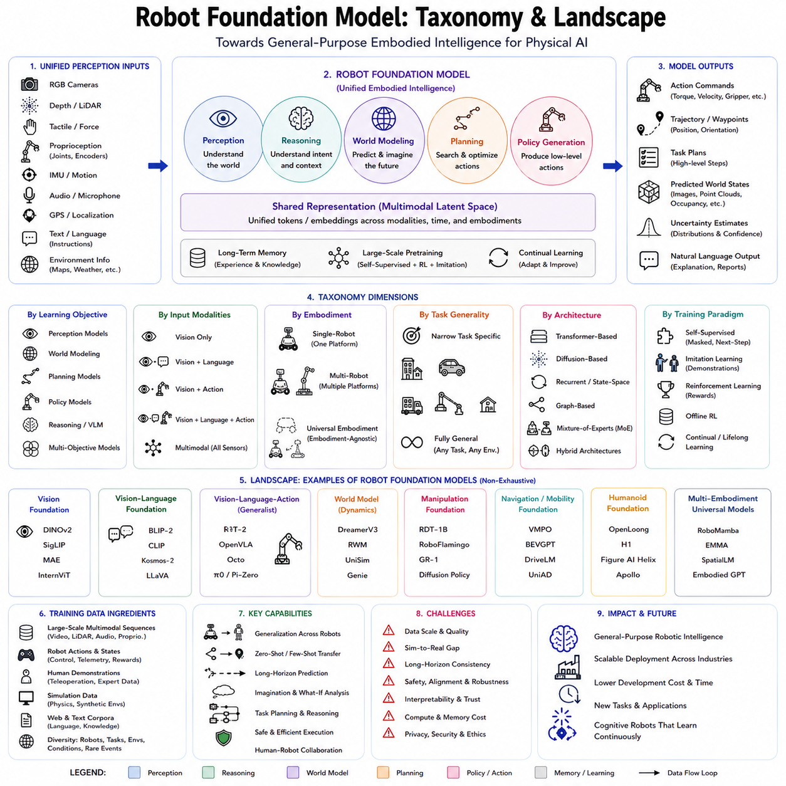{width="7.268055555555556in" height="7.268055555555556in"}

Robot Foundation Models represent one of the most significant developments in Physical AI, extending the concept of foundation models beyond language and vision into embodied intelligence. While traditional robot software has typically been designed for a specific machine performing a narrowly defined task, Robot Foundation Models aim to provide a unified intelligence layer capable of generalizing across multiple robot embodiments, environments, tasks, and interaction modalities. Similar to how large language models serve as general-purpose reasoning engines for text and multimodal information, Robot Foundation Models seek to become universal cognitive engines that transform perception, reasoning, planning, and action into a common computational framework applicable to a broad range of robotic systems.

The emergence of Robot Foundation Models is driven by several converging technological trends. Large-scale multimodal pretraining has demonstrated that models trained on sufficiently diverse datasets can develop transferable representations that adapt efficiently to downstream tasks. Reinforcement learning has shown that agents can learn increasingly sophisticated behaviors through interaction with simulated and physical environments. Advances in world models, diffusion models, transformer architectures, and vision-language-action learning have further reduced the gap between perception and control. At the same time, rapid improvements in computing hardware, cloud infrastructure, edge AI processors, and robotics simulation platforms have made it feasible to train models containing billions of parameters while processing petabytes of multimodal robotic data. Together, these advances have shifted robotics from task-specific engineering toward data-driven foundation intelligence.

Unlike conventional AI models that focus primarily on perception or prediction, Robot Foundation Models integrate multiple cognitive functions within a single architecture. They receive information from cameras, LiDAR, tactile sensors, force sensors, inertial measurement units, joint encoders, microphones, GPS receivers, and language instructions. They combine these heterogeneous observations with internal memory, learned world knowledge, task objectives, and predictive reasoning to generate coordinated motor commands. Consequently, Robot Foundation Models operate across the complete perception-to-action pipeline rather than solving isolated subproblems independently.

The taxonomy of Robot Foundation Models can be understood from several complementary perspectives. One classification is based on learning objectives. Some models primarily perform perception, extracting semantic understanding from visual, spatial, and multimodal observations. Others specialize in planning by predicting future environmental evolution and optimizing action sequences. Another category focuses on policy generation, directly mapping observations into robot actions. Additional models emphasize reasoning, language understanding, memory organization, or world simulation. Modern systems increasingly combine these objectives into unified architectures where multiple capabilities are learned simultaneously.

A second taxonomy is based on input modalities. Vision-only models process camera observations and estimate object categories, scene understanding, and spatial relationships. Vision-language models incorporate textual instructions, allowing robots to interpret natural language commands and connect linguistic concepts with visual observations. Vision-language-action models extend this capability by directly generating robot actions from multimodal inputs. More comprehensive multimodal foundation models additionally incorporate depth sensing, LiDAR, radar, force sensing, tactile perception, proprioception, audio, and environmental metadata. As sensor diversity increases, robots develop richer representations of the physical world and become capable of operating under increasingly challenging conditions.

Another important classification concerns embodiment. Single-robot foundation models are trained for one specific platform, such as a robotic manipulator or mobile robot. Multi-embodiment foundation models learn representations that transfer across multiple robot types despite differences in kinematics, sensor configuration, morphology, and control interfaces. Universal embodiment models aim to represent actions independently of hardware by encoding robot structure, joint relationships, dynamic limits, and sensor placement as part of the model input. This abstraction enables knowledge acquired by one robot platform to accelerate learning on another, reducing data collection requirements and supporting scalable deployment across heterogeneous fleets.

Task generality provides another dimension of classification. Narrow foundation models specialize in one application domain such as warehouse manipulation, autonomous driving, aerial navigation, industrial assembly, or domestic service. Domain-general models perform multiple tasks within a common environment, while fully general Robot Foundation Models attempt to operate across fundamentally different industries, robots, and operational conditions. Although truly universal robotic intelligence remains an open research objective, recent progress suggests that sufficiently large models trained on diverse interaction data can exhibit remarkable cross-task transfer capabilities.

The landscape of Robot Foundation Models includes several distinct architectural families. Transformer-based architectures dominate current research because self-attention efficiently models long-range dependencies across multimodal sequences. Vision Transformers provide high-capacity visual representations, while multimodal transformers integrate language, vision, and sensor information into unified latent spaces. Diffusion-based architectures have recently emerged as powerful policy generators capable of producing smooth, multimodal action trajectories. Recurrent State Space Models and latent dynamics models support long-horizon prediction and planning through compact world representations. Graph neural networks contribute explicit relational reasoning for articulated bodies, object interactions, and structured environments. Increasingly, hybrid systems combine these architectural components within unified cognitive frameworks.

Vision-Language-Action models occupy a central position within the current landscape. These systems extend vision-language pretraining by adding robot action prediction. Instead of simply answering questions about images, they learn to execute manipulation, navigation, and interaction behaviors conditioned on natural language instructions. The resulting architecture links semantic reasoning with physical control, allowing robots to interpret commands such as "place the blue container on the upper shelf" while generating corresponding motor actions. This integration substantially simplifies human-robot interaction by replacing manually engineered task programming with natural language communication.

World Model-based foundation models represent another rapidly expanding category. Rather than directly predicting actions, these models first learn latent representations describing environmental dynamics. Planning occurs inside the learned world model through imagined future trajectories before actions are executed in reality. Such architectures significantly improve sample efficiency because robots can evaluate thousands of hypothetical futures without exposing physical hardware to unnecessary wear or safety risks. World models therefore serve as internal simulators supporting reasoning, planning, and policy optimization simultaneously.

Diffusion Policy models have become increasingly influential for robot manipulation. Inspired by generative image models, diffusion-based policies gradually transform random noise into coherent action trajectories through iterative denoising. This process naturally represents multimodal action distributions, enabling robots to choose among multiple valid manipulation strategies rather than producing only one deterministic solution. Diffusion policies have demonstrated impressive performance on contact-rich manipulation, dexterous grasping, tool use, and bimanual coordination while maintaining smooth control outputs suitable for real robotic systems.

Large Language Models have also become foundational components of robot intelligence. Although language models alone cannot control physical systems, they provide high-level reasoning, task decomposition, planning, commonsense knowledge, and semantic understanding. Modern robot architectures frequently combine large language models with vision encoders, world models, and action generators. The language model interprets human intent, decomposes complex goals into executable subtasks, reasons about constraints, and communicates intermediate decisions, while specialized robotic modules execute low-level physical control. This hierarchical integration combines symbolic reasoning with continuous motor execution.

Open-source and industrial ecosystems have accelerated progress across the Robot Foundation Model landscape. Research organizations have introduced increasingly capable open models that encourage reproducibility and community-driven innovation. Industrial laboratories simultaneously develop proprietary models optimized for large-scale deployment, manufacturing automation, logistics, warehouse robotics, autonomous vehicles, and humanoid systems. Competition between open research and commercial development continues to accelerate algorithmic improvements, dataset growth, benchmarking methodologies, and deployment experience.

Training datasets represent another important dimension of the landscape. Foundation models require diverse multimodal interaction data collected from real robots, simulation, teleoperation, demonstration learning, internet-scale video, digital twins, and synthetic environments. High-quality datasets combine synchronized visual observations, robot states, sensor measurements, actions, language instructions, environmental metadata, and task outcomes. Dataset diversity often proves more valuable than simple scale because transferable representations emerge from varied embodiments, environments, manipulation styles, weather conditions, failure cases, and recovery behaviors rather than repetitive execution of identical tasks.

Simulation has become indispensable for scaling Robot Foundation Models. Modern simulation environments support physics-based interaction, procedural scene generation, domain randomization, digital twins, and increasingly realistic sensor models. Synthetic environments allow robots to practice millions of interactions at minimal cost while safely exploring dangerous or rare scenarios. Sim-to-real adaptation techniques subsequently transfer learned representations into physical robots. Learned world models further blur the distinction between simulation and reality by generating interactive virtual environments directly from observed experience.

Evaluation across the Robot Foundation Model landscape extends beyond conventional perception benchmarks. Researchers increasingly measure cross-task generalization, embodiment transfer, long-horizon planning, language following, manipulation success, navigation performance, safety, uncertainty estimation, energy efficiency, robustness, and continual adaptation. Comprehensive evaluation must consider not only benchmark accuracy but also operational reliability under changing environmental conditions, unseen tasks, hardware variation, sensor degradation, and human interaction. Standardized benchmarks continue evolving to reflect these broader requirements.

Despite remarkable progress, Robot Foundation Models still face important challenges. Data collection remains expensive because physical interaction requires robots, operators, maintenance, and safety supervision. Generalization across significantly different embodiments remains imperfect due to differences in dynamics and control interfaces. Long-horizon planning still accumulates prediction errors, particularly under partial observability and uncertain environments. Real-world deployment demands explainability, robustness, regulatory compliance, cybersecurity, and formal safety verification. Efficient inference on embedded hardware also remains difficult because increasingly capable models require substantial computational resources.

Several emerging research directions aim to address these limitations. Continual learning enables robots to improve after deployment without catastrophic forgetting. Federated learning allows multiple robots to share knowledge while preserving data privacy. Hierarchical memory systems organize long-term experience across missions. Neuro-symbolic reasoning combines neural learning with structured knowledge representations. Causal reasoning improves robustness under environmental intervention. Self-supervised interaction learning reduces dependence on manual annotation. Multimodal world models support predictive imagination and internal simulation. Together, these technologies move Robot Foundation Models toward increasingly autonomous lifelong learning systems.

Robot Foundation Models are also transforming system architecture. Traditional robotic software consists of numerous independently engineered modules for perception, localization, mapping, planning, manipulation, navigation, and control. Foundation models increasingly replace rigid module boundaries with unified latent representations shared across multiple tasks. Instead of manually designing separate algorithms for each capability, developers increasingly fine-tune common pretrained models using domain-specific data. This architectural shift resembles the transition from handcrafted feature engineering to deep learning observed in computer vision and natural language processing during the previous decade.

The industrial impact of Robot Foundation Models extends across manufacturing, logistics, healthcare, agriculture, construction, inspection, transportation, defense, disaster response, warehouse automation, and domestic service robotics. General-purpose models reduce engineering effort when deploying robots in new environments because much of the required knowledge has already been acquired during large-scale pretraining. Organizations can adapt pretrained models to specialized tasks through fine-tuning rather than developing entirely new robotic software stacks from scratch. This significantly reduces deployment time while improving scalability across diverse applications.

Future Robot Foundation Models are expected to integrate language reasoning, multimodal perception, world modeling, memory, planning, causal inference, policy optimization, and lifelong adaptation into increasingly unified cognitive architectures. Rather than functioning as isolated perception or control components, they will serve as complete embodied intelligence systems capable of understanding complex instructions, predicting future environmental evolution, reasoning about uncertainty, coordinating multiple robots, learning continuously from experience, and adapting autonomously to unfamiliar situations. As Physical AI progresses toward general robotic intelligence, the taxonomy of Robot Foundation Models will continue evolving, but their fundamental objective will remain unchanged: to provide a scalable, transferable, and general computational foundation that enables intelligent robots to perceive, reason, plan, and act effectively across the diverse physical world.

## 5.2 RT-1 Robot Transformer Architecture [w/Code]

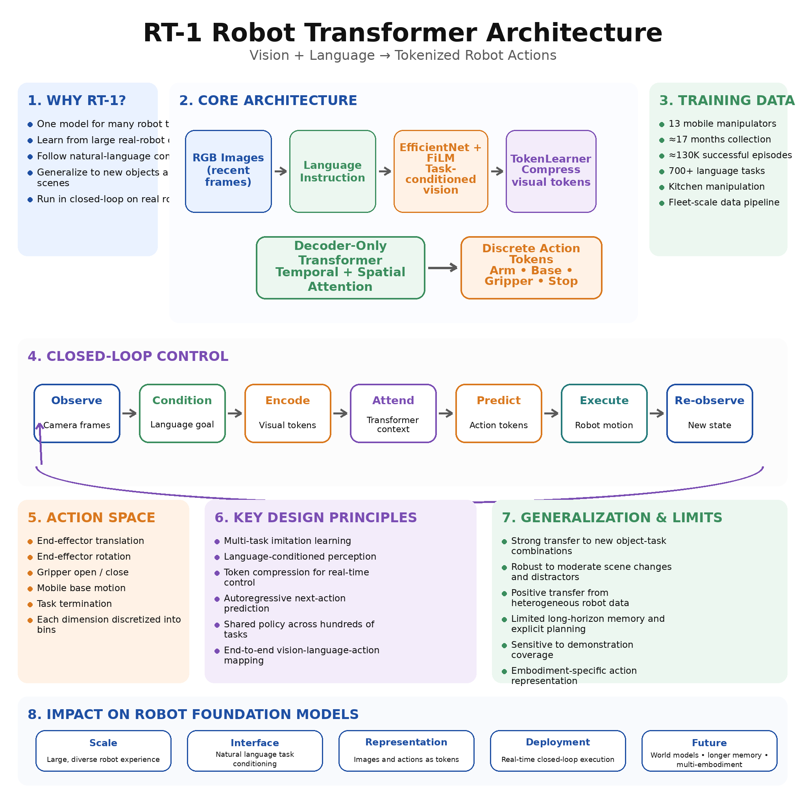{width="7.268055555555556in" height="7.268055555555556in"}

RT-1, or Robotics Transformer 1, is a large-scale robot control architecture developed to investigate whether the scaling principles that transformed language and vision models could also be applied to real-world robotics. Traditional robotic learning systems were commonly trained for a single task, object set, or environment, which limited their ability to generalize when conditions changed. RT-1 introduced a different direction: a single high-capacity model trained on a large and diverse collection of real robot demonstrations, capable of following natural-language instructions and producing low-level actions for hundreds of manipulation tasks. Rather than building separate policies for each behavior, RT-1 treats robot control as a sequence modeling problem in which images, language, and actions are represented within one unified transformer-based architecture.

The central motivation behind RT-1 is the observation that scale and diversity are essential for generalization. In natural language processing, large models trained on diverse text corpora acquire reusable linguistic and semantic representations. In computer vision, models trained on broad image datasets transfer effectively to new recognition tasks. Robotics presents a more difficult setting because collecting real interaction data requires physical robots, human operators, safe environments, maintenance, and significant time. RT-1 was designed to test whether a sufficiently large model could absorb diverse real-world robot experiences and transfer that knowledge to new tasks, objects, and environmental conditions.

The RT-1 training dataset was collected using a fleet of mobile manipulators operating in office kitchen environments. Thirteen robots were used over approximately seventeen months to gather around 130,000 successful episodes covering more than 700 task instructions. The tasks included picking objects, placing items into containers, opening and closing drawers, moving objects near other objects, knocking items over, and performing multi-object interactions. This scale was substantially larger and more diverse than many earlier robot learning datasets, making it possible to examine how data quantity, model capacity, and task diversity influence generalization.

RT-1 receives two primary forms of input: a sequence of visual observations and a natural-language task instruction. The images provide information about the robot's current surroundings, including object locations, scene arrangement, gripper position, obstacles, and the progress of the task. The language instruction specifies the desired behavior, such as picking up a particular object or placing an item in a target location. The architecture must combine these two information sources so that visual perception becomes conditioned on the semantic meaning of the command.

The visual input is processed using an EfficientNet-based image encoder. EfficientNet provides a computationally efficient convolutional architecture capable of extracting hierarchical visual features from RGB images. Instead of using a completely independent visual representation for every task, RT-1 conditions the image encoder on the language instruction through Feature-wise Linear Modulation, commonly known as FiLM. FiLM modifies intermediate visual features using parameters derived from the language embedding. As a result, the same image can be interpreted differently depending on the task. When the instruction refers to a red cup, the visual representation can emphasize image regions and object features related to that cup, while a different instruction can direct attention toward another object or location.

The natural-language instruction is converted into a fixed-dimensional semantic representation using a pretrained language encoder. This embedding captures the meaning of the command rather than treating it as a simple task identifier. Language conditioning allows related instructions to share semantic structure. Commands involving picking, placing, opening, or moving can reuse common concepts even when the exact wording or target object changes. This contributes to compositional generalization because the model can potentially execute combinations of known actions and known objects that were not observed together frequently during training.

After visual features are extracted, RT-1 uses TokenLearner to reduce the number of visual tokens passed to the transformer. A raw image feature map may contain hundreds or thousands of spatial elements, creating excessive computational cost for real-time control. TokenLearner dynamically selects and aggregates the most informative regions into a small set of learned visual tokens. These tokens represent task-relevant objects, gripper relationships, spatial targets, and important environmental context while discarding redundant background information. The official RT-1 implementation combines a FiLM-conditioned EfficientNet tokenizer with TokenLearner-based input compression before transformer processing.

Token compression is especially important because RT-1 operates as a closed-loop control policy. The model must repeatedly process recent camera observations and generate actions at a frequency suitable for physical execution. A conventional high-resolution vision transformer could require too much computation for on-robot deployment. By compressing each image into a small token set, RT-1 maintains high-capacity sequence modeling while satisfying practical inference constraints. This design illustrates an important principle for Physical AI: model scale alone is insufficient unless the architecture can produce actions within the timing requirements of the physical system.

The compressed visual tokens from multiple recent observations are arranged into a temporal sequence and processed by a decoder-only transformer. Self-attention allows the model to relate image features across space and time. It can track how objects and the robot arm move between frames, infer task progress, and use earlier observations to resolve temporary occlusion or ambiguity. Unlike a recurrent neural network that propagates information through a single hidden state, the transformer can directly attend to relevant tokens from multiple previous timesteps. This helps the model represent short-term motion and action history within a common sequence.

The transformer output is converted into robot actions through discrete action tokenization. RT-1 does not directly regress unrestricted continuous values for every control dimension. Instead, each action dimension is discretized into a fixed number of bins, and the network predicts categorical action tokens. The robot action includes end-effector translation, rotational movement, gripper opening or closing, base motion, and a termination signal indicating whether the task should end. Discretization transforms continuous robot control into a token prediction problem that resembles language modeling, allowing the transformer to use classification-style objectives across different action dimensions.

Action tokenization offers several advantages. Categorical prediction is often easier to optimize than direct continuous regression, especially when the action distribution is multimodal. It also provides a standardized output representation that can be processed by the same transformer architecture used for other sequence data. However, discretization introduces a resolution trade-off. A small number of bins improves robustness but limits precision, while a large number of bins increases control resolution but makes classification more difficult and data-intensive. RT-1 demonstrates that carefully chosen discrete action vocabularies can provide sufficient precision for many mobile manipulation tasks.

The complete model operates autoregressively at each control step. Recent observations and the current language instruction are encoded, transformed into tokens, and passed through the transformer. The model predicts the next set of action tokens, which are converted back into physical control commands and executed by the robot. The environment changes in response, new camera images are captured, and the process repeats. This closed-loop operation allows the policy to correct its behavior continuously rather than generating an entire long trajectory in advance.

RT-1 is trained primarily through supervised imitation learning. Each robot demonstration contains a task instruction, a sequence of images, and the actions performed by an operator-generated or previously available policy. During training, the model learns to predict the demonstrated action tokens from the corresponding visual and language context. The objective is similar to behavior cloning: reproduce successful actions from expert data. Unlike reinforcement learning, RT-1 does not require online trial-and-error exploration or manually engineered reward functions during its primary training process.

The multi-task training formulation is fundamental to the architecture. All task episodes are combined into one dataset, and a single shared model learns every behavior. This creates opportunities for positive transfer because tasks share perceptual features, motion patterns, object concepts, and manipulation primitives. Learning to pick several different objects can improve the general concept of grasping. Learning to place objects in multiple containers can improve spatial reasoning. The model does not need to learn every task independently because its internal representations can be reused across related behaviors.

RT-1 was evaluated on known tasks, new configurations of known tasks, unseen objects, changed environments, and robustness challenges. The results showed that increasing both dataset diversity and model capacity improved generalization. The model achieved strong performance on tasks represented in the training data while also demonstrating the ability to handle new combinations of objects, instructions, and environmental conditions. These results supported the central hypothesis that scalable robot models benefit from broad task-agnostic training rather than narrowly separated policies.

One important category of evaluation involved generalization to new instructions formed by combining familiar skills and objects. For example, the model might have experience with picking one type of object and handling another object in a different task, but not with the exact requested combination. Because task semantics are encoded through language and visual features are shared across tasks, RT-1 can sometimes compose previously learned knowledge into a new behavior. This ability remains limited compared with human reasoning, but it represents an important transition from memorized task policies toward general-purpose robot control.

Robustness evaluation also examined the effect of environmental variation. Objects could be moved, backgrounds could change, distractor items could be introduced, and the robot could begin from different positions. RT-1's broad training distribution helped it remain effective under moderate changes. The visual-language architecture allowed it to focus on task-relevant features rather than relying entirely on fixed object locations or identical scene layouts. This robustness is critical for real-world deployment because physical environments cannot be controlled as precisely as laboratory benchmarks.

RT-1 also demonstrated that incorporating heterogeneous robot data can improve rather than necessarily degrade performance. The researchers mixed data from another robot configuration into training and observed positive transfer in some settings. This result suggested that large robot policies may eventually absorb data from different platforms, provided that observations and actions are represented appropriately. Such findings contributed to later work on multi-embodiment models and larger cross-robot datasets.

From a system architecture perspective, RT-1 differs significantly from traditional robotic pipelines. Conventional systems often separate object detection, pose estimation, task planning, motion planning, and control into individually engineered modules. RT-1 directly maps images and language to actions through one learned network. This end-to-end structure reduces dependence on handcrafted intermediate representations and allows the entire policy to optimize features that are useful for task execution.

End-to-end learning does not mean that traditional robotics components become unnecessary in every deployment. Low-level motor control, collision monitoring, joint limit enforcement, emergency stopping, and other deterministic safety mechanisms may still operate beneath or around the learned policy. RT-1 functions primarily as a high-level visuomotor controller that generates task-directed commands. A practical robot system can therefore combine the flexibility of transformer-based control with conventional safety layers and hardware-level controllers.

The RT-1 architecture was designed to balance model capacity with real-time performance. Transformers become computationally expensive as the token sequence grows because standard self-attention scales approximately quadratically with sequence length. The use of EfficientNet, FiLM conditioning, TokenLearner compression, and a limited temporal context reduces this burden. The architecture achieved practical on-robot inference while retaining enough capacity to learn hundreds of tasks. This balance between scale and deployability remains a central design challenge for later robot foundation models.

RT-1's language capability should be understood carefully. The model uses language to specify tasks and associate instructions with demonstrated actions, but it is not a general-purpose language reasoner comparable to an internet-scale large language model. Its semantic knowledge is primarily grounded in the robot demonstration dataset and the pretrained instruction encoder. It can generalize across related commands, but it does not possess broad visual-language knowledge about unfamiliar objects, abstract concepts, or complex reasoning tasks. This limitation motivated later systems such as RT-2, which incorporated large-scale vision-language pretraining from web data.

Another limitation is that RT-1 relies heavily on supervised demonstration quality. Behavior cloning reproduces patterns contained in the dataset, including potential biases, limited recovery strategies, and insufficient coverage of failure states. When the robot enters a situation far outside the demonstrations, prediction errors may compound because the policy has limited experience returning to a familiar state. Collecting diverse recovery demonstrations, failure data, and corrective behavior is therefore important for improving robustness.

Long-horizon tasks also remain difficult. RT-1 predicts actions based on a limited history and typically executes relatively short manipulation skills. Complex missions involving many dependent subtasks require persistent memory, explicit state tracking, strategic planning, and recovery over extended periods. A robot may need to navigate to several locations, manipulate multiple objects, respond to failures, and verify task completion. These requirements exceed the capabilities of a purely reactive or short-context policy and motivate integration with hierarchical planners, memory systems, and world models.

The fixed action representation also creates challenges for transfer to different robot embodiments. A mobile manipulator with a particular arm, gripper, camera placement, and base control interface has a specific action space. Another robot may have different joints, kinematics, control rates, or sensing arrangements. Directly applying the same RT-1 output tokens is therefore difficult. Later multi-embodiment research attempts to solve this problem through normalized action spaces, embodiment conditioning, shared semantic actions, and platform-specific adapters.

RT-1 nevertheless established several architectural principles that continue to influence Robot Foundation Models. First, a single model can learn hundreds of physical tasks from diverse real-world data. Second, natural language can act as a scalable interface for task conditioning. Third, robot control can be formulated as token sequence prediction. Fourth, transformer capacity and dataset diversity can improve generalization. Fifth, efficient visual tokenization is necessary for real-time embodied deployment. These principles became important foundations for subsequent Vision-Language-Action models.

RT-1 also demonstrated the importance of data infrastructure. Training the architecture required coordinated data collection across multiple robots, standardized task descriptions, consistent camera observations, synchronized actions, storage pipelines, quality filtering, and scalable training systems. The model's performance depended not only on neural architecture but also on the operational capability to gather and curate diverse robot experiences. This remains a defining feature of Physical AI: data collection systems and robot operations are inseparable from model development.

For industrial robotics, the RT-1 approach suggests a transition from programming individual robot tasks toward training reusable multi-task policies. A warehouse robot could share representations across picking, placing, sorting, drawer operation, and workstation interaction. A service robot could reuse perception and manipulation skills across rooms and object categories. An inspection robot could combine navigation, viewpoint selection, equipment interaction, and anomaly response within a shared policy framework. Fine-tuning a pretrained model may eventually require far less data than building each capability from the beginning.

RT-1 also provides lessons for fleet learning. When multiple robots collect experience under different conditions, their trajectories can be combined into a common dataset. A central model can learn from the fleet and distribute improved policies back to individual robots. This creates a data flywheel in which deployment generates new experience, new experience improves the model, and the improved model increases future task performance. However, achieving this safely requires dataset governance, version management, regression testing, uncertainty monitoring, and controlled rollout procedures.

In relation to world models, RT-1 is primarily a direct policy rather than an explicit predictive simulator. It maps recent observations and instructions to actions without generating detailed future state trajectories. This makes inference efficient, but it limits the ability to compare many hypothetical futures before acting. Future systems can combine RT-1-style action generation with latent world models that predict environmental consequences. The direct policy can propose actions rapidly, while the world model evaluates safety, feasibility, and long-term outcomes.

RT-1's influence extends beyond its original task results because it provided an early demonstration of scaling behavior in real-world robot control. The project showed that robot learning could benefit from the same broad principles that drove progress in language and vision: large datasets, shared architectures, task diversity, transferable representations, and token-based modeling. Although the model remained limited to a particular class of mobile manipulation tasks, it established a credible pathway toward increasingly general robot policies.

Future descendants of the RT-1 architecture are expected to integrate larger pretrained vision-language encoders, continuous or generative action models, longer temporal context, multimodal sensing, explicit memory, world-model prediction, and cross-embodiment adaptation. They may also combine imitation learning with reinforcement learning, human feedback, autonomous data collection, and online adaptation. The underlying objective remains the same: transform diverse robot experience into a reusable model that can understand instructions and produce reliable physical behavior.

RT-1 should therefore be viewed not merely as a single robot control model but as an architectural milestone in the development of Robot Foundation Models. It demonstrated that a transformer can absorb large-scale real-world manipulation data, condition visual perception on natural-language goals, compress observations into efficient tokens, and generate closed-loop robot actions across hundreds of tasks. Its limitations reveal the remaining challenges of long-horizon reasoning, safety, recovery, embodiment transfer, and broad semantic understanding. Its achievements, however, established many of the concepts that now define the modern Vision-Language-Action landscape and the broader pursuit of scalable Physical AI.

## 5.3 RT-2 Vision Language Action Model [w/Code]

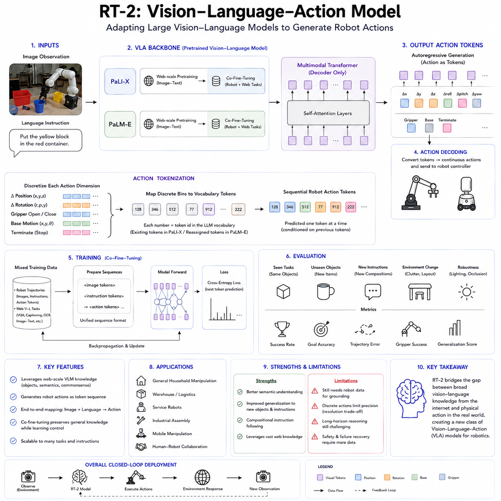{width="7.268055555555556in" height="7.268055555555556in"}

RT-2, or Robotics Transformer 2, represents an important transition from task-specific robot policies toward Vision-Language-Action models that connect broad semantic knowledge with physical control. RT-1 had already demonstrated that a single transformer policy could learn hundreds of manipulation tasks from large-scale real robot demonstrations. However, its understanding of objects, concepts, and language was largely constrained by the robot data used during training. RT-2 extends this foundation by adapting large Vision-Language Models trained on web-scale image and text data so that they can directly generate robot actions. The central idea is that knowledge acquired from visual question answering, image captioning, object recognition, and language understanding can improve a robot's ability to act in situations that were not explicitly represented in its manipulation dataset.

RT-2 introduced the category of Vision-Language-Action models, commonly abbreviated as VLA models. A conventional Vision-Language Model receives images and text and produces a sequence of language tokens. A VLA model extends the same formulation by allowing the output sequence to represent physical robot actions as well as natural-language responses. Instead of designing a completely separate neural architecture for motor control, RT-2 expresses robot actions using tokens that can be processed by an existing multimodal transformer. This creates a unified interface through which visual observations, language instructions, semantic reasoning, and physical actions can be represented within a common sequence modeling framework.

The main motivation behind RT-2 is the mismatch between the amount of information available on the web and the limited quantity of robot interaction data. Internet-scale image and language datasets contain extensive knowledge about objects, materials, spatial relationships, symbols, categories, human activities, and common-sense associations. Robot demonstration datasets, by comparison, are much smaller because every trajectory requires real hardware, operators, controlled environments, and safety supervision. A robot trained only on manipulation demonstrations may learn how to grasp objects but may not understand that a rock can function as an improvised hammer, that an energy drink is associated with tiredness, or that a recycling symbol indicates where an object should be placed. RT-2 seeks to transfer such semantic knowledge from web-trained models into robotic behavior.

The architecture begins with a pretrained Vision-Language Model rather than a robot policy trained from scratch. The RT-2 study adapted two major backbone families: PaLI-X and PaLM-E. PaLI-X is a large vision-language architecture designed to process images and language within a unified token generation framework. PaLM-E is an embodied multimodal language model that incorporates visual and continuous sensor information into a large language model. By adapting these pretrained backbones, RT-2 inherits substantial visual recognition, language comprehension, and semantic reasoning capabilities before robot-specific training begins.

RT-2 receives an image of the robot's current environment together with a natural-language instruction. The visual input may include the robot arm, gripper, objects, containers, surfaces, and surrounding scene. The instruction describes the desired goal, such as placing an object into a container, moving an item near a target, or selecting an object according to a semantic property. The multimodal backbone jointly processes the image and text, using knowledge acquired during web-scale pretraining to identify relevant objects and interpret the command. The output is then decoded into a sequence of action tokens that control the robot.

Action tokenization is the architectural mechanism that enables this transformation. Continuous robot actions are first divided into discrete numerical bins. The action representation includes translational motion of the end effector, rotational motion, gripper control, base movement where applicable, and a termination signal. Each discretized value is mapped to a token in the model's vocabulary. For PaLI-X-based RT-2 models, numerical tokens already supported by the tokenizer could be associated with action bins. For PaLM-E-based variants, rarely used vocabulary entries were reassigned to represent the action token space. The model can therefore generate motor commands through the same autoregressive decoding process used to produce text.

This formulation is conceptually powerful because it converts robotic control into a language-like sequence prediction task. A model that previously generated words in response to images can be fine-tuned to generate numerical action symbols. The transformer itself does not require a fundamentally separate output mechanism for robot control. It predicts the next valid token according to the image, instruction, and previously generated tokens. During deployment, the action tokens are converted back into continuous control values and sent to the robot's motion system.

RT-2 is trained through co-fine-tuning on both robot trajectory data and web-scale vision-language tasks. This joint training strategy is essential. If the model were fine-tuned only on robot actions, it might lose some of the semantic and visual knowledge acquired during pretraining, a problem related to catastrophic forgetting. If it were trained only on web data, it would have no grounding in physical action. Co-fine-tuning mixes manipulation examples with tasks such as visual question answering, image captioning, and semantic recognition. The resulting model preserves broad web knowledge while learning how that knowledge connects to robot behavior.

Robot trajectory examples are reformatted to resemble ordinary vision-language training samples. The input contains the current image and task instruction, while the target output is a textualized sequence of action tokens. Web examples retain their conventional language outputs. The same model is therefore trained to produce either linguistic answers or physical actions depending on the prompt and task context. This shared training format is one of the most important contributions of RT-2 because it offers a relatively simple method for transforming an existing Vision-Language Model into a Vision-Language-Action policy.

The robot data used for RT-2 was related to the large-scale manipulation dataset developed for RT-1. It contained many real-world tasks involving picking, placing, moving, opening, closing, and arranging objects in office and kitchen environments. These demonstrations grounded the model's semantic representations in actual robot actions. Web training supplied broader concepts, while robot trajectories taught the model what physical movements corresponded to the desired outcomes.

The distinction between RT-1 and RT-2 is therefore not simply model size. RT-1 learned a visual-language-conditioned robot policy primarily from robotic demonstrations. RT-2 begins with a model that already possesses broad visual and linguistic knowledge and then adds action as another output modality. RT-1 could generalize within the concepts represented by its robot dataset, whereas RT-2 was designed to use semantic information that may never have appeared in the robot demonstrations themselves. This enables qualitatively different forms of generalization.

One of the most important capabilities demonstrated by RT-2 was improved generalization to unfamiliar objects. A robot may understand an instruction involving an object category even if the exact object instance was absent from the robot training dataset. Web-scale visual pretraining exposes the model to many variations of objects, materials, logos, shapes, and visual contexts. When the robot encounters a new package, toy, container, or household item, it can use this broad visual representation to relate the object to the instruction and select an appropriate action.

RT-2 also showed semantic generalization to commands that required concepts not explicitly taught through robot demonstrations. For example, the robot could respond to instructions involving visible numbers, symbols, or icons. If asked to place an object near a particular number, the model could use visual-language knowledge to identify the corresponding symbol and generate an action toward it. This differs from ordinary geometric generalization because success requires understanding the semantic meaning of a visual pattern rather than merely detecting an object position.

Another notable capability was reasoning over object properties. RT-2 could interpret instructions such as selecting the smallest or largest object, or choosing the object closest to another item. These tasks require comparing several visible entities and connecting linguistic concepts with spatial or visual relationships. Although the reasoning remains relatively limited, the ability to translate such semantic judgments directly into motor behavior illustrates the central promise of VLA models.

The model also demonstrated forms of common-sense reasoning acquired from non-robotic data. In one widely discussed example, the robot was asked to choose an object that could be used as an improvised hammer. It selected a rock even though the robot demonstrations did not explicitly teach the relationship between rocks and hammering. In another example, it selected an energy drink in response to a request concerning someone who was tired. These behaviors suggest that semantic associations learned from web-scale language and image data can influence physical action selection. The RT-2 study also explored chain-of-thought-style prompting to support multi-stage semantic reasoning before action generation.

Such demonstrations should not be interpreted as evidence that RT-2 possesses human-level common sense. The model relies on statistical associations acquired during pretraining and may fail when concepts are ambiguous, culturally dependent, visually unfamiliar, or physically constrained. Nevertheless, the experiments show that a robot policy can reuse knowledge learned outside the robotics domain. This reduces the need to create explicit robot demonstrations for every semantic concept that a robot may encounter.

The evaluation of RT-2 involved thousands of real robot trials covering seen tasks, unseen objects, new instruction combinations, semantic reasoning, and environmental variation. The reported experiments showed that RT-2 retained strong performance on robot tasks while substantially improving generalization to novel situations compared with policies trained only on robot data. The evaluation was designed not only to measure manipulation success but also to examine whether internet-scale knowledge produced new physical capabilities.

The model operates in a closed-loop control process. At every control cycle, the latest image and instruction are processed, and the model generates the next action token sequence. These tokens are decoded into robot commands and executed. The next observation reflects the consequences of the action, allowing the model to update its output. This repeated perception-action loop enables correction during task execution. However, the large size of the Vision-Language backbone introduces substantial inference latency compared with smaller direct policies.

Some RT-2 configurations used models with billions or tens of billions of parameters. Large variants required cloud-based accelerator infrastructure and network communication with the robot. The largest systems operated at relatively low control frequencies, while smaller variants could run faster. This illustrates a major engineering trade-off in VLA systems: increasing model scale improves semantic knowledge and generalization but makes real-time physical control more difficult. Network delay, accelerator availability, communication reliability, and inference cost become part of the robot system design rather than purely machine-learning concerns.

Low-frequency action generation is acceptable for some slow manipulation tasks but insufficient for highly dynamic control. Fine motor stabilization, collision response, force regulation, and rapid contact adjustment generally require much faster control loops. In practical deployments, RT-2-style VLA models therefore need to operate above conventional low-level controllers. The VLA model can provide task-directed end-effector commands or motion targets, while embedded controllers manage high-frequency joint control, torque regulation, safety limits, and emergency responses.

This hierarchy is essential for safety. A generative transformer may occasionally produce an invalid or inappropriate token sequence. RT-2 constrains decoding so that only valid action tokens can be selected in the action output context. The resulting commands must also pass through physical constraints involving reachable poses, velocity limits, workspace boundaries, collision conditions, and gripper capabilities. Token-level validity does not guarantee physical safety, so deterministic control and monitoring layers remain necessary.

RT-2 provides an end-to-end connection from visual observation and language instruction to action, but the broader robot system is not entirely end to end. Camera pipelines, robot kinematics, motion controllers, safety monitors, communication systems, and hardware interfaces continue to play important roles. The model determines what action should be attempted, while conventional robotics software ensures that commands are transformed into feasible and controlled physical motion.

The use of pretrained web knowledge also introduces reliability concerns. Web datasets contain biases, ambiguous relationships, visual errors, and incomplete representations of the physical world. A semantic association that is useful in an image-question-answering task may be unsafe when translated directly into physical action. For this reason, robotic grounding must validate whether the inferred concept is physically appropriate in the current context. A robot may recognize an object as a tool but still need to evaluate its weight, fragility, reachability, and safety before using it.

RT-2 does not contain an explicit world model that simulates multiple future outcomes before acting. Its transformer implicitly represents relationships among images, language, and actions, but it generally generates a policy response directly. This limits its ability to evaluate long-term physical consequences, compare several trajectories, or estimate how uncertainty will evolve. Combining VLA models with predictive world models is therefore an important future direction. The VLA component can interpret goals and propose semantically appropriate actions, while the world model evaluates their expected physical consequences.

Long-horizon tasks remain challenging for the same reason. RT-2 performs short manipulation skills effectively, but complex missions require persistent memory, subgoal management, progress tracking, failure detection, and strategic replanning. An instruction such as organizing an entire room or preparing a multistep meal cannot be solved reliably by repeatedly generating local actions without a structured representation of task state. Hierarchical systems can address this limitation by using a language-based planner to decompose the mission and a VLA policy to execute individual skills.

Another limitation involves action discretization. Mapping continuous control values into tokens provides architectural simplicity, but it reduces precision and may create discontinuities between adjacent bins. Manipulation tasks requiring delicate force control, dexterous finger movement, or high-speed dynamics may not be well represented through a small categorical action vocabulary. Later VLA systems increasingly explore continuous action heads, action chunking, diffusion policies, flow matching, and hybrid token-continuous representations to improve temporal consistency and precision.

RT-2 was developed primarily for a particular mobile manipulation platform, so transferring the model to robots with different embodiments remains difficult. Different robots have different arm structures, joint ranges, grippers, cameras, control frequencies, and action dimensions. The semantic components of the model may transfer, but the final motor representation must be adapted. Cross-embodiment learning requires normalized action representations, embodiment tokens, kinematic descriptions, or robot-specific action adapters.

Despite these limitations, RT-2 established the conceptual foundation of modern VLA models. It showed that action can be treated as another modality within a pretrained multimodal transformer. It demonstrated that internet-scale visual and linguistic knowledge can improve real robot generalization. It introduced a practical co-fine-tuning method that retains web knowledge while grounding the model in robot trajectories. Most importantly, it connected semantic reasoning directly to physical behavior without requiring a manually designed symbolic interface between language understanding and robot control.

RT-2 also changed the role of robot training data. In earlier policies, robot data had to teach both what objects meant and how to manipulate them. In RT-2, web data supplies much of the semantic understanding, while robot data primarily grounds that knowledge in physical action. This separation can improve data efficiency because expensive robot trajectories no longer need to contain every object category, visual symbol, or common-sense relationship. However, robot data is still essential for learning embodiment-specific dynamics and reliable action execution.

The architecture suggests a scalable development strategy for industrial robots. A general VLA backbone can first be pretrained on broad image-language data, then co-fine-tuned on company-specific robot demonstrations and operational tasks. A warehouse model could learn natural-language picking and sorting commands, while an inspection robot could associate semantic instructions with navigation and sensor positioning. A service robot could use broad object knowledge while adapting its actions to a particular manipulator and environment.

Fleet learning can further strengthen this approach. Multiple robots can collect trajectories across different sites, objects, lighting conditions, and failure cases. These experiences can be added to a shared VLA training mixture while preserving general vision-language tasks. The resulting model can gradually improve both physical robustness and semantic coverage. Controlled deployment, model versioning, regression testing, and safety validation are necessary because changes intended to improve one capability may degrade another.

RT-2 also highlights the importance of multimodal data governance. Robot episodes must align images, natural-language instructions, action tokens, timestamps, outcomes, and hardware states. Web data must be filtered for quality, relevance, licensing, privacy, and bias. The training mixture must be balanced so that robot control ability is not overwhelmed by general vision-language objectives and semantic knowledge is not erased by narrow action fine-tuning. Dataset composition therefore becomes as important as model architecture.

From the perspective of Physical AI, RT-2 represents a transition from robots that execute predefined skills toward robots that interpret the meaning of a task. RT-1 demonstrated scalable multi-task behavior, while RT-2 added the ability to connect physical control with broader visual and linguistic knowledge. This does not eliminate the need for planning, world modeling, low-level control, or safety engineering. Instead, it provides a semantic action layer that can connect human intent with robot capabilities.

Future VLA systems will likely expand this approach through larger and more efficient multimodal backbones, longer video context, tactile and proprioceptive input, continuous action generation, action chunking, world-model prediction, memory, and multi-robot transfer. They may combine imitation learning with reinforcement learning and autonomous data collection. Some systems may reason explicitly before acting, while others may divide semantic planning and fast motor execution between separate but coordinated models.

RT-2 should therefore be understood as both a specific robotic model and a broader architectural milestone. Its most important contribution is the demonstration that a pretrained Vision-Language Model can be transformed into a robot policy by representing actions as tokens and jointly training on web and robot data. The resulting model can use semantic concepts, object knowledge, visual relationships, and rudimentary reasoning to guide physical behavior. Although challenges remain in latency, precision, safety, long-horizon planning, and embodiment transfer, RT-2 established the fundamental design pattern that defines much of today's Vision-Language-Action research and provides an important foundation for increasingly general Robot Foundation Models.

## 5.4 Octo Open Source Robot Foundation Model [w/Code]

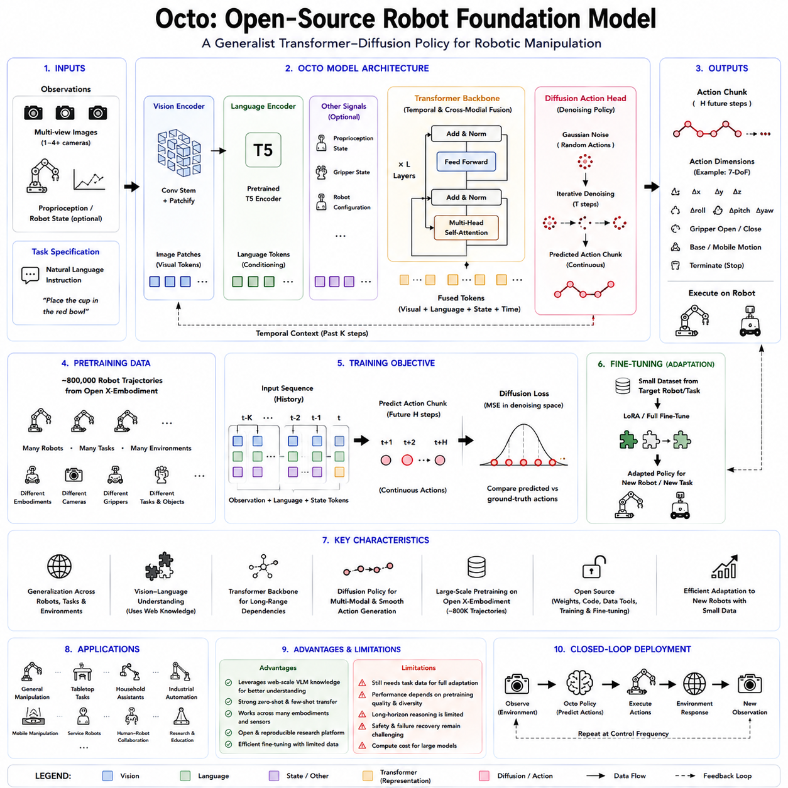{width="7.268055555555556in" height="7.268055555555556in"}

Octo is an open-source generalist robot policy designed to provide a reusable foundation for robotic manipulation across different platforms, tasks, observation spaces, and action interfaces. Rather than training a separate control policy from the beginning for every robot application, Octo is pretrained on a large collection of heterogeneous robot trajectories and then adapted to new systems through comparatively small amounts of task-specific data. Its central objective is not to provide a single universal policy that immediately controls every robot without modification, but to offer a strong policy initialization that can be fine-tuned efficiently for new embodiments and operational domains. This emphasis on accessibility, adaptability, and open development distinguishes Octo from many proprietary Robot Foundation Models.

Octo was introduced in response to a practical limitation in large-scale robot learning. Generalist policies can potentially transfer knowledge among tasks and robots, but many earlier systems were trained for fixed observation formats, predetermined action spaces, or privately controlled robot platforms. Their model weights, training code, datasets, and fine-tuning procedures were often unavailable to the wider research community. Octo addresses this problem by releasing pretrained checkpoints, training and fine-tuning code, dataset tools, and implementation details. The project therefore functions not only as a robot policy but also as an open research platform for studying large-scale pretraining, cross-embodiment transfer, and downstream adaptation.

The model was pretrained on approximately 800,000 robot trajectories drawn from a curated mixture of the Open X-Embodiment dataset. These trajectories combine demonstrations from many manipulation datasets, institutions, task definitions, camera arrangements, environments, and robot platforms. The resulting training distribution contains substantial variation in object appearance, workspace layout, control strategy, embodiment, and demonstration style. By learning from this heterogeneous mixture, Octo develops representations that can be reused more effectively than those learned from a small dataset collected on only one robot.

The use of Open X-Embodiment is central to Octo's role as a Robot Foundation Model. A conventional manipulation policy usually receives data collected from one arm, one gripper, and one laboratory configuration. Such a policy may achieve excellent performance within that setting while failing when the camera position, robot kinematics, action convention, or task distribution changes. Octo instead learns from a broad collection of embodiments and environments. This does not completely solve cross-robot transfer, but it encourages the model to discover visual, semantic, and temporal patterns that remain useful across different systems.

Octo is implemented as a transformer-based diffusion policy. The transformer integrates observations, task specifications, and temporal context into a shared representation. A diffusion-based action head then generates continuous action sequences by progressively removing noise from an initially random action sample. This differs from autoregressive VLA systems such as RT-2, which convert continuous controls into discrete tokens and predict them sequentially. Octo preserves a continuous action formulation and can model several plausible control trajectories without reducing every action dimension to a fixed categorical vocabulary.

The diffusion formulation is well suited to robotic manipulation because physical tasks frequently contain multimodal action distributions. When grasping an object, a robot may approach from the left, right, front, or above, and several solutions may be equally valid. A direct regression policy tends to average these alternatives, potentially producing an action that corresponds to none of them. A diffusion policy can represent several distinct action modes and generate one coherent trajectory during inference. The iterative denoising process also tends to produce temporally smooth action sequences, which is valuable for stable manipulation.

Octo predicts action chunks rather than only one isolated control command. An action chunk contains several future actions generated together as a short trajectory. Predicting multiple steps provides temporal consistency because the model reasons about a local motion sequence instead of making every control decision independently. It can reduce oscillation and improve motion smoothness, particularly during reaching, grasping, and object transport. The official Octo Small checkpoint, for example, uses a short observation window and predicts a seven-dimensional action representation several steps into the future.

The observation pipeline is designed to accommodate visual inputs commonly found in robot manipulation systems. Images are first processed by a lightweight convolutional stem and divided into visual patches. These patches become tokens that the transformer can combine with temporal information and task conditioning. Depending on the downstream robot configuration, the observation may contain one camera view, multiple camera views, proprioceptive state, or additional sensor channels. The architecture is intended to make these observation definitions configurable rather than permanently tied to one fixed sensor interface.

Language is one of the principal methods for specifying a task. Natural-language instructions are tokenized and processed through a pretrained T5 language encoder. The language representation conditions the robot policy on the desired objective, allowing one model to perform many behaviors according to commands such as moving an object, placing it in a container, or interacting with a specified target. Because the language encoder provides a semantic representation rather than a simple task number, related instructions can share information and support limited generalization across alternative descriptions.

Octo can also be conditioned using goal images. Instead of describing the desired state through language, a user may provide an image representing the intended final configuration. Goal-image conditioning is useful when the target is difficult to describe precisely in words or when tasks are defined primarily by visual arrangement. The model can compare the current observation with the goal representation and generate actions that move the environment toward the desired state. Supporting both language and visual goals makes Octo applicable to a wider range of robot-learning workflows.

A major architectural feature of Octo is its block-wise attention structure. Input tokens are organized into functional groups representing observations, tasks, and readout information. Attention masks determine which token groups may exchange information. This modular arrangement allows the policy to incorporate different task definitions and observation modalities without redesigning the complete transformer. New inputs can be introduced through additional tokenizers and attention blocks, while the pretrained backbone continues to provide reusable representations.

The task tokens encode information about what the robot should accomplish. They may originate from a language instruction, a goal image, or another task representation. Observation tokens represent the current and recent robot environment. Readout tokens gather information from the relevant context and provide features to the action head. This separation creates a flexible interface between the shared transformer representation and downstream action generation. It also makes Octo easier to adapt than architectures whose input and output definitions are tightly embedded into every layer.

Octo's action head is deliberately treated as a modular component. During pretraining, the diffusion head learns to generate actions in the standardized representation used for the selected training mixture. When adapting the policy to a new robot with a different action space, the original action head may be replaced or reinitialized while the transformer backbone retains its pretrained knowledge. The model can therefore reuse visual and task representations even when the new system has different control dimensions, gripper conventions, or motion commands.

This design reflects an important distinction between transferable knowledge and embodiment-specific control. Visual knowledge about objects, containers, surfaces, spatial relations, and task progress may transfer across many robots. Exact motor outputs usually do not, because robots differ in kinematics, workspace, joint arrangement, control rate, and action parameterization. Octo attempts to preserve the transferable part inside its transformer while allowing the embodiment-dependent input and output components to be adapted.

The released model family includes Octo-Small and Octo-Base configurations. Octo-Small contains approximately 27 million parameters, while Octo-Base contains approximately 93 million parameters. These sizes are modest compared with the multi-billion-parameter VLA models derived from large vision-language systems. The smaller scale makes Octo more accessible for university laboratories, startups, and individual researchers who do not possess hyperscale computing infrastructure. The official implementation also documents the computational requirements for pretraining and provides checkpoints that avoid the need to repeat the full pretraining process.

Although full pretraining required substantial accelerator resources, downstream adaptation was designed to be practical. The authors demonstrated that Octo could be fine-tuned to new robot configurations within a few hours using standard consumer GPUs. This capability is one of the model's most important contributions. A research team can begin with a pretrained generalist policy, collect a comparatively small dataset on its own robot, and adapt the model rather than training a large transformer policy from random initialization.

Fine-tuning can take several forms. Full fine-tuning updates the entire network and may provide the highest adaptation capacity when sufficient data and compute are available. Partial fine-tuning updates only selected modules, such as the action head, observation tokenizer, or newly added sensor adapters. Parameter-efficient adaptation can preserve most of the pretrained backbone while adjusting only a small fraction of parameters. The most appropriate strategy depends on how different the target robot is from the pretraining distribution.

When the new robot uses familiar camera observations but a different control interface, replacing the action head may be sufficient. When the sensor suite also changes, new input tokenizers or observation modules may be required. If the target tasks and environment differ substantially from the source data, deeper fine-tuning of the transformer may become necessary. Octo's modularity allows these adaptation choices to be treated as engineering decisions rather than requiring the entire architecture to be rebuilt.

Octo was evaluated across nine robot platforms covering several distinct embodiments. The experiments examined whether pretraining provided a useful initialization for different observation spaces, action formats, robots, and task domains. The results showed that fine-tuned Octo generally outperformed policies trained from scratch and could adapt effectively to multiple downstream settings. The experiments were intended primarily to evaluate adaptation rather than claim that Octo operates zero-shot on every platform.

This distinction between zero-shot deployment and efficient fine-tuning is essential. Octo is sometimes described as a general-purpose robot policy, but its strongest practical role is that of a pretrained foundation for downstream learning. A model trained on heterogeneous manipulation data cannot automatically know the precise action convention, safety constraints, or dynamics of every new robot. Fine-tuning provides the grounding required to connect the shared representation with the actual target system.

The evaluation also explored language-conditioned and goal-image-conditioned tasks. This demonstrated that a single pretrained backbone could support more than one task interface. The model was not limited to fixed symbolic task identifiers and could instead receive semantically meaningful task descriptions. Such flexibility is useful for research because different datasets define objectives in different ways. Some contain natural-language labels, while others provide goal observations or task metadata.

Octo's open-source release is as important as its architecture. The project provides code for pretraining, fine-tuning, dataset conversion, evaluation, and checkpoint use. Researchers can inspect the model, modify the attention structure, replace tokenizers, experiment with action heads, change the dataset mixture, and reproduce important training decisions. The release also provides access to pretrained weights. This transparency enables independent analysis that is difficult with closed proprietary systems.

The open implementation supports the development of a shared research ecosystem. New robot datasets can be converted into compatible formats, and new policies can be compared against the same initialization. Researchers can investigate whether performance improvements arise from architecture, data mixture, fine-tuning strategy, or evaluation design. Open access also makes it possible to study failure modes, bias, spurious correlations, and robustness more systematically.

The original Octo implementation is primarily based on JAX and uses the RLDS data ecosystem. This choice supports large-scale training and integration with Open X-Embodiment datasets but may present a learning curve for teams accustomed to PyTorch. Preparing the complete pretraining dataset also requires considerable storage; the official repository notes that the processed data mixture is approximately 1.2 terabytes. These requirements mean that full reproduction remains a substantial engineering effort even though the code is public.

The distinction between openness and low cost is therefore important. Octo lowers the barriers to studying and adapting a Robot Foundation Model, but it does not eliminate the compute, storage, data engineering, and physical robot resources required for serious experimentation. Pretrained checkpoints reduce the burden significantly, yet reliable downstream deployment still requires demonstrations, calibration, safety systems, and evaluation on the target hardware.

Octo differs from RT-2 in several fundamental ways. RT-2 begins with a large web-pretrained Vision-Language Model and represents robot actions as discrete tokens within its language vocabulary. Its strength lies in connecting broad semantic web knowledge with physical behavior. Octo is smaller, focuses more directly on manipulation policy learning, and generates continuous action chunks through a diffusion head. Octo therefore emphasizes open adaptation, temporal action generation, and heterogeneous robot data rather than internet-scale semantic reasoning.

Octo also differs from a pure Diffusion Policy trained for one robot. Both use diffusion-based action generation, but Octo pretrains a transformer representation on a large multi-dataset mixture. The goal is to create reusable representations that can be fine-tuned across robots and tasks. A conventional Diffusion Policy may achieve excellent performance on a narrow dataset, whereas Octo attempts to provide a broader initialization that reduces the data needed in each downstream domain.

Unlike an explicit world model, Octo does not primarily simulate future environmental states. It directly generates action sequences conditioned on observations and goals. The diffusion process models the distribution of actions, not a detailed predictive model of future images, object states, rewards, and physical outcomes. This makes the policy efficient and suitable for direct control, but it limits its ability to compare many predicted futures or perform explicit long-horizon planning.

A future system could combine Octo with a world model. Octo could propose coherent short-horizon action chunks, while the world model predicts their consequences and evaluates safety, task progress, and longer-term value. A high-level planner could decompose complex instructions into subgoals, and Octo could execute each manipulation skill. Such a hierarchy would combine semantic planning, predictive evaluation, and fast local action generation.

Octo's use of action chunks improves temporal behavior but does not fully solve long-horizon reasoning. Organizing a room, completing an industrial assembly sequence, or performing a multi-stage inspection mission requires memory, progress tracking, failure detection, and strategic replanning. Octo primarily addresses short-horizon visuomotor manipulation. Complex missions require additional orchestration layers above the policy.

The model also inherits limitations from its training data. Open X-Embodiment contains heterogeneous datasets collected under different conventions, camera configurations, task definitions, action scales, and quality levels. Combining such data requires normalization and careful mixture design. Larger datasets do not automatically guarantee better transfer if incompatible action semantics or low-quality demonstrations dominate the training distribution.

Dataset imbalance is another concern. Some robot types, environments, and behaviors appear much more frequently than others. The model may therefore perform better on tasks resembling the dominant datasets. Rare skills, unusual grippers, nonstandard camera placements, or contact-intensive behaviors may receive insufficient representation. Dataset weighting and targeted downstream fine-tuning are needed to compensate for these imbalances.

Negative transfer can also occur. Knowledge learned from one robot or task may conflict with the control requirements of another. A motion pattern appropriate for a lightweight manipulator may be unsuitable for a slower industrial arm. Pretrained representations can accelerate learning, but they may also introduce biases that fine-tuning must overcome. Careful evaluation against training-from-scratch baselines is necessary to determine whether transfer is genuinely beneficial.

Safety is not guaranteed by pretraining or diffusion generation. Octo may produce smooth and plausible actions, but those actions can still violate collision constraints, workspace boundaries, payload limits, or task-specific safety rules. A practical deployment requires low-level motion control, collision checking, emergency stopping, force limits, joint-limit enforcement, and uncertainty monitoring. The policy should operate within a broader robot architecture rather than being treated as the sole safety authority.

Inference efficiency is more favorable than in very large VLA models, but real-time deployment still depends on hardware, image resolution, observation count, action horizon, and denoising steps. Diffusion policies generally require multiple network evaluations to generate an action sample. Reducing the number of denoising steps improves latency but may affect action quality. Edge deployment therefore requires a balance among model size, control frequency, trajectory quality, and available accelerators.

Octo also has limited broad semantic knowledge compared with web-scale VLA models. Its language encoder provides useful task conditioning, but the policy was not designed primarily to perform open-ended visual reasoning or extensive common-sense inference. It may follow familiar manipulation instructions effectively while struggling with abstract requests, unfamiliar visual concepts, or tasks requiring knowledge not represented in the robot training mixture.

The model's strongest value lies in open, data-efficient adaptation. For a laboratory developing a new manipulator, Octo provides a tested architecture and pretrained representation. For an industrial team, it offers a starting point for evaluating whether cross-dataset pretraining can reduce internal demonstration requirements. For the wider research community, it offers a common baseline for studying generalist robot policies under reproducible conditions.

An industrial adaptation process would typically begin by defining the target observation and action interfaces. Cameras, proprioception, control coordinates, action rate, and gripper commands must be standardized. Demonstrations must then be collected for representative tasks, including successful behavior, perturbations, and recovery. The Octo checkpoint can be fine-tuned using this data, after which the policy should be evaluated under unseen objects, changed lighting, sensor variation, payload differences, and operational disturbances.

For fleet learning, multiple robots can contribute additional trajectories to a shared training pipeline. Octo's flexible architecture could support a common backbone with platform-specific tokenizers and action heads. As new data arrive, the model could be periodically retrained and redistributed. This creates a fleet data flywheel, but it requires strict version control, dataset lineage, regression testing, and rollback mechanisms to prevent a global update from degrading a previously reliable behavior.

The open-source approach also encourages specialized variants. Researchers can integrate tactile sensors, depth images, point clouds, force measurements, or multi-camera observations. The diffusion head can be modified for different action horizons or dimensions. Language conditioning can be replaced or supplemented by goal images, task embeddings, or high-level plans. This flexibility makes Octo more than a fixed checkpoint; it provides a configurable architecture for exploring new Robot Foundation Model designs.

Octo's publication also provided detailed ablation studies examining architecture, data composition, pretraining, task conditioning, and adaptation. These analyses help distinguish which design choices contribute to downstream performance. Such ablations are especially valuable in robotics because improvements can otherwise be difficult to interpret when models, datasets, hardware, and training procedures change simultaneously.

From a broader Physical AI perspective, Octo demonstrates that robot foundation modeling does not necessarily require a multi-billion-parameter web model. A medium-scale transformer trained on diverse and physically grounded robot trajectories can provide substantial value as a reusable policy initialization. This suggests that data diversity, modular interfaces, and effective adaptation may be as important as raw parameter count for many practical robotic applications.

Octo also shows that a Robot Foundation Model need not expose only one fixed action vocabulary. Its modular action head allows the shared model to support new control definitions after fine-tuning. This is an important step toward cross-embodiment learning, although a truly universal action representation remains unresolved. Future systems may combine Octo-style modularity with embodiment descriptions, kinematic tokens, normalized end-effector actions, and robot-specific adapters.

Further development is likely to include larger and more diverse datasets, improved language and visual encoders, faster generative action heads, longer memory, tactile and force sensing, explicit uncertainty estimation, and integration with world models. Parameter-efficient fine-tuning may reduce adaptation costs further, while continual learning could enable policies to improve after deployment without forgetting earlier skills. More systematic safety evaluation will also be required as open generalist policies move from laboratory research toward industrial use.

Octo should therefore be understood as both an open-source model and an architectural reference for generalist robot learning. It combines a configurable transformer backbone, language or goal-image conditioning, block-wise attention, and diffusion-based action generation. It learns from approximately 800,000 heterogeneous trajectories and can be adapted to new observation and action spaces using accessible compute. Its open checkpoints and software make large-scale robot policy research available beyond a small number of proprietary laboratories.

The model does not yet provide universal zero-shot control, human-level semantic reasoning, guaranteed safety, or complete long-horizon autonomy. Its importance lies in establishing a practical and reproducible foundation upon which those capabilities can be studied. By demonstrating that diverse robot experience can be converted into an adaptable open policy, Octo provides an important step toward collaborative, scalable, and broadly accessible Robot Foundation Models for Physical AI.

## 5.5 Pi0 Physical Intelligence Flow Policy [w/Code]

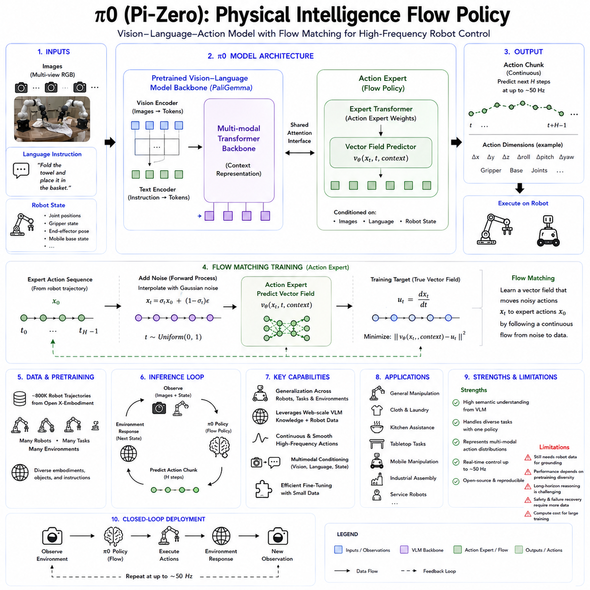{width="7.268055555555556in" height="7.268055555555556in"}

π0, pronounced "pi-zero," is a generalist Vision-Language-Action model developed by Physical Intelligence to control diverse robots through a shared policy architecture. Its central objective is to combine the broad semantic understanding of a pretrained Vision-Language Model with the precision, continuity, and temporal responsiveness required for physical robot control. Earlier Vision-Language-Action systems often represented robot commands as discrete tokens and generated them autoregressively, much like words in a sentence. π0 follows a different approach. It adds a continuous action-generation module to a pretrained multimodal model and trains this module through flow matching, allowing the system to produce smooth, high-frequency motor trajectories while retaining knowledge learned from large-scale image and language data.

The development of π0 reflects a fundamental tension in Robot Foundation Models. Large Vision-Language Models possess broad knowledge about objects, scenes, language, spatial relationships, and human activities, but they are normally optimized to generate discrete language tokens at relatively low frequencies. Dexterous manipulation requires continuous actions, coordinated multi-joint motion, rapid corrections, and fine contact control. A robot folding laundry or assembling a box may need to update its motor commands dozens of times per second. Physical Intelligence reported that π0 was designed to support action generation at rates of up to approximately 50 Hz, which is much closer to the requirements of practical manipulation than conventional language-token decoding.

π0 therefore begins with a pretrained Vision-Language Model backbone that provides semantic and visual representations. The original architecture was built using a PaliGemma-based multimodal model. This backbone processes camera images and natural-language instructions and produces context representations describing what is visible, what the user wants, and which parts of the scene are relevant. Instead of replacing this pretrained model with a robot-specific network, π0 augments it with a separate action expert. The action expert receives the multimodal context together with noisy continuous action sequences and predicts a vector field that transforms those noisy actions into coherent robot commands.

The term action expert describes a specialized set of parameters dedicated to physical control. The Vision-Language backbone and the action expert exchange information through a shared attention architecture, but they do not necessarily use identical weights for every computation. This separation resembles a mixture-of-experts design in which one component preserves semantic and visual knowledge while another specializes in continuous motor generation. The architecture is intended to prevent the detailed requirements of action control from overwhelming the more general representations inherited from the pretrained Vision-Language Model.

This division of responsibility is important because language reasoning and robot control have very different output structures. Language consists of discrete symbols selected from a vocabulary. Robot control usually consists of real-valued vectors representing end-effector displacement, joint motion, gripper commands, mobile-base movement, or other embodiment-specific controls. Language can often tolerate a relatively slow token rate, whereas manipulation may require rapid sequences of precisely coordinated values. By adding an action expert rather than forcing every control value into the language vocabulary, π0 preserves a continuous action representation suitable for smooth physical execution.

Flow matching is the core generative method used by the action expert. Flow matching learns a time-dependent vector field that transports samples from a simple noise distribution toward the distribution of valid robot actions. During training, real action sequences are combined with random noise at different interpolation times. The model observes the partially corrupted action sequence, the current images, the language instruction, and the robot state, and then predicts the direction in which the noisy sequence should move to become a valid expert action. During inference, the policy begins with random noise and repeatedly follows the learned vector field until a coherent action trajectory emerges.

This method is related to diffusion modeling but uses a continuous flow formulation. Both diffusion and flow-based policies are generative approaches that can represent complicated, multimodal action distributions. A conventional regression model may average several valid behaviors and produce an ineffective compromise. For example, if a cloth can be grasped from either side, averaging the two strategies may send the gripper toward the empty space between them. A flow policy can represent both alternatives and generate one complete, internally consistent action trajectory.

The ability to represent multiple action modes is especially valuable for dexterous manipulation. Many physical tasks do not have a single correct movement. A robot may approach a cup from different directions, choose different grasp points on a towel, or use different arm coordination patterns to place an object. The best action may also depend on subtle features such as occlusion, object deformation, previous motion, or the relative positions of the robot's arms. Flow matching allows π0 to model these possibilities without reducing the policy to a single deterministic average.

π0 generates action chunks rather than predicting only one instantaneous command. An action chunk is a sequence of several future control steps produced by one policy inference. This provides temporal consistency because the model generates a short movement plan rather than making each motor decision independently. Physical Intelligence's later technical description of its VLA systems states that they commonly use chunks containing 50 actions, corresponding to approximately one second of robot motion at a 50 Hz execution rate. Action chunking reduces oscillation, improves smoothness, and allows expensive policy inference to occur less frequently than the low-level control loop.

A practical robot does not necessarily execute an entire generated chunk without feedback. New observations may arrive while previous actions are still being performed, and the policy can generate updated chunks to reflect environmental changes. Later work from Physical Intelligence explored asynchronous real-time chunking, in which the model computes future actions while the robot executes part of an earlier prediction. The original π0 formulation already establishes the architectural foundation for this approach by treating action generation as short-horizon trajectory synthesis rather than isolated token prediction.

The model conditions action generation on several input types. Camera observations provide information about objects, surfaces, robot arms, grippers, and task progress. Natural-language instructions describe the desired objective. Proprioceptive state indicates the current configuration of the robot, which is essential because identical images can require different actions depending on joint positions or gripper state. These inputs are encoded into a shared context that guides the flow process from random action noise toward an executable trajectory.

Multiple camera views are particularly useful for manipulation. A fixed external camera provides a global view of the workspace, while a wrist-mounted camera offers detailed information about contact and local object geometry. For dual-arm robots, several images may be necessary to observe both manipulators and the objects between them. The VLM backbone converts these views into visual tokens, and the action expert attends to task-relevant information when generating coordinated motion.

π0 was trained on a large, diverse, cross-embodiment robot dataset containing data from single-arm manipulators, dual-arm systems, and mobile manipulators. The training tasks included folding laundry, cleaning tables, assembling boxes, placing objects, manipulating deformable materials, and other challenging behaviors. This diversity was intended to teach a shared policy representations that transfer across robot types and task families rather than producing a separate network for each application.

Cross-embodiment learning is difficult because robots differ in morphology, control dimensions, camera arrangements, action rates, workspaces, and kinematics. π0 addresses this problem partly through dataset normalization and embodiment-aware input and output processing. Actions from different robots must be converted into consistent numerical ranges, and robot-specific state dimensions must be mapped into the model's expected format. The openpi documentation emphasizes the importance of normalization statistics when fine-tuning on a new robot, because actions that follow familiar scales are generally easier for the pretrained model to adapt to.

The shared model does not imply that every robot uses precisely the same raw command format. A mobile manipulator may output base velocity and arm motion, while a stationary dual-arm robot may require two end-effector trajectories and two gripper commands. Platform-specific preprocessing, padding, masking, or action adapters can map these interfaces into the common policy architecture. The transferable knowledge lies primarily in visual interpretation, task understanding, temporal behavior, and manipulation structure, while exact control semantics remain partly embodiment dependent.

The original π0 experiments examined three major forms of capability. The first was zero-shot execution after broad pretraining, where the model attempted tasks without task-specific fine-tuning. The second was language-conditioned execution, including instructions provided directly by people or generated by a higher-level Vision-Language Model. The third was rapid acquisition of new skills through fine-tuning on additional task data. The reported evaluations covered complex manipulation behaviors such as laundry folding, table cleaning, and box assembly.

Laundry folding is an important demonstration because deformable objects are difficult to represent using rigid-object assumptions. Cloth shape changes continuously, self-occlusion is common, and success often requires coordinated bimanual motion over an extended period. The policy must identify corners or edges, maintain tension, reposition the material, and respond to imperfect intermediate states. Such tasks test whether a generalist policy can produce fluent, temporally coherent movements rather than isolated pick-and-place actions.

Table cleaning similarly requires more than object recognition. The robot must identify which objects should be moved, distinguish waste from items that should remain, plan repeated grasps, and coordinate arm motion with workspace coverage. Box assembly introduces sequence dependencies and geometric constraints because components must be aligned, folded, or inserted in a particular order. These examples were selected to demonstrate that π0 targets relatively complex manipulation rather than only simple benchmark motions.

The model can also receive instructions produced by a high-level VLM policy. In this arrangement, a larger reasoning model interprets the overall task and generates intermediate language commands, while π0 converts each command into continuous robot motion. This creates a hierarchical architecture in which semantic reasoning and motor execution are separated but connected through language. For example, a high-level planner may determine that the robot should first pick up a plate, then place it in a container, and then wipe the table. π0 executes the corresponding low-level behaviors.

This hierarchy addresses one of the major limitations of end-to-end policies. A continuous action model is effective at local motor generation but may not reliably maintain a long symbolic task plan over many minutes. A Vision-Language Model can reason about goals and subtask order but is not suitable for high-frequency motor control. Combining the two allows each model to operate at an appropriate temporal and semantic scale.

π0 differs from RT-2 in its treatment of action. RT-2 extends a Vision-Language Model by converting continuous controls into discrete tokens and generating them autoregressively. π0 retains a pretrained VLM but delegates motor generation to a continuous flow-matching action expert. Discrete action tokens provide architectural simplicity and compatibility with language modeling, but quantization can reduce precision and autoregressive decoding can be slow. Flow matching avoids fixed action bins and generates entire chunks of continuous motion, which is better suited to smooth dexterous manipulation.

π0 also differs from Octo. Octo is an open generalist transformer policy that uses diffusion-based continuous action generation and emphasizes efficient adaptation across public robot datasets. π0 similarly uses generative continuous actions, but it places greater emphasis on integrating a large pretrained VLM with a specialized action expert and training across highly dexterous, cross-embodiment tasks. Octo originally targeted a smaller and more accessible model scale, while π0 was designed as a more capable general robot control system built around broad semantic pretraining.

The relationship between flow matching and diffusion policy is subtle. Both begin from noise and transform it into actions. Diffusion models usually learn a denoising or score process associated with a sequence of noise levels. Flow matching directly learns a velocity field that transports samples along a continuous path. In principle, flow matching can provide straighter sampling trajectories and potentially require fewer integration steps, although practical performance depends on architecture, training, numerical solver, and task complexity.

The generative process creates an important inference trade-off. More flow integration steps may improve action quality but increase latency. Fewer steps improve responsiveness but may yield less accurate trajectories. This trade-off matters because robots must continuously react to new observations. Later research has continued to explore faster action generation, consistency models, efficient action tokenization, and asynchronous execution. Physical Intelligence's FAST work noted that flow matching performs well for dexterous control but can require more training effort than discrete action-token approaches.

π0 is primarily trained through imitation learning from successful robot trajectories. The model learns the conditional distribution of expert actions given images, instructions, and robot state. Flow matching provides the training objective for continuous action generation, while the VLM backbone contributes semantic representations. This process does not require the policy to discover skills through online trial and error, which makes training safer and more scalable than unrestricted physical reinforcement learning.

However, imitation learning also creates limitations. The policy can only learn behaviors sufficiently represented in the demonstrations. If recovery from a failed grasp is rare in the dataset, the robot may continue making ineffective movements rather than selecting a robust recovery strategy. If certain objects, camera arrangements, or action scales are underrepresented, generalization may degrade. The quality, diversity, and balance of the demonstration mixture therefore strongly influence the final policy.

Fine-tuning is used to adapt π0 to new robots or tasks. The released openpi software provides model checkpoints, training configurations, inference tools, and client-server utilities for integrating policies into robot systems. The repository contains π0-family models and packages intended to support research and deployment workflows.

A downstream adaptation pipeline begins by converting the new robot dataset into the expected observation and action format. Camera images, language commands, robot state, action sequences, and normalization statistics must be defined consistently. A suitable pretrained checkpoint is then fine-tuned on the target demonstrations. Depending on the available hardware and robot interface, inference may run locally or on a remote policy server connected to the robot through a lightweight client.

Open availability makes π0 more valuable as a research platform, but successful deployment still requires significant engineering. The robot's coordinate systems, action semantics, gripper commands, camera order, image preprocessing, and control frequency must match the policy configuration. Incorrect action normalization can produce unstable or meaningless movements. A model fine-tuned for one embodiment cannot be assumed to operate safely on another without validation.

π0's continuous action generation is particularly beneficial for bimanual manipulation. Two arms must coordinate position, orientation, timing, and force while handling shared objects. Generating each arm independently may lead to inconsistent or conflicting motion. A joint action chunk allows the model to represent coordinated trajectories for both arms as one distribution. This is important for folding cloth, carrying large objects, opening containers, or assembling structures.

The same architecture can support mobile manipulation. A mobile robot may need to reposition its base while moving an arm and controlling a gripper. The policy can, in principle, generate a combined action vector that coordinates these systems. This reduces the need to divide every task into separately engineered navigation and manipulation phases, although practical safety constraints and low-level controllers remain necessary.

π0 is an action policy rather than a complete robot control stack. Its outputs must pass through motor controllers, inverse kinematics, workspace constraints, velocity and acceleration limits, collision monitors, and emergency stop logic. High-frequency torque or joint stabilization is generally handled by conventional control systems beneath the VLA policy. The learned model provides task-directed trajectories, while deterministic controllers ensure that these trajectories are executed within the mechanical and safety limits of the robot.

This layered architecture is essential because semantic plausibility does not guarantee physical feasibility. The model may understand that an object should be placed in a box but propose a path that approaches a joint limit or passes near an obstacle. Additional planning and safety components can reject, modify, or halt the command. Industrial deployment therefore requires π0 to operate as part of a larger system that includes perception validation, state estimation, motion supervision, and fail-safe behavior.

π0 does not explicitly function as a world model. It generates actions conditioned on current observations but does not necessarily simulate detailed future scenes, compare many predicted outcomes, or estimate long-term environmental evolution. The flow process models the distribution of expert action sequences rather than the full transition dynamics of the world. This makes it effective for direct motor generation but limits explicit look-ahead planning.

A future architecture can combine π0 with a predictive world model. The action expert can propose several candidate chunks, and the world model can predict their physical consequences. A planner can then choose the candidate with the highest expected success and lowest risk. Such a structure would combine semantic understanding, multimodal action generation, uncertainty estimation, and explicit planning.

Long-horizon autonomy remains challenging. π0 can execute complex local skills, but an extended mission requires memory, task state, subgoal tracking, recovery logic, and verification. Folding one item is different from identifying, sorting, folding, and storing an entire load of laundry. A high-level orchestration system is needed to determine what has been completed, what remains, and how to respond when intermediate results are incorrect.

Generalization also remains imperfect. Broad pretraining helps the policy adapt across objects, tasks, and robots, but major differences in embodiment or workspace may still require substantial fine-tuning. A new industrial arm may have different dynamics, payload, speed, camera placement, and gripper geometry from the pretraining robots. Semantic knowledge can transfer, but reliable control must be grounded in target-platform data.

Another limitation is computational cost. The VLM backbone and iterative flow process require significant accelerator resources. Remote inference can reduce onboard hardware requirements but introduces network latency and communication risk. Local deployment improves reliability but may require a powerful edge GPU. Model compression, quantization, caching, faster solvers, and asynchronous action execution are therefore important for production systems.

Despite these challenges, π0 establishes a powerful design pattern for Physical AI. It shows that broad visual-language knowledge and high-frequency continuous control do not need to be represented through the same output mechanism. A pretrained VLM can provide semantic context, while a dedicated generative action expert produces precise motor trajectories. This separation allows one model to connect human instructions and internet-scale visual concepts with dexterous robot behavior.

The architecture also demonstrates the value of cross-embodiment data. Training on several robot families encourages the policy to discover common manipulation structure rather than memorizing one platform. Reaching, grasping, object transport, coordinated contact, and task completion share patterns across robots even when exact commands differ. Building larger, better normalized, and more diverse cross-robot datasets is therefore likely to remain central to future Robot Foundation Models.

For industrial applications, π0 suggests a development pathway based on general pretraining followed by targeted adaptation. A manufacturer could begin with a generalist checkpoint, collect demonstrations for assembly or material handling, and fine-tune the action expert and selected backbone parameters. A logistics robot could adapt the same foundation to sorting, packing, loading, and workspace cleanup. A service robot could use language-based task specification while learning local control from facility-specific data.

Fleet deployment can create a continuous learning loop. Robots operating at multiple sites collect successful executions, failures, corrections, and recovery episodes. These data are curated and added to the training mixture. Updated models are evaluated in simulation and controlled field trials before gradual deployment. Such a process requires data lineage, model versioning, safety regression testing, performance monitoring, and rollback capability.

π0 also influenced later Physical Intelligence models and the openpi ecosystem. Subsequent systems explored efficient action tokenization, open-world generalization, asynchronous real-time action chunking, and reinforcement-based improvement. The original π0 remains important because it introduced the continuous flow-based action expert as a practical mechanism for turning a pretrained Vision-Language Model into a high-frequency robot policy.

The broader significance of π0 lies in its view of robot intelligence as a combination of semantic knowledge and motor fluency. A robot must understand what a human wants, recognize relevant objects and relationships, and produce physically coherent actions at the speed required by the real world. Language models address only the first part of this problem. Conventional control policies address only the last part. π0 integrates both through a shared multimodal architecture and continuous generative control.

π0 should therefore be understood as an architectural milestone in the development of generalist Robot Foundation Models. It combines a pretrained Vision-Language backbone, a specialized action expert, flow-matching-based continuous trajectory generation, action chunking, and cross-embodiment robot data. This enables the policy to follow language instructions, perform complex manipulation, adapt through fine-tuning, and reuse knowledge across several robot platforms.

The model does not yet provide universal zero-shot control, guaranteed safety, complete long-horizon planning, or effortless transfer to every embodiment. Its importance lies in demonstrating a scalable approach for connecting broad multimodal intelligence with dexterous physical action. By treating continuous robot behavior as a generative flow conditioned on vision, language, and state, π0 provides a major foundation for future Physical AI systems capable of combining general understanding with precise and adaptable real-world control.

## 5.6 OpenVLA Open Source VLA for Manipulation [w/Code]

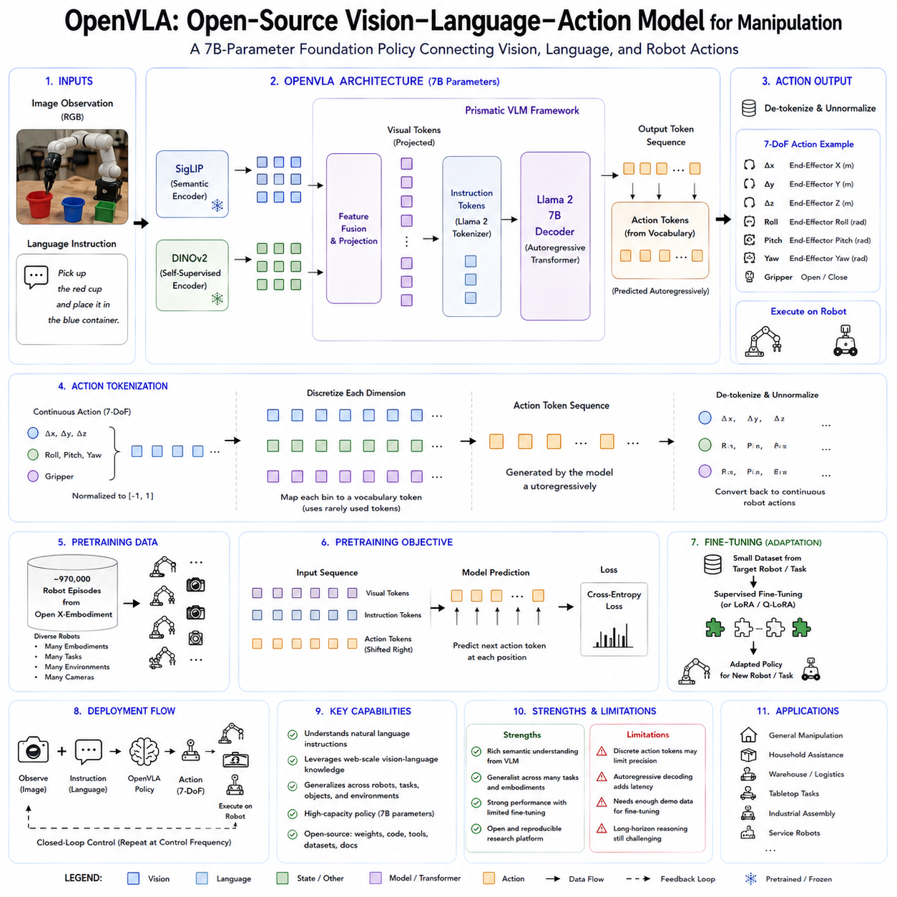{width="7.268055555555556in" height="7.268055555555556in"}

OpenVLA is a 7-billion-parameter open-source Vision-Language-Action model designed to connect visual perception, natural-language understanding, and robot manipulation within a single transformer-based policy. It was introduced to make large-scale VLA research more accessible by releasing model weights, training and fine-tuning code, implementation details, and integration tools. Earlier systems such as RT-2 demonstrated that internet-pretrained Vision-Language Models could be adapted to generate robot actions, but many influential VLA models remained closed and difficult for outside researchers to reproduce or customize. OpenVLA addresses this limitation by providing a fully inspectable foundation model that can be studied, modified, fine-tuned, and deployed on new manipulation platforms.

The central goal of OpenVLA is to create a generalist manipulation policy that receives an image of the robot's environment and a natural-language instruction, then directly predicts a low-level robot action. A command such as "pick up the red cup," "place the object inside the container," or "move the block to the left side" is processed together with the current camera observation. The model identifies task-relevant objects, interprets the instruction, reasons about spatial relationships, and generates the action required to move the robot toward the desired outcome. This architecture transforms manipulation into a multimodal sequence prediction problem in which images, language, and actions are represented within one unified model.

OpenVLA was pretrained on approximately 970,000 real-world robot episodes selected from the Open X-Embodiment dataset. These episodes combine demonstrations collected across many research institutions, robot platforms, environments, objects, camera arrangements, and task definitions. The diversity of this training mixture is essential because a foundation model must learn representations that transfer beyond one fixed laboratory setup. Instead of memorizing the appearance and action conventions of a single manipulator, OpenVLA is exposed to heterogeneous examples of reaching, grasping, placing, moving, opening, closing, and object interaction.

The model is built upon the Prismatic Vision-Language Model framework. Its visual system combines representations from two complementary pretrained vision encoders. One encoder emphasizes semantic information learned from image-text supervision, while the other provides detailed visual features learned through self-supervised representation learning. In the published architecture, visual features derived from SigLIP and DINOv2 are fused before being projected into the language model's embedding space. This combination is intended to preserve both language-aligned semantic knowledge and fine-grained spatial or visual structure required for manipulation.

The semantic vision encoder helps the model connect visible objects with linguistic concepts. It can associate an instruction referring to a cup, container, tool, color, or spatial relationship with relevant image regions. The self-supervised visual encoder contributes detailed information about shape, texture, boundaries, object configuration, and scene geometry. Manipulation requires both types of information. Recognizing that an object is a cup is not enough; the robot must also estimate where the cup is, how it is oriented, and where the gripper should approach it.

The fused image features are converted into visual tokens and supplied to a Llama 2-based language model backbone containing approximately 7 billion parameters. The language model processes the visual tokens together with the natural-language instruction and predicts an output sequence representing the robot action. OpenVLA therefore reuses the autoregressive decoding mechanism of a large language model but changes the meaning of selected output tokens. Rather than producing only natural-language words, the model can produce symbols corresponding to robot control values.

Action tokenization enables this shared representation. Continuous robot actions are normalized and divided into discrete bins. OpenVLA commonly represents an action as a seven-dimensional vector corresponding to end-effector translation, end-effector rotation, and gripper control. Each action dimension is discretized separately, and the resulting values are mapped onto rarely used tokens within the language model vocabulary. During training, the model learns to predict these action tokens from the current image and instruction. During deployment, the generated tokens are converted back into normalized continuous control values and then unnormalized according to the target robot's action statistics.

This approach follows the same broad principle introduced by RT-2: robot control can be represented as language-like token generation. The benefit is architectural simplicity. A pretrained multimodal language model can be transformed into a robot policy without requiring an entirely separate continuous control network. Cross-entropy loss, autoregressive decoding, vocabulary masking, and other established language-model training methods can be reused. The robot action becomes another structured sequence that the transformer learns to generate.

However, action tokenization also introduces important trade-offs. Discretization limits the precision of each control value and may create discontinuities between neighboring bins. Autoregressive decoding predicts action tokens sequentially, which can increase latency. A seven-dimensional action may require multiple token-generation steps even though the values conceptually describe one simultaneous robot command. These limitations are especially relevant for tasks requiring high-frequency control, force regulation, dexterous fingers, or tightly coordinated dual-arm motion.

OpenVLA is trained primarily through supervised imitation learning. Each training example contains a robot observation, a natural-language task instruction, and the action executed by the demonstrator. The model learns to maximize the likelihood of the corresponding action tokens. It does not need to discover behavior through unsafe online exploration and does not require a manually designed reward function during the main pretraining stage. Instead, it learns patterns from successful robot trajectories contained in the dataset.

The heterogeneous dataset must be converted into a shared training representation before learning. Different robot datasets use different coordinate frames, action ranges, gripper conventions, camera names, control rates, and language formats. OpenVLA normalizes actions and converts episodes into a common interface suitable for autoregressive training. This data-engineering layer is as important as the neural architecture because incorrect coordinate transformation or action normalization can produce meaningless supervision.

Cross-embodiment pretraining encourages OpenVLA to learn features that remain useful across different robots. The exact motor commands of a WidowX manipulator differ from those of a Franka arm, but both may need to recognize an object, identify a target location, approach safely, close a gripper, and transport the object. The model can reuse semantic, visual, and task-level knowledge even when embodiment-specific actions differ. Nevertheless, cross-embodiment transfer is not automatic. A new robot usually requires adaptation so that the shared representation becomes grounded in its particular kinematics and control interface.

One of OpenVLA's primary contributions is its support for efficient downstream fine-tuning. Full fine-tuning updates all model parameters and offers maximum adaptation capacity, but training a 7-billion-parameter model requires substantial GPU memory and distributed computing resources. The official project therefore supports parameter-efficient fine-tuning methods such as Low-Rank Adaptation. LoRA inserts small trainable low-rank matrices into selected model layers while keeping most pretrained parameters frozen. This significantly reduces memory consumption and allows laboratories or companies to adapt OpenVLA without repeating complete pretraining.

Fine-tuning begins with a dataset collected on the target robot. Each demonstration should include the camera image, language instruction, robot action, timestamps, and any state information needed by the deployment interface. The action distribution is analyzed to obtain normalization statistics. The dataset is then converted into the RLDS-style format or another structure supported by the training pipeline. During adaptation, the model learns the target robot's visual perspective, workspace, gripper behavior, action scale, and task distribution.

A small target-domain dataset may be sufficient when the new robot and tasks resemble the pretraining distribution. More data are required when the camera arrangement, embodiment, environment, or action interface differs substantially. For example, adapting from tabletop single-arm manipulation to a large industrial robot handling heavy parts may require extensive demonstrations because motion scale, payload, dynamics, safety constraints, and visual appearance are different. Pretraining provides a strong initialization, but it does not eliminate the need for physical grounding.

The OpenVLA study evaluated the model on multiple real-world manipulation platforms and task suites. The experiments compared OpenVLA with generalist policies such as RT-1-X and with larger proprietary VLA systems. The reported results showed that the open 7-billion-parameter model achieved strong performance across diverse manipulation tasks and, in the evaluated settings, outperformed several prior generalist policies despite using fewer parameters than some closed alternatives.

The evaluation considered more than success on memorized training tasks. It included variation in object identity, object position, visual appearance, background, language instruction, and environmental configuration. These tests examined whether the model had learned transferable visual-language-action representations rather than a fixed mapping from one familiar image to one familiar command. OpenVLA's broad visual and language pretraining helped it recognize task-relevant concepts that were not exhaustively represented in the target robot demonstrations.

Language conditioning allows one policy to support many tasks without assigning a separate symbolic identifier to each behavior. Related instructions can share semantic representations, and alternative phrasings may produce similar actions. For instance, "put the cup in the bowl" and "place the cup inside the bowl" express the same underlying objective. This semantic interface is more scalable than hard-coded task IDs and makes the policy easier for people to command.

The model's visual-language knowledge can also assist with unfamiliar object instances. If the robot has learned the general concept of a container, cup, block, or tool from large-scale pretraining, it may interpret a new example more effectively than a policy trained only on a small robot dataset. Nevertheless, recognition does not guarantee manipulation success. A novel object may have an unusual weight, friction, geometry, transparency, or deformability that requires physical experience not available from images and language alone.

OpenVLA operates in a closed-loop control process. At each timestep, the latest camera observation and instruction are processed, an action vector is predicted, and the command is executed through the robot control interface. A new image is then acquired, allowing the model to correct its behavior as the task progresses. Closed-loop operation is essential because manipulation contains uncertainty arising from object movement, calibration error, imperfect grasps, and visual occlusion.

The baseline OpenVLA architecture predicts one action at a time through autoregressive token generation. This provides frequent visual feedback but can create substantial inference overhead. A large 7-billion-parameter language model must process the image and instruction and then decode several action tokens for every control step. The resulting control frequency may be insufficient for dynamic manipulation without substantial acceleration or an additional low-level controller.

Quantization can reduce the deployment burden. Lower-precision model weights require less GPU memory and may improve inference speed. The official ecosystem supports integration with the Hugging Face Transformers library, and the released checkpoint can be used with parameter-efficient fine-tuning and quantized inference workflows. However, aggressive quantization may alter prediction quality, and robotic policies must be validated through task-level testing rather than language-model benchmarks alone.

The open-source release includes more than model weights. It provides a PyTorch training codebase, fine-tuning scripts, dataset-processing utilities, inference examples, and model configurations. Researchers can inspect how visual representations are fused, how action tokens are assigned, how robot datasets are sampled, and how adaptation is performed. This transparency enables reproducibility and allows the community to test modifications that would be impossible with closed VLA systems.

Open access also makes OpenVLA an architectural reference. Researchers can replace the visual encoder, modify the language backbone, introduce continuous action heads, add proprioception, change the action tokenizer, or combine the model with a diffusion policy. The checkpoint can serve as a baseline for studies of action chunking, parameter-efficient adaptation, compression, robustness, continual learning, and reinforcement-learning fine-tuning.

The model differs from RT-2 primarily in openness and implementation accessibility. Both architectures adapt large pretrained Vision-Language Models to robot control through discrete action tokens. RT-2 established the concept of using web-scale semantic knowledge to improve physical behavior, but its principal checkpoints and full training pipeline were not released as a completely open platform. OpenVLA made a comparable architectural pattern available to the wider robotics community through public code and weights.

OpenVLA differs from Octo in both scale and action representation. Octo is a smaller transformer policy that uses diffusion-based continuous action chunks and emphasizes adaptable cross-embodiment manipulation. OpenVLA uses a 7-billion-parameter VLM backbone and predicts discretized actions autoregressively. OpenVLA generally offers stronger large-model semantic capacity, while Octo's continuous generative head may provide smoother temporal action generation and lower adaptation cost.

OpenVLA also differs from π0. π0 combines a pretrained VLM with a dedicated flow-matching action expert that generates continuous action chunks at comparatively high frequency. OpenVLA uses the language model vocabulary itself as the action output interface. The OpenVLA design is simpler and closely aligned with standard language-model training, whereas π0's specialized action expert is better suited to continuous dexterous control. Both approaches demonstrate different ways of extending semantic multimodal models into Physical AI.

OpenVLA is a direct action policy rather than an explicit world model. It predicts what the robot should do from the current image and instruction, but it does not normally generate multiple detailed future scenes and compare their consequences before acting. This allows direct control but limits explicit long-horizon planning, uncertainty propagation, and counterfactual evaluation. A future system could use OpenVLA to propose actions while a world model predicts whether those actions will lead to successful and safe outcomes.

The absence of explicit long-term memory also limits complex mission execution. OpenVLA is effective for local manipulation behaviors but does not independently maintain a structured record of many completed subtasks over an extended mission. Cleaning an entire room, assembling a complex product, or performing a long inspection workflow requires progress tracking, subgoal management, failure recovery, and strategic replanning. These functions are better handled by a hierarchical planner or mission-level orchestration system above the VLA policy.

Another important limitation concerns proprioception and contact sensing. The baseline architecture is primarily image-and-language driven, although deployment pipelines can be extended. Camera observations cannot fully represent contact force, joint torque, friction, gripper pressure, or hidden object motion. Precision manipulation may therefore benefit from tactile, force, depth, and proprioceptive inputs. Extending the tokenization and attention architecture to these modalities is an important research direction.

Behavior cloning also inherits the limitations of its demonstrations. If the training data contain mostly successful behavior, the policy may not learn how to recover from a dropped object or failed grasp. If certain objects or robot platforms dominate the dataset, the model may perform poorly on underrepresented cases. Open X-Embodiment provides substantial diversity, but it also contains differences in data quality, action conventions, task labels, and collection procedures. Careful dataset balancing and quality control remain necessary.

The web-pretrained components can introduce semantic bias and visual shortcuts. A large vision-language model may focus on object appearance while underestimating physical properties such as mass, stiffness, friction, or fragility. It may recognize a transparent cup semantically yet fail to estimate its grasp geometry. Physical manipulation requires grounded experience, and internet visual knowledge cannot replace robot interaction data.

Safety is not guaranteed by the model's size or generalization ability. An action may be semantically appropriate but violate joint limits, collide with an obstacle, exceed velocity constraints, or enter a human-occupied region. OpenVLA should therefore operate within a layered architecture containing inverse kinematics, motion control, collision checking, workspace restrictions, force limits, emergency stopping, and supervisory monitoring. The VLA policy proposes task-directed actions, while deterministic systems enforce physical safety.

Industrial deployment also requires uncertainty handling. The baseline model generates an action prediction but does not automatically provide a calibrated confidence measure indicating whether the current observation lies outside the training distribution. Additional ensembles, uncertainty estimators, out-of-distribution detectors, action validators, or safety critics can be used to decide when the robot should stop, request assistance, or switch to a conventional fallback controller.

OpenVLA's 7-billion-parameter scale creates deployment challenges. Running the complete model on an embedded robot computer may require a powerful GPU with substantial memory. Remote inference can reduce onboard compute requirements but introduces network latency and communication failure risk. Production deployment therefore benefits from quantization, model distillation, efficient attention, caching, smaller visual encoders, and edge-optimized variants.

Later research built on OpenVLA to improve these limitations. OpenVLA-OFT, for example, explored parallel action decoding, action chunking, and optimized fine-tuning to improve speed and task performance. Its published project reports significantly faster action generation and lower latency than the base OpenVLA architecture. Such developments illustrate that an open foundation model can stimulate rapid community innovation around inference efficiency and control quality.

For a laboratory or company, OpenVLA provides a practical starting point for developing a custom manipulation policy. The organization can collect demonstrations on its own robot, convert them into the supported dataset structure, calculate action normalization statistics, and perform LoRA or full fine-tuning. It can then evaluate the adapted policy under new objects, changed positions, lighting variation, camera noise, payload differences, and task rephrasing.

A responsible deployment process should include both nominal and failure data. Demonstrations should cover correct execution, imperfect object placement, failed grasps, obstruction, human interruption, and recovery. Validation should separate training and test environments to avoid hidden memorization. The model should be evaluated using task success, collision rate, completion time, recovery performance, action smoothness, and human intervention frequency rather than token prediction accuracy alone.

OpenVLA can also support fleet learning. Multiple robots may collect trajectories across different facilities and task conditions. These data can be curated into a shared training mixture, used to update the foundation policy, and redistributed through controlled releases. A shared backbone may retain broad visual-language knowledge, while each robot platform uses its own action normalization and adapter configuration. Such a data flywheel can improve performance over time but requires model versioning, dataset lineage, regression testing, staged deployment, monitoring, and rollback.

From a system architecture perspective, OpenVLA is best understood as a semantic visuomotor policy layer. It connects language-defined intent with observed objects and produces low-level manipulation commands. It does not replace mission orchestration, map-based navigation, certified safety control, or hardware-level servo loops. In a complete Physical AI system, a high-level planner determines the current subtask, OpenVLA produces an appropriate manipulation action, and lower-level controllers execute it safely.

The open release also has strategic significance for the robotics community. It reduces dependence on a small number of proprietary laboratories and provides a common baseline for comparing new VLA methods. Researchers can reproduce experiments, inspect model failures, evaluate bias, measure cross-robot transfer, and develop efficient deployment techniques using the same starting point. This shared foundation accelerates progress and improves scientific transparency.

OpenVLA demonstrates that a relatively standard large Vision-Language Model can be converted into a generalist robot policy through action tokenization and large-scale cross-embodiment imitation learning. The architecture integrates fused visual encoders, a Llama 2 language backbone, natural-language task conditioning, and discretized robot actions. Its training on approximately 970,000 real-world episodes provides broad manipulation experience, while parameter-efficient fine-tuning enables adaptation to new robots and domains.

The model does not yet provide universal zero-shot manipulation, high-frequency dexterous control, explicit physical reasoning, guaranteed safety, or complete long-horizon autonomy. Nevertheless, its open weights, code, and training tools established an important foundation for reproducible VLA research. OpenVLA shows how vision, language, and action can be combined within a transparent and adaptable framework, making it a major milestone in the development of open Robot Foundation Models for manipulation and broader Physical AI.

## 5.7 GR00T Humanoid Foundation Model NVIDIA [w/Code]

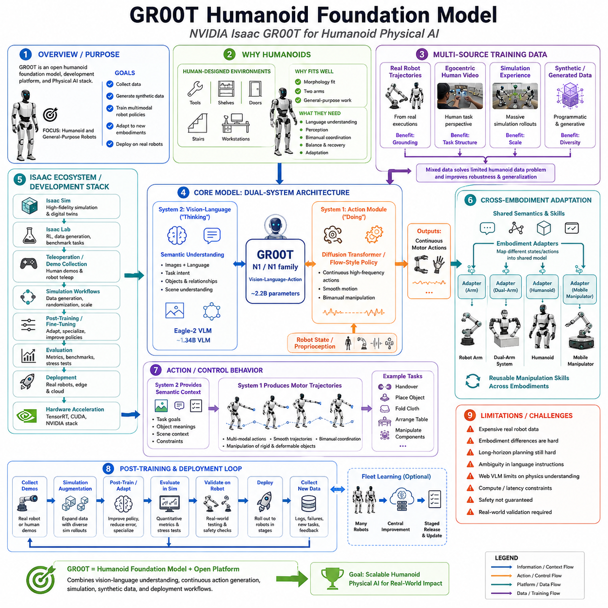{width="7.268055555555556in" height="7.268055555555556in"}

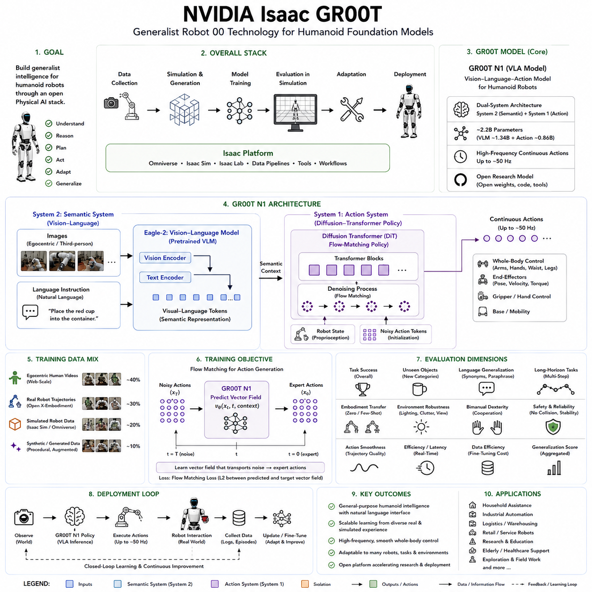{width="7.268055555555556in" height="7.268055555555556in"}

NVIDIA Isaac GR00T, short for Generalist Robot 00 Technology, is an open research initiative and development platform for building foundation models, data pipelines, simulation workflows, and deployment systems for humanoid and general-purpose robots. Its purpose is broader than producing a single control policy. GR00T seeks to create an integrated Physical AI stack through which developers can collect demonstrations, generate synthetic experience, train multimodal robot policies, evaluate them in simulation, adapt them to different robot embodiments, and deploy them on physical hardware. The platform reflects NVIDIA's view that general-purpose humanoid robots require not only capable mechanical bodies but also foundation models trained on large and diverse sources of physical experience.

Humanoid robots are attractive as general-purpose machines because their bodies are designed to operate in environments originally constructed for people. Human workplaces, homes, tools, shelves, doors, stairs, workstations, and transportation systems assume human reach, height, hand structure, and mobility. A humanoid may therefore use existing infrastructure without requiring every environment to be redesigned. However, this morphological compatibility does not automatically provide intelligence. A humanoid still needs to understand language, perceive complex scenes, coordinate two arms, manage balance, manipulate unfamiliar objects, recover from errors, and adapt to changing conditions. GR00T is intended to supply a reusable intelligence foundation for these capabilities.

The original Project GR00T was presented as a general-purpose multimodal model for humanoid robots, while the later Isaac GR00T platform expanded the concept into an open development environment covering model training and robot data pipelines. NVIDIA subsequently released GR00T N1 as an open foundation model for generalist humanoid robots. The N1 model was trained from a heterogeneous mixture of egocentric human videos, real robot trajectories, simulated robot experience, and synthetically generated data. This mixture was designed to address one of the central constraints in humanoid learning: real robot demonstrations are valuable but expensive, slow, and difficult to scale.

GR00T N1 is a Vision-Language-Action model. It receives visual observations, natural-language instructions, and robot state information and produces continuous motor actions. Unlike a conventional vision-language model that outputs only text, the GR00T architecture connects semantic understanding directly with physical execution. A robot may receive an instruction such as placing an object into a container, handing an item to a person, arranging objects on a table, or manipulating components with both hands. The model must identify the relevant entities, understand the intended relationship, interpret the current robot configuration, and generate an appropriate action trajectory.

A defining feature of GR00T N1 is its dual-system architecture. The design is inspired by the distinction between deliberate reasoning and rapid action in human cognition. System 2 is implemented as a vision-language module that interprets images and instructions. It provides a semantic understanding of the scene, the requested task, the relevant objects, and their relationships. System 1 is implemented as a diffusion-transformer-based action module that converts this understanding into fluid motor behavior. The two systems are tightly coupled and jointly trained rather than operating as completely independent pipelines.

The vision-language component processes visual observations and textual instructions as tokens. In the publicly described GR00T N1 architecture, NVIDIA used the Eagle-2 Vision-Language Model as the semantic backbone. Camera images and language instructions are converted into a multimodal representation that captures what is visible and what the robot should accomplish. The publicly released GR00T-N1-2B model contains approximately 2.2 billion parameters, including about 1.34 billion parameters in the vision-language component. This scale is smaller than some very large web-oriented VLA systems, making the model more practical for robot adaptation while retaining a substantial semantic backbone.

The action-generation module receives the output of the vision-language backbone together with robot state and action encodings. It uses a Diffusion Transformer, commonly abbreviated as DiT, with a flow-matching-style policy to produce high-frequency continuous actions. Rather than representing every control value as a discrete language token, the model generates real-valued motor trajectories. This approach is well suited to humanoid manipulation because arm movement, hand motion, waist configuration, and other controls must remain smooth and temporally coordinated.

Continuous generative action modeling is especially important for humanoids because many tasks have multiple valid solutions. An object can often be approached from several directions. A cloth may be grasped at different corners. A large item may be lifted through different bimanual coordination patterns. A deterministic regression model may average these possibilities and generate an ineffective compromise. A diffusion or flow-based policy can represent several action modes and generate one coherent trajectory conditioned on the current scene and task.

The dual-system design also separates semantic timescales from motor timescales. Language interpretation and visual reasoning may evolve relatively slowly because the task objective does not change at every millisecond. Motor control must respond much more rapidly to changes in robot state and physical interaction. The vision-language backbone provides a semantically meaningful context, while the action module produces short-horizon motion at the frequency needed by the robot. This division allows GR00T to connect high-level instructions with continuous control without forcing every motor value through a slow language-decoding process.

Robot state is an essential input to the action module. The same visual scene may require different actions depending on the current arm position, hand state, waist orientation, or previous movement. Proprioceptive information allows the policy to understand the robot's configuration and generate actions that are consistent with its current physical state. For humanoid manipulation, this may include arm and wrist positions, gripper or hand states, torso configuration, and other embodiment-specific measurements.

GR00T was designed to support multiple robot embodiments rather than one fixed humanoid platform. Its reported evaluations included standard simulation benchmarks across several robot types, ranging from tabletop robot arms to dexterous humanoid systems. The architecture uses embodiment-specific interfaces and adapters so that heterogeneous robot states and action spaces can be mapped into a shared model. This allows the internal semantic and manipulation representations to be reused even though exact control dimensions differ among platforms.

Cross-embodiment learning does not mean that all robots share identical raw motor commands. A single-arm manipulator, dual-arm humanoid, mobile manipulator, and full humanoid have different kinematics, state dimensions, control rates, and action spaces. The shared model learns reusable concepts such as reaching, grasping, object transport, spatial alignment, and task completion. Lightweight embodiment-dependent input and output modules then connect those representations to the physical interface of each robot.

One of the major difficulties in training humanoid foundation models is the lack of sufficiently large real-robot datasets. Collecting data on humanoids is more expensive than collecting images or text. Each trajectory requires physical hardware, operators, safety supervision, maintenance, calibration, and significant time. Humanoid systems also experience greater wear and failure risk because of their mechanical complexity. GR00T therefore relies on a multimodal data strategy that combines several complementary sources rather than depending only on robot demonstrations.

Real robot trajectories provide the most direct grounding. They show how sensor observations, robot states, commands, actions, contacts, and task outcomes are connected on actual hardware. These data capture effects that are difficult to simulate perfectly, including actuator delay, camera noise, mechanical compliance, backlash, friction variation, calibration error, object movement, and operator style. However, real trajectories alone are too costly to provide the task and environment diversity required for a general-purpose model.

Human video offers a much larger source of behavior data. Egocentric recordings can show how people interact with objects, use tools, arrange environments, open containers, move deformable items, and complete multistage activities. Human bodies differ from robot embodiments, so the recorded movements cannot be copied directly. Nevertheless, the videos contain valuable information about task structure, object affordances, hand-object relationships, and temporal ordering. GR00T uses such data to improve the model's understanding of human-world activities before grounding that knowledge in robot-specific controls.

Simulation supplies another essential source of experience. NVIDIA Isaac Sim and Isaac Lab provide GPU-accelerated environments for modeling robots, scenes, sensors, physics, and control policies. Isaac Lab is an open-source modular robot-learning framework that supports imitation learning and reinforcement learning and forms a foundational part of the Isaac GR00T development platform. Simulation makes it possible to generate large numbers of trajectories, vary environments systematically, reproduce dangerous failures safely, and evaluate policies before real-world deployment.

Synthetic data further extends this strategy. Scene layouts, object appearances, camera perspectives, lighting conditions, and trajectories can be varied automatically. Synthetic generation is particularly valuable for rare configurations and safety-critical situations that are difficult to collect naturally. NVIDIA has also described workflows such as GR00T-Dreams, which use world foundation models to generate synthetic trajectory data for teaching robots new actions in unfamiliar environments.

These data sources play different roles. Human video offers task and semantic diversity. Simulation provides scalable physical interaction and controlled variation. Synthetic generation expands scene coverage and rare-event representation. Real robot data supplies accurate embodiment grounding and compensates for simulation-to-reality differences. The foundation model must combine these sources without confusing human actions, simulated controls, and real robot dynamics.

Data normalization and embodiment metadata are therefore critical. Different robots may use joint-space control, end-effector deltas, Cartesian poses, gripper commands, hand joints, base velocities, or waist controls. Camera configurations and observation histories also vary. Training requires conversion into compatible representations while preserving information about the original embodiment. If the model loses the distinction between robot types, it may generate controls that are meaningful for one platform but invalid for another.

The GR00T training workflow fits into a broader NVIDIA ecosystem for data collection, simulation, policy learning, and deployment. Isaac Teleop supports the capture of human-controlled robot demonstrations. Isaac Sim provides high-fidelity simulation and synthetic data generation. Isaac Lab supports policy training and large-scale experimentation. GR00T supplies the foundation policy architecture, while deployment tools connect the adapted model with physical robots. NVIDIA presents these components as a modular platform that developers may use individually or as an integrated pipeline.

Teleoperation is especially important for learning manipulation. An operator can control a humanoid or manipulator while cameras, proprioception, actions, and language labels are recorded. This produces successful demonstrations without requiring the robot to discover every behavior through unsafe exploration. The resulting episodes can be used to fine-tune the general foundation model for a new task, environment, or embodiment.

The model is trained primarily through imitation learning. Given observations, instructions, robot state, and expert trajectories, the system learns to reproduce the distribution of appropriate actions. The vision-language module learns to associate instructions with visual context, while the action module learns the continuous motor trajectories required to achieve the goal. End-to-end joint training allows the semantic representation to become useful for actual control rather than remaining an abstract language feature.

GR00T N1 was deployed on the Fourier GR-1 humanoid robot for language-conditioned bimanual manipulation. The experiments examined whether the model could use two arms to perform tasks under natural-language instructions while adapting efficiently from a pretrained foundation. NVIDIA reported strong performance and high data efficiency relative to imitation-learning baselines. The work also reported improved results on simulated manipulation benchmarks across multiple embodiments.

Bimanual manipulation is a demanding evaluation because both arms must be coordinated in space and time. A task may require one hand to stabilize an object while the other manipulates it, both hands to carry a large item, or the arms to perform complementary movements. Independent arm policies can generate inconsistent timing or conflicting motion. GR00T's joint action representation allows coordinated behaviors to be generated as a single trajectory conditioned on the full scene.

Humanoid manipulation also introduces torso and whole-body considerations. The robot may need to adjust its waist or body position to extend reach, maintain a stable workspace, or avoid self-collision. The original N1 emphasis was primarily on manipulation rather than complete unified locomotion and manipulation, but the broader GR00T initiative is intended to support increasingly general humanoid capabilities. Full-body autonomy requires coordination between semantic planning, manipulation, locomotion, balance, and safety control.

GR00T should therefore not be interpreted as replacing all conventional humanoid control. High-frequency joint stabilization, torque control, balance regulation, collision avoidance, actuator protection, and emergency stopping remain the responsibility of specialized control layers. The VLA foundation model produces task-directed action trajectories, while lower-level controllers ensure physically stable execution. For walking or whole-body motion, dedicated locomotion and balance controllers may operate beneath or alongside the learned policy.

This layered architecture is essential for safety. A foundation model may generate an action that is semantically reasonable but mechanically infeasible. The robot may understand that an object should be retrieved from a shelf but propose a movement that exceeds a joint limit or approaches an obstacle. Deterministic safety monitors must therefore validate reachability, velocity, acceleration, self-collision, external collision, force, payload, and stability before or during execution.

GR00T is also not a complete mission-level orchestration system. It can interpret instructions and generate local physical behavior, but long industrial missions require task scheduling, navigation, workflow state, fleet coordination, recovery logic, and progress verification. A warehouse humanoid may need to receive a work order, navigate to a station, identify components, perform manipulation, verify the result, and report completion. These functions require a hierarchical architecture above the VLA policy.

A high-level reasoning system can decompose a complex instruction into a sequence of subgoals. GR00T can then execute the local manipulation associated with each subgoal. A world model may predict the consequences of candidate actions, while a mission state machine tracks overall progress and recovery. Such a hierarchy combines the semantic flexibility of a foundation model with the determinism and observability required in industrial operations.

The relationship between GR00T and world models is becoming increasingly important. GR00T N1 itself is principally a VLA action model rather than a full predictive simulator. It maps current multimodal context into actions but does not necessarily generate several complete future worlds before choosing a trajectory. Later NVIDIA workflows increasingly combine GR00T policies with Cosmos world models for scene reasoning, synthetic data generation, task decomposition, and sim-to-real development.

A world model can complement GR00T by evaluating future outcomes. The VLA model may propose candidate action chunks, while the world model predicts object motion, contact, task progress, and risk. A planner can select the most promising candidate before execution. This would provide more explicit look-ahead reasoning than direct imitation-based policy generation alone.

GR00T's open release is strategically important. The project provides an accessible foundation that researchers and robot manufacturers can adapt to their own embodiments. Open models allow developers to inspect the architecture, evaluate failures, modify data adapters, perform domain-specific fine-tuning, and compare results across platforms. NVIDIA describes Isaac GR00T as an open reference platform rather than a closed robot product.

Open availability does not mean that deployment is automatic. A company must still collect task-specific demonstrations, configure the robot's observation and action spaces, normalize states and controls, calibrate cameras, integrate safety controllers, and evaluate the model under operational variation. A pretrained humanoid foundation model reduces the starting cost but does not eliminate embodiment engineering.

Fine-tuning is especially necessary when the target robot differs from the pretraining platforms. A new humanoid may use different arms, hands, cameras, joint limits, control rates, payloads, and coordinate systems. The foundation model provides transferable visual-language and manipulation representations, while post-training grounds them in the target hardware. The amount of required data depends on how closely the target embodiment and tasks resemble those used during pretraining.

The data-collection process should include more than ideal successful demonstrations. Recovery from missed grasps, shifted objects, occlusion, human interruption, partial completion, and unexpected contact is essential for practical robustness. A humanoid trained only on perfect demonstrations may fail when a minor error moves it outside the familiar trajectory distribution.

The simulation environment can be used to expand these recovery cases. Developers can randomize object position, lighting, friction, sensor noise, latency, and robot initialization. Faults can be injected into observations or controls. The resulting policy should then be tested on unseen simulations and controlled physical trials before production deployment. Isaac Lab and simulation-based evaluation provide infrastructure for this workflow.

Evaluation must consider more than action prediction error. A useful humanoid policy should be measured by task success, bimanual coordination, completion time, collision rate, intervention frequency, recovery performance, action smoothness, language following, and generalization to unseen objects and configurations. Simulation benchmarks provide repeatability, but physical trials are necessary because real contact and mechanical variation remain difficult to model perfectly.

Generalization is one of GR00T's primary objectives, but it remains incomplete. The model can benefit from diverse pretraining and transfer across related embodiments, yet a radically different robot or task may still require extensive adaptation. Human-like morphology does not guarantee identical control. Different humanoids vary in hand design, joint range, compliance, strength, sensing, and locomotion capability.

The vision-language backbone also brings limitations inherited from web-trained multimodal models. It may recognize the semantic category of an object while lacking accurate information about mass, stiffness, friction, or fragility. A visually familiar object can behave differently during contact. Physical grounding through robot data, tactile sensing, force feedback, and real-world validation remains essential.

Language instructions can also be ambiguous. A person may say "put that over there" without clearly identifying the object or target. Industrial terminology may differ from web language. A safe system should detect ambiguity, request clarification, or use contextual task information rather than confidently executing an uncertain interpretation.

Inference cost is another practical issue. A large vision-language backbone and generative action module require substantial accelerator performance. Humanoid robots have strict power, thermal, weight, and latency constraints. Some deployments may use onboard GPUs, while others may rely on an external edge server. Remote inference introduces communication delay and failure risk, so safety-critical low-level control must remain local.

Model optimization techniques such as reduced precision, quantization, TensorRT acceleration, efficient attention, caching, and smaller embodiment-specific variants can reduce deployment cost. However, optimization must be evaluated at the task level because small changes in action quality can produce large differences in physical success and safety.

Subsequent GR00T versions have continued to improve architecture, training data, generalization, and language following. NVIDIA introduced N1.5 and later N1.6 with updated visual-language backbones, data mixtures, and post-training performance across simulated benchmarks and physical robots. These developments show that GR00T is an evolving model family and platform rather than a fixed one-time architecture.

The original N1 remains important because it established the core dual-system formulation: a vision-language semantic module coupled with a diffusion-transformer action module. This architecture provides a practical compromise between high-level multimodal intelligence and continuous robot control. Later versions refine the components while retaining the broader principle of combining semantic reasoning with specialized action generation.

For industrial use, GR00T suggests a development strategy based on broad pretraining followed by targeted post-training. A manufacturer can begin with a general foundation checkpoint, collect demonstrations for assembly, material handling, machine tending, or logistics, and adapt the model to the company's humanoid hardware. Simulation and synthetic data can expand coverage before limited real-world validation.

A factory deployment would still require integration with production systems. The humanoid must receive authorized work instructions, know which station and component are involved, respect safety zones, interact with programmable logic controllers, report task completion, and recover according to approved procedures. GR00T provides the semantic manipulation intelligence, while plant orchestration and safety systems provide operational control.

Fleet learning can create a continuous improvement cycle. Multiple humanoids operating at different facilities can collect trajectories, failures, corrections, and environmental variations. These data can be curated centrally, used for updated post-training, validated in simulation, and distributed through staged releases. Such a process requires strong dataset lineage, model versioning, regression testing, monitoring, rollback, cybersecurity, and privacy controls.

Human demonstration data also raises governance issues. Video may contain workers, proprietary facilities, processes, or customer information. Data collection must include consent, access control, anonymization, retention policies, and clear ownership rights. Synthetic and simulated data can reduce some privacy burden but cannot completely replace real operational grounding.

From a broader Physical AI perspective, GR00T illustrates that humanoid intelligence must be built as an ecosystem rather than a single neural model. The foundation policy, teleoperation tools, simulation framework, synthetic data generation, world models, low-level control, hardware acceleration, safety systems, and deployment infrastructure all contribute to the final capability. A strong model without scalable data and validation pipelines cannot become a reliable robot product.

GR00T also demonstrates the convergence of several foundation-model paradigms. Vision-language pretraining supplies semantic knowledge. Imitation learning grounds that knowledge in physical demonstrations. Diffusion and flow-based generation produce continuous motor behavior. Simulation and synthetic data provide scale. World models support prediction and data generation. Cross-embodiment training creates reusable representations. Together these technologies form a general framework for humanoid Physical AI.

NVIDIA Isaac GR00T should therefore be understood as both a humanoid foundation model family and an open reference platform for generalist robot development. Its core architecture combines a vision-language System 2 with a continuous action-generating System 1. It is trained from human video, real robot trajectories, simulation, and synthetic experience, and it is designed for adaptation across multiple robot embodiments. The surrounding Isaac ecosystem supports demonstration collection, simulation, policy training, evaluation, and deployment.

GR00T does not yet provide unrestricted human-level autonomy, universal zero-shot control, guaranteed safety, complete whole-body intelligence, or flawless transfer across every humanoid. Its importance lies in establishing a scalable architecture and development pipeline through which broad multimodal understanding can be connected to coordinated physical action. As the GR00T family evolves, it provides a major foundation for humanoid robots that can learn new tasks more efficiently, follow language instructions, reuse knowledge across embodiments, and operate with increasing flexibility in human-designed environments.

## 5.8 Robot Foundation Model Benchmarking Protocol [w/Code]

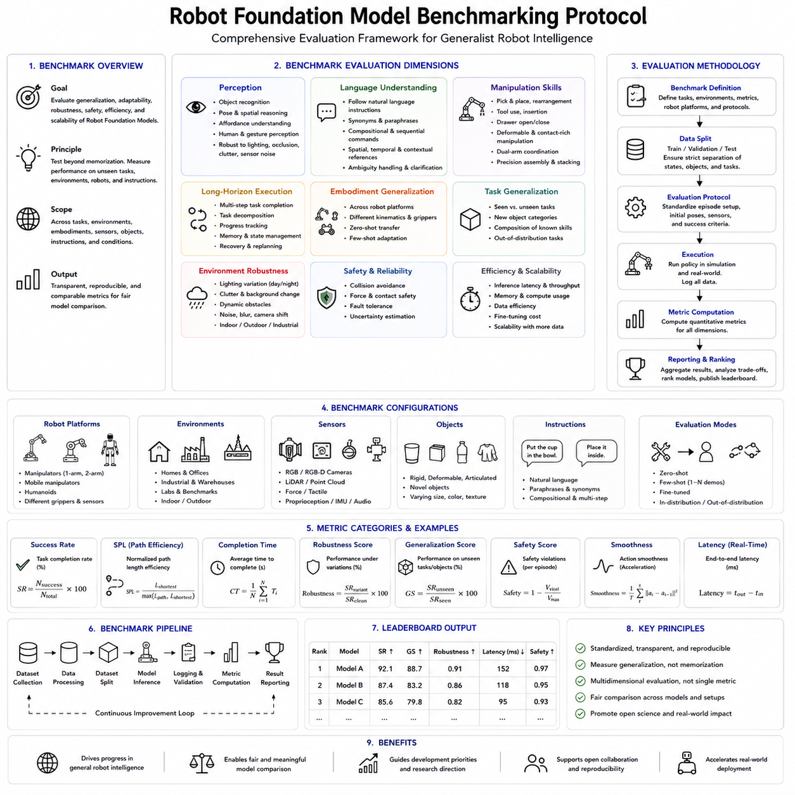{width="7.268055555555556in" height="7.268055555555556in"}

The rapid development of Robot Foundation Models has fundamentally changed how robot intelligence is trained and evaluated. Traditional robotics research usually focused on a single robot, a single laboratory environment, and a small collection of predefined tasks. Performance was often measured by task success rate within that limited setting. Foundation models introduce a completely different paradigm. They are expected to generalize across different robot embodiments, diverse environments, multiple sensing modalities, natural-language instructions, and previously unseen manipulation tasks. Consequently, evaluating these models requires a comprehensive benchmarking protocol that measures not only immediate task performance but also scalability, adaptability, robustness, safety, efficiency, and generalization. A modern Robot Foundation Model benchmark therefore becomes a multidimensional evaluation framework rather than a single performance metric.

Benchmarking is essential because the complexity of foundation models makes intuitive comparison almost impossible. Two models may achieve similar success rates on familiar laboratory tasks while exhibiting dramatically different behavior when exposed to unseen objects, novel instructions, changing environments, or different robot platforms. Likewise, a model with exceptional language understanding may generate unstable motor actions, while another model may perform smooth manipulation but fail to understand complex instructions. Without standardized evaluation protocols, researchers may optimize models toward isolated demonstrations that appear impressive but do not represent reliable general robot intelligence.

The primary objective of a Robot Foundation Model benchmark is therefore to measure generalization rather than memorization. A robot should not merely repeat demonstrations observed during training. Instead, it should combine previously learned visual concepts, language understanding, motor skills, spatial reasoning, and physical interaction into successful behavior under conditions that differ from those encountered during training. Generalization should be measured across tasks, environments, robot embodiments, sensing conditions, object categories, and instruction formulations.

A comprehensive benchmark typically evaluates several complementary capability categories. The first category concerns perception. The robot must correctly recognize objects, estimate their positions and orientations, understand spatial relationships, identify affordances, interpret human gestures, and maintain scene awareness under varying lighting, occlusion, clutter, and sensor noise. Foundation models increasingly rely on multimodal representations combining RGB images, depth cameras, force sensors, tactile sensors, proprioception, and language. A benchmark should therefore evaluate perception under multiple sensing conditions rather than relying solely on ideal camera images.

Language understanding forms the second major evaluation dimension. Modern Robot Foundation Models are expected to follow natural-language instructions rather than predefined task identifiers. A benchmark should therefore evaluate whether different linguistic expressions describing the same task produce consistent behavior. The robot should correctly interpret synonyms, paraphrases, indirect instructions, sequential commands, spatial references, temporal constraints, and contextual descriptions. The evaluation should also consider ambiguous instructions and determine whether the robot requests clarification instead of confidently executing an uncertain interpretation.

Manipulation capability represents another central benchmark category. Evaluation should include simple pick-and-place operations, object rearrangement, drawer opening, tool use, insertion tasks, deformable object manipulation, dual-arm coordination, precision assembly, container interaction, object stacking, and contact-rich manipulation. Tasks should vary in complexity, object geometry, material properties, required precision, and temporal length. Success should not depend on a single predefined object but should generalize across multiple object instances with different appearances and physical characteristics.

Long-horizon task execution requires additional evaluation beyond individual manipulation skills. A robot capable of grasping an object is not necessarily capable of completing a sequence of twenty coordinated actions. Benchmark protocols should therefore include multistage activities such as preparing a workstation, assembling multiple components, organizing shelves, packing containers, cleaning workspaces, or sorting heterogeneous objects. Such tasks require memory, task decomposition, progress tracking, recovery behavior, and strategic replanning rather than isolated motor execution.

Embodiment generalization has become one of the defining characteristics of Robot Foundation Models. Unlike traditional robot-specific controllers, foundation models are expected to transfer knowledge across multiple platforms. A benchmark should therefore evaluate performance on robots that differ in kinematic structure, joint configuration, workspace, camera placement, gripper design, locomotion capability, payload, and sensing hardware. Transfer should be measured both with and without additional fine-tuning. Zero-shot transfer evaluates the direct reuse of pretrained representations, while few-shot adaptation measures how efficiently the model learns from a limited number of demonstrations on the new platform.

Task generalization should also be evaluated independently from embodiment transfer. A robot may successfully transfer between different manipulators while still failing to perform unfamiliar tasks. Benchmark protocols should therefore distinguish between known tasks with new objects, new tasks using familiar objects, and entirely novel combinations of tasks and environments. This separation helps researchers identify whether improvements originate from semantic understanding, motor learning, or simple memorization of demonstrations.

Visual robustness represents another important benchmark dimension. Industrial and household environments rarely match ideal laboratory conditions. Lighting changes throughout the day, reflective surfaces create glare, objects become partially occluded, and backgrounds continuously vary. Benchmark datasets should therefore include illumination changes, shadows, clutter, camera motion, motion blur, lens contamination, sensor noise, partial visibility, transparent objects, reflective materials, and dynamic obstacles. Robust policies should maintain stable performance despite these disturbances.

Physical robustness extends beyond visual robustness. Objects may have different masses, friction coefficients, stiffness, deformability, center-of-mass locations, or surface textures. A grasp that succeeds for an empty plastic container may fail for a heavy metal object of identical appearance. Benchmark protocols should therefore vary physical properties independently of visual appearance whenever possible. Simulated benchmarks can randomize these parameters systematically, while physical benchmarks can evaluate representative object families with controlled variation.

Out-of-distribution evaluation has become increasingly important for foundation models. Training datasets cannot cover every possible environment, object, language expression, or robot embodiment. A reliable Robot Foundation Model should detect unfamiliar situations and respond appropriately rather than producing overconfident but unsafe behavior. Benchmark protocols should therefore include objects never observed during training, novel combinations of familiar concepts, unusual environmental configurations, previously unseen manipulation goals, and unexpected human interactions. Performance should be evaluated both in terms of successful adaptation and calibrated uncertainty estimation.

Safety evaluation is a mandatory component of any practical benchmark. Foundation models may generate semantically reasonable but physically dangerous actions. A benchmark should therefore measure collision frequency, self-collision avoidance, workspace boundary violations, excessive joint velocities, force-limit violations, unstable balance, payload misuse, unsafe human proximity, and recovery from emergency interruptions. Industrial deployment requires that safety be evaluated independently from task success because a highly successful robot that occasionally generates dangerous actions is unsuitable for production use.

Recovery capability deserves its own benchmark category. Many published demonstrations evaluate only ideal successful trajectories. Real robots inevitably experience grasp failures, object slips, dropped tools, unexpected human interference, calibration drift, localization errors, and dynamic environmental changes. Benchmark protocols should intentionally introduce failures and measure whether the policy recovers autonomously. Recovery time, recovery success rate, number of additional actions, and final task completion should all be reported.

Human-robot interaction represents another increasingly important evaluation area. A Robot Foundation Model should interpret spoken instructions, gestures, demonstrations, corrections, interruptions, and collaborative behavior. Benchmarks should evaluate how effectively the robot updates its behavior after receiving new instructions during execution. Cooperative assembly, object handover, shared workspace interaction, and collaborative transportation provide realistic evaluation scenarios for these capabilities.

Benchmarking should also measure computational efficiency. Foundation models often contain billions of parameters and require significant hardware resources. Practical deployment depends not only on intelligence but also on inference latency, memory consumption, GPU utilization, energy efficiency, communication overhead, and deployment complexity. A benchmark should therefore report average inference time, control frequency, peak GPU memory usage, throughput, energy consumption, and hardware configuration alongside task performance. Comparing success rates without reporting computational requirements can create misleading conclusions regarding real-world applicability.

Training efficiency is equally important. Foundation models differ substantially in their data requirements. One model may require millions of demonstrations, while another achieves similar performance using significantly less data. Benchmark protocols should therefore report dataset size, number of robot trajectories, number of task categories, embodiment diversity, language diversity, synthetic-to-real ratio, simulation ratio, and human demonstration volume. Learning curves illustrating performance as a function of available data provide valuable insight into sample efficiency.

Fine-tuning efficiency has become another important benchmark dimension because many foundation models are intended to serve as reusable initialization rather than complete zero-shot solutions. Evaluation should measure the amount of target-domain data required for adaptation, the computational cost of fine-tuning, adaptation time, parameter-efficient tuning performance, and final downstream accuracy. Models requiring only a few demonstrations for successful adaptation offer significant practical advantages over models requiring extensive retraining.

Simulation benchmarks continue to play an important role because they provide repeatability and controlled experimentation. Isaac Lab, ManiSkill, RLBench, Meta-World, CALVIN, Habitat, and other simulation environments enable systematic evaluation under thousands of controlled conditions. Simulation allows researchers to vary friction, lighting, object position, sensor noise, robot initialization, and environmental layout independently while ensuring reproducibility across laboratories. Nevertheless, simulation cannot fully replace physical evaluation because contact dynamics, compliance, latency, wear, and sensing imperfections remain difficult to model accurately.

Real-world benchmarking therefore remains indispensable. Physical evaluation should include industrial manipulators, collaborative robots, mobile manipulators, dual-arm platforms, and humanoid systems whenever possible. Benchmarks should span factories, warehouses, laboratories, offices, kitchens, and household environments. Cross-domain evaluation helps determine whether foundation models truly learn transferable representations or merely adapt to one particular setting.

Cross-laboratory reproducibility is another essential consideration. A benchmark that succeeds only within the laboratory where the model was developed provides limited scientific value. Standardized evaluation procedures, open datasets, fixed random seeds, reproducible simulation environments, and public evaluation scripts allow independent research groups to validate reported performance. Open benchmarking also reduces publication bias by encouraging objective comparison across competing methods.

Benchmark protocols should clearly distinguish between pretraining performance and post-training performance. Some models emphasize zero-shot capability, while others are designed primarily for efficient fine-tuning. Reporting only final adapted performance without indicating adaptation cost can be misleading. Results should therefore separate pretrained performance, parameter-efficient adaptation, full fine-tuning, reinforcement-learning refinement, and task-specific optimization.

Evaluation metrics should also move beyond binary success rates. Task completion percentage provides only limited information about policy quality. Additional metrics should include trajectory smoothness, action efficiency, completion time, path optimality, collision count, force regulation quality, energy consumption, recovery frequency, human intervention rate, policy stability, uncertainty calibration, and consistency across repeated trials. Reporting confidence intervals rather than single values improves statistical reliability.

Statistical evaluation becomes increasingly important as models grow larger. Foundation models often exhibit stochastic behavior because of probabilistic decoding, generative action models, or randomized sampling. A benchmark should therefore evaluate multiple independent trials across many environments and report mean performance, standard deviation, confidence intervals, and statistical significance. Comparing single demonstrations can produce misleading conclusions because performance variation may be substantial.

Fair comparison requires standardized training conditions whenever possible. Different models may use dramatically different datasets, computational budgets, simulation resources, and human demonstration volumes. Benchmark reports should therefore describe training data, pretraining duration, GPU resources, parameter counts, optimization procedures, and evaluation hardware. Transparent reporting allows researchers to distinguish improvements arising from architecture from those resulting primarily from increased computational scale.

Interpretability represents another emerging benchmark dimension. Foundation models increasingly influence high-value industrial decisions, making it important to understand why particular actions are generated. Evaluation may include visual attention maps, language grounding analysis, trajectory visualization, failure explanation, uncertainty estimation, internal representation analysis, and causal intervention experiments. Although interpretability remains challenging, it contributes significantly to debugging, safety certification, and industrial acceptance.

Continual learning benchmarks are becoming increasingly relevant. Practical robots should improve over time without forgetting previously acquired skills. Evaluation protocols should therefore measure catastrophic forgetting, incremental learning performance, long-term retention, adaptation speed, memory efficiency, and knowledge transfer between sequential tasks. A model capable of continuously acquiring new skills while preserving earlier abilities represents an important milestone toward lifelong robotic intelligence.

Benchmarking should also evaluate multi-robot knowledge sharing. Foundation models may support fleet learning in which experience collected by one robot improves all other robots using the same shared model. Evaluation should measure communication efficiency, distributed learning stability, privacy preservation, synchronization cost, and transfer effectiveness across geographically separated deployments. Such benchmarks become particularly important for industrial fleets containing hundreds or thousands of robots.

Industrial readiness requires additional evaluation beyond academic research benchmarks. Production environments demand high reliability over long operating periods. Evaluation should therefore include continuous operation over many hours or days, thermal stability, hardware reliability, communication robustness, software fault tolerance, version compatibility, update safety, rollback procedures, cybersecurity resilience, and maintainability. These characteristics rarely appear in academic leaderboards but are critical for commercial deployment.

Benchmark protocols should distinguish between laboratory demonstrations and production qualification. Laboratory experiments often assume carefully prepared workspaces and cooperative conditions. Industrial systems must tolerate unexpected disturbances, incomplete calibration, equipment wear, variable operators, changing schedules, and occasional hardware faults. Benchmark scenarios should therefore include realistic operational variability rather than only carefully controlled demonstrations.

Ethical evaluation is another increasingly important benchmark component. Foundation models interacting with humans should respect privacy, avoid discriminatory behavior, handle sensitive objects appropriately, and comply with operational policies. Evaluation may include data governance, privacy preservation, safe language interpretation, responsible deployment practices, and human oversight mechanisms. Although these factors extend beyond motor control, they significantly influence real-world adoption.

Benchmark governance should itself remain open and continuously updated. As Robot Foundation Models evolve, benchmark tasks that once represented significant challenges may become trivial. A healthy benchmarking ecosystem should therefore introduce new task categories, additional embodiments, richer language instructions, more difficult manipulation problems, and increasingly realistic environments while preserving backward compatibility. Community participation helps prevent overfitting to static benchmark suites.

Open-source benchmark ecosystems accelerate research progress. Public datasets, evaluation scripts, baseline implementations, simulation assets, and standardized reporting formats enable direct comparison across laboratories. Open benchmark platforms also encourage reproducibility and facilitate rapid integration of new foundation models. The robotics community increasingly benefits from shared infrastructure similar to benchmark ecosystems that transformed computer vision and natural language processing.

Despite the importance of standardized evaluation, no single benchmark can fully characterize robot intelligence. Physical interaction is extraordinarily diverse, and industrial deployment requirements differ substantially from household service robots, warehouse logistics, healthcare assistance, agricultural automation, and humanoid collaboration. Multiple complementary benchmark suites are therefore preferable to one universal evaluation. Different benchmarks can emphasize manipulation, navigation, language understanding, long-horizon planning, safety, embodiment transfer, or real-world robustness while sharing common reporting principles.

Future Robot Foundation Model benchmarking will likely incorporate world-model reasoning, uncertainty-aware planning, multimodal memory, collaborative robots, humanoid locomotion, tactile intelligence, force-aware manipulation, lifelong learning, and autonomous scientific discovery. Benchmark protocols will evolve from evaluating isolated manipulation episodes toward evaluating complete autonomous workflows operating continuously within realistic environments. Such benchmarks will increasingly combine simulation, synthetic data, digital twins, and physical deployment into unified evaluation pipelines.

From a Physical AI perspective, Robot Foundation Model benchmarking is not merely a method for ranking models. It is a systematic methodology for measuring whether a robot can perceive, understand, reason, act, adapt, recover, collaborate, and operate safely under real-world conditions. Effective benchmarking requires standardized datasets, reproducible evaluation procedures, realistic deployment scenarios, statistically reliable metrics, and transparent reporting. As Robot Foundation Models continue to grow in capability and complexity, comprehensive benchmarking protocols will remain essential for scientific progress, industrial qualification, regulatory acceptance, and the practical deployment of trustworthy autonomous robots.

## 5.9 Cross Embodiment Generalization Open X Embodiment [w/Code]

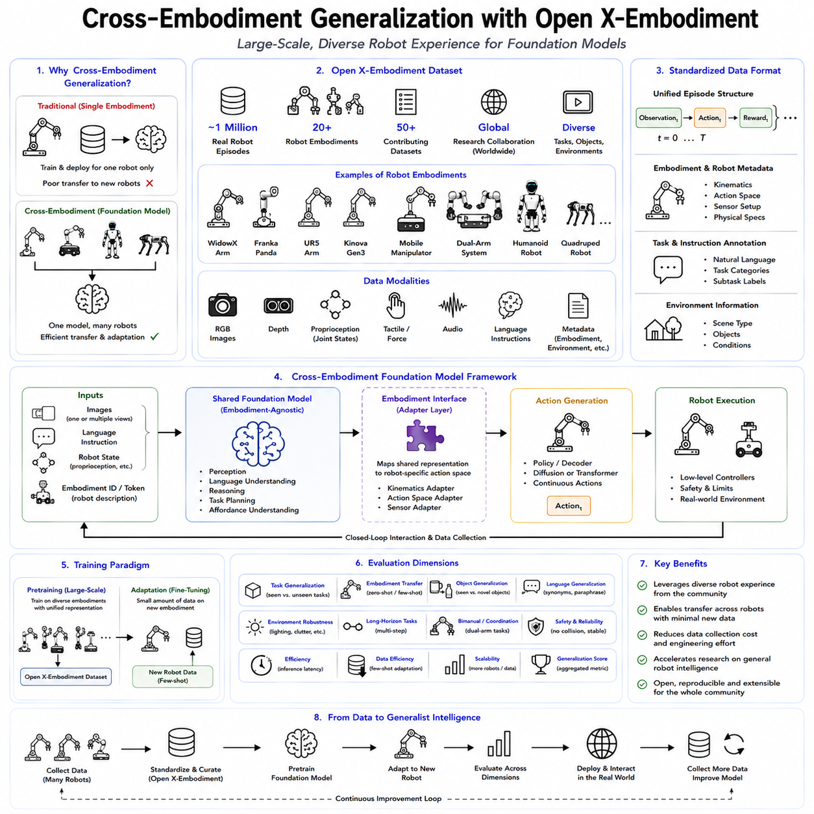{width="7.268055555555556in" height="7.268055555555556in"}

One of the most significant limitations of traditional robot learning has been its dependence on a single robot embodiment. A manipulation policy trained for one robot arm typically performs poorly when transferred to another robot with different kinematics, sensors, control interfaces, or physical dimensions. Even relatively small differences in gripper geometry, camera position, workspace size, or joint configuration often require complete retraining. This lack of transferability has prevented robotic learning from scaling in the same way that large language models or vision foundation models have scaled through diverse datasets. Cross-embodiment generalization seeks to overcome this limitation by enabling a single foundation model to learn reusable knowledge that can be applied across many different robot platforms. Rather than memorizing robot-specific control strategies, the model learns universal representations of perception, language, manipulation, spatial reasoning, and physical interaction that remain useful despite differences in hardware.

The emergence of Robot Foundation Models has made cross-embodiment learning one of the central research directions in Physical AI. A foundation model is expected to function as a shared intelligence backbone rather than a controller dedicated to one particular robot. Different embodiments should be able to reuse common semantic knowledge while adapting only the embodiment-specific components that translate internal representations into motor commands. This approach parallels transfer learning in computer vision and natural language processing, where large pretrained models are adapted efficiently to downstream tasks. In robotics, however, embodiment differences introduce additional complexity because physical actions depend directly on mechanical structure, sensing configuration, and dynamic properties.

Robot embodiment refers to the complete physical realization of an intelligent agent. It includes kinematic structure, degrees of freedom, joint limits, actuator characteristics, end-effector design, sensing hardware, mobility system, control frequency, workspace geometry, payload capacity, and mechanical compliance. Two robots performing the same conceptual task may require entirely different motion trajectories because their physical bodies differ. A mobile manipulator, an industrial six-axis arm, a dual-arm humanoid, and a quadruped equipped with a robotic arm all possess different embodiments even if they execute similar manipulation objectives.

Cross-embodiment learning attempts to separate embodiment-independent knowledge from embodiment-dependent execution. Embodiment-independent knowledge includes recognizing objects, understanding natural language, identifying task goals, estimating spatial relationships, predicting affordances, and reasoning about manipulation sequences. Embodiment-dependent knowledge includes joint trajectories, actuator commands, inverse kinematics, balance control, grasp geometry, and low-level servo behavior. A successful Robot Foundation Model learns the former as a reusable representation while adapting the latter through lightweight embodiment-specific interfaces.

This separation has profound implications for data efficiency. Traditional robot learning requires collecting demonstrations independently for every new robot platform. Such an approach scales poorly because each robot requires dedicated operators, hardware time, calibration, maintenance, and data collection procedures. If embodiment-independent knowledge can be shared, only the embodiment-specific adaptation must be learned for a new robot. Consequently, far fewer demonstrations become necessary during deployment.

The Open X-Embodiment project represents one of the largest collaborative efforts toward cross-embodiment robot learning. It was introduced through a collaboration involving numerous universities, research laboratories, and industrial partners with the objective of creating a large-scale open dataset spanning many robot embodiments, manipulation tasks, sensing configurations, and operating environments. Rather than collecting data from a single laboratory, the project aggregates robot demonstrations contributed by multiple institutions around the world. This diversity enables foundation models to observe an unprecedented range of robotic behaviors during pretraining.

The Open X-Embodiment dataset contains approximately one million real-world robot episodes collected across more than twenty robot embodiments and dozens of datasets contributed by independent research groups. These demonstrations include tabletop manipulation, mobile manipulation, dual-arm coordination, industrial manipulation, tool use, object rearrangement, drawer interaction, insertion tasks, household activities, and numerous other behaviors. The resulting dataset provides one of the largest publicly available corpora of real robot experience for foundation model development.

The diversity of robot embodiments represented in Open X-Embodiment is one of its greatest strengths. Contributing platforms include WidowX manipulators, Franka Panda arms, Kinova robots, UR5 systems, mobile manipulators, custom research platforms, and other laboratory robots. Each platform differs in kinematic structure, sensing configuration, action representation, workspace dimensions, and control interfaces. Instead of hiding these differences, the dataset explicitly preserves embodiment information while providing mechanisms for standardized representation.

Large-scale diversity serves several important purposes. First, it prevents the model from overfitting to one robot\'s motion characteristics. Second, it exposes the model to multiple visual perspectives and camera configurations. Third, it increases variation in object appearance, backgrounds, manipulation styles, and environmental layouts. Finally, it encourages the development of internal representations that emphasize semantic task structure rather than robot-specific execution details.

Building such a dataset requires substantial standardization. Individual laboratories naturally record demonstrations using different coordinate systems, sampling frequencies, camera resolutions, action formats, language annotations, sensor configurations, and metadata conventions. Without normalization, combining these datasets would produce inconsistent supervision. Open X-Embodiment therefore introduces common data structures, metadata descriptions, and standardized interfaces while preserving sufficient embodiment information to support accurate adaptation.

A key technical component of the project is the Robot Learning Dataset Standard (RLDS). RLDS provides a unified representation for robot learning episodes, defining consistent formats for observations, actions, rewards, language annotations, timestamps, and metadata. Each episode contains temporally ordered trajectories describing robot interaction with the environment. By adopting a shared representation, different datasets become compatible with common training pipelines while remaining traceable to their original embodiments.

Each episode generally contains synchronized observations from cameras, robot state information, action vectors, task descriptions, and temporal metadata. Visual observations may include RGB images, depth images, or multiple camera viewpoints. Robot states typically include joint positions, end-effector poses, gripper states, and other proprioceptive measurements. Action representations vary across robots but are converted into standardized interfaces during preprocessing.

Natural language has become an increasingly important component of Open X-Embodiment. Rather than identifying tasks using symbolic identifiers, many demonstrations include textual instructions describing the intended behavior. Language enables semantic alignment across datasets even when the exact motor actions differ. A command such as "place the red block inside the container" conveys the same conceptual objective regardless of whether the robot is a Franka arm, WidowX manipulator, or humanoid platform. This shared semantic representation significantly improves cross-embodiment transfer.

Visual observations similarly provide a common representation across embodiments. Although camera placement differs between robots, images capture many embodiment-independent aspects of the environment. Object identity, color, shape, spatial arrangement, and scene context remain largely independent of the robot itself. Vision foundation models therefore provide an effective mechanism for sharing perceptual knowledge across heterogeneous robot platforms.

Action representations, however, remain considerably more difficult to standardize. Some robots operate in joint space, others use Cartesian end-effector control, while mobile manipulators combine base velocities with arm control. Humanoids require coordinated whole-body control involving multiple limbs. Consequently, foundation models often employ embodiment adapters that translate standardized internal representations into robot-specific control spaces. These adapters may be implemented through learned projection layers, normalization modules, inverse kinematics solvers, or embodiment-conditioned policy heads.

Cross-embodiment learning does not imply that every robot executes identical motor commands. Instead, different robots learn to produce different physical behaviors corresponding to the same semantic objective. Consider the task of grasping a mug. A desktop manipulator approaches from above, a humanoid may bend its torso while reaching forward, and a mobile manipulator may reposition its base before extending its arm. The high-level concept remains identical, while execution differs according to embodiment.

Robot Foundation Models such as RT-1-X, OpenVLA, Octo, and GR00T all leverage Open X-Embodiment or related large-scale datasets to improve transfer performance. RT-1-X demonstrated that increasing embodiment diversity during pretraining substantially improves downstream adaptation. Octo emphasized diffusion-based continuous action generation across multiple embodiments. OpenVLA combined Open X-Embodiment demonstrations with large-scale vision-language pretraining to create a generalist manipulation model. NVIDIA GR00T similarly combines heterogeneous robot data with human videos, simulation, and synthetic trajectories to improve humanoid generalization.

Cross-embodiment learning benefits from scale in much the same way as language models. Increasing the number of robots, tasks, environments, objects, and demonstrations exposes the model to broader physical experience. Scaling laws appear to emerge in robotics as well, although they are more complex because data quality, embodiment diversity, and physical realism all influence performance. Simply increasing demonstration count without increasing diversity often produces diminishing returns.

Task diversity is particularly important. A dataset containing millions of identical pick-and-place demonstrations provides less transferable knowledge than a smaller dataset containing many different manipulation behaviors. Foundation models benefit from observing opening, closing, pushing, pulling, rotating, inserting, folding, stacking, sorting, cleaning, and cooperative manipulation tasks because these expose richer physical relationships.

Environmental diversity also plays a crucial role. Laboratory backgrounds, lighting conditions, table textures, object arrangements, and camera positions vary significantly between research groups. Rather than representing unwanted noise, this variation acts as beneficial regularization. The model learns to focus on task-relevant information while becoming less sensitive to superficial environmental differences.

Cross-embodiment datasets further improve robustness by exposing models to heterogeneous sensing conditions. Camera resolutions differ, depth sensors vary in quality, calibration errors exist, and robot states are measured using different conventions. Learning across these variations encourages representations that tolerate imperfect sensing rather than depending on one precisely calibrated laboratory configuration.

Nevertheless, embodiment diversity introduces significant challenges. Action spaces differ substantially among robots. A seven-degree-of-freedom manipulator, a dual-arm humanoid, and a mobile manipulator cannot share identical control outputs. Learning universal action representations therefore remains an active research area. Current approaches include action tokenization, latent action spaces, continuous diffusion policies, embodiment-conditioned decoders, and hierarchical motor representations.

Another challenge concerns temporal consistency. Different robots operate at different control frequencies. Industrial manipulators may execute commands at hundreds of Hertz, while demonstration datasets may be recorded at much lower rates. Time normalization becomes necessary to align trajectories across embodiments. Interpolation, action chunking, trajectory segmentation, and temporal abstraction are commonly employed to address these differences.

Mechanical capabilities also vary. Some robots possess dexterous hands, while others use simple parallel grippers. Some robots are fixed manipulators, whereas others combine locomotion with manipulation. Foundation models must therefore avoid assuming capabilities unavailable to particular embodiments. Conditioning policies on embodiment metadata helps prevent impossible action generation.

Simulation provides valuable support for cross-embodiment learning. Isaac Lab, MuJoCo, ManiSkill, Habitat, and other simulation platforms allow researchers to generate additional trajectories under controlled conditions. Simulation can introduce embodiment variation more rapidly than constructing new physical robots. Synthetic robots with modified link lengths, sensor placements, or actuator properties can augment real-world datasets and encourage stronger generalization.

Synthetic data generation further expands embodiment diversity. Digital twins permit automatic variation of robot geometry, camera viewpoints, object layouts, lighting conditions, and environmental structure. Such generated experience supplements expensive physical demonstrations while reducing overfitting to specific laboratories. Domain randomization also prepares policies for sim-to-real transfer by increasing visual and physical variability.

Despite these advantages, simulation cannot completely replace real robot data. Contact dynamics, compliance, actuator latency, wear, sensor drift, and unexpected environmental interactions remain difficult to model accurately. Consequently, the most effective foundation models combine real demonstrations with simulated and synthetic experience. Real robot data grounds physical behavior, while simulation provides scalable diversity.

Evaluation of cross-embodiment learning requires carefully designed benchmarks. Performance should be measured on robot embodiments absent from pretraining, novel task combinations, unfamiliar objects, and previously unseen environments. Zero-shot transfer evaluates direct generalization without adaptation. Few-shot transfer measures adaptation efficiency after a small number of demonstrations. Full fine-tuning establishes the upper performance bound. Reporting all three conditions provides a comprehensive view of transfer capability.

Generalization should also be evaluated across sensing modalities. A policy trained primarily on RGB cameras should ideally benefit from additional depth information without complete retraining. Likewise, tactile sensing, force sensing, and proprioception should integrate naturally with shared representations. Future Robot Foundation Models will likely incorporate increasingly multimodal observations.

Language contributes significantly to cross-embodiment transfer because semantic concepts remain largely embodiment independent. The concept of opening a drawer or placing an object inside a box does not depend on robot mechanics. Language therefore serves as an abstraction layer connecting diverse embodiments through shared task descriptions. Large Vision-Language Models have demonstrated remarkable ability to encode such semantic relationships, making them valuable components of Robot Foundation Models.

However, semantic understanding alone cannot solve embodiment transfer. Physical execution still depends on geometry, dynamics, and control. Consequently, successful foundation models typically combine shared semantic representations with embodiment-specific action modules. This layered architecture parallels software engineering principles in which platform-independent logic is separated from hardware-dependent implementation.

Open X-Embodiment also encourages open scientific collaboration. Rather than maintaining isolated datasets within individual laboratories, contributors share demonstrations through standardized formats. This collective approach resembles the evolution of ImageNet in computer vision and Common Crawl in natural language processing. Large shared datasets enable reproducible research, objective comparison, and rapid progress throughout the robotics community.

Open datasets also democratize Robot Foundation Model research. Previously, only organizations possessing large robot fleets could collect sufficient demonstrations to train generalist policies. Open X-Embodiment lowers this barrier by making extensive robot experience publicly available. Smaller laboratories can therefore focus on developing improved architectures, algorithms, or adaptation methods instead of spending years collecting proprietary datasets.

Nevertheless, open datasets introduce governance challenges. Different contributors may apply different safety standards, annotation quality, demonstration styles, or task definitions. Dataset documentation, metadata quality, licensing, privacy protection, and version control become increasingly important as the dataset grows. Careful curation remains essential because foundation models often inherit biases and inconsistencies present in their training data.

Data quality may matter as much as dataset scale. Demonstrations containing inaccurate actions, inconsistent language annotations, calibration errors, or incomplete trajectories can negatively influence learned representations. Automated quality assessment, anomaly detection, and dataset balancing therefore become important components of future Robot Foundation Model pipelines.

Cross-embodiment learning also interacts naturally with continual learning. As new robot embodiments become available, their demonstrations can be incorporated into the shared dataset without retraining every downstream application from scratch. Ideally, the foundation model continuously expands its understanding while preserving previously acquired capabilities. This lifelong accumulation of robotic experience resembles how humans learn across different tools throughout life.

Industrial deployment offers particularly compelling opportunities for cross-embodiment learning. A manufacturing company may operate collaborative robots, industrial manipulators, mobile manipulators, autonomous forklifts, inspection robots, and humanoids within the same facility. Although their mechanical structures differ, many semantic tasks remain related. Shared foundation models allow knowledge acquired by one platform to benefit others, reducing engineering effort across the entire fleet.

Fleet learning naturally extends this concept. Multiple robots deployed across geographically distributed factories can collect demonstrations, failure cases, corrections, and environmental variations. These experiences can be aggregated centrally, incorporated into updated foundation models, validated in simulation, and redistributed to all participating robots. Such continuous improvement requires secure data pipelines, model versioning, regression testing, staged deployment, and rollback mechanisms.

Future cross-embodiment learning will likely extend beyond manipulation into navigation, locomotion, mobile manipulation, aerial robotics, underwater robotics, agricultural robots, construction robots, medical robots, and humanoid assistants. The fundamental objective remains unchanged: separating universal intelligence from embodiment-specific execution. As foundation models grow larger and more capable, increasingly diverse physical systems may share a common cognitive backbone while retaining specialized control modules.

From a Physical AI perspective, Open X-Embodiment demonstrates that scalable robot intelligence depends not only on larger neural networks but also on larger, more diverse, and better organized robot experience. Cross-embodiment generalization transforms robot learning from isolated platform-specific engineering into a shared learning ecosystem. Foundation models trained across heterogeneous embodiments learn reusable representations of perception, language, reasoning, and manipulation while adapting efficiently to new hardware through lightweight embodiment-specific interfaces.

Although current models remain far from universal transfer across every conceivable robot, Open X-Embodiment establishes the infrastructure necessary for continual progress. Its standardized data formats, collaborative data collection, embodiment diversity, semantic alignment, and open accessibility provide a foundation upon which future Robot Foundation Models can achieve increasingly robust generalization. As datasets continue to expand and learning algorithms mature, cross-embodiment intelligence will become one of the defining capabilities of next-generation Physical AI systems, enabling robots with different bodies to share a common understanding of the physical world while executing actions appropriate to their own mechanical capabilities.

## 5.10 Robotics Foundation Model Strategy

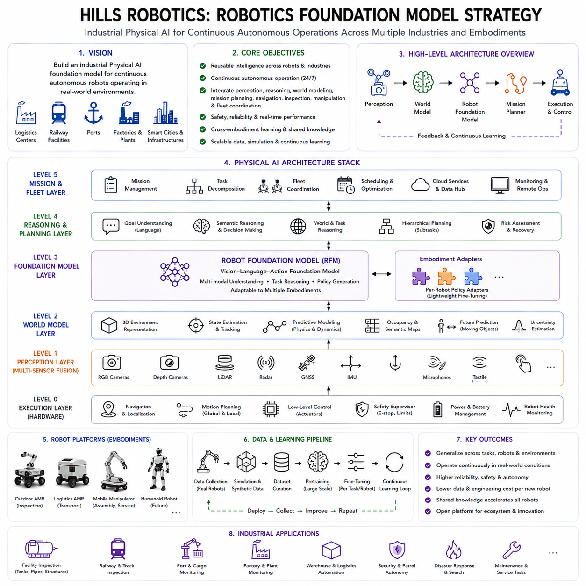{width="7.268055555555556in" height="7.268055555555556in"}

Robot Foundation Models are rapidly transforming robotics from task-specific automation into general-purpose embodied intelligence. However, most existing foundation models remain research-oriented. They primarily demonstrate laboratory manipulation, tabletop tasks, or humanoid benchmark performance rather than addressing the operational requirements of industrial autonomous robots. Hills Robotics has a different objective. Rather than developing a foundation model solely for academic benchmarks, the company\'s strategy is to build an industrial Physical AI foundation model capable of operating continuously in real-world environments such as logistics centers, railway facilities, ports, factories, industrial complexes, smart cities, and large outdoor infrastructures. The long-term vision is to establish a reusable intelligence platform that supports multiple robot embodiments, multiple industries, and continuous autonomous operation while integrating perception, reasoning, world modeling, mission planning, navigation, inspection, manipulation, and fleet coordination.

The strategy begins with a fundamental observation. Industrial robots rarely operate in isolation. An autonomous mobile robot must receive a mission, navigate through dynamic environments, avoid obstacles, monitor battery status, communicate with cloud services, cooperate with other robots, perform inspections, report abnormalities, and recover from unexpected situations. Existing Robot Foundation Models often focus primarily on manipulation policies or language-conditioned actions. Hills Robotics instead defines the foundation model as one layer within a hierarchical Physical AI architecture. High-level mission reasoning, world modeling, perception, navigation, and fleet management remain essential components surrounding the foundation model.

The proposed architecture separates intelligence into multiple layers. The perception layer integrates multimodal sensor observations including RGB cameras, depth cameras, LiDAR, radar, GNSS, IMU, microphones, ultrasonic sensors, and future tactile sensors. These observations are fused into a unified scene representation. Above perception, a world model continuously predicts environmental evolution, robot state transitions, obstacle movement, human behavior, and mission progress. The Robot Foundation Model operates on this structured representation, combining visual understanding, language instructions, robot state, and mission context to generate high-level action policies. Finally, deterministic motion planners, navigation systems, low-level controllers, and safety supervisors convert those actions into physically executable behavior.

Unlike general-purpose language models, an industrial foundation model must maintain persistent situational awareness. The robot should remember previous observations, maintain maps, track moving objects, understand long-term missions, and predict future environmental changes. Hills Robotics therefore proposes integrating the foundation model with a continuously updated world model rather than relying solely on instantaneous sensor observations. Predictive reasoning allows the robot to anticipate future hazards, estimate task completion time, optimize energy consumption, and plan efficient mission sequences.

One defining characteristic of the Hills Robotics strategy is its emphasis on mission-level intelligence. Most current Vision-Language-Action models generate immediate motor actions conditioned on the current observation. Industrial systems, however, require hierarchical reasoning. A robot may receive an instruction such as "inspect every emergency exit on the second floor, report damaged equipment, recharge if necessary, and continue inspection." Such a mission cannot be executed as a single manipulation policy. Instead, it requires decomposition into navigation, localization, inspection, anomaly detection, reporting, charging, recovery, and scheduling. The foundation model therefore interacts with a mission planner rather than replacing it.

Mission decomposition becomes increasingly important as robots perform longer autonomous operations. A twelve-hour patrol robot may execute hundreds of subtasks before completing its assigned mission. These subtasks include localization updates, elevator usage, corridor navigation, door interaction, inspection waypoint execution, battery monitoring, obstacle avoidance, communication with operators, and autonomous recovery from unexpected events. The foundation model contributes semantic understanding and adaptive decision-making, while deterministic workflow engines guarantee reliable mission execution.

The proposed strategy also recognizes that different robot categories require different embodiment-specific execution modules. Hills Robotics develops outdoor autonomous mobile robots, inspection robots, logistics robots, mobile manipulators, and future humanoid platforms. Rather than training separate foundation models for every robot, the strategy adopts a shared semantic backbone with embodiment-specific policy adapters. Visual understanding, language comprehension, object recognition, anomaly detection, and task reasoning remain largely shared, while motion generation is specialized for each robot platform.

Cross-embodiment learning therefore becomes a central long-term objective. Knowledge acquired by one robot category should benefit others whenever possible. An outdoor inspection robot learning to identify damaged infrastructure contributes semantic knowledge that may later assist a humanoid maintenance robot. Likewise, manipulation knowledge acquired by a future mobile manipulator may improve object interaction capabilities within autonomous inspection platforms. Shared representations reduce redundant engineering effort while accelerating continuous learning.

Data strategy forms another critical pillar of the proposed roadmap. Unlike internet-scale language models trained primarily on text, Robot Foundation Models require extensive physical interaction data. Hills Robotics proposes combining five complementary data sources. The first consists of real operational data collected from deployed robots operating in industrial environments. The second consists of teleoperation demonstrations recorded by expert operators. The third consists of simulation data generated using high-fidelity digital twins. The fourth consists of synthetic trajectories generated by world models. The fifth consists of publicly available open robot datasets such as Open X-Embodiment, RT-X, BridgeData, RoboNet, DROID, and other large-scale manipulation datasets. Combining these heterogeneous sources enables broad semantic pretraining while preserving strong industrial grounding.

Real-world deployment data is considered the highest-value information because it captures phenomena difficult to simulate accurately. Sensor noise, wheel slip, actuator degradation, weather variation, communication latency, human interaction, lighting changes, infrastructure aging, and unexpected operational disturbances all appear naturally during deployment. These observations continuously improve the foundation model by exposing it to conditions rarely represented in academic datasets.

Simulation plays a complementary role rather than replacing physical experience. Digital twins representing industrial facilities, warehouses, railway stations, ports, apartment complexes, and outdoor campuses allow millions of safe training episodes to be generated efficiently. Domain randomization systematically varies lighting, weather, sensor calibration, object placement, pedestrian behavior, vehicle movement, and environmental appearance. Such diversity prepares policies for robust real-world deployment while reducing expensive physical experimentation.

Synthetic data generation further expands this capability. A world model predicts realistic future trajectories, generates hypothetical operational scenarios, and creates rare failure conditions difficult to observe during routine deployment. Emergency situations, infrastructure failures, hazardous environments, and unusual human behavior can all be simulated safely. These synthetic experiences improve robustness while reducing operational risk.

Language represents another essential component of the Hills Robotics strategy. Industrial robots increasingly receive high-level task descriptions from operators rather than predefined scripts. Consequently, the foundation model must understand multilingual instructions, industrial terminology, maintenance procedures, logistics workflows, inspection protocols, and operational constraints. Domain-specific language adaptation becomes necessary because factory terminology differs substantially from internet language used during large-scale pretraining.

Multimodal perception provides the environmental awareness required by industrial Physical AI. RGB cameras contribute semantic recognition. Depth cameras estimate geometry. LiDAR provides robust three-dimensional localization. GNSS supports outdoor navigation. IMU measurements stabilize localization and motion estimation. Radar improves perception under adverse weather. Directional microphones detect abnormal acoustic events. Ultrasonic sensors protect against low-height obstacles. Future tactile sensors and force sensors will extend manipulation capability. The foundation model integrates these heterogeneous observations into coherent environmental understanding.

Unlike many laboratory systems relying primarily on vision, Hills Robotics considers sensor redundancy essential for industrial reliability. Individual sensors inevitably fail under specific environmental conditions. Cameras suffer from glare and darkness, LiDAR performance decreases during heavy rain or fog, GNSS becomes unreliable near buildings, and wireless communication may occasionally fail. Sensor fusion allows the foundation model to maintain situational awareness despite partial sensor degradation.

World models occupy a central position within the overall architecture. Rather than merely interpreting the current observation, the robot continuously predicts future environmental evolution. Pedestrians continue walking, vehicles change direction, doors open, elevators move, and weather evolves over time. Predictive world models allow safer navigation, earlier anomaly detection, improved energy planning, and proactive decision-making. The foundation model therefore reasons not only about the present but also about likely future states.

Mission planning naturally benefits from world model integration. Multiple candidate mission plans may be evaluated through internal simulation before physical execution. Estimated travel time, battery consumption, traffic congestion, weather conditions, equipment availability, and operational priorities influence plan selection. Such predictive planning improves efficiency while reducing unnecessary risk.

Navigation remains largely deterministic despite increasing intelligence elsewhere in the architecture. Existing SLAM systems, localization algorithms, path planners, obstacle avoidance modules, and motion controllers have matured significantly over many years of robotics research. Hills Robotics therefore treats navigation as a reliable engineering subsystem augmented by foundation-model reasoning rather than replacing deterministic algorithms entirely. Semantic understanding improves navigation decisions while classical planning guarantees predictable execution.

Inspection represents one of the company\'s primary application domains. Autonomous inspection requires significantly more than object detection. Robots must determine inspection order, recognize equipment categories, compare observations against historical baselines, detect anomalies, estimate severity, generate inspection reports, recommend maintenance actions, and prioritize future inspections. Foundation models contribute semantic interpretation, while specialized inspection AI performs domain-specific defect recognition.

The strategy also anticipates future mobile manipulation capability. Although current platforms primarily emphasize inspection and logistics, future systems may manipulate doors, tools, maintenance equipment, packages, charging connectors, and industrial infrastructure. Manipulation policies developed through foundation models can therefore expand existing autonomous mobile robots into more capable service platforms without redesigning higher-level mission intelligence.

Fleet intelligence represents another distinguishing feature. Industrial deployments often involve dozens or hundreds of robots operating simultaneously. Individual robot intelligence alone cannot optimize overall system performance. Fleet management coordinates task allocation, traffic control, charging schedules, maintenance planning, communication, and resource utilization across the entire robot population. Hills Robotics therefore positions the foundation model beneath a fleet-level orchestration layer that optimizes collective behavior.

Fleet learning naturally extends this architecture. Experience collected by one robot becomes valuable for all other robots. Successful trajectories, failures, recovery strategies, anomaly examples, environmental changes, and operator corrections are aggregated centrally, validated, incorporated into updated foundation models, and redistributed through controlled deployment pipelines. Such continuous improvement gradually increases fleet intelligence while minimizing duplicated learning effort.

Model adaptation follows a hierarchical strategy. Large publicly pretrained Robot Foundation Models provide initial semantic capability. Industrial data then performs domain adaptation. Customer-specific deployment introduces additional fine-tuning using facility-specific observations and operational procedures. Individual robots continue lightweight online adaptation while respecting safety constraints. This multi-stage learning pipeline balances scalability with practical deployment requirements.

Safety remains the highest architectural priority. Foundation models generate high-level intentions rather than directly controlling actuators without supervision. Deterministic safety layers continuously verify collision avoidance, velocity limits, acceleration constraints, safe stopping distances, operational boundaries, battery condition, actuator health, communication integrity, and emergency response capability. Safety supervisors always retain authority to override foundation-model outputs whenever hazardous behavior is detected.

Explainability becomes increasingly important as industrial customers demand transparent decision-making. Operators should understand why a robot selected a particular route, identified an anomaly, requested maintenance, or aborted a mission. Hills Robotics therefore proposes integrating interpretable reasoning traces, confidence estimation, anomaly explanations, and evidence visualization alongside foundation-model predictions. Such transparency improves trust, debugging efficiency, and regulatory acceptance.

Cybersecurity also forms an essential design consideration. Foundation models interact with cloud infrastructure, edge servers, autonomous robots, and operational technology networks. Secure communication, encrypted model distribution, authenticated software updates, access control, audit logging, anomaly detection, and secure rollback mechanisms become mandatory components of large-scale deployment.

Computational efficiency influences practical deployment decisions. Some industrial robots possess powerful onboard GPU computers, while others operate under strict power and thermal constraints. The strategy therefore supports multiple deployment configurations. Small distilled models perform onboard inference when low latency is essential. Larger cloud or edge models provide higher-level reasoning when communication permits. Hybrid execution dynamically allocates computation according to operational requirements.

Model optimization techniques including quantization, TensorRT acceleration, parameter-efficient fine-tuning, knowledge distillation, retrieval augmentation, and modular inference pipelines reduce computational requirements without significantly degrading performance. Efficient deployment remains particularly important for battery-powered outdoor autonomous robots operating continuously for extended periods.

Evaluation methodology extends beyond traditional academic benchmarks. Laboratory demonstrations provide only limited evidence regarding industrial readiness. Hills Robotics proposes evaluating foundation models through long-duration autonomous missions, cross-weather operation, infrastructure inspection accuracy, fleet coordination efficiency, recovery performance, human intervention frequency, operational availability, energy efficiency, communication robustness, and maintenance cost reduction. Production metrics complement conventional robotics benchmarks.

Cross-embodiment benchmarking also becomes an internal development objective. New robot platforms should inherit semantic capabilities from previous deployments while requiring minimal additional training. Measuring adaptation efficiency across autonomous mobile robots, mobile manipulators, logistics robots, inspection robots, and future humanoids provides quantitative evidence of shared intelligence development.

The long-term roadmap envisions gradual expansion of capability rather than attempting universal intelligence immediately. Early deployments focus on autonomous inspection, logistics support, environmental monitoring, and infrastructure maintenance. Subsequent phases introduce mobile manipulation, collaborative operation with human workers, semi-autonomous maintenance, and eventually humanoid service robots. Each stage contributes additional physical experience to the shared foundation model.

This incremental strategy reduces technical risk while continuously expanding reusable knowledge. Every deployed robot contributes operational data improving future generations. Instead of treating each product independently, the company develops a continuously evolving intelligence platform whose capabilities accumulate across applications and robot embodiments.

Integration with digital twins further strengthens this roadmap. Every deployed facility may possess a continuously updated virtual representation containing infrastructure geometry, semantic annotations, equipment states, historical inspection records, operational schedules, and environmental conditions. Foundation models interact with these digital twins during planning, simulation, anomaly diagnosis, and predictive maintenance. Digital twins therefore become persistent memory systems extending beyond onboard robot perception.

The proposed architecture also aligns naturally with future world foundation models. As predictive generative models mature, robots will increasingly simulate future operational scenarios before execution. Candidate mission plans, maintenance schedules, fleet traffic patterns, energy usage, and emergency responses may all be evaluated within learned world models. The Robot Foundation Model provides semantic reasoning, while world models estimate future consequences.

Cloud-edge collaboration forms another important aspect of the strategy. Computationally intensive model training, fleet analytics, long-term memory, global optimization, and knowledge aggregation occur within cloud infrastructure. Low-latency perception, obstacle avoidance, motion execution, and safety supervision remain onboard. Edge servers positioned within industrial facilities provide intermediate computational resources balancing latency with scalability.

Human supervision remains integrated throughout the deployment lifecycle. Operators define mission objectives, approve critical actions, review anomaly reports, validate updated models, and intervene during exceptional situations. Rather than replacing human expertise, the foundation model augments operator productivity by automating repetitive perception, reasoning, and reporting tasks while preserving human authority for high-consequence decisions.

Open-source collaboration also contributes strategically. Hills Robotics intends to leverage publicly available Robot Foundation Models, open datasets, simulation platforms, and robotics frameworks whenever appropriate while developing proprietary industrial adaptations above these foundations. This approach accelerates innovation, reduces redundant engineering, and enables compatibility with the broader robotics research community.

Intellectual property therefore shifts toward industrial knowledge integration rather than basic perception algorithms alone. Mission orchestration, industrial workflows, inspection intelligence, predictive maintenance, fleet optimization, customer-specific adaptation, and long-term operational experience become major competitive differentiators beyond publicly available pretrained models.

Ultimately, the Hills Robotics Foundation Model strategy views Physical AI as an integrated industrial intelligence ecosystem rather than a single neural network. Foundation models provide reusable semantic reasoning, multimodal understanding, and adaptive decision-making. World models contribute prediction and planning. Fleet intelligence coordinates collective behavior. Digital twins preserve long-term operational memory. Deterministic engineering systems ensure safety and reliability. Continuous learning expands capability throughout deployment.

As Robot Foundation Models continue evolving, the strategic objective is not merely to build increasingly larger models but to construct an industrial intelligence platform capable of learning continuously from real-world operation. Every inspection mission, logistics task, anomaly report, maintenance activity, navigation episode, and human interaction contributes additional knowledge. Over time, this accumulated physical experience transforms isolated autonomous robots into a unified Physical AI ecosystem capable of supporting increasingly diverse robot embodiments, industries, and autonomous operational scenarios while maintaining the safety, reliability, and explainability required for large-scale industrial deployment.
