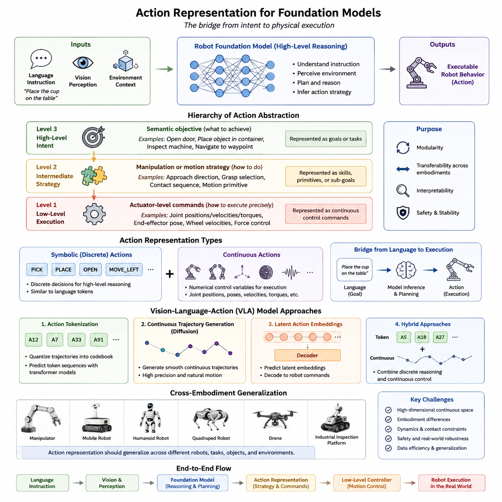
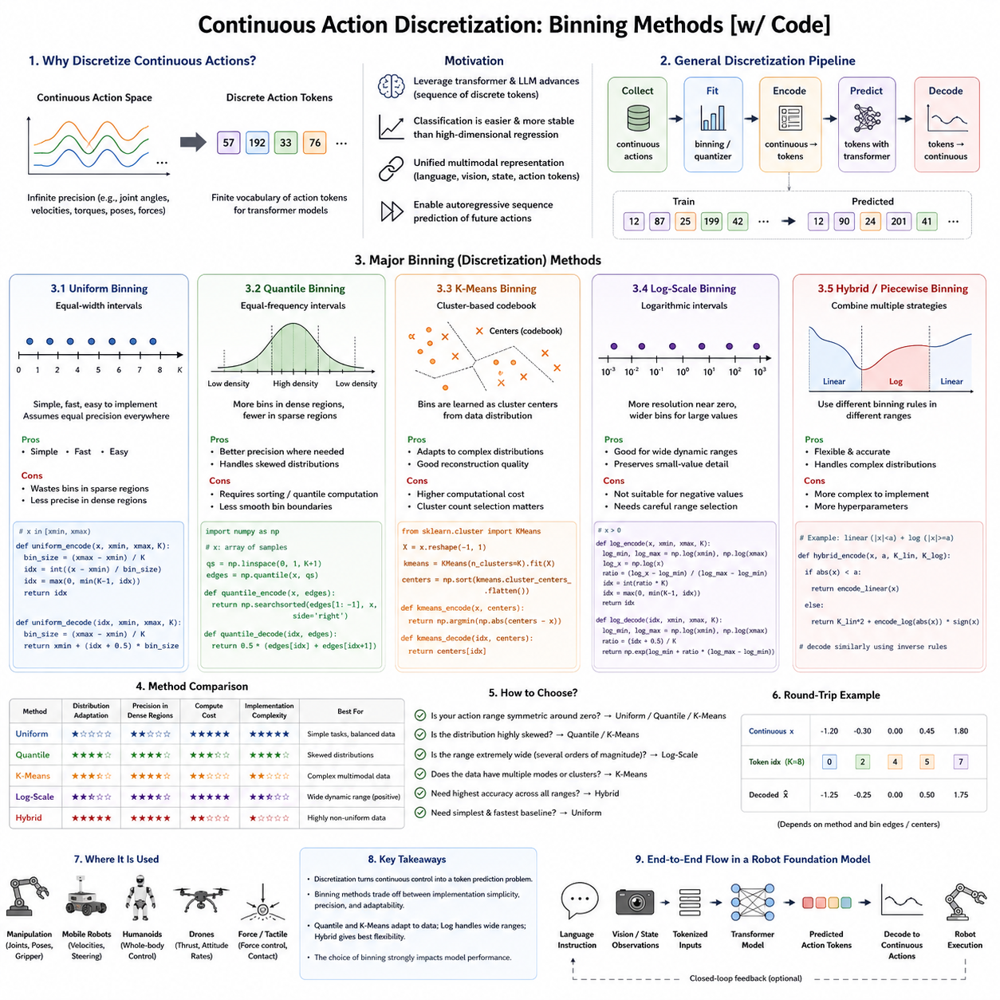
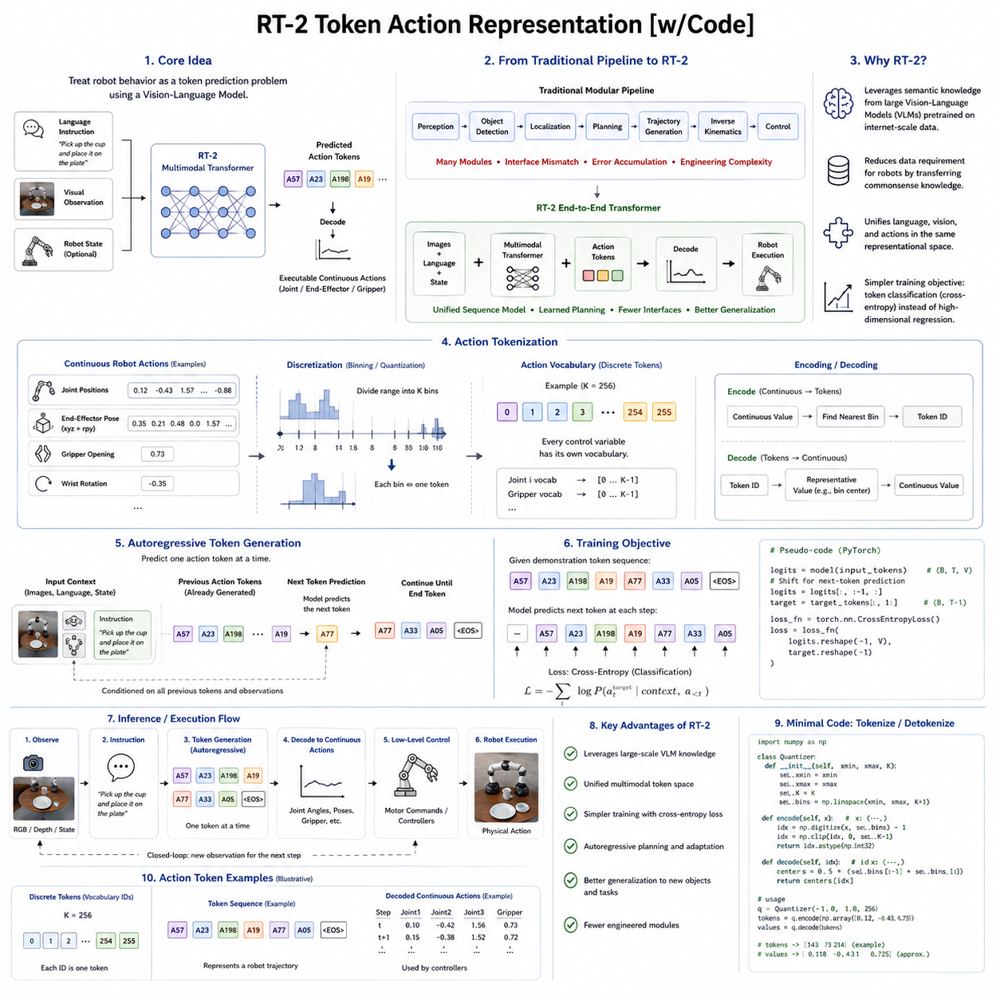
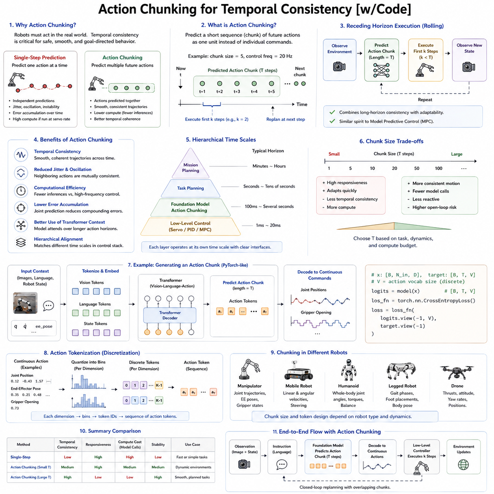
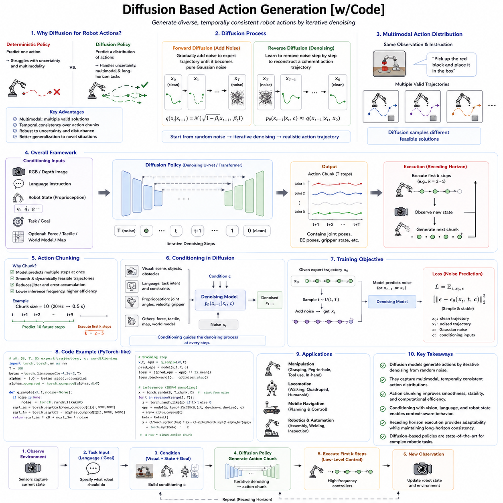
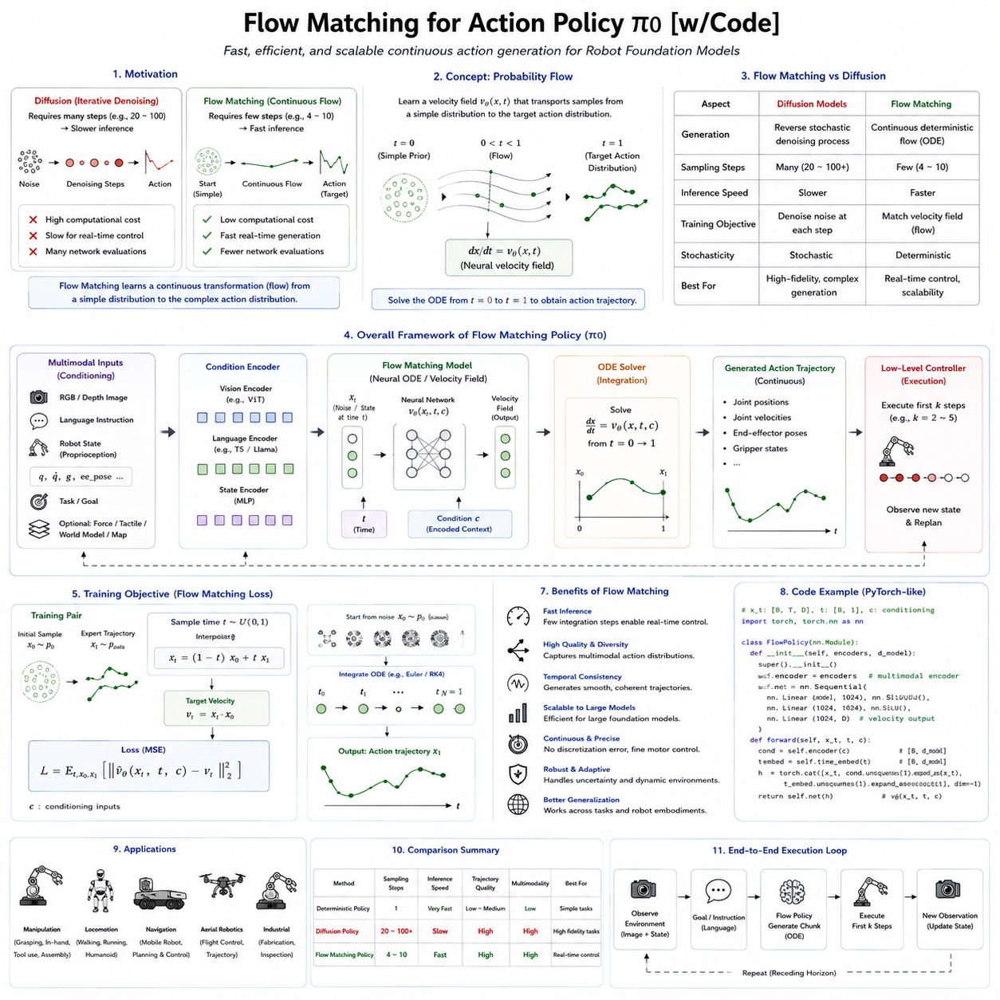
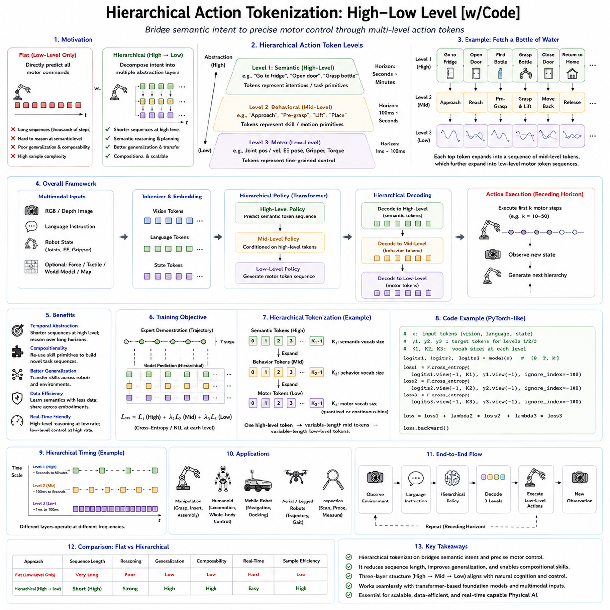
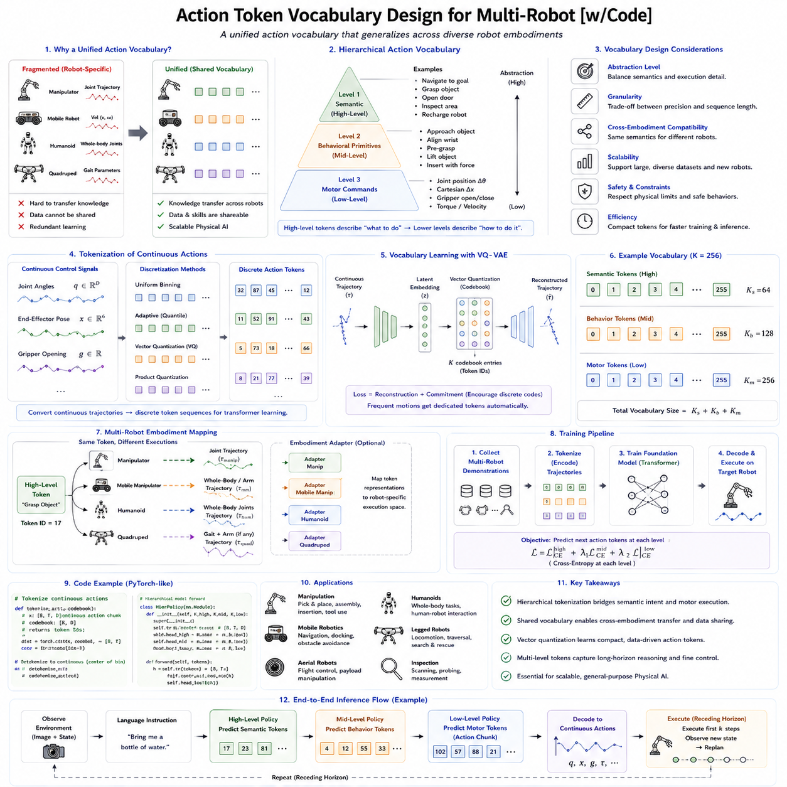
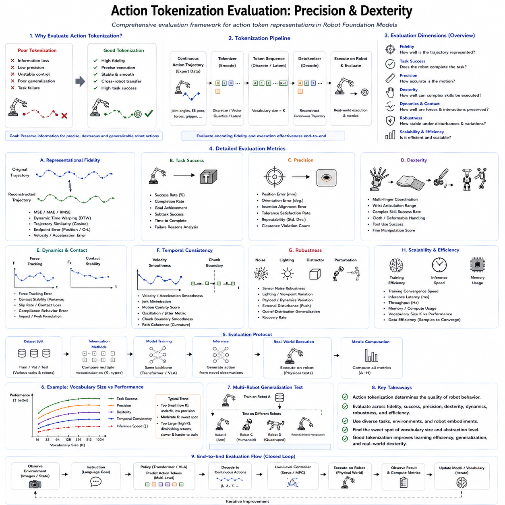
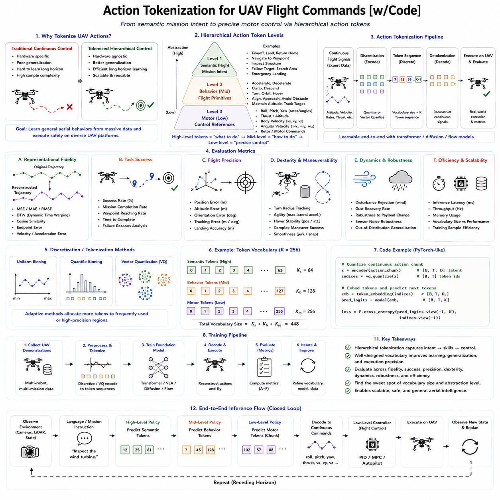

**Volume 18 Physical AI Foundation Models**

# 6. Action Tokenization

## 6.1 Action Representation for Foundation Models Overview

{width="7.268055555555556in" height="7.268055555555556in"}

행동 표현(Action Representation)은 Robot Foundation Model의 가장 핵심적인 구성 요소 가운데 하나이다. 이는 지능 시스템(Intelligent System)이 내린 의사결정을 실제 물리적 행동(Physical Behavior)으로 어떻게 표현하고 실행하는지를 정의하기 때문이다. 인식(Perception)은 로봇이 무엇을 관찰하는지를 결정하고, 언어(Language)는 무엇을 해야 하는지를 설명하지만, 행동 표현은 이러한 목표를 실제 액추에이터(Actuator)가 수행할 수 있는 모터 명령(Motor Command)으로 변환하는 역할을 한다. 따라서 조작 로봇(Manipulator), 자율주행 로봇(Autonomous Mobile Robot), 휴머노이드(Humanoid), 사족보행 로봇(Quadruped), 드론(Drone), 산업용 검사 로봇(Industrial Inspection Robot) 등 모든 Robot Foundation Model은 최종적으로 실행 가능한 행동을 생성해야 하며, 행동 표현은 고수준 지능과 저수준 제어(Low-Level Control)를 연결하는 핵심 인터페이스가 된다.

자연어는 단어(Token)라는 비교적 고정된 의미를 가진 이산 표현(Discrete Representation)으로 표현할 수 있지만, 로봇의 행동은 연속적인 물리 공간(Continuous Physical Space)에서 이루어지며 동역학(Dynamics), 운동학(Kinematics), 접촉 역학(Contact Mechanics), 안전 제약(Safety Constraint)의 영향을 받는다. 동일한 작업 목표라도 로봇의 구조, 물체의 특성, 환경 조건, 작업 상황에 따라 완전히 다른 움직임이 필요하다. 따라서 행동 표현을 설계하는 것은 텍스트나 이미지를 표현하는 것보다 훨씬 어려운 문제이며, 추상적인 의도(Intent)와 실제 물리적 실행(Physical Execution)을 동시에 표현할 수 있어야 한다.

기존의 로봇 제어에서는 대부분 특정 하드웨어에 최적화된 행동 표현을 사용하였다. 산업용 로봇은 관절 공간(Joint Space) 궤적이나 카테시안(Cartesian) 말단 효과기(End-Effector) 명령을 사용하였고, 이동형 로봇은 선속도(Linear Velocity)와 각속도(Angular Velocity)를 사용하였다. 휴머노이드는 전신 역운동학(Whole-Body Inverse Kinematics)과 균형 제어(Balance Controller)를 사용하였다. 이러한 표현은 개별 로봇에서는 매우 효과적이었지만 다른 플랫폼으로는 거의 전이되지 않았다. Robot Foundation Model은 이러한 한계를 극복하기 위해 여러 로봇에서 공통적으로 사용할 수 있는 행동 표현을 목표로 한다.

대규모 Robot Foundation Model의 등장 이후 행동 표현은 보다 계층적인(Hierarchical) 개념으로 발전하고 있다. 행동은 단순한 모터 명령이 아니라 의미 추론(Semantic Reasoning), 작업 계획(Task Planning), 모션 생성(Motion Generation), 물리 제어(Physical Control)를 연결하는 구조화된 정보로 해석된다. 상위 수준의 의도, 중간 수준의 조작 전략, 하위 수준의 액추에이터 명령을 서로 분리하여 표현함으로써 전이 학습(Transfer Learning), 모듈화(Modularity), 해석 가능성(Interpretability), 다중 체화 일반화(Cross-Embodiment Generalization)를 향상시킨다.

행동은 여러 추상화 수준(Abstraction Level)에서 해석될 수 있다. 가장 높은 수준에서는 문을 열기(Open Door), 물체를 상자 안에 넣기(Place Object), 설비를 검사하기(Inspect Equipment), 특정 위치로 이동하기(Navigate to Waypoint)와 같은 목표(Objective)를 의미한다. 중간 수준에서는 접근 방향(Approach Direction), 그립 선택(Grasp Selection), 접촉 순서(Contact Sequence), 모션 프리미티브(Motion Primitive)를 의미한다. 가장 낮은 수준에서는 관절 위치(Joint Position), 관절 속도(Joint Velocity), 관절 토크(Joint Torque), 바퀴 속도(Wheel Velocity), 모터 전류(Motor Current), 힘 명령(Force Command)과 같은 실제 제어 신호를 의미한다. Robot Foundation Model은 주로 상위 의미 수준에서 추론을 수행하고, 하위 제어 계층이 실제 안정적인 동작을 담당한다.

현대의 파운데이션 모델에서는 기호 행동(Symbolic Action)과 연속 행동(Continuous Action)을 구분하는 것이 중요하다. 기호 행동은 "Pick", "Place", "Move Left", "Open Drawer"와 같은 이산적인 명령으로 표현되며, 언어 토큰과 유사한 구조를 가진다. 이러한 표현은 상위 수준의 추론에는 적합하지만 실제 로봇을 직접 제어할 수는 없다. 반면 연속 행동은 관절 위치, 말단 효과기 자세, 그리퍼 개방 정도, 속도 벡터, 토크 명령과 같은 연속적인 수치 값을 생성한다. 대부분의 Robot Foundation Model은 기호 기반 추론과 연속 제어 생성을 함께 사용한다.

언어 기반 로봇(Language-Conditioned Robot)은 또 다른 추상화 계층을 필요로 한다. 사람은 "컵을 테이블 위에 올려놓아라."와 같이 목표만 설명하며, 팔의 궤적, 손목 방향, 손가락 모양, 장애물 회피, 이동 속도는 전혀 언급하지 않는다. Robot Foundation Model은 언어 의미(Semantics), 시각 정보(Visual Observation), 환경(Context), 로봇 구조(Embodiment)를 모두 결합하여 이러한 실행 정보를 스스로 추론해야 한다. 따라서 행동 표현은 자연어와 실제 제어를 연결하는 핵심 연결 고리(Bridge)가 된다.

Vision-Language-Action(VLA) 모델의 등장은 행동 표현 연구를 크게 발전시켰다. 기존 Vision-Language Model이 텍스트를 생성하는 것과 달리 VLA 모델은 실제 로봇 행동을 생성한다. RT-2, OpenVLA, Octo, GR00T는 각각 서로 다른 행동 표현 방식을 사용한다. 어떤 모델은 언어처럼 행동을 토큰(Token)으로 표현하고, 어떤 모델은 확산 모델(Diffusion Model)을 이용하여 연속적인 궤적을 생성하며, 또 다른 모델은 잠재 행동 임베딩(Latent Action Embedding)을 먼저 생성한 후 이를 실제 제어 명령으로 변환한다. 이러한 구조적 선택은 일반화 능력, 안정성, 계산 효율성, 플랫폼 전이 성능에 큰 영향을 미친다.

이산 행동 토큰화(Discrete Action Tokenization)는 대표적인 연구 방향 가운데 하나이다. 연속적인 로봇 행동을 일정한 코드북(Codebook)으로 양자화(Quantization)하여 언어 토큰처럼 표현하는 방식이다. 학습 과정에서는 연속적인 제어 값이 아니라 행동 토큰의 시퀀스를 예측한다. 이러한 접근은 원래 언어 모델을 위해 설계된 Transformer 구조를 그대로 활용할 수 있다는 장점이 있다. RT-2는 행동을 텍스트와 이미지와 동일한 또 하나의 모달리티(Modality)로 취급하는 방식을 제안하였다. 그러나 양자화 과정에서 오차가 발생할 수 있으며, 매우 정밀한 제어에는 한계가 존재한다.

연속 행동 표현(Continuous Action Representation)은 이러한 양자화를 사용하지 않는다. Diffusion Policy, Flow Model, Continuous Transformer는 직접 연속적인 제어 값을 생성한다. 이러한 방식은 높은 정밀도를 유지할 수 있으며, 특히 정교한 손 조작(Dexterous Manipulation), 휴머노이드 제어, 접촉 기반 조작(Contact-Rich Manipulation)에 적합하다. 다만 연속적인 행동 생성은 이산 토큰을 예측하는 것보다 최적화와 샘플링(Sampling)이 복잡하다.

잠재 행동 표현(Latent Action Representation)은 이산 표현과 연속 표현의 중간적인 접근 방식이다. 모델은 직접 모터 명령을 생성하는 대신 행동의 핵심 특징을 압축한 잠재 공간(Latent Space)을 학습한다. 이후 별도의 디코더(Decoder)가 이를 실제 로봇의 제어 명령으로 변환한다. 이러한 표현은 차원을 줄이면서도 의미 구조를 유지할 수 있기 때문에 다중 체화 일반화에 매우 적합하다. 서로 다른 로봇이 수행하는 유사한 작업은 잠재 공간에서 서로 가까운 위치를 차지하게 된다.

시간 표현(Temporal Representation)도 행동 표현에서 매우 중요한 요소이다. 실제 행동은 한 순간에 끝나는 것이 아니라 일정 시간 동안 연속적으로 수행된다. 따라서 대부분의 Robot Foundation Model은 하나의 제어 명령만 생성하지 않고 여러 개의 행동(Action Chunk)을 동시에 생성한다. 이러한 행동 청킹(Action Chunking)은 시간적 일관성(Temporal Consistency)을 향상시키고, 추론 횟수를 줄이며, 보다 부드러운 움직임을 생성할 수 있게 한다. 최근 Diffusion Policy와 Transformer 기반 정책에서 매우 중요한 기술로 자리 잡고 있다.

행동 청킹은 계산 효율성도 향상시킨다. 예를 들어 한 번의 추론으로 향후 10개의 제어 명령을 생성하면 추론 빈도를 줄이면서도 높은 제어 속도를 유지할 수 있다. 또한 여러 행동을 동시에 최적화하기 때문에 각각을 독립적으로 생성하는 것보다 훨씬 부드러운 궤적을 만들 수 있다. 다만 Chunk의 길이가 너무 길면 환경 변화에 빠르게 대응하기 어렵고, 너무 짧으면 계산량이 증가하는 문제가 있다.

계층적 행동 표현(Hierarchical Action Representation)은 계층적 계획(Hierarchical Planning)과 매우 잘 어울린다. 미션 계획기는 장기 목표를 생성하고, 작업 계획기는 이를 세부 작업으로 분해한다. Robot Foundation Model은 의미 기반 행동을 생성하며, 모션 플래너(Motion Planner)는 실제 궤적을 계산하고, 저수준 제어기는 액추에이터를 제어한다. 각 계층은 서로 다른 시간 해상도와 의미 수준에서 동작하며, 전체 시스템의 확장성을 크게 향상시킨다.

체화 적응(Embodiment Adaptation)은 행동 표현에서 가장 어려운 문제 가운데 하나이다. 로봇마다 관절 수, 액추에이터 성능, 운동학 구조, 센서 구성이 모두 다르다. 따라서 동일한 행동 표현을 그대로 사용할 수 없다. Robot Foundation Model은 공통적인 의미 표현을 유지하면서 플랫폼별 행동 디코더(Action Decoder)를 통해 실제 제어를 수행하는 구조를 사용한다.

Open X-Embodiment와 같은 다중 플랫폼 데이터셋은 범용 행동 표현 연구를 크게 가속화하였다. 여러 종류의 로봇이 동일한 작업을 수행하는 데이터를 학습함으로써 모델은 특정 로봇의 움직임이 아니라 작업 자체의 의미를 학습하게 된다. 결과적으로 행동 표현은 특정 플랫폼과 독립적인 형태로 발전하면서도 플랫폼별 실행 모듈과 쉽게 연결될 수 있다.

좌표계(Coordinate System)의 선택도 행동 표현에 큰 영향을 준다. 관절 공간 명령은 직접적인 제어가 가능하지만 플랫폼 의존성이 매우 크다. 반면 카테시안 말단 효과기(Cartesian End-Effector) 표현은 여러 로봇에서 보다 공통적으로 사용할 수 있다. 최근에는 물체 중심 좌표(Object-Centric Coordinate)를 사용하는 연구도 증가하고 있다. 이는 로봇 기준이 아니라 물체 기준으로 행동을 표현하기 때문에 플랫폼 일반화에 더욱 유리하다.

물체 중심 행동 표현(Object-Centric Action Representation)은 특히 조작 작업에서 매우 중요하다. "3번 관절을 5도 움직여라."가 아니라 "컵의 손잡이에 접근하라.", "서랍을 계속 잡고 당겨라.", "밸브를 시계 방향으로 돌려라."와 같이 물체와의 관계를 중심으로 행동을 표현한다. 이러한 표현은 서로 다른 로봇에서도 동일한 의미를 유지할 수 있다.

어포던스(Affordance)를 고려한 행동 표현도 일반화를 크게 향상시킨다. 손잡이는 당길 수 있고, 버튼은 누를 수 있으며, 밸브는 회전할 수 있고, 상자는 물체를 넣을 수 있다는 기능적 속성을 함께 학습하는 것이다. 이렇게 하면 처음 보는 물체라도 동일한 기능을 가지면 기존 지식을 그대로 활용할 수 있다.

접촉 기반 조작(Contact-Rich Manipulation)은 행동 표현을 더욱 어렵게 만든다. 삽입 작업(Insertion), 연마(Polishing), 나사 조이기(Screwing), 병뚜껑 열기(Open Jar), 변형 물체 조작은 단순한 기하학적 움직임이 아니라 힘과 촉각 정보에 의존한다. 따라서 앞으로의 Robot Foundation Model은 힘 센서와 촉각 센서를 포함하는 행동 표현으로 발전하게 될 것이다.

휴머노이드(Humanoid)는 행동 표현 측면에서 가장 어려운 플랫폼 가운데 하나이다. 걷기, 균형 유지, 팔 움직임, 몸통 회전, 장애물 회피가 모두 동시에 이루어져야 한다. 따라서 전신 행동 표현(Whole-Body Action Representation)은 수십 개의 자유도를 동시에 제어하면서도 안정성을 유지해야 한다. 파운데이션 모델은 개별 관절 토크를 생성하는 것이 아니라 전체적인 행동 의도를 생성하고, 하위 계층이 이를 실제 움직임으로 변환한다.

이동형 조작(Mobile Manipulation) 역시 통합 행동 표현을 요구한다. 이동과 조작은 독립적으로 수행되는 것이 아니라 서로 긴밀하게 연결된다. 로봇의 위치는 팔의 도달 가능 범위(Reachability), 조작 성공률, 충돌 가능성에 직접 영향을 미친다. 따라서 최신 Robot Foundation Model은 이동과 조작을 동시에 고려하는 행동 표현을 생성한다.

자연어(Language)는 행동 표현 형성에 중요한 영향을 준다. 사람은 전체 미션, 세부 작업, 물체 관계, 공간 제약, 시간 순서, 안전 조건 등 다양한 수준에서 명령을 내린다. Robot Foundation Model은 이러한 언어 표현을 실제 물리 행동으로 변환해야 한다. 따라서 대부분의 최신 모델은 언어 임베딩(Language Embedding)을 행동 생성 과정 전체에서 조건(Condition)으로 사용한다.

시각 정보(Visual Observation) 역시 행동 생성에 지속적으로 영향을 미친다. 실제 환경에서는 물체가 움직이고, 사람이 개입하며, 조명이 변하고, 새로운 장애물이 나타난다. 따라서 행동은 항상 현재의 센서 정보를 반영하여 갱신되는 폐루프 제어(Closed-Loop Control) 구조를 사용한다. 이는 한 번 생성한 궤적을 그대로 수행하는 개루프(Open-Loop) 방식보다 훨씬 강건하다.

메모리(Memory) 역시 행동 표현의 중요한 요소이다. 장기 작업에서는 이전 행동, 완료된 작업, 물체 상태, 미션 진행 상황을 기억해야 한다. 따라서 최신 Robot Foundation Model은 순환 메모리(Recurrent Memory), 어텐션(Attention), 외부 메모리(External Memory)를 이용하여 과거 정보를 지속적으로 활용한다.

월드 모델(World Model)은 행동 표현과 자연스럽게 결합된다. 파운데이션 모델이 생성한 여러 행동 후보를 월드 모델 내부에서 먼저 시뮬레이션하고, 미래의 물체 움직임, 충돌 가능성, 에너지 소비, 작업 성공 가능성을 예측한 후 가장 적합한 행동을 선택한다. 따라서 행동 표현은 계획(Planning)과도 긴밀하게 연결된다.

안전성(Safety)은 행동 표현에서 반드시 고려되어야 하는 요소이다. 파운데이션 모델은 의미적으로는 올바른 행동을 생성하더라도 실제 물리적으로는 위험할 수 있다. 따라서 생성된 행동은 항상 관절 제한(Joint Limit), 속도 제한, 가속도 제한, 작업 공간 제한, 충돌 회피, 균형 유지, 적재 하중(Payload) 등을 검사하는 안전 시스템에서 검증되어야 한다.

행동의 불확실성(Action Uncertainty)도 중요한 연구 분야가 되고 있다. 센서 노이즈, 불완전한 정보, 모호한 명령에서는 하나의 행동만 생성하기보다 여러 후보 행동의 확률 분포(Probability Distribution)와 신뢰도(Confidence)를 함께 예측하는 것이 바람직하다. 신뢰도가 낮으면 추가 센서 정보를 요청하거나 사람에게 질문하는 것이 더욱 안전하다.

효과적인 행동 표현을 학습하기 위해서는 다양한 학습 방식이 필요하다. 전문가 시연(Demonstration)은 관측과 행동의 관계를 제공하고, 시뮬레이션은 대규모 데이터를 생성하며, 강화학습(Reinforcement Learning)은 시행착오를 통해 정책을 개선하고, 자기지도 학습(Self-Supervised Learning)은 명시적인 라벨 없이 물리 구조를 학습한다. 최신 Robot Foundation Model은 이러한 모든 학습 방식을 조합하여 사용한다.

행동 표현에서도 스케일링 법칙(Scaling Law)이 나타난다. 단순히 동일한 작업 데이터를 많이 수집하는 것보다 다양한 로봇, 다양한 작업, 다양한 환경, 다양한 언어를 포함하는 데이터가 일반화 성능을 훨씬 크게 향상시킨다. 앞으로는 데이터 양보다 데이터 다양성이 더욱 중요한 요소가 될 것이다.

행동 표현의 평가는 단순한 작업 성공률(Task Success Rate)만으로는 충분하지 않다. 움직임의 부드러움(Smoothness), 안정성(Stability), 에너지 효율(Energy Efficiency), 충돌 회피, 복구 능력(Recovery Capability), 시간적 일관성, 플랫폼 전이(Cross-Embodiment Transfer), 계산 지연(Latency), 불확실성 추정, 장기 신뢰성(Long-Horizon Reliability)까지 함께 평가되어야 한다.

산업 환경에서는 추가적인 평가 요소도 필요하다. 24시간 연속 운용, 예지 보전(Predictive Maintenance), 통신 장애, 액추에이터 성능 저하, 배터리 제약, 환경 변화, 사람과의 협업은 모두 행동 표현의 품질에 영향을 준다. 실제 산업용 Robot Foundation Model은 연구실 성능보다 장기간의 안정성과 적응성이 더욱 중요하다.

행동 표현은 설명 가능성(Explainability)에도 영향을 준다. 상위 수준의 의미 행동은 저수준 모터 명령보다 사람이 이해하기 쉽다. 따라서 계층적 행동 표현은 운영자와 안전 시스템이 실제 실행 전에 의사결정 과정을 이해하고 검증할 수 있도록 도와준다. 이는 디버깅(Debugging), 인증(Certification), 규제 대응(Regulatory Compliance), 사용자 신뢰 향상에도 중요한 역할을 한다.

미래에는 조합형 행동 표현(Compositional Action Representation)이 더욱 중요해질 것이다. 복잡한 행동을 각각 따로 학습하는 것이 아니라 접근(Reach), 잡기(Grasp), 회전(Rotate), 당기기(Pull), 밀기(Push), 정렬(Align), 놓기(Release)와 같은 기본 동작을 조합하여 새로운 행동을 생성하는 방식이다. 이는 제한된 기본 요소를 조합하여 무한한 문장을 만드는 자연어와 매우 유사한 개념이다.

또 다른 중요한 연구 방향은 기호 계획(Symbolic Planning)과 연속 행동 생성(Continuous Action Generation)의 통합이다. 기호 계획은 장기적인 작업 구조를 효율적으로 추론할 수 있고, 연속 정책은 실제 물리 제어를 잘 수행한다. 앞으로는 기호 추론, 잠재 행동 표현, 월드 모델, Diffusion Policy를 하나의 통합 시스템으로 결합하는 연구가 더욱 활발해질 것이다.

멀티모달 파운데이션 모델(Multimodal Foundation Model)의 발전은 행동 표현의 범위를 더욱 확장하고 있다. 미래의 로봇은 영상, 언어, 소리, 촉각, 힘, 고유감각(Proprioception), 지도(Map), 디지털 트윈(Digital Twin), 월드 모델을 모두 통합하여 행동을 생성하게 될 것이다. 행동은 더 이상 단순한 제어 출력이 아니라 현재 환경과 미래 예측을 모두 반영한 종합적인 물리 행동이 된다.

Physical AI의 관점에서 행동 표현은 인지(Cognition)와 체화(Embodiment)를 연결하는 가장 핵심적인 기술이다. 인식은 현재 환경을 이해하고, 언어는 목표를 정의하며, 월드 모델은 미래를 예측하고, 계획은 전략을 수립한다. 행동 표현은 이러한 모든 인지 과정을 실제 물리적 행동으로 변환하면서도 로봇 구조, 안전성, 동역학, 환경 상호작용을 동시에 고려한다. 앞으로 Robot Foundation Model이 발전할수록 더욱 표현력이 높고, 다양한 플랫폼으로 전이 가능하며, 계층적이고, 멀티모달 기반의 행동 표현이 범용 자율 로봇을 실현하는 핵심 기술로 자리 잡게 될 것이다.

## 6.2 Continuous Action Discretization Binning Methods [w/Code]

{width="7.268055555555556in" height="7.268055555555556in"}

연속 행동 생성(Continuous Action Generation)은 로봇 지능(Robotic Intelligence)의 가장 중요한 특징 가운데 하나이다. 로봇은 자연어처럼 이산적인 기호(Symbolic Command)가 아니라 연속적인 움직임(Continuous Motion)을 통해 물리 세계와 상호작용하기 때문이다. 자연어는 유한한 단어(Vocabulary) 집합으로 표현할 수 있지만, 로봇의 행동은 관절 위치(Joint Position), 관절 속도(Joint Velocity), 관절 토크(Joint Torque), 카테시안 자세(Cartesian Pose), 그리퍼 개방 정도(Gripper Opening), 바퀴 속도(Wheel Speed), 자세(Orientation), 힘 명령(Force Command)과 같은 연속적인 실수(Real-Valued Variable) 공간에서 표현된다. 이러한 연속성은 매우 부드럽고 정밀한 제어를 가능하게 하지만 대규모 학습에서는 새로운 문제를 발생시킨다. 따라서 현대의 Robot Foundation Model은 행동을 끝까지 연속 값으로 유지할 것인지, 아니면 Transformer가 학습하기 쉬운 이산 토큰(Discrete Token)으로 변환할 것인지라는 중요한 설계 문제를 해결해야 한다.

연속 행동 이산화(Continuous Action Discretization)는 연속적인 제어 신호를 가능한 한 많은 정보를 유지하면서 유한한 기호 표현으로 변환하는 과정이다. 모델이 직접 실수 형태의 액추에이터 명령을 예측하는 대신, 미리 정의된 행동 토큰(Action Token) 가운데 하나를 선택하도록 만드는 것이다. 이는 사람의 음성을 단어(Token)로 변환하여 언어 모델이 처리하는 방식과 매우 유사하다. 행동을 이산 토큰으로 표현하면 Robot Foundation Model은 자기회귀 예측(Autoregressive Prediction), 토큰 임베딩(Token Embedding), 어텐션(Attention), 시퀀스 모델링(Sequence Modeling), 대규모 사전학습(Pretraining)과 같은 대형 언어 모델(Large Language Model)의 기술을 그대로 활용할 수 있다.

행동 이산화가 필요한 이유는 머신러닝과 로봇공학 양쪽에서 모두 찾을 수 있다. Transformer는 원래 연속적인 수치가 아니라 이산 토큰을 처리하도록 설계되었다. 물론 연속 입력도 선형 투영(Linear Projection)을 통해 처리할 수 있지만, 고차원의 연속 출력을 직접 예측하는 것은 최적화가 불안정하고 수렴 속도가 느리며 불확실성(Uncertainty) 추정도 어렵다. 반면 이산화는 회귀 문제(Regression)를 분류 문제(Classification)로 바꾸어 주기 때문에 학습이 훨씬 안정적이다. 특히 Cross-Entropy와 같은 분류 손실 함수는 고차원 연속 회귀보다 대규모 데이터셋에서 더 안정적으로 최적화되는 경우가 많다.

또 다른 중요한 이유는 멀티모달 학습(Multimodal Learning)이다. 현대의 Robot Foundation Model은 언어, 영상, 로봇 상태, 깊이 정보, 촉각, 행동을 동시에 처리한다. 행동을 이산 토큰으로 표현하면 언어 토큰과 동일한 구조 안에서 처리할 수 있다. Transformer는 단어, 이미지 패치(Image Patch), 행동 토큰을 모두 하나의 시퀀스로 인식하게 되며, 동일한 Attention 메커니즘을 통해 모든 모달리티를 함께 학습할 수 있다. 이러한 구조적 단순성은 멀티모달 통합을 매우 쉽게 만들어 준다.

행동 이산화는 자기회귀 시퀀스 생성에도 적합하다. 언어 모델이 이전 단어를 기반으로 다음 단어를 생성하듯이 Robot Foundation Model도 이전 행동 토큰을 기반으로 다음 행동 토큰을 생성한다. 즉, 언어 대신 행동 시퀀스를 예측하는 구조가 되며, 이를 통해 자연어 처리 분야에서 축적된 Transformer 기술을 거의 그대로 로봇 행동 생성에 적용할 수 있다.

가장 단순한 이산화 방법은 균일 빈닝(Uniform Binning)이다. 이 방법은 연속적인 행동 범위를 동일한 크기의 여러 구간(Bin)으로 나눈다. 예를 들어 관절 각도가 -90도에서 +90도까지 움직일 수 있다면 이를 256개의 동일한 구간으로 나누고 각 구간을 하나의 행동 토큰으로 정의한다. 학습 시에는 실제 값을 가장 가까운 Bin으로 변환하고, 추론 시에는 예측된 Bin의 중앙값을 다시 연속 값으로 복원한다. 균일 빈닝은 구현이 매우 간단하고 계산량도 적지만 모든 영역에서 동일한 정밀도를 사용한다는 문제가 있다.

실제 로봇의 행동 분포(Action Distribution)는 대부분 균일하지 않다. 관절은 특정 영역에서 자주 움직이고 극단적인 자세는 거의 사용되지 않는다. 따라서 균일 빈닝은 거의 사용되지 않는 영역에 많은 Bin을 낭비하고, 실제 자주 사용하는 영역에서는 충분한 정밀도를 제공하지 못한다. 이러한 문제를 해결하기 위해 데이터 분포를 고려하는 적응형 빈닝(Adaptive Binning)이 사용된다.

비균일 빈닝(Non-Uniform Binning)은 자주 사용되는 영역에는 더 많은 Bin을 할당하고 드물게 사용되는 영역에는 적은 Bin을 배치한다. 대표적인 방법이 분위수 기반 빈닝(Quantile-Based Binning)이다. 숫자 범위를 동일하게 나누는 대신 실제 데이터가 동일한 개수씩 포함되도록 구간을 나눈다. 결과적으로 자주 사용되는 영역은 더욱 세밀하게 표현되고, 동일한 토큰 수로도 훨씬 높은 복원 정확도를 얻을 수 있다. 이러한 방식은 행동 분포가 한쪽으로 치우친(Skewed Distribution) 로봇 데이터에서 특히 효과적이다.

또 다른 적응형 방법은 클러스터링(Clustering)이다. 미리 구간을 정의하지 않고 K-Means와 같은 알고리즘을 사용하여 데이터에서 대표적인 행동 중심(Centroid)을 직접 찾는다. 각 행동은 가장 가까운 중심으로 변환되며, 각 중심이 하나의 행동 토큰이 된다. 이러한 방법은 여러 차원의 행동 공간(Multidimensional Action Space)에서도 자연스럽게 적용할 수 있으며, 자주 등장하는 행동은 더 많은 중심을 가지게 되고 드문 행동은 적은 중심만 사용하게 된다.

VQ-VAE(Vector Quantized Variational Autoencoder)는 이러한 아이디어를 신경망 기반으로 확장한 방법이다. 사람이 직접 Bin을 정의하는 대신 신경망이 데이터를 가장 잘 표현하는 코드북(Codebook)을 스스로 학습한다. 연속 행동은 가장 가까운 코드(Code)로 변환되고 디코더(Decoder)가 이를 다시 연속 행동으로 복원한다. 이러한 학습 기반 코드북은 의미적으로 유사한 행동을 서로 가까운 코드로 표현하기 때문에 일반화(Generalization)와 조합성(Compositionality)을 크게 향상시킨다.

제품 양자화(Product Quantization)는 고차원 행동 공간을 위한 매우 효율적인 방법이다. 하나의 거대한 행동 벡터를 여러 개의 작은 부분 공간(Subspace)으로 나누고 각각 독립적으로 양자화한다. 각 부분 공간은 자신의 코드북을 가지며 이를 조합하여 전체 행동을 표현한다. 이러한 방식은 수십 개의 관절을 가진 휴머노이드와 같이 매우 높은 차원의 행동 공간에서도 현실적인 계산량으로 이산화를 수행할 수 있다.

잔차 양자화(Residual Quantization)는 행동을 여러 단계로 표현하는 계층적 접근이다. 첫 번째 단계에서는 전체 행동을 대략적으로 표현하고, 이후 단계에서는 남아 있는 오차(Residual)를 계속 양자화한다. 이는 이미지 압축(Image Compression)의 다단계 압축과 매우 유사한 개념이다. 잔차 양자화는 거대한 코드북 없이도 매우 높은 복원 정확도를 얻을 수 있어 정밀한 조작 작업에 적합하다.

계층적 이산화(Hierarchical Discretization)는 숫자뿐 아니라 의미(Semantics)도 함께 계층적으로 표현한다. 상위 토큰은 "잡기(Grasp)", "밀기(Push)", "삽입하기(Insert)"와 같은 작업 목표를 나타내고, 중간 단계는 접근 방향이나 접촉 전략(Contact Strategy)을 표현하며, 하위 토큰은 실제 액추에이터 명령을 표현한다. 이러한 구조는 계층적 계획(Hierarchical Planning)과 매우 잘 어울리며, 사람이 이해하기도 쉽다.

행동 토큰화(Action Tokenization)는 Vision-Language-Action 모델에서 매우 중요한 기술이 되었다. RT-2는 행동을 언어 토큰과 동일한 형태로 표현하는 방식을 제안하였다. 언어 명령, 영상 정보, 행동 토큰이 하나의 Transformer 시퀀스 안에서 함께 처리되며, 모델은 자기회귀 방식으로 다음 행동 토큰을 생성한다. 이러한 구조 덕분에 대형 언어 모델을 거의 수정하지 않고도 실제 로봇 행동 생성에 사용할 수 있게 되었다.

그러나 이산화는 항상 양자화 오차(Quantization Error)를 발생시킨다. 모든 연속 값은 가장 가까운 Bin으로 근사되므로 항상 오차가 존재한다. Bin의 개수를 늘리면 오차는 줄어들지만 토큰 수가 증가하여 계산량과 메모리 사용량도 함께 증가한다. 반대로 Bin을 줄이면 학습은 쉬워지지만 제어 정밀도가 크게 감소한다. 따라서 이산화에서는 항상 정확도와 효율성 사이의 균형이 필요하다.

이러한 문제는 정밀 조작(Precision Manipulation)에서 특히 중요하다. 전기 커넥터 삽입, 나사 조이기, 수술용 로봇, 정밀 조립과 같은 작업은 수 밀리미터 이하의 오차만으로도 실패할 수 있다. 따라서 실제 시스템에서는 상위 단계는 이산 행동을 사용하고, 하위 단계는 연속 제어를 통해 오차를 보정하는 구조가 많이 사용된다.

연속 보정(Continuous Refinement)은 대표적인 하이브리드(Hybrid) 방법이다. Transformer는 먼저 대략적인 행동 토큰을 생성하고, 이후 별도의 신경망이 이를 보다 정밀한 연속 값으로 수정한다. 상위 단계는 의미 기반 행동을 담당하고, 하위 단계는 실제 제어 정밀도를 확보한다.

Diffusion Model은 이산화를 사용하지 않는 또 다른 접근 방식이다. 행동을 Bin으로 선택하는 대신 확산 과정(Diffusion Process)을 반복적으로 수행하여 연속적인 행동 궤적을 생성한다. Diffusion Policy는 매우 복잡한 행동 분포를 자연스럽게 표현할 수 있으며, 다양한 조작 전략을 동시에 학습할 수 있다. 그러나 여러 번의 반복 계산이 필요하기 때문에 계산 비용이 상대적으로 크다.

Flow Matching 모델은 Diffusion보다 계산 효율이 높은 연속 행동 생성 방법이다. 확산 과정을 역으로 수행하는 대신 간단한 잠재 분포(Latent Distribution)를 연속 행동 공간으로 직접 변환하는 함수를 학습한다. 최근 Physical AI 분야에서는 Flow Matching이 Diffusion의 대안으로 빠르게 연구되고 있다.

행동 이산화는 시간 표현(Temporal Representation)에도 영향을 미친다. 최근 Robot Foundation Model은 하나의 제어 명령이 아니라 Action Chunk라 불리는 짧은 행동 시퀀스를 하나의 토큰처럼 표현한다. 하나의 토큰이 여러 제어 주기를 포함하기 때문에 추론 횟수가 줄어들고 시간적 일관성도 향상된다. RT-1, RT-2, Octo, Diffusion Policy에서도 이러한 Chunk 기반 예측을 적극 활용하고 있다.

Action Chunk는 자주 사용되는 모션 프리미티브(Motion Primitive)를 자연스럽게 학습한다. 접근하기(Reach), 잡기(Grasp), 들어 올리기(Lift), 밀기(Push), 당기기(Pull), 복귀하기(Retract)와 같은 반복적인 움직임은 하나의 행동 패턴으로 표현되며, 이를 조합하여 더욱 복잡한 작업을 수행한다. 이는 단어를 조합하여 문장을 만드는 자연어와 매우 유사한 개념이다.

행동을 어떤 좌표계(Coordinate System)에서 표현하는지도 매우 중요하다. 관절 공간은 직접적인 제어에는 유리하지만 플랫폼 간 전이가 어렵다. 카테시안 좌표(Cartesian Coordinate)는 여러 로봇에서 공통적으로 사용할 수 있으며, 물체 중심 좌표(Object-Centric Coordinate)는 더욱 높은 일반화 성능을 제공한다. 최근에는 가능한 한 물체 기준 행동을 사용하려는 연구가 증가하고 있다.

다양한 로봇 플랫폼(Embodiment)은 행동 이산화를 더욱 어렵게 만든다. 관절 수, 운동학 구조, 센서 구성, 제어 방식이 모두 다르기 때문이다. 따라서 최근 Robot Foundation Model은 공통 잠재 행동 표현(Shared Latent Action Representation)을 학습하고, 플랫폼별 디코더(Embodiment-Specific Decoder)가 이를 실제 모터 명령으로 변환하는 구조를 사용한다.

자연어 기반 행동 생성(Language-Conditioned Action Generation)도 이산화를 더욱 중요하게 만든다. 사람은 숫자가 아니라 "상자를 선반 위에 올려놓아라."와 같은 의미 기반 명령을 사용한다. 행동 토큰은 이러한 언어와 실제 제어 사이를 연결하는 중간 표현으로 매우 적합하다.

월드 모델(World Model)도 이산 행동 표현을 적극 활용한다. 미래를 예측하기 위해서는 행동 시퀀스를 효율적으로 표현해야 하며, 이산 토큰은 장기간 시뮬레이션(Long-Horizon Simulation)을 훨씬 쉽게 만들어 준다. 월드 모델은 여러 행동 시퀀스를 내부적으로 평가하여 실제 실행 전에 가장 좋은 행동을 선택할 수 있다.

그러나 지나친 이산화는 예측 정확도를 떨어뜨릴 수 있다. 접촉 기반 조작, 균형 유지, 동적 보행에서는 아주 작은 연속적인 차이가 결과를 크게 바꿀 수 있기 때문이다. 따라서 최신 월드 모델은 외부에서는 이산 행동을 사용하더라도 내부에서는 연속적인 잠재 동역학(Latent Dynamics)을 사용하는 경우가 많다.

강화학습(Reinforcement Learning)도 행동 이산화를 다른 관점에서 바라본다. DQN과 같은 알고리즘은 이산 행동에서는 매우 효율적이지만 고차원 로봇 제어에는 적합하지 않다. 반면 DDPG, SAC, TD3와 같은 알고리즘은 연속 행동을 직접 다룰 수 있다. 최근 Robot Foundation Model은 행동 토큰 학습과 강화학습 기반 미세조정(Fine-Tuning)을 함께 사용하는 경우가 증가하고 있다.

모방학습(Imitation Learning) 역시 행동 이산화의 장점을 크게 활용한다. 전문가 시연은 행동 토큰 시퀀스로 변환되며, Behavioral Cloning은 연속 회귀가 아니라 시퀀스 예측 문제로 바뀐다. 수백만 개의 시연 데이터를 언어 모델과 거의 동일한 방식으로 학습할 수 있다는 것이 큰 장점이다.

토큰 사전(Vocabulary) 설계도 매우 중요한 연구 분야이다. 작은 사전은 계산이 쉽지만 표현력이 부족하고, 너무 큰 사전은 정밀도는 높지만 계산량이 크게 증가한다. 적응형 코드북(Adaptive Codebook), 계층형 Vocabulary, 동적 토큰화(Dynamic Tokenization)는 이러한 문제를 해결하기 위한 대표적인 연구 방향이다.

행동 이산화의 품질은 단순한 복원 오차(Reconstruction Error)만으로 평가할 수 없다. 실제 작업 성공률(Task Success), 움직임의 부드러움(Smoothness), 시간적 일관성(Temporal Consistency), 플랫폼 일반화(Cross-Embodiment Transfer), 강건성(Robustness), 불확실성 추정(Uncertainty Estimation), 계산 효율성, 장기 계획 능력(Long-Horizon Planning)까지 함께 평가해야 한다. 결국 가장 중요한 것은 숫자의 정확성이 아니라 실제 로봇이 성공적으로 작업을 수행하는 것이다.

산업용 로봇에서는 추가적인 제약도 존재한다. 실시간성(Real-Time), 낮은 지연 시간(Low Latency), 예측 가능한 실행 시간(Deterministic Timing), 임베디드 하드웨어(Embedded Hardware)에서의 계산 효율성이 매우 중요하다. 이산 행동은 분류 기반 추론(Classification Inference)을 사용하기 때문에 실시간 구현이 상대적으로 쉽다. 그러나 초정밀 작업에서는 여전히 연속 보정 계층이 필요하다.

안전 검증(Safety Verification)도 이산 행동 표현의 중요한 장점이다. 기호 기반 행동은 연속적인 모터 명령보다 사람이 이해하고 검증하기 쉽다. 안전 시스템은 위험한 행동 조합을 미리 차단하고, 운영 정책(Operation Policy)을 검증하며, 미션 논리(Mission Logic)를 확인한 후 실제 연속 제어를 수행할 수 있다. 이러한 계층적 검증(Hierarchical Verification)은 설명 가능성과 규제 대응에도 매우 유리하다.

미래의 Robot Foundation Model은 순수한 이산 표현이나 순수한 연속 표현 가운데 하나만 사용하는 것이 아니라 하이브리드 구조를 사용할 가능성이 높다. 상위 계획은 행동 토큰을 사용하고, 중간 단계는 잠재 행동 표현(Latent Action Representation)을 사용하며, 하위 단계는 Diffusion Policy나 Flow Policy를 이용한 연속 제어를 수행하게 될 것이다. 이러한 계층 구조는 각 표현 방식의 장점을 동시에 활용하면서 단점을 최소화할 수 있다.

멀티모달 파운데이션 모델(Multimodal Foundation Model)의 발전은 행동 이산화의 역할을 더욱 확대하고 있다. 행동은 앞으로 언어, 영상, 촉각, 힘 센서, 음향(Audio), 월드 모델, 디지털 트윈(Digital Twin), 장기 기억(Long-Term Memory)과 함께 하나의 통합된 토큰 공간에서 처리될 가능성이 높다. 미래의 행동 토큰은 단순한 숫자 표현이 아니라 시간, 공간, 촉각, 인과 관계(Causality)를 동시에 포함하는 풍부한 의미 표현으로 발전하게 될 것이다.

Physical AI의 관점에서 연속 행동 이산화는 단순한 전처리(Preprocessing) 기법이 아니다. 이는 기호 기반 추론(Symbolic Reasoning)과 실제 물리 행동(Physical Execution)을 연결하는 핵심 기술이다. 빈닝(Binning), 학습 기반 코드북(Learned Codebook), 잠재 양자화(Latent Quantization), 계층적 토큰화(Hierarchical Tokenization), 연속-이산 하이브리드 구조(Hybrid Continuous-Discrete Architecture)는 모두 연속적인 로봇 행동을 대규모 Foundation Model이 학습할 수 있는 형태로 변환하는 다양한 방법이다. 이러한 기술은 앞으로 Robot Foundation Model의 확장성(Scalability), 일반화 능력(Transferability), 설명 가능성(Interpretability), 그리고 실제 산업 현장에서의 활용 가능성을 결정하는 가장 중요한 기반 기술 가운데 하나가 될 것이다.

## 6.3 RT-2 Token Action Representation [w/Code]

{width="7.268055555555556in" height="7.268055555555556in"}

Robot Foundation Model은 로봇의 행동을 기존의 제어(Control) 문제가 아니라 멀티모달 시퀀스 예측(Multimodal Sequence Prediction) 문제로 바라보는 새로운 패러다임을 제시하였다. 이러한 방향을 가장 대표적으로 보여준 모델이 Google의 RT-2(Robotics Transformer 2)이다. RT-2는 대규모 Vision-Language Model이 로봇 행동을 이산 토큰(Discrete Token)으로 표현하여 직접 생성할 수 있음을 보여주었다. 기존에는 로봇 제어를 연속적인 수치 예측(Continuous Numerical Prediction) 문제로 다루었지만, RT-2는 이를 자연어 생성과 유사한 토큰 예측(Token Prediction) 문제로 재구성하였다. 이러한 개념적 변화는 매우 단순해 보이지만, 실제로는 로봇이 대형 언어 모델(Large Language Model)의 발전을 거의 그대로 활용할 수 있도록 만들었다는 점에서 매우 큰 의미를 가진다. 새로운 로봇 전용 신경망을 설계하는 대신 이미지(Image), 언어(Language), 물리 행동(Action)을 모두 하나의 토큰 시퀀스로 처리하는 통합 Transformer 구조를 구축한 것이다.

기존 로봇 제어 시스템은 일반적으로 인식(Perception), 객체 인식(Object Detection), 위치 추정(Localization), 계획(Planning), 궤적 생성(Trajectory Generation), 역운동학(Inverse Kinematics), 모션 계획(Motion Planning), 저수준 제어(Low-Level Control)와 같은 여러 개의 독립적인 모듈(Module)로 구성된다. 이러한 구조에서는 각 모듈 간 인터페이스가 복잡하고, 단계별 오차가 누적되며, 전체 시스템의 유지보수도 어렵다. RT-2는 완전히 다른 철학을 제안하였다. 명시적인 계획기나 모션 생성기를 별도로 설계하는 대신 Transformer가 이미지와 언어를 입력받아 행동 토큰(Action Token)을 직접 생성한다. 이미지가 환경을 설명하고, 언어가 작업 목표를 정의하며, 행동 토큰이 실제 실행 가능한 로봇 행동을 나타낸다. 즉, 전체 의사결정 과정이 하나의 자기회귀 시퀀스 모델(Autoregressive Sequence Model)로 통합된다.

RT-2의 기반은 이전 세대 모델인 RT-1(Robotics Transformer 1)에서 시작되었다. RT-1은 Transformer가 대량의 로봇 시연(Robot Demonstration)을 학습하여 조작 정책(Manipulation Policy)을 생성할 수 있음을 보여주었다. 그러나 RT-1은 대부분 로봇 데이터만을 사용하여 학습된 로봇 전용 모델이었다. RT-2는 이를 한 단계 발전시켜 인터넷 규모(Internet Scale)의 Vision-Language Model을 함께 활용하였다. 핵심 아이디어는 수십억 개의 이미지와 텍스트를 통해 학습된 의미 지식(Semantic Knowledge)이 실제 로봇 시연 데이터가 없어도 로봇의 추론 능력을 크게 향상시킬 수 있다는 것이다.

Vision-Language Model은 물체(Object Category), 공간 관계(Spatial Relationship), 인간의 행동(Human Activity), 도구 사용(Tool Usage), 재질(Material), 어포던스(Affordance), 상식(Common Sense)에 대한 방대한 지식을 이미 가지고 있다. 사람은 컵에는 액체가 들어가고, 서랍은 열 수 있으며, 가위는 자르는 데 사용되고, 키보드는 책상 위에 놓인다는 사실을 자연스럽게 이해한다. 기존의 로봇은 이러한 지식을 모두 실제 시연을 통해 학습해야 했기 때문에 막대한 데이터가 필요했다. RT-2는 이러한 의미 정보를 그대로 활용하여 로봇 행동 생성에 적용하였다. 결국 핵심 과제는 의미 기반 추론(Semantic Reasoning)을 실제 물리 행동으로 연결하는 것이었다.

이를 가능하게 만든 기술이 바로 토큰 기반 행동 표현(Token-Based Action Representation)이다. RT-2는 연속적인 액추에이터 제어 명령을 직접 예측하지 않는다. 대신 관절 위치(Joint Position), 카테시안 이동(Cartesian Motion), 그리퍼 상태(Gripper State) 등을 이산적인 행동 토큰으로 변환한다. Transformer는 언어 토큰을 생성하는 것과 동일한 방식으로 행동 토큰을 생성하며, 생성된 토큰은 다시 연속적인 제어 명령으로 복원되어 실제 로봇을 움직인다.

행동 토큰화(Action Tokenization)는 학습 문제 자체를 바꾸었다. 기존의 로봇 제어는 고차원 연속 공간에서 회귀(Regression)를 수행해야 했기 때문에 최적화가 어렵고 그래디언트(Gradient)가 불안정하였다. 반면 행동 토큰은 문제를 분류(Classification) 문제로 바꾸어 준다. 자연어 처리에서 이미 수십 년 동안 발전해 온 Cross-Entropy 기반 최적화 기법을 그대로 사용할 수 있게 되었으며, 이는 RT-2의 가장 큰 혁신 가운데 하나이다.

RT-2에서는 행동도 하나의 모달리티(Modality)로 취급된다. 언어 토큰(Language Token), 영상 임베딩(Visual Embedding), 행동 토큰(Action Token)이 모두 동일한 표현 공간(Representation Space)에 존재한다. Transformer의 Attention은 이들 사이를 자유롭게 연결하며, 언어 명령은 행동 생성에 직접 영향을 주고, 영상 정보는 환경을 이해하는 기반이 된다. 기존 로봇 시스템처럼 의미 이해와 행동 생성 사이에 명확한 경계가 존재하지 않으며, Transformer가 이를 자동으로 학습한다.

행동 토큰(Action Token)은 연속 제어 값을 이산화(Discretization)하여 생성된다. 연속적인 관절 각도나 이동량을 일정한 구간(Bin)으로 나누고, 각 구간을 하나의 토큰으로 정의한다. 학습 과정에서는 실제 로봇 행동을 토큰 시퀀스로 변환하고, 추론 시에는 예측된 토큰을 다시 연속적인 제어 값으로 복원한다. 물론 이 과정에서 양자화 오차(Quantization Error)가 발생하지만, 충분히 세밀한 양자화를 사용하면 실제 제어에서는 거의 문제가 되지 않는다.

RT-2의 또 다른 특징은 자기회귀 생성(Autoregressive Generation)이다. 전체 궤적(Trajectory)을 한 번에 생성하는 것이 아니라 이전 행동과 현재 관측을 기반으로 다음 행동 토큰을 하나씩 생성한다. 이는 자연어 생성 방식과 매우 유사하다. 각 행동은 이전 행동의 영향을 받으며, 이러한 구조 덕분에 장기적인 일관성(Long-Horizon Consistency)을 자연스럽게 유지할 수 있다.

이러한 구조는 Chain-of-Thought와 유사한 내부 추론 구조도 가능하게 한다. Vision-Language Model은 이미 언어와 영상 사이의 복잡한 의미 관계를 학습하고 있다. RT-2는 이러한 의미 표현을 행동 생성에도 활용한다. 비록 내부 추론 과정이 직접 출력되지는 않지만, 모델 내부에서는 언어, 영상, 객체 의미, 행동이 하나의 Transformer 안에서 함께 추론된다.

인터넷 규모의 사전학습(Internet-Scale Pretraining)은 로봇 일반화(Generalization)를 크게 향상시킨다. 기존의 로봇 데이터셋은 언어 데이터에 비해 매우 작다. 수백만 개의 로봇 시연을 수집하는 것은 막대한 비용과 시간이 필요하다. 반면 인터넷에는 이미 수십억 개의 이미지와 텍스트 데이터가 존재한다. RT-2는 이러한 데이터를 이용하여 의미 개념을 먼저 학습한 후, 로봇 시연 데이터로 물리 행동과 연결하는 방식으로 학습한다.

이러한 의미 전이(Semantic Transfer)는 여러 형태로 나타난다. 모델은 처음 보는 물체도 이미지와 언어를 통해 이해할 수 있으며, 자연어 명령도 보다 유연하게 해석할 수 있다. "안쪽(Inside)", "뒤(Behind)", "위(Above)", "옆(Next To)"과 같은 공간 개념도 이미 학습되어 있으며, 물체 간의 기능적 관계(Function Relationship)도 이해하고 있다. 이러한 능력은 모두 실제 로봇 데이터가 아니라 인터넷 데이터에서 학습된 것이다.

RT-2의 가장 중요한 성과 가운데 하나는 새로운 물체(Unseen Object)에 대한 일반화 능력이다. 기존 모방학습(Imitation Learning)은 학습 중 본 물체의 외형을 기억하는 경우가 많았다. 그러나 RT-2는 물체 자체가 아니라 물체의 의미(Category)를 이해한다. 따라서 이전에 보지 못한 새로운 용기(Container)도 "용기"라는 개념을 이해하기 때문에 올바르게 조작할 수 있다. 이러한 의미 기반 일반화는 Zero-Shot 성능을 크게 향상시켰다.

자연어 이해(Natural Language Understanding)도 크게 발전하였다. 기존 시스템은 미리 정의된 작업 ID(Task Identifier)를 사용하는 경우가 많았지만, RT-2는 사람이 사용하는 일반적인 문장을 그대로 입력받을 수 있다. 동일한 작업이라도 다양한 표현과 동의어(Synonym), 문맥(Context)을 이해하며 일관된 행동을 생성한다.

행동 토큰은 멀티모달 Attention의 장점도 극대화한다. 예를 들어 "가장 작은 파란색 물체를 집어서 빨간 상자 안에 넣어라."라는 명령을 수행하려면 색상(Color), 크기(Size), 공간 관계(Spatial Relationship), 작업 기억(Task Memory), 행동 생성(Action Generation)을 동시에 처리해야 한다. RT-2는 언어 토큰, 영상 토큰, 행동 토큰을 하나의 Attention 안에서 함께 처리하기 때문에 이러한 복잡한 작업도 자연스럽게 수행할 수 있다.

그러나 토큰 기반 행동 표현에는 해결해야 할 문제도 존재한다. 가장 중요한 것은 토큰 사전(Vocabulary)의 크기이다. 작은 Vocabulary는 계산이 쉽지만 제어 정밀도가 떨어지고, 너무 큰 Vocabulary는 계산량과 학습 난이도가 크게 증가한다. RT-2는 적절한 이산화 수준을 선택하여 이러한 균형을 맞추었다.

양자화 오차도 피할 수 없는 문제이다. 연속적인 제어 값은 가장 가까운 토큰으로 근사되므로 항상 일정한 오차가 발생한다. 특히 매우 정밀한 조작에서는 이러한 오차가 누적될 수 있다. 따라서 실제 시스템에서는 저수준 피드백 제어기(Feedback Controller)가 이러한 오차를 지속적으로 보정한다.

시간 표현(Temporal Representation)도 중요한 설계 요소이다. 로봇은 매우 높은 주기로 제어되지만 Transformer 추론은 상대적으로 계산 비용이 크다. 따라서 RT-2는 모든 제어 주기를 개별적으로 예측하지 않고 의미 있는 행동 시퀀스를 생성하는 방식을 사용한다. 이러한 시간적 추상화는 계산 효율성과 행동 일관성을 동시에 향상시킨다.

로봇 플랫폼(Embodiment)의 다양성도 중요한 문제이다. 서로 다른 로봇은 관절 수, 운동학 구조, 액추에이터 범위가 모두 다르다. RT-2는 주로 유사한 조작 플랫폼을 대상으로 연구되었지만, 이후 Open X-Embodiment와 같은 연구는 서로 다른 플랫폼에서도 사용할 수 있는 행동 표현을 연구하기 시작하였다.

다중 플랫폼 일반화(Cross-Embodiment Learning)를 위해서는 의미 행동과 실제 실행을 분리해야 한다. 상위 행동 토큰은 로봇 종류와 무관한 의미를 표현하고, 플랫폼별 어댑터(Adapter)가 이를 실제 모터 명령으로 변환한다. 앞으로 대부분의 Robot Foundation Model은 이러한 구조를 사용할 것으로 예상된다.

RT-2는 조합적 추론(Compositional Reasoning) 능력도 보여주었다. 예를 들어 "공룡 장난감을 집어라."와 "물체를 상자 안에 넣어라."를 각각 학습했다면, 실제 시연이 없더라도 "공룡 장난감을 빨간 상자 안에 넣어라."를 성공적으로 수행할 수 있다. 이는 기존에 학습한 개념을 새로운 형태로 조합하여 사용하는 능력이다.

이러한 조합적 일반화는 언어 사전학습(Language Pretraining)의 영향을 크게 받는다. 독립적으로 학습한 의미 개념들이 Transformer Attention을 통해 새로운 방식으로 결합되며, 이는 대형 언어 모델에서 관찰되는 조합적 추론과 매우 유사하다.

RT-2는 언어 모델과 로봇 지능의 융합(Convergence)을 대표하는 사례이기도 하다. 과거에는 로봇 전용 네트워크를 설계하는 것이 일반적이었지만, RT-2는 하나의 범용 멀티모달 Transformer가 텍스트, 영상, 행동을 모두 처리할 수 있음을 보여주었다. 로봇은 이제 독립적인 연구 분야가 아니라 범용 인공지능의 하나의 응용 분야로 발전하고 있다.

RT-2의 학습은 여러 단계로 이루어진다. 먼저 Vision-Language Model을 인터넷 데이터로 대규모 사전학습하고, 이후 로봇 시연 데이터를 이용하여 행동 생성 능력을 추가 학습한다. 이 과정에서 행동 토큰이 Transformer Vocabulary에 추가되며, 기존 의미 지식을 유지하면서 이를 실제 물리 행동과 연결한다.

전이학습(Transfer Learning)은 전체 학습 과정의 핵심이다. 인식, 언어 이해, 상식 추론을 모두 로봇 데이터로 학습하는 대신 이미 학습된 Vision-Language Model을 재사용한다. 따라서 로봇 데이터는 의미 개념을 새롭게 배우는 것이 아니라 물리 행동과 연결하는 역할만 수행하면 된다.

RT-2는 스케일링 법칙(Scaling Law)의 혜택도 함께 받는다. 대형 언어 모델은 모델 크기와 데이터가 증가할수록 지속적으로 성능이 향상되는 것이 알려져 있다. RT-2도 동일한 시퀀스 예측 구조를 사용하기 때문에 모델 크기, 데이터 양, 사전학습 규모가 증가할수록 로봇 성능도 함께 향상되는 경향을 보인다.

그러나 단순히 모델을 크게 만드는 것만으로는 모든 문제가 해결되지는 않는다. 실제 로봇은 접촉(Contact), 동역학(Dynamics), 플랫폼 제약, 안전성(Safety), 지연 시간(Latency), 센서 노이즈(Sensor Noise)를 모두 고려해야 한다. 따라서 RT-2는 기존 로봇 공학을 대체하는 것이 아니라 그 위에 새로운 지능 계층(Intelligence Layer)을 추가하는 역할을 한다.

안전성은 특히 중요한 요소이다. 행동 토큰만으로는 실제 안전한 제어를 보장할 수 없다. 생성된 행동은 항상 관절 제한(Joint Limit), 속도 제한(Velocity Limit), 충돌 회피(Collision Avoidance), 작업 공간(Workspace), 적재 하중(Payload), 안전 규칙(Safety Policy)을 검사하는 별도의 안전 시스템을 통과해야 한다.

불확실성(Uncertainty)도 고려해야 한다. 언어 모델이 그럴듯하지만 틀린 답을 생성하는 것처럼, 로봇도 잘못된 행동을 생성할 수 있다. 앞으로의 Robot Foundation Model은 신뢰도(Confidence)를 함께 예측하고, 불확실성이 높으면 추가 정보를 수집하거나 사람에게 질문하는 방향으로 발전할 것이다.

행동 토큰의 평가는 단순한 조작 성공률만으로는 충분하지 않다. Zero-Shot 일반화, 의미 이해, 작업 전이(Task Transfer), 언어 변화에 대한 강건성(Robustness), 행동 일관성(Action Consistency), 움직임의 부드러움(Smoothness), 추론 속도(Latency), 토큰 정확도(Token Accuracy), 실제 작업 성능까지 함께 평가해야 한다. 결국 중요한 것은 토큰을 얼마나 정확하게 예측했는지가 아니라 실제 로봇이 얼마나 성공적으로 작업을 수행하는가이다.

RT-2는 이후 Vision-Language-Action 연구에도 큰 영향을 주었다. OpenVLA는 오픈소스 기반의 VLA 모델을 개발하였고, Octo는 다중 플랫폼 Foundation Model을 연구하였으며, NVIDIA GR00T는 휴머노이드용 멀티모달 Foundation Model을 제안하였다. 세부 구조는 다르지만 모두 언어, 인식, 행동을 하나의 Foundation Model로 통합한다는 동일한 목표를 가진다.

행동 토큰화는 새로운 행동 표현 연구도 촉진하였다. Diffusion Policy는 연속 행동을 직접 생성하고, Flow Matching은 보다 효율적인 연속 생성 방식을 제공하며, Latent Action Embedding은 행동을 압축된 잠재 공간으로 표현하고, Hierarchical Tokenization은 의미 계획과 실제 제어를 분리한다. 이러한 다양한 연구는 행동 표현이 앞으로도 Robot Foundation Model에서 가장 활발한 연구 분야 가운데 하나임을 보여준다.

산업용 로봇에서도 토큰 기반 행동 표현은 매우 유용하다. 검사(Inspection), 내비게이션(Navigation), 조작(Manipulation), 물류(Logistics), 유지보수(Maintenance)는 모두 상위 수준에서는 기호적인 작업 흐름(Symbolic Workflow)으로 표현될 수 있다. 미래의 산업용 Robot Foundation Model은 미션 계획(Mission Planning), 자연어 명령, 디지털 트윈(Digital Twin), 월드 모델(World Model), 행동 토큰을 하나의 통합 플랫폼에서 처리하게 될 것이다.

디지털 트윈은 RT-2의 행동 계획을 더욱 강화한다. 생성된 행동 시퀀스를 실제 수행하기 전에 가상 환경에서 먼저 시뮬레이션하고, 위험 요소를 미리 평가하며, 장기 계획(Long-Horizon Planning)의 성능을 향상시킬 수 있다. 월드 모델은 행동 토큰과 함께 미래 결과를 예측하는 역할을 수행한다.

플릿 지능(Fleet Intelligence)도 행동 토큰을 활용할 수 있다. 여러 종류의 로봇이 동일한 의미 기반 행동 토큰을 공유하고, 각 로봇은 이를 자신의 플랫폼에 맞게 변환하여 실행한다. 이러한 구조는 다양한 로봇이 협력하는 다중 플랫폼 시스템(Cross-Embodiment Collaboration)을 가능하게 한다.

Physical AI의 관점에서 RT-2의 토큰 기반 행동 표현은 단순한 이산화 기법이 아니다. 이는 인식, 언어 이해, 추론, 계획, 물리 행동을 하나의 Transformer 안에서 연결하는 통합 계산 언어(Unified Computational Language)를 제공한다. 로봇 행동을 단어와 같은 토큰으로 표현함으로써 RT-2는 대규모 멀티모달 Foundation Model의 강력한 능력을 그대로 로봇 제어에 활용할 수 있게 하였다. 물론 제어 정밀도, 다양한 플랫폼 지원, 안전성, 지속적인 적응과 같은 과제는 여전히 남아 있지만, 토큰 기반 행동 표현은 Robot Foundation Model이 범용 Physical AI 시스템으로 발전하는 데 가장 중요한 기반 기술 가운데 하나로 자리 잡고 있으며, 앞으로 다양한 작업(Task), 다양한 환경(Environment), 다양한 로봇 플랫폼(Embodiment)에서 동작하는 차세대 자율 로봇의 핵심 기술이 될 것으로 기대된다.

## 6.4 Action Chunking for Temporal Consistency [w/Code]

{width="7.268055555555556in" height="7.268055555555556in"}

로봇 지능(Robotic Intelligence)과 언어 지능(Language Intelligence)의 가장 근본적인 차이 가운데 하나는 로봇이 시간(Time)에 따라 지속적으로 물리 세계(Physical World)와 상호작용해야 한다는 점이다. 언어 모델은 단어를 순차적으로 생성하며 문맥의 일관성은 중요하지만, 일부 단어가 부정확하더라도 대부분 치명적인 결과를 초래하지는 않는다. 반면 로봇은 연속적인 물리 행동을 수행하며, 하나의 잘못된 모터 명령만으로도 진동(Oscillation), 충돌(Collision), 작업 실패(Task Failure), 심지어 안전사고(Safety Hazard)가 발생할 수 있다. 따라서 Robot Foundation Model에서는 개별 행동이 올바른 것만으로는 충분하지 않다. 생성되는 행동의 전체 시퀀스(Action Sequence)가 부드럽고(Smooth), 동역학적으로 실현 가능하며(Dynamically Feasible), 목표 지향적(Goal-Directed)이고, 장시간 동안 시간적 일관성(Temporal Consistency)을 유지해야 한다. 이러한 문제를 해결하기 위해 등장한 대표적인 기술이 행동 청킹(Action Chunking)이다.

행동 청킹(Action Chunking)은 매 제어 주기(Control Cycle)마다 하나의 저수준 행동(Low-Level Action)을 예측하는 대신, 여러 개의 연속적인 제어 명령을 하나의 예측 단위(Prediction Unit)로 묶어서 생성하는 방법이다. 즉, Foundation Model은 하나의 액추에이터 명령이 아니라 짧은 미래 궤적(Short Trajectory Segment)을 한 번에 예측한다. 이러한 묶음을 행동 청크(Action Chunk)라고 부른다. 하나의 청크는 로봇의 종류와 제어 주기에 따라 수백 밀리초에서 수초 정도의 행동을 포함할 수 있다. 결국 행동 생성은 단순한 순간적인 의사결정이 아니라 짧은 시간 범위의 행동 계획(Short-Horizon Behavioral Planning)으로 확장된다.

기존의 로봇 제어기는 일반적으로 수십 Hz에서 수천 Hz까지 매우 높은 주기로 동작한다. 산업용 로봇은 1kHz 이상의 서보 제어(Servo Control)를 수행하며, 자율주행 로봇도 보통 10\~50Hz 정도로 내비게이션 명령을 갱신한다. 반면 Vision-Language-Action 모델과 같은 대규모 Transformer는 이러한 주기로 추론(Inference)을 수행하기에는 계산량이 너무 크다. 행동 청킹은 Foundation Model이 여러 개의 미래 제어 명령을 한 번에 생성하고, 저수준 제어기가 이를 높은 주기로 실행하도록 함으로써 이러한 계산적 불일치를 해결한다.

행동 청킹의 목적은 단순히 계산량을 줄이는 것만이 아니다. 물리적인 움직임은 본질적으로 시간적 연속성(Temporal Continuity)을 가진다. 사람의 팔 움직임, 보행(Walking), 물체 잡기(Grasping), 자동차 조향(Steering)은 모두 시간이 흐르면서 자연스럽게 이어진다. 만약 모든 제어 명령을 독립적으로 생성한다면 작은 오차가 누적되어 떨림(Jitter), 진동(Oscillation), 불안정한 움직임(Unstable Motion)이 쉽게 발생한다. 행동 청킹은 여러 개의 행동을 동시에 생성함으로써 서로 인접한 행동들이 자연스럽게 연결되도록 만든다.

시간적 일관성(Temporal Consistency)은 로봇 지능에서 매우 중요한 개념이다. 하나의 행동은 항상 다음 상태(State)에 영향을 미친다. 팔을 뻗는 움직임은 이전의 팔 위치에 의존하며, 안정적인 보행은 이전 발걸음의 위치에 영향을 받고, 자율주행 차량의 조향도 여러 초 동안의 연속성이 필요하다. 따라서 Robot Foundation Model은 개별 제어 명령이 아니라 일정 시간 동안 이어지는 행동 사이의 관계를 학습해야 한다. 행동 청킹은 이러한 시간 구조를 명시적으로 모델링하는 가장 효과적인 방법이다.

행동 청킹은 자연어와 비교하면 더욱 쉽게 이해할 수 있다. 사람은 문장을 만들 때 단어 하나하나를 완전히 독립적으로 생성하지 않는다. 단어는 구(Phrase)를 이루고, 여러 구가 문장을 구성하며, 문장은 다시 하나의 문단을 만든다. 로봇도 마찬가지이다. 물체에 접근하기(Reach), 손을 닫기(Close Gripper), 들어 올리기(Lift), 이동하기(Transport), 내려놓기(Place)는 각각 독립적인 모터 명령이 아니라 의미 있는 행동 단위(Behavioral Unit)이다. 행동 청킹은 이러한 행동 단위를 명시적으로 표현한다.

초기의 로봇 학습 시스템은 대부분 다음 제어 명령 하나만 예측하였다. 이러한 방식은 구현은 간단하지만 작은 예측 오차가 다음 예측으로 계속 전달되기 때문에 장기 작업(Long-Horizon Task)에서는 오차가 급격히 누적된다. 이는 자연어 생성에서 노출 편향(Exposure Bias)이 발생하는 것과 매우 유사하다. 행동 청킹은 여러 미래 행동을 동시에 최적화함으로써 이러한 누적 오차를 크게 줄여 준다.

최근의 Robot Foundation Model은 따라서 하나의 관절 위치가 아니라 향후 10개, 20개, 또는 50개의 제어 명령을 동시에 생성하는 경우가 많다. 이러한 행동 청크는 시간적으로 서로 겹치며(Overlap), 새로운 센서 정보가 들어올 때마다 새로운 청크가 이전 계획을 갱신한다. 이를 통해 환경 변화에 대응하면서도 시간적 일관성을 유지할 수 있다.

이러한 실행 방식은 모델 예측 제어(Model Predictive Control, MPC)와 매우 유사하다. Foundation Model은 미래 행동 청크를 먼저 생성하고, 그 가운데 일부만 실행한 뒤 새로운 환경을 관측하여 다시 새로운 청크를 생성한다. 이러한 반복적인 재계획(Replanning)은 장기 계획 능력과 환경 적응 능력을 동시에 확보한다.

행동 청킹은 계층적 시간 추상화(Hierarchical Temporal Abstraction)와도 자연스럽게 연결된다. 미션 계획기(Mission Planner)는 수분 또는 수시간 단위로 계획하고, 작업 계획기(Task Planner)는 수초 단위로 계획하며, Foundation Model은 수백 밀리초 단위의 행동 청크를 생성하고, 저수준 제어기는 밀리초 단위로 모터를 제어한다. 이러한 계층 구조는 인간의 운동 제어(Motor Control)와도 매우 유사하다.

청크의 길이(Chunk Length)는 작업 종류에 따라 달라진다. 정밀한 조작(Manipulation)은 환경 변화가 빠르므로 짧은 청크가 필요하고, 이동 로봇(Mobile Robot)은 보다 긴 청크를 사용할 수 있다. 휴머노이드는 보행 주기(Gait Cycle)에 맞추어 청크를 설정하며, 드론은 수초 앞까지의 비행 계획을 청크로 생성하는 경우가 많다.

따라서 청크 길이는 여러 요소를 고려하여 결정해야 한다. 긴 청크는 추론 횟수를 줄이고 움직임을 더욱 부드럽게 만들지만 환경 변화에 대한 적응력이 감소한다. 반대로 짧은 청크는 환경 변화에 빠르게 대응할 수 있지만 계산량이 증가하고 장기적인 일관성이 떨어질 수 있다. 실제 시스템에서는 로봇의 동역학, 환경의 불확실성, 계산 자원, 작업 특성을 모두 고려하여 적절한 길이를 선택한다.

행동 청킹은 Transformer의 계산 효율성도 크게 향상시킨다. 모든 제어 주기를 하나의 토큰(Token)으로 표현하는 대신 하나의 청크가 여러 제어 명령을 포함하므로 전체 시퀀스 길이가 크게 줄어든다. 이는 Attention 계산량과 메모리 사용량을 감소시키며, 수십억 개의 파라미터를 가진 Robot Foundation Model에서 특히 중요한 장점이 된다.

또 다른 장점은 시간 압축(Temporal Compression)이다. 연속적인 제어 명령은 대부분 매우 비슷한 값을 가진다. 이를 각각 독립적으로 저장하는 것은 매우 비효율적이다. 행동 청킹은 이러한 중복성을 제거하여 하나의 행동 단위로 압축한다. 이는 비디오 압축(Video Compression)에서 인접한 프레임(Frame)이 유사한 정보를 공유하는 것과 같은 원리이다.

행동 청킹은 자연스럽게 행동 프리미티브(Behavioral Primitive)를 학습하게 한다. 접근하기(Approach), 손목 회전(Rotate Wrist), 그리퍼 닫기(Close Gripper), 서랍 밀기(Push Drawer), 문 열기(Open Door), 한 걸음 걷기(Step Forward)와 같은 반복적인 움직임이 하나의 행동 단위로 학습된다. 이러한 행동은 이후 다양한 작업에서 재사용될 수 있다.

이러한 행동 프리미티브는 인간의 운동 학습(Motor Learning)과도 매우 유사하다. 사람은 팔을 움직일 때 개별 근육을 하나씩 계산하지 않는다. 대신 이미 학습된 운동 시너지(Motor Synergy)를 활성화하여 여러 근육을 동시에 제어한다. Robot Foundation Model 역시 개별 액추에이터 명령이 아니라 이러한 협응된 행동 단위를 학습하게 된다.

행동 청킹은 센서 노이즈(Sensor Noise)에 대한 강건성(Robustness)도 향상시킨다. 실제 센서에는 측정 오차, 가림(Occlusion), 조명 변화, 일시적인 잡음이 존재한다. 개별 행동을 바로 생성하면 이러한 노이즈에 민감하지만, 여러 미래 행동을 동시에 생성하면 일시적인 오차의 영향을 평균화할 수 있어 보다 안정적인 움직임을 생성할 수 있다.

그러나 행동 청킹을 사용하더라도 폐루프 제어(Closed-Loop Control)는 반드시 필요하다. 로봇은 생성된 청크 전체를 무조건 실행하지 않는다. 사람이 움직이고, 물체가 이동하며, 새로운 장애물이 나타나기 때문이다. 따라서 Foundation Model은 새로운 센서 정보를 지속적으로 받아 새로운 청크를 생성하며 기존 계획을 수정한다.

행동 청킹은 Vision-Language-Action 아키텍처와도 매우 잘 결합된다. 영상은 현재 환경을 표현하고, 언어는 작업 목표를 설명하며, 행동 청크는 미래 행동을 나타낸다. Transformer는 이 세 가지 정보를 동시에 Attention으로 연결하여 단순한 제어 명령이 아니라 시간적으로 확장된 행동 계획을 생성한다.

Diffusion Policy는 행동 청킹의 가장 대표적인 활용 사례 가운데 하나이다. Diffusion Model은 하나의 제어 명령이 아니라 전체 미래 궤적(Future Trajectory)을 동시에 생성한다. 따라서 여러 행동을 함께 최적화하여 더욱 부드럽고 물리적으로 자연스러운 움직임을 만들어 낸다. 최신 조작 로봇 시스템에서는 대부분 Diffusion과 행동 청킹을 함께 사용한다.

Flow 기반 행동 생성(Flow-Based Action Generation) 역시 행동 청킹의 장점을 활용한다. 연속적인 행동을 생성할 때 전체 청크를 하나의 연속적인 흐름(Flow)으로 모델링하기 때문에 시간적 의존성이 자연스럽게 유지된다.

잠재 행동 표현(Latent Action Representation)도 행동 청킹을 자주 활용한다. 개별 제어 명령이 아니라 일정 시간 동안의 행동을 하나의 잠재 벡터(Latent Vector)로 표현하고, 디코더(Decoder)가 이를 연속적인 제어 명령으로 복원한다. 이러한 방식은 차원을 줄이면서도 시간 정보를 효과적으로 유지할 수 있다.

행동 청킹은 월드 모델(World Model)과도 매우 잘 결합된다. 월드 모델은 행동 시퀀스가 미래 환경에 어떤 영향을 미칠지 예측한다. 만약 행동을 하나씩만 예측한다면 월드 모델도 계속 반복 실행되어야 한다. 반면 행동 청크를 사용하면 여러 미래 상태를 동시에 예측할 수 있으므로 계획 효율성이 크게 향상된다.

최근에는 행동 청킹과 모델 예측 제어(Model Predictive Control)를 결합하는 연구도 증가하고 있다. 기존 MPC는 수학적 모델을 이용하여 미래 궤적을 최적화하지만, Foundation Model은 경험을 바탕으로 행동 청크를 생성한다. 두 기술을 결합하면 의미 기반 행동 생성과 물리 기반 최적화를 동시에 수행할 수 있다.

정교한 손 조작(Dexterous Manipulation)에서도 행동 청킹은 매우 중요하다. 병뚜껑 열기(Open Jar), 커넥터 삽입(Connector Insertion), 매듭 묶기(Tie Knot), 천 접기(Fold Cloth), 공구 사용(Tool Use)은 모두 여러 관절이 오랜 시간 협응해야 하는 작업이다. 행동 청킹은 이러한 협응 구조를 자연스럽게 표현할 수 있다.

휴머노이드(Humanoid)는 행동 청킹의 대표적인 활용 분야이다. 걷기, 균형 유지, 팔 움직임, 몸 회전, 충격 복구는 모두 여러 신체 부위가 긴 시간 동안 협조해야 한다. 행동 청킹은 이러한 전신 협응(Whole-Body Coordination)을 보다 안정적으로 생성한다.

자율주행 이동 로봇(Autonomous Mobile Robot)도 큰 이점을 얻는다. 이동은 현재 속도만이 아니라 미래 이동 방향과 연속성에 의해 결정된다. 행동 청킹을 사용하면 조향(Steering)이 더욱 부드러워지고, 장애물 회피가 안정적이며, 경로 추종(Path Following)의 진동도 크게 줄어든다.

드론(Drone)은 비행 동역학이 매우 민감하기 때문에 행동 청킹의 효과가 더욱 크다. 갑작스러운 제어 변화는 비행 불안정을 초래할 수 있지만, 청크 기반 예측은 연속적인 제어를 생성하여 비행 안정성을 크게 향상시킨다.

다중 플랫폼 학습(Cross-Embodiment Learning)에서도 행동 청킹은 중요한 역할을 한다. 개별 액추에이터 명령은 로봇마다 다르지만, 접근하기, 잡기, 들어 올리기와 같은 행동 구조는 대부분 유사하다. 따라서 행동 청크는 서로 다른 플랫폼에서도 공통적으로 사용할 수 있는 표현이 된다.

행동 청킹은 조합형 행동 생성(Compositional Behavior Generation)도 가능하게 한다. 접근하기(Approach), 잡기(Grasp), 들어 올리기(Lift), 이동하기(Transport), 정렬하기(Align), 삽입하기(Insert), 놓기(Release)와 같은 행동 청크를 조합하면 매우 복잡한 조립 작업도 수행할 수 있다. 이는 모든 작업을 개별적으로 학습하는 것보다 훨씬 효율적이다.

Transformer의 시간 Attention(Temporal Attention)은 행동 청킹의 성능을 더욱 향상시킨다. 이전 행동 청크와 미래 행동 사이의 관계를 동시에 학습함으로써 장기적인 작업에서도 일관성을 유지할 수 있다.

메모리(Memory) 시스템도 행동 청킹과 밀접하게 연결된다. 장기 작업에서는 이전 행동, 완료된 작업, 환경 변화, 미션 진행 상황을 기억해야 한다. 외부 메모리(External Memory), 순환 상태(Recurrent State), Attention 기반 메모리를 함께 사용하면 새로운 행동 청크가 이전 작업과 일관성을 유지할 수 있다.

행동 청킹은 학습 효율성도 크게 향상시킨다. 행동을 청크 단위로 학습하면 전체 시퀀스 길이가 줄어들기 때문에 Transformer의 Attention 계산량이 크게 감소한다. 결과적으로 더 긴 문맥(Context)을 사용할 수 있고, 멀티모달 정보를 더욱 풍부하게 통합할 수 있다.

청크 경계(Chunk Boundary)를 자동으로 찾는 것도 활발한 연구 분야이다. 고정된 길이의 청크는 구현은 쉽지만 실제 행동의 의미와 맞지 않을 수 있다. 최근에는 시연 데이터를 분석하여 물체를 잡는 순간, 접촉(Contact)이 발생하는 시점, 보행 단계(Gait Phase), 작업 전환(Task Transition)과 같은 의미 있는 경계에서 청크를 자동으로 분리하는 적응형 청킹(Adaptive Chunking)이 연구되고 있다.

자기지도 학습(Self-Supervised Learning)도 행동 청크를 자동으로 발견하는 데 활용된다. 사람이 직접 행동을 구분하지 않아도 미래를 예측하는 과정에서 의미 있는 행동 단위가 자연스럽게 형성된다.

행동 청킹의 평가는 단순한 예측 정확도로는 충분하지 않다. 움직임의 부드러움(Smoothness), 시간적 일관성(Temporal Consistency), 작업 성공률(Task Success), 에너지 효율(Energy Efficiency), 반응성(Responsiveness), 복구 능력(Recovery Capability), 장기 안정성(Long-Horizon Stability), 계산 지연(Latency), 플랫폼 일반화(Cross-Embodiment Transfer), 환경 변화에 대한 강건성(Robustness)을 함께 평가해야 한다.

산업용 로봇에서는 추가적인 평가 요소도 존재한다. 제조 로봇은 일정한 실행 시간과 예측 가능한 동작이 필요하고, 검사 로봇은 장시간 안정적으로 이동해야 하며, 물류 로봇은 사람 주변에서 부드럽게 움직여야 한다. 행동 청킹은 진동을 줄이고, 궤적을 안정화하며, 임베디드 시스템(Embedded System)의 계산 부담도 감소시키므로 산업 환경에서 매우 큰 장점을 가진다.

안전성(Safety)도 크게 향상된다. 갑작스러운 제어 변화는 충돌 위험과 기계적 스트레스를 증가시킨다. 행동 청킹은 인접한 행동들이 서로 자연스럽게 연결되도록 만들기 때문에 액추에이터 명령이 부드럽고 예측 가능해진다. 이러한 특성은 안전 시스템이 위험을 예측하고 비상 정지를 수행하는 데에도 매우 유리하다.

미래의 Robot Foundation Model은 여러 시간 스케일(Multi-Temporal Scale)을 동시에 사용하는 계층적 행동 청킹(Hierarchical Action Chunking)을 사용할 가능성이 높다. 상위 청크는 수초 동안의 작업을 표현하고, 중간 청크는 조작 단계(Manipulation Phase)를 표현하며, 하위 청크는 세밀한 모터 제어를 담당하게 될 것이다.

행동 청킹은 World Foundation Model과도 긴밀하게 연결된다. Foundation Model이 생성한 행동 청크를 월드 모델 내부에서 먼저 시뮬레이션하여 작업 성공률, 충돌 가능성, 에너지 소비, 환경 변화를 예측한 뒤 가장 적합한 행동을 선택하게 된다.

대규모 멀티모달 Physical AI 시스템에서는 행동 청킹이 언어 추론(Language Reasoning), 월드 모델(World Model), 디지털 트윈(Digital Twin), 강화학습(Reinforcement Learning), Diffusion Policy, 다중 플랫폼 일반화(Cross-Embodiment Transfer)와 함께 사용될 것이다. 행동 청킹은 단순한 계산 최적화 기술이 아니라 대규모 Robot Foundation Model을 가능하게 하는 핵심 시간 표현(Temporal Representation) 기술로 자리 잡고 있다.

Physical AI의 관점에서 행동 청킹은 단순히 여러 제어 명령을 묶는 기술이 아니다. 이는 실제 물리적 움직임이 가지는 연속성과 자연스럽게 일치하는 시간 표현 방식이다. 짧은 행동 구간을 하나의 예측 단위로 사용함으로써 Robot Foundation Model은 더욱 부드러운 움직임, 높은 계산 효율성, 향상된 시간 추론 능력, 뛰어난 플랫폼 일반화, 그리고 장시간 안정적인 자율 행동을 동시에 달성할 수 있다. 앞으로 Robot Foundation Model이 범용 Physical AI로 발전할수록 행동 청킹은 고수준 추론과 실제 물리 행동을 연결하는 가장 핵심적인 기술 가운데 하나로 계속 발전하게 될 것이다.

## 6.5 Diffusion Based Action Generation [w/Code]

{width="7.268055555555556in" height="7.268055555555556in"}

확산 기반 행동 생성(Diffusion-Based Action Generation)은 현대 Robot Foundation Model에서 가장 중요한 기술 가운데 하나로 자리 잡고 있다. 이는 로봇이 행동을 생성하는 방식을 근본적으로 변화시켰기 때문이다. 기존의 로봇 정책(Robot Policy)은 현재 관측(Observation)으로부터 하나의 결정론적 제어 명령(Deterministic Control Command)을 직접 예측하는 방식을 사용하였다. 이러한 방식은 비교적 단순한 조작 작업에서는 효과적이지만, 불확실성(Uncertainty), 다중 행동 가능성(Multimodal Behavior), 장기 계획(Long-Horizon Planning), 그리고 정교한 손 조작(Dexterous Manipulation)과 같은 복잡한 문제에서는 한계를 가진다. 실제 환경에서는 하나의 정답 행동만 존재하는 경우가 거의 없다. 접근 방향, 물체를 잡는 자세, 이동 경로, 장애물 회피 방식, 힘을 가하는 방법 등 여러 가지 성공 가능한 행동이 존재한다. 확산 모델(Diffusion Model)은 이러한 다양한 행동을 하나의 확률 분포(Probability Distribution)로 표현하고, 반복적인 노이즈 제거(Denoising) 과정을 통해 생성함으로써 하나의 결정론적 행동이 아니라 다양한 성공 가능한 행동을 표현할 수 있다.

확산 모델은 원래 생성형 인공지능(Generative AI)의 이미지 생성 분야에서 발전하였다. DALL·E, Stable Diffusion, Imagen과 같은 모델은 무작위 노이즈(Random Noise)에서 시작하여 점차 노이즈를 제거하면서 고품질 이미지를 생성하였다. 확산 기반 로봇 제어의 핵심 아이디어는 로봇 행동 역시 하나의 확률 분포에서 추출되는 샘플(Sample)로 볼 수 있다는 것이다. 이미지 대신 로봇의 궤적(Trajectory), 관절 명령(Joint Command), 엔드이펙터 자세(End-Effector Pose), 그리퍼 상태(Gripper State), 또는 전체 행동 시퀀스(Action Sequence)를 생성하는 것이다. 따라서 확산 과정은 센서 정보와 작업 목표를 기반으로 물리적으로 타당한 행동을 생성하는 범용적인 프레임워크가 된다.

확산 모델의 수학적 원리는 두 개의 상반된 과정으로 구성된다. 학습 단계에서는 순방향 확산 과정(Forward Diffusion Process)을 통해 전문가 시연(Expert Demonstration)에 점진적으로 노이즈를 추가하여 원래의 행동을 거의 완전히 무너뜨린다. 이후 모델은 역방향 확산 과정(Reverse Diffusion Process)을 학습하여 노이즈를 단계적으로 제거하면서 원래의 행동을 복원하는 방법을 익힌다. 추론(Inference)에서는 완전한 무작위 노이즈에서 시작하여 학습된 노이즈 제거 과정을 반복 적용함으로써 하나의 완전한 행동 궤적을 생성한다. 생성된 행동은 학습 데이터를 단순히 복사한 것이 아니라 성공적인 행동 분포를 따라 새롭게 합성된 결과이다.

확산 기반 행동 생성의 가장 큰 장점은 다중 행동 분포(Multimodal Action Distribution)를 자연스럽게 표현할 수 있다는 것이다. 실제 로봇 작업은 여러 개의 정답을 가지는 경우가 많다. 예를 들어 로봇이 컵을 집을 때 왼쪽에서 접근할 수도 있고, 오른쪽이나 위쪽에서 접근할 수도 있다. 기존의 회귀 기반 정책(Regression-Based Policy)은 이러한 여러 가능성을 평균내기 때문에 실제로는 존재하지 않는 중간 궤적을 생성하여 충돌하거나 작업에 실패하는 경우가 발생한다. 반면 확산 모델은 평균값이 아니라 전체 행동 분포에서 하나의 완전한 궤적을 생성하기 때문에 모든 행동이 물리적으로 일관성을 유지한다.

이러한 특성은 복잡한 환경(Cluttered Environment)에서 특히 중요하다. 예를 들어 선반 위의 여러 물체 사이에서 특정 물체를 꺼내야 하는 경우에는 다양한 충돌 회피 경로가 존재한다. 확산 정책(Diffusion Policy)은 여러 개의 후보 궤적(Candidate Trajectory)을 생성할 수 있으며, 이후 계획기(Planner)나 안전 시스템(Safety Module)이 가장 적합한 경로를 선택할 수 있다. 즉, 정책은 하나의 행동이 아니라 가능한 행동들의 확률 분포 자체를 학습한다.

확산 기반 정책은 시간적 일관성(Temporal Consistency)도 크게 향상시킨다. 최신 확산 정책은 하나의 제어 명령만 생성하지 않고 전체 행동 청크(Action Chunk)를 동시에 생성한다. 하나의 행동 구간 전체가 함께 최적화되기 때문에 인접한 행동들이 서로 자연스럽게 연결된다. 팔의 움직임, 보행, 물체 잡기, 이동 경로가 모두 부드럽고 연속적으로 생성되는 이유가 여기에 있다.

행동 청킹(Action Chunking)과 확산 모델의 결합은 현대 Robot Foundation Model의 대표적인 특징이 되었다. 하나의 확산 샘플은 하나의 모터 명령이 아니라 일정 시간 동안의 행동 조각(Behavioral Fragment)을 의미한다. 실제 실행에서는 생성된 청크 가운데 일부만 수행하고, 새로운 센서 정보를 이용하여 다음 청크를 다시 생성한다. 이러한 반복적인 재계획(Receding Horizon Planning)은 시간적 일관성과 환경 적응성을 동시에 확보한다.

확산 기반 행동 생성에서는 조건부 생성(Conditioning)이 매우 중요하다. 이미지 생성과 달리 로봇 행동은 현재 환경, 언어 명령, 로봇 상태, 작업 목표에 따라 달라져야 한다. 따라서 확산 모델은 노이즈 제거 과정의 모든 단계에서 다양한 조건 정보를 함께 입력받는다. 영상(Vision)은 주변 환경을 제공하고, 자연어(Language)는 작업 목표를 설명하며, 로봇 고유 감각(Proprioception)은 현재 관절 상태와 속도를 제공한다. 또한 힘 센서(Force Sensor), 촉각(Tactile Sensing), 월드 모델(World Model), 디지털 트윈(Digital Twin)도 함께 사용할 수 있다. 결과적으로 생성되는 행동은 이러한 모든 정보를 동시에 반영하게 된다.

영상 기반 조건(Vision Conditioning)은 생성된 행동이 실제 환경에 적응하도록 만든다. 물체의 위치가 변하거나 조명이 바뀌거나 새로운 장애물이 나타나더라도 확산 모델은 최신 영상 정보를 이용하여 새로운 행동을 생성한다. 따라서 고정된 계획이 아니라 실제 환경에 맞추어 지속적으로 적응하는 행동이 가능하다.

언어 기반 조건(Language Conditioning)은 확산 정책의 활용 범위를 크게 넓힌다. 사람은 로봇에게 구체적인 궤적을 지시하지 않는다. 대신 "빨간 상자를 선반 위에 올려놓아라." 또는 "유리컵을 조심스럽게 들어라."와 같은 의미 기반 명령을 사용한다. 확산 모델은 이러한 언어의 의미를 이해하고 이에 맞는 연속적인 물리 행동을 생성한다. 표현이 조금 달라져도 의미가 같다면 비슷한 행동 분포를 생성할 수 있다.

로봇 상태 조건(Robot State Conditioning)은 생성된 행동이 실제로 실행 가능하도록 만든다. 현재 관절 위치, 속도, 그리퍼 상태, 배터리 잔량, 동역학적 제약(Dynamic Constraint) 등이 모두 행동 생성에 반영된다. 이러한 정보가 없다면 모델은 실제 로봇이 수행할 수 없는 행동을 생성할 가능성이 높아진다.

확산 모델은 접촉 기반 조작(Contact-Rich Manipulation)에서 특히 뛰어난 성능을 보인다. 전기 커넥터 삽입, 나사 조이기, 병뚜껑 열기, 천 접기, 부품 조립, 변형 가능한 물체 조작은 모두 시간에 따라 매우 정교한 힘 제어가 필요하다. 작은 궤적 차이만으로도 작업 성공 여부가 크게 달라질 수 있다. 확산 모델은 개별 명령이 아니라 전체 행동을 동시에 최적화하기 때문에 이러한 미세한 시간적 관계를 효과적으로 학습할 수 있다.

또 다른 장점은 다양한 시연 데이터(Diverse Demonstration)에 대한 강건성이다. 사람은 동일한 작업도 속도, 손목 자세, 이동 경로, 힘의 크기를 조금씩 다르게 수행한다. 회귀 기반 정책은 이러한 차이를 평균화하면서 성능이 저하되지만, 확산 모델은 이러한 다양성을 행동 분포 자체로 학습하기 때문에 오히려 풍부한 데이터가 된다.

확산 정책은 일반화 능력(Generalization)도 매우 우수하다. 모델은 특정 궤적을 암기하는 것이 아니라 성공적인 행동의 구조 자체를 학습한다. 따라서 새로운 환경이나 새로운 물체에 대해서도 기존 행동 패턴을 새로운 방식으로 조합하여 적절한 행동을 생성할 수 있다.

반복적인 노이즈 제거 과정은 또 다른 중요한 장점이다. 초기에는 매우 거친 행동이 생성되지만, 노이즈 제거가 반복될수록 행동이 점점 더 정교해진다. 이는 사람이 처음에는 대략적인 움직임을 계획한 후 점차 세부 동작을 수정하는 과정과 매우 유사하다.

그러나 이러한 장점에는 계산 비용(Computational Cost)이 따른다. 확산 모델은 일반적으로 10회에서 100회 정도의 노이즈 제거 과정을 반복해야 하므로, 결정론적 정책보다 추론 시간이 길다. 따라서 실시간 제어에서는 모델 최적화(Model Optimization), 경량화(Model Compression), 전용 하드웨어 가속(Hardware Acceleration)이 필요하다.

이 문제를 해결하기 위해 여러 가지 기술이 개발되고 있다. DDIM(Denoising Diffusion Implicit Model)은 샘플링 횟수를 줄이면서도 성능을 유지한다. Consistency Model은 반복적인 노이즈 제거를 한 번의 계산으로 근사한다. Progressive Distillation은 많은 단계를 적은 단계로 압축한다. Flow Matching은 확산 대신 결정론적 흐름(Deterministic Flow)을 학습한다. 이러한 기술들은 추론 시간을 크게 단축하면서도 대부분의 성능을 유지한다.

최근에는 Flow Matching이 특히 주목받고 있다. Flow 모델은 확률적 확산을 역으로 수행하는 대신 간단한 잠재 분포(Latent Distribution)를 행동 공간으로 직접 변환하는 벡터장(Vector Field)을 학습한다. 일반적으로 확산 모델보다 적은 계산으로도 높은 품질의 행동을 생성할 수 있기 때문에 차세대 Robot Foundation Model에서 적극적으로 연구되고 있다.

잠재 확산(Latent Diffusion)도 중요한 최적화 기술이다. 고차원 행동 공간에서 직접 확산을 수행하는 대신 오토인코더(Autoencoder)를 이용하여 행동을 저차원 잠재 공간으로 압축한 후 그 공간에서 확산을 수행한다. 이후 디코더가 이를 실제 행동으로 복원한다. 이러한 방식은 계산량을 크게 줄이면서도 행동의 핵심 구조를 유지할 수 있다.

확산 모델은 월드 모델(World Model)과도 매우 자연스럽게 결합된다. 생성된 행동은 바로 실행되는 것이 아니라 먼저 월드 모델 내부에서 시뮬레이션된다. 월드 모델은 미래 물체의 움직임, 충돌 가능성, 에너지 소비, 작업 성공 확률 등을 예측한다. 따라서 로봇은 단순히 가장 그럴듯한 행동이 아니라 미래 결과가 가장 좋은 행동을 선택할 수 있다.

이러한 구조는 상상 기반 계획(Imagination-Based Planning)을 가능하게 한다. 확산 정책이 여러 후보 행동을 생성하면 월드 모델이 각각의 미래를 시뮬레이션하고 가장 좋은 행동을 선택한다. 결과적으로 로봇은 현재만 보는 것이 아니라 미래를 예측하며 행동하게 된다.

강화학습(Reinforcement Learning)도 확산 정책과 잘 결합된다. 초기에는 시연 데이터를 이용하여 행동 분포를 학습하고, 이후 강화학습을 통해 작업별 보상 함수(Reward Function)에 맞도록 행동을 더욱 최적화한다. 이러한 하이브리드 학습은 데이터 효율성과 최종 성능을 모두 향상시킨다.

확산 정책은 모방학습(Imitation Learning)에서도 매우 뛰어난 성능을 보인다. 수많은 사람의 시연 데이터를 이용하여 행동 분포를 학습할 수 있으며, Behavioral Cloning을 단순한 회귀 문제가 아니라 생성 모델링(Generative Modeling) 문제로 바꾸어 준다.

안전성(Safety)은 반드시 고려되어야 한다. 확산 모델은 확률적인 행동을 생성하기 때문에 일부 행동은 안전 규칙을 위반할 수 있다. 따라서 생성된 행동은 항상 안전 시스템이 검사한다. 관절 제한(Joint Limit), 충돌 회피(Collision Avoidance), 힘 제한(Force Constraint), 속도 제한(Velocity Limit), 작업 공간 제한(Workspace Restriction) 등을 모두 통과한 행동만 실제 실행된다. 산업 환경에서는 확산 정책 위에 결정론적 안전 시스템이 항상 존재한다.

설명 가능성(Interpretability)은 아직 해결해야 할 과제이다. 확산 모델은 반복적인 최적화를 통해 행동을 생성하기 때문에 왜 특정 행동이 선택되었는지 사람이 이해하기 어렵다. 최근에는 Attention 시각화, 잠재 공간 분석(Latent Space Analysis), 행동 기여도 분석(Trajectory Attribution), 신뢰도 추정(Confidence Estimation)을 통해 설명 가능성을 높이는 연구가 진행되고 있다.

확산 모델은 불확실성 추정(Uncertainty Estimation)도 자연스럽게 수행할 수 있다. 하나의 행동만 생성하는 것이 아니라 여러 개의 행동을 샘플링할 수 있기 때문이다. 만약 생성된 행동들이 거의 동일하다면 모델의 확신이 높다는 의미이고, 매우 다양한 행동이 생성된다면 현재 상황이 불확실하다는 것을 의미한다. 이러한 경우 로봇은 추가 센서 정보를 수집하거나 속도를 줄이거나 사람의 도움을 요청할 수 있다.

확산 정책은 양팔 조작(Bimanual Manipulation)에서도 매우 뛰어난 성능을 보인다. 두 팔을 동시에 제어하려면 복잡한 시간적 협응이 필요하다. 각각 독립적으로 제어하면 협응이 깨질 수 있지만, 확산 모델은 두 팔의 전체 궤적을 동시에 최적화하기 때문에 자연스러운 협력이 가능하다.

휴머노이드(Humanoid) 역시 큰 이점을 얻는다. 걷기, 균형 유지, 팔 움직임, 전신 조작은 수십 개의 관절이 동시에 협조해야 한다. 확산 모델은 이러한 전체 궤적을 동시에 생성하여 보다 자연스럽고 안정적인 움직임을 만들어 낸다.

자율주행 이동 로봇(Autonomous Mobile Robot)도 확산 정책의 장점을 활용할 수 있다. 생성된 이동 경로는 곡률(Curvature)이 부드럽고 진동이 적으며, 장애물 회피가 자연스럽다. 이는 개별 속도 명령을 독립적으로 생성하는 방식보다 훨씬 안정적인 이동을 가능하게 한다.

드론(Drone) 역시 중요한 응용 분야이다. 드론는 매우 민감한 비행 동역학을 가지므로 급격한 제어 변화는 비행 불안정을 초래한다. 확산 기반 궤적 생성은 부드러운 연속 경로를 생성하면서도 환경 변화에 지속적으로 적응할 수 있다. 월드 모델과 함께 사용하면 실제 비행 전에 내부 시뮬레이션을 통해 위험을 평가할 수도 있다.

다중 플랫폼 일반화(Cross-Embodiment Learning)도 중요한 연구 분야이다. 확산 모델은 연속적인 행동 공간을 공통 잠재 공간으로 표현할 수 있으며, 이후 플랫폼별 디코더가 이를 실제 모터 명령으로 변환한다. 이러한 구조는 조작 로봇, 이동 로봇, 휴머노이드, 사족보행 로봇 사이의 전이학습(Transfer Learning)을 가능하게 한다.

최신 멀티모달 Robot Foundation Model은 확산 정책을 언어(Language), 영상(Vision), 음향(Audio), 촉각(Tactile), 힘 센서(Force Feedback), 고유 감각(Proprioception), 의미 기반 월드 모델(Semantic World Model)과 함께 사용한다. 결과적으로 단순한 모터 명령이 아니라 다양한 감각 정보를 통합한 물리 행동을 생성하게 된다.

산업용 로봇에서도 확산 기반 행동 생성의 활용 범위는 계속 확대되고 있다. 검사 로봇은 설비 상태에 따라 검사 경로를 동적으로 생성할 수 있고, 물류 로봇은 다양한 화물 배치에 맞추어 적재 동작을 생성할 수 있으며, 이동 조작 로봇(Mobile Manipulator)은 사람과 함께 작업하는 환경에서 안전한 경로를 생성할 수 있다. 예지보전(Predictive Maintenance) 로봇도 디지털 트윈과 연계하여 설비 상태에 따라 검사 행동을 자동으로 변경할 수 있다.

디지털 트윈(Digital Twin)은 확산 정책에 매우 중요한 조건 정보를 제공한다. 가상 공장은 설비 구조, 유지보수 이력, 장비 상태, 운영 일정, 시뮬레이션 결과를 모두 포함한다. 확산 정책은 이러한 정보를 함께 사용하여 단순히 현재 환경만이 아니라 장기적인 운영 상황까지 고려한 행동을 생성할 수 있다.

클라우드-엣지 협업(Cloud-Edge Collaboration)도 중요한 구조가 되고 있다. 계산량이 큰 확산 생성은 클라우드나 엣지 서버에서 수행하고, 저지연 안전 제어는 로봇 내부에서 수행한다. 통신이 끊기더라도 경량화된 확산 모델이 로컬에서 동작하도록 하여 시스템의 연속성을 유지할 수 있다.

확산 기반 행동 생성의 평가는 단순한 궤적 복원 정확도만으로 이루어지지 않는다. 작업 성공률(Task Success), 움직임의 부드러움(Smoothness), 시간적 일관성(Temporal Consistency), 행동 다양성(Diversity), 강건성(Robustness), 데이터 효율(Data Efficiency), Zero-Shot 일반화, 플랫폼 전이(Cross-Embodiment Transfer), 추론 속도(Latency), 안전성(Safety), 에너지 효율(Energy Efficiency), 장기 안정성(Long-Horizon Reliability) 등을 함께 평가한다. 산업 환경에서는 장시간 연속 운전, 장애 복구, 유지보수 비용 절감, 사람과의 협업 품질, 시스템 확장성도 중요한 평가 요소가 된다.

앞으로의 연구는 확산 모델을 더욱 강력한 World Foundation Model, 계층적 계획(Hierarchical Planning), 기호 추론(Symbolic Reasoning), 강화학습, 검색 기반 메모리(Retrieval-Augmented Memory), 대규모 멀티모달 Transformer와 통합하는 방향으로 발전할 것이다. 확산 모델은 단순한 정책 생성기가 아니라 추론, 예측, 계획, 기억, 인식, 행동을 모두 포함하는 차세대 Physical AI의 핵심 구성 요소가 될 것으로 예상된다.

Physical AI의 관점에서 확산 기반 행동 생성은 결정론적 제어에서 확률적 생성 행동(Probabilistic Generative Behavior)으로의 근본적인 전환을 의미한다. 로봇은 더 이상 하나의 정해진 행동만 생성하는 것이 아니라 성공 가능한 전체 행동 분포를 학습함으로써 불확실성, 환경 변화, 다양한 플랫폼, 복잡한 작업에 유연하게 대응할 수 있게 된다. 반복적인 노이즈 제거, 멀티모달 조건부 생성, 전체 궤적 최적화, 월드 모델과의 결합을 통해 확산 정책은 현재 가장 강력한 로봇 행동 생성 기술 가운데 하나로 자리 잡고 있으며, 앞으로 Robot Foundation Model이 범용 Physical AI로 발전하는 과정에서 핵심 기술로 지속적으로 활용될 것으로 기대된다.

## 6.6 Flow Matching for Action Policy Pi0 [w/Code]

{width="7.268055555555556in" height="7.268055555555556in"}

플로우 매칭(Flow Matching)은 최근 Robot Foundation Model에서 확산 기반 행동 생성(Diffusion-Based Action Generation)을 대체할 수 있는 가장 유망한 기술 가운데 하나로 주목받고 있다. 확산 모델은 부드럽고(Smooth), 다양한 행동(Multimodal Behavior), 높은 강건성(Robustness)을 가진 로봇 행동을 생성하는 데 매우 뛰어난 성능을 보였지만, 하나의 행동을 생성하기 위해 반복적인 노이즈 제거(Denoising)를 여러 번 수행해야 하므로 계산 비용이 매우 크다는 단점이 있다. 플로우 매칭은 이러한 문제를 해결하기 위해 단순한 확률 분포(Simple Probability Distribution)에서 복잡한 행동 분포(Action Distribution)까지의 연속적인 변환(Continuous Transformation)을 직접 학습한다. 이를 통해 생성형 정책(Generative Policy)의 표현력을 유지하면서도 추론 속도를 크게 향상시킬 수 있다. 이러한 장점은 특히 Physical AI 분야에서 큰 관심을 받고 있으며, Physical Intelligence가 발표한 Pi0 모델은 플로우 기반 행동 생성을 활용하여 실시간으로 매우 뛰어난 로봇 조작 능력을 보여주었다.

플로우 매칭의 등장은 생성형 인공지능(Generative Artificial Intelligence)의 발전 흐름과도 연결된다. 초기 생성 모델은 자기회귀 모델(Autoregressive Model), 변분 오토인코더(Variational Autoencoder), 생성적 적대 신경망(Generative Adversarial Network)을 주로 사용하였다. 이후 확산 모델은 반복적인 노이즈 제거를 통해 매우 높은 품질의 이미지(Image), 비디오(Video), 그리고 로봇 행동(Trajectory)을 생성하면서 생성형 AI의 주류가 되었다. 그러나 확산 모델은 하나의 결과를 생성하기 위해 수십 회에서 수백 회의 신경망 계산을 반복해야 한다. 이미지 생성에서는 이러한 계산량이 허용될 수 있지만, 수십 밀리초 안에 행동을 생성해야 하는 실시간 로봇 제어에서는 큰 문제가 된다. 플로우 매칭은 확산 모델의 표현 능력을 유지하면서 계산량을 획기적으로 줄이기 위해 개발되었다.

플로우 매칭의 기본 개념은 매우 직관적이다. 확산 모델처럼 노이즈를 조금씩 제거하는 방법을 학습하는 것이 아니라, 간단한 확률 분포에서 목표 행동 분포까지 데이터를 이동시키는 연속적인 벡터장(Vector Field)을 직접 학습한다. 하나의 행동 궤적(Action Trajectory)을 고차원 공간(High-Dimensional Space)에서 움직이는 입자(Particle)라고 생각하면 이해하기 쉽다. 플로우 매칭은 이 입자가 어떤 방향과 속도로 이동해야 최종적으로 의미 있는 로봇 행동이 되는지를 학습한다. 추론 시에는 무작위 초기 상태(Random Initial State)에서 시작하여 학습된 흐름(Flow)을 따라 이동하기만 하면 최종 행동 궤적이 생성된다.

수학적으로 플로우 매칭은 연속 정규화 흐름(Continuous Normalizing Flow)과 확률 이동(Probability Transport)에 기반한 생성 모델이다. 확산 모델처럼 확률적인 노이즈 제거 과정을 역으로 수행하는 것이 아니라, 확률 분포가 시간에 따라 어떻게 변화하는지를 나타내는 상미분방정식(Ordinary Differential Equation)을 학습한다. 신경망은 이러한 변화 속도(Velocity Function)를 학습하며, 추론 시에는 이 미분방정식을 적분하여 최종 행동을 생성한다. 따라서 반복적인 노이즈 제거 없이도 매우 적은 계산만으로 행동을 생성할 수 있다.

플로우 매칭과 확산 모델의 가장 큰 차이는 학습 방식에 있다. 확산 모델은 먼저 데이터에 노이즈를 추가한 뒤 이를 복원하는 방법을 학습한다. 반면 플로우 매칭은 처음부터 목표 분포까지의 최적 이동 경로(Optimal Transport Path)를 직접 학습한다. 따라서 복잡한 복원 과정을 수행할 필요가 없으며, 행동은 반복적인 노이즈 제거가 아니라 연속적인 기하학적 변환(Geometric Transformation)을 통해 생성된다.

로봇 행동 생성에서는 이러한 차이가 매우 중요하다. 로봇의 행동은 관절 각도(Joint Angle), 속도(Velocity), 토크(Torque), 카테시안 자세(Cartesian Pose), 접촉 힘(Contact Force), 그리퍼 상태(Gripper State)와 같은 연속적인 물리량으로 구성된다. 플로우 매칭은 이러한 연속 행동 공간(Continuous Action Space)을 직접 모델링한다. 행동을 토큰(Token)으로 변환하거나 노이즈를 반복 제거하는 대신, 잠재 공간(Latent Space)의 초기 표현을 연속적으로 변형하여 최종 행동을 생성한다. 이러한 방식은 실제 물리 운동이 연속적으로 변화한다는 특성과 매우 잘 일치한다.

Physical Intelligence에서 개발한 Pi0 Foundation Model은 이러한 개념을 실제 대규모 Robot Foundation Model에 적용한 대표적인 사례이다. Pi0는 Vision-Language 이해 능력과 플로우 기반 행동 생성을 결합하여 다양한 로봇 플랫폼에서 사용할 수 있는 범용 조작 정책(General-Purpose Manipulation Policy)을 구현하였다. Pi0는 개별 제어 명령을 생성하는 것이 아니라 영상(Image), 자연어(Language), 로봇 상태(Robot State)를 기반으로 전체 연속 행동 궤적(Continuous Action Trajectory)을 생성한다. 플로우 매칭을 사용함으로써 확산 정책보다 훨씬 빠른 추론 속도를 달성하면서도 매우 부드럽고 안정적인 로봇 행동을 생성할 수 있다.

Pi0의 중요한 목표 가운데 하나는 확장성(Scalability)이다. 최근 Foundation Model은 수십억 개의 파라미터(Billion Parameters), 멀티모달 인식(Multimodal Perception), 장문맥 추론(Long Context Reasoning), 다중 플랫폼 일반화(Cross-Embodiment Generalization)를 지원하고 있다. 모델이 커질수록 추론 효율성이 더욱 중요해진다. 플로우 매칭은 수십 번의 확산 과정을 반복할 필요가 없기 때문에 실제 로봇 하드웨어에서 실행하기에 매우 적합하다.

Pi0의 행동 표현(Action Representation)은 생성 과정 전체에서 연속적인 형태를 유지한다. RT-2처럼 행동을 이산 토큰으로 변환하지 않고 연속적인 궤적을 직접 생성한다. 이러한 연속 표현은 양자화 오차(Quantization Error)를 제거하고 더욱 정밀한 모터 제어를 가능하게 한다. 커넥터 삽입(Connector Insertion), 천 접기(Fold Cloth), 공구 사용(Tool Use), 힘 기반 조립(Force-Sensitive Assembly)과 같은 정밀 작업에서 이러한 장점이 크게 나타난다.

플로우 매칭은 행동 청킹(Action Chunking)과도 자연스럽게 결합된다. Pi0는 하나의 제어 명령이 아니라 일정 시간 동안의 행동 구간(Action Chunk)을 한 번에 생성한다. 하나의 청크 안에는 여러 관절의 연속적인 움직임이 포함되며, 전체 궤적이 시간적으로 일관성을 유지하도록 함께 생성된다. 실제 실행에서는 청크의 앞부분만 수행하고 새로운 센서 정보를 이용하여 다음 청크를 생성하는 재계획(Receding Horizon Planning) 방식을 사용한다.

플로우 기반 행동 생성에서는 조건부 생성(Conditioning)이 매우 중요한 역할을 한다. 영상(Vision)은 물체 위치, 장애물, 작업 공간을 제공하고, 자연어(Language)는 작업 목표를 설명하며, 고유 감각(Proprioception)은 현재 관절 상태와 엔드이펙터 위치를 제공한다. 여기에 촉각(Tactile Sensing), 힘 센서(Force Sensor), 깊이 카메라(Depth Camera), 디지털 트윈(Digital Twin)까지 함께 사용할 수 있다. 플로우 매칭은 이러한 다양한 정보를 하나의 행동 생성 과정 안에서 통합한다.

영상 기반 조건(Vision Conditioning)은 환경 변화에 대한 적응성을 제공한다. 물체가 이동하거나 사람이 작업 공간에 들어오거나 조명이 바뀌더라도 행동 생성은 항상 최신 환경 정보를 기반으로 이루어진다. 따라서 기존 계획에 의존하지 않고 실제 환경에 맞는 행동을 생성할 수 있다.

언어 기반 조건(Language Conditioning)은 사람과의 자연스러운 상호작용을 가능하게 한다. 사람은 "깨지기 쉬운 유리컵을 조심해서 캐비닛 안에 넣어라." 또는 "파란 상자를 크기순으로 쌓아라."와 같이 의미 중심의 명령을 사용한다. Pi0는 이러한 언어 의미를 잠재 표현(Latent Representation)으로 변환하고 이를 행동 생성 과정에 반영한다.

로봇 상태 조건(Robot State Conditioning)은 생성된 행동이 실제 로봇에서 실행 가능하도록 만든다. 현재 관절 위치, 자세, 액추에이터 상태, 운동 이력(Motion History) 등이 모두 고려되므로 생성된 행동은 항상 현재 로봇 상태와 일치한다.

플로우 매칭의 가장 큰 장점 가운데 하나는 계산 효율성(Computational Efficiency)이다. 확산 정책은 일반적으로 20\~100회의 반복 계산이 필요하지만, 플로우 매칭은 몇 번의 적분 계산만으로도 비슷한 품질의 행동을 생성할 수 있다. 구현 방식에 따라 차이는 있지만, 추론 시간이 크게 감소하기 때문에 실시간 제어가 필요한 로봇에서 매우 유리하다.

이러한 효율성은 폐루프 제어(Closed-Loop Control)에서 더욱 중요하다. 로봇은 계속 새로운 센서 정보를 받아들이며 환경과 상호작용한다. 행동 생성이 너무 오래 걸리면 이미 환경이 바뀌어 계획이 무의미해질 수 있다. 플로우 매칭은 빠른 추론을 통해 보다 자주 재계획할 수 있으며, 결과적으로 환경 변화에 훨씬 빠르게 대응할 수 있다.

또 다른 중요한 장점은 결정론적 생성(Deterministic Generation)이다. 확산 모델은 추론 과정에서 확률적인 샘플링을 수행하기 때문에 같은 입력에서도 다른 행동을 생성할 수 있다. 반면 플로우 매칭은 동일한 초기 조건이라면 항상 동일한 흐름을 따라 이동하므로 같은 행동을 생성한다. 이러한 결정론적 특성은 디버깅(Debugging), 검증(Verification), 재현성(Reproducibility), 산업용 시스템 구축에 매우 유리하다.

플로우 매칭은 학습 안정성(Optimization Stability)도 우수하다. 확산 모델은 반복적인 노이즈 제거를 간접적으로 학습하지만, 플로우 매칭은 연속적인 속도장(Velocity Field)을 직접 지도학습한다. 따라서 학습이 더욱 안정적이며 데이터 효율성(Data Efficiency)도 향상되는 것으로 알려져 있다.

연속적인 흐름은 매우 부드러운 궤적(Trajectory Smoothness)을 자연스럽게 만들어 낸다. 행동이 연속적인 벡터장 위에서 생성되므로 갑작스러운 움직임이 줄어들며, 이는 기계적 스트레스(Mechanical Stress), 에너지 소비(Energy Consumption), 시스템 진동(Oscillation)을 감소시키는 데도 도움이 된다.

접촉 기반 조작(Contact-Rich Manipulation)은 플로우 매칭의 대표적인 응용 분야이다. 커넥터 삽입, 나사 조이기, 유연한 물체 조작, 병뚜껑 열기, 기계 조립은 모두 매우 정교한 연속 제어가 필요하다. 플로우 매칭은 이러한 연속적인 힘과 움직임을 자연스럽게 생성할 수 있다.

플로우 매칭은 월드 모델(World Model)과도 매우 잘 결합된다. 생성된 행동은 실제 실행 전에 월드 모델에서 시뮬레이션된다. 월드 모델은 충돌 가능성, 물체의 미래 움직임, 에너지 소비, 작업 성공 확률 등을 예측하며, 가장 성공 가능성이 높은 행동을 선택하도록 돕는다.

이러한 구조는 상상 기반 계획(Imagination-Based Planning)을 가능하게 한다. 플로우 정책이 여러 후보 행동을 생성하면 월드 모델이 각각의 미래를 시뮬레이션하고 최적의 행동을 선택한다. 플로우 매칭은 매우 빠르게 여러 후보를 생성할 수 있기 때문에 이러한 내부 시뮬레이션도 실시간으로 수행할 수 있다.

강화학습(Reinforcement Learning)도 플로우 매칭과 자연스럽게 결합된다. 초기에는 전문가 시연을 이용하여 성공적인 행동 구조를 학습하고, 이후 강화학습을 이용하여 특정 작업의 보상 함수(Reward Function)에 맞도록 행동을 더욱 최적화한다. 이러한 방식은 모방학습(Imitation Learning)과 강화학습의 장점을 동시에 활용할 수 있다.

대규모 모방학습에서도 플로우 매칭은 매우 효과적이다. 사람마다 속도, 손목 자세, 이동 경로, 작업 방식이 조금씩 다르지만, 플로우 매칭은 이러한 다양한 시연을 평균내는 것이 아니라 하나의 연속적인 행동 공간으로 학습한다. 따라서 특정 궤적을 암기하는 것이 아니라 성공적인 행동의 구조 자체를 학습하게 된다.

Pi0의 중요한 목표 가운데 하나는 다중 플랫폼 일반화(Cross-Embodiment Learning)이다. 하나의 Foundation Model이 로봇 팔, 이동 조작 로봇(Mobile Manipulator), 휴머노이드(Humanoid), 사족보행 로봇(Quadruped)에서 모두 동작하는 것이다. 플로우 매칭은 하드웨어와 독립적인 공통 잠재 행동 공간(Shared Latent Action Space)을 생성하고, 이후 플랫폼별 어댑터(Adapter)가 이를 실제 모터 명령으로 변환한다.

이러한 공통 잠재 공간은 전이학습(Transfer Learning)을 크게 향상시킨다. 물체 잡기(Grasp), 밀기(Push), 놓기(Place), 열기(Open), 운반하기(Carry)와 같은 행동은 로봇이 달라도 동일한 의미를 유지한다. 플랫폼별 차이는 최종 디코더에서만 처리하면 된다.

플로우 매칭은 계층적 행동 생성(Hierarchical Action Generation)도 지원한다. 상위 계획기(High-Level Planner)는 작업 목표를 결정하고, 중간 단계의 플로우 정책은 전체 행동 궤적을 생성하며, 저수준 제어기(Low-Level Controller)는 실제 모터를 제어하면서 센서 노이즈와 외부 충격을 보정한다.

메모리(Memory) 시스템도 장기 작업에서는 중요한 역할을 한다. 이전 작업, 물체 상태, 환경 변화, 작업 진행 상황을 기억해야 장기적인 행동 일관성을 유지할 수 있다. 외부 메모리(External Memory), 순환 상태(Recurrent State), Transformer Attention을 함께 사용하면 긴 작업에서도 일관된 행동을 생성할 수 있다.

안전성(Safety)은 산업용 로봇에서 반드시 보장되어야 한다. 플로우 매칭이 생성한 행동은 항상 별도의 안전 시스템이 검사한다. 관절 제한(Joint Limit), 충돌 검출(Collision Detection), 작업 공간 제한(Workspace Boundary), 힘 제한(Force Constraint), 속도 제한(Velocity Restriction), 적재 하중(Payload Limit) 등을 모두 만족한 경우에만 실제 실행된다.

신뢰도 추정(Confidence Estimation)도 중요하다. 플로우 매칭은 기본적으로 결정론적이지만, 입력 정보가 불확실하거나 작업 목표가 모호할 수 있다. 이를 해결하기 위해 앙상블(Ensemble), 베이지안(Bayesian) 추정, 여러 번의 플로우 생성 등을 통해 신뢰도를 계산하고, 불확실성이 높으면 속도를 줄이거나 추가 정보를 수집하거나 사람에게 도움을 요청할 수 있다.

휴머노이드(Humanoid)는 플로우 매칭의 가장 중요한 응용 분야 가운데 하나이다. 걷기, 균형 유지, 물체 조작은 수십 개의 관절이 동시에 협조해야 한다. 플로우 기반 행동 생성은 이러한 전신 협응(Whole-Body Coordination)을 매우 부드럽게 생성할 수 있으며, 앞으로 휴머노이드 Foundation Model의 핵심 기술이 될 가능성이 높다.

자율주행 이동 로봇(Autonomous Mobile Robot)도 큰 장점을 얻는다. 생성된 이동 경로는 조향이 부드럽고 진동이 적으며, 장애물 회피도 자연스럽다. 이는 이동 로봇의 승차감과 에너지 효율성까지 향상시킬 수 있다.

드론(Drone)도 중요한 응용 분야이다. 비행은 연속적인 추력(Thrust), 자세(Orientation), 속도(Velocity)를 매우 빠르게 조정해야 한다. 플로우 매칭은 부드러운 비행 경로를 생성하면서도 환경 변화에 즉시 적응할 수 있어 비행 안정성을 크게 향상시킨다.

산업용 로봇은 플로우 매칭의 가장 중요한 활용 분야 가운데 하나가 될 것으로 예상된다. 조립 로봇은 밀리미터 단위의 정밀도를 요구하며, 물류 로봇은 사람과 함께 안전하게 이동해야 하고, 검사 로봇은 설비 상태에 따라 검사 경로를 변경해야 하며, 유지보수 로봇은 다양한 장비를 안전하게 조작해야 한다. 플로우 매칭은 이러한 모든 작업을 하나의 생성형 정책으로 처리할 수 있는 가능성을 제공한다.

디지털 트윈(Digital Twin)은 산업 현장에서 매우 중요한 조건 정보가 된다. 공장의 구조, 장비 상태, 유지보수 이력, 생산 일정, 시뮬레이션 결과 등을 함께 사용하면 플로우 정책은 현재 환경뿐 아니라 장기적인 운영 목표까지 고려한 행동을 생성할 수 있다.

클라우드-엣지 협업(Cloud-Edge Collaboration)도 중요한 배치 방식이다. 대규모 멀티모달 인코더와 계획기는 클라우드나 엣지 서버에서 실행하고, 경량화된 플로우 디코더는 로봇 내부에서 실시간 행동을 생성한다. 통신 장애가 발생하더라도 로컬 모델이 계속 동작하여 자율성을 유지할 수 있다.

플로우 매칭의 평가는 단순한 궤적 정확도가 아니라 작업 성공률(Task Success), 시간적 일관성(Temporal Consistency), 움직임의 부드러움(Smoothness), 추론 속도(Latency), 데이터 효율(Data Efficiency), 다중 플랫폼 일반화(Cross-Embodiment Transfer), Zero-Shot 일반화, 강건성(Robustness), 안전성(Safety), 에너지 효율(Energy Efficiency), 장기 안정성(Long-Horizon Stability), 산업 적용성(Industrial Scalability)을 종합적으로 평가한다.

현재 플로우 매칭은 검색 기반 메모리(Retrieval-Augmented Memory), 인과 월드 모델(Causal World Model), 강화학습(Reinforcement Learning), 기호 추론(Symbolic Reasoning), 의미 기반 계획(Semantic Planning), 대규모 멀티모달 Foundation Model과 통합되는 방향으로 빠르게 발전하고 있다. 앞으로 플로우 매칭은 단순한 행동 생성기가 아니라 인식, 추론, 계획, 예측, 기억, 실행을 통합하는 차세대 Physical AI 아키텍처의 핵심 구성 요소가 될 것이다.

Physical AI의 관점에서 플로우 매칭은 단순히 확산 모델의 계산량을 줄인 기술이 아니다. 이는 확률적 노이즈 제거(Stochastic Denoising)가 아니라 확률 이동(Probability Transport)을 이용하여 연속 행동을 생성하는 새로운 패러다임이다. Pi0와 같은 모델은 연속 행동 공간에서 직접 부드러운 행동을 생성함으로써 빠른 추론 속도, 높은 확장성, 정밀한 모터 제어, 멀티모달 인식과 월드 모델의 효율적인 통합을 동시에 달성하였다. 앞으로 Robot Foundation Model이 범용 Physical AI로 발전함에 따라 플로우 매칭은 다양한 환경(Environment)과 다양한 로봇 플랫폼(Embodiment)에서 동작하는 실시간 자율 로봇을 가능하게 하는 핵심 기반 기술 가운데 하나로 자리 잡을 것으로 전망된다.

## 6.7 Hierarchical Action Tokenization High Low Level [w/Code]

{width="7.268055555555556in" height="7.268055555555556in"}

계층적 행동 토큰화(Hierarchical Action Tokenization)는 Robot Foundation Model에서 가장 중요한 연구 방향 가운데 하나로 자리 잡고 있다. 이는 구현된 지능(Embodied Intelligence)이 가진 가장 근본적인 문제, 즉 추상적인 추론(Abstract Reasoning)과 정밀한 물리 제어(Physical Control)를 어떻게 연결할 것인가를 해결하기 위한 방법이기 때문이다. 사람은 본래 계층적인 방식으로 사고하고 행동한다. 예를 들어 "생수 한 병을 가져와라."라는 지시를 받으면 사람은 수천 개의 근육 움직임을 직접 계산하지 않는다. 먼저 작업의 의미를 이해하고, 냉장고까지 걸어가기, 문 열기, 생수 찾기, 병 잡기, 문 닫기, 다시 돌아오기와 같은 여러 하위 작업(Subtask)으로 나눈 뒤, 마지막 단계에서 각각을 세부적인 근육 움직임으로 변환한다. 현대의 Robot Foundation Model도 이러한 인간의 구조를 모방하여 모든 모터 명령을 하나의 동일한 수준에서 예측하는 대신 여러 수준(Level)의 추상화를 통해 행동을 표현하기 시작하였다.

초기의 로봇 제어 시스템은 대부분 가장 낮은 수준(Low-Level)의 제어만 수행하였다. 정책(Policy)은 센서 관측으로부터 직접 관절 각도(Joint Angle), 모터 토크(Motor Torque), 카테시안 속도(Cartesian Velocity), 액추에이터 명령(Actuator Command)을 예측하였다. 이러한 방식은 단순한 작업에서는 효과적이었지만 장기 계획(Long-Horizon Planning), 의미 기반 추론(Semantic Reasoning), 전이학습(Transfer Learning), 일반화(Generalization)에서는 한계를 보였다. 높은 수준의 작업 목표와 실제 모터 제어가 하나의 모델 안에서 동시에 해결되어야 했기 때문에 학습 데이터가 많이 필요하고 확장성도 매우 낮았다.

계층적 행동 토큰화는 이러한 문제를 해결하기 위해 행동을 여러 계층으로 나누어 표현한다. 상위 토큰(High-Level Token)은 의미 기반 목표(Semantic Goal), 작업(Task), 행동 프리미티브(Behavioral Primitive)를 표현하고, 하위 토큰(Low-Level Token)은 실제 모터 움직임을 표현한다. Foundation Model은 언어와 영상을 입력받아 곧바로 수천 개의 모터 명령을 생성하는 것이 아니라 먼저 추상적인 행동을 생성하고, 이후 이를 점차 실제 실행 가능한 행동으로 구체화한다. 이러한 구조는 기존 로봇공학의 계층적 계획(Hierarchical Planning)을 현대 Transformer 구조와 결합한 형태라고 볼 수 있다.

계층 구조의 최상위 계층은 의미 공간(Semantic Space)에서 동작한다. 이 수준의 토큰은 물체 접근하기(Approach Object), 물체 잡기(Grasp Object), 서랍 열기(Open Drawer), 부품 검사하기(Inspect Component), 커넥터 삽입하기(Insert Connector), 물체 운반하기(Transport Item), 원위치로 복귀하기(Return Home Position)와 같은 행동 개념을 표현한다. 이러한 토큰은 실제 모터 움직임이 아니라 작업의 의도(Intention)를 나타낸다는 점에서 자연어의 단어나 문장과 매우 유사하다. 하나의 상위 토큰은 수백 개에서 수천 개의 실제 모터 명령에 해당할 수 있다.

중간 계층(Intermediate Layer)은 이러한 의미 기반 행동을 실제 움직임 계획으로 변환한다. 여기서는 단순히 모터를 제어하는 것이 아니라 접근 궤적(Reach Trajectory), 손목 자세 조정(Wrist Orientation Adjustment), 사전 파지 위치(Pre-Grasp Position), 접촉(Contact Establishment), 힘 제어(Force Regulation), 장애물 회피(Obstacle Avoidance)와 같은 행동 구조를 표현한다. 이러한 표현은 작업의 의미를 유지하면서도 특정 로봇 하드웨어에 크게 의존하지 않는다는 특징을 가진다.

가장 하위 계층에서는 이러한 행동이 실제 연속 제어 신호(Continuous Control Signal)로 변환된다. 관절 궤적(Joint Trajectory), 카테시안 자세(Cartesian Pose), 속도(Velocity), 토크(Torque), 그리퍼 명령(Gripper Command), 균형 보정(Balance Correction), 서보 제어 명령(Servo Reference)이 생성된다. 이후 저수준 피드백 제어기(Feedback Controller)가 모델 오차, 외란(Disturbance), 센서 노이즈(Sensor Noise), 액추에이터 특성을 보정하면서 실제 제어를 수행한다. 결국 계층 구조는 의미 기반 추론과 물리 제어를 명확하게 분리하면서도 안정적인 폐루프 제어(Closed-Loop Control)를 유지한다.

계층적 행동 토큰화의 가장 큰 장점 가운데 하나는 시간적 추상화(Temporal Abstraction)이다. 서로 다른 추론은 서로 다른 시간 규모(Time Scale)에서 이루어진다. 미션 계획(Mission Planning)은 수분 또는 수시간 단위에서 수행되고, 작업 계획(Task Planning)은 수초 단위에서 이루어지며, 조작 행동은 수백 밀리초 동안 진행되고, 서보 제어는 밀리초 단위로 수행된다. 이러한 모든 행동을 하나의 동일한 행동 공간(Action Space)에서 표현하면 계산량이 폭발적으로 증가한다. 계층적 토큰화는 각 계층이 자신의 시간 규모에 맞는 문제만 해결하도록 하여 계산 효율성과 추론 능력을 동시에 향상시킨다.

Transformer도 이러한 구조의 큰 혜택을 받는다. 높은 수준에서는 매우 짧은 시퀀스만 처리하면 되므로 Attention 계산량이 크게 줄어든다. Foundation Model은 긴 시간 동안의 작업을 적은 수의 의미 토큰으로 표현하고, 하위 정책이 이를 세부적인 움직임으로 확장한다. 결과적으로 장기 추론(Long-Horizon Reasoning) 능력을 유지하면서도 계산 비용은 크게 감소한다.

행동 토큰화는 조합형 행동 생성(Compositional Behavior Generation)도 가능하게 한다. 상위 토큰은 재사용 가능한 행동 개념을 나타내며, 이를 다양한 방식으로 조합하여 새로운 작업을 수행할 수 있다. 예를 들어 접근하기(Approach), 잡기(Grasp), 놓기(Place)를 각각 학습했다면 이를 조합하여 새로운 조작 작업을 수행할 수 있다. 이는 자연어에서 제한된 단어를 조합하여 무한한 문장을 만드는 것과 같은 원리이다.

이러한 조합성(Compositionality)은 일반화 능력(Generalization)을 크게 향상시킨다. 기존의 Behavioral Cloning은 전체 시연을 그대로 암기하는 경우가 많았지만, 계층적 토큰화는 재사용 가능한 행동 모듈을 학습하기 때문에 새로운 환경이나 새로운 작업에서도 기존 행동을 조합하여 문제를 해결할 수 있다. 따라서 Zero-Shot Learning과 Few-Shot Learning의 성능도 크게 향상된다.

계층적 행동 토큰화는 Vision-Language-Action 아키텍처와도 매우 잘 결합된다. 자연어는 먼저 의미 기반 행동 토큰으로 변환되고, 영상 정보는 이러한 의미를 실제 환경에 맞게 구체화한다. 이후 중간 계층은 물체 위치와 공간 관계를 고려하여 행동을 계획하고, 최종적으로 저수준 제어기가 실제 모터 명령을 생성한다. 각 계층은 자신의 역할에 집중하므로 하나의 모델이 모든 문제를 동시에 해결할 필요가 없다.

RT-2는 행동 토큰화를 대표하는 초기 모델 가운데 하나이다. RT-2는 연속 행동을 이산 토큰(Discrete Token)으로 변환하여 Transformer가 자연어처럼 행동을 생성할 수 있도록 만들었다. 그러나 RT-2는 주로 저수준 행동을 토큰화하였다. 계층적 행동 토큰화는 여기에서 한 단계 더 나아가 의도(Intention), 하위 작업(Subtask), 조작 단계(Manipulation Phase), 행동 전략(Behavioral Strategy)까지 각각 다른 수준의 Vocabulary로 표현한다.

대형 언어 모델(Large Language Model)의 계층 구조도 중요한 영감을 제공한다. 자연어는 단어(Word), 구(Phrase), 문장(Sentence), 문단(Paragraph), 문서(Document)라는 계층 구조를 가진다. 의미는 개별 단어뿐 아니라 이러한 계층적 구조에서 생성된다. 로봇 행동도 매우 유사하다. 하나의 모터 명령은 문자(Letter)에 해당하고, 짧은 행동 프리미티브는 단어에 해당하며, 조작 행동은 문장, 하나의 작업은 문단, 장기 미션은 하나의 문서에 해당한다. 계층적 행동 토큰화는 이러한 구조를 명시적으로 표현한다.

행동 프리미티브(Behavioral Primitive)는 계층 구조에서 가장 중요한 요소 가운데 하나이다. 접근하기, 잡기, 회전하기, 들어 올리기, 밀기, 당기기, 정렬하기, 삽입하기, 놓기와 같은 행동은 거의 모든 조작 작업에서 반복된다. 계층적 토큰화는 이러한 행동을 독립적인 중간 토큰으로 표현하며, 다양한 작업에서 재사용할 수 있도록 한다.

이러한 행동 프리미티브를 자동으로 발견하는 것도 활발한 연구 분야이다. 사람이 직접 행동을 정의하는 대신 자기지도학습(Self-Supervised Learning)이 대규모 시연 데이터에서 반복적으로 나타나는 움직임을 자동으로 찾아낸다. 클러스터링(Clustering), 대조학습(Contrastive Learning), 벡터 양자화(Vector Quantization), 변분 오토인코더(Variational Autoencoder), 잠재 행동 표현(Latent Action Representation) 등이 이러한 연구에 활용된다.

특히 VQ-VAE(Vector Quantized Variational Autoencoder)는 행동 토큰을 학습하는 데 매우 많이 사용된다. 연속적인 행동을 잠재 벡터(Latent Vector)로 압축한 후 이를 코드북(Codebook)의 이산 토큰으로 변환한다. 이렇게 학습된 Vocabulary는 사람이 정의하지 않아도 의미 있는 행동 프리미티브를 자연스럽게 형성하는 경우가 많다. 이후 Transformer는 연속 제어 대신 이러한 토큰 시퀀스를 예측하게 된다.

계층적 행동 토큰화는 행동 청킹(Action Chunking)과도 매우 잘 결합된다. 하위 토큰은 짧은 행동 구간(Action Chunk)을 표현하고, 중간 토큰은 여러 청크를 하나의 조작 단계로 구성하며, 상위 토큰은 전체 작업을 조직한다. 이러한 다층적 시간 구조는 계산 효율성과 행동 일관성을 동시에 향상시킨다.

Diffusion Policy도 계층 구조를 적극 활용한다. 전체 궤적을 바로 생성하는 대신 먼저 상위 행동 계획을 생성하고, 이후 이를 연속적인 움직임으로 구체화한다. 상위 토큰은 확산 과정(Diffusion Process)이 의미 있는 행동 공간에서만 탐색하도록 제한하기 때문에 계산 효율성과 생성 품질이 모두 향상된다.

Flow Matching 역시 계층적 토큰화와 잘 결합된다. 의미 기반 잠재 표현이 중간 행동을 생성하고, 이후 연속적인 흐름(Continuous Flow)을 따라 실제 모터 궤적이 생성된다. 이러한 구조는 연속 행동 생성과 의미 기반 추론을 동시에 지원한다.

월드 모델(World Model)은 계층적 행동 생성의 효과를 더욱 높인다. 상위 계획기는 월드 모델 내부에서 의미 기반 행동 시퀀스를 먼저 시뮬레이션하고, 성공 가능성이 높은 계획만 중간 계층으로 전달한다. 이후 중간 계획기가 세부 조작을 생성하고, 저수준 제어기가 실제 실행을 담당한다. 이렇게 하면 모든 모터 명령을 시뮬레이션하지 않아도 장기 계획을 매우 효율적으로 수행할 수 있다.

계층적 표현은 설명 가능성(Interpretability)도 향상시킨다. 기존의 평면적인 정책(Flat Policy)은 추론 과정과 제어 과정이 하나의 블랙박스(Black Box)에 포함되어 있기 때문에 실패 원인을 분석하기 어렵다. 계층 구조에서는 의미 계획, 행동 계획, 실제 제어가 분리되어 있으므로 작업 실패가 계획 때문인지, 인식 때문인지, 제어 때문인지 쉽게 확인할 수 있다. 이는 산업용 시스템의 디버깅과 검증에서도 매우 큰 장점이 된다.

다중 플랫폼 학습(Cross-Embodiment Learning)도 계층 구조의 중요한 장점이다. 상위 행동 토큰은 로봇의 형태와 거의 무관하다. 컵 잡기(Grasp Cup), 밸브 검사(Inspect Valve), 캐비닛 열기(Open Cabinet)는 로봇 팔, 휴머노이드, 이동 조작 로봇, 사족보행 로봇 모두 동일한 의미를 가진다. 플랫폼마다 다른 것은 저수준 제어뿐이다. 따라서 공통적인 의미 모델을 공유하고 실행 계층만 플랫폼별로 변경하면 된다.

이러한 구조는 확장성(Scalability)도 크게 향상시킨다. 새로운 로봇을 도입할 때 전체 Foundation Model을 다시 학습할 필요가 없다. 상위 의미 모델은 그대로 사용하고 하위 실행 모듈만 교체하면 된다. 결과적으로 개발 비용과 학습 시간이 크게 감소하며, 다양한 플랫폼 사이의 표준화(Standardization)도 가능해진다.

메모리(Memory)도 계층 구조와 매우 잘 결합된다. 장시간 작업에서는 이전 작업, 물체 상태, 사람과의 상호작용, 환경 변화 등을 기억해야 한다. 상위 메모리는 작업 진행 상황(Task Progress)을 저장하고, 하위 메모리는 최근의 모터 상태를 유지하여 부드러운 움직임을 생성한다. 이러한 다중 수준 메모리는 장기 자율성을 크게 향상시킨다.

계층적 토큰화는 평생학습(Lifelong Learning)에도 유리하다. 새로운 행동을 학습하면 중간 Vocabulary에 새로운 행동 프리미티브만 추가하면 된다. 상위 계획기는 이러한 새로운 행동을 즉시 사용할 수 있으며, 전체 Foundation Model을 다시 학습할 필요가 없다. 따라서 시간이 지날수록 로봇의 행동 라이브러리는 계속 확장될 수 있다.

안전성(Safety)도 계층 구조에서 더욱 강력하게 보장된다. 상위 계층에서는 위험한 작업 목표 자체를 차단하고, 중간 계층은 충돌 없는 행동을 계획하며, 하위 계층은 관절 제한, 힘 제한, 속도 제한, 동역학 안정성을 검사한다. 이러한 다단계 검증은 단순히 최종 모터 명령만 검사하는 방식보다 훨씬 높은 안전성을 제공한다.

사람과 로봇의 협업(Human-Robot Collaboration)도 더욱 자연스러워진다. 사람은 숫자 기반 모터 명령이 아니라 의미 기반 목표를 전달한다. 계층적 토큰화는 이러한 자연어를 상위 행동 토큰으로 변환하고, 실제 움직임은 하위 계층이 자동으로 생성한다. 따라서 사람은 목표만 제시하면 되고, 세부적인 움직임은 로봇이 스스로 해결한다.

산업 자동화(Industrial Automation)에서는 매우 다양한 활용이 가능하다. 조립 로봇은 제조 공정을 의미 기반 작업 토큰으로 표현할 수 있으며, 물류 로봇은 이동, 적재, 하역, 검사를 공통 행동 Vocabulary로 공유할 수 있다. 유지보수 로봇도 표준 행동 Vocabulary와 장비별 실행 모듈을 조합하여 다양한 설비를 관리할 수 있다. 이러한 추상화는 대규모 산업 시스템의 구축과 유지보수를 크게 단순화한다.

디지털 트윈(Digital Twin)은 계층적 추론을 더욱 강화한다. 상위 계획기는 가상 환경에서 여러 작업 계획을 시뮬레이션하고, 중간 계획기는 작업 공간과 자원을 최적화하며, 저수준 제어기는 실제 설비에서 검증된 행동을 수행한다. 이러한 가상-현실 동기화는 적응형 산업 지능(Adaptive Industrial Intelligence)의 핵심 기술이 된다.

휴머노이드(Humanoid)는 계층적 행동 토큰화가 가장 중요한 분야 가운데 하나이다. 보행, 균형 유지, 조작, 시각적 주의(Visual Attention), 사람과의 상호작용은 모두 동시에 이루어진다. 이러한 모든 관절을 하나의 모델이 직접 제어하는 것은 계산적으로 매우 어렵다. 계층 구조는 의미 계획, 행동 계획, 모터 제어를 분리하여 인간의 신경계와 유사한 구조를 형성한다.

자율주행 차량(Autonomous Vehicle)도 계층 구조를 가진다. 미션 계획기는 목적지를 결정하고, 경로 계획기(Route Planner)는 이동 경로를 선택하며, 행동 계획기(Behavior Planner)는 교통 상황을 처리하고, 궤적 계획기(Motion Planner)는 실제 주행 경로를 생성하며, 저수준 제어기가 조향과 가속을 수행한다. 계층적 행동 토큰화는 이러한 구조를 하나의 통합 학습 프레임워크로 표현할 수 있다.

범용 Physical AI는 추론(Reasoning), 계획(Planning), 예측(Prediction), 기억(Memory), 인식(Perception), 언어 이해(Language Understanding), 모터 제어(Motor Control)를 모두 통합해야 한다. 계층적 행동 토큰화는 이러한 다양한 기능이 서로 다른 추상화 수준에서 협력하도록 만드는 핵심 표현 구조를 제공한다.

앞으로는 적응형 계층 토큰화(Adaptive Hierarchical Tokenization)가 중요한 연구 주제가 될 것이다. 사람이 미리 정의한 행동 Vocabulary를 사용하는 것이 아니라, 로봇이 경험을 통해 새로운 행동 개념을 발견하고, 불필요한 행동은 통합하며, 복잡한 행동은 다시 세분화하여 자신의 계층 구조를 스스로 발전시키게 된다. 이러한 자기 조직화(Self-Organizing) 행동 Vocabulary는 사람이 평생 동안 새로운 기술을 배우고 기존 기술을 개선하는 과정과 매우 유사하다.

대규모 멀티모달 사전학습(Large-Scale Multimodal Pretraining)은 이러한 계층 구조를 더욱 풍부하게 만들 것이다. 인터넷 규모의 언어 데이터는 의미 추론을 제공하고, 대규모 비디오 데이터는 행동 이해를 제공하며, 로봇 시연 데이터는 실제 실행 지식을 제공하고, 시뮬레이션은 희귀 상황(Corner Case)을 생성하며, 월드 모델은 미래를 예측한다. 이러한 다양한 데이터가 결합되면 환경(Environment), 작업(Task), 로봇 플랫폼(Embodiment)을 모두 일반화할 수 있는 강력한 행동 Vocabulary가 형성될 것이다.

계층적 행동 토큰화의 평가는 단순한 행동 예측 정확도(Action Prediction Accuracy)만으로 이루어지지 않는다. 의미 일관성(Semantic Consistency), 작업 분해(Task Decomposition) 품질, 조합형 일반화(Compositional Generalization), 시간적 일관성(Temporal Coherence), 플랫폼 일반화(Cross-Embodiment Transfer), 계획 효율성(Planning Efficiency), 움직임의 부드러움(Trajectory Smoothness), 안전성(Safety), 설명 가능성(Interpretability), 데이터 효율성(Sample Efficiency), 계산 확장성(Computational Scalability), 장기 자율성(Long-Horizon Autonomy)을 모두 함께 평가해야 한다. 산업 환경에서는 유지보수성(Maintainability), 상호운용성(Interoperability), 인증 가능성(Certification Readiness), 기존 자동화 시스템과의 통합 능력도 중요한 평가 요소가 된다.

Robot Foundation Model의 관점에서 계층적 행동 토큰화는 단순한 모터 예측에서 구조화된 구현형 추론(Structured Embodied Reasoning)으로의 근본적인 전환을 의미한다. 로봇 행동은 더 이상 방대한 모터 명령의 나열이 아니라 언어(Language), 인식(Perception), 계획(Planning), 물리 행동(Physical Execution)을 연결하는 여러 수준의 의미 구조로 표현된다. 이러한 계층 구조는 확장성(Scalability), 설명 가능성(Interpretability), 일반화(Generalization), 계산 효율성(Computational Efficiency), 다중 플랫폼 전이(Cross-Embodiment Transfer)를 크게 향상시키면서도 저수준 제어의 정밀성을 그대로 유지할 수 있다. 앞으로 Physical AI가 범용 로봇 지능으로 발전할수록 계층적 행동 토큰화는 추상적인 사고와 정밀한 물리 행동을 연결하는 가장 핵심적인 아키텍처 원리 가운데 하나로 자리 잡을 것으로 기대된다.

## 6.8 Action Token Vocabulary Design for Multi Robot [w/Code]

{width="7.268055555555556in" height="7.268055555555556in"}

행동 토큰 어휘(Action Token Vocabulary) 설계는 Robot Foundation Model에서 가장 중요한 아키텍처 설계 과제 가운데 하나로 떠오르고 있다. 이는 물리 행동(Physical Action)을 어떻게 표현하고, 학습하며, 서로 다른 로봇 플랫폼 사이에서 전이(Transfer)하고 일반화(Generalization)할 것인지를 결정하기 때문이다. 자연어 모델이 단어를 토큰(Token)으로 변환하는 정교한 어휘(Vocabulary)에 의존하는 것처럼, Robot Foundation Model 역시 매우 다양한 로봇 행동을 표현할 수 있는 행동 어휘가 필요하다. 그러나 자연어와 달리 로봇 행동은 물리 법칙(Physics)에 기반을 둔다. 행동은 연속적인 움직임(Continuous Motion), 힘 상호작용(Force Interaction), 플랫폼 특성(Embodiment Constraint), 시간 변화(Temporal Evolution), 환경 피드백(Environmental Feedback)을 모두 포함한다. 따라서 효과적인 행동 토큰 어휘를 설계하기 위해서는 의미적 추상화(Semantic Abstraction), 물리적 정밀도(Physical Precision), 계산 효율성(Computational Efficiency), 확장성(Scalability), 다중 플랫폼 호환성(Cross-Embodiment Compatibility)을 동시에 고려해야 한다.

범용 행동 어휘가 필요한 이유는 Physical AI의 빠른 발전 때문이다. 초기 로봇 시스템은 매우 제한된 작업을 수행하도록 설계되었으며, 각 로봇은 자신만의 독자적인 행동 표현 방식을 사용하였다. 산업용 로봇은 관절 궤적(Joint Trajectory)을 사용했고, 자율주행 차량은 조향(Steering)과 가속(Throttle) 명령을 사용했으며, 사족보행 로봇(Quadruped)은 보행 파라미터(Gait Parameter)를 생성하였다. 휴머노이드는 수십 개의 관절을 동시에 제어하였고, 이동 조작 로봇(Mobile Manipulator)은 이동과 조작을 하나의 제어기에 통합하였다. 이러한 독립적인 표현 방식 때문에 동일한 의미의 행동이라도 플랫폼마다 전혀 다른 형태로 표현되었고, 결과적으로 플랫폼 간 지식 전이가 매우 어려웠다. Foundation Model은 하나의 공통 행동 언어(Common Action Language)를 도입하여 이러한 문제를 해결하려고 한다.

이 개념은 다국어 번역(Multilingual Translation)과 매우 유사하다. 서로 다른 언어는 다른 단어와 문법을 사용하지만 동일한 의미를 표현할 수 있다. 다국어 언어 모델은 언어와 무관한 공통 의미 표현(Shared Semantic Representation)을 학습한다. 로봇도 마찬가지이다. 6축 산업용 로봇, 양팔 휴머노이드, 이동 조작 로봇은 모두 전혀 다른 관절 움직임으로 컵을 집지만, "컵을 집는다(Grasp Cup)"라는 의미는 동일하다. 잘 설계된 행동 어휘는 이러한 공통 의미를 표현하면서도 실제 실행은 각 플랫폼에 맞게 수행할 수 있도록 만든다.

행동 어휘 설계의 첫 번째 단계는 각 토큰이 어느 수준의 추상화(Level of Abstraction)를 표현할 것인지 결정하는 것이다. 가장 낮은 수준에서는 토큰이 액추에이터 명령(Actuator Command), 관절 각도 증가(Joint Angle Increment), 카테시안 이동(Cartesian Displacement), 그리퍼 상태(Gripper State)를 표현할 수 있다. 이러한 방식은 매우 높은 정밀도를 제공하지만 특정 하드웨어에 강하게 의존한다. 반대로 "물체를 잡는다(Grasp Object)" 또는 "문을 연다(Open Door)"와 같은 의미 기반 토큰은 플랫폼 간 전이는 쉽지만 실제 실행 정보를 포함하지 않는다. 따라서 실제 Robot Foundation Model은 의미(Semantic), 행동(Behavior), 모터 제어(Motor Control)를 함께 포함하는 계층적 어휘(Hierarchical Vocabulary)를 사용한다.

계층적 행동 토큰화(Hierarchical Action Tokenization)는 이러한 어휘 구성을 자연스럽게 지원한다. 상위 어휘(High-Level Vocabulary)는 이동(Navigate), 검사(Inspect), 물체 잡기(Grasp), 운반(Transport), 조립(Assemble), 충전(Recharge), 협업(Collaborate), 장애물 회피(Avoid Obstacle), 도킹(Dock)과 같은 작업 수준의 행동을 표현한다. 중간 어휘(Intermediate Vocabulary)는 접근 궤적(Reach Trajectory), 손목 정렬(Wrist Alignment), 사전 접촉 위치(Pre-Contact Position), 순응 삽입(Compliant Insertion), 힘 조정(Force Adjustment), 복구 동작(Recovery Motion)과 같은 재사용 가능한 행동 프리미티브를 표현한다. 하위 어휘(Low-Level Vocabulary)는 실제 로봇마다 다른 모터 제어 명령을 표현한다. 이러한 계층 구조는 추상적인 추론과 실제 물리 제어를 효과적으로 연결한다.

어휘의 세분화 수준(Vocabulary Granularity)은 설계에서 가장 중요한 요소 가운데 하나이다. 매우 세밀한 어휘는 작은 움직임까지 표현할 수 있어 높은 정밀도를 제공하지만, 토큰 수가 증가하여 시퀀스 길이와 계산량이 크게 증가한다. 반대로 큰 단위의 토큰은 계산량을 줄일 수 있지만 세밀한 제어 능력이 감소한다. 따라서 표현력(Expression Power)과 계산 효율성(Efficiency)의 균형을 고려하여 적절한 세분화 수준을 선택해야 한다.

Transformer 기반 모델에서 행동을 예측하기 위해서는 연속 행동(Continuous Action)을 일반적으로 이산 토큰(Discrete Token)으로 변환해야 한다. 가장 단순한 방법은 균일 구간 분할(Uniform Binning)이다. 연속적인 제어 공간을 동일한 크기의 구간으로 나누어 각각을 하나의 토큰으로 정의한다. 그러나 실제 로봇의 움직임은 특정 영역에 집중되는 경우가 많기 때문에 이러한 방식은 많은 토큰을 낭비하게 된다. 적응형 이산화(Adaptive Discretization)는 자주 사용되거나 높은 정밀도가 필요한 영역에는 더 많은 토큰을 할당하고, 거의 사용되지 않는 영역에는 적은 토큰을 할당하여 어휘를 더욱 효율적으로 활용한다.

벡터 양자화(Vector Quantization)는 최근 행동 어휘를 자동으로 학습하는 대표적인 방법이 되었다. 사람이 직접 행동 토큰을 정의하는 대신 신경망이 연속적인 행동을 잠재 벡터(Latent Vector)로 압축한 후 이를 코드북(Codebook)의 이산 벡터로 변환한다. 코드북의 각 항목은 하나의 행동 토큰이 되며, 자주 등장하는 움직임은 자연스럽게 독립적인 토큰으로 학습된다. 결과적으로 행동 어휘는 데이터의 통계적 구조에 맞추어 스스로 최적화된다.

VQ-VAE(Vector Quantized Variational Autoencoder)는 이러한 학습에 가장 널리 사용되는 모델 가운데 하나이다. 연속적인 행동 궤적은 잠재 임베딩(Latent Embedding)으로 변환된 후 가장 가까운 코드북 벡터로 양자화된다. 이후 디코더(Decoder)가 이를 다시 연속 행동으로 복원한다. 이러한 과정에서 사람의 개입 없이도 의미 있는 행동 프리미티브(Behavioral Primitive)가 자동으로 형성되는 경우가 많다.

시간 구조(Temporal Organization)도 행동 어휘 설계에 매우 중요한 요소이다. 개별 모터 명령은 대부분 독립적인 의미를 가지지 않는다. 의미 있는 행동은 일정 시간 동안 이어지는 행동 시퀀스(Action Sequence)를 통해 형성된다. 행동 청킹(Action Chunking)은 여러 개의 연속적인 제어 명령을 하나의 토큰으로 묶어 시간적으로 일관된 행동을 표현한다. 이러한 청크 토큰은 시퀀스 길이를 줄이고 시간적 일관성을 향상시키며 계산량도 감소시킨다.

적응형 청크 어휘(Adaptive Chunk Vocabulary)는 더욱 효율적인 표현을 제공한다. 고정된 길이의 행동 구간 대신 물체를 잡는 순간, 접촉(Contact)이 시작되는 시점, 보행 단계(Gait Phase), 서랍을 완전히 연 순간과 같이 의미 있는 행동 이벤트(Event)를 기준으로 청크를 생성한다. 따라서 시간 자체가 아니라 실제 행동 구조에 맞는 어휘를 구성할 수 있다.

로봇의 형태(Morphology)는 행동 어휘 설계에서 매우 중요한 요소이다. 로봇마다 관절 수, 액추에이터 종류, 작업 공간(Workspace), 적재 하중(Payload), 동역학(Dynamics)이 모두 다르다. 6축 산업용 로봇과 수십 개의 관절을 가진 휴머노이드는 전혀 다른 제어 구조를 가진다. 이동 로봇은 팔 대신 이동 제어가 중요하며, 사족보행 로봇은 네 다리의 협조가 핵심이다. 따라서 단순히 액추에이터 명령만을 토큰화한 범용 어휘는 실제로 사용할 수 없다.

다중 플랫폼 어휘(Cross-Embodiment Vocabulary)는 이러한 문제를 추상화(Abstraction)를 통해 해결한다. 상위 행동 토큰은 하드웨어와 무관한 의미를 표현하며, 플랫폼별 디코더(Embodiment-Specific Decoder)가 이를 실제 모터 명령으로 변환한다. 따라서 하나의 Foundation Model은 동일한 의미 기반 행동을 생성하고, 각 로봇은 자신의 구조에 맞게 이를 실행할 수 있다.

Open X-Embodiment 프로젝트는 이러한 공통 행동 표현의 중요성을 보여준 대표적인 사례이다. 수백 종류의 로봇이 서로 다른 하드웨어와 센서, 제어 방식을 사용하지만, 공통 행동 어휘를 사용함으로써 하나의 Foundation Model에서 함께 학습할 수 있었다. 이러한 공통 표현이 없었다면 각 데이터셋은 서로 완전히 분리된 상태로 남아 있었을 것이다.

행동 어휘는 Vision-Language-Action 아키텍처와도 자연스럽게 통합되어야 한다. 언어 토큰(Language Token)은 작업 목표를 표현하고, 영상 토큰(Visual Token)은 환경을 표현하며, 행동 토큰(Action Token)은 미래 행동을 나타낸다. 이 세 가지가 하나의 잠재 표현 공간(Latent Representation Space)을 공유하면 Transformer의 Attention은 언어, 영상, 행동 사이의 관계를 자유롭게 학습할 수 있다.

RT-2는 행동을 Transformer가 사용할 수 있는 토큰으로 표현한 대표적인 모델이다. 그러나 앞으로의 행동 어휘는 단순히 연속 행동을 이산화하는 수준을 넘어서 힘(Force), 접촉(Contact), 불확실성(Uncertainty), 순응성(Compliance), 조작 단계(Manipulation Phase), 시간 의도(Temporal Intention), 플랫폼 정보(Embodiment Information)까지 함께 표현하게 될 것으로 예상된다.

물리적 상호작용(Physical Interaction)은 자연어와 달리 행동 어휘에서 반드시 고려해야 하는 요소이다. 미끄러뜨리기(Sliding), 밀기(Pushing), 잡기(Grasping), 삽입(Insertion), 조이기(Tightening), 절단(Cutting), 접기(Folding), 변형 가능한 물체(Deformable Object) 조작은 단순한 위치 이동이 아니라 힘과 접촉을 포함한다. 따라서 미래의 행동 어휘는 힘 조절(Force Regulation), 순응성 제어(Compliance Adjustment), 마찰(Friction), 변형(Deformation)과 같은 상호작용 정보를 포함하게 될 것이다.

힘 기반 조작(Force-Sensitive Manipulation)은 이러한 확장된 행동 어휘의 대표적인 응용 분야이다. 단순히 위치를 이동하는 대신 "점진적으로 그리퍼 힘을 증가시킨다(Gradually Increase Gripping Force)", "순응 접촉을 유지한다(Maintain Compliant Contact)", "삽입 압력을 줄인다(Reduce Insertion Pressure)", "표면 정렬을 확인한다(Detect Surface Alignment)"와 같은 의미를 행동 토큰으로 표현할 수 있다.

이동 로봇(Mobile Robot)도 전용 행동 어휘가 필요하다. 상위 수준에서는 복도 따라가기(Follow Corridor), 사람 피하기(Avoid Pedestrian), 엘리베이터 타기(Enter Elevator), 충전기로 이동하기(Approach Charging Station), 교차로 통과하기(Cross Intersection), 검사 지점 방문하기(Inspect Waypoint)와 같은 행동을 표현한다. 중간 계층은 경로 수정(Path Adjustment)을 담당하고, 저수준 제어는 플랫폼별 이동 제어를 수행한다. 이러한 공통 어휘는 자율주행 차량, 물류 로봇, 배송 로봇, 순찰 로봇 간의 지식 공유를 가능하게 한다.

휴머노이드(Humanoid)는 더욱 복잡한 행동 어휘를 요구한다. 휴머노이드는 자세(Posture), 균형(Balance), 보행(Locomotion), 조작(Manipulation), 시선(Gaze), 의사소통(Communication)을 동시에 수행해야 한다. 따라서 계층적 행동 어휘는 이러한 복잡한 행동을 여러 수준으로 나누어 표현해야 한다.

Diffusion Policy도 행동 어휘와 자연스럽게 결합된다. 개별 모터 명령을 생성하는 대신 시간적으로 일관된 행동 토큰 시퀀스를 생성한다. 의미 기반 행동 토큰은 확산 과정이 의미 있는 행동 공간에서만 탐색하도록 유도하여 생성 품질과 계산 효율성을 동시에 향상시킨다.

Flow Matching도 구조화된 행동 어휘와 매우 잘 결합된다. 상위 행동 토큰은 연속적인 확률 흐름(Continuous Probability Flow)을 제어하고, 플랫폼별 디코더가 최종 모터 궤적을 생성한다. 이러한 구조는 기호적 추론(Symbolic Reasoning)과 연속 제어(Continuous Control)를 하나의 모델 안에서 통합한다.

월드 모델(World Model)은 행동 어휘의 활용 범위를 더욱 넓혀 준다. 상위 행동 토큰 시퀀스를 먼저 내부 시뮬레이션에서 평가한 후 성공 가능성이 높은 계획만 실제 실행으로 연결한다. 따라서 모든 모터 명령을 시뮬레이션하는 것보다 훨씬 적은 계산으로 장기 계획을 수행할 수 있다.

메모리(Memory) 시스템도 행동 어휘와 밀접하게 연결된다. 장시간 작업에서는 이전 행동 토큰, 완료된 작업, 환경 변화, 물체 상태를 기억해야 한다. 의미 메모리(Semantic Memory)는 작업 진행 상황을 저장하고, 모터 메모리(Motor Memory)는 최근 행동을 유지하여 부드러운 움직임을 생성한다.

검색 기반 생성(Retrieval-Augmented Generation)은 또 다른 중요한 연구 방향이다. 모든 행동을 새롭게 생성하는 대신 과거에 성공했던 행동 토큰 시퀀스를 행동 메모리(Behavior Memory)에서 검색하여 현재 상황에 맞게 수정한다. 이러한 방식은 데이터 효율성과 장기 계획 능력을 크게 향상시킨다.

행동 어휘의 확장성(Scalability)은 앞으로 더욱 중요해질 것이다. 언어 모델은 수만 개의 단어를 사용하지만, 미래의 Robot Foundation Model은 조작(Manipulation), 이동(Navigation), 보행(Locomotion), 검사(Inspection), 유지보수(Maintenance), 의료(Medical), 농업(Agriculture), 건설(Construction), 물류(Logistics) 등 수많은 작업을 표현하기 위해 수십만 개 이상의 행동 토큰을 사용할 가능성이 있다. 따라서 효율적인 어휘 구조가 반드시 필요하다.

동적 어휘 진화(Dynamic Vocabulary Evolution)도 활발히 연구되고 있다. 고정된 행동 어휘를 사용하는 대신 평생학습(Lifelong Learning)을 통해 자주 사용하는 행동에는 새로운 토큰을 만들고, 거의 사용하지 않는 행동은 제거하며, 비슷한 행동은 자동으로 통합하는 방식이다. 이는 인간의 언어가 시간이 지나면서 변화하는 과정과 매우 유사하다.

안전성(Safety)은 행동 어휘 설계에도 큰 영향을 미친다. 비상 정지(Emergency Stop), 안전 감속(Safe Slowdown), 사람 회피(Human Avoidance), 충돌 복구(Collision Recovery), 힘 해제(Force Release), 안전 후퇴(Controlled Retreat), 시스템 종료(System Shutdown)와 같은 안전 행동은 별도의 행동 토큰으로 표현하는 것이 유리하다. 이렇게 하면 안전 시스템은 저수준 모터 명령을 분석하지 않고도 위험한 행동을 쉽게 인식할 수 있다.

사람과 로봇의 상호작용(Human-Robot Interaction)도 의미 기반 행동 어휘를 통해 더욱 자연스러워진다. 사람은 움직임이 아니라 목표를 전달한다. 상위 행동 토큰은 사람의 명령을 직접 표현할 수 있으며, 로봇은 실제 실행 전에 자신의 계획을 의미 기반 행동으로 설명할 수도 있다.

산업 자동화(Industrial Automation)는 행동 어휘 설계의 가장 중요한 응용 분야 가운데 하나이다. 제조 공장은 산업용 로봇, 이동 로봇, 검사 로봇, 물류 로봇, 협동 로봇, 휴머노이드 등 매우 다양한 플랫폼을 함께 운영하게 된다. 공통 행동 어휘는 이러한 서로 다른 로봇들이 동일한 행동 언어를 사용하여 협력하고, 학습된 기술을 공유하며, 서로의 행동을 이해할 수 있도록 만든다.

클라우드 로보틱스(Cloud Robotics)는 이러한 장점을 더욱 확대한다. 중앙의 Foundation Model은 전 세계 수천 대의 로봇으로부터 수집된 데이터를 이용하여 행동 어휘를 지속적으로 개선하고, 업데이트된 어휘를 각 로봇에 배포한다. 이러한 클라우드-엣지 협업(Cloud-Edge Collaboration)은 전체 로봇 시스템이 함께 학습하는 집단 지능(Collective Intelligence)을 가능하게 한다.

행동 토큰 어휘 설계의 평가는 단순한 복원 정확도(Reconstruction Accuracy)가 아니다. 의미 일관성(Semantic Consistency), 플랫폼 일반화(Cross-Embodiment Transfer), 작업 조합 능력(Task Compositionality), 시간적 일관성(Temporal Coherence), 어휘 효율성(Vocabulary Efficiency), 데이터 효율성(Sample Complexity), 계산 비용(Computational Cost), 설명 가능성(Interpretability), 확장성(Scalability), 검색 성능(Retrieval Performance), 장기 계획(Long-Horizon Planning), 안전성 통합(Safety Integration), 산업 적용성(Industrial Deployment Readiness)을 종합적으로 평가해야 한다. 성공적인 행동 어휘는 효율적인 학습과 안정적인 실행, 뛰어난 일반화, 그리고 실제 산업 적용성을 동시에 만족해야 한다.

미래의 Robot Foundation Model은 언어(Language), 인식(Perception), 기억(Memory), 계획(Planning), 월드 모델(World Model), 물리 행동(Physical Execution)을 하나의 공통 표현 공간으로 통합하는 범용 멀티모달 행동 언어(Universal Multimodal Behavioral Language)로 발전할 것으로 예상된다. 행동 어휘는 더 이상 단순히 모터 명령을 압축한 표현이 아니라 기호적 추론(Symbolic Reasoning)과 구현형 지능(Embodied Intelligence)을 연결하는 인지 인터페이스(Cognitive Interface)의 역할을 수행하게 될 것이다. 이러한 행동 언어는 특정 로봇만을 위한 것이 아니라 다양한 로봇 생태계(Heterogeneous Robotic Ecosystem)가 함께 사용하는 공통 행동 언어가 될 것이다.

Physical AI의 관점에서 행동 토큰 어휘 설계는 단순히 모터 제어를 위한 이산 기호를 선택하는 문제가 아니다. 이는 로봇이 세상을 인식하고, 추론하며, 소통하고, 계획하고, 학습하며, 행동하는 전체 과정을 정의하는 표현 언어(Representational Language)를 설계하는 일이다. 잘 설계된 계층적 행동 어휘는 효율적인 멀티모달 학습(Multimodal Learning), 다중 플랫폼 전이(Cross-Embodiment Transfer), 확장 가능한 Foundation Model, 설명 가능한 계획(Interpretable Planning), 안전한 실행(Safe Execution), 평생 기술 습득(Lifelong Skill Acquisition)을 가능하게 한다. 앞으로 Physical AI가 범용 자율 지능으로 발전할수록 행동 토큰 어휘 설계는 다양한 환경(Environment), 다양한 작업(Task), 다양한 로봇 플랫폼(Embodiment)을 하나의 공통 행동 언어로 연결하는 가장 핵심적인 기반 기술 가운데 하나가 될 것이다.

## 6.9 Action Tokenization Evaluation Precision Dexterity

{width="7.268055555555556in" height="7.268055555555556in"}

행동 토큰화(Action Tokenization) 평가는 Robot Foundation Model 연구에서 가장 중요한 요소 가운데 하나가 되고 있다. 행동 표현(Action Representation)의 품질이 로봇이 물리 세계를 얼마나 효과적으로 인식(Perception)하고, 추론(Reasoning)하며, 계획(Planning)하고, 상호작용(Interaction)할 수 있는지를 직접 결정하기 때문이다. 자연어(Language) 토큰화는 의미 보존(Semantic Fidelity)과 언어적 자연스러움(Linguistic Fluency)이 주요 평가 대상이지만, 행동 토큰화는 물리적으로 올바른 움직임을 유지하면서도 효율적인 학습(Learning), 다중 플랫폼 전이(Cross-Embodiment Transfer), 장기 계획(Long-Horizon Planning), 실시간 실행(Real-Time Execution)을 동시에 지원해야 한다. 계산 효율성은 뛰어나지만 조작 정밀도(Manipulation Precision)가 떨어지는 행동 어휘는 실제 로봇에서는 사용할 수 없다. 따라서 행동 토큰화의 평가는 표현 품질(Representation Quality), 실행 정밀도(Execution Precision), 기민성(Dexterity), 강건성(Robustness), 확장성(Scalability), 계산 효율성(Computational Efficiency)을 종합적으로 평가하는 체계가 필요하다.

행동 토큰화 평가가 중요해진 이유는 기존 로봇공학에서 Foundation Model 기반 Physical AI로 발전하면서 행동 표현 방식이 크게 변화했기 때문이다. 전통적인 로봇 제어기는 연속적인 관절 명령(Continuous Joint Command)을 직접 생성하였다. 반면 현대의 Vision-Language-Action 모델은 연속 행동을 이산 토큰(Discrete Token)이나 잠재 표현(Latent Representation)으로 변환한 후 Transformer나 생성 모델(Generative Model)을 이용하여 미래 행동을 생성한다. 이러한 표현 계층은 학습 효율성과 일반화를 크게 향상시킬 수 있지만, 잘못 설계되면 중요한 물리 정보를 잃을 위험도 있다. 따라서 선택한 행동 표현이 실제 로봇 행동에 필요한 정보를 얼마나 정확하게 보존하는지를 평가하는 것이 매우 중요하다.

가장 기본적인 평가 항목은 표현 충실도(Representational Fidelity)이다. 행동 토크나이저(Action Tokenizer)는 연속적인 행동 궤적(Trajectory)을 이산 또는 잠재 토큰으로 변환하면서 중요한 정보를 잃지 않아야 한다. 토큰을 다시 연속 행동으로 복원한 결과가 원래 시연 데이터와 매우 유사해야 한다. 이를 평가하기 위해 평균제곱오차(Mean Squared Error, MSE), 평균절대오차(Mean Absolute Error, MAE), 제곱평균제곱근오차(Root Mean Squared Error, RMSE), 동적 시간 왜곡(Dynamic Time Warping, DTW), 궤적 유사도(Trajectory Similarity) 등이 사용된다. 이러한 지표는 행동 어휘가 원래의 움직임 구조를 얼마나 잘 보존하는지를 측정한다.

그러나 복원 정확도만으로는 충분하지 않다. 로봇공학에서 중요한 것은 수학적인 유사성이 아니라 실제 작업(Task)을 성공적으로 수행하는 것이다. 두 개의 궤적이 수치적으로 다르더라도 동일한 작업을 성공적으로 수행할 수 있으며, 반대로 매우 작은 오차가 정밀 조립에서는 작업 실패로 이어질 수도 있다. 따라서 행동 토큰화의 평가는 단순한 수치 비교를 넘어 실제 기능(Function) 중심으로 이루어져야 한다.

작업 성공률(Task Success Rate)은 가장 중요한 평가 지표 가운데 하나이다. 행동 토큰화의 궁극적인 목적은 성공적인 로봇 행동을 생성하는 것이다. 복원된 행동이 물체 잡기(Grasping), 삽입(Insertion), 이동(Navigation), 조립(Assembly), 검사(Inspection)를 안정적으로 수행한다면 약간의 궤적 차이는 크게 중요하지 않다. 반대로 복원 오차가 매우 작더라도 실제 작업이 반복적으로 실패한다면 해당 행동 표현은 실용성이 낮다고 평가된다.

조작 정밀도(Manipulation Precision)는 또 다른 핵심 평가 요소이다. 산업용 로봇은 밀리미터 수준의 오차도 허용되지 않는 경우가 많다. 전자부품 조립(Electronic Assembly), 반도체 제조(Semiconductor Manufacturing), 수술 보조(Surgical Assistance), 실험실 자동화(Laboratory Automation)는 매우 높은 위치 정밀도를 요구한다. 행동 토큰화는 이러한 미세한 공간 정보를 유지해야 한다. 위치 오차(Position Error), 자세 오차(Orientation Error), 엔드포인트 정확도(Endpoint Accuracy), 삽입 성공률(Insertion Success), 정렬 정확도(Alignment Precision), 반복 정밀도(Repeatability)가 대표적인 평가 항목이다.

기민성(Dexterity) 평가는 단순한 위치 정확도를 넘어 복잡한 협조 행동(Coordinated Behavior)을 평가한다. 사람과 같은 조작 능력은 여러 관절을 동시에 제어하고 환경 변화에 지속적으로 적응하는 능력을 의미한다. 천 접기(Cloth Folding), 케이블 배선(Cable Routing), 매듭 묶기(Knot Tying), 공구 사용(Tool Use), 상자 다루기(Package Handling), 변형 가능한 물체 조작(Deformable Object Manipulation)은 모두 높은 기민성을 요구한다. 따라서 평가에서는 손가락 협조(Finger Coordination), 손목 제어(Wrist Articulation), 접촉 적응(Contact Adaptation), 다관절 동기화(Multi-Joint Synchronization), 연속적인 힘 조절(Continuous Force Modulation)을 함께 고려한다.

접촉 기반 조작(Contact-Rich Manipulation)은 가장 어려운 평가 대상 가운데 하나이다. 실제 작업에서는 자유 공간(Free Space)에서 이동하다가 물체와 접촉하는 순간이 자주 발생한다. 삽입(Insertion), 연마(Polishing), 조임(Fastening), 연삭(Grinding), 조립(Assembly)은 접촉 힘(Contact Force)을 정밀하게 유지하면서도 주변 형상에 계속 적응해야 한다. 따라서 행동 토큰화는 이러한 상호작용 특성을 그대로 유지해야 한다. 평가 항목으로는 힘 추종 정확도(Force Tracking Accuracy), 접촉 안정성(Contact Stability), 순응성(Compliance), 삽입 힘 제어(Insertion Force Regulation), 마찰 적응(Friction Adaptation), 미끄러짐 방지(Slip Prevention) 등이 사용된다.

시간적 일관성(Temporal Consistency)도 매우 중요한 평가 요소이다. 로봇 행동은 독립적인 제어 명령의 집합이 아니라 시간에 따라 연속적으로 변화하는 과정이다. 행동 토큰화는 이러한 시간적 흐름을 자연스럽게 유지해야 한다. 속도 연속성(Velocity Continuity), 가속도 부드러움(Acceleration Smoothness), 저크(Jerk) 최소화, 움직임 안정성(Motion Stability), 진동 억제(Oscillation Suppression), 궤적 일관성(Trajectory Coherence)이 대표적인 평가 지표이다. 위치 오차가 작더라도 움직임이 끊기거나 진동이 심하다면 좋은 행동 표현이라고 볼 수 없다.

행동 청킹(Action Chunking)은 시간적 평가와 밀접하게 연결된다. 최신 Robot Foundation Model은 개별 제어 명령이 아니라 일정 시간 동안의 행동 청크(Action Chunk)를 생성한다. 청크 사이의 연결이 자연스럽고 전체 행동이 끊김 없이 이어져야 한다. 따라서 청크 일관성(Chunk Consistency), 전환 부드러움(Transition Smoothness), 계획 안정성(Planning Stability), 장기 실행 정확도(Long-Horizon Execution Accuracy)도 함께 평가한다.

일반화(Generalization)는 Foundation Model의 핵심 목표이다. 행동 토큰화는 새로운 환경(Environment), 새로운 물체(Object), 새로운 작업(Task), 새로운 로봇 플랫폼(Embodiment)에서도 기존 행동을 활용할 수 있어야 한다. 추가 학습 없이 수행하는 Zero-Shot 평가, 적은 데이터만 사용하는 Few-Shot 평가, 다양한 조명(Lighting), 시점(Viewpoint), 센서 노이즈(Sensor Noise), 작업 공간(Workspace), 환경 변화(Environmental Variation)에 대한 강건성을 모두 측정한다. 우수한 행동 표현은 시연 데이터를 단순히 암기하는 것이 아니라 행동 구조 자체를 학습한다.

다중 플랫폼 평가(Cross-Embodiment Evaluation)는 Open X-Embodiment 프로젝트 이후 더욱 중요해졌다. 하나의 행동 어휘는 로봇 팔(Robot Arm), 이동 조작 로봇(Mobile Manipulator), 휴머노이드(Humanoid), 사족보행 로봇(Quadruped) 등 서로 다른 플랫폼에서도 활용될 수 있어야 한다. 이를 평가하기 위해 전이 효율성(Transfer Efficiency), 적응 속도(Adaptation Speed), 정책 재사용(Policy Reuse), 플랫폼 독립성(Embodiment Invariance), 하드웨어 독립성(Hardware Independence)을 측정한다. 성공적인 행동 어휘는 의미(Semantics)는 유지하면서 실행만 플랫폼에 맞게 변경할 수 있어야 한다.

의미 일관성(Semantic Consistency)도 매우 중요한 평가 대상이다. 상위 행동 토큰은 단순한 숫자가 아니라 사람이 이해할 수 있는 의미를 가져야 한다. 예를 들어 물체 접근하기(Approach Object), 손잡이 잡기(Grasp Handle), 손목 회전하기(Rotate Wrist), 커넥터 삽입하기(Insert Connector), 부품 배치하기(Place Component)와 같은 행동이 명확한 의미를 가져야 한다. 이러한 의미 기반 표현은 디버깅(Debugging), 사람과의 협업(Human-Robot Interaction), 산업용 검증(Industrial Verification), 기호 기반 계획(Symbolic Planning)에 큰 도움이 된다.

설명 가능성(Interpretability)은 의미 표현을 넘어서 내부 표현 자체를 이해하는 것을 의미한다. 최근 연구에서는 Attention Map, 잠재 임베딩(Latent Embedding), 토큰 유사도(Token Similarity), 행동 클러스터링(Behavioral Clustering), 계층적 분해(Hierarchical Decomposition)를 분석하여 행동 토큰이 실제로 어떤 의미를 학습했는지를 조사한다. 유사한 행동이 잠재 공간에서 서로 가까운 위치에 배치되는지, 의미 있는 행동 그룹이 형성되는지를 확인한다.

어휘 효율성(Vocabulary Efficiency)도 매우 중요한 평가 항목이다. 큰 Vocabulary는 다양한 행동을 표현할 수 있지만 메모리 사용량(Memory Usage), 학습 시간(Training Time), 계산 비용(Computational Cost)이 증가한다. 반대로 작은 Vocabulary는 계산은 효율적이지만 행동 다양성과 정밀도가 감소한다. 따라서 Vocabulary 크기(Size), 압축률(Compression Ratio), 복원 품질(Reconstruction Quality), 계산 효율성(Efficiency), 실제 작업 성능(Task Performance)의 균형을 함께 평가해야 한다.

압축 성능(Compression Performance)도 중요한 평가 지표이다. 우수한 행동 토큰화는 긴 연속 행동을 매우 작은 토큰 시퀀스로 압축하면서도 실제 실행 품질은 유지해야 한다. 압축률(Compression Ratio), 정보 보존(Information Retention), 엔트로피(Entropy), 잠재 공간 활용도(Latent Utilization), 코드북 다양성(Codebook Diversity), 중복성(Redundancy) 등을 함께 측정한다.

VQ-VAE(Vector Quantized Variational Autoencoder)에서는 코드북(Codebook) 활용도(Codebook Utilization)가 매우 중요하다. 잘못 학습된 코드북은 전체 토큰 가운데 일부만 사용하고 나머지는 거의 사용하지 않는다. 이를 방지하기 위해 토큰 사용 빈도(Token Frequency Distribution), 코드북 점유율(Codebook Occupancy), 엔트로피(Entropy), 사용되지 않는 토큰 비율(Dead Token Percentage), 임베딩 다양성(Embedding Diversity)을 평가한다.

학습 효율성(Learning Efficiency)도 행동 토큰화의 중요한 목표이다. 우수한 행동 표현은 적은 시연 데이터(Demonstration Data)만으로도 높은 성능을 달성해야 한다. 따라서 제한된 데이터 환경에서 작업 성공률(Task Success), 수렴 속도(Convergence Speed), 일반화 성능(Generalization), 데이터 효율성(Sample Efficiency)을 비교하여 행동 토큰화의 성능을 평가한다.

계산 효율성(Computational Efficiency)은 실제 로봇 시스템에서 매우 중요하다. 행동 인코딩(Action Encoding), 디코딩(Decoding), Transformer 추론(Inference), 메모리 사용량(Memory Usage), GPU 활용률(GPU Utilization), 지연 시간(Latency), 처리량(Throughput), 전력 소비(Power Consumption) 등을 종합적으로 평가하여 실제 시스템에 적용 가능한지를 판단한다.

실시간 실행(Real-Time Execution)은 엄격한 지연 시간 요구 사항을 가진다. 이동 로봇(Mobile Robot), 자율주행 차량(Autonomous Vehicle), 휴머노이드(Humanoid), 드론(Drone), 산업용 로봇은 모두 변화하는 환경에서 즉시 행동을 생성해야 한다. 행동 토큰화는 표현 품질을 유지하면서도 인코딩과 디코딩 시간을 최소화해야 한다. 이를 위해 종단 간 지연 시간(End-to-End Latency), 디코딩 속도(Decoding Speed), 제어 주기(Controller Frequency), 반응성(Responsiveness)을 함께 평가한다.

강건성(Robustness)은 실제 환경에서 반드시 평가해야 하는 요소이다. 실제 환경은 센서 노이즈, 액추에이터 오차, 캘리브레이션 오차(Calibration Error), 통신 지연(Communication Delay), 예상하지 못한 장애물, 조명 변화, 물체 다양성, 기계 마모(Mechanical Wear) 등을 포함한다. 우수한 행동 토큰화는 이러한 환경에서도 안정적인 행동을 유지해야 한다. 따라서 노이즈 강건성(Noise Robustness), 외란 억제(Disturbance Rejection), 고장 허용(Fault Tolerance), 복구 능력(Recovery Capability), 불확실성 적응(Uncertainty Adaptation)을 평가한다.

안전성(Safety)은 사람과 함께 동작하는 로봇에서 매우 중요한 평가 요소이다. 행동 토큰은 안전 검증(Safety Verification) 시스템과 쉽게 통합될 수 있어야 한다. 충돌 회피(Collision Avoidance), 힘 제한(Force Limitation), 속도 제한(Velocity Constraint), 작업 공간 제한(Workspace Boundary), 비상 정지(Emergency Stop), 안전 복구(Safe Recovery)가 토큰화 과정에서도 유지되는지를 평가한다.

장기 작업(Long-Horizon Evaluation)은 Foundation Model 시대에 더욱 중요해졌다. 하나의 미션은 수십 개에서 수백 개의 행동으로 구성될 수 있다. 작은 표현 오차도 시간이 지나면서 누적될 수 있기 때문에 장기적인 행동 안정성을 평가해야 한다. 누적 궤적 오차(Cumulative Trajectory Drift), 계획 일관성(Planning Consistency), 메모리 활용(Memory Utilization), 행동 안정성(Behavior Stability), 장시간 작업 성공률(Long-Duration Task Completion)을 함께 측정한다.

메모리(Memory)와의 통합도 평가 대상이다. 계층적 행동 토큰화는 순환 메모리(Recurrent Memory), Transformer Attention, 검색 기반 생성(Retrieval-Augmented Generation), 에피소드 메모리(Episodic Memory)와 함께 사용된다. 행동 표현은 이전 행동을 효율적으로 검색하고 장기 추론(Long-Term Reasoning)을 유지할 수 있어야 한다. 따라서 검색 정확도(Retrieval Accuracy), 메모리 활용도(Memory Utilization), 행동 회상(Behavior Recall), 문맥 일관성(Contextual Consistency)도 평가한다.

월드 모델(World Model)은 새로운 평가 방법을 제공한다. 실제 로봇을 움직이기 전에 내부 시뮬레이션에서 행동 토큰을 실행하여 미래를 예측할 수 있다. 예측 정확도(Prediction Accuracy), 상상 궤적 일관성(Imagined Trajectory Consistency), 계획 신뢰성(Planning Reliability), 시뮬레이션 작업 성공률(Simulated Task Success)을 평가하면 실제 실험 횟수를 크게 줄일 수 있다.

Diffusion 기반 행동 생성(Diffusion-Based Action Generation)은 추가적인 평가 항목을 요구한다. 생성된 행동은 다양성(Diversity)을 가지면서도 실제로 수행 가능해야 한다. 따라서 다중 행동 분포(Multimodal Coverage), 행동 다양성(Behavioral Diversity), 샘플 품질(Sample Quality), 수렴 안정성(Convergence Stability), 계획 일관성(Planning Consistency)을 평가한다.

Flow Matching도 별도의 평가 기준이 필요하다. 연속적인 확률 이동(Continuous Probability Transport)이 적은 적분 단계만으로도 부드러운 행동을 생성해야 한다. 따라서 흐름의 부드러움(Flow Smoothness), 궤적 연속성(Trajectory Continuity), 수렴 정확도(Convergence Accuracy), 계산 효율성(Computational Efficiency), 플랫폼 일반화(Cross-Embodiment Stability)를 함께 평가한다.

계층적 행동 토큰화(Hierarchical Action Tokenization)는 계층별 평가가 필요하다. 상위 토큰은 작업 목표를 정확히 표현해야 하고, 중간 토큰은 행동 프리미티브를 유지해야 하며, 하위 토큰은 실제 모터 명령을 정확히 복원해야 한다. 각 계층은 독립적으로 평가되어야 하며, 동시에 전체 계층 구조에서도 일관성을 유지해야 한다. 상위 계층의 작은 오류가 하위 제어까지 영향을 미칠 수 있기 때문이다.

사람 중심 평가(Human Evaluation)도 매우 중요하다. 숙련된 로봇 전문가들은 수치 지표만으로는 표현하기 어려운 차이를 쉽게 발견할 수 있다. 움직임의 자연스러움(Naturalness), 예측 가능성(Predictability), 부드러움(Smoothness), 신뢰감(Confidence), 설명 가능성(Explainability), 협업 능력(Collaborative Behavior), 지능적인 행동(Intelligent Behavior) 등을 주관적으로 평가할 수 있으며, 협동 로봇(Collaborative Robot)에서는 이러한 평가가 특히 중요하다.

산업 적용(Industrial Deployment)은 추가적인 평가 기준을 요구한다. 제조 시스템은 반복 정밀도(Repeatability), 인증 가능성(Certification), 유지보수 비용(Maintenance Cost), 시스템 통합(Integration Complexity), 상호운용성(Interoperability), 진단 기능(Diagnostic Capability), 장애 복구(Fault Recovery), 생산성(Production Throughput)을 매우 중요하게 평가한다. 따라서 행동 토큰화는 연구용 벤치마크뿐 아니라 실제 산업 환경에서도 검증되어야 한다.

클라우드 로보틱스(Cloud Robotics)는 또 다른 평가 항목을 제공한다. 공통 행동 어휘는 중앙 Foundation Model과 수많은 엣지 로봇(Edge Robot) 사이에서 효율적으로 동기화되어야 한다. 통신 대역폭(Communication Bandwidth), 어휘 업데이트 효율성(Vocabulary Update Efficiency), 분산 학습(Distributed Learning), 협업 적응(Collaborative Adaptation), 집단 지식 공유(Global Knowledge Sharing)를 함께 평가해야 한다.

벤치마크(Benchmark)도 계속 발전하고 있다. 미래의 벤치마크는 다양한 로봇 플랫폼(Heterogeneous Robot Platform), 멀티모달 센서(Multimodal Sensing), 힘 기반 조작(Force Interaction), 장기 조작(Long-Horizon Manipulation), 협업 로봇(Collaborative Robotics), 정교한 손 조작(Dexterous Hand Manipulation), 휴머노이드 보행(Humanoid Locomotion), 자율주행 이동(Autonomous Navigation), 산업 유지보수(Industrial Maintenance)까지 포함하는 방향으로 발전할 것이다. 표준화된 평가 체계(Standardized Evaluation Protocol)는 서로 다른 행동 토큰화 방법을 객관적으로 비교할 수 있게 해준다.

앞으로는 적응형 평가 프레임워크(Adaptive Evaluation Framework)가 중요한 연구 방향이 될 것이다. 고정된 벤치마크 대신 자동으로 새로운 조작 문제(New Manipulation Challenge), 새로운 로봇 플랫폼(New Embodiment), 새로운 물체(Unseen Object), 새로운 환경(Environment)을 생성하여 지속적으로 난이도를 높이는 평가 시스템이 등장할 것이다. 이러한 적응형 벤치마크는 평생학습(Lifelong Learning)과 지속적으로 발전하는 Physical AI를 더욱 정확하게 평가할 수 있다.

결국 행동 토큰화 평가는 단순히 행동 복원 정확도를 측정하는 과정이 아니다. 이는 의미 기반 추론(Semantic Reasoning), 멀티모달 인식(Multimodal Perception), 월드 모델(World Model), 계획(Planning), 메모리(Memory), 그리고 정밀한 물리 행동(Precise Physical Execution)을 하나의 Foundation Model 안에서 얼마나 효과적으로 연결하는지를 평가하는 과정이다. 우수한 행동 토큰화는 정밀도(Precision), 기민성(Dexterity), 시간적 일관성(Temporal Consistency), 계산 효율성(Computational Efficiency), 안전성(Safety), 설명 가능성(Interpretability), 강건성(Robustness), 다중 플랫폼 일반화(Cross-Embodiment Generalization)를 동시에 만족해야 한다.

Physical AI의 관점에서 행동 토큰화 평가는 구현형 지능(Embodied Intelligence)의 수준 자체를 측정하는 기준이 된다. 로봇이 단순히 시연을 재현하는 것이 아니라 작업 구조를 이해하고(Task Understanding), 서로 다른 플랫폼으로 지식을 전이하며(Knowledge Transfer), 불확실성에 적응하고(Adaptation to Uncertainty), 높은 정밀도를 유지하면서(Physical Precision) 안전하고 효율적으로 복잡한 작업을 수행할 수 있는지를 종합적으로 평가하는 것이다. 앞으로 Robot Foundation Model이 범용 자율 지능으로 발전할수록 행동 토큰화에 대한 체계적이고 종합적인 평가 방법은 신뢰성(Reliability), 확장성(Scalability), 그리고 실제 산업 환경에서 활용 가능한 지능형 로봇 플랫폼(Intelligent Robotic Platform)을 구축하는 핵심 기반 기술이 될 것이다.

## 6.10 Action Tokenization for UAV Flight Commands [w/Code]

{width="7.268055555555556in" height="7.268055555555556in"}

UAV 비행 명령(Action Tokenization for UAV Flight Commands)을 위한 행동 토큰화(Action Tokenization)는 Robot Foundation Model을 조작(Manipulation)과 지상 이동(Ground Navigation)에서 자율 비행 지능(Autonomous Aerial Intelligence)으로 확장하는 중요한 연구 분야이다. Vision-Language-Action 모델은 로봇 조작에서 뛰어난 성능을 보여주었지만, 드론(UAV)은 근본적으로 다른 제어 특성을 가진다. 드론는 6자유도(Six Degrees of Freedom) 공간에서 비행하며, 비선형 동역학(Nonlinear Dynamics)을 지속적으로 안정화해야 한다. 하나의 제어 명령이 미래의 공기역학적 상태(Aerodynamic Behavior)에 직접 영향을 미치기 때문에 행동 표현은 지상 로봇보다 훨씬 복잡하다. 따라서 UAV를 위한 행동 토큰화는 비행 동역학(Flight Dynamics), 연속 제어(Continuous Control), 의미 기반 미션 계획(Semantic Mission Planning), 환경 인식(Environmental Awareness), 안전 제약(Safety Constraint)을 하나의 Foundation Model에서 사용할 수 있는 통합 표현으로 설계해야 한다.

기존 UAV 제어 시스템은 일반적으로 여러 단계의 계층적 비행 제어(Hierarchical Flight Control) 구조를 사용한다. 가장 낮은 계층에서는 고속 피드백 제어기를 이용하여 각속도(Angular Velocity), 자세(Attitude), 고도(Altitude), 속도(Velocity)를 안정적으로 유지한다. 중간 계층은 지역 경로(Local Trajectory)와 장애물 회피(Obstacle Avoidance)를 생성하며, 상위 계층은 비행 미션(Mission), 검사 경로(Inspection Route), 감시 전략(Surveillance Strategy), 배송 일정(Delivery Schedule)을 결정한다. 사람은 "세 번째 웨이포인트(Waypoint)로 이동하라.", "목표물을 선회하라.", "출발 지점으로 복귀하라."와 같은 의미 기반 명령을 사용하며, 기체 내부 제어기는 이를 초당 수천 번의 모터 속도 제어(Motor Speed Adjustment)로 변환한다. 행동 토큰화는 이러한 전체 계층 구조를 하나의 멀티모달 학습 아키텍처(Multimodal Learning Architecture) 안에서 표현할 수 있는 프레임워크를 제공한다.

UAV Foundation Model에서 행동 토큰화가 필요한 이유는 기존의 연속 제어 표현이 가진 한계 때문이다. 기존 자율 비행 시스템은 Roll, Pitch, Yaw, Throttle, 속도(Velocity), 모터 명령(Motor Command)을 직접 출력하였다. 이러한 방식은 특정 드론에서 미리 정의된 작업을 수행하는 데는 효과적이지만, 서로 다른 기체, 다양한 임무, 변화하는 환경 사이에서 일반화하기 어렵다. Foundation Model은 대규모 멀티모달 데이터(Multimodal Dataset)를 이용하여 범용적인 비행 행동을 학습하는 것을 목표로 하기 때문에 특정 하드웨어와 독립적인 행동 표현이 필요하다.

로봇 팔과 달리 드론는 대부분의 비행 상태에서 본질적으로 동적으로 불안정(Dynamically Unstable)하다. 쿼드로터(Quadrotor)는 단순히 공중에 정지(Hovering)하기 위해서도 지속적으로 자세를 보정해야 한다. 모든 기동(Maneuver)은 추력(Thrust), 자세(Orientation), 병진 속도(Translational Velocity), 회전 운동(Rotational Dynamics), 환경 외란(Environmental Disturbance)을 동시에 제어해야 한다. 따라서 행동 토큰은 단순한 액추에이터 명령이 아니라 이러한 동역학적 관계를 시간적으로 유지하면서 Transformer가 처리할 수 있는 형태로 표현되어야 한다.

계층적 행동 토큰화(Hierarchical Action Tokenization)는 이러한 문제를 자연스럽게 해결한다. 상위 행동 토큰(High-Level Flight Token)은 이륙(Takeoff), 복도 비행(Navigate Corridor), 송전탑 검사(Inspect Tower), 목표물 선회(Orbit Target), 악천후 회피(Avoid Weather), 탐색(Search Region), 착륙 지점 접근(Approach Landing Zone), 호버링(Hover), 복귀(Return Home), 비상 착륙(Emergency Landing), 충전 도킹(Dock for Charging)과 같은 의미 기반 미션을 표현한다. 이러한 토큰은 실제 제어 명령이 아니라 비행 의도(Intention)를 나타내며, 하나의 토큰은 수천 개의 저수준 모터 명령에 해당할 수 있다.

중간 계층(Intermediate Flight Token)은 재사용 가능한 비행 행동 프리미티브(Behavior Primitive)를 표현한다. 예를 들어 전진 가속(Accelerate Forward), 부드러운 감속(Decelerate Smoothly), 점진적 상승(Climb Gradually), 안전한 하강(Descend Safely), 웨이포인트 방향 회전(Rotate Toward Waypoint), 고도 유지(Maintain Altitude), 횡풍 안정화(Stabilize Under Crosswind), 장애물 회피(Avoid Obstacle), 착륙 패드 정렬(Align With Landing Pad), 협조 회전(Coordinated Turn), 호버링 전환(Transition to Hover), 시각 추적 유지(Maintain Visual Tracking) 등이 여기에 포함된다. 이러한 행동은 특정 기체와 관계없이 공기역학적 의미를 유지한다.

가장 낮은 계층(Low-Level Flight Token)은 실제 실행 가능한 제어 참조값(Control Reference)을 표현한다. 여기에는 Roll 각도, Pitch 각도, Yaw 속도, 추력(Thrust), Body Velocity, 가속도 벡터(Acceleration Vector), 로터 속도(Rotor Speed), 모터 토크(Motor Torque) 등이 포함될 수 있다. 이후 실시간 비행 제어기(Flight Controller)가 이를 실제 모터 신호로 변환하며 외란과 센서 노이즈를 보정한다.

시간적 추상화(Temporal Abstraction)는 UAV에서 특히 중요하다. 화물 운송(Cargo Transport), 설비 검사(Infrastructure Inspection), 수색 구조(Search and Rescue)에서는 미션 계획이 수분 또는 수시간 동안 이루어진다. 지역 경로 계획(Local Planning)은 수초 단위이고, 자세 안정화(Stabilization)는 수 밀리초마다 수행된다. 이러한 모든 제어를 개별 명령으로 표현하면 Transformer 시퀀스가 지나치게 길어진다. 계층적 토큰화는 서로 다른 시간 규모를 적절한 추상화 수준으로 압축하여 계산 효율성을 크게 향상시킨다.

행동 청킹(Action Chunking)은 UAV에서도 매우 효과적이다. Foundation Model은 개별 모터 명령이 아니라 일정 시간 동안의 비행 구간(Flight Segment)을 생성한다. 하나의 청크는 선회 비행, 장애물 회피, 착륙 접근과 같은 연속적인 기동을 포함할 수 있다. 실제 실행에서는 청크의 일부만 수행한 후 새로운 센서 정보를 이용하여 다시 계획을 생성하는 재계획(Receding Horizon Planning)을 수행한다.

Transformer를 이용하기 위해서는 연속 비행 제어(Continuous Flight Control)를 일반적으로 이산 토큰으로 변환해야 한다. 균일 분할(Uniform Discretization)은 가장 단순한 방법이지만, 드론의 비행 상태는 매우 비균일하게 분포하기 때문에 효율성이 낮다. 예를 들어 호버링은 매우 좁은 제어 공간을 사용하지만, 급기동(Aggressive Maneuver)은 넓은 제어 공간을 사용한다. 적응형 이산화(Adaptive Discretization)는 자주 사용되는 영역에는 더 많은 토큰을 할당하여 표현 효율을 높인다.

벡터 양자화(Vector Quantization)는 UAV 행동 어휘(Action Vocabulary)를 자동으로 학습하는 매우 효과적인 방법이다. 전문가 비행 시연(Expert Demonstration)을 잠재 공간(Latent Space)으로 압축한 후 코드북(Codebook)을 이용하여 자주 등장하는 비행 행동을 토큰으로 학습한다. 사람이 직접 행동을 정의하지 않아도 안정적인 호버링(Hovering), 협조 회전(Coordinated Turn), 장애물 회피, 고도 유지, 정밀 착륙(Precision Landing), 급가속과 같은 행동이 자동으로 학습된다.

VQ-VAE(Vector Quantized Variational Autoencoder)는 이러한 자동 행동 발견(Automatic Behavior Discovery)에 자주 사용된다. 코드북은 전문가 조종사가 자주 사용하는 비행 전략을 자연스럽게 행동 토큰으로 학습하며, Transformer는 개별 모터 명령이 아니라 이러한 행동 토큰을 예측하게 된다.

의미 일관성(Semantic Consistency)은 UAV에서 더욱 중요하다. 드론는 사람과 지속적으로 상호작용하며 운용되기 때문이다. 조종사, 관제사, 미션 계획자는 모두 모터 명령이 아니라 의미 기반 명령을 사용한다. 따라서 행동 토큰도 송전탑 검사(Inspect Transmission Tower), 농경지 조사(Survey Agricultural Field)와 같은 의미를 직접 표현할 수 있어야 한다. 이러한 표현은 설명 가능성(Explainability)과 사람-드론 협업(Human-Drone Collaboration)을 크게 향상시킨다.

Vision-Language-Action 구조는 UAV 행동 토큰화와 매우 잘 결합된다. 자연어(Language)는 미션 목표를 전달하고, 영상(Vision)은 장애물, 목표물, 위치 정보를 제공하며, 행동 토큰(Action Token)은 미래의 비행 행동을 생성한다. 이러한 공통 표현 공간(Common Representation Space)은 드론가 자연어 명령을 이해하면서도 실제 환경에 맞추어 비행 경로를 지속적으로 수정하도록 만든다.

현대 UAV는 일반 RGB 카메라뿐 아니라 깊이 카메라(Depth Camera), 열화상(Thermal Camera), 다중분광 카메라(Multispectral Camera), 레이더(Radar), LiDAR, 이벤트 카메라(Event Camera), 관성측정장치(IMU), GPS, 기압계(Barometer), 풍속 센서(Wind Sensor), 초음파 고도계(Ultrasonic Altimeter), 대기 속도계(Airspeed Sensor)까지 다양한 센서를 사용한다. 행동 토큰화는 이러한 다양한 센서 정보를 하나의 행동 표현으로 통합해야 한다.

월드 모델(World Model)은 UAV에서 매우 중요한 역할을 한다. 비행은 항상 미래를 예측해야 하는 문제이기 때문이다. 행동 토큰 시퀀스는 실제 실행 전에 내부 시뮬레이션에서 평가된다. 월드 모델은 미래 자세(Future Vehicle State), 장애물 충돌 가능성, 날씨 영향, 배터리 소비, 통신 품질, 미션 성공 확률을 예측한다. 이러한 내부 상상(Imagination)은 위험을 줄이고 계획 품질을 향상시킨다.

기상 조건(Weather Awareness)은 지상 로봇에는 없는 중요한 요소이다. 바람(Wind), 난기류(Turbulence), 강수(Precipitation), 온도 변화, 기압 변화, 시야(Visibility), 착빙(Icing)은 모두 비행 안전에 직접적인 영향을 미친다. 미래의 UAV 행동 토큰은 이러한 기상 조건을 고려하여 안정화(Stabilization), 보수적 항법(Conservative Navigation), 에너지 효율 경로(Energy-Efficient Routing), 비상 회피(Emergency Avoidance)와 같은 행동을 포함하게 될 것이다.

배터리 관리(Battery Management)도 행동 표현과 밀접하게 연결된다. UAV의 가장 큰 한계 가운데 하나는 비행 시간이다. 따라서 전력 소비 최소화(Minimize Power Consumption), 경제 순항 속도(Efficient Cruise Speed), 검사 경로 단축(Shorten Inspection Path), 조기 복귀(Prioritize Return Flight), 저전력 비상 착륙(Emergency Landing Due to Low Battery)과 같은 행동도 상위 행동 토큰으로 표현될 수 있다.

화물 UAV(Cargo UAV)는 더욱 복잡한 행동 어휘를 요구한다. 의료 물자(Medical Supply), 산업 장비, 구호 물자(Humanitarian Aid), 상업용 화물을 운송하는 대형 UAV는 적재물(Payload)을 안정적으로 관리해야 한다. 따라서 적재물 안정화(Payload Stabilization), 무게 중심 보정(Center-of-Gravity Compensation), 진동 최소화(Vibration Minimization), 정밀 화물 투하(Precision Cargo Release), 자동 적재 정렬(Autonomous Loading Alignment), 다중 UAV 협업 운송(Coordinated Formation Transport)과 같은 행동 토큰이 필요하다.

군집 비행(Formation Flight)은 또 다른 중요한 응용 분야이다. 여러 대의 UAV는 지도 작성(Mapping), 감시(Surveillance), 통신 중계(Communication Relay), 수색 구조, 환경 모니터링(Environmental Monitoring), 군사 정찰(Military Reconnaissance)에서 협력한다. 공통 행동 어휘는 편대 유지(Maintain Formation), 탐색 영역 확장(Expand Search Pattern), 통신 중계(Relay Communication), 관측 정보 공유(Exchange Observation), 충돌 회피(Avoid Teammate), 동시 착륙(Synchronize Landing), 작업 분담(Distribute Coverage)과 같은 협력 행동을 표현할 수 있다.

다중 플랫폼 전이(Cross-Embodiment Transfer)는 UAV Foundation Model의 중요한 목표이다. 고정익(Fixed-Wing), 쿼드콥터(Quadrotor), 헥사콥터(Hexacopter), 옥토콥터(Octocopter), 틸트로터(Tilt-Rotor), 하이브리드 VTOL, 화물 드론(Cargo Drone), 자율 헬리콥터는 모두 서로 다른 비행 특성을 가진다. 그러나 송유관 검사(Inspect Pipeline), 착륙 지점 접근(Approach Landing Zone), 차량 추적(Follow Vehicle), 복귀(Return Home)와 같은 의미 기반 행동은 동일하다. 공통 행동 어휘는 이러한 의미를 공유하면서 플랫폼마다 다른 비행 제어를 수행하도록 만든다.

Diffusion 기반 행동 생성(Diffusion-Based Action Generation)은 UAV 궤적 생성에도 적용되고 있다. 개별 제어 명령 대신 공기역학 제약(Aerodynamic Constraint)을 만족하는 전체 비행 궤적을 생성한다. 행동 토큰은 Diffusion이 의미 있는 비행 공간에서 탐색하도록 유도하여 계획 품질과 강건성을 향상시킨다.

Flow Matching은 UAV에서 특히 큰 장점을 가진다. 자율 비행은 환경 변화에 매우 빠르게 대응해야 하므로 추론 시간이 짧아야 한다. Flow Matching은 적은 계산으로도 연속적인 비행 궤적을 생성할 수 있으며, 계층적 행동 토큰은 이러한 흐름을 의미 기반으로 제어한다.

계층적 계획(Hierarchical Planning)은 장기 자율 비행(Long-Horizon Autonomous Flight)에 필수적이다. 상위 계획기는 미션 목표와 검사 순서를 결정하고, 중간 계획기는 웨이포인트와 장애물 회피를 생성하며, 저수준 제어기는 실제 비행을 안정적으로 수행한다. 행동 토큰화는 이러한 여러 계층을 하나의 Foundation Model 안에서 연결한다.

메모리(Memory)는 장시간 비행에서 매우 중요하다. 장거리 검사(Long-Range Inspection), 환경 모니터링, 재난 대응, 물류 배송에서는 이미 방문한 위치, 이상 탐지 결과, 배터리 이력, 통신 품질, 기상 변화, 미션 진행 상황을 기억해야 한다. 상위 메모리는 미션 상태를 저장하고, 하위 메모리는 최근 비행 상태를 유지하여 장기적인 행동 일관성을 제공한다.

검색 기반 생성(Retrieval-Augmented Generation)은 UAV에서도 효과적이다. 새로운 비행을 처음부터 생성하는 대신 과거 성공했던 검사 비행, 착륙 접근, 장애물 회피, 비상 복구 행동을 검색하여 현재 상황에 맞게 수정한다. 이는 데이터 효율성과 장기 계획 능력을 크게 향상시킨다.

안전성(Safety)은 UAV 행동 토큰화에서 가장 중요한 요소 가운데 하나이다. 드론는 사람이 있는 지역과 공역(Airspace)에서 운용되기 때문에 높은 수준의 안전성이 요구된다. 비상 호버링(Emergency Hover), 충돌 회피(Collision Avoidance), 안전 하강(Controlled Descent), 자동 복귀(Return-to-Home), 지오펜스 준수(Geofence Compliance), 통신 장애 복구(Communication Loss Recovery), 자동 비상 착륙(Autonomous Contingency Landing)은 모두 독립적인 행동 토큰으로 표현하는 것이 바람직하다. 이러한 안전 토큰은 형식 검증(Formal Verification)과 실제 운용의 신뢰성을 높여준다.

항공 규제(Regulatory Compliance)도 앞으로 Foundation Model 설계에 중요한 요소가 될 것이다. 미래의 자율 UAV는 설명 가능성(Explainability), 예측 가능성(Predictability), 인증(Certification), 안전성을 모두 만족해야 한다. 계층적 의미 행동 토큰은 비행 의도를 명확하게 표현할 수 있기 때문에 인증 과정에서도 큰 장점을 제공할 것으로 예상된다.

시뮬레이션(Simulation)은 UAV 행동 어휘를 개발하는 핵심 수단이다. 도시(Urban Environment), 공항(Airport), 공장(Industrial Facility), 산악(Mountain), 해상(Maritime Operation), 재난 지역(Disaster Zone), 다양한 기상 조건을 포함하는 디지털 트윈(Digital Twin)은 실제로 수집하기 어려운 대규모 학습 데이터를 생성할 수 있다. 따라서 Sim-to-Real 전이는 행동 어휘의 일반화 능력에 크게 의존한다.

UAV 행동 토큰화의 평가는 단순한 복원 정확도가 아니다. 비행 안정성(Flight Stability), 궤적 부드러움(Trajectory Smoothness), 웨이포인트 정확도(Waypoint Accuracy), 장애물 회피 성공률, 에너지 효율(Energy Efficiency), 배터리 활용(Battery Utilization), 풍속 강건성(Wind Robustness), 적재물 안정성(Payload Stability), 군집 비행(Formation Coordination), 미션 성공률(Mission Completion Rate), 계산 지연 시간(Latency), 의미 일관성(Semantic Consistency), 플랫폼 전이(Cross-Platform Transfer), 장기 자율성(Long-Horizon Autonomy), 규제 적합성(Regulatory Compliance)을 종합적으로 평가해야 한다.

미래의 UAV Foundation Model은 언어 이해(Language Understanding), 멀티모달 인식(Multimodal Perception), 월드 모델(World Model), 계층적 계획(Hierarchical Planning), 검색 기반 메모리(Retrieval-Augmented Memory), Diffusion 또는 Flow Matching 기반 행동 생성, 적응형 행동 어휘(Adaptive Action Vocabulary)를 하나의 Physical AI 아키텍처로 통합하게 될 것이다. UAV는 단순히 비행 제어를 수행하는 기계가 아니라 미션을 이해하고, 환경을 예측하며, 에너지를 관리하고, 다른 UAV와 협력하는 범용 자율 비행 지능으로 발전하게 될 것이다.

Physical AI의 관점에서 UAV 비행 명령을 위한 행동 토큰화는 기존의 비행 제어(Flight Control)에서 인지 기반 자율 비행(Cognitive Aerial Autonomy)으로의 근본적인 전환을 의미한다. 잘 설계된 행동 어휘는 연속적인 비행 동역학을 구조화된 행동 언어(Structured Behavioral Language)로 변환하여 인식(Perception), 추론(Reasoning), 계획(Planning), 예측(Prediction), 기억(Memory), 실행(Execution)을 하나의 확장 가능한 Foundation Model 안에서 연결한다. 이러한 행동 표현은 효율적인 멀티모달 학습(Multimodal Learning), 다양한 기체 간 일반화(Cross-Aircraft Generalization), 설명 가능한 미션 계획(Explainable Mission Planning), 안전한 자율 비행(Safe Autonomous Flight), 다중 UAV 협업(Multi-UAV Intelligence)을 가능하게 한다. 앞으로 화물 UAV(Cargo UAV), 시설 검사 드론(Inspection Drone), 재난 대응 항공 시스템(Disaster-Response Aircraft), 지능형 비행 로봇(Intelligent Flying Robot)이 널리 활용됨에 따라 행동 토큰화는 다양한 기체(Aircraft Platform), 다양한 미션(Mission), 다양한 운용 환경(Operational Environment)에서 범용 자율 비행 Physical AI를 구현하는 핵심 기반 기술 가운데 하나가 될 것이다.
