**Volume 18 Physical AI Foundation Models**

# 7. Large Scale Pretraining

## 7.1 Large Scale Pretraining Infrastructure Requirements

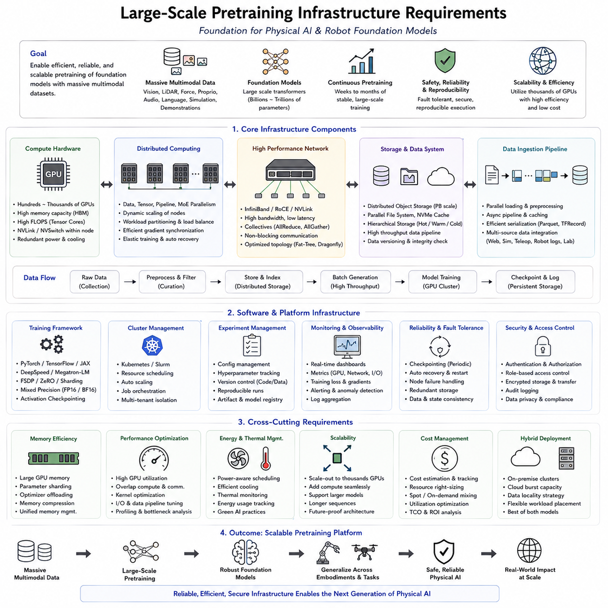{width="7.268055555555556in" height="7.268055555555556in"}

Large-scale pretraining infrastructure forms the computational foundation upon which modern Physical AI and Robot Foundation Models are built. Unlike conventional machine learning systems trained on relatively small datasets and a limited number of GPUs, robot foundation models require enormous computational resources capable of processing multimodal observations collected from cameras, LiDAR, force sensors, proprioception, language instructions, simulation environments, and real-world robotic demonstrations. The infrastructure must sustain continuous high-throughput data ingestion, distributed optimization, fault-tolerant execution, and efficient model checkpointing while maintaining reproducibility across thousands of training iterations. Within the overall Physical AI Foundation Models volume, this topic serves as the entry point to the large-scale pretraining section and establishes the engineering principles required before discussing data pipelines, distributed training strategies, and optimization techniques.

The first requirement is scalable computing hardware. Modern pretraining clusters typically consist of hundreds or thousands of high-performance GPUs interconnected through ultra-high-bandwidth communication fabrics. GPU memory capacity, tensor computation throughput, and inter-GPU communication bandwidth directly influence the size of trainable models and the achievable batch size. As model parameters increase from billions to hundreds of billions, computational infrastructure must scale almost linearly while minimizing synchronization overhead. A well-designed cluster balances compute density, communication latency, storage bandwidth, and power efficiency rather than optimizing only raw floating-point performance.

Distributed computing architecture represents another essential requirement because no single machine can efficiently train foundation-scale models. Data parallelism, tensor parallelism, pipeline parallelism, sequence parallelism, and expert parallelism are combined to distribute computation across multiple nodes. Intelligent workload partitioning minimizes idle hardware while maintaining numerical consistency during gradient synchronization. The infrastructure must support dynamic scaling so that additional compute resources can be integrated without fundamentally changing the training pipeline, allowing research teams to expand from small experimental clusters to production-scale supercomputing environments.

High-performance networking is equally important because communication frequently becomes the dominant bottleneck during distributed training. Technologies such as InfiniBand, NVLink, NVSwitch, and high-speed Ethernet enable rapid parameter synchronization and efficient tensor exchange across GPU clusters. Low-latency collective communication libraries reduce synchronization overhead during forward and backward propagation. Network topology should minimize congestion while providing predictable bandwidth across all participating nodes, ensuring that communication efficiency scales together with computational capacity.

Storage infrastructure must accommodate enormous multimodal datasets that may reach petabyte scale. Robot pretraining datasets often contain synchronized RGB images, depth maps, LiDAR point clouds, tactile measurements, joint states, force readings, audio streams, simulation trajectories, and natural language annotations. Distributed object storage, parallel file systems, high-speed NVMe caches, and hierarchical storage architectures ensure that GPUs remain continuously supplied with training data. Efficient metadata indexing, version control, and automatic integrity verification are equally important because corrupted or inconsistent datasets can significantly degrade large-scale pretraining.

Data ingestion pipelines must deliver data at sustained throughput without starving accelerators. Parallel data loading, asynchronous preprocessing, memory-mapped datasets, caching layers, and optimized serialization formats reduce CPU bottlenecks while maximizing GPU utilization. The pipeline should seamlessly combine web-scale multimodal data, synthetic simulation outputs, teleoperation demonstrations, autonomous robot logs, and laboratory datasets into unified training batches. Continuous monitoring of data throughput helps identify bottlenecks before they affect overall cluster efficiency.

Memory architecture plays a central role in supporting increasingly larger models. High-capacity GPU memory, unified memory management, activation checkpointing, parameter sharding, optimizer state partitioning, and efficient buffer reuse allow training models that exceed the memory capacity of individual accelerators. Mixed precision computation, memory compression, and intelligent offloading between GPU and CPU memory further increase effective model capacity while maintaining acceptable computational performance. Careful memory management becomes increasingly important as sequence length, model depth, and multimodal token counts continue to grow.

Software infrastructure coordinates every component within the distributed training environment. Deep learning frameworks, distributed runtime libraries, scheduling systems, experiment management platforms, and resource orchestration tools work together to provide reliable large-scale execution. Automatic job recovery, fault detection, distributed checkpoint management, configuration tracking, dependency management, and reproducible execution environments ensure that long-running experiments remain stable even under hardware failures or software interruptions.

Reliability and fault tolerance become critical because foundation model pretraining often continues for weeks or months. Hardware failures, network interruptions, storage errors, and power events are inevitable within very large clusters. Periodic checkpointing, redundant metadata storage, distributed recovery protocols, and automatic job rescheduling minimize lost computation while allowing interrupted training to resume efficiently. Infrastructure resilience directly affects both research productivity and operational cost because restarting extremely large experiments from the beginning is often impractical.

Energy consumption and thermal management also become fundamental engineering considerations. Large GPU clusters consume substantial electrical power while generating significant heat. Efficient cooling systems, intelligent workload scheduling, power-aware resource allocation, and optimized hardware utilization reduce operational cost without sacrificing computational performance. Monitoring infrastructure continuously observes power usage, thermal behavior, GPU frequency, and system health to maximize cluster reliability over extended training periods.

Monitoring and observability provide comprehensive visibility into the entire pretraining process. Infrastructure dashboards track GPU utilization, communication bandwidth, storage throughput, network latency, memory consumption, training loss, gradient stability, checkpoint frequency, and hardware health in real time. Automated alerting identifies abnormal behavior such as node failures, exploding gradients, degraded throughput, or storage bottlenecks before they significantly impact model training. Detailed logging further supports reproducibility, debugging, and long-term system optimization.

Security and access control become increasingly important as organizations manage valuable datasets and proprietary foundation models. Authentication, authorization, encrypted communication, secure storage, role-based access control, and audit logging protect both training infrastructure and intellectual property. Multi-tenant clusters require workload isolation to prevent interference between concurrent research projects while maintaining efficient hardware sharing across engineering teams.

Cloud and on-premise deployment models each provide unique advantages. Cloud infrastructure offers rapid scalability, flexible resource allocation, and global accessibility, making it attractive for experimental workloads and temporary large-scale training campaigns. On-premise clusters provide predictable performance, lower long-term operational costs for sustained utilization, greater control over sensitive datasets, and reduced dependence on external service providers. Many Physical AI organizations therefore adopt hybrid architectures that combine local GPU clusters with cloud-based burst capacity for peak computational demand.

Scalability should extend beyond hardware alone. Infrastructure must support progressively larger datasets, longer sequence lengths, more robot embodiments, increasingly complex multimodal inputs, and future generations of Foundation Models without requiring complete architectural redesign. Modular software components, standardized communication interfaces, containerized deployment, and hardware abstraction layers enable continuous infrastructure evolution while preserving compatibility with existing training pipelines.

Ultimately, large-scale pretraining infrastructure is not simply a collection of powerful computers but an integrated engineering platform that combines computation, networking, storage, software, monitoring, reliability, security, and operational management into one cohesive ecosystem. For Robot Foundation Models and Physical AI, this infrastructure determines whether massive multimodal datasets can be transformed into robust, generalizable, and scalable embodied intelligence. Every subsequent stage of large-scale pretraining---including data collection, distributed optimization, curriculum design, checkpoint evaluation, and cost optimization---depends upon a reliable infrastructure capable of sustaining continuous, efficient, and reproducible learning at foundation-model scale.

## 7.2 Robot Pretraining Data Sources Web Sim Real [w/Code]

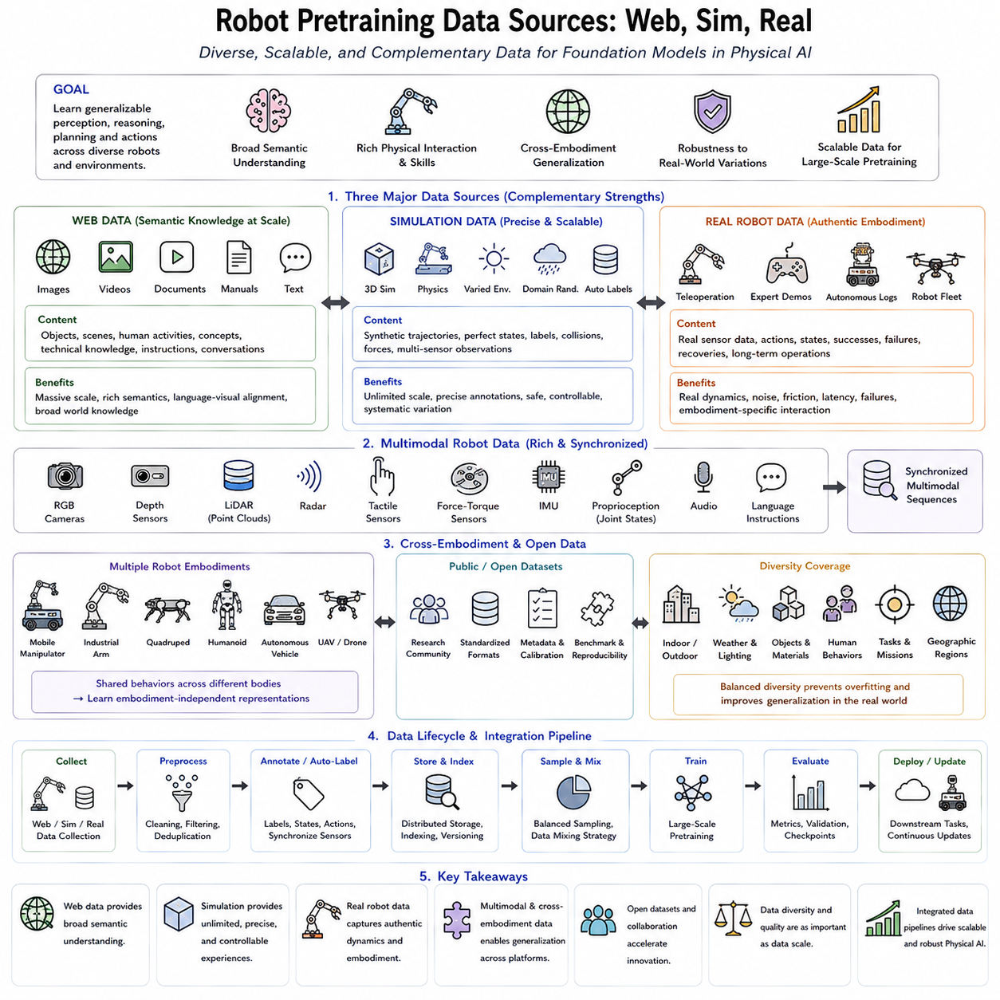{width="7.268055555555556in" height="7.268055555555556in"}

Modern Robot Foundation Models require extraordinarily diverse training data because no single data source can adequately represent the complexity of real-world physical interaction. Unlike conventional computer vision models trained primarily on static internet images, robot foundation models must learn perception, reasoning, planning, action generation, and physical interaction simultaneously. Consequently, large-scale robot pretraining integrates heterogeneous data collected from web resources, simulation environments, and real-world robotic systems into one unified learning framework. Each source contributes complementary information while compensating for the limitations of the others, enabling models to acquire both broad semantic knowledge and embodiment-specific physical skills. Within the overall Physical AI pretraining pipeline, robot data sources represent the foundation upon which scalable multimodal intelligence is built.

Web-scale data provides the largest and most diverse source of semantic knowledge available for pretraining. Billions of publicly available images, videos, documents, technical manuals, scientific publications, instructional articles, and natural language conversations enable models to understand objects, environments, human intentions, physical concepts, and task descriptions. Large Vision-Language Models benefit enormously from this extensive semantic coverage, learning relationships between language and visual observations across countless real-world scenarios. Although web data generally lacks direct robot action labels, it establishes rich representations that later support embodied reasoning and task understanding.

Large collections of internet videos further enrich robot pretraining by exposing models to dynamic human activities and object interactions. Videos demonstrate temporal relationships that static images cannot capture, allowing models to learn motion patterns, manipulation sequences, navigation behavior, and long-horizon task execution. Self-supervised learning techniques extract temporal consistency, future prediction, and action-relevant representations without requiring expensive manual annotation. These large-scale video corpora significantly improve a model\'s understanding of how physical events evolve over time.

Simulation environments constitute the second major category of robot pretraining data. Modern physics simulators generate virtually unlimited interaction experiences while providing perfect state information, precise action labels, collision detection, force measurements, and environmental parameters. Platforms such as robotic simulators, synthetic warehouses, household environments, industrial workcells, autonomous driving simulators, and aerial simulation systems allow researchers to generate diverse training scenarios rapidly and safely. Simulation also enables systematic variation of lighting, weather, object placement, materials, sensor noise, and robot embodiments that would be difficult or prohibitively expensive to reproduce in reality.

Synthetic data generation extends simulation by automatically producing massive quantities of labeled multimodal observations. RGB images, depth maps, semantic segmentation masks, instance labels, optical flow, point clouds, occupancy grids, and precise six-degree-of-freedom object poses can all be generated automatically without human annotation. Domain randomization intentionally varies textures, colors, illumination, camera parameters, and environmental conditions so that models learn robust features rather than memorizing simulator-specific appearances. Such diversity substantially improves sim-to-real generalization during downstream deployment.

Digital Twin technology further bridges simulation and reality by constructing virtual replicas of physical robots, industrial facilities, warehouses, factories, construction sites, logistics centers, or outdoor environments. These synchronized virtual environments continuously reflect real operational conditions while enabling safe experimentation, predictive planning, synthetic data generation, and large-scale policy evaluation. Digital Twins therefore serve not only as simulation platforms but also as continuously updated sources of realistic pretraining experiences throughout the robot lifecycle.

Real-world robotic data remains indispensable because only physical interaction captures the full complexity of embodiment. Real robots experience actuator imperfections, sensor noise, friction, compliance, latency, hardware failures, unexpected contacts, and environmental uncertainty that are difficult to model accurately in simulation. Demonstrations collected through teleoperation, kinesthetic teaching, joystick control, virtual reality interfaces, and expert human operators provide high-quality trajectories that directly encode successful manipulation, navigation, inspection, assembly, and locomotion behaviors. These demonstrations form the foundation for imitation learning and behavior cloning in Robot Foundation Models.

Autonomous robot operation generates another valuable source of training data. Production robots deployed in warehouses, factories, hospitals, agricultural fields, construction sites, and logistics centers continuously collect observations, state transitions, mission histories, success records, failure cases, recovery behaviors, and environmental changes. Unlike manually curated datasets, autonomous operational logs reflect authentic long-term interactions across highly diverse operational conditions. These continuously expanding datasets support lifelong learning, continual adaptation, and periodic foundation model updates.

Multimodal robot datasets integrate information from numerous sensing modalities simultaneously. RGB cameras capture visual appearance, while depth sensors provide three-dimensional geometry. LiDAR contributes accurate spatial measurements, radar offers robust perception under adverse weather, tactile sensors measure physical contact, force-torque sensors characterize interaction dynamics, inertial measurement units estimate robot motion, proprioceptive sensors describe internal joint states, microphones capture acoustic events, and natural language instructions provide semantic task descriptions. Synchronizing these heterogeneous observations into temporally aligned multimodal sequences enables foundation models to learn unified physical representations across diverse sensing domains.

Cross-embodiment datasets significantly expand model generalization by combining demonstrations from multiple robot platforms. Mobile manipulators, industrial robot arms, quadrupeds, humanoids, autonomous vehicles, aerial drones, and service robots all perform related tasks using different physical embodiments. Rather than learning hardware-specific control policies, Foundation Models discover higher-level behavioral abstractions that transfer across robots. Shared datasets therefore encourage embodiment-independent representations while preserving platform-specific execution capabilities through downstream adaptation.

Large-scale robot pretraining also increasingly incorporates public open-source datasets collected by research communities. Collaborative initiatives aggregate demonstrations contributed by numerous laboratories, institutions, and industrial partners using standardized data formats. Such datasets improve reproducibility, facilitate benchmarking, and accelerate research by allowing models to train on broader distributions than any individual organization could realistically collect. Standardized metadata, calibration information, sensor synchronization, and task annotations further simplify large-scale integration across heterogeneous data sources.

Data diversity remains as important as dataset size. Successful Robot Foundation Models require balanced coverage across indoor and outdoor environments, structured and unstructured scenes, varying weather conditions, multiple geographic regions, different object categories, diverse human behaviors, numerous manipulation tasks, multiple navigation objectives, and a wide range of robot embodiments. Overrepresentation of narrow task domains or limited environmental conditions reduces generalization capability and increases deployment risk in unfamiliar situations. Careful sampling and dataset balancing therefore become essential components of pretraining strategy.

Combining web, simulation, and real-world data creates complementary learning benefits. Web data provides broad semantic understanding, simulation supplies unlimited labeled interaction experiences, and physical robots contribute realistic embodiment dynamics unavailable elsewhere. Together they enable Foundation Models to acquire language understanding, visual reasoning, physical prediction, action generation, and robust control within a unified multimodal representation. Data mixing strategies further regulate the relative contribution of each source during different stages of pretraining, allowing semantic knowledge and physical skills to develop simultaneously.

Ultimately, Robot Pretraining Data Sources represent far more than simple collections of training examples. They define the knowledge base from which Physical AI learns to understand, predict, and interact with the physical world. The future of Robot Foundation Models will increasingly depend upon scalable integration of massive web corpora, high-fidelity simulation environments, continuously expanding real-world robot experiences, and collaborative open datasets. As multimodal data ecosystems continue to grow in both diversity and scale, they will become the primary driver enabling increasingly general, transferable, and capable Physical AI systems across virtually every robotic embodiment and application domain.

## 7.3 Data Curation and Quality Filtering for Pretraining [w/Code]

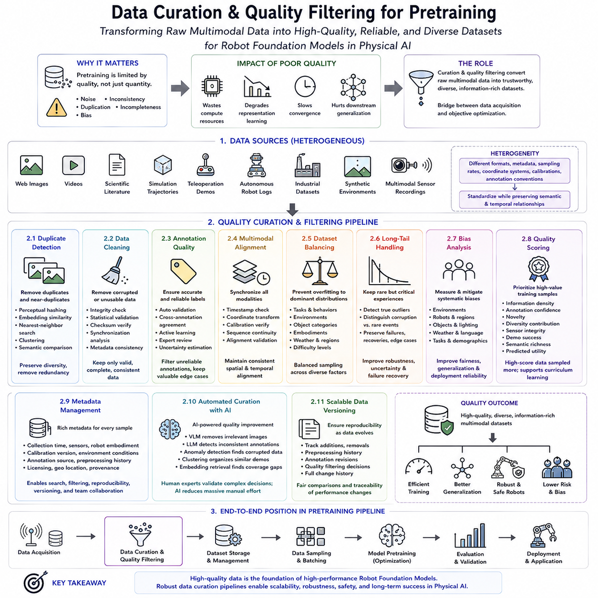{width="7.268055555555556in" height="7.268055555555556in"}

Large-scale pretraining is fundamentally constrained not only by the quantity of available data but also by its quality. Robot Foundation Models learn statistical relationships directly from the datasets presented during training, making them highly sensitive to noisy, inconsistent, duplicated, incomplete, or biased data. As model scale increases, poor-quality data can consume enormous computational resources while degrading representation learning, slowing convergence, and reducing downstream generalization. Consequently, data curation and quality filtering have become essential engineering disciplines within Physical AI, transforming raw multimodal collections into reliable, diverse, and information-rich training corpora suitable for foundation-scale learning. Within the overall pretraining pipeline, this stage connects data acquisition with objective optimization by ensuring that only meaningful information reaches the learning process.

Data curation begins with comprehensive dataset aggregation from heterogeneous sources. Modern Robot Foundation Models integrate web-scale images, videos, scientific literature, simulation trajectories, teleoperation demonstrations, autonomous robot logs, industrial datasets, synthetic environments, and multimodal sensor recordings into one unified repository. Each source introduces different formats, metadata structures, sampling frequencies, coordinate systems, sensor calibrations, and annotation conventions. A robust curation pipeline standardizes these heterogeneous inputs into consistent representations while preserving critical semantic and temporal relationships necessary for downstream multimodal learning.

Duplicate detection represents one of the earliest quality filtering operations. Large internet datasets frequently contain repeated images, near-identical videos, mirrored content, compressed copies, and multiple resized versions of the same observations. Similarly, autonomous robots repeatedly encounter identical environments during routine operation. Training on excessive duplicates wastes computational resources while encouraging memorization rather than generalization. Modern deduplication algorithms therefore employ perceptual hashing, embedding similarity, nearest-neighbor search, clustering techniques, and semantic comparison methods to eliminate redundant samples while preserving meaningful diversity across the dataset.

Data cleaning further removes corrupted or unusable samples before training. Images may be damaged, videos truncated, sensor logs incomplete, language annotations malformed, timestamps inconsistent, or multimodal synchronization lost due to recording failures. Physical sensors occasionally generate invalid measurements caused by hardware malfunction, communication errors, environmental interference, or calibration drift. Automated validation pipelines identify these anomalies through integrity checks, statistical validation, checksum verification, synchronization analysis, and metadata consistency tests before excluding problematic data from large-scale training corpora.

Annotation quality plays an equally important role because supervised and self-supervised learning both depend upon accurate contextual information. Human-generated labels occasionally contain inconsistencies, ambiguous descriptions, missing categories, incorrect object identities, or inaccurate task definitions. Robot demonstrations may include unsuccessful executions, operator mistakes, unintended collisions, or incomplete trajectories. Quality assurance systems combine automated validation, cross-annotation agreement, active learning, expert review, and uncertainty estimation to identify unreliable annotations while preserving valuable edge cases for downstream robustness.

Multimodal alignment constitutes another critical curation challenge unique to Physical AI. Robot observations simultaneously combine RGB images, depth measurements, LiDAR scans, force signals, proprioception, tactile feedback, inertial sensing, audio, and natural language instructions. Every modality must remain accurately synchronized in both spatial and temporal dimensions. Misaligned sensor streams create inconsistent supervision that can significantly degrade representation learning. Automated synchronization verification therefore compares timestamps, coordinate transformations, calibration parameters, and sequence continuity to maintain coherent multimodal observations throughout the dataset.

Dataset balancing prevents foundation models from overfitting dominant data distributions. Naturally collected robot data often contains overwhelming numbers of common navigation behaviors, stationary observations, or repetitive manipulation actions while relatively few examples capture rare failures, recovery behaviors, adverse weather, unusual objects, or complex interactions. Without careful balancing, models become highly specialized for frequent scenarios while performing poorly under uncommon conditions. Intelligent sampling strategies therefore maintain appropriate distributions across tasks, environments, object categories, robot embodiments, weather conditions, geographic regions, and operational difficulty levels.

Long-tail data deserves particular attention because rare events frequently determine real-world system reliability. Unexpected collisions, actuator failures, sensor degradation, slippery surfaces, damaged infrastructure, emergency maneuvers, communication loss, and human intervention occur infrequently but possess disproportionately high operational importance. Rather than eliminating statistical outliers indiscriminately, curation systems distinguish between corrupted data and genuinely rare but informative experiences. Preserving these valuable edge cases substantially improves robustness, uncertainty estimation, and failure recovery capabilities during deployment.

Bias analysis has become increasingly important as Foundation Models influence real-world robotic decision making. Data collected primarily within certain countries, industrial facilities, households, climates, or demographic groups may unintentionally produce systematic behavioral biases. Similarly, simulation environments may oversimplify physical interactions or omit critical environmental variability. Data curation therefore includes quantitative bias measurement across environments, robot platforms, geographic regions, object categories, lighting conditions, weather patterns, languages, and task distributions. Correcting these imbalances improves fairness, generalization, and deployment reliability across diverse operational settings.

Quality scoring enables continuous prioritization of high-value training samples. Rather than treating every observation equally, modern curation systems estimate information density, annotation confidence, novelty, diversity contribution, sensor integrity, demonstration success, semantic richness, and predicted training utility. Samples with higher quality scores may receive greater sampling probability during pretraining, while low-value observations contribute proportionally less. Curriculum learning strategies often exploit these quality metrics by introducing progressively more challenging or diverse data throughout different stages of foundation model optimization.

Metadata management supports scalable dataset organization throughout the entire pretraining lifecycle. Every observation should maintain comprehensive metadata describing collection time, sensor configuration, robot embodiment, calibration version, environmental conditions, annotation source, preprocessing history, licensing information, geographic location when appropriate, and data provenance. Rich metadata enables efficient filtering, reproducible experiments, dataset versioning, and downstream analysis while simplifying integration across multiple research teams and continuously expanding repositories.

Automated curation pipelines increasingly rely upon AI itself to improve dataset quality. Vision-language models identify irrelevant images, language models detect inconsistent annotations, anomaly detection algorithms locate corrupted sensor recordings, clustering methods organize semantically related demonstrations, and embedding-based retrieval systems identify missing coverage within the data distribution. Human experts remain responsible for validating complex decisions, but intelligent automation dramatically reduces the manual effort required to curate petabyte-scale multimodal robot datasets.

Scalable data versioning ensures reproducibility despite continuous dataset evolution. As new robot experiences, simulation environments, teleoperation demonstrations, and web resources become available, training corpora evolve over time. Version-controlled datasets maintain complete histories of additions, removals, preprocessing operations, annotation revisions, and quality filtering decisions. This reproducibility enables researchers to compare foundation models fairly while allowing production systems to trace performance changes back to specific dataset modifications.

Ultimately, data curation and quality filtering determine the effective knowledge available to Robot Foundation Models long before optimization begins. Massive computational infrastructure cannot compensate for poorly organized, inconsistent, or low-quality training data. Instead, carefully curated multimodal datasets maximize information density, preserve meaningful diversity, eliminate harmful noise, and ensure reliable supervision across web resources, simulation environments, and real robotic experiences. As Physical AI systems continue expanding toward increasingly general embodied intelligence, sophisticated data curation pipelines will become one of the most decisive factors governing scalability, robustness, safety, and long-term foundation model performance.

## 7.4 Pretraining Objective Design MAE Contrastive [w/Code]

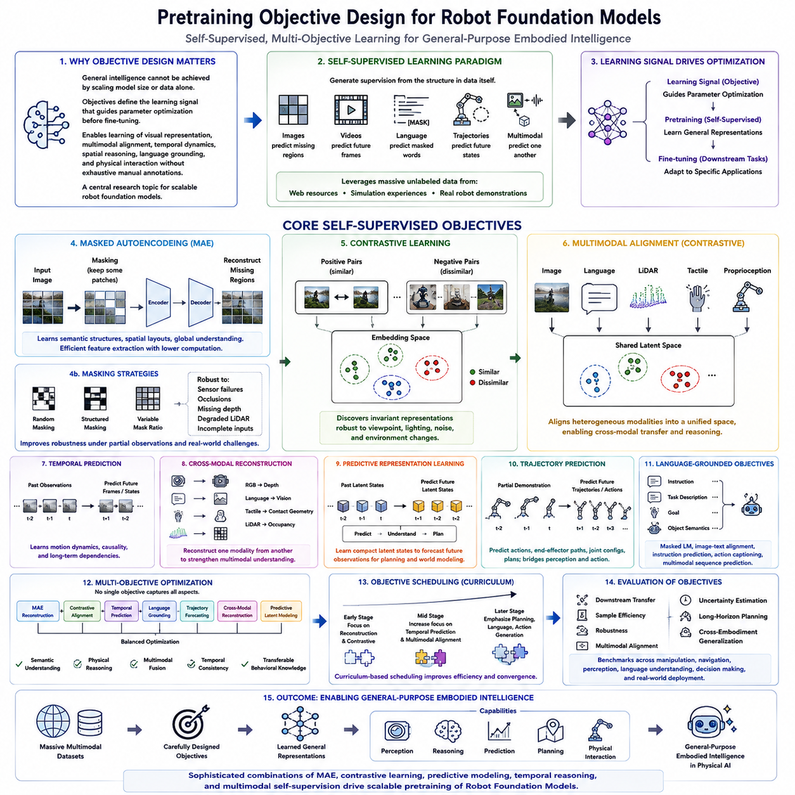{width="7.268055555555556in" height="7.268055555555556in"}

Modern Robot Foundation Models cannot acquire general intelligence solely by increasing model size or dataset volume. Equally important is the design of pretraining objectives, which determine what information the model learns from the available data. A pretraining objective defines the learning signal that guides parameter optimization before any downstream task-specific fine-tuning occurs. In Physical AI, these objectives extend far beyond traditional image classification, enabling robots to learn visual representations, multimodal alignment, temporal dynamics, spatial reasoning, language grounding, and physical interaction without requiring exhaustive manual annotations. Consequently, objective design has become one of the central research topics in scalable robot foundation model development.

Self-supervised learning has emerged as the dominant paradigm for large-scale robot pretraining because manually labeling billions of multimodal observations is economically impossible. Instead of relying upon human-generated annotations, self-supervised objectives automatically generate supervision from the structure inherent within the data itself. Images predict missing regions, videos predict future frames, language predicts masked words, robot trajectories predict future states, and multimodal observations predict one another. These automatically generated learning signals allow foundation models to exploit enormous quantities of unlabeled web resources, simulation experiences, and real robot demonstrations while continuously improving representation quality.

Masked Autoencoders (MAE) represent one of the most influential pretraining objectives for visual representation learning. During training, a large portion of an input image is intentionally masked, leaving only a subset of visible patches available to the encoder. The decoder must reconstruct the missing regions using the latent representation generated from the remaining visible information. Rather than memorizing pixel values, the model gradually learns semantic object structures, spatial layouts, contextual relationships, and global scene understanding. Because reconstruction occurs over highly incomplete observations, MAE encourages efficient feature extraction while substantially reducing computational cost compared with processing every image patch simultaneously.

The masking strategy significantly influences representation quality. Random masking encourages broad contextual understanding, while structured masking emphasizes spatial continuity and object geometry. Variable masking ratios expose models to different levels of information availability, improving robustness under partial observations. For robot perception, masking may additionally target sensor failures, occlusions, missing depth measurements, degraded LiDAR scans, or incomplete multimodal inputs, enabling foundation models to remain reliable even when certain sensing modalities become temporarily unavailable during real-world operation.

Contrastive learning provides another powerful self-supervised objective by encouraging semantically similar observations to occupy nearby locations within the learned embedding space while separating unrelated observations. Positive pairs may consist of two augmented views of the same image, synchronized RGB and depth observations, temporally adjacent video frames, multiple camera perspectives, or different sensor modalities observing the same physical event. Negative pairs originate from unrelated objects, environments, tasks, or time periods. Through contrastive optimization, the model discovers invariant representations that remain stable despite viewpoint changes, lighting variation, sensor noise, or environmental diversity.

Contrastive objectives have proven especially valuable for multimodal robot learning because they naturally align heterogeneous sensing modalities. Images become associated with corresponding language descriptions, LiDAR scans align with camera observations, tactile measurements correspond to manipulation actions, and proprioceptive states synchronize with visual perception. Instead of learning separate representations for each modality, the model gradually constructs a shared latent space where semantically equivalent observations become closely related regardless of their original sensing source. Such unified representations substantially improve downstream multimodal reasoning and cross-modal transfer learning.

Temporal prediction objectives extend self-supervised learning beyond static observations into dynamic physical processes. Robot foundation models predict future visual frames, object trajectories, sensor readings, robot states, or environmental changes using previously observed sequences. Learning to anticipate future events encourages models to internalize motion dynamics, object permanence, physical causality, and long-term dependencies. Temporal objectives therefore become particularly important for manipulation, navigation, collision avoidance, and decision-making tasks requiring prediction rather than simple perception.

Cross-modal reconstruction objectives further strengthen multimodal understanding by reconstructing one sensing modality from another. RGB images may predict depth maps, language descriptions reconstruct visual observations, tactile feedback estimates contact geometry, or LiDAR predicts occupancy representations. These objectives encourage the latent representation to capture information shared across modalities while preserving modality-specific characteristics when necessary. Such cross-modal reasoning improves robustness whenever one sensor becomes unreliable or temporarily unavailable.

Predictive representation learning focuses on learning compact latent states capable of accurately forecasting future observations instead of reconstructing raw sensor measurements directly. Rather than modeling every pixel individually, the objective emphasizes abstract features describing scene structure, object interactions, robot dynamics, and environmental evolution. This predictive abstraction significantly improves computational efficiency while supporting downstream planning, world modeling, imagination, and model-based reinforcement learning. Many modern world models therefore optimize latent prediction objectives instead of explicit observation reconstruction.

Robot trajectory prediction introduces objectives specialized for embodied intelligence. Given partial demonstrations, the model predicts future robot actions, end-effector trajectories, joint configurations, navigation paths, grasp sequences, or manipulation plans. Unlike purely visual objectives, trajectory prediction directly connects perception with action generation, allowing foundation models to acquire transferable behavioral priors applicable across multiple robotic embodiments. Such objectives play an essential role in imitation learning, policy initialization, and autonomous skill acquisition.

Language-grounded objectives integrate natural language into robot pretraining. Models learn to associate instructions, task descriptions, goals, and object semantics with corresponding visual observations and physical actions. Masked language modeling, image-text alignment, instruction prediction, action captioning, and multimodal sequence prediction jointly develop semantic grounding between linguistic concepts and embodied experience. These objectives enable robots to interpret previously unseen commands while leveraging broad world knowledge acquired from web-scale language corpora.

Multi-objective optimization has become increasingly common because no single pretraining objective captures every aspect of embodied intelligence. Modern Robot Foundation Models frequently combine MAE reconstruction, contrastive alignment, temporal prediction, language grounding, trajectory forecasting, cross-modal reconstruction, and predictive latent modeling into one unified optimization framework. Carefully balancing these objectives enables simultaneous learning of semantic understanding, physical reasoning, multimodal fusion, temporal consistency, and transferable behavioral knowledge. Adaptive weighting strategies further adjust objective importance throughout different training stages as model capabilities evolve.

Objective scheduling also influences foundation model performance. Early training may emphasize reconstruction and contrastive learning to establish robust representations, followed by progressively greater focus on temporal prediction, planning, language grounding, or action generation. Curriculum-based objective scheduling exposes the model to increasingly complex prediction tasks while preserving previously acquired representations. Such staged optimization often converges more efficiently than optimizing every objective equally throughout the entire pretraining process.

Evaluation of pretraining objectives extends beyond reconstruction accuracy or contrastive loss values. Effective objectives should improve downstream transfer learning, sample efficiency, robustness, multimodal alignment, uncertainty estimation, long-horizon planning, and cross-embodiment generalization. Benchmarking therefore measures how well learned representations support manipulation, navigation, perception, language understanding, decision making, and real-world deployment rather than focusing exclusively on optimization metrics observed during pretraining itself.

Ultimately, pretraining objective design defines what Robot Foundation Models learn from enormous multimodal datasets. While large computational infrastructure and diverse training data establish the foundation for scalable learning, carefully engineered objectives transform raw observations into meaningful representations capable of supporting perception, reasoning, prediction, planning, and autonomous physical interaction. As Physical AI progresses toward increasingly general embodied intelligence, sophisticated combinations of MAE, contrastive learning, predictive modeling, temporal reasoning, and multimodal self-supervision will continue to serve as the primary driving force behind scalable robot foundation model pretraining.

## 7.5 Distributed Pretraining Multi Node GPU Cluster [w/Code]

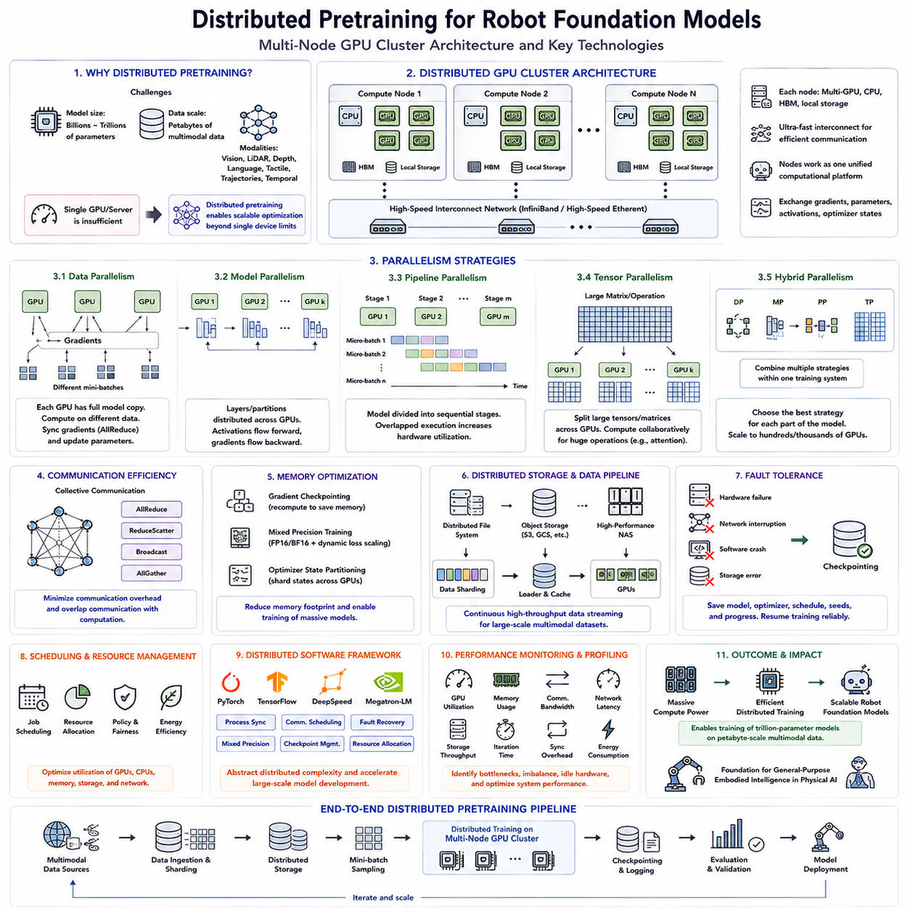{width="7.268055555555556in" height="7.268055555555556in"}

Distributed pretraining has become an essential technology for modern Robot Foundation Models because neither a single GPU nor a single computing server can efficiently process the enormous datasets and model sizes required by Physical AI. Contemporary foundation models often contain billions of parameters while training on petabytes of multimodal robot data collected from web resources, simulation environments, and real robotic systems. The computational requirements increase even further when processing synchronized RGB images, LiDAR point clouds, depth maps, language instructions, tactile sensing, robot trajectories, and temporal observations simultaneously. Consequently, distributed pretraining enables computational workloads to be partitioned across multiple GPUs, multiple servers, and entire GPU clusters, allowing scalable optimization that would otherwise be computationally impossible.

A distributed GPU cluster consists of numerous interconnected compute nodes, each containing multiple high-performance GPUs, multicore CPUs, high-bandwidth memory, local storage, and ultra-fast networking hardware. Individual nodes communicate through technologies such as InfiniBand or high-speed Ethernet, allowing gradients, parameters, activations, and optimizer states to be exchanged efficiently during training. Rather than functioning as isolated computers, these nodes operate as one coordinated computational platform capable of executing massive neural network optimization across thousands of parallel processing units.

Data parallelism represents the most widely adopted distributed training strategy. Each GPU maintains an identical copy of the neural network while processing different mini-batches of training data simultaneously. After each forward and backward propagation step, gradients computed independently by every GPU are synchronized using collective communication operations before updating model parameters. This approach significantly increases throughput while preserving identical optimization behavior compared with single-device training. Data parallelism scales particularly well when extremely large datasets dominate computational workload.

As Robot Foundation Models continue growing beyond billions of parameters, model parallelism becomes increasingly important. Instead of replicating the complete neural network on every GPU, different layers or partitions of the model are distributed across multiple devices. During forward propagation, intermediate activations flow sequentially between GPUs, while backward propagation distributes gradients in reverse order. Model parallelism enables networks whose parameter counts exceed the memory capacity of any individual GPU, making it indispensable for training the largest multimodal foundation models.

Pipeline parallelism further improves scalability by dividing the neural network into multiple sequential stages executed on different GPUs. While one GPU processes the early layers of one mini-batch, downstream GPUs simultaneously process later layers belonging to previously submitted batches. This overlapping execution substantially improves hardware utilization by reducing idle computation time throughout the cluster. Modern distributed frameworks frequently combine pipeline parallelism with data parallelism to maximize computational efficiency across large GPU systems.

Tensor parallelism partitions individual matrix operations rather than entire neural network layers. Extremely large weight matrices are divided among multiple GPUs, allowing matrix multiplication, attention computation, and feed-forward networks to execute collaboratively. This approach becomes particularly valuable for Transformer architectures whose enormous linear layers exceed individual GPU memory capacity. Tensor parallelism therefore forms a critical component of distributed optimization in today\'s largest language, vision, and robot foundation models.

Hybrid parallelism integrates multiple parallelization strategies simultaneously. Large-scale Robot Foundation Models commonly combine data parallelism, model parallelism, tensor parallelism, and pipeline parallelism within one unified distributed training architecture. Different portions of the neural network utilize whichever strategy best matches their computational characteristics, enabling efficient scaling across hundreds or thousands of GPUs. Such hybrid optimization significantly improves both memory utilization and computational throughput compared with relying upon any single parallelization technique alone.

Communication efficiency becomes one of the primary bottlenecks in distributed pretraining. As GPU counts increase, synchronizing gradients, parameters, optimizer states, and activation tensors consumes substantial bandwidth. Collective communication algorithms such as AllReduce, ReduceScatter, Broadcast, and AllGather minimize communication overhead while maintaining optimization consistency. Modern distributed systems further overlap communication with computation so that parameter synchronization occurs concurrently with ongoing neural network execution whenever possible.

Memory optimization plays an equally critical role because robot foundation models frequently exceed available GPU memory even under distributed execution. Gradient checkpointing recomputes selected intermediate activations instead of storing them permanently, reducing memory consumption at the cost of additional computation. Mixed precision training stores many tensors using lower numerical precision while preserving optimization stability through dynamic loss scaling. Optimizer state partitioning distributes optimizer variables across multiple GPUs rather than replicating them everywhere, dramatically reducing memory requirements during extremely large-scale training.

Distributed storage infrastructure supports continuous high-throughput data delivery throughout pretraining. Petabyte-scale multimodal datasets cannot reside on local disks attached to individual compute nodes. Instead, parallel distributed file systems, object storage platforms, high-performance network-attached storage, and hierarchical caching architectures continuously stream training samples into GPU memory. Intelligent data sharding ensures each GPU processes different portions of the dataset while maintaining balanced workload distribution and minimizing storage contention across the cluster.

Fault tolerance becomes increasingly important as distributed training scales toward thousands of GPUs operating continuously for weeks or months. Hardware failures, network interruptions, power fluctuations, software crashes, or storage errors become statistically inevitable during extremely long training jobs. Checkpointing periodically saves model parameters, optimizer states, learning rate schedules, random seeds, and training progress so interrupted jobs can resume without restarting from the beginning. Robust recovery mechanisms substantially reduce computational waste and improve overall training reliability.

Scheduling and resource management coordinate computational resources across shared GPU clusters. Modern training environments frequently execute multiple foundation model experiments simultaneously, requiring intelligent allocation of GPUs, CPUs, memory, storage bandwidth, and network capacity. Cluster schedulers optimize hardware utilization while enforcing priority policies, fairness constraints, resource quotas, and energy efficiency. Dynamic scheduling additionally adapts computational allocation as workloads evolve throughout different stages of pretraining.

Distributed software frameworks abstract much of the complexity associated with large-scale parallel training. Libraries and runtime systems automatically manage process synchronization, communication scheduling, fault recovery, mixed precision execution, checkpoint management, and hardware resource allocation. Researchers can therefore focus primarily upon model architecture, objective design, and dataset engineering rather than manually implementing distributed communication algorithms. These frameworks have become indispensable infrastructure for scalable Robot Foundation Model development.

Performance monitoring provides continuous visibility into distributed training efficiency. Metrics such as GPU utilization, memory occupancy, communication bandwidth, network latency, storage throughput, iteration time, gradient synchronization overhead, and energy consumption reveal bottlenecks limiting overall scalability. Profiling tools identify inefficient operations, communication imbalance, idle hardware, and memory fragmentation, allowing engineers to optimize distributed execution before launching extremely expensive large-scale training experiments.

Ultimately, distributed pretraining transforms collections of independent GPUs into unified computational systems capable of training Robot Foundation Models far beyond the limitations of individual devices. By combining advanced parallelization strategies, efficient communication protocols, scalable storage systems, intelligent scheduling, fault-tolerant execution, and optimized software infrastructure, distributed GPU clusters provide the computational foundation required for modern Physical AI. As multimodal robot datasets continue expanding and foundation models approach trillions of parameters, distributed pretraining will remain one of the most fundamental enabling technologies supporting future embodied intelligence at global scale.

## 7.6 Mixed Precision and Gradient Checkpointing [w/Code]

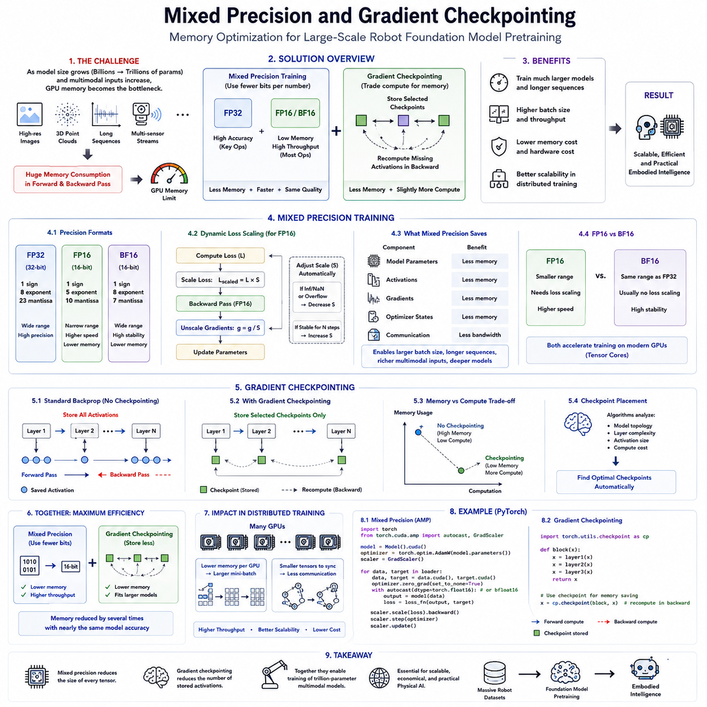{width="7.268055555555556in" height="7.268055555555556in"}

Modern Robot Foundation Models have reached scales where computational performance is constrained not only by processing power but also by GPU memory capacity. As model sizes increase from billions toward trillions of parameters, memory becomes one of the most valuable resources during pretraining. Large multimodal batches, long temporal sequences, high-resolution images, three-dimensional point clouds, and multiple synchronized sensor streams dramatically increase memory consumption throughout forward and backward propagation. Consequently, memory optimization techniques such as Mixed Precision Training and Gradient Checkpointing have become indispensable technologies that enable efficient large-scale pretraining without requiring prohibitively expensive hardware.

Traditional deep learning frameworks perform all computations using single-precision floating-point arithmetic (FP32). Although FP32 provides high numerical accuracy, it requires significant memory capacity and computational bandwidth. Every model parameter, activation tensor, gradient, and optimizer state occupies substantial storage, limiting the maximum model size and batch size that can fit into GPU memory. As Robot Foundation Models continue expanding, relying exclusively on FP32 rapidly becomes inefficient both economically and computationally.

Mixed Precision Training addresses these limitations by combining multiple numerical precisions during optimization. Rather than executing every operation in FP32, many tensor operations are performed using half-precision formats such as FP16 or BF16 while retaining selected computations in higher precision whenever numerical stability is critical. This hybrid approach substantially reduces memory consumption while increasing computational throughput because modern GPUs contain specialized hardware units optimized for lower-precision arithmetic. Mixed precision therefore enables significantly larger models and higher training throughput without sacrificing final model quality.

FP16 has historically been the most widely adopted reduced-precision format for deep learning acceleration. By representing each numerical value using only sixteen bits instead of thirty-two, FP16 nearly halves memory requirements while allowing Tensor Core hardware to perform matrix operations at dramatically higher speeds. However, FP16 possesses a relatively narrow numerical range, making extremely small gradients susceptible to numerical underflow during optimization. Without appropriate stabilization techniques, this reduced precision can occasionally introduce convergence difficulties when training very deep neural networks.

Dynamic Loss Scaling solves many numerical stability challenges associated with FP16 training. Before backpropagation begins, the training loss is temporarily multiplied by a scaling factor that increases gradient magnitudes beyond the minimum representable FP16 value. After gradients have been computed successfully, they are rescaled back to their original magnitude before updating model parameters. Automatic scaling algorithms continuously adjust this scaling factor according to observed numerical behavior, preventing both underflow and overflow while preserving stable optimization throughout extremely long pretraining runs.

Brain Floating Point (BF16) has recently become increasingly popular for foundation model training because it preserves the numerical range of FP32 while using only sixteen bits per value. Unlike FP16, BF16 allocates more bits to the exponent and fewer bits to the mantissa, allowing significantly larger dynamic ranges without requiring aggressive loss scaling. Modern AI accelerators from multiple hardware vendors therefore provide native BF16 support, making it one of the preferred numerical formats for training today\'s largest language models, vision transformers, and Robot Foundation Models.

Mixed precision reduces memory consumption across multiple components simultaneously. Model parameters require less storage, activation tensors occupy smaller memory regions, gradient buffers become more compact, and communication overhead during distributed training decreases because fewer bits must be exchanged between GPUs. The cumulative effect allows substantially larger batch sizes, longer temporal sequences, richer multimodal inputs, and more complex transformer architectures to execute within fixed hardware resources. Consequently, mixed precision improves both computational efficiency and overall hardware utilization.

Although mixed precision reduces memory requirements significantly, activation tensors generated during forward propagation remain one of the largest memory consumers in extremely deep neural networks. Standard backpropagation stores every intermediate activation because these values are required later for gradient computation. For Robot Foundation Models containing hundreds of transformer layers, multimodal fusion modules, temporal encoders, and large attention blocks, activation storage alone can exceed available GPU memory even after applying mixed precision optimization.

Gradient Checkpointing addresses this challenge by strategically trading computation for memory. Instead of preserving every intermediate activation generated during forward propagation, only selected checkpoint activations are stored permanently. During backward propagation, missing intermediate activations are recomputed by partially repeating segments of the forward computation before calculating gradients. Although this introduces additional computation, it dramatically reduces memory consumption while allowing substantially larger neural networks to fit within existing GPU memory constraints.

Checkpoint placement strongly influences overall training efficiency. Storing too many checkpoints reduces memory savings, while storing too few increases recomputation overhead during backpropagation. Modern checkpoint scheduling algorithms therefore analyze neural network topology, layer complexity, activation size, and computational cost to determine optimal checkpoint locations automatically. This careful balance minimizes total training time while maximizing memory efficiency across increasingly deep Robot Foundation Models.

Gradient checkpointing proves particularly valuable for Transformer architectures because self-attention layers generate exceptionally large intermediate activation tensors. Long context windows, high-resolution visual tokens, multimodal embeddings, and temporal sequences all amplify activation memory requirements quadratically or linearly depending upon architectural design. Checkpointing enables these massive attention mechanisms to process considerably larger input sequences than would otherwise be feasible using conventional memory management alone.

Mixed Precision Training and Gradient Checkpointing complement one another rather than serving as competing optimization techniques. Mixed precision decreases the memory required for every stored tensor, whereas checkpointing reduces the total number of tensors that must remain resident in memory simultaneously. Combining both approaches frequently decreases memory consumption by several times while maintaining nearly identical model accuracy. Modern large-scale Robot Foundation Model training pipelines therefore routinely employ both techniques together as standard optimization practices.

These memory optimization strategies also provide important benefits within distributed pretraining environments. Lower memory consumption allows each GPU to process larger mini-batches before synchronizing gradients across the cluster, improving overall computational throughput. Reduced tensor sizes likewise decrease communication bandwidth during distributed parameter synchronization. Consequently, memory optimization not only benefits individual GPUs but also enhances scalability across hundreds or thousands of interconnected accelerators participating in large-scale distributed training.

Implementation complexity has decreased considerably as modern deep learning frameworks increasingly automate mixed precision execution and checkpoint management. Automatic precision casting, dynamic loss scaling, memory scheduling, checkpoint insertion, recomputation management, and numerical validation now operate largely without manual intervention. Researchers can therefore focus primarily upon model architecture, dataset engineering, and objective design while software frameworks transparently optimize memory utilization throughout the entire pretraining process.

Ultimately, Mixed Precision Training and Gradient Checkpointing represent two of the most influential optimization technologies enabling modern large-scale Robot Foundation Model pretraining. Rather than relying exclusively upon increasingly expensive hardware with ever-larger memory capacity, these techniques intelligently improve computational efficiency through careful numerical representation and memory management. As Physical AI continues advancing toward trillion-parameter multimodal foundation models trained on enormous robot datasets, efficient memory optimization will remain one of the fundamental technologies supporting scalable, economical, and practical embodied intelligence.

## 7.7 Pretraining Curriculum and Data Mixing Strategy [w/Code]

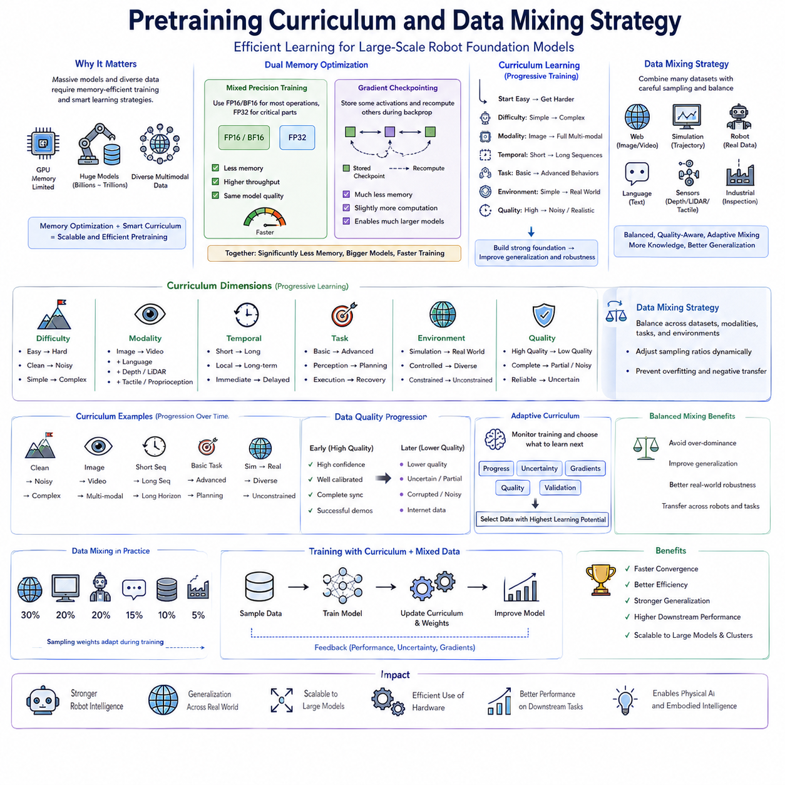{width="7.268055555555556in" height="7.268055555555556in"}

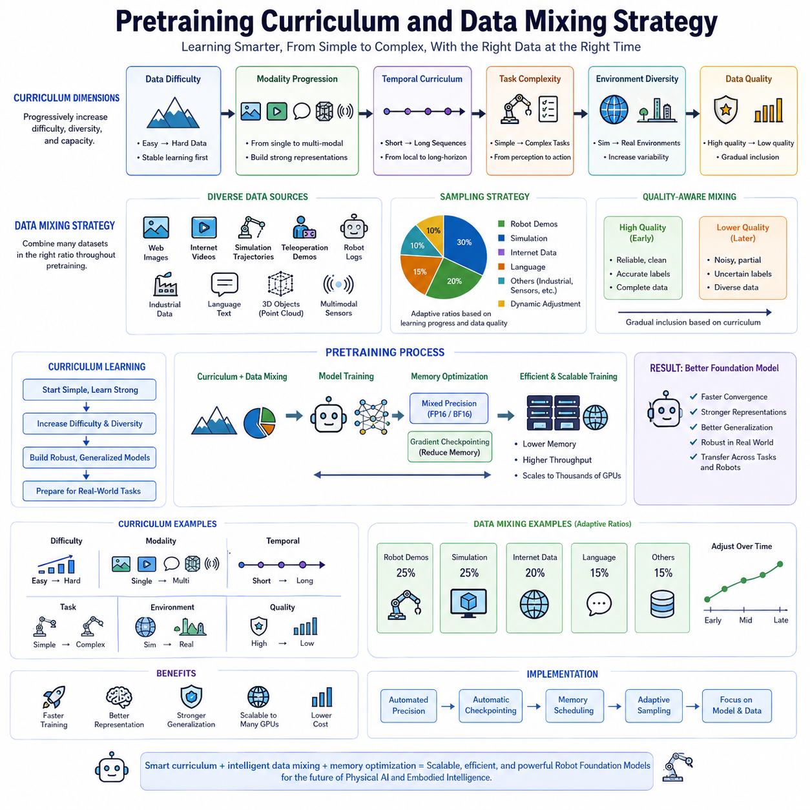{width="7.268055555555556in" height="7.268055555555556in"}

Pretraining curriculum learning has become an increasingly important component of Robot Foundation Model development because exposing a model to every available dataset with equal probability throughout training often leads to inefficient optimization and suboptimal representation learning. Similar to the way humans gradually progress from simple concepts toward increasingly complex reasoning, foundation models can benefit from structured learning schedules that progressively introduce more difficult tasks, richer multimodal observations, longer temporal dependencies, and increasingly diverse environments. Rather than viewing all training samples as equally valuable at every stage of optimization, curriculum design determines when different categories of knowledge should be introduced to maximize learning efficiency, convergence stability, and downstream generalization.

Curriculum learning originated from the observation that optimization landscapes become significantly easier to navigate when neural networks first master relatively simple examples before encountering more challenging ones. Early exposure to highly complex data may overwhelm immature representations, causing unstable gradients, slower convergence, or inefficient utilization of computational resources. By beginning with simpler observations and gradually increasing complexity, models establish robust low-level representations that subsequently support increasingly sophisticated semantic reasoning, physical understanding, and multimodal integration. This staged learning strategy has proven particularly effective for large-scale foundation models trained across highly heterogeneous robot datasets.

Data mixing strategy complements curriculum learning by determining how multiple datasets should be combined throughout pretraining. Modern Robot Foundation Models rarely rely upon a single data source. Instead, they integrate web-scale images, internet videos, simulation trajectories, teleoperation demonstrations, autonomous robot logs, industrial inspection datasets, language corpora, scientific documents, three-dimensional object repositories, and multimodal sensor recordings. Every dataset contributes unique knowledge while simultaneously introducing different statistical distributions, annotation styles, sensor characteristics, and environmental biases. Effective data mixing therefore becomes essential for maximizing knowledge diversity while avoiding overrepresentation of any individual source.

One of the simplest curriculum strategies organizes training according to data difficulty. Models initially process high-quality, well-annotated, visually clear, and relatively uncomplicated observations before gradually incorporating noisier environments, cluttered scenes, partial occlusions, adverse weather, sensor degradation, complex manipulation tasks, and long-horizon sequential behaviors. This gradual increase in complexity encourages stable optimization while reducing catastrophic forgetting and improving overall robustness under real-world deployment conditions.

Another widely adopted strategy emphasizes modality progression. Early training may concentrate primarily on visual perception using static images before incorporating videos, language descriptions, depth maps, LiDAR observations, tactile sensing, proprioception, force measurements, and eventually complete multimodal robot experiences. Learning one modality thoroughly before integrating additional sensing channels often produces stronger latent representations than attempting to optimize every modality simultaneously from random initialization. Progressive multimodal integration therefore provides a smoother optimization pathway toward comprehensive embodied intelligence.

Temporal curriculum design focuses upon progressively increasing sequence length during pretraining. Short image sequences initially teach local motion patterns and immediate temporal consistency. As optimization progresses, models encounter increasingly longer trajectories containing delayed consequences, object permanence, long-term dependencies, and multi-stage manipulation tasks. This gradual expansion of temporal reasoning capabilities enables Robot Foundation Models to transition naturally from reactive perception toward predictive planning, world modeling, and long-horizon decision making.

Task-based curriculum learning organizes training according to behavioral complexity rather than observation complexity alone. Foundation models may first learn basic object recognition, scene understanding, and localization before progressing toward navigation, grasp prediction, manipulation planning, collaborative tasks, failure recovery, and autonomous mission execution. Earlier tasks establish transferable representations that later facilitate increasingly sophisticated physical reasoning and embodied decision making. Such hierarchical behavioral organization closely resembles developmental learning observed in biological intelligence.

Environment diversity also plays an important role within curriculum scheduling. Models may initially train using clean simulation environments where object geometry, lighting, physics, and annotations remain highly controlled. Subsequent stages gradually introduce synthetic variability, domain randomization, realistic simulation, laboratory robot data, industrial facilities, outdoor environments, and unconstrained real-world observations. This progressive environmental expansion reduces the simulation-to-reality gap while maintaining optimization stability throughout large-scale multimodal pretraining.

Data quality frequently influences curriculum scheduling decisions. High-confidence annotations, well-calibrated sensor measurements, complete multimodal synchronization, and successful demonstrations generally appear during early optimization because they provide reliable supervision. Lower-quality observations, uncertain annotations, incomplete demonstrations, partially corrupted sensor recordings, and noisy internet data may be introduced progressively after robust representations have already formed. This quality-aware curriculum minimizes negative learning effects while preserving valuable information contained within imperfect datasets.

Data mixing ratios significantly influence representation quality because different datasets often vary enormously in size. Web image collections may contain billions of samples, whereas high-quality robot demonstrations remain comparatively scarce. Simply sampling proportionally according to dataset size would overwhelm robot-specific knowledge with generic visual information. Modern pretraining pipelines therefore assign carefully engineered sampling weights that intentionally oversample valuable robotic experiences while maintaining broad semantic diversity from internet-scale resources. Adaptive sampling strategies further modify these proportions dynamically throughout different stages of optimization.

Dynamic curriculum adaptation has recently attracted significant research attention. Instead of relying upon manually designed schedules, adaptive algorithms continuously analyze training progress, prediction uncertainty, gradient statistics, representation quality, and downstream validation performance to determine which data should be presented next. Samples that maximize expected learning progress receive higher probability, while already-mastered observations gradually decrease in sampling frequency. Such automated curriculum optimization enables foundation models to personalize their learning trajectory according to continuously evolving internal representations.

Balanced data mixing also prevents catastrophic dominance by any single modality, embodiment, task category, or geographic region. Excessive emphasis upon simulation may reduce real-world robustness, while overreliance on one robot embodiment limits transferability across diverse platforms. Similarly, language-rich datasets should not completely dominate multimodal sensor experiences, and industrial manipulation should remain balanced with navigation, exploration, and human-robot interaction. Carefully engineered mixing strategies therefore preserve broad generalization across heterogeneous physical environments and robotic capabilities.

Negative transfer represents another important consideration during data mixing. Some datasets contain contradictory annotation policies, incompatible coordinate systems, inconsistent action definitions, conflicting language descriptions, or fundamentally different sensing characteristics. Blindly combining such data may confuse optimization and degrade representation quality. Data mixing pipelines therefore frequently normalize representations, standardize coordinate conventions, harmonize annotation taxonomies, and isolate incompatible distributions before integrating heterogeneous datasets into unified foundation model pretraining.

Curriculum scheduling also interacts closely with optimization objectives. Reconstruction-based learning, contrastive learning, predictive modeling, language grounding, temporal prediction, and trajectory forecasting need not receive identical emphasis throughout every stage of training. Early optimization may prioritize representation learning, while later stages increasingly emphasize planning, multimodal reasoning, and action prediction. Coordinating curriculum schedules with objective weighting therefore produces smoother optimization trajectories and more transferable foundation model representations.

Evaluation of curriculum and data mixing strategies extends beyond measuring pretraining loss alone. Effective scheduling should improve convergence speed, computational efficiency, downstream transfer learning, robustness, uncertainty estimation, multimodal alignment, long-horizon planning, and cross-embodiment generalization. Researchers therefore analyze how different curriculum strategies influence final robot capabilities rather than simply comparing optimization curves during pretraining. Large-scale ablation studies frequently reveal that curriculum design substantially affects performance even when architecture, dataset size, and computational budget remain unchanged.

Ultimately, pretraining curriculum design and data mixing strategy determine not only what Robot Foundation Models learn but also how efficiently they acquire that knowledge. Massive multimodal datasets provide enormous learning opportunities, yet their full value can only be realized through carefully structured exposure schedules and intelligently balanced sampling policies. As Physical AI progresses toward increasingly general embodied intelligence trained on web resources, simulation environments, and real robotic experiences simultaneously, sophisticated curriculum learning and adaptive data mixing will remain fundamental technologies enabling scalable, stable, and transferable Robot Foundation Models.

## 7.8 Pretraining Evaluation and Intermediate Checkpoint

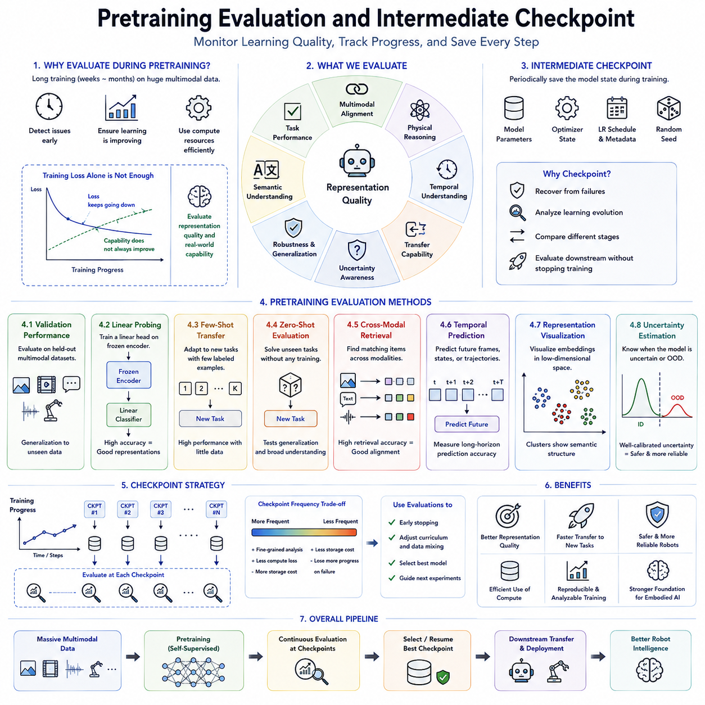{width="7.268055555555556in" height="7.268055555555556in"}

Modern Robot Foundation Models require continuous evaluation throughout pretraining because optimizing neural network parameters over trillions of tokens or multimodal observations can consume weeks or even months of uninterrupted computation. Unlike conventional supervised learning, where validation accuracy often provides a direct measure of learning progress, self-supervised robot pretraining must evaluate representation quality, multimodal alignment, physical reasoning, temporal understanding, and transfer capability without relying upon a single predefined downstream task. Consequently, pretraining evaluation has become an independent research discipline that continuously monitors learning quality while ensuring computational resources are utilized efficiently throughout large-scale optimization.

Training loss alone provides only a limited view of foundation model performance. Although decreasing reconstruction error, contrastive loss, or prediction error generally indicates successful optimization, lower training loss does not necessarily imply stronger downstream capabilities. Robot Foundation Models may continue reducing objective values while simultaneously learning redundant features, overfitting particular datasets, or failing to improve transferable representations. Effective evaluation therefore extends beyond optimization metrics and continuously measures whether learned latent representations become increasingly useful for perception, reasoning, planning, language understanding, manipulation, and autonomous decision making.

Validation datasets provide an essential mechanism for monitoring generalization throughout pretraining. Rather than evaluating exclusively on training samples, separate multimodal validation collections containing images, videos, language descriptions, robot trajectories, LiDAR observations, tactile sensing, and sensor synchronization sequences estimate how well the model generalizes to previously unseen observations. These datasets remain isolated from optimization, allowing researchers to detect overfitting, memorization, distribution shifts, and representation degradation before computational resources are wasted on ineffective training.

Linear probing has become one of the most widely adopted representation evaluation techniques. During evaluation, the pretrained encoder remains completely frozen while only a lightweight linear classifier is trained for downstream recognition tasks. High linear probing accuracy indicates that semantic information has already been encoded efficiently within the learned latent representation. Because this evaluation avoids full fine-tuning, it provides an inexpensive and standardized method for comparing different pretraining strategies, datasets, and objective functions throughout large-scale foundation model development.

Few-shot transfer evaluation measures how efficiently pretrained representations adapt to new robotic tasks using only a small number of labeled examples. Instead of requiring extensive supervised retraining, strong Robot Foundation Models rapidly acquire new perception, manipulation, navigation, or language capabilities from minimal task-specific supervision. Few-shot performance therefore directly reflects representation quality and practical deployment potential across diverse robotic applications where labeled data remains expensive and difficult to obtain.

Zero-shot evaluation further examines generalization by testing models on completely unseen tasks without additional training. Language-grounded Robot Foundation Models may receive novel textual instructions, unfamiliar object categories, previously unseen environments, or entirely new manipulation objectives while relying solely upon knowledge acquired during pretraining. Strong zero-shot capability demonstrates that learned representations capture broad semantic understanding rather than memorizing individual datasets, making such evaluation increasingly important for scalable embodied intelligence.

Cross-modal retrieval benchmarks evaluate multimodal alignment quality throughout pretraining. Given an image, the model retrieves corresponding language descriptions. Given textual instructions, it identifies matching visual observations. LiDAR scans retrieve synchronized camera images, robot states recover associated sensor measurements, and manipulation trajectories locate corresponding task descriptions. High retrieval accuracy indicates that multiple sensing modalities have successfully converged into a unified semantic representation capable of supporting robust multimodal reasoning.

Temporal prediction evaluation measures whether foundation models have successfully internalized physical dynamics. Models predict future robot observations, object trajectories, environmental evolution, or sensor measurements while evaluation compares predicted sequences against actual future outcomes. Accurate long-horizon prediction demonstrates that latent representations encode meaningful physical causality rather than static appearance alone. Such evaluation directly supports downstream planning, world modeling, collision avoidance, and autonomous decision making.

Representation visualization provides valuable qualitative insight into foundation model learning. Dimensionality reduction techniques project high-dimensional latent embeddings into lower-dimensional visualization spaces where semantically similar observations naturally cluster together. Images containing related objects, robot trajectories executing similar behaviors, or language descriptions referring to equivalent tasks should occupy nearby regions within representation space. Progressive improvement of cluster organization throughout pretraining often reveals representation evolution before downstream benchmark improvements become fully measurable.

Uncertainty estimation has become increasingly important during foundation model evaluation because autonomous robots must recognize situations lying beyond their training experience. Well-calibrated uncertainty estimates allow models to distinguish confident predictions from unfamiliar observations, sensor failures, ambiguous environments, or previously unseen tasks. Evaluation therefore measures calibration quality, confidence reliability, out-of-distribution detection, and uncertainty consistency alongside conventional prediction accuracy, particularly for safety-critical Physical AI applications.

Intermediate checkpoints provide periodic snapshots of the evolving foundation model throughout pretraining. Rather than saving only the final optimized network, training systems regularly preserve model parameters, optimizer states, learning schedules, random seeds, and metadata at predefined intervals. These checkpoints support fault recovery after hardware failures while simultaneously allowing researchers to analyze representation evolution, compare intermediate capabilities, resume optimization, and perform downstream evaluation without interrupting ongoing large-scale training.

Checkpoint frequency significantly influences both storage requirements and experimental flexibility. Frequent checkpointing provides detailed insight into optimization dynamics and minimizes computational loss following unexpected failures, although it consumes additional storage bandwidth and disk capacity. Less frequent checkpointing reduces storage overhead but risks losing substantial computational progress if interruptions occur. Modern training systems therefore balance checkpoint intervals according to model size, cluster reliability, storage performance, and expected recovery requirements.

Intermediate checkpoint evaluation enables early stopping when optimization ceases producing meaningful improvements. Rather than allocating additional weeks of GPU computation after representation quality has plateaued, evaluation metrics identify diminishing returns across downstream transfer learning, multimodal alignment, temporal reasoning, or uncertainty estimation. Early termination conserves computational resources while allowing researchers to begin subsequent experiments sooner. Such adaptive training management becomes increasingly valuable as foundation model scale continues expanding.

Checkpoint comparison additionally supports large-scale ablation studies. Researchers evaluate multiple intermediate versions trained using different datasets, objective functions, curriculum schedules, optimization algorithms, or architectural modifications while controlling computational budget. Systematic checkpoint analysis reveals which design decisions genuinely improve representation quality and which merely reduce optimization loss without enhancing practical robotic capability. Such evidence-based comparison has become fundamental for reproducible foundation model research.

Ultimately, pretraining evaluation and intermediate checkpoint management ensure that Robot Foundation Models develop meaningful embodied intelligence rather than simply minimizing mathematical objective functions. Continuous representation assessment, multimodal benchmarking, transfer evaluation, uncertainty analysis, and systematic checkpoint preservation transform long-running distributed optimization into a measurable, reproducible, and scientifically interpretable learning process. As Physical AI advances toward increasingly general-purpose autonomous systems trained over enormous multimodal datasets, sophisticated evaluation methodologies and intelligent checkpoint strategies will remain indispensable for achieving scalable, reliable, and transferable robot foundation models.

## 7.9 Pretraining Cost Estimation and ROI Analysis

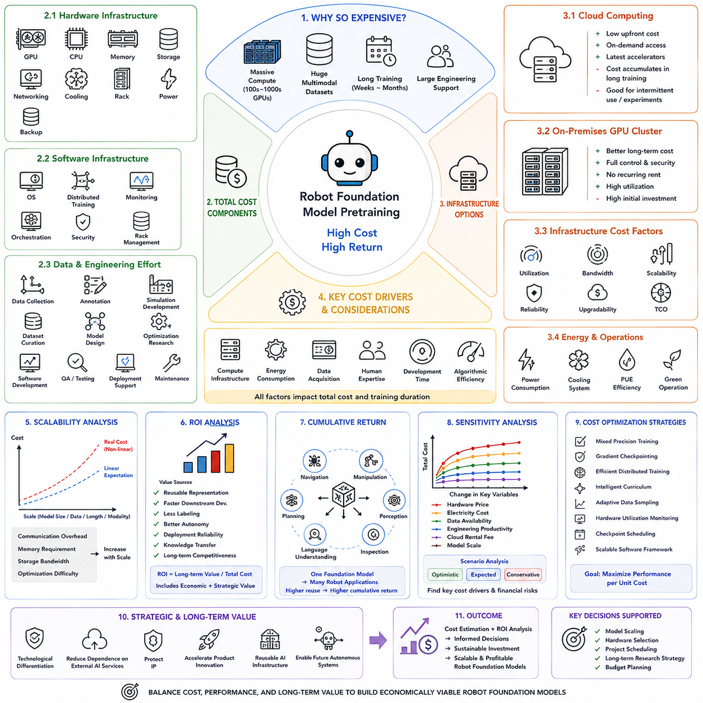{width="7.268055555555556in" height="7.268055555555556in"}

Large-scale pretraining has become one of the most computationally expensive activities in modern Artificial Intelligence and Physical AI because Robot Foundation Models require enormous computing infrastructure, massive multimodal datasets, long training durations, and extensive engineering support. Unlike conventional machine learning projects that may be completed using a single workstation, foundation model pretraining often involves hundreds or thousands of GPUs operating continuously for weeks or months. Consequently, successful deployment of Robot Foundation Models requires not only algorithmic innovation but also careful financial planning, infrastructure optimization, and systematic return on investment analysis. Cost estimation has therefore become an essential engineering discipline that guides model scaling, hardware selection, project scheduling, and long-term research strategy.

Pretraining cost consists of numerous interconnected components extending far beyond GPU acquisition alone. Hardware infrastructure includes GPUs, CPUs, memory, high-speed storage, networking equipment, cooling systems, racks, power distribution, and backup facilities. Software infrastructure encompasses operating systems, distributed training frameworks, monitoring platforms, orchestration software, security services, and data management systems. Engineering resources include data collection, annotation, simulation development, dataset curation, model architecture design, optimization research, software engineering, quality assurance, deployment support, and long-term maintenance. Together these components determine the total cost of ownership throughout the complete foundation model lifecycle.

Computational infrastructure generally represents the largest direct expenditure during pretraining. Modern Robot Foundation Models frequently require hundreds or thousands of high-performance GPUs interconnected through ultra-fast communication networks. GPU utilization, memory capacity, communication bandwidth, storage throughput, and cluster scalability all influence total training duration and therefore operational cost. Selecting appropriate hardware involves balancing computational capability, acquisition price, energy efficiency, reliability, upgrade potential, and expected utilization across multiple future projects rather than optimizing only one training experiment.

Cloud computing has become an attractive alternative to purchasing dedicated hardware infrastructure. Instead of investing substantial capital in permanent GPU clusters, organizations may rent computational resources on demand from cloud providers. This operational expenditure model reduces initial investment while providing immediate access to state-of-the-art accelerators. However, long-duration foundation model training can accumulate considerable rental expenses, making cloud solutions economically favorable primarily for intermittent workloads, rapid experimentation, or organizations without sufficient infrastructure expertise.

On-premises GPU clusters provide greater long-term economic efficiency when computational demand remains consistently high. Although initial capital expenditure is substantial, hardware ownership enables continuous utilization across multiple research projects, eliminates recurring rental fees, and provides complete control over scheduling, networking, security, and software configuration. Organizations conducting sustained Robot Foundation Model research frequently achieve lower average computational cost over several years despite larger upfront investment. Consequently, long-term infrastructure planning must consider expected research continuity rather than isolated project requirements.

Energy consumption represents another significant operational expense. Thousands of GPUs executing continuously require enormous electrical power, while additional energy supports cooling systems, networking equipment, storage infrastructure, and facility operations. Power usage effectiveness, hardware efficiency, ambient environmental conditions, and cooling architecture substantially influence total operating cost. Modern AI data centers therefore increasingly optimize both computational throughput and energy efficiency to reduce long-term operational expenditures while minimizing environmental impact.

Data acquisition and preparation frequently account for a surprisingly large proportion of total project cost. High-quality multimodal robot datasets require simulation environments, physical robot deployments, teleoperation demonstrations, sensor calibration, annotation systems, quality validation, legal licensing, storage infrastructure, and continuous version management. Unlike internet text or publicly available image collections, robot experiences often require expensive physical interaction with real environments. Consequently, data engineering has become one of the primary financial considerations in Physical AI foundation model development.

Human expertise contributes substantially to overall investment requirements. Successful pretraining projects involve multidisciplinary teams including machine learning researchers, robotics engineers, distributed systems specialists, data engineers, software developers, infrastructure architects, MLOps engineers, quality assurance specialists, security engineers, and project managers. Salaries, training, recruitment, organizational coordination, and knowledge transfer collectively represent major long-term investments that frequently exceed hardware acquisition costs over the complete project lifecycle.

Development time directly influences financial cost because extended optimization cycles consume both computational resources and engineering effort simultaneously. Inefficient architectures, poorly designed objectives, inadequate datasets, unstable optimization, or excessive experimentation may increase training duration dramatically without proportional improvement in downstream capability. Consequently, algorithmic efficiency has become economically valuable in addition to its scientific significance. Faster convergence reduces GPU usage, engineering effort, electricity consumption, infrastructure occupancy, and opportunity cost associated with delayed deployment.

Scalability analysis evaluates how project cost changes as model size, dataset volume, sequence length, or multimodal complexity increase. Training expense rarely grows linearly because communication overhead, memory requirements, storage bandwidth, and optimization difficulty all increase with system scale. Careful scaling analysis therefore estimates computational requirements before training begins, enabling organizations to identify practical operating points where additional investment continues producing meaningful capability improvements instead of diminishing returns.

Return on investment analysis evaluates whether pretraining expenditure produces sufficient long-term value relative to project objectives. Rather than measuring only immediate financial profit, Robot Foundation Models generate value through reusable representations, accelerated downstream development, reduced labeling requirements, improved robot autonomy, increased deployment reliability, transferable knowledge across applications, and long-term technological competitiveness. ROI therefore includes both direct economic returns and strategic technological advantages obtained through foundation model ownership.

Foundation models frequently demonstrate positive cumulative returns because one pretrained model supports numerous downstream robotic applications simultaneously. Instead of independently training navigation, manipulation, perception, inspection, language understanding, and planning systems from scratch, organizations fine-tune one shared foundation model for multiple specialized tasks. This transfer capability substantially reduces future development cost while shortening deployment schedules across successive robotics projects. Consequently, ROI generally improves as the number of downstream applications increases.

Sensitivity analysis provides important insight into financial risk by evaluating how changes in hardware pricing, electricity cost, dataset availability, engineering productivity, cloud rental fees, or model scaling affect total project expenditure. Rather than relying upon a single deterministic estimate, organizations analyze multiple scenarios representing optimistic, expected, and conservative assumptions. Such financial modeling supports more robust budgeting while identifying the variables that most strongly influence long-term project viability.

Cost optimization strategies aim to maximize capability per unit expenditure rather than simply minimizing absolute cost. Mixed precision training, gradient checkpointing, efficient distributed optimization, intelligent curriculum learning, adaptive data sampling, hardware utilization monitoring, checkpoint scheduling, and scalable software frameworks all reduce computational expense while preserving model quality. Engineering improvements that shorten training duration or improve hardware efficiency frequently generate greater financial benefit than merely acquiring additional computational resources.

Economic evaluation extends beyond individual pretraining projects toward long-term organizational strategy. Companies developing proprietary Robot Foundation Models may establish technological differentiation, reduce dependence on external AI providers, protect intellectual property, accelerate product innovation, and create reusable AI infrastructure supporting future generations of autonomous systems. These strategic advantages frequently outweigh short-term computational expenditures, particularly for organizations pursuing sustained Physical AI research and commercial deployment.

Ultimately, pretraining cost estimation and return on investment analysis transform Robot Foundation Model development from a purely technical challenge into a comprehensive engineering and business decision. Successful organizations balance computational infrastructure, data engineering, human expertise, software optimization, deployment strategy, and long-term technological objectives to maximize sustainable value creation. As Physical AI advances toward increasingly capable multimodal embodied intelligence trained on ever-larger datasets, rigorous financial planning, scalable infrastructure management, and systematic ROI analysis will become as essential as algorithm design itself for building economically viable next-generation robot foundation models.

## 7.10 Open X Embodiment Pretraining Architecture Case [w/Code]

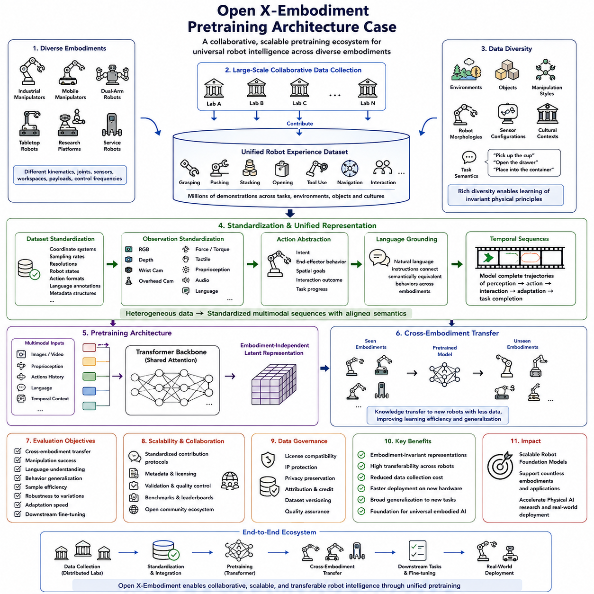{width="7.268055555555556in" height="7.268055555555556in"}

Open X-Embodiment has become one of the most influential case studies in Robot Foundation Model pretraining because it demonstrates how diverse robotic experiences collected from many independent institutions can be unified into a single scalable learning framework. Traditional robot learning systems were typically trained using demonstrations collected from one laboratory, one robot platform, or one narrowly defined task. Such specialized datasets produced models with strong performance within their original environments but poor transferability to new robots or unfamiliar tasks. Open X-Embodiment introduced a fundamentally different philosophy by treating robotic experience as a shared resource, enabling foundation models to learn from heterogeneous embodiments, sensing configurations, manipulation skills, environments, and task definitions simultaneously. This large-scale collaborative approach significantly improved generalization while establishing an important direction for future Physical AI research.

The central objective of Open X-Embodiment is to create a unified pretraining ecosystem capable of supporting robots with fundamentally different physical structures. Industrial manipulators, mobile manipulators, dual-arm systems, tabletop robots, research platforms, and service robots possess different kinematics, joint configurations, workspaces, payload capacities, sensors, and control frequencies. Instead of constructing separate models for every embodiment, the pretraining architecture seeks to learn abstract representations describing tasks, object interactions, physical dynamics, and behavioral intent independently of any single robot morphology. Such embodiment-invariant representations greatly improve knowledge transfer across robotic platforms while reducing the amount of task-specific retraining required for new hardware.

One of the most significant contributions of Open X-Embodiment lies in large-scale dataset aggregation. Rather than relying upon a single institution to collect millions of demonstrations, numerous research laboratories contribute independently collected robot experiences into a common data repository. These demonstrations include grasping, pushing, stacking, opening containers, manipulating deformable objects, tool usage, navigation, human interaction, and various household activities. Every participating laboratory contributes unique environmental diversity, hardware characteristics, sensor configurations, and manipulation strategies, substantially expanding the behavioral coverage available during pretraining.

Dataset standardization represents one of the greatest engineering challenges within the Open X-Embodiment architecture. Individual laboratories originally record demonstrations using different coordinate systems, sampling frequencies, image resolutions, robot state definitions, action parameterizations, language annotations, calibration procedures, and metadata structures. Before unified pretraining becomes possible, heterogeneous datasets must be transformed into standardized representations that preserve semantic consistency while eliminating unnecessary implementation differences. This normalization pipeline enables foundation models to interpret robot experiences originating from many institutions as components of one coherent multimodal dataset.

Observation standardization similarly plays a central role throughout pretraining. Individual robots may provide RGB images, depth observations, wrist cameras, overhead cameras, force sensors, tactile arrays, proprioceptive states, audio streams, or language instructions in different combinations. Rather than requiring identical sensing hardware across every robot, Open X-Embodiment introduces unified observation interfaces capable of representing partially available sensing modalities while preserving correspondence among synchronized multimodal observations. Such flexible observation encoding enables foundation models to exploit heterogeneous sensory experiences without discarding valuable information unique to particular robotic platforms.

Action representation presents another major architectural consideration. Robot embodiments frequently possess different numbers of joints, end-effector geometries, actuator characteristics, and motion constraints. Directly transferring joint commands between robots therefore becomes impractical. Open X-Embodiment instead encourages higher-level action abstractions describing manipulation intent, end-effector behavior, spatial goals, interaction outcomes, or task progress. By emphasizing semantic action representations rather than hardware-specific control signals, pretrained models become substantially more transferable across diverse embodiments.

Language grounding provides an additional mechanism for unifying heterogeneous demonstrations. Natural language instructions describe manipulation objectives independently of robot morphology, allowing semantically equivalent behaviors executed by different robots to become associated within a shared representation space. Instructions such as "pick up the cup," "open the drawer," or "place the object into the container" maintain identical semantic meaning regardless of embodiment differences. Language therefore functions as a universal supervisory signal connecting multiple robotic platforms through common task semantics rather than shared hardware architecture.

Temporal sequence modeling enables foundation models to capture complete manipulation behaviors rather than isolated observations. Robot demonstrations naturally consist of continuous sequences involving perception, planning, movement, contact, adaptation, and task completion. Open X-Embodiment pretraining therefore models entire behavioral trajectories while learning long-term temporal dependencies linking observations, actions, language, and environmental evolution. Such sequence-level representations substantially improve downstream planning, imitation learning, policy initialization, and autonomous skill acquisition across multiple robotic domains.

Transformer architectures have become particularly well suited for Open X-Embodiment because attention mechanisms naturally integrate heterogeneous multimodal sequences originating from many embodiments. Visual tokens, language embeddings, proprioceptive measurements, action histories, and temporal context become jointly processed through shared attention layers that gradually construct embodiment-independent latent representations. Large transformer backbones therefore provide sufficient modeling capacity to capture broad behavioral diversity while preserving transferable semantic structure across thousands of distinct robotic tasks.

Cross-embodiment transfer serves as one of the most important evaluation objectives within the Open X-Embodiment framework. Rather than measuring only performance on robots included during training, researchers evaluate whether representations learned from one collection of embodiments improve learning efficiency on previously unseen robotic platforms. Successful transfer demonstrates that pretrained representations encode general physical knowledge rather than memorizing embodiment-specific control policies. Such cross-platform generalization significantly reduces data collection requirements for newly developed robotic systems.

Data diversity proves equally important as dataset scale. Simply increasing the number of demonstrations collected from one robot provides diminishing returns because behavioral redundancy eventually dominates learning. Open X-Embodiment instead emphasizes diversity across environments, objects, manipulation styles, robot morphologies, sensing configurations, cultural contexts, and task semantics. Rich diversity encourages foundation models to discover invariant physical principles that remain applicable across broad classes of robotic experiences rather than overfitting individual datasets.

Distributed collaborative data collection further distinguishes Open X-Embodiment from conventional robot learning projects. Multiple institutions independently improve dataset quality while simultaneously expanding behavioral coverage unavailable within any single laboratory. Standardized contribution protocols, metadata specifications, licensing agreements, validation procedures, and benchmark definitions enable sustainable long-term dataset growth while preserving scientific reproducibility. This collaborative ecosystem resembles open-source software development, where collective community effort continuously strengthens foundation model capability over time.

Open X-Embodiment also demonstrates the practical importance of scalable data governance. As datasets expand across institutions and countries, issues including licensing compatibility, intellectual property protection, privacy preservation, contributor attribution, dataset versioning, and quality assurance become increasingly significant. Robust governance frameworks ensure that large collaborative robot datasets remain legally usable, scientifically reproducible, ethically responsible, and continuously maintainable throughout future foundation model development.

Evaluation within Open X-Embodiment extends beyond conventional benchmark accuracy. Researchers measure cross-embodiment transfer, manipulation success, language understanding, behavioral generalization, sample efficiency, robustness under environmental variation, adaptation speed, and downstream fine-tuning performance. Because the ultimate objective is broadly transferable embodied intelligence rather than narrow task optimization, evaluation emphasizes generalization across new robots, unfamiliar objects, unseen environments, and previously unobserved manipulation tasks.

Ultimately, Open X-Embodiment illustrates how collaborative large-scale pretraining can fundamentally reshape Robot Foundation Model development. By aggregating heterogeneous robotic experiences into standardized multimodal representations, separating semantic behavior from embodiment-specific control, and enabling knowledge transfer across diverse robotic platforms, the architecture provides a practical blueprint for scalable embodied intelligence. As Physical AI continues progressing toward increasingly universal robot foundation models capable of supporting countless embodiments and applications, the principles established by Open X-Embodiment will likely remain one of the foundational reference architectures guiding future large-scale robotic pretraining research.
