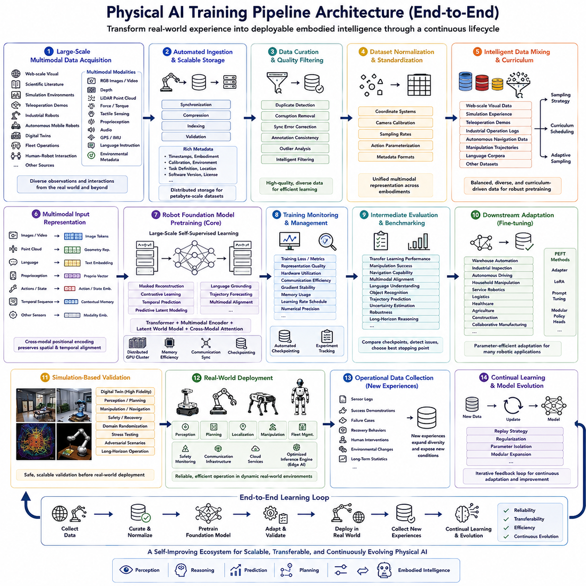
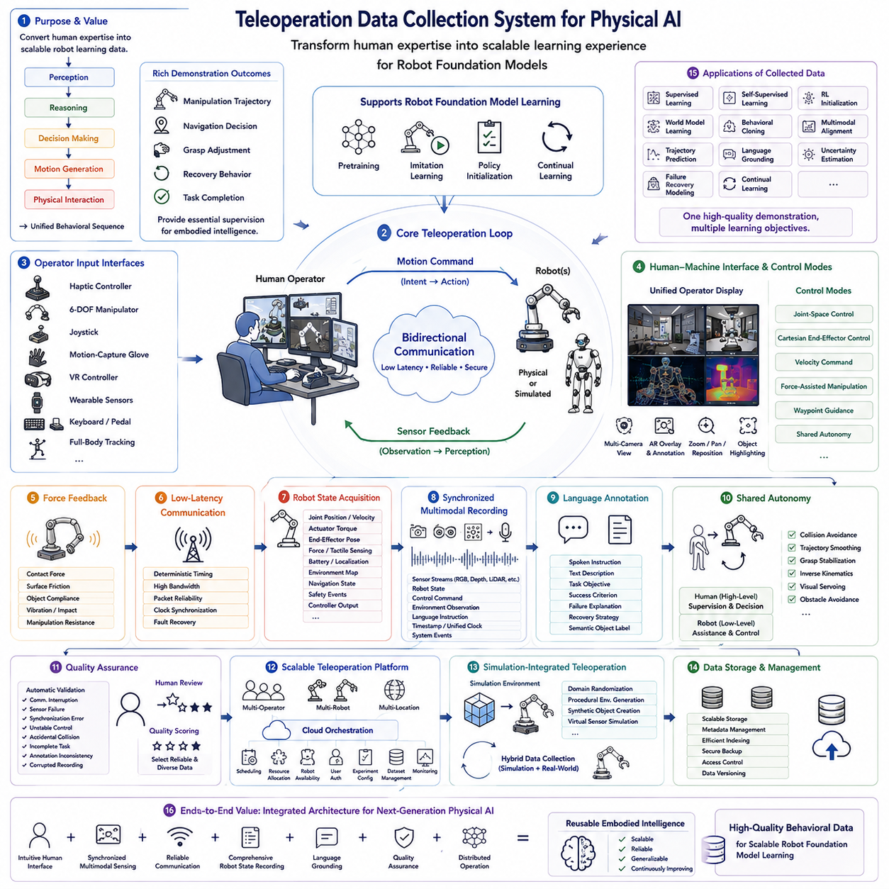
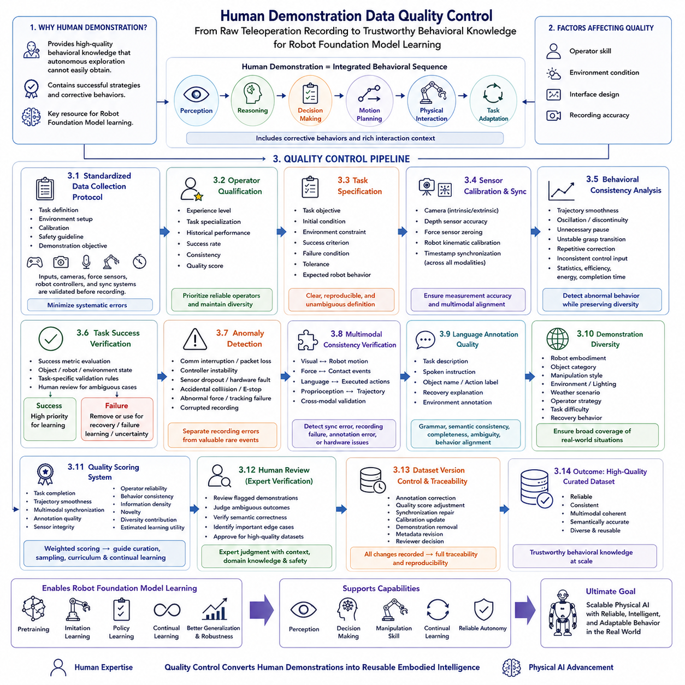
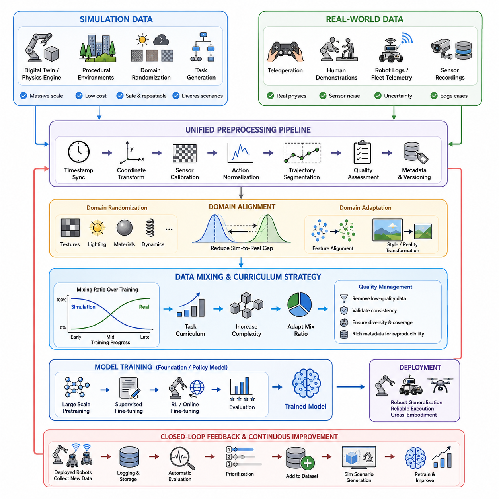
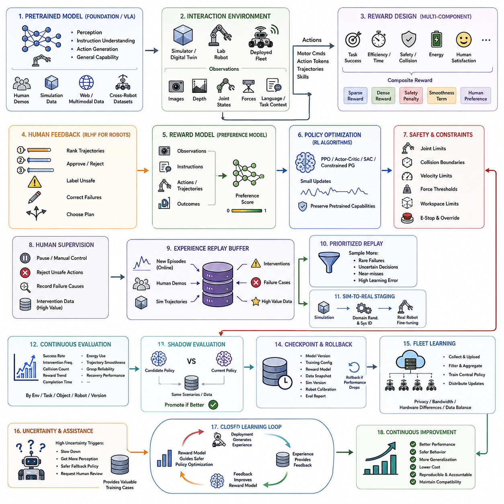
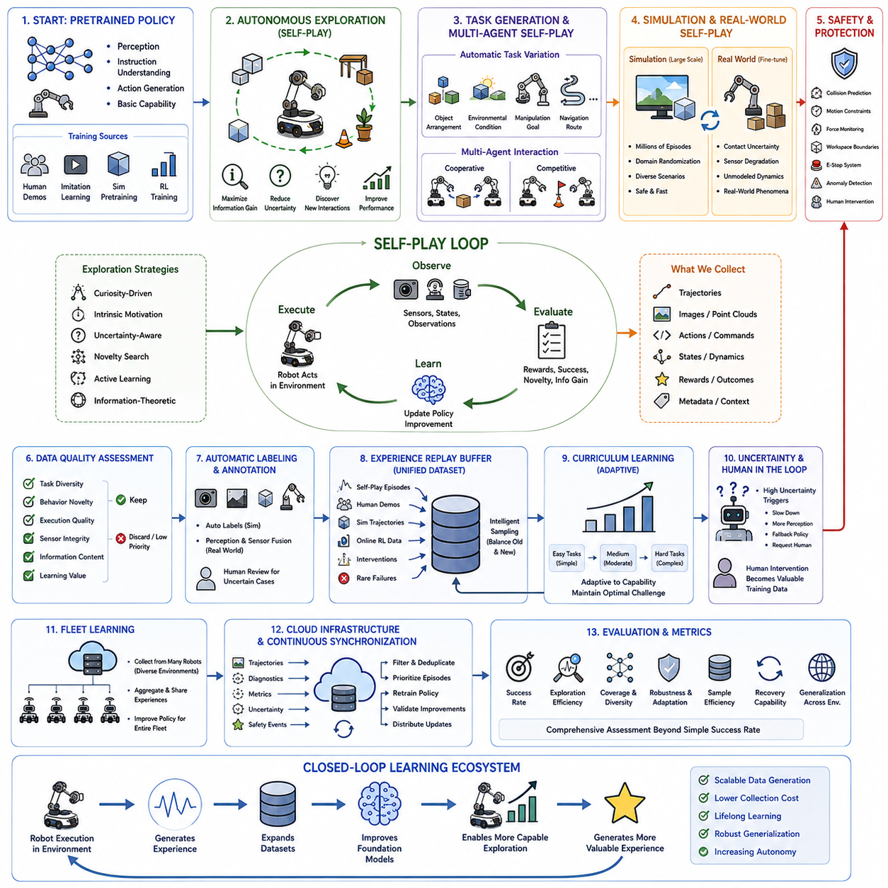
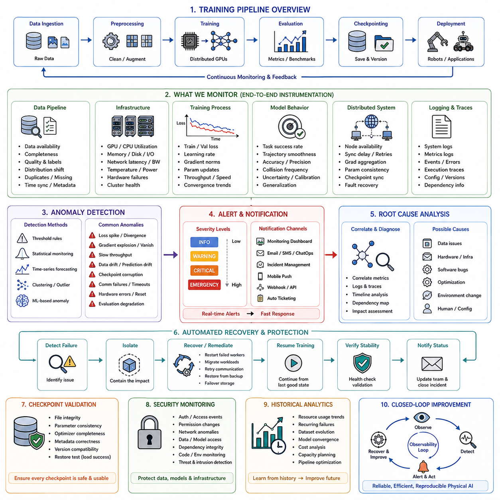
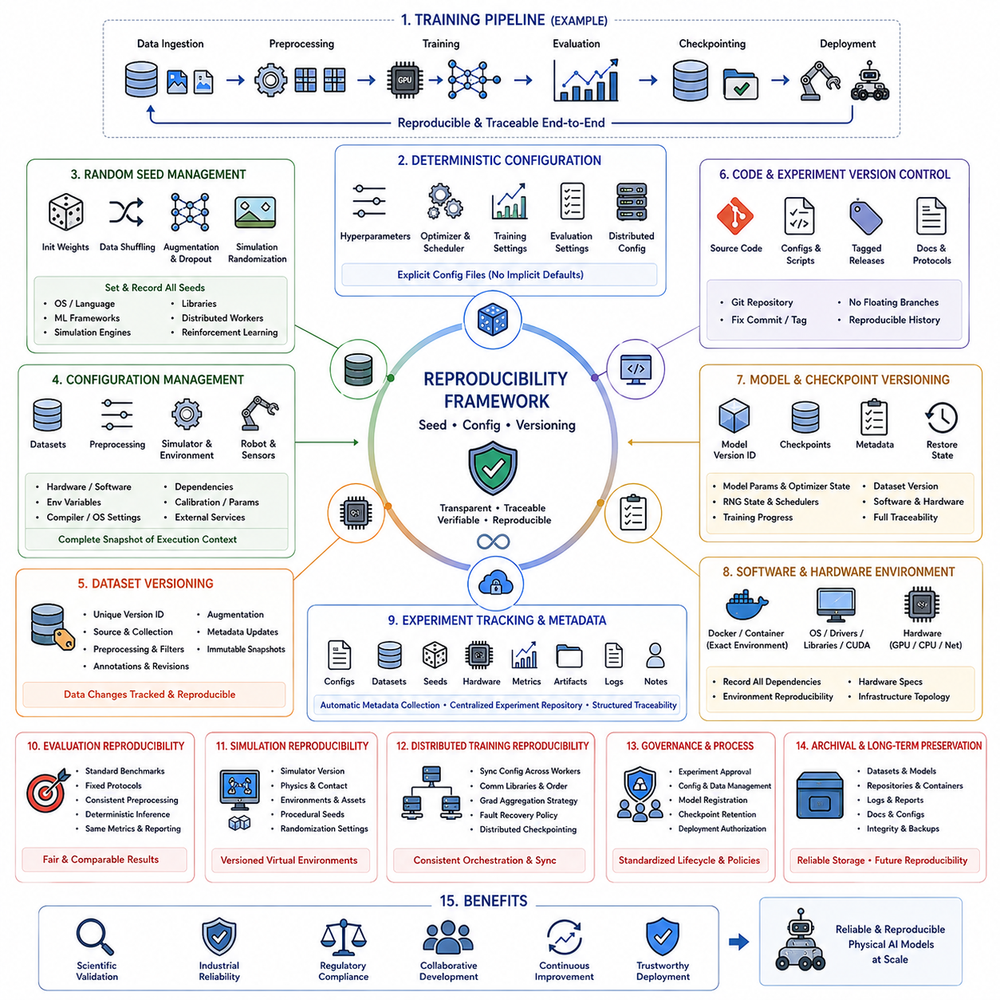
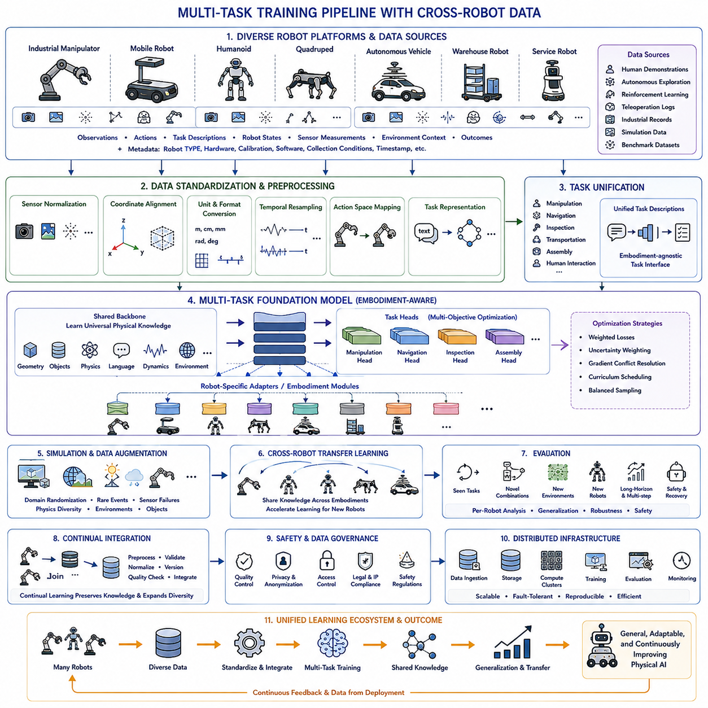
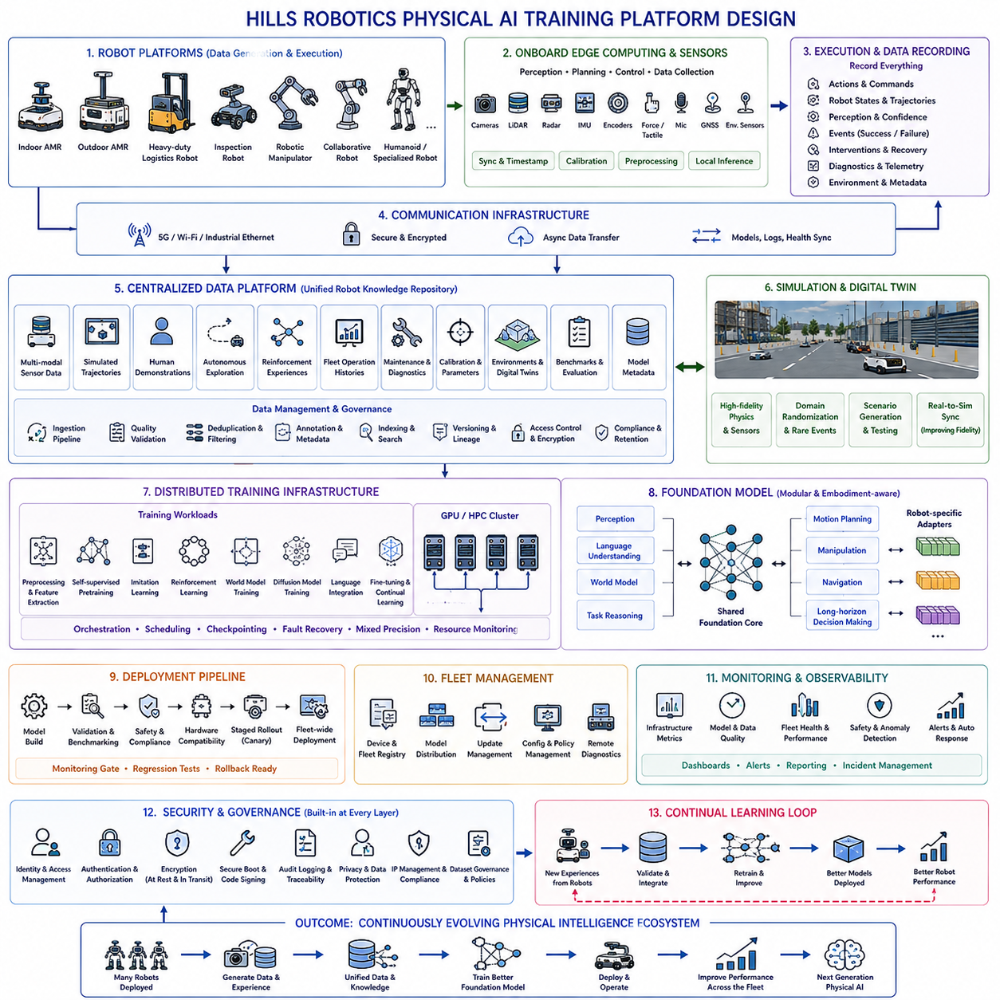

**Volume 18 Physical AI Foundation Models**

# 8. Physical AI Training Pipelines

## 8.1 Physical AI Training Pipeline Architecture E2E

{width="7.268055555555556in" height="7.268055555555556in"}

피지컬 AI(Physical AI) 학습은 개별적인 머신러닝(Machine Learning) 워크플로우(Workflow)를 넘어, 이질적인 실제 환경 경험(Real-World Experience)을 지속적으로 배포 가능한 체화 지능(Embodied Intelligence)으로 변환하는 종단 간(End-to-End) 파이프라인(Pipeline)으로 발전하였습니다. 정적인 데이터셋(Static Dataset)만을 기반으로 학습하는 기존 AI 시스템과 달리, 피지컬 AI는 멀티모달 센싱(Multimodal Sensing), 시뮬레이션(Simulation), 로봇 상호작용(Robot Interaction), 대규모 분산 학습(Large-Scale Distributed Training), 평가(Evaluation), 배포(Deployment), 지속학습(Continual Learning)을 하나의 통합된 수명주기(Lifecycle)로 연결합니다. 파이프라인의 각 단계는 로봇 파운데이션 모델(Robot Foundation Model)의 성능 향상에 직접적으로 기여하며, 새로운 로봇 경험이 축적될수록 인식(Perception), 추론(Reasoning), 예측(Prediction), 계획(Planning), 제어(Control)가 동시에 발전하도록 합니다. 따라서 전체 학습 파이프라인은 확장 가능한 체화 지능을 구현하기 위한 가장 중요한 아키텍처 기반 가운데 하나가 되었습니다.

파이프라인은 대규모 멀티모달 데이터 수집(Large-Scale Multimodal Data Acquisition) 단계에서 시작됩니다. 데이터는 웹 규모의 시각 자료(Web-Scale Visual Resource), 과학 문헌(Scientific Literature), 시뮬레이션 환경(Simulation Environment), 원격조작 시연(Teleoperation Demonstration), 산업용 로봇(Industrial Robot), 자율 이동 로봇(Autonomous Mobile Robot), 디지털 트윈(Digital Twin), 플릿 운영(Fleet Operation), 인간-로봇 상호작용(Human-Robot Interaction) 등 다양한 출처로부터 수집됩니다. 현대의 피지컬 AI 시스템은 RGB 이미지(RGB Image), 동영상(Video), 깊이 정보(Depth Observation), 라이다 포인트 클라우드(LiDAR Point Cloud), 힘 측정값(Force Measurement), 촉각 센싱(Tactile Sensing), 고유수용감각(Proprioception), 오디오(Audio), GPS, 관성측정장치(IMU), 언어 지시(Language Instruction), 환경 메타데이터(Environmental Metadata)를 하나의 통합된 멀티모달 데이터셋으로 결합합니다. 이러한 다양한 관측 정보는 파운데이션 모델이 단일 데이터 출처에서는 얻을 수 없는 방대한 객체, 환경, 행동, 상호작용 패턴을 학습할 수 있도록 하여 폭넓은 물리 지식을 제공합니다.

데이터가 수집되면 자동 데이터 수집 파이프라인(Automated Ingestion Pipeline)이 새로운 관측 데이터를 확장 가능한 저장 인프라(Scalable Storage Infrastructure)에 체계적으로 저장합니다. 원시 센서 스트림(Raw Sensor Stream)은 시간 동기화(Synchronization), 압축(Compression), 인덱싱(Indexing), 검증(Validation)을 수행하며, 타임스탬프(Timestamp), 로봇 형태(Robot Embodiment), 보정 파라미터(Calibration Parameter), 환경 조건(Environmental Condition), 작업 정의(Task Definition), 지역 정보(Geographic Location), 소프트웨어 버전(Software Version), 라이선스 정보(Licensing Information)와 같은 풍부한 메타데이터(Metadata)가 함께 저장됩니다. 분산 저장 시스템(Distributed Storage System)은 페타바이트(Petabyte) 규모의 데이터셋을 지원하면서도 사전학습에 필요한 특정 멀티모달 시퀀스를 효율적으로 검색할 수 있도록 합니다. 신뢰성 높은 데이터 수집은 이후 학습 단계가 완전하고 추적 가능하며 재현 가능한 데이터셋을 기반으로 수행되도록 보장합니다.

데이터 큐레이션(Data Curation)과 품질 필터링(Quality Filtering)은 원시 데이터를 신뢰할 수 있는 학습 자원으로 변환하는 단계입니다. 중복 탐지(Duplicate Detection)는 반복된 이미지와 중복 시연을 제거하고, 손상된 센서 기록(Corrupted Sensor Recording)은 삭제하며, 동기화 오류(Synchronization Error)를 수정하고, 주석 일관성(Annotation Consistency)을 검증하며, 통계적 이상치(Statistical Outlier)를 학습 데이터에 포함하기 전에 분석합니다. 또한 지능형 필터링(Intelligent Filtering)은 손상된 데이터와 실제로 가치 있는 희귀 사례(Rare Event)를 구분하면서도 다양한 작업(Task), 환경(Environment), 로봇 플랫폼(Robot Platform), 운영 조건(Operational Condition)에 대한 데이터 다양성을 유지합니다. 이러한 과정은 단순히 데이터의 양을 늘리는 것보다 훨씬 높은 학습 효율을 제공하며, 신중하게 큐레이션된 데이터는 파운데이션 모델의 성능을 크게 향상시킵니다.

데이터셋 정규화(Dataset Normalization)는 서로 다른 로봇 플랫폼 간에 일관된 표현을 구축합니다. 각 로봇은 서로 다른 좌표계(Coordinate System), 카메라 보정(Camera Calibration), 샘플링 주파수(Sampling Frequency), 행동 표현(Action Parameterization), 메타데이터 형식(Metadata Format)을 사용할 수 있습니다. 정규화 파이프라인은 이러한 이질적인 데이터를 하나의 통합된 멀티모달 표현(Unified Multimodal Representation)으로 변환하면서 의미적 관계(Semantic Relationship)와 시간적 일관성(Temporal Consistency)을 유지합니다. 이러한 표준화된 데이터셋은 로봇 파운데이션 모델이 특정 플랫폼의 구현 방식이 아니라 전이 가능한 물리 지식(Transferable Physical Knowledge)을 학습하도록 하며, 교차 엠보디먼트 일반화(Cross-Embodiment Generalization)를 크게 향상시킵니다.

정규화 이후에는 지능형 데이터 혼합(Intelligent Data Mixing)이 사전학습 동안 다양한 데이터셋이 어떻게 활용될지를 결정합니다. 웹 규모 시각 데이터(Web-Scale Visual Data), 시뮬레이션 경험(Simulation Experience), 원격조작 시연(Teleoperation Demonstration), 산업용 운영 로그(Industrial Operation Log), 자율주행 데이터(Autonomous Navigation Data), 조작 궤적(Manipulation Trajectory), 언어 코퍼스(Language Corpus)는 세심하게 설계된 샘플링 전략(Sampling Strategy)에 따라 함께 학습됩니다. 커리큘럼 스케줄링(Curriculum Scheduling)은 점차 더 복잡한 데이터를 제공하며, 적응형 샘플링(Adaptive Sampling)은 정보량이 높은 경험과 상대적으로 부족한 시나리오를 우선적으로 선택합니다. 이러한 데이터 혼합은 특정 데이터 분포에 대한 과적합을 방지하면서 다양한 로봇 능력을 균형 있게 학습하도록 합니다.

다음 단계에서는 파운데이션 모델 최적화에 적합한 멀티모달 입력 표현(Multimodal Input Representation)을 생성합니다. 시각 관측은 이미지 토큰(Image Token)으로, 언어 지시는 의미 임베딩(Semantic Embedding)으로, 포인트 클라우드(Point Cloud)는 기하학적 표현(Geometric Representation)으로, 로봇 상태(Robot State)는 고유수용감각 벡터(Proprioceptive Vector)로, 시간 시퀀스(Temporal Sequence)는 문맥 기억(Contextual Memory)으로, 센서 측정값은 센서별 특징 임베딩(Modality-Specific Feature Embedding)으로 변환됩니다. 또한 교차 모달 위치 인코딩(Cross-Modal Positional Encoding)은 서로 다른 센서 데이터 사이의 공간적 대응 관계(Spatial Correspondence)와 시간적 대응 관계(Temporal Correspondence)를 유지하여 모델이 다양한 센서 정보를 동시에 통합할 수 있도록 합니다.

로봇 파운데이션 모델 사전학습(Robot Foundation Model Pretraining)은 전체 파이프라인의 계산 중심부를 구성합니다. 대규모 트랜스포머(Transformer), 멀티모달 인코더(Multimodal Encoder), 잠재 월드 모델(Latent World Model), 교차 모달 어텐션(Cross-Modal Attention)은 수십억 개의 멀티모달 관측을 기반으로 자기지도학습(Self-Supervised Learning)을 수행하여 일반화된 표현을 학습합니다. 마스크 복원(Masked Reconstruction), 대조학습(Contrastive Learning), 시간 예측(Temporal Prediction), 잠재 예측 모델링(Predictive Latent Modeling), 언어 기반 의미 연결(Language Grounding), 궤적 예측(Trajectory Forecasting), 멀티모달 정렬(Multimodal Alignment)이 함께 최적화되어 의미 이해(Semantic Understanding), 물리 추론(Physical Reasoning), 환경 예측(Environmental Prediction), 전이 가능한 행동 지식(Transferable Behavioral Knowledge)을 동시에 학습합니다. 분산 GPU 클러스터(Distributed GPU Cluster)는 수주 또는 수개월 동안 지속적으로 최적화를 수행하면서 메모리 효율(Memory Efficiency), 통신 동기화(Communication Synchronization), 체크포인팅(Checkpointing), 장애 복구(Fault Tolerance)를 자동으로 관리합니다.

학습 과정에서는 지속적인 모니터링 시스템(Continuous Monitoring System)이 실시간으로 최적화 진행 상황을 평가합니다. 학습 손실(Training Loss), 검증 지표(Validation Metric), 표현 품질(Representation Quality), 하드웨어 활용률(Hardware Utilization), 통신 효율(Communication Efficiency), 그래디언트 안정성(Gradient Stability), 메모리 사용량(Memory Consumption), 학습률 스케줄(Learning Rate Schedule), 수치 정밀도(Numerical Precision)를 지속적으로 분석하여 계산 자원이 낭비되기 전에 최적화 문제를 발견합니다. 자동 체크포인트 관리(Automated Checkpoint Management)는 복구 가능한 모델 상태를 주기적으로 저장하며, 실험 추적 시스템(Experiment Tracking System)은 모든 학습 과정을 재현 가능하도록 관리합니다.

중간 평가(Intermediate Evaluation)는 사전학습이 완료되기 이전에도 로봇 파운데이션 모델의 성능을 지속적으로 측정합니다. 단순한 최적화 손실만이 아니라 전이학습 성능(Transfer Learning Performance), 조작 성공률(Manipulation Success), 이동 성능(Navigation Capability), 멀티모달 정렬(Multimodal Alignment), 언어 이해(Language Understanding), 객체 인식(Object Recognition), 궤적 예측(Trajectory Prediction), 불확실성 추정(Uncertainty Estimation), 강건성(Robustness), 장기 추론(Long-Horizon Reasoning)을 함께 평가합니다. 이러한 지속적인 벤치마크(Benchmark)는 다양한 체크포인트를 비교하고, 최적의 학습 종료 시점을 결정하며, 과적합이나 표현 붕괴(Representation Collapse)를 조기에 발견할 수 있도록 지원합니다.

파운데이션 모델 사전학습이 완료되면 다운스트림 적응(Downstream Adaptation)을 통해 범용 모델을 특정 로봇 응용 분야에 특화시킵니다. 창고 자동화(Warehouse Automation), 산업 검사(Industrial Inspection), 자율주행(Autonomous Driving), 가정용 조작(Household Manipulation), 서비스 로봇(Service Robotics), 물류(Logistics), 의료(Healthcare), 농업(Agriculture), 건설(Construction), 협업 제조(Collaborative Manufacturing) 등이 대표적인 적용 분야입니다. 어댑터(Adapter), 저랭크 적응(Low-Rank Adaptation), 프롬프트 튜닝(Prompt Tuning), 모듈형 정책 헤드(Modular Policy Head)와 같은 파라미터 효율적 적응(Parameter-Efficient Adaptation) 기법은 사전학습에서 획득한 지식을 유지하면서도 계산 비용을 크게 줄입니다. 따라서 하나의 파운데이션 모델이 적은 작업별 데이터만으로도 다양한 응용 분야를 효율적으로 지원할 수 있습니다.

시뮬레이션 기반 검증(Simulation-Based Validation)은 실제 로봇에 배포하기 전에 안전하게 성능을 검증하는 환경을 제공합니다. 디지털 트윈(Digital Twin)은 센서 구성(Sensor Configuration), 로봇 운동학(Robot Kinematics), 환경 동역학(Environmental Dynamics), 운영 시나리오(Operational Scenario)를 높은 정확도로 재현하여 인식, 계획, 조작, 이동, 안전성, 장애 복구 행동을 다양한 조건에서 평가할 수 있도록 합니다. 도메인 랜덤화(Domain Randomization), 스트레스 테스트(Stress Testing), 적대적 시나리오(Adversarial Scenario), 장기 자율 운용(Long-Horizon Autonomous Operation)은 실제 환경에 배포하기 전에 잠재적인 문제를 발견하고 운영 위험을 크게 줄여 줍니다.

실환경 배포(Real-World Deployment)는 검증된 모델을 실제 로봇 시스템에 적용하는 단계입니다. 최적화된 추론 엔진(Optimized Inference Engine)은 임베디드 AI 가속기(Embedded AI Accelerator)에서 파운데이션 모델을 실행하며, 인식, 계획, 위치추정(Localization), 조작, 플릿 관리(Fleet Management), 안전 모니터링(Safety Monitoring), 통신 인프라(Communication Infrastructure), 클라우드 서비스(Cloud Service)를 함께 통합합니다. 실행 환경 최적화(Runtime Optimization)는 지연 시간(Latency), 메모리 사용량, 전력 소비, 계산 부하를 줄이면서도 변화하는 환경에서 신뢰성 있는 의사결정을 유지하도록 합니다. 이 단계는 대규모 오프라인 학습(Offline Learning)을 실제 체화 지능으로 전환하는 과정입니다.

운영 중인 로봇은 지속적으로 새로운 경험(New Experience)을 생성하며, 이는 향후 학습을 위한 중요한 데이터 자원이 됩니다. 센서 로그(Sensor Log), 성공 사례(Successful Demonstration), 실패 사례(Failure Case), 복구 행동(Recovery Behavior), 사람의 개입(Human Intervention), 환경 변화(Environmental Change), 장기 운영 통계(Long-Term Operational Statistics)는 배포 과정에서 자동으로 수집됩니다. 이러한 새로운 경험은 데이터셋의 다양성을 확장하고 기존 학습 과정에서는 경험하지 못했던 새로운 상황을 모델에 제공함으로써 로봇의 능력을 지속적으로 향상시킵니다.

지속학습(Continual Learning)은 새롭게 수집된 로봇 경험을 다음 사전학습 과정에 다시 통합함으로써 종단 간 학습 루프(End-to-End Training Loop)를 완성합니다. 전체 모델을 처음부터 다시 학습하는 대신, 리플레이 전략(Replay Strategy), 정규화 기법(Regularization Technique), 파라미터 분리(Parameter Isolation), 모듈 확장(Modular Expansion) 등을 이용하여 기존 지식을 유지하면서 새로운 경험을 점진적으로 반영합니다. 이러한 반복적인 피드백 순환(Iterative Feedback Cycle)은 환경(Environment), 하드웨어(Hardware), 운영 요구사항(Operational Requirement), 물리적 상호작용(Physical Interaction)이 변화하더라도 로봇 파운데이션 모델이 지속적으로 적응하고 발전할 수 있도록 합니다.

궁극적으로 피지컬 AI 학습 파이프라인(Physical AI Training Pipeline)은 여러 개의 독립적인 머신러닝 단계가 아니라 지속적으로 동작하는 하나의 통합 생태계(Integrated Ecosystem)를 구성합니다. 대규모 데이터 수집(Large-Scale Data Acquisition), 지능형 데이터 큐레이션(Intelligent Data Curation), 멀티모달 표현 학습(Multimodal Representation Learning), 분산 사전학습(Distributed Pretraining), 체계적인 평가(Systematic Evaluation), 다운스트림 적응(Downstream Adaptation), 시뮬레이션 검증(Simulation Validation), 실환경 배포(Real-World Deployment), 운영 데이터 수집(Operational Data Collection), 지속학습(Continual Learning)은 서로 긴밀하게 연결되어 스스로 발전(Self-Improving)하는 체화 지능 아키텍처를 형성합니다. 앞으로 로봇 파운데이션 모델이 더욱 범용적인 피지컬 AI 시스템으로 확장됨에 따라, 견고한 종단 간 학습 파이프라인 아키텍처는 신뢰성(Reliability), 전이성(Transferability), 효율성(Efficiency), 지속적인 진화(Continuous Evolution)를 지원하는 가장 핵심적인 기반 기술로 계속 발전해 나갈 것입니다.

## 8.2 Teleoperation Data Collection System Design [w/Code]

{width="7.268055555555556in" height="7.268055555555556in"}

원격조작(Teleoperation)은 인간 전문가(Human Expertise)의 지식을 직접 로봇 파운데이션 모델(Robot Foundation Model)을 위한 확장 가능한 학습 경험(Scalable Learning Experience)으로 변환할 수 있기 때문에, 고품질 로봇 학습 데이터(Robot Training Data)를 수집하는 가장 중요한 기술 가운데 하나가 되었습니다. 단순히 사람이 레이블(Label)을 부여한 이미지 데이터셋과 달리, 원격조작 시연(Teleoperation Demonstration)은 인식(Perception), 추론(Reasoning), 의사결정(Decision Making), 동작 생성(Motion Generation), 물리적 상호작용(Physical Interaction)을 하나의 일관된 행동 시퀀스(Behavioral Sequence)로 자연스럽게 결합합니다. 전문가 조작자가 수행하는 모든 조작 궤적(Manipulation Trajectory), 이동 결정(Navigation Decision), 그립 조정(Grasp Adjustment), 복구 행동(Recovery Behavior), 작업 완료(Task Completion)는 체화 지능(Embodied Intelligence)을 학습하기 위한 중요한 지도 정보(Supervision)를 제공합니다. 따라서 현대의 피지컬 AI(Physical AI) 시스템은 로봇 파운데이션 모델 사전학습(Pretraining), 모방학습(Imitation Learning), 정책 초기화(Policy Initialization), 지속학습(Continual Learning)을 지원하기 위해 대규모 원격조작 플랫폼(Large-Scale Teleoperation Platform)에 점점 더 의존하고 있습니다.

원격조작 데이터 수집 시스템(Teleoperation Data Collection System)은 사람 조작자(Human Operator)와 하나 이상의 실제 또는 시뮬레이션 로봇(Physical or Simulated Robot)을 연결하는 여러 개의 긴밀하게 통합된 하위 시스템(Sub-System)으로 구성됩니다. 조작자는 햅틱 컨트롤러(Haptic Controller), 6자유도 조작기(Six-Degree-of-Freedom Manipulator), 조이스틱(Joystick), 모션 캡처 장갑(Motion-Capture Glove), VR 컨트롤러(VR Controller), 웨어러블 센서(Wearable Sensor), 키보드(Keyboard), 페달(Pedal), 전신 추적 시스템(Full-Body Tracking System)과 같은 입력 장치(Input Device)를 사용하여 로봇을 제어합니다. 이러한 인터페이스는 사람의 의도(Human Intention)를 지속적으로 측정하면서 조작 명령(Motion Command)을 로봇 매니퓰레이터(Robot Manipulator), 이동형 플랫폼(Mobile Platform), 휴머노이드(Humanoid), 기타 체화 시스템(Embodied System)으로 전달합니다. 동시에 양방향 통신(Bidirectional Communication)은 로봇의 센서 피드백(Sensory Feedback)을 다시 조작자에게 전달하여 원격 환경(Remote Environment)에서 정밀한 폐루프 제어(Closed-Loop Control)를 가능하게 합니다.

인간-기계 인터페이스(Human-Machine Interface) 설계는 시연(Demonstration)의 품질을 직접 결정합니다. 인체공학적 컨트롤러(Ergonomic Controller)는 장시간 데이터 수집 과정에서 조작자의 피로를 줄여 주며, 사람의 움직임(Human Motion)과 로봇 움직임(Robot Motion) 사이의 직관적인 매핑(Mapping)은 행동의 일관성(Behavioral Consistency)을 향상시킵니다. 현대의 원격조작 시스템은 관절 공간 제어(Joint-Space Control), 직교 좌표 엔드이펙터 제어(Cartesian End-Effector Control), 속도 명령(Velocity Command), 힘 보조 조작(Force-Assisted Manipulation), 웨이포인트 안내(Waypoint Guidance), 공유 자율성(Shared Autonomy) 등 다양한 제어 모드(Control Mode)를 자유롭게 전환할 수 있도록 지원합니다. 이러한 유연성은 단순 반복 작업부터 고난도의 정밀 조작(Dexterous Manipulation)까지 폭넓은 시연 데이터를 효율적으로 수집할 수 있도록 합니다.

시각 피드백(Visual Feedback)은 조작자의 상황 인식(Situational Awareness)을 지원하는 가장 중요한 정보 채널입니다. 현대의 원격조작 시스템은 여러 대의 RGB 카메라(RGB Camera), 스테레오 비전(Stereo Vision), 깊이 센서(Depth Sensor), 손목 장착 카메라(Wrist-Mounted Camera), 파노라마 카메라(Panoramic Camera), 열화상 카메라(Thermal Imager), 3차원 재구성 화면(Three-Dimensional Reconstruction View)을 하나의 통합된 조작자 화면(Unified Operator Display)으로 제공합니다. 다중 카메라 시각화(Multi-Camera Visualization)는 조작 중 발생하는 가림(Occlusion)을 최소화하면서 작업 공간 전체를 효과적으로 파악할 수 있도록 합니다. 또한 가상 카메라 이동(Virtual Camera Repositioning), 확대 기능(Zoom Function), 객체 강조(Object Highlighting), 의미 정보 오버레이(Semantic Overlay), 증강현실 주석(Augmented Reality Annotation)은 복잡한 작업 환경에서도 조작자의 이해도를 크게 향상시킵니다.

힘 피드백(Force Feedback)과 햅틱 상호작용(Haptic Interaction)은 로봇이 실제 물체와 접촉하는 작업에서 시연의 현실성을 크게 향상시킵니다. 햅틱 장치(Haptic Device)는 접촉력(Contact Force), 표면 마찰(Surface Friction), 물체의 탄성(Object Compliance), 진동(Vibration), 충격(Impact Event), 조작 저항(Manipulation Resistance)을 조작자에게 그대로 전달합니다. 따라서 조작자는 단순히 시각 정보만이 아니라 촉각 정보(Tactile Information)를 이용하여 그립 강도(Grasp Strength), 삽입 힘(Insertion Force), 정렬 정확도(Alignment Precision), 접촉 시점(Contact Timing)을 자연스럽게 조절할 수 있습니다. 이러한 고품질 햅틱 피드백은 사람의 물리적 추론(Physical Reasoning)과 정밀 조작 전략(Dexterous Interaction Strategy)을 더욱 정확하게 반영하는 시연 데이터를 생성하도록 도와줍니다.

저지연 통신 인프라(Low-Latency Communication Infrastructure)는 고품질 원격조작을 위한 필수 요소입니다. 조작 명령(Motion Command), 영상 스트림(Video Stream), 힘 피드백(Force Feedback), 로봇 상태(Robot State), 동기화 메시지(Synchronization Message)는 매우 짧은 지연 시간(Latency)으로 지속적으로 교환되어야 안정적인 폐루프 제어가 가능합니다. 따라서 통신 네트워크(Communication Network)는 결정론적 타이밍(Deterministic Timing), 높은 대역폭(High Bandwidth), 패킷 신뢰성(Packet Reliability), 시계 동기화(Clock Synchronization), 장애 복구(Fault Recovery)를 중요하게 고려하여 설계됩니다. 또한 엣지 컴퓨팅(Edge Computing)은 센서 융합(Sensor Fusion), 인식(Perception), 압축(Compression), 제어(Control)를 로봇 근처에서 먼저 처리하여 통신 지연을 더욱 줄여 줍니다.

로봇 상태 수집(Robot State Acquisition)은 원격조작 데이터 수집의 또 다른 핵심 구성 요소입니다. 모든 시연에는 관절 위치(Joint Position), 관절 속도(Joint Velocity), 액추에이터 토크(Actuator Torque), 엔드이펙터 자세(End-Effector Pose), 힘 측정값(Force Measurement), 촉각 센싱(Tactile Sensing), 배터리 상태(Battery Status), 위치 추정(Localization Estimate), 환경 지도(Environmental Map), 이동 상태(Navigation State), 안전 이벤트(Safety Event), 제어기 출력(Controller Output)이 조작자의 명령과 함께 동시에 기록됩니다. 이러한 종합적인 시스템 상태(System State)는 파운데이션 모델이 인식, 로봇 구성, 환경 변화, 조작 의도, 실제 물리 행동 사이의 관계를 완전하게 학습할 수 있도록 지원합니다.

동기화된 멀티모달 기록(Synchronized Multimodal Recording)은 현대 원격조작 데이터셋의 가장 중요한 특징 가운데 하나입니다. 모든 센서 스트림(Sensor Stream), 로봇 상태(Robot State), 제어 명령(Control Command), 환경 관측(Environmental Observation), 언어 지시(Language Instruction), 타임스탬프(Timestamp), 시스템 이벤트(System Event)는 하나의 통합된 시간 기준(Unified Temporal Reference Frame)에 정확하게 정렬됩니다. 이러한 고정밀 동기화는 시각 관측(Visual Observation), 실행된 행동(Action), 힘 측정값(Force Measurement), 조작자의 의사결정이 완전히 일치하도록 보장합니다. 정확한 시간 정렬은 자기지도학습(Self-Supervised Learning), 멀티모달 융합(Multimodal Fusion), 월드 모델(World Model), 정책 학습(Policy Learning)의 성능을 좌우하는 매우 중요한 요소입니다.

언어 주석(Language Annotation)은 원격조작 시연의 장기적인 활용 가치를 크게 향상시킵니다. 조작자는 시연 과정에서 음성 지시(Spoken Instruction), 텍스트 설명(Textual Description), 작업 목표(Task Objective), 성공 기준(Success Criterion), 실패 원인(Failure Explanation), 복구 전략(Recovery Strategy), 객체 의미 레이블(Semantic Object Label)을 함께 기록할 수 있습니다. 자동 음성 인식(Automatic Speech Recognition)과 언어 처리(Language Processing)는 이러한 언어 정보를 로봇의 관측과 행동에 정확하게 동기화합니다. 이를 통해 로봇 파운데이션 모델은 자연어(Natural Language)와 실제 물리 행동(Physical Behavior)을 연결할 수 있으며, 명령 이해(Instruction Following), 의미 기반 계획(Semantic Planning), 설명 가능한 의사결정(Explainable Decision Making), 교차 모달 추론(Cross-Modal Reasoning)을 수행할 수 있습니다.

공유 자율성(Shared Autonomy)은 사람의 지능(Human Intelligence)과 로봇의 자율 기능(Autonomous Robotic Assistance)을 결합하여 원격조작의 효율성을 크게 향상시킵니다. 조작자는 모든 저수준 동작(Low-Level Motion)을 직접 제어하는 대신, 상위 수준의 작업 목표(High-Level Objective)에 집중하고, 충돌 회피(Collision Avoidance), 궤적 평활화(Trajectory Smoothing), 그립 안정화(Grasp Stabilization), 역기구학(Inverse Kinematics), 비주얼 서보잉(Visual Servoing), 장애물 회피(Obstacle Avoidance)는 로봇이 자동으로 수행합니다. 이러한 협업 방식은 장시간 데이터 수집 과정에서도 조작자의 피로를 줄이고 시연의 일관성을 높여 줍니다.

품질 보증(Quality Assurance) 시스템은 수집된 시연이 파운데이션 모델 학습 데이터셋에 포함되기 전에 신뢰성을 지속적으로 평가합니다. 자동 검증(Automatic Validation)은 통신 장애(Communication Interruption), 센서 고장(Sensor Failure), 동기화 오류(Synchronization Error), 불안정한 제어(Unstable Control Behavior), 충돌(Accidental Collision), 불완전한 작업 수행(Incomplete Task Execution), 주석 불일치(Annotation Inconsistency), 손상된 기록(Corrupted Recording)을 자동으로 탐지합니다. 이후 사람 검토자(Human Reviewer)는 불확실한 시연을 확인하고, 품질 점수(Quality Score) 시스템은 성공적이고 정보량이 많으며 다양한 시연을 우선적으로 선택합니다. 이러한 검증 과정은 파운데이션 모델이 오류가 있는 시연이 아니라 신뢰할 수 있는 행동 예제(Reliable Behavioral Example)로부터 학습하도록 보장합니다.

확장 가능한 원격조작 플랫폼(Scalable Teleoperation Platform)은 여러 명의 조작자와 여러 대의 로봇이 서로 다른 지역에서 동시에 데이터 수집을 수행할 수 있도록 지원합니다. 클라우드 기반 오케스트레이션(Cloud-Based Orchestration)은 시연 일정(Demonstration Scheduling), 자원 할당(Resource Allocation), 로봇 가용성(Robot Availability), 사용자 인증(User Authentication), 실험 구성(Experiment Configuration), 데이터셋 관리(Dataset Management), 지속적인 모니터링(Continuous Monitoring)을 중앙에서 관리합니다. 이러한 분산 인프라(Distributed Infrastructure)는 연구소, 산업 현장, 대학, 상용 로봇 기업이 하나의 통합 데이터 생태계(Unified Data Ecosystem)에서 협력하여 대규모 데이터 수집을 수행할 수 있도록 합니다.

시뮬레이션 기반 원격조작(Simulation-Integrated Teleoperation)은 운영 비용과 하드웨어 위험을 줄이면서 학습 데이터를 크게 확장합니다. 조작자는 실제 로봇에 적용하기 전에 물리적으로 현실적인 시뮬레이션 환경(Physically Realistic Simulation Environment)에서 먼저 시연을 수행합니다. 도메인 랜덤화(Domain Randomization), 절차적 환경 생성(Procedural Environment Generation), 합성 객체 생성(Synthetic Object Creation), 가상 센서 시뮬레이션(Virtual Sensor Simulation)은 실제 로봇만으로는 수집하기 어려운 매우 다양한 작업(Task)을 제공합니다. 따라서 시뮬레이션과 실제 원격조작을 결합한 하이브리드 데이터 수집(Hybrid Data Collection)은 로봇 파운데이션 모델 사전학습을 위한 풍부한 멀티모달 경험을 제공합니다.

수집된 시연은 단순한 모방학습(Imitation Learning)을 넘어 다양한 AI 학습 방식에서 활용됩니다. 원격조작 데이터셋은 지도학습(Supervised Learning), 자기지도학습(Self-Supervised Representation Learning), 강화학습 초기화(Reinforcement Learning Initialization), 월드 모델 학습(World Model Training), 행동 복제(Behavioral Cloning), 멀티모달 정렬(Multimodal Alignment), 궤적 예측(Trajectory Prediction), 언어 기반 의미 연결(Language Grounding), 불확실성 추정(Uncertainty Estimation), 장애 복구 모델링(Failure Recovery Modeling), 지속학습(Continual Learning)을 모두 지원합니다. 따라서 하나의 고품질 시연은 피지컬 AI 개발 파이프라인 전체에서 다양한 학습 목적(Learning Objective)에 동시에 활용될 수 있는 매우 가치 있는 자산이 됩니다.

궁극적으로 원격조작 데이터 수집 시스템 설계(Teleoperation Data Collection System Design)는 차세대 로봇 파운데이션 모델을 위한 핵심 인프라 기술입니다. 직관적인 인간 인터페이스(Intuitive Human Interface), 동기화된 멀티모달 센싱(Synchronized Multimodal Sensing), 신뢰성 높은 통신(Reliable Communication), 완전한 로봇 상태 기록(Comprehensive Robot State Recording), 언어 기반 의미 연결(Language Grounding), 품질 보증(Quality Assurance), 분산 운영(Distributed Operation), 확장 가능한 데이터셋 관리(Scalable Dataset Management)를 하나의 통합 아키텍처로 결합함으로써, 원격조작 플랫폼은 인간의 전문 지식을 재사용 가능한 체화 지능(Reusable Embodied Intelligence)으로 변환합니다. 앞으로 피지컬 AI가 더욱 범용적인 자율 로봇으로 발전하고 다양한 멀티모달 경험으로부터 지속적으로 학습하게 될수록, 정교한 원격조작 시스템은 확장 가능한 로봇 파운데이션 모델 학습을 위한 고품질 행동 데이터(High-Quality Behavioral Data)를 생성하는 가장 중요한 기반 기술 가운데 하나로 계속 자리 잡게 될 것입니다.

## 8.3 Human Demonstration Data Quality Control [w/Code]

{width="7.268055555555556in" height="7.268055555555556in"}

인간 시연(Human Demonstration)은 자율 탐색(Autonomous Exploration)만으로는 얻기 어려운 고품질 행동 지식(Behavioral Knowledge)을 제공하기 때문에 현대 로봇 파운데이션 모델(Robot Foundation Model)의 핵심 학습 자원으로 활용됩니다. 인간 조작자는 실제 문제를 해결하는 과정에서 인식(Perception), 추론(Reasoning), 의사결정(Decision Making), 동작 계획(Motion Planning), 물리적 상호작용(Physical Interaction), 작업 적응(Task Adaptation)을 하나의 일관된 행동 시퀀스(Behavioral Sequence)로 자연스럽게 통합합니다. 이러한 시연은 성공적인 작업 수행 전략뿐 아니라 미세한 보정 동작(Corrective Behavior)까지 함께 포함하여 자동으로 생성된 데이터셋에서는 얻기 어려운 풍부한 정보를 제공합니다. 그러나 시연 품질은 조작자의 숙련도(Operator Skill), 환경 조건(Environmental Condition), 인터페이스 설계(Interface Design), 기록 정확도(Recording Accuracy)에 따라 크게 달라질 수 있습니다. 따라서 인간 시연 데이터 품질 관리(Human Demonstration Data Quality Control)는 피지컬 AI(Physical AI) 데이터 엔지니어링(Data Engineering)의 핵심 요소로 자리 잡았으며, 신뢰성 있고 정보량이 높은 시연만이 대규모 사전학습(Pretraining)과 다운스트림 정책 학습(Downstream Policy Learning)에 활용되도록 보장합니다.

품질 관리는 시연이 시작되기 이전부터 표준화된 데이터 수집 프로토콜(Standardized Data Collection Protocol)을 수립하는 것에서 시작됩니다. 조작자는 일관된 작업 정의(Task Definition), 환경 준비 절차(Environment Preparation Procedure), 보정(Calibration) 방법, 안전 지침(Safety Guideline), 시연 목표(Demonstration Objective)를 제공받습니다. 입력 장치(Input Device), 카메라(Camera), 힘 센서(Force Sensor), 로봇 제어기(Robot Controller), 동기화 시스템(Synchronization System)은 모든 기록 전에 검증되어 시스템적인 오류(Systematic Error)를 최소화합니다. 이러한 표준 운영 절차(Standard Operating Procedure)는 서로 다른 연구소, 조작자, 로봇 플랫폼에서 수집된 시연 간의 편차를 줄이고 대규모 학습에 적합한 일관성을 유지하도록 지원합니다.

조작자 자격(Operator Qualification)은 시연 품질을 결정하는 가장 중요한 요소 가운데 하나입니다. 숙련된 조작자는 일반적으로 더 부드러운 궤적(Smoother Trajectory), 효율적인 조작 전략(Manipulation Strategy), 우수한 복구 행동(Recovery Behavior), 높은 작업 성공률(Task Success Rate)을 제공합니다. 현대 원격조작 플랫폼(Teleoperation Platform)은 조작자의 경험 수준(Experience Level), 작업 전문성(Task Specialization), 과거 성능(Historical Performance), 성공률(Success Rate), 시연 일관성(Demonstration Consistency), 품질 점수(Quality Score)를 지속적으로 관리합니다. 이러한 정보는 데이터셋 관리자가 신뢰도가 높은 조작자의 시연을 우선적으로 활용하면서도 필요한 경우 다양한 행동 패턴을 유지하기 위해 초보자의 시연도 적절히 포함할 수 있도록 합니다.

작업 명세(Task Specification)는 명확하고 재현 가능하게 정의되어야 합니다. 모든 시연은 작업 목표(Task Objective), 초기 조건(Initial Condition), 환경 제약(Environmental Constraint), 성공 기준(Success Criterion), 실패 조건(Failure Condition), 허용 오차(Acceptable Tolerance), 기대되는 로봇 행동(Expected Robot Behavior)을 분명하게 포함해야 합니다. 모호한 작업 정의는 동일한 목표에 대해 서로 다른 해결 방법을 제시하는 일관성 없는 시연을 생성하여 학습 알고리즘을 혼란스럽게 만들 수 있습니다. 반대로 명확한 작업 정의는 행동의 일관성을 높이면서도 의도된 전략적 다양성과 단순한 조작자 편차를 구분할 수 있도록 지원합니다.

센서 보정(Sensor Calibration)은 기록된 시연의 신뢰성을 직접 결정합니다. 카메라는 내부 보정(Intrinsic Calibration)과 외부 보정(Extrinsic Calibration)이 정확해야 하며, 깊이 센서(Depth Sensor)는 거리 측정 정확도를 유지해야 하고, 힘 센서(Force Sensor)는 주기적으로 영점 보정(Zero-Point Calibration)을 수행해야 합니다. 또한 로봇 운동학 보정(Robot Kinematic Calibration)은 엔드이펙터(End-Effector)의 위치 정확도를 보장합니다. 카메라, 로봇 상태(Robot State), 힘 측정값(Force Measurement), 촉각 센싱(Tactile Sensing), 오디오(Audio), 조작자 명령(Operator Command) 사이의 타임스탬프 동기화(Timestamp Synchronization)는 기록 전체에서 정확하게 유지되어야 합니다. 작은 보정 오차나 동기화 오류도 누적되면 멀티모달 정렬(Multimodal Alignment)의 품질을 크게 저하시킬 수 있습니다.

행동 일관성 분석(Behavioral Consistency Analysis)은 시연이 물리적으로 타당하고 일관된 행동 순서를 따르는지를 평가합니다. 동작 궤적(Motion Trajectory)은 과도한 진동(Oscillation), 급격한 불연속성(Discontinuity), 불필요한 정지(Unnecessary Pause), 불안정한 그립 전환(Unstable Grasp Transition), 반복적인 보정 동작(Repetitive Corrective Motion), 일관되지 않은 제어 입력(Control Input)을 기준으로 분석됩니다. 통계적 궤적 분석(Statistical Trajectory Analysis), 부드러움 지표(Smoothness Metric), 에너지 소비(Energy Consumption), 경로 효율(Path Efficiency), 작업 완료 시간(Task Completion Time)은 정상적인 조작 패턴에서 크게 벗어난 시연을 식별하는 데 활용됩니다. 자연스러운 행동 다양성은 유지하되 명백히 비정상적인 시연은 추가 검토 대상으로 분류됩니다.

작업 성공 검증(Task Success Verification)은 성공적으로 완료된 시연과 실패한 시도를 구분합니다. 완료 여부는 미리 정의된 성공 지표(Success Metric), 객체 상태(Object State), 로봇 구성(Robot Configuration), 환경 조건(Environmental Condition), 작업별 검증 규칙(Task-Specific Validation Rule)을 이용하여 자동으로 평가됩니다. 자동 평가만으로 판단하기 어려운 경우에는 사람 검토자(Human Reviewer)가 추가로 확인합니다. 성공한 시연은 학습에서 높은 우선순위를 가지며, 실패한 시연은 제거되거나 장애 복구(Failure Recovery), 실패 예측(Failure Prediction), 불확실성 추정(Uncertainty Estimation)을 학습하기 위한 별도의 데이터셋으로 활용될 수 있습니다.

이상 탐지(Anomaly Detection) 알고리즘은 시연 기록 과정에서 발생하는 예기치 않은 사건을 지속적으로 감시합니다. 통신 중단(Communication Interruption), 패킷 손실(Packet Loss), 제어기 불안정(Controller Instability), 센서 누락(Sensor Dropout), 하드웨어 고장(Hardware Malfunction), 우발적 충돌(Accidental Collision), 비상 정지(Emergency Stop), 비정상적인 힘 변화(Abnormal Force Peak), 추적 실패(Tracking Failure), 손상된 기록(Corrupted Recording)은 통계적 모니터링과 머신러닝 기법을 통해 자동으로 탐지됩니다. 품질 관리 시스템은 모든 이상 사례를 제거하는 것이 아니라 기록 오류와 실제로 가치 있는 희귀 사례(Rare Event)를 구분하여 강건성(Robustness) 향상에 도움이 되는 데이터는 유지합니다.

멀티모달 일관성 검증(Multimodal Consistency Verification)은 모든 센서 정보가 동일한 물리적 상호작용을 정확하게 반영하는지를 확인합니다. 시각 관측(Visual Observation)은 로봇의 움직임과 일치해야 하며, 힘 측정값은 실제 접촉 사건(Contact Event)과 대응되어야 하고, 언어 주석(Language Annotation)은 수행된 행동을 정확하게 설명해야 하며, 고유수용감각 상태(Proprioceptive State)는 실행된 궤적과 일관성을 유지해야 합니다. 교차 모달 검증(Cross-Modal Validation)은 동기화 오류(Synchronization Error), 기록 실패(Recording Failure), 주석 오류(Annotation Error), 하드웨어 이상(Hardware Malfunction)을 효과적으로 발견합니다. 이러한 멀티모달 일관성은 자기지도학습(Self-Supervised Learning)의 표현 학습 성능을 크게 향상시킵니다.

언어 주석 품질(Language Annotation Quality)은 언어 기반 로봇 학습(Language-Grounded Robot Learning)에서 매우 중요한 요소입니다. 작업 설명(Task Description), 음성 지시(Spoken Instruction), 객체 이름(Object Name), 행동 레이블(Action Label), 복구 설명(Recovery Explanation), 환경 주석(Environment Annotation)은 문법적 정확성(Grammatical Correctness), 의미적 일관성(Semantic Consistency), 완전성(Completeness), 모호성(Ambiguity), 실제 로봇 행동과의 정합성(Behavior Alignment)을 기준으로 평가됩니다. 자동 언어 모델(Language Model)은 서로 모순되는 설명, 누락된 주석, 중복된 레이블, 일관되지 않은 용어를 식별하면서도 조작자의 맥락 정보를 최대한 보존하도록 지원합니다.

시연 다양성(Demonstration Diversity)은 또 다른 중요한 품질 지표입니다. 고품질 데이터셋은 동일한 작업을 거의 동일한 환경에서 반복한 시연만으로 구성되어서는 안 됩니다. 대신 다양한 로봇 형태(Robot Embodiment), 객체 범주(Object Category), 조작 방식(Manipulation Style), 환경 구성(Environmental Layout), 조명 조건(Lighting Condition), 기상 상황(Weather Scenario), 조작 전략(Operator Strategy), 작업 난이도(Task Difficulty), 복구 행동(Recovery Behavior)을 충분히 포함해야 합니다. 따라서 다양성 분석(Diversity Analysis)은 단순히 시연의 수를 늘리는 것이 아니라 실제 운영 환경을 폭넓게 대표하는 데이터를 확보하도록 지원합니다.

품질 점수 시스템(Quality Scoring System)은 여러 평가 기준을 종합하여 시연의 전체 품질을 정량화합니다. 각 시연은 작업 성공(Task Completion), 궤적 부드러움(Trajectory Smoothness), 멀티모달 동기화(Multimodal Synchronization), 주석 품질(Annotation Quality), 센서 무결성(Sensor Integrity), 조작자 신뢰도(Operator Reliability), 행동 일관성(Behavioral Consistency), 정보 밀도(Information Density), 새로움(Novelty), 다양성 기여도(Diversity Contribution), 예상 학습 기여도(Estimated Learning Utility)를 기준으로 평가됩니다. 이러한 종합 품질 점수는 데이터 큐레이션(Data Curation), 샘플링 우선순위(Sampling Priority), 커리큘럼 학습(Curriculum Learning), 지속학습(Continual Learning)의 데이터 선택 과정에 활용됩니다.

자동화 기술이 발전하고 있음에도 사람 검토(Human Review)는 여전히 필수적입니다. 전문가 검토자는 자동 검증 시스템이 표시한 시연을 직접 확인하고, 모호한 작업 결과를 판단하며, 의미적 정확성을 검증하고, 중요한 경계 사례(Edge Case)를 식별하며, 고품질 벤치마크 데이터셋(Benchmark Dataset)에 포함될 시연을 최종 승인합니다. 이러한 전문가의 판단은 통계적 분석만으로는 평가하기 어려운 맥락(Context), 도메인 지식(Domain Knowledge), 운영 경험(Operational Experience), 안전성(Safety)을 함께 고려할 수 있도록 합니다.

데이터셋 버전 관리(Dataset Version Control)는 품질 관리 과정 전체의 완전한 추적성(Traceability)을 제공합니다. 주석 수정(Annotation Correction), 품질 점수 변경(Quality Score Adjustment), 동기화 복구(Synchronization Repair), 보정 업데이트(Calibration Update), 시연 삭제(Demonstration Removal), 메타데이터 수정(Metadata Revision), 검토자 결정(Reviewer Decision)과 같은 모든 변경 사항은 데이터셋 이력(Dataset History)에 영구적으로 기록됩니다. 이러한 버전 관리는 연구자가 실험을 정확하게 재현하고, 서로 다른 품질 관리 전략을 비교하며, 데이터셋의 변화가 파운데이션 모델 성능에 미치는 영향을 체계적으로 분석할 수 있도록 지원합니다.

궁극적으로 인간 시연 데이터 품질 관리(Human Demonstration Data Quality Control)는 원시 원격조작 기록(Raw Teleoperation Recording)을 대규모 로봇 파운데이션 모델(Robot Foundation Model) 학습에 적합한 신뢰성 높은 행동 지식(Trustworthy Behavioral Knowledge)으로 변환합니다. 현대 피지컬 AI 시스템은 단순히 시연의 양을 늘리는 것이 아니라 신뢰성(Reliability), 일관성(Consistency), 멀티모달 정합성(Multimodal Coherence), 의미적 정확성(Semantic Accuracy), 다양성(Diversity), 장기적인 재사용성(Long-Term Reusability)을 더욱 중요하게 고려합니다. 앞으로 더욱 강력한 체화 파운데이션 모델(Embodied Foundation Model)이 다양한 로봇 플랫폼에서 수집된 수백만 건의 인간 시연으로부터 학습하게 될수록, 정교한 품질 관리 프레임워크(Quality Control Framework)는 강건한 인식(Robust Perception), 지능적인 의사결정(Intelligent Decision Making), 전이 가능한 조작 기술(Transferable Manipulation Skill), 지속학습(Continual Learning), 그리고 실제 환경에서 신뢰성 있는 자율 행동(Reliable Autonomous Behavior)을 지원하는 확장 가능한 데이터셋을 구축하는 핵심 기반 기술로 계속 발전하게 될 것입니다.

## 8.4 Sim and Real Data Mixing Pipeline [w/Code]

{width="7.268055555555556in" height="7.268055555555556in"}

시뮬레이션 생성 데이터(Simulation-generated Data)와 실제 환경 데이터(Real-world Robot Data)는 현대 피지컬 AI(Physical AI) 학습 파이프라인(Training Pipeline)에서 서로 보완적인 역할을 수행하며, 각각 고유한 장점을 제공하는 동시에 상대방의 한계를 보완합니다. 시뮬레이션 환경(Simulation Environment)은 다양한 환경 조건(Environmental Conditions), 로봇 구성(Robot Configurations), 객체 배치(Object Arrangements), 조명 변화(Lighting Variations), 기상 조건(Weather Scenarios), 그리고 실제 환경에서는 비용이 매우 크거나 위험하거나 재현하기 어려운 실패 상황(Failure Cases)을 포함한 방대한 양의 라벨링된 궤적(Labeled Trajectories)을 빠르게 생성할 수 있습니다. 반면 실제 환경 데이터는 센서 노이즈(Sensor Noise), 액추에이터 오차(Actuator Imperfections), 접촉 동역학(Contact Dynamics), 환경 불확실성(Environmental Uncertainty), 사람의 행동(Human Behavior), 기계적 마모(Mechanical Wear), 그리고 시뮬레이션에서 정확하게 모델링하기 어려운 예기치 않은 외란(Unexpected Disturbances)을 자연스럽게 포함합니다. 따라서 효과적인 학습 파이프라인은 두 영역의 데이터를 함께 활용하여 데이터 다양성(Data Diversity)을 극대화하면서도 실제 환경에서의 수행 능력을 유지하도록 설계됩니다. 목표는 어느 한쪽 데이터를 다른 데이터로 대체하는 것이 아니라, 보지 못한 환경(Unseen Environments)과 다양한 로봇 플랫폼(Robot Embodiments)에서도 강인한 일반화(Robust Generalization)가 가능하도록 균형 잡힌 학습 과정을 구축하는 데 있습니다.

데이터 혼합 파이프라인(Data Mixing Pipeline)은 일반적으로 대규모 시뮬레이션 데이터 생성(Large-scale Simulation Data Generation) 단계에서 시작됩니다. 이 단계에서는 디지털 트윈(Digital Twin), 물리 엔진(Physics Engine), 절차적 환경 생성(Procedural Scene Generation), 합성 센서(Synthetic Sensors), 자동 작업 생성기(Automated Task Generator)를 활용하여 다양한 경험 데이터를 지속적으로 생성합니다. 이후 생성된 시뮬레이션 데이터는 검증(Validation), 필터링(Filtering), 정규화(Normalization), 그리고 표준 데이터셋 형식(Standardized Dataset Format)으로 변환되어 이후 학습 과정에서 사용할 수 있도록 준비됩니다. 동시에 실제 환경 데이터는 원격 조작 시스템(Teleoperation System), 자율 탐색(Autonomous Exploration), 인간 시연(Human Demonstration), 산업용 로봇 로그(Industrial Robot Logs), 플릿 원격 측정 데이터(Fleet Telemetry), 그리고 센서 기록(Sensor Recordings)을 통해 수집됩니다. 시뮬레이션 데이터와 실제 데이터는 모두 동일한 전처리(Preprocessing) 과정을 거치며, 여기에는 타임스탬프 동기화(Timestamp Synchronization), 좌표계 변환(Coordinate Transformation), 센서 보정(Sensor Calibration), 행동 정규화(Action Normalization), 궤적 분할(Trajectory Segmentation), 품질 평가(Quality Assessment), 메타데이터 생성(Metadata Generation), 그리고 버전 관리(Version Management)가 포함됩니다. 이를 통해 데이터의 출처와 관계없이 학습 알고리즘이 일관된 표현(Consistent Representation)을 사용할 수 있도록 합니다.

이 파이프라인의 핵심 구성 요소 중 하나는 시뮬레이션 환경과 실제 환경 사이의 도메인 정렬(Domain Alignment)입니다. 이러한 정렬 과정이 충분하지 않으면 시뮬레이션 데이터 중심으로 학습된 모델은 널리 알려진 시뮬레이션-현실 간 격차(Simulation-to-Reality Gap)로 인해 실제 로봇에 배치되었을 때 성능이 크게 저하될 수 있습니다. 도메인 랜덤화(Domain Randomization)는 이러한 문제를 해결하기 위해 텍스처(Textures), 조명(Illumination), 재질(Materials), 카메라 파라미터(Camera Parameters), 객체 위치(Object Positions), 마찰 계수(Friction Coefficients), 질량 분포(Mass Distributions), 센서 노이즈(Sensor Noise), 지연 시간(Latency), 그리고 환경 동역학(Environmental Dynamics)을 시뮬레이션 과정에서 의도적으로 변화시키는 방법입니다. 또한 도메인 적응(Domain Adaptation)은 두 환경 사이에서 공통적인 특징 표현(Invariant Feature Representations)을 학습하거나, 합성 관측 데이터(Synthetic Observations)를 실제와 유사한 시각적·물리적 특성으로 변환함으로써 두 환경의 차이를 더욱 줄입니다. 이러한 접근법은 모델이 환경 고유의 특징보다는 작업 수행에 필요한 핵심 정보(Task-relevant Information)에 집중하도록 도와줍니다.

시뮬레이션 데이터와 실제 데이터의 혼합 비율(Data Mixing Ratio)은 전체 학습 과정에서 고정되어서는 안 되며, 학습 단계에 따라 점진적으로 변화해야 합니다. 초기 단계의 파운데이션 모델(Foundation Model) 사전학습(Pretraining)에서는 저비용으로 다양한 작업(Task), 동작(Motion), 환경 변화(Environmental Variations)를 광범위하게 제공할 수 있는 시뮬레이션 데이터의 비중이 매우 높아지는 것이 일반적입니다. 이후 학습이 진행될수록 고품질의 실제 로봇 데이터(High-quality Real Robot Data)를 점차 증가시켜 실제 환경에서의 인식(Perception), 조작 정확도(Manipulation Accuracy), 움직임의 부드러움(Motion Smoothness), 그리고 상호작용 행동(Interaction Behaviors)을 정교하게 개선합니다. 또한 교육과정 학습(Curriculum Learning)은 작업 난이도를 점진적으로 증가시키는 동시에 시뮬레이션과 실제 데이터의 비율을 단계적으로 조정함으로써, 먼저 일반적인 능력을 학습한 뒤 실제 배치 환경에 적합한 전문 능력을 습득하도록 지원합니다. 이러한 점진적 혼합 전략(Progressive Mixing Strategy)은 실제 데이터 수집 비용을 줄이는 동시에 학습 효율(Sample Efficiency)을 크게 향상시킵니다.

데이터의 출처와 관계없이 데이터 품질 관리(Data Quality Management)는 매우 중요한 요소입니다. 시뮬레이션 데이터는 물리적 현실성(Physical Realism), 작업 다양성(Task Diversity), 충돌의 타당성(Collision Validity), 행동 일관성(Action Consistency), 그리고 환경 커버리지(Environment Coverage)를 중심으로 평가되어야 합니다. 실제 환경 데이터는 센서 동기화(Sensor Synchronization), 라벨 정확도(Annotation Accuracy), 작업자 일관성(Operator Consistency), 하드웨어 상태(Hardware Status), 보정 정확성(Calibration Integrity), 그리고 작업 수행 성공 여부(Execution Success)를 검증해야 합니다. 품질이 낮은 궤적(Low-quality Trajectories), 손상된 센서 데이터(Corrupted Sensor Streams), 중복된 에피소드(Duplicated Episodes), 불완전한 시연(Incomplete Demonstrations), 또는 물리적으로 타당하지 않은 행동(Physically Implausible Actions)은 통합 데이터셋(Unified Dataset)에 포함되기 전에 반드시 제거되어야 합니다. 또한 환경 조건(Environmental Conditions), 로봇 구성(Robot Configurations), 소프트웨어 버전(Software Versions), 작업 종류(Task Categories), 데이터 수집 방식(Collection Methods) 등을 설명하는 메타데이터(Metadata)를 모든 샘플과 함께 저장하여 재현성(Reproducibility), 데이터 필터링(Data Filtering), 그리고 통제된 학습 실험(Controlled Experimentation)을 지원해야 합니다.

현대의 피지컬 AI(Physical AI) 학습 파이프라인은 배치(Deployment) 이후에도 데이터셋을 지속적으로 개선하는 자동 피드백 루프(Automated Feedback Loop)를 점점 더 많이 활용하고 있습니다. 실제 운영 환경에서 동작하는 로봇은 새로운 상황(Novel Situations), 예외 사례(Edge Cases), 실패 사례(Failures), 복구 행동(Recovery Behaviors), 그리고 이전에 경험하지 못했던 상호작용(Unseen Interactions)을 포함하는 새로운 궤적 데이터를 지속적으로 생성합니다. 이러한 경험 데이터는 자동으로 기록(Logging), 평가(Evaluation), 우선순위 지정(Prioritization)을 거친 후, 관찰된 실패 사례를 재현하도록 새롭게 생성된 시뮬레이션 시나리오와 함께 다음 학습 주기에 포함됩니다. 이러한 반복적 개선 과정(Iterative Refinement)은 시뮬레이션 학습 환경과 실제 운영 환경 사이의 성능 차이를 지속적으로 줄여 주며, 시뮬레이션은 탐색(Exploration)을 가속화하고 실제 환경 데이터는 모델을 현실 세계에 지속적으로 정착(Grounding)시키는 진화형 데이터 생태계(Evolving Data Ecosystem)를 구축합니다. 이러한 폐쇄 루프(Closed-loop) 기반의 시뮬레이션 및 실제 데이터 혼합 파이프라인(Sim-and-Real Data Mixing Pipeline)은 확장 가능한 로봇 파운데이션 모델(Robot Foundation Model) 개발의 핵심 구성 요소이며, 다양한 로봇 플랫폼과 응용 분야에서 강인한 일반화(Robust Generalization), 효율적인 학습(Efficient Learning), 안정적인 배치(Reliable Deployment), 그리고 장기적인 적응(Long-term Adaptation)을 지원합니다.

## 8.5 Online RL Fine Tuning Pipeline RLHF for Robots [w/Code]

{width="7.268055555555556in" height="7.268055555555556in"}

온라인 강화학습 미세조정(Online Reinforcement Learning Fine-tuning)은 사전학습(Pretrained)이 완료된 로봇 모델(Robot Model)이 이후 실제 환경 또는 시뮬레이션 환경과 직접 상호작용하면서 지속적으로 성능을 향상시키는 과정입니다. 정적인 시연 데이터(Static Demonstrations)에만 의존하는 것이 아니라, 로봇이 직접 행동(Action)을 수행하고 결과를 관찰하며 평가 신호(Evaluative Signals)를 받아 정책(Policy)을 업데이트합니다. 이러한 과정은 초기 데이터셋에 충분히 포함되지 않았던 새로운 물체(New Objects), 작업 공간(Workspaces), 하드웨어 조건(Hardware Conditions), 그리고 작업 요구사항(Task Requirements)에 적응할 수 있도록 합니다.

일반적인 파이프라인(Pipeline)은 이미 일반적인 인식(Perception), 명령 이해(Instruction Understanding), 그리고 행동 생성(Action Generation) 능력을 갖춘 사전학습된 파운데이션 모델(Foundation Model) 또는 비전-언어-행동 모델(Vision-Language-Action Model, VLA)에서 시작됩니다. 이러한 모델은 인간 시연(Human Demonstrations), 시뮬레이션 궤적(Simulation Trajectories), 멀티모달 웹 데이터(Multimodal Web Data), 또는 크로스 로봇 데이터셋(Cross-robot Datasets)을 활용하여 학습되었을 수 있습니다. 이후 온라인 강화학습(Online Reinforcement Learning)은 대규모 사전학습(Large-scale Pretraining)을 통해 획득한 일반적인 표현 능력(Representations)을 유지하면서 특정 운영 목표(Operational Objectives)에 맞추어 모델을 더욱 정교하게 개선합니다.

상호작용 환경(Interaction Environment)은 고충실도 시뮬레이터(High-fidelity Simulator), 디지털 트윈(Digital Twin), 실험실 로봇(Laboratory Robot), 또는 안전 제약(Safety Constraints) 하에서 운용되는 실제 로봇 플릿(Deployed Fleet)일 수 있습니다. 각 단계에서 정책은 카메라 영상(Camera Images), 깊이 영상(Depth Maps), 관절 상태(Joint States), 힘 측정값(Force Measurements), 언어 명령(Language Instructions), 그리고 작업 상황(Task Context)과 같은 관측 정보(Observations)를 입력받습니다. 이후 모터 명령(Motor Commands), 행동 토큰(Action Tokens), 궤적(Trajectories), 또는 상위 수준 기술(High-level Skills)을 생성하며, 이에 따른 상태 전이(State Transition)는 평가(Evaluation)와 향후 학습(Future Learning)을 위해 모두 기록됩니다.

보상 설계(Reward Design)는 정책이 입력받는 신호를 그대로 최적화하기 때문에 전체 파이프라인에서 가장 중요한 요소 중 하나입니다. 보상은 작업 완료(Task Completion), 이동 효율(Motion Efficiency), 그립 안정성(Grasp Stability), 충돌 회피(Collision Avoidance), 에너지 소비(Energy Consumption), 수행 시간(Execution Time), 사용자 만족도(Human Satisfaction), 그리고 운영 규칙 준수(Compliance with Operational Rules) 등을 반영할 수 있습니다. 보상이 잘못 설계되면 위험한 지름길(Unsafe Shortcuts), 불안정한 행동(Unstable Behavior), 또는 명세 악용(Specification Gaming)이 발생할 수 있으므로, 보상 함수(Reward Function)는 작업 성능뿐 아니라 물리적 안전 요구사항(Physical Safety Requirements)도 함께 반영해야 합니다.

많은 로봇 작업에서는 하나의 스칼라 보상(Scalar Reward)만으로는 성공적인 행동을 충분히 설명할 수 없습니다. 따라서 파이프라인은 작업 성공 보상(Sparse Success Rewards), 진행도 보상(Dense Progress Rewards), 안전 패널티(Safety Penalties), 움직임 부드러움 항목(Smoothness Terms), 그리고 인간 선호도 점수(Human Preference Scores) 등 여러 요소를 함께 결합합니다. 이러한 요소들은 특정 목표가 다른 목표를 압도하지 않도록 정규화(Normalization)와 가중치 조정(Weighting)을 거쳐 통합됩니다. 최종 보상은 안정성(Stability), 정밀성(Precision), 해석 가능성(Interpretability), 그리고 복구 가능성(Recoverability)을 유지하면서 효율적인 작업 수행을 유도해야 합니다.

인간 피드백(Human Feedback)은 로봇을 위한 인간 피드백 기반 강화학습(Reinforcement Learning from Human Feedback, RLHF)의 형태로 통합될 수 있습니다. 작업자는 여러 개의 궤적(Trajectories)을 비교하여 순위를 매기거나, 완료된 행동(Action)을 승인 또는 거부하고, 위험한 행동을 식별하며, 실패한 작업을 수정하거나, 여러 개의 동작 계획(Motion Plans) 중 적절한 경로를 선택할 수 있습니다. 이러한 선호도 라벨(Preference Labels)은 인간이 더욱 성공적이고 자연스러우며 안전하고 목적에 적합하다고 판단하는 행동을 예측하는 보상 모델(Reward Model)을 학습시키는 데 사용됩니다.

보상 모델은 로봇의 관측 정보(Robot Observations), 명령(Instructions), 행동(Actions), 그리고 작업 결과(Trajectory Outcomes)를 입력받아 인간의 선호도를 추정하는 점수(Estimated Human Preference)를 생성합니다. 학습 데이터는 성공한 에피소드와 실패한 에피소드, 부드러운 움직임과 거친 움직임, 안전한 경로와 위험한 경로, 효율적인 작업과 비효율적인 작업을 비교하는 쌍별 비교(Pairwise Comparisons)로 구성될 수 있습니다. 이러한 비교 데이터의 품질(Quality)과 다양성(Diversity)은 보상 모델이 인간의 의도를 얼마나 정확하게 반영하는지를 결정하는 핵심 요소입니다.

보상 모델 학습이 완료되면 정책은 근접 정책 최적화(Proximal Policy Optimization, PPO), 액터-크리틱 학습(Actor-Critic Learning), 소프트 액터-크리틱(Soft Actor-Critic, SAC), 또는 기타 제약 조건을 고려한 정책 그래디언트 방법(Constrained Policy-gradient Methods)을 이용하여 최적화될 수 있습니다. 선택되는 알고리즘은 행동(Action)이 연속값(Continuous), 이산값(Discrete), 토큰(Tokenized), 또는 시간 단위 청크(Temporal Chunks) 형태인지에 따라 달라집니다. 일반적으로 정책 업데이트는 기존에 학습한 능력을 유지하고 실제 환경 배치 시 갑작스러운 행동 변화를 방지하기 위해 작은 폭으로 수행됩니다.

실제 로봇에서 수행되는 온라인 학습(Online Learning)은 시뮬레이션 기반 강화학습보다 훨씬 강력한 안전 제어(Safety Controls)를 필요로 합니다. 탐색 공간(Exploration Space)은 관절 제한(Joint Constraints), 충돌 경계(Collision Boundaries), 속도 제한(Velocity Limits), 힘 임계값(Force Thresholds), 작업 공간 제한(Workspace Restrictions), 그리고 비상 정지 로직(Emergency-stop Logic)에 의해 엄격하게 제한됩니다. 또한 별도의 안전 제어기(Safety Controller)가 존재하여 예측된 행동이 인증된 안전 한계를 초과하거나 충분히 검증되지 않은 상태에 진입할 경우 학습된 정책을 즉시 우회(Override)합니다.

온라인 미세조정(Online Fine-tuning)의 초기 단계에서는 인간 감독(Human Supervision)이 여전히 매우 중요합니다. 작업자는 언제든지 작업을 일시 중지(Pause)하거나 수동 제어(Manual Control)를 수행하고, 위험한 행동을 거부하거나 실패 원인을 기록할 수 있어야 합니다. 이러한 개입 데이터(Intervention Data)는 현재 정책이 불확실하거나 신뢰하기 어려운 상황을 직접 보여주기 때문에 매우 높은 가치를 가집니다. 이러한 수정 사례(Corrective Episodes)는 리플레이 버퍼(Replay Buffer)에 저장되어 감독학습 기반 복구(Supervised Recovery Training), 선호도 모델링(Preference Modeling), 또는 추가적인 강화학습 업데이트에 활용될 수 있습니다.

시뮬레이션(Simulation)은 일반적으로 온라인 강화학습의 첫 번째 단계로 사용됩니다. 시뮬레이션은 실제 하드웨어를 손상시키지 않으면서도 매우 다양한 객체 배치(Object Configurations), 외란(Disturbances), 접촉 조건(Contact Conditions), 센서 오류(Sensor Failures), 그리고 작업 변형(Task Variations)을 빠르게 탐색할 수 있기 때문입니다. 이후 도메인 랜덤화(Domain Randomization)와 시스템 식별(System Identification)을 적용하여 시뮬레이션과 실제 로봇 사이의 차이를 줄인 후 정책을 실제 하드웨어로 이전합니다.

정책이 시뮬레이션에서 충분한 성능 수준(Acceptable Performance Threshold)에 도달하면 실제 로봇에서 더 작은 학습률(Learning Rate)과 보수적인 탐색(Conservative Exploration)을 적용하여 미세조정을 계속 수행합니다. 실제 환경에서는 시뮬레이션이 정확하게 재현하기 어려운 마찰 변화(Friction Changes), 액추에이터 백래시(Actuator Backlash), 카메라 왜곡(Camera Artifacts), 유연한 재료(Flexible Materials), 제어 지연(Delayed Control Responses), 그리고 기계적 마모(Mechanical Wear)와 같은 요소를 중심으로 모델을 보완합니다. 이러한 단계적 접근(Stage Process)은 데이터 수집 비용을 줄이면서도 실제 환경의 물리적 특성(Physical Realism)을 유지하는 데 효과적입니다.

경험 재사용(Experience Replay)은 데이터 효율(Data Efficiency)을 높이고 온라인 업데이트를 안정화하기 위해 널리 사용됩니다. 새롭게 수집된 에피소드(Episodes)는 기존의 인간 시연(Human Demonstrations), 시뮬레이션 궤적(Simulation Trajectories), 개입 데이터(Intervention Samples), 그리고 중요한 실패 사례(High-value Failure Cases)와 함께 저장됩니다. 이후 학습 스케줄러(Training Scheduler)는 최신 데이터와 과거 데이터를 균형 있게 선택하여 정책이 새로운 환경에 적응하면서도 기존에 학습한 능력을 잊어버리는 재앙적 망각(Catastrophic Forgetting)을 방지하고 특정 환경에만 과도하게 특화되는 문제를 예방합니다.

우선순위 리플레이(Prioritized Replay)는 드문 실패(Rare Failures), 불확실한 의사결정(Uncertain Decisions), 위험한 근접 사고(Unsafe Near-misses), 그리고 큰 학습 오차(Large Learning Errors)를 발생시키는 사례에 더 높은 샘플링 확률을 부여합니다. 그러나 실패 사례에 지나치게 집중하면 전체 학습 분포가 왜곡되어 일반적인 작업 성능이 저하될 수 있습니다. 따라서 리플레이 전략은 성공 사례(Successes), 일반 작업(Routine Behaviors), 어려운 작업(Difficult Tasks), 그리고 복구 행동(Recovery Behaviors)을 모두 적절한 비율로 유지하면서 다양한 로봇 플랫폼과 작업 종류(Task Categories)를 균형 있게 포함해야 합니다.

정책 평가(Policy Evaluation)는 학습 종료 후 한 번만 수행되는 것이 아니라 학습 과정 전체에서 지속적으로 수행되어야 합니다. 주요 평가 지표(Evaluation Metrics)에는 작업 성공률(Task Success Rate), 개입 빈도(Intervention Frequency), 충돌 횟수(Collision Count), 보상 변화 추이(Reward Trend), 작업 완료 시간(Completion Time), 에너지 소비(Energy Use), 궤적 부드러움(Trajectory Smoothness), 그립 신뢰성(Grasp Reliability), 그리고 복구 성능(Recovery Performance)이 포함됩니다. 또한 환경(Environment), 작업(Task), 객체 종류(Object Type), 로봇 구성(Robot Configuration), 그리고 소프트웨어 버전(Software Version)별로 결과를 구분하여 특정 영역의 성능 향상이 다른 영역의 성능 저하를 유발하는지 확인해야 합니다.

섀도 평가 시스템(Shadow Evaluation System)은 새로운 정책(New Policy)을 실제 운영 정책(Current Production Policy)과 비교하여 배치 이전에 충분히 검증할 수 있도록 지원합니다. 두 모델은 동일한 기록 데이터(Recorded Observations) 또는 동일한 시뮬레이션 시나리오(Simulation Scenarios)를 입력받지만, 실제 로봇을 제어하는 것은 검증된 정책만 허용됩니다. 새로운 후보 정책(Candidate Policy)은 대표적인 벤치마크(Benchmark Suites)에서 사전에 정의된 안전성(Safety), 신뢰성(Reliability), 회귀 테스트(Regression Testing) 기준을 모두 통과하고 통계적으로 유의미한 성능 향상을 입증한 경우에만 운영 정책으로 승격됩니다.

체크포인트 관리(Checkpointing)와 롤백(Rollback) 메커니즘은 온라인 업데이트 과정에서 성능이 일시적으로 저하될 가능성이 있기 때문에 반드시 필요합니다. 모든 모델 버전(Model Version)은 학습 설정(Training Configuration), 보상 모델(Reward Model), 데이터셋 스냅샷(Dataset Snapshot), 시뮬레이터 버전(Simulator Version), 로봇 보정 상태(Robot Calibration State), 그리고 평가 보고서(Evaluation Report)와 연결되어야 합니다. 만약 배치 이후 이상 현상(Anomalies)이 발생하면 운영자는 마지막으로 검증된 체크포인트를 즉시 복원하고 어떤 데이터 또는 최적화 단계가 성능 저하를 유발했는지 정확히 추적할 수 있어야 합니다.

플릿 기반 학습(Fleet-based Learning)은 서로 다른 환경에서 운용되는 여러 대의 로봇으로부터 경험 데이터를 수집하여 파이프라인을 확장합니다. 각 로봇은 선택된 궤적(Trajectories), 실패 사례(Failures), 개입 데이터(Interventions), 그리고 진단 메타데이터(Diagnostic Metadata)를 중앙 학습 플랫폼(Central Training Platform)으로 업로드할 수 있습니다. 중앙 시스템은 이러한 경험을 필터링(Filter)하고 통합(Aggregate)하여 공통 정책(Shared Policy)을 업데이트한 후, 충분히 검증된 개선 사항을 다시 전체 플릿(Fleet)에 배포합니다. 이 과정에서는 개인정보 보호(Privacy), 통신 대역폭(Bandwidth), 하드웨어 차이(Hardware Differences), 그리고 데이터 불균형(Data Imbalance)을 신중하게 관리해야 합니다.

불확실성 추정(Uncertainty Estimation)은 로봇이 자율적으로 작업을 계속 수행해야 하는지, 아니면 인간의 도움을 요청해야 하는지를 결정하는 데 활용될 수 있습니다. 높은 불확실성은 더 느린 이동(Slower Motion), 추가적인 환경 인식(Additional Perception), 보다 안전한 대체 정책(Safer Fallback Policy), 또는 인간 검토(Human Review)를 유도할 수 있습니다. 이러한 상황은 현재 모델이 아직 충분히 학습하지 못한 영역을 보여주므로 매우 중요한 학습 사례가 됩니다. 반복적인 학습을 통해 이러한 불확실한 상황(Uncertain Situations)을 지속적으로 보완하면 위험을 통제하면서도 로봇의 운용 범위(Operational Domain)를 점진적으로 확장할 수 있습니다.

전체 파이프라인은 배치(Deployment)가 새로운 경험(Experience)을 생성하고, 경험이 피드백(Feedback)을 제공하며, 피드백이 보상 모델(Reward Model)을 개선하고, 개선된 보상 모델이 더욱 안전한 정책 최적화(Safer Policy Optimization)를 수행하는 폐쇄 루프(Closed-loop Learning Loop)를 형성합니다. 업데이트된 정책은 운영 요구사항(Operational Requirements)을 충족한 이후에만 평가(Evaluation), 검증(Validation), 버전 관리(Versioning), 그리고 재배치(Redeployment)가 이루어집니다. 이러한 구조는 로봇 시스템이 지속적으로 성능을 향상시키면서도 안전성(Safety), 재현성(Reproducibility), 책임성(Accountability), 그리고 기존에 학습한 능력과의 호환성(Compatibility)을 안정적으로 유지할 수 있도록 지원합니다.

## 8.6 Autonomous Data Collection Robot Self Play [w/Code]

{width="7.268055555555556in" height="7.268055555555556in"}

로봇 자가 플레이(Robot Self-play)를 활용한 자율 데이터 수집(Autonomous Data Collection)은 인간 시연(Human Demonstrations)에만 의존하지 않고 로봇이 지속적으로 대규모 경험 데이터를 생성할 수 있기 때문에 피지컬 AI(Physical AI) 학습에서 가장 확장성이 높은 접근 방식 중 하나로 자리 잡고 있습니다. 로봇은 작업자가 직접 작업을 수행하기를 기다리는 대신 스스로 환경을 탐색하고(Environment Exploration), 물체와 상호작용(Object Interaction)하며, 다양한 전략을 시도하고(Strategy Exploration), 결과를 평가(Evaluation)한 후 향후 학습에 활용할 수 있는 다양한 궤적(Trajectories)을 축적합니다. 이러한 과정은 데이터 가용성(Data Availability)을 크게 향상시키고 데이터 수집 비용(Collection Cost)을 절감하여 파운데이션 모델(Foundation Model)이 경험을 통해 지속적으로 성능을 향상시킬 수 있도록 합니다. 자가 플레이(Self-play)는 실제 운영 중인 로봇을 단순한 추론 시스템(Inference System)이 아닌 지속적으로 가치 있는 학습 데이터를 생성하는 능동적 학습 에이전트(Active Learning Agent)로 변화시킵니다.

자가 플레이(Self-play) 파이프라인은 일반적으로 감독학습(Supervised Learning), 모방학습(Imitation Learning), 시뮬레이션 사전학습(Simulation Pretraining), 또는 강화학습(Reinforcement Learning)을 통해 획득한 사전학습 정책(Pretrained Policy)에서 시작됩니다. 초기 정책은 환경과 안전하게 상호작용하면서 기본적인 작업을 수행할 수 있는 수준의 능력을 제공합니다. 전문가 수준의 성능(Expert-level Performance)이 요구되는 것은 아니며, 의미 있는 탐색(Meaningful Exploration)을 시작할 수 있을 정도의 기본 역량이면 충분합니다. 이후 로봇은 자율 실행(Autonomous Execution), 평가(Evaluation), 그리고 재학습(Retraining)을 반복하는 과정을 통해 지속적으로 경험을 축적하며 정책을 점진적으로 향상시킵니다.

자율 탐색(Autonomous Exploration)은 무작위 행동(Random Behavior)과는 다르며, 학습 목표(Learning Objectives)와 운영 제약(Operational Constraints)에 의해 유도됩니다. 로봇은 정보 획득량(Information Gain)을 최대화하고, 불확실성(Uncertainty)을 줄이며, 새로운 물체 상호작용(New Object Interactions)을 발견하거나 작업 수행 성능(Task Completion Performance)을 향상시키는 행동을 능동적으로 선택합니다. 탐색 전략(Exploration Strategies)에는 호기심 기반 학습(Curiosity-driven Learning), 내재적 동기(Intrinsic Motivation), 불확실성 기반 탐색(Uncertainty-aware Exploration), 새로운 행동 탐색(Novelty Search), 능동 학습(Active Learning), 그리고 정보이론 기반 목적 함수(Information-theoretic Objective Functions) 등이 활용될 수 있습니다. 이러한 방법들은 반복적이거나 학습 가치가 낮은 경험을 줄이면서 학습에 도움이 되는 새로운 상황을 적극적으로 경험하도록 유도합니다.

작업 생성(Task Generation)은 자가 플레이 시스템(Self-play System)의 또 다른 핵심 요소입니다. 로봇은 미리 정의된 작업 순서만 반복하는 것이 아니라 객체 배치(Object Arrangements), 환경 조건(Environmental Conditions), 조작 목표(Manipulation Goals), 이동 경로(Navigation Routes), 그리고 상호작용 순서(Interaction Sequences)를 지속적으로 변경하면서 새로운 작업 변형(Task Variations)을 자동으로 생성합니다. 절차적 작업 생성(Procedural Task Generation)은 학습 경험의 다양성(Diversity)을 지속적으로 확대하고 제한된 시나리오에 과적합(Overfitting)되는 문제를 방지합니다. 작업의 난이도(Task Complexity)가 증가함에 따라 로봇은 다양한 환경과 응용 분야에서 일반화(Generalization)가 가능한 폭넓은 행동 능력(Behavioral Capabilities)을 점진적으로 습득하게 됩니다.

다중 에이전트 자가 플레이(Multi-agent Self-play)는 여러 대의 로봇 또는 여러 가상의 에이전트(Virtual Agents)가 서로 상호작용하도록 함으로써 데이터의 다양성을 더욱 향상시킵니다. 협력 작업(Cooperative Tasks)은 로봇들이 운반(Transportation), 조작(Manipulation), 통신(Communication), 그리고 공동 의사결정(Shared Decision-making)을 수행하도록 요구하며, 경쟁 환경(Competitive Scenarios)은 더욱 강인한 계획 수립(Planning), 적응(Adaptation), 그리고 전략 개발(Strategy Development)을 촉진합니다. 이러한 상호작용은 사람이 직접 설계하기 어려운 복잡한 행동(Complex Behaviors)을 자연스럽게 생성하며, 단일 로봇 학습(Single-robot Training)에서는 발견되지 않는 정책의 약점을 효과적으로 드러냅니다.

시뮬레이션(Simulation)은 대규모 자가 플레이(Self-play)를 수행하기에 가장 적합한 환경입니다. 실제 하드웨어를 손상시키지 않으면서도 수백만 번의 상호작용(Millions of Interactions)을 매우 빠르게 수행할 수 있기 때문입니다. 디지털 트윈(Digital Twin), 물리 시뮬레이터(Physics Simulators), 절차적 환경(Procedural Environments), 그리고 합성 센서 모델(Synthetic Sensor Models)은 로봇이 무수히 많은 객체 배치(Object Configurations), 외란(Disturbances), 지형 조건(Terrain Conditions), 기상 변화(Weather Variations), 그리고 실패 시나리오(Failure Scenarios)를 탐색할 수 있도록 지원합니다. 또한 도메인 랜덤화(Domain Randomization)는 시각적 외형(Visual Appearance), 물리 파라미터(Physical Parameters), 센서 특성(Sensor Characteristics), 그리고 환경 동역학(Environmental Dynamics)을 지속적으로 변화시켜 정책이 특정 시뮬레이션 환경에 과도하게 의존하지 않도록 합니다.

충분한 시뮬레이션 기반 탐색(Simulation-based Exploration)이 이루어진 이후에는 선별된 정책(Selected Policies)과 높은 가치의 궤적(High-value Trajectories)을 실제 로봇으로 이전하여 추가적인 데이터 수집을 수행합니다. 실제 환경 자가 플레이(Real-world Self-play)는 접촉 불확실성(Contact Uncertainty), 기계적 마모(Mechanical Wear), 센서 성능 저하(Sensor Degradation), 유연한 재료(Flexible Materials), 조명 변화(Lighting Changes), 예기치 않은 인간 행동(Unexpected Human Behavior), 그리고 장기적인 환경 변화(Long-term Environmental Evolution)와 같이 시뮬레이션에서 정확하게 재현하기 어려운 현상에 집중합니다. 시뮬레이션 자가 플레이와 실제 환경 자가 플레이를 결합하면 학습 효율(Learning Efficiency)과 실제 운용 강건성(Deployment Robustness)을 동시에 향상시킬 수 있습니다.

안전(Safety)은 자율 탐색이 익숙하지 않은 환경(Unfamiliar Situations)을 필연적으로 경험하기 때문에 가장 중요한 요구사항입니다. 따라서 모든 자가 플레이 파이프라인(Self-play Pipeline)은 충돌 예측(Collision Prediction), 움직임 제약(Motion Constraints), 힘 모니터링(Force Monitoring), 작업 공간 경계(Workspace Boundaries), 비상 정지 시스템(Emergency-stop Systems), 이상 탐지(Anomaly Detection), 그리고 인간 개입 프로토콜(Human Intervention Protocols)과 같은 다양한 보호 메커니즘을 포함합니다. 안전 탐색 알고리즘(Safe Exploration Algorithms)은 학습 효과를 최대화하면서도 하드웨어 손상(Hardware Damage), 환경 훼손(Environmental Disruption), 그리고 운영 위험(Operational Risk)을 최소화하도록 설계됩니다. 정책은 로봇과 주변 사람을 보호하기 위해 인증된 안전 영역(Certified Safety Envelopes) 내에서만 탐색이 허용됩니다.

지속적인 데이터 품질 평가(Continuous Data Quality Assessment)는 자율 탐색이 단순히 중복된 경험이 아니라 실제 학습 가치가 있는 데이터를 생성하도록 보장합니다. 모든 궤적(Trajectory)은 작업 다양성(Task Diversity), 행동의 새로움(Behavioral Novelty), 실행 품질(Execution Quality), 센서 무결성(Sensor Integrity), 정보량(Information Content), 그리고 학습 가치(Learning Value)를 기준으로 평가됩니다. 손상된 측정값(Corrupted Measurements), 반복적인 행동(Repetitive Actions), 불안정한 동작(Unstable Behavior), 또는 잘못된 상태 전이(Invalid State Transitions)를 포함하는 에피소드(Episodes)는 제거되거나 낮은 샘플링 우선순위(Sampling Priority)를 부여받습니다. 반면 고품질 궤적(High-quality Trajectories), 성공적인 복구(Successful Recoveries), 드문 실패 사례(Rare Failures), 그리고 중요한 경계 사례(Informative Edge Cases)는 이후 학습 과정에서 더 높은 중요도를 갖습니다.

자동 라벨링(Automatic Labeling)과 자동 주석 생성(Automatic Annotation)은 대규모 데이터셋 구축(Large-scale Dataset Construction)에 필요한 인간의 작업량을 크게 줄여 줍니다. 시뮬레이션 환경은 객체 식별(Object Identities), 분할 마스크(Segmentation Masks), 깊이 영상(Depth Maps), 접촉 상태(Contact States), 힘 측정값(Force Measurements), 궤적(Trajectories), 그리고 행동 시퀀스(Action Sequences)에 대한 완벽하게 동기화된 라벨(Synchronized Labels)을 자동으로 생성할 수 있습니다. 실제 환경에서는 자동 인식 시스템(Automated Perception Systems), 센서 융합(Sensor Fusion), 위치 추정(Localization), 그리고 기존 학습 모델(Previously Trained Models)이 자동 주석 생성을 지원하며, 인간 검토자는 불확실하거나 애매한 사례(Uncertain or Ambiguous Cases)만 확인하면 됩니다. 이러한 하이브리드 라벨링 전략(Hybrid Labeling Strategy)은 데이터셋의 신뢰성(Reliability)을 유지하면서도 뛰어난 확장성(Scalability)을 제공합니다.

경험 재사용(Experience Replay) 메커니즘은 새롭게 수집된 데이터를 기존 데이터셋과 지속적으로 통합합니다. 자율 탐색 에피소드(Autonomous Exploration Episodes), 인간 시연(Human Demonstrations), 시뮬레이션 궤적(Simulation Trajectories), 온라인 강화학습 경험(Online Reinforcement Learning Experiences), 개입 기록(Intervention Records), 그리고 희귀 실패 사례(Rare Failure Cases)는 모두 하나의 통합 리플레이 버퍼(Unified Replay Buffer)에 저장됩니다. 이후 지능형 샘플링 알고리즘(Intelligent Sampling Algorithms)은 과거 데이터와 최신 데이터를 균형 있게 선택하여 모델이 변화하는 환경에 적응하면서도 기존에 습득한 지식을 유지하도록 합니다. 이러한 과정은 재앙적 망각(Catastrophic Forgetting)을 줄이고 로봇의 전체 운용 기간 동안 지속 학습(Continual Learning)을 지원합니다.

교육과정 학습(Curriculum Learning)은 자율 자가 플레이(Autonomous Self-play) 과정에서 자연스럽게 형성됩니다. 초기에는 로봇이 비교적 단순한 작업(Simple Tasks)만 성공적으로 수행할 수 있지만, 능력이 향상될수록 더욱 복잡한 환경(More Difficult Environments), 긴 계획 수립(Longer Planning Horizons), 복잡한 객체 상호작용(Complicated Object Interactions), 그리고 더욱 엄격한 성능 요구사항(Stricter Performance Requirements)이 자동으로 추가됩니다. 적응형 교육과정 생성(Adaptive Curriculum Generation)은 학습 난이도가 현재 로봇의 능력(Current Capabilities)에 적절하게 맞추어지도록 유지하여 지나치게 높은 실패율 없이 효율적인 학습을 지속적으로 가능하게 합니다.

불확실성 추정(Uncertainty Estimation)은 로봇이 자율 탐색을 계속해야 하는지 또는 외부의 도움(External Assistance)을 요청해야 하는지를 결정하는 핵심 요소입니다. 높은 불확실성은 더 느린 실행(Slower Execution), 추가적인 환경 인식(Additional Perception), 인간 감독(Human Supervision), 대체 정책(Fallback Policies), 또는 작업 종료(Task Termination)를 유도할 수 있습니다. 이러한 상황은 실패가 아니라 매우 가치 있는 학습 기회(Valuable Learning Opportunities)로 간주됩니다. 특히 불확실한 상황에서 이루어진 인간의 개입(Human Interventions)은 정책이 가장 자신이 없는 영역에서 올바른 행동을 보여주므로 매우 중요한 학습 데이터가 됩니다.

플릿 학습(Fleet Learning)은 여러 대의 로봇이 서로 다른 환경에서 수집한 경험을 중앙 학습 플랫폼(Centralized Training Platform)에 통합함으로써 자율 데이터 수집을 개별 로봇 수준을 넘어 확장합니다. 공장(Factories), 물류창고(Warehouses), 병원(Hospitals), 건설 현장(Construction Sites), 그리고 야외 환경(Outdoor Environments)에서 운용되는 로봇들은 하나의 플랫폼으로는 수집할 수 없는 매우 다양한 경험을 함께 제공합니다. 이러한 통합 데이터셋(Aggregated Datasets)은 환경 다양성(Environmental Diversity), 작업 범위(Task Coverage), 그리고 운영 강건성(Operational Robustness)을 크게 향상시키며 전체 플릿의 정책 개선 속도를 가속화합니다.

클라우드 기반 인프라(Cloud-based Infrastructure)는 실제 운영 중인 로봇과 중앙 학습 시스템(Centralized Learning Systems) 사이의 지속적인 동기화(Continuous Synchronization)를 지원합니다. 로봇은 선택된 궤적(Selected Trajectories), 진단 정보(Diagnostic Information), 성능 지표(Performance Metrics), 불확실성 추정(Uncertainty Estimates), 그리고 안전 이벤트(Safety Events)를 주기적으로 업로드합니다. 중앙 플랫폼은 중복된 경험(Duplicated Experiences)을 제거하고 중요한 에피소드(Informative Episodes)를 우선적으로 선택한 후 정책을 재학습(Retrain)하고 성능 향상을 검증한 다음, 안전한 업데이트 메커니즘(Secure Update Mechanisms)을 통해 개선된 모델을 다시 로봇에 배포합니다. 이러한 지속적인 동기화는 개별 로봇이 아닌 하나의 진화형 학습 생태계(Evolving Learning Ecosystem)를 구축합니다.

자가 플레이 시스템(Self-play System)의 평가는 단순한 작업 성공률(Task Success Rate)만으로는 충분하지 않습니다. 연구자들은 탐색 효율(Exploration Efficiency), 환경 커버리지(Environmental Coverage), 행동 다양성(Behavioral Diversity), 정책 강건성(Policy Robustness), 적응 속도(Adaptation Speed), 불확실성 보정(Uncertainty Calibration), 샘플 효율(Sample Efficiency), 개입 빈도(Intervention Frequency), 복구 능력(Recovery Capability), 장기 안정성(Long-term Stability), 그리고 환경 간 일반화(Cross-environment Generalization) 등을 종합적으로 평가합니다. 이러한 지표들은 자율 탐색이 실제로 로봇의 지능을 확장하는지, 아니면 단순히 중복된 경험만 대량으로 생성하는지를 판단하는 중요한 기준이 됩니다.

확장성(Scalability)은 자율 데이터 수집(Autonomous Data Collection)의 가장 큰 장점 중 하나입니다. 생성되는 경험 데이터의 양은 운영 중인 로봇 수(Number of Deployed Robots)와 운용 시간(Operating Hours)에 거의 비례하여 증가합니다. 신뢰할 수 있는 자가 플레이 인프라(Self-play Infrastructure)가 구축되면 모든 로봇은 스스로 학습 데이터를 생성하는 자율 데이터 생성 플랫폼(Autonomous Data Generation Platform)이 됩니다. 플릿 규모(Fleet Size)가 확대될수록 인간의 감독(Human Supervision)을 동일한 비율로 늘리지 않고도 학습 데이터는 지속적으로 증가하므로, 파운데이션 모델의 성능 향상은 시간이 지날수록 더욱 효율적으로 이루어질 수 있습니다.

전체 자율 데이터 수집 파이프라인(Autonomous Data Collection Pipeline)은 로봇의 실행(Robot Execution)이 새로운 경험(Experience)을 생성하고, 경험이 데이터셋(Datasets)을 확장하며, 데이터셋이 파운데이션 모델(Foundation Models)을 개선하고, 개선된 모델이 더욱 뛰어난 탐색(Capable Exploration)을 수행하며, 그 결과 더욱 가치 있는 경험이 다시 생성되는 폐쇄 루프 학습 생태계(Closed Learning Ecosystem)를 형성합니다. 이러한 지속적인 피드백 사이클(Continuous Feedback Cycle)은 피지컬 AI(Physical AI)가 정적인 데이터셋(Static Datasets)과 인간 시연(Human Demonstrations)의 한계를 넘어설 수 있도록 하며, 평생 학습(Lifelong Robot Learning), 강인한 일반화(Robust Generalization), 그리고 점점 더 높은 수준의 자율 지능(Increasingly Autonomous Intelligence)으로 발전할 수 있는 확장 가능한 기반을 제공합니다.

## 8.7 Training Pipeline Monitoring and Anomaly Alert [w/Code]

{width="7.268055555555556in" height="7.268055555555556in"}

학습 파이프라인 모니터링 및 이상 탐지 경고 시스템(Training Pipeline Monitoring and Anomaly Alert Systems)은 현대 피지컬 AI(Physical AI) 개발에서 필수적인 구성 요소입니다. 대규모 로봇 학습(Large-scale Robot Training)은 데이터셋(Datasets), 분산 컴퓨팅 인프라(Distributed Computing Infrastructure), 최적화 알고리즘(Optimization Algorithms), 하드웨어 가속기(Hardware Accelerators), 스토리지 시스템(Storage Systems), 그리고 배치 환경(Deployment Environments) 간의 복잡한 상호작용을 포함하기 때문입니다. 이러한 구성 요소 중 하나라도 문제가 발생하면 모델 품질(Model Quality)이 크게 저하되거나 계산 자원(Computational Resources)이 낭비될 수 있으며, 신뢰할 수 없는 로봇 행동(Robot Behavior)이 생성될 수 있습니다. 지속적인 모니터링(Continuous Monitoring)은 학습 파이프라인의 모든 단계에 대한 실시간 가시성(Real-time Visibility)을 제공하여 엔지니어가 이상 상태(Abnormal Conditions)를 조기에 발견하고, 근본 원인(Root Causes)을 효율적으로 분석하며, 안정적이고 재현 가능한 모델 개발(Reproducible Model Development)을 유지할 수 있도록 지원합니다. 효과적인 모니터링은 학습 과정을 단순한 실행 절차(Passive Execution Workflow)가 아니라 운영 문제(Operational Issues)를 조기에 감지하고 보고하며 대응할 수 있는 능동적인 엔지니어링 시스템(Actively Managed Engineering System)으로 전환합니다.

모니터링(Monitoring)은 전체 학습 인프라(Training Infrastructure)에 대한 포괄적인 계측(Instrumentation)으로부터 시작됩니다. 데이터 수집 시스템(Data Ingestion Systems), 전처리 파이프라인(Preprocessing Pipelines), 분산 스토리지(Distributed Storage), GPU 클러스터(GPU Clusters), 통신 네트워크(Communication Networks), 학습 프레임워크(Training Frameworks), 모델 체크포인트(Model Checkpoints), 평가 서비스(Evaluation Services), 그리고 배치 구성 요소(Deployment Components)는 지속적으로 운영 지표(Operational Metrics)를 생성합니다. 이러한 지표에는 하드웨어 사용률(Hardware Utilization), 메모리 사용량(Memory Consumption), 스토리지 처리량(Storage Throughput), 네트워크 지연(Network Latency), 데이터셋 가용성(Dataset Availability), 학습 속도(Training Speed), 최적화 통계(Optimization Statistics), 그리고 모델 성능 지표(Model Performance Indicators)가 포함됩니다. 이러한 측정값을 실시간으로 수집하면 중앙 집중형 관측 플랫폼(Centralized Observability Platform)은 전체 피지컬 AI 학습 생태계(Physical AI Training Ecosystem)에 대한 통합 운영 관점(Unified Operational View)을 제공합니다.

데이터 파이프라인 모니터링(Data Pipeline Monitoring)은 학습 데이터가 학습 과정 전체에서 일관성(Consistency), 완전성(Completeness), 그리고 접근 가능성(Accessibility)을 유지하는지를 확인하는 데 중점을 둡니다. 입력되는 데이터셋(Incoming Datasets)은 누락된 파일(Missing Files), 손상된 샘플(Corrupted Samples), 중복 레코드(Duplicated Records), 잘못된 주석(Incorrect Annotations), 타임스탬프 불일치(Timestamp Inconsistencies), 센서 동기화 실패(Sensor Synchronization Failures), 데이터 분포 변화(Distribution Shifts), 그리고 메타데이터(Metadata)의 예상치 못한 변경 사항을 지속적으로 검사합니다. 클래스 균형(Class Balance), 궤적 다양성(Trajectory Diversity), 멀티모달 데이터 완전성(Modality Completeness), 환경 커버리지(Environmental Coverage), 그리고 주석 신뢰도(Annotation Confidence)와 같은 데이터 품질 지표(Data Quality Metrics)도 지속적으로 추적됩니다. 데이터 이상(Data Anomalies)을 조기에 발견하면 품질이 저하된 데이터셋이 비용이 많이 드는 대규모 학습 작업(Large-scale Training Jobs)으로 전파되는 것을 방지할 수 있습니다.

인프라 모니터링(Infrastructure Monitoring)은 모델 학습을 지원하는 계산 자원(Computational Resources)의 상태를 지속적으로 관리합니다. GPU 사용률(GPU Utilization), CPU 부하(CPU Load), 메모리 할당(Memory Allocation), 디스크 처리량(Disk Throughput), 네트워크 대역폭(Network Bandwidth), 온도 상태(Thermal Conditions), 전력 소비(Power Consumption), 하드웨어 장애(Hardware Failures), 그리고 통신 지연(Communication Latency)이 분산 클러스터(Distributed Clusters) 전체에서 지속적으로 측정됩니다. 또한 다중 노드 동기화 성능(Multi-node Synchronization Performance), 파라미터 서버 응답성(Parameter Server Responsiveness), 체크포인트 저장 속도(Checkpoint Storage Rates), 그리고 통신 병목 현상(Communication Bottlenecks)도 함께 모니터링하여 대규모 병렬 학습(Large-scale Parallel Training)이 효율적으로 수행되도록 합니다. 이러한 인프라 가시성(Infrastructure Observability)은 자원 낭비(Resource Waste)를 최소화하고 하드웨어 활용도(Hardware Utilization)와 학습 효율(Training Efficiency)을 극대화합니다.

학습 과정 모니터링(Training Process Monitoring)은 단순히 하드웨어 상태(Hardware Status)를 감시하는 것이 아니라 최적화 과정(Optimization Dynamics)에 집중합니다. 시스템은 학습 손실(Training Loss), 검증 손실(Validation Loss), 학습률 스케줄(Learning Rate Schedules), 그래디언트 노름(Gradient Norms), 파라미터 업데이트(Parameter Updates), 옵티마이저 통계(Optimizer Statistics), 배치 처리 속도(Batch Processing Speed), 에폭 완료 시간(Epoch Completion Times), 수렴 추세(Convergence Trends), 그리고 수치적 안정성(Numerical Stability)을 지속적으로 추적합니다. 시각화 대시보드(Visualization Dashboards)는 이러한 지표를 학습 과정 전반에 걸쳐 표시하여 연구자가 불안정한 수렴(Unstable Convergence), 그래디언트 폭주(Exploding Gradients), 그래디언트 소실(Vanishing Gradients), 손실 진동(Oscillating Losses), 또는 예상보다 느린 학습(Slow Learning)과 같은 최적화 문제를 모델 성능이 심각하게 저하되기 전에 조기에 발견할 수 있도록 합니다.

모델 행동 모니터링(Model Behavior Monitoring)은 학습된 정책(Learned Policy)이 최적화 과정 동안 지속적으로 향상되고 있는지를 평가합니다. 중간 체크포인트(Intermediate Checkpoints)는 표준 검증 데이터셋(Standardized Validation Datasets), 시뮬레이션 벤치마크(Simulation Benchmarks), 독립 검증 환경(Held-out Environments), 그리고 대표적인 로봇 작업(Representative Robot Tasks)을 이용하여 주기적으로 평가됩니다. 작업 성공률(Task Success Rate), 궤적 부드러움(Trajectory Smoothness), 정책 일관성(Policy Consistency), 예측 정확도(Prediction Accuracy), 충돌 빈도(Collision Frequency), 조작 정밀도(Manipulation Precision), 이동 효율(Navigation Efficiency), 불확실성 추정(Uncertainty Estimation), 그리고 일반화 성능(Generalization Capability)과 같은 지표는 시간에 따라 지속적으로 기록됩니다. 이러한 지속적인 행동 평가(Continuous Behavioral Evaluation)는 실제 학습 성과(Genuine Learning Progress)와 단순한 최적화 효과(Superficial Optimization Improvements)를 구분하는 데 중요한 역할을 합니다.

분산 학습(Distributed Training)은 하나의 계산 노드(Computing Node)에서 발생한 문제가 전체 학습 과정에 영향을 미칠 수 있기 때문에 추가적인 모니터링이 필요합니다. 모니터링 시스템은 노드 가용성(Node Availability), 동기화 지연(Synchronization Delays), 통신 재시도(Communication Retries), 파라미터 일관성(Parameter Consistency), 분산 옵티마이저 상태(Distributed Optimizer States), 그래디언트 집계 성능(Gradient Aggregation Performance), 체크포인트 동기화(Checkpoint Synchronization), 그리고 장애 복구 메커니즘(Fault Recovery Mechanisms)을 지속적으로 감독합니다. 실패한 작업 노드(Failed Workers), 멈춘 통신 채널(Stalled Communication Channels), 또는 일관되지 않은 파라미터 업데이트(Inconsistent Parameter Updates)를 조기에 감지하면 전체 학습을 처음부터 다시 수행하지 않고도 분산 학습 작업을 안정적으로 복구할 수 있습니다.

이상 탐지(Anomaly Detection)는 사전에 정의된 운영 임계값(Operational Thresholds)과 지능형 통계 분석(Intelligent Statistical Analysis)을 결합하여 학습 파이프라인 전반에서 비정상적인 행동을 인식합니다. 단순한 임계값 기반 모니터링(Threshold-based Monitoring)은 과도한 메모리 사용량(Excessive Memory Usage), 낮은 GPU 사용률(Low GPU Utilization), 데이터 로딩 실패(Failed Data Loading), 또는 스토리지 시스템 장애(Unavailable Storage Systems)와 같은 명확한 문제를 탐지합니다. 보다 발전된 방법은 통계적 공정 모니터링(Statistical Process Monitoring), 시계열 예측(Time-series Forecasting), 군집 분석(Clustering), 베이지안 추론(Bayesian Inference), 또는 머신러닝 기반 이상 탐지(Machine Learning Models)를 활용하여 기존 임계값을 넘기 전에 잠재적인 문제를 조기에 발견합니다.

학습 과정에서 발생하는 이상 현상(Training Anomalies)은 다양한 원인으로부터 발생할 수 있습니다. 손실 값(Loss Values)의 급격한 증가, 검증 성능의 급격한 저하(Validation Degradation), 비정상적인 그래디언트 크기(Abnormal Gradient Magnitudes), 불안정한 파라미터 분포(Unstable Parameter Distributions), 비정상적으로 느린 처리 속도(Unusually Slow Throughput), 체크포인트 손상(Checkpoint Corruption), 반복적인 통신 실패(Repeated Communication Failures), 과도한 수치 오버플로우(Numerical Overflow), 혼합 정밀도(Mixed Precision)의 비일관성, 또는 설명할 수 없는 하드웨어 재시작(Hardware Resets) 등은 모두 즉각적인 분석이 필요한 상황입니다. 포괄적인 이상 탐지 시스템은 이러한 이벤트를 심각도(Severity), 예상 원인(Probable Origin), 영향을 받는 구성 요소(Affected Components), 그리고 운영 영향도(Operational Impact)에 따라 분류합니다.

데이터 드리프트 모니터링(Data Drift Monitoring)은 지속적으로 업데이트되는 피지컬 AI 시스템에서 점점 더 중요한 역할을 수행합니다. 새롭게 수집되는 로봇 경험(Newly Collected Robot Experiences)은 환경 특성(Environmental Characteristics), 센서 분포(Sensor Distributions), 객체 외형(Object Appearances), 운영 작업(Operational Tasks), 또는 사용자 행동(User Behavior)을 기존 학습 데이터 분포로부터 점진적으로 변화시킬 수 있습니다. 모니터링 시스템은 통계적 거리(Statistical Distance), 임베딩 유사도(Embedding Similarity), 특징 히스토그램(Feature Histograms), 그리고 표현 일관성(Representation Consistency)을 이용하여 새로운 데이터와 과거 기준 분포(Historical Reference Distributions)를 지속적으로 비교합니다. 의미 있는 분포 변화(Significant Drift)가 감지되면 모델 성능이 실제 운영 환경에서 저하되기 전에 자동으로 경고(Alert), 추가 검증(Additional Validation), 또는 재학습(Retraining)을 권장합니다.

예측 드리프트(Prediction Drift)와 정책 드리프트(Policy Drift) 모니터링은 입력 데이터뿐 아니라 모델의 출력 변화까지 감시합니다. 데이터셋이 비교적 안정적으로 유지되더라도 점진적인 업데이트(Incremental Updates), 온라인 학습(Online Learning), 최적화 과정의 변화(Changing Optimization Dynamics), 또는 운영 환경 적응(Deployment-specific Adaptations)으로 인해 모델의 출력은 서서히 변할 수 있습니다. 과거 예측(Historical Predictions)과 현재 모델 행동(Current Model Behavior)을 지속적으로 비교하면 예상하지 못한 정책 변화(Unexpected Policy Changes), 불안정한 의사결정 경계(Unstable Decision Boundaries), 신뢰도 보정 저하(Confidence Calibration), 그리고 불확실성 증가(Increasing Uncertainty)를 조기에 발견할 수 있습니다. 행동 드리프트(Behavioral Drift)의 탐지는 지속적으로 변화하는 환경에서 운용되는 안전 필수(Safety-critical) 로봇 시스템에 특히 중요합니다.

자동 경고 시스템(Automated Alert Systems)은 중요한 이상 현상(Critical Anomalies)에 대해 즉각적인 대응이 이루어질 수 있도록 보장합니다. 경고(Alert)는 사전에 정의된 임계값(Predefined Thresholds), 통계적 신뢰구간(Statistical Confidence Intervals), 예지 보전 모델(Predictive Maintenance Models), 또는 이상 점수 알고리즘(Anomaly Scoring Algorithms)에 의해 생성될 수 있습니다. 알림(Notification)은 모니터링 대시보드(Monitoring Dashboards), 이메일(Email), 메시징 시스템(Messaging Systems), 사고 관리 플랫폼(Incident Management Platforms), 모바일 알림(Mobile Notifications), 그리고 자동화 워크플로우(Automated Workflow Orchestration Services)를 통해 전달됩니다. 경고 심각도(Alert Severity)는 정보성 이벤트(Informational Events), 성능 저하(Performance Degradation), 운영 경고(Operational Warnings), 치명적 장애(Critical Failures), 그리고 비상 정지(Emergency Shutdown Conditions)를 구분하여 엔지니어링 팀이 우선순위를 효율적으로 결정할 수 있도록 지원합니다.

근본 원인 분석(Root Cause Analysis)은 모니터링 시스템이 전체 학습 파이프라인에 대한 상세한 실행 기록(Detailed Execution Traces)을 유지할 때 훨씬 효율적으로 수행됩니다. 모든 학습 실행(Training Run)은 구성 파라미터(Configuration Parameters), 데이터셋 버전(Dataset Versions), 소프트웨어 의존성(Software Dependencies), 하드웨어 할당(Hardware Allocation), 하이퍼파라미터(Hyperparameter Settings), 최적화 상태(Optimization States), 인프라 지표(Infrastructure Metrics), 시스템 로그(System Logs), 그리고 평가 결과(Evaluation Results)를 함께 기록합니다. 이러한 다양한 정보원을 상관 분석(Correlation Analysis)하면 문제의 원인이 데이터 품질(Data Quality), 하드웨어 불안정(Hardware Instability), 소프트웨어 결함(Software Defects), 분산 동기화(Distributed Synchronization), 최적화 전략(Optimization Strategies), 또는 환경 변화(Environmental Changes) 중 어디에서 발생했는지를 신속하게 식별할 수 있습니다.

자동 복구 메커니즘(Automated Recovery Mechanisms)은 장애 발생 시 지능적으로 대응하여 시스템 중단 시간을 최소화합니다. 하드웨어를 사용할 수 없게 되면 작업 부하(Workloads)는 다른 계산 노드(Alternative Computing Nodes)로 자동 이동할 수 있습니다. 손상된 체크포인트(Corrupted Checkpoints)는 검증된 백업 버전(Validated Backup Versions)으로부터 자동 복원됩니다. 실패한 작업 노드(Failed Workers)는 복구 이후 자동으로 분산 학습에 다시 참여하며, 일시적인 네트워크 장애(Temporary Network Failures)는 통신 재시도(Communication Retries)를 수행하고, 스토리지 장애(Storage Failures)는 이중화된 백업 시스템(Redundant Backup Systems)을 활성화합니다. 이러한 자가 복구(Self-healing) 기능은 전체 파이프라인의 신뢰성(Reliability)을 향상시키고 지속적인 수작업 개입(Manual Intervention)의 필요성을 줄여 줍니다.

체크포인트 검증(Checkpoint Validation)은 또 다른 중요한 모니터링 기능입니다. 저장되는 모든 체크포인트는 파일 무결성(File Integrity), 파라미터 일관성(Parameter Consistency), 옵티마이저 완전성(Optimizer Completeness), 메타데이터 정확성(Metadata Correctness), 버전 호환성(Version Compatibility), 그리고 실제 복원 가능성(Restoration Capability)에 대해 검증됩니다. 이러한 검증은 손상된 체크포인트가 이후 학습 단계나 배치 후보(Deployment Candidates)의 기반이 되는 것을 방지합니다. 또한 정기적인 체크포인트 검증은 장기간 수행되는 학습 프로젝트에서도 모든 복구 지점(Recovery Point)이 실제로 사용 가능한 상태임을 보장하여 재해 복구(Disaster Recovery) 준비 수준을 높여 줍니다.

보안 모니터링(Security Monitoring)은 학습 인프라를 무단 접근(Unauthorized Access), 악의적인 변경(Malicious Modifications), 데이터 유출(Data Leakage), 그리고 소프트웨어 침해(Software Compromise)로부터 보호합니다. 인증 이벤트(Authentication Events), 권한 변경(Permission Changes), 비정상적인 네트워크 활동(Unusual Network Activity), 데이터셋 수정(Dataset Modifications), 모델 아티팩트 접근(Model Artifact Access), 의존성 무결성(Dependency Integrity), 그리고 실행 환경(Execution Environments)은 모두 지속적으로 감시되어 의심스러운 행동(Suspicious Behavior)을 탐지합니다. 이러한 보안 관련 이상(Security-related Anomalies)은 운영 모니터링(Operational Monitoring)과 통합되어 피지컬 AI 개발 수명주기(Physical AI Development Lifecycle) 전체에서 시스템 상태(System Health)와 인프라 보호(Infrastructure Protection)를 동시에 관리할 수 있도록 합니다.

과거 모니터링 기록(Historical Monitoring Records)은 학습 파이프라인을 장기적으로 최적화하는 데 매우 중요한 정보를 제공합니다. 엔지니어는 자원 사용 추세(Resource Utilization Trends), 반복적으로 발생하는 장애(Recurring Failures), 데이터셋 변화(Dataset Evolution), 인프라 병목(Infrastructure Bottlenecks), 모델 수렴 특성(Model Convergence Characteristics), 그리고 운영 비용(Operational Costs)을 여러 실험에 걸쳐 분석할 수 있습니다. 이러한 장기적인 분석은 용량 계획(Capacity Planning), 인프라 확장(Infrastructure Scaling), 워크플로우 최적화(Workflow Optimization), 예지 보전(Predictive Maintenance), 그리고 학습 방법론(Training Methodologies)의 지속적인 개선을 지원하여 모델 복잡성이 증가하더라도 효율성과 신뢰성을 동시에 향상시킬 수 있도록 합니다.

전체 모니터링 및 이상 탐지 경고 아키텍처(Monitoring and Anomaly Alert Architecture)는 지속적인 관측(Continuous Observation)이 실행 가능한 운영 지표(Actionable Metrics)를 생성하고, 이상 탐지(Anomaly Detection)가 잠재적인 문제를 조기에 식별하며, 자동 경고(Automated Alerts)가 신속한 대응(Rapid Response)을 시작하고, 복구 메커니즘(Recovery Mechanisms)이 안정적인 실행을 복원하며, 과거 데이터 분석(Historical Analysis)이 장기적인 파이프라인 최적화(Long-term Pipeline Optimization)를 지원하는 폐쇄형 운영 피드백 루프(Closed Operational Feedback Loop)를 구축합니다. 이러한 포괄적인 관측성 프레임워크(Comprehensive Observability Framework)는 피지컬 AI 파운데이션 모델(Physical AI Foundation Models)이 점점 더 복잡해지는 로봇 학습 시스템에서도 계산 자원 낭비(Computational Waste), 운영 위험(Operational Risk), 그리고 예기치 않은 장애(Unexpected Failures)를 최소화하면서 효율적(Efficient), 재현 가능(Reproducible), 안전(Secure), 그리고 신뢰성 있게(Reliably) 학습될 수 있도록 보장합니다.

## 8.8 Training Reproducibility Seed Config Versioning [w/Code]

{width="7.268055555555556in" height="7.268055555555556in"}

학습 재현성(Training Reproducibility)은 현대 피지컬 AI(Physical AI) 개발에서 가장 기본적이면서도 필수적인 요구사항입니다. 로봇 파운데이션 모델(Robot Foundation Models)은 대규모 데이터셋(Large-scale Datasets), 분산 컴퓨팅(Distributed Computing), 다양한 소프트웨어 프레임워크(Software Frameworks), 하드웨어 가속기(Hardware Accelerators), 그리고 수많은 최적화 단계(Optimization Stages)를 포함하는 매우 복잡한 학습 파이프라인을 통해 학습되기 때문입니다. 재현성(Reproducibility)이 보장되지 않으면 동일한 학습 절차를 수행하더라도 서로 다른 모델이 생성될 수 있으며, 실험 결과를 검증하거나 알고리즘의 개선 효과를 비교하고, 문제를 분석하거나, 실제 로봇의 동작을 인증(Certification)하는 것이 매우 어려워집니다. 재현성은 모든 모델이 통제된 조건(Controlled Conditions)에서 다시 생성될 수 있도록 보장하며, 연구자와 엔지니어가 모델의 행동을 특정 데이터셋(Datasets), 설정(Configuration), 소프트웨어 버전(Software Versions), 그리고 하드웨어 환경(Hardware Environments)까지 추적할 수 있도록 합니다. 이러한 능력은 과학적 검증(Scientific Validation), 산업적 신뢰성(Industrial Reliability), 규제 준수(Regulatory Compliance), 그리고 대규모 피지컬 AI 시스템의 장기 유지보수(Long-term Maintenance)에 필수적입니다.

재현성은 결정론적 실험 설정(Deterministic Experiment Configuration)으로부터 시작됩니다. 모든 학습 실행(Training Run)은 학습률(Learning Rates), 배치 크기(Batch Sizes), 옵티마이저 설정(Optimizer Settings), 가중치 초기화 방법(Weight Initialization Methods), 그래디언트 클리핑 임계값(Gradient Clipping Thresholds), 스케줄러 파라미터(Scheduler Parameters), 혼합 정밀도 옵션(Mixed-precision Options), 체크포인트 저장 주기(Checkpoint Intervals), 평가 주기(Evaluation Frequency), 그리고 분산 학습 설정(Distributed Training Configurations)을 포함한 모든 하이퍼파라미터(Hyperparameters)를 명시적으로 정의해야 합니다. 기본값(Default Values)에 의존해서는 안 되며, 소프트웨어 업데이트나 프레임워크 변경으로 인해 기본 설정이 바뀌면 실험 결과가 의도하지 않게 달라질 수 있습니다. 명시적인 설정 파일(Configuration Files)은 모든 실험을 완전하게 설명하며, 향후 동일한 실험을 재현할 때 발생할 수 있는 모호성을 제거합니다.

난수 시드(Random Seed) 관리는 재현 가능한 학습(Reproducible Training)의 가장 중요한 요소 중 하나입니다. 난수 생성기(Random Number Generators)는 데이터셋 셔플링(Dataset Shuffling), 가중치 초기화(Weight Initialization), 데이터 증강(Data Augmentation), 샘플링 전략(Sampling Strategies), 강화학습 탐색(Reinforcement Learning Exploration), 드롭아웃(Dropout), 시뮬레이션 랜덤화(Simulation Randomization), 그리고 최적화 과정(Optimization Procedures)에 직접적인 영향을 미칩니다. 운영체제(Operating Systems), 프로그래밍 언어(Programming Languages), 머신러닝 프레임워크(Machine Learning Frameworks), 시뮬레이션 엔진(Simulation Engines), 그리고 분산 작업 노드(Distributed Workers)에서 사용되는 모든 난수 생성기는 문서화된 시드 값(Documented Seed Values)을 사용하여 초기화되어야 합니다. 이러한 시드 값을 기록하면 결정론적 실행(Deterministic Execution)이 가능한 환경에서는 거의 동일한 계산 경로(Computational Trajectories)를 재현할 수 있습니다.

그러나 난수 시드를 철저하게 관리하더라도 하드웨어 특성(Hardware Characteristics)과 병렬 계산(Parallel Computation)으로 인해 완전한 결정론성(Complete Determinism)을 보장하기는 어렵습니다. GPU 커널(GPU Kernels), 비동기 실행(Asynchronous Execution), 부동소수점 정밀도(Floating-point Precision), 통신 순서(Communication Ordering), 분산 동기화(Distributed Synchronization), 그리고 하드웨어 전용 최적화 라이브러리(Hardware-specific Optimization Libraries)는 미세한 수치 차이(Small Numerical Differences)를 발생시킬 수 있으며, 이러한 차이는 장시간 학습 과정에서 점진적으로 누적될 수 있습니다. 따라서 재현성 전략(Reproducibility Strategies)은 완전히 동일한 비트 수준 재현(Bitwise Reproducibility)과, 내부 수치는 조금 다르더라도 동일한 수준의 성능을 제공하는 통계적 재현성(Statistical Reproducibility)을 구분하여 관리합니다.

설정 관리(Configuration Management)는 하이퍼파라미터뿐 아니라 모델의 행동(Model Behavior)에 영향을 미치는 모든 요소를 포함해야 합니다. 데이터셋 위치(Dataset Locations), 전처리 파이프라인(Preprocessing Pipelines), 특징 추출 방법(Feature Extraction Methods), 토크나이저 버전(Tokenizer Versions), 센서 보정 파라미터(Sensor Calibration Parameters), 시뮬레이터 설정(Simulator Settings), 로봇 하드웨어 구성(Robot Hardware Configurations), 환경 변수(Environment Variables), 컴파일러 옵션(Compiler Options), 운영체제 설정(Operating System Settings), 소프트웨어 의존성(Software Dependencies), 그리고 외부 서비스 연결 정보(External Service Endpoints)까지 모두 기록되어야 합니다. 이러한 전체 설정 스냅샷(Configuration Snapshot)은 학습 알고리즘뿐 아니라 실험을 둘러싼 전체 실행 환경(Execution Environment)을 완전하게 재현할 수 있도록 합니다.

버전 관리(Version Control)는 지속적으로 발전하는 개발 프로젝트에서 재현성을 유지하는 핵심 요소입니다. 소스 코드(Source Code), 설정 파일(Configuration Files), 실험 스크립트(Experiment Scripts), 데이터셋 정의(Dataset Definitions), 평가 프로토콜(Evaluation Protocols), 배치 산출물(Deployment Artifacts), 그리고 문서(Documentation)는 모두 체계적인 버전 관리 시스템(Structured Version Control Systems)을 통해 관리되어야 합니다. 모든 학습 실행은 변경되는 개발 브랜치(Floating Development Branches)가 아니라 특정 저장소 버전(Repository Revisions), 태그된 릴리스(Tagged Releases), 또는 변경 불가능한 커밋 식별자(Immutable Commit Identifiers)를 참조해야 합니다. 이러한 버전 관리 방식은 수년 후에도 과거의 실험을 정확하게 재현할 수 있도록 보장합니다.

데이터셋 버전 관리(Dataset Versioning) 역시 매우 중요합니다. 학습 결과는 데이터의 내용(Data Content)에 직접적으로 의존하기 때문입니다. 모든 데이터셋은 데이터 출처(Source Collections), 전처리 방법(Preprocessing Methods), 주석 수정 사항(Annotation Revisions), 필터링 기준(Filtering Criteria), 데이터 증강 전략(Augmentation Strategies), 그리고 메타데이터 변경(Metadata Updates)을 설명하는 고유한 버전 식별자(Unique Version Identifiers)를 가져야 합니다. 수십억 개의 샘플(Billions of Examples)로 학습되는 파운데이션 모델에서는 극히 일부 샘플만 변경되어도 모델의 행동(Model Behavior)이 눈에 띄게 달라질 수 있습니다. 변경 불가능한 데이터셋 스냅샷(Immutable Dataset Snapshots)은 과거 학습 환경을 그대로 보존하며, 실험 간의 정확한 비교를 가능하게 합니다.

모델 버전 관리(Model Versioning)는 전체 개발 수명주기(Development Lifecycle)에 걸쳐 완전한 추적성(Traceability)을 제공합니다. 모든 학습된 모델은 학습 데이터셋(Training Dataset), 설정(Configuration), 소프트웨어 버전(Software Version), 하드웨어 환경(Hardware Environment), 난수 시드(Random Seeds), 평가 결과(Evaluation Results), 체크포인트 이력(Checkpoint History), 그리고 배치 상태(Deployment Status)와 연결되는 고유 식별자(Unique Identifier)를 가져야 합니다. 단순히 모델 가중치(Model Weights)만 저장하는 것이 아니라 전체 실험 환경(Complete Experimental Context)을 설명하는 메타데이터(Metadata)를 함께 포함하는 포괄적인 모델 패키지(Model Packages)를 관리해야 합니다. 이러한 추적성은 디버깅(Debugging), 롤백(Rollback), 인증(Certification), 배치 관리(Deployment Management), 그리고 장기 유지보수(Long-term Maintenance)를 크게 단순화합니다.

체크포인트 버전 관리(Checkpoint Versioning)는 장시간 수행되는 학습 과정(Long-running Training Processes)에서 중간 복구 지점(Intermediate Recovery Points)을 제공합니다. 각 체크포인트는 모델 파라미터(Model Parameters), 옵티마이저 상태(Optimizer States), 학습률 스케줄(Learning Rate Schedules), 그래디언트 스케일링 정보(Gradient Scaling Information), 난수 생성기 상태(Random Number Generator States), 분산 동기화 메타데이터(Distributed Synchronization Metadata), 그리고 학습 진행 상태(Training Progress Indicators)를 기록합니다. 또한 체크포인트 메타데이터는 해당 데이터셋 버전(Dataset Version), 소프트웨어 버전(Software Revision), 설정 스냅샷(Configuration Snapshot), 그리고 하드웨어 할당 정보(Hardware Allocation)를 함께 저장합니다. 체크포인트를 복원(Restoring a Checkpoint)하면 모델 가중치뿐 아니라 학습이 동일한 상태에서 계속 진행될 수 있도록 최적화 상태(Optimization State)까지 정확하게 복원되어야 합니다.

소프트웨어 환경 재현성(Software Environment Reproducibility)은 의존성(Dependencies)의 정밀한 관리가 필요합니다. 프로그래밍 언어 버전(Programming Language Versions), 머신러닝 라이브러리(Machine Learning Libraries), CUDA 툴킷(CUDA Toolkits), GPU 드라이버(GPU Drivers), 운영체제 패키지(Operating System Packages), 컴파일러 버전(Compiler Versions), 시뮬레이션 엔진(Simulation Engines), 시각화 프레임워크(Visualization Frameworks), 그리고 각종 보조 유틸리티(Auxiliary Utilities)는 모두 명확하게 문서화되어야 합니다. Docker와 같은 컨테이너(Container) 기술은 전체 실행 환경(Complete Execution Environment)을 하나의 패키지로 관리하여 시간이 지나 컴퓨팅 인프라가 크게 변경되더라도 동일한 실험을 재현할 수 있도록 지원합니다.

하드웨어 구성(Hardware Configuration) 역시 피지컬 AI 학습의 재현성에 영향을 미칩니다. GPU 아키텍처(GPU Architectures), CPU 모델(CPU Models), 가속기 세대(Accelerator Generations), 메모리 용량(Memory Capacity), 스토리지 시스템(Storage Systems), 네트워크 토폴로지(Network Topology), 분산 클러스터 구성(Distributed Cluster Configuration), 그리고 전용 하드웨어 라이브러리(Specialized Hardware Libraries)는 모두 계산 결과에 영향을 줄 수 있습니다. 하드웨어 사양(Hardware Specifications)을 기록하면 알고리즘 개선(Algorithmic Improvements)과 하드웨어 차이에 따른 성능 변화(Hardware-dependent Performance Differences)를 구분할 수 있습니다. 특히 서로 다른 하드웨어를 사용하는 분산 학습(Distributed Training)에서는 이러한 정보가 매우 중요합니다.

실험 추적 시스템(Experiment Tracking Systems)은 모델 개발 과정(Model Development)에서 생성되는 모든 정보를 자동으로 수집하고 관리합니다. 모든 실험은 설정 파일(Configuration Files), 소프트웨어 버전(Software Versions), 데이터셋 식별자(Dataset Identifiers), 난수 시드(Random Seeds), 하드웨어 정보(Hardware Information), 학습 지표(Training Metrics), 평가 결과(Evaluation Results), 체크포인트(Checkpoints), 실행 로그(Execution Logs), 시각화 결과(Visualization Outputs), 그리고 사용자 메모(User Annotations)를 함께 저장합니다. 중앙 집중형 실험 저장소(Centralized Experiment Repository)는 여러 실험 간 비교를 쉽게 하며, 향후 재현에 필요한 중요한 정보를 잃어버릴 가능성을 크게 줄여 줍니다.

자동 메타데이터 생성(Automated Metadata Generation)은 실험 문서화 과정에서 발생할 수 있는 사람의 실수를 줄여 줍니다. 연구자가 모든 설정 정보를 직접 기록하는 대신, 학습 파이프라인은 실행 환경(Execution Context), 소프트웨어 의존성(Software Dependencies), 하드웨어 사양(Hardware Specifications), 실행 통계(Runtime Statistics), 시스템 환경 변수(System Environment Variables), 분산 토폴로지(Distributed Topology), 자원 사용률(Resource Utilization), 그리고 타임스탬프(Timestamp Information)를 자동으로 수집합니다. 자동 생성된 메타데이터는 일관성(Consistency)을 높이며, 중요한 재현성 정보(Reproducibility Information)가 누락되는 것을 방지합니다.

평가 재현성(Evaluation Reproducibility)은 표준 벤치마크 데이터셋(Standardized Benchmark Datasets), 고정된 평가 절차(Fixed Evaluation Protocols), 일관된 전처리(Consistent Preprocessing), 결정론적 추론 설정(Deterministic Inference Settings), 그리고 동일한 성능 지표(Identical Performance Metrics)를 필요로 합니다. 평가 환경(Evaluation Environment)은 가능한 한 숨겨진 난수(Hidden Randomness)를 제거하여 서로 다른 모델이 동일한 조건에서 공정하게 비교될 수 있도록 해야 합니다. 또한 통계적 신뢰구간(Statistical Confidence Intervals), 반복 평가(Repeated Evaluation Runs), 그리고 표준화된 보고 형식(Standardized Reporting Formats)은 성능 비교의 신뢰성과 해석 가능성을 향상시킵니다.

시뮬레이션 재현성(Simulation Reproducibility)은 버전 관리되는 가상 환경(Version-controlled Virtual Environments)을 필요로 합니다. 물리 엔진(Physics Engines), 접촉 모델(Contact Models), 환경 자산(Environmental Assets), 센서 모델(Sensor Models), 지형 생성(Terrain Generation), 또는 절차적 객체 배치(Procedural Object Placement)의 작은 변화도 학습 결과를 크게 바꿀 수 있기 때문입니다. 모든 시뮬레이션 실험은 시뮬레이터 버전(Simulator Version), 물리 설정(Physics Configuration), 환경 파라미터(Environmental Parameters), 절차적 생성 시드(Procedural Generation Seeds), 그리고 랜덤화 설정(Randomization Settings)을 함께 기록해야 합니다. 이러한 재현 가능한 시뮬레이션 환경은 특히 시뮬레이션-현실 전이(Sim-to-real Transfer) 연구에서 매우 중요합니다.

분산 학습 재현성(Distributed Training Reproducibility)은 모든 참여 작업 노드(Participating Workers) 간의 완벽한 설정 동기화(Synchronized Configuration)를 요구합니다. 통신 라이브러리(Communication Libraries), 그래디언트 집계 전략(Gradient Aggregation Strategies), 동기화 주기(Synchronization Intervals), 파라미터 업데이트 순서(Parameter Update Ordering), 장애 복구 정책(Fault Recovery Policies), 그리고 분산 체크포인트 메커니즘(Distributed Checkpoint Mechanisms)은 모든 실행 과정에서 동일하게 유지되어야 합니다. 분산 실험을 재현하기 위해서는 개별 노드(Local Node Configurations)뿐 아니라 전체 학습 클러스터를 관리하는 전역 오케스트레이션(Global Orchestration Strategy)도 함께 보존되어야 합니다.

거버넌스 정책(Governance Policies)은 실험 승인(Experiment Approval), 설정 관리(Configuration Management), 데이터셋 공개(Dataset Release), 모델 등록(Model Registration), 체크포인트 보존(Checkpoint Retention), 문서화 요구사항(Documentation Requirements), 그리고 배치 승인(Deployment Authorization)에 대한 표준 절차(Standardized Procedures)를 정의함으로써 재현성을 더욱 강화합니다. 조직 차원의 재현성(Organizational Reproducibility)은 단순히 기술적인 메커니즘만으로 이루어지는 것이 아니라, 모든 모델이 동일한 생명주기 관리(Lifecycle Management)를 따르도록 하는 체계적인 엔지니어링 프로세스(Disciplined Engineering Processes)에 의해 유지됩니다. 이러한 거버넌스 프레임워크(Governance Frameworks)는 운영 불확실성(Operational Uncertainty)을 줄이는 동시에 대규모 다학제 개발팀(Multidisciplinary Development Teams) 간의 협업을 향상시킵니다.

장기적인 재현성(Long-term Reproducibility)은 신뢰할 수 있는 아카이브 전략(Archival Strategies)을 필요로 합니다. 과거 데이터셋(Historical Datasets), 소프트웨어 저장소(Software Repositories), 컨테이너 이미지(Container Images), 실험 로그(Experiment Logs), 학습된 모델(Trained Models), 평가 보고서(Evaluation Reports), 문서(Documentation), 그리고 설정 스냅샷(Configuration Snapshots)은 무결성 검증(Integrity Verification)과 이중 백업(Redundant Backup Mechanisms)을 갖춘 안정적인 저장 시스템(Reliable Storage Systems)에 장기간 보관되어야 합니다. 미래의 연구자는 수년 후에도 과거의 실험을 다시 수행해야 할 수 있으므로, 내구성 있는 아카이브 인프라(Durable Archival Infrastructure)는 재현 가능한 AI 연구(Reproducible AI Research)의 핵심 요소입니다.

전체 재현성 프레임워크(Reproducibility Framework)는 결정론적 설정(Deterministic Configuration), 통제된 난수(Controlledu Randomness), 포괄적인 버전 관리(Comprehensive Versioning), 자동 메타데이터 수집(Automated Metadata Collection), 표준화된 평가(Standardized Evaluation), 체계적인 거버넌스(Disciplined Governance), 그리고 장기 보관(Long-term Archival)이 결합된 폐쇄형 생명주기 관리 시스템(Closed Lifecycle Management System)을 형성합니다. 이러한 구조는 모든 피지컬 AI 모델(Physical AI Model)이 전체 운영 수명주기(Operational Lifetime) 동안 투명성(Transparency), 추적성(Traceability), 검증 가능성(Verifiability), 그리고 재현성(Reproducibility)을 유지하도록 보장합니다. 이와 같은 포괄적인 재현성은 신뢰할 수 있는 로봇 파운데이션 모델(Robot Foundation Models), 대규모 협업 개발(Large-scale Collaborative Development), 규제 인증(Regulatory Certification), 지속적인 개선(Continuous Improvement), 그리고 점점 더 복잡해지는 자율 로봇 시스템(Autonomous Robotic Systems)의 안정적인 배치(Trustworthy Deployment)를 가능하게 하는 과학적·공학적 기반이 됩니다.

## 8.9 Multi Task Training Pipeline Cross Robot Data [w/Code]

{width="7.268055555555556in" height="7.268055555555556in"}

멀티태스크 학습(Multi-task Training)은 현대 피지컬 AI(Physical AI)를 대표하는 핵심 학습 방법론 중 하나로 자리 잡았습니다. 오늘날의 로봇은 단일 작업(Single Specialized Behavior)만 수행하는 것이 아니라 매우 다양한 작업을 수행할 수 있어야 하기 때문입니다. 기존의 로봇 학습은 물체 파지(Object Grasping), 자율주행(Navigation), 조립(Assembly)과 같이 개별 작업마다 별도의 모델을 학습하는 방식이 일반적이었습니다. 반면 멀티태스크 학습은 다양한 작업(Task)에서 수집된 경험을 하나의 통합된 파운데이션 모델(Foundation Model)에 학습시켜 공유 표현(Shared Representations)을 형성하고, 이를 통해 지식 전이(Knowledge Transfer), 일반화(Generalization), 그리고 샘플 효율(Sample Efficiency)을 향상시킵니다. 개별 기술(Skills)을 독립적으로 학습하는 대신 여러 로봇 능력을 동시에 지원하는 재사용 가능한 내부 표현(Reusable Internal Representations)을 구축하는 것이 핵심 목표입니다.

크로스 로봇 데이터(Cross-robot Data)는 서로 다른 로봇 플랫폼(Robot Platforms)에서 수집된 경험을 하나의 통합 학습 파이프라인(Unified Training Pipeline)에 결합함으로써 이러한 개념을 더욱 확장합니다. 산업용 매니퓰레이터(Industrial Manipulators), 이동형 로봇(Mobile Robots), 휴머노이드(Humanoids), 사족보행 로봇(Quadrupeds), 자율주행 차량(Autonomous Vehicles), 물류 로봇(Warehouse Robots), 그리고 서비스 로봇(Service Robots)은 서로 다른 형태(Embodiments), 센서(Sensors), 액추에이터(Actuators), 그리고 운영 목적(Operational Objectives)을 가지지만 모두 가치 있는 상호작용 데이터를 생성합니다. 이러한 이질적인 데이터셋(Heterogeneous Datasets)을 통합하면 단일 로봇이 경험할 수 없는 다양한 물리적 상호작용(Physical Interactions), 환경 조건(Environmental Conditions), 그리고 행동 전략(Behavioral Strategies)을 모델이 학습할 수 있습니다. 이러한 데이터 다양성(Data Diversity)은 모델의 강건성(Robustness)을 크게 향상시키며 범용 로봇 지능(Generalized Robotic Intelligence)의 형성을 지원합니다.

학습 파이프라인(Training Pipeline)은 시뮬레이션(Simulation)과 실제 환경(Real-world Environments)에서 운용되는 다양한 로봇 플랫폼으로부터 데이터셋(Datasets)을 수집하는 단계에서 시작됩니다. 데이터는 인간 시연(Human Demonstrations), 자율 탐색(Autonomous Exploration), 강화학습 궤적(Reinforcement Learning Trajectories), 원격 조작 로그(Teleoperation Logs), 산업 생산 기록(Industrial Production Records), 플릿 운영 이력(Fleet Operation Histories), 시뮬레이션 생성 데이터(Simulation-generated Experiences), 그리고 연구기관이 공개한 벤치마크 데이터셋(Benchmark Datasets) 등 다양한 출처로부터 수집됩니다. 각 데이터셋은 관측 정보(Observations), 행동(Actions), 작업 설명(Task Descriptions), 로봇 상태(Robot States), 센서 측정값(Sensor Measurements), 환경 정보(Environmental Context), 그리고 실행 결과(Execution Outcomes)를 포함합니다. 또한 로봇 종류(Robot Type), 하드웨어 구성(Hardware Configuration), 보정 상태(Calibration Status), 소프트웨어 버전(Software Version), 그리고 데이터 수집 조건(Collection Conditions)을 설명하는 메타데이터(Metadata)가 함께 저장되어 전체 학습 과정에서 완전한 추적성(Traceability)을 유지합니다.

서로 다른 로봇은 하드웨어 구조(Hardware Architectures)가 크게 다르기 때문에 데이터 정규화(Data Normalization)는 크로스 로봇 학습(Cross-robot Learning)의 핵심 요소입니다. 카메라 영상(Camera Images), 깊이 영상(Depth Maps), 라이다 스캔(LiDAR Scans), 힘 측정값(Force Measurements), 촉각 정보(Tactile Information), 관절 위치(Joint Positions), 액추에이터 명령(Actuator Commands), 위치 추정 정보(Localization Data), 그리고 언어 명령(Language Instructions)은 모두 공통 학습 프레임워크(Shared Learning Framework)에 입력되기 전에 표준화된 표현(Standardized Representations)으로 변환되어야 합니다. 좌표계(Coordinate Systems), 측정 단위(Measurement Units), 시간 샘플링 속도(Temporal Sampling Rates), 센서 해상도(Sensor Resolutions), 그리고 행동 형식(Action Formats)은 공통 인터페이스(Common Interfaces)로 변환되어 다양한 플랫폼 간의 일관된 관계를 모델이 학습할 수 있도록 합니다.

로봇 구현체 차이(Robot Embodiment Differences)는 다중 로봇 학습(Multi-robot Training)에서 가장 어려운 문제 중 하나입니다. 로봇마다 운동학 구조(Kinematic Structures), 관절 수(Number of Joints), 액추에이터 종류(Actuator Types), 적재 능력(Payload Capacities), 이동 방식(Mobility Mechanisms), 작업 공간 형상(Workspace Geometries), 센서 종류(Sensing Modalities), 그리고 제어 주파수(Control Frequencies)가 모두 다릅니다. 현대의 학습 아키텍처(Modern Architectures)는 모든 로봇을 동일한 행동 공간(Action Space)에 맞추기보다는 로봇 고유의 특성과 작업 수준의 지식을 분리하는 구현체 인식 표현(Embodiment-aware Representations)을 학습합니다. 이를 통해 상위 수준의 추론(High-level Reasoning)과 계획(Planning)은 다양한 로봇 간에 공유하면서도 각 로봇의 고유한 물리적 제약(Physical Constraints)은 유지할 수 있습니다.

작업 표현(Task Representation) 역시 신중하게 표준화(Standardization)되어야 합니다. 동일한 작업 목표(Objectives)도 데이터셋마다 서로 다른 방식으로 표현될 수 있기 때문입니다. 조작(Manipulation), 자율주행(Navigation), 검사(Inspection), 운반(Transportation), 조립(Assembly), 물체 분류(Object Sorting), 인간 상호작용(Human Interaction), 그리고 협업 작업(Collaborative Operations)은 특정 로봇의 구현 방식과 독립적인 통합 작업 표현(Unified Task Descriptions)으로 변환되어야 합니다. 자연어 명령(Natural Language Instructions), 의미 기반 작업 임베딩(Semantic Task Embeddings), 구조화된 행동 명세(Structured Action Specifications), 또는 계층형 작업 그래프(Hierarchical Task Graphs)는 서로 다른 로봇 플랫폼이 동일한 목표를 공통된 방식으로 이해할 수 있도록 하는 표준 인터페이스(Common Interfaces)를 제공합니다.

데이터 균형(Data Balancing)은 일부 로봇이나 작업(Task)이 다른 작업보다 훨씬 많은 데이터를 생성하기 때문에 매우 중요합니다. 적절한 균형 전략(Balancing Strategies)이 없다면 대규모 데이터셋(Dominant Datasets)이 상대적으로 작은 데이터셋의 중요한 정보를 압도하여 모델이 특정 행동(Frequently Observed Behaviors)에 과도하게 특화될 수 있습니다. 따라서 샘플링 알고리즘(Sampling Algorithms)은 서로 다른 로봇, 환경, 작업 종류(Task Categories), 그리고 난이도(Difficulty Levels)의 기여도를 조절하여 학습 과정 전반에서 폭넓은 데이터 분포(Broad Coverage)를 유지합니다. 또한 교육과정 스케줄링(Curriculum Scheduling)은 학습이 진행됨에 따라 이러한 데이터 비율을 동적으로 조정할 수 있습니다.

멀티태스크 최적화(Multi-task Optimization)는 다양한 로봇 능력을 동시에 향상시킬 수 있는 목적 함수(Objective Functions)를 필요로 합니다. 개별 작업은 자율주행 정확도(Navigation Accuracy), 조작 정밀도(Manipulation Precision), 파지 안정성(Grasp Stability), 언어 이해(Language Understanding), 장애물 회피(Obstacle Avoidance), 에너지 효율(Energy Efficiency), 안전(Safety), 또는 협업(Collaboration) 등 서로 다른 목표를 가질 수 있습니다. 다중 목적 최적화(Multi-objective Optimization)는 가중 손실(Weighted Losses), 적응형 최적화 전략(Adaptive Optimization Strategies), 불확실성 기반 가중치(Uncertainty-based Weighting), 그래디언트 충돌 해결(Gradient Conflict Resolution), 또는 작업별 최적화 헤드(Task-specific Optimization Heads)를 이용하여 이러한 목표를 균형 있게 학습합니다. 이러한 방법은 서로 다른 작업 간의 간섭(Interference)을 최소화하면서 공유 지식(Shared Knowledge)을 효과적으로 학습하도록 지원합니다.

파라미터 공유(Parameter Sharing)는 효율적인 멀티태스크 학습의 기반을 형성합니다. 모델의 하위 계층(Lower Layers)은 기하학적 구조(Geometry), 물체 특성(Object Properties), 물리적 상호작용(Physical Interactions), 언어 의미(Language Semantics), 시간적 동역학(Temporal Dynamics), 그리고 환경 구조(Environmental Structure)에 대한 일반적인 표현을 학습합니다. 상위 계층(Higher Layers)은 점차 작업별 추론(Task-specific Reasoning), 로봇 제어(Robot Control), 그리고 구현체 의존 실행(Embodiment-dependent Execution)에 특화됩니다. 이러한 선택적 파라미터 공유(Selective Parameter Sharing)는 모든 작업이 동일한 내부 표현을 사용할 필요 없이 지식을 공유할 수 있도록 하여 다양한 로봇으로의 확장성(Scalability)을 향상시킵니다.

어댑터 모듈(Adapter Modules)과 모듈형 아키텍처(Modular Architectures)는 크로스 로봇 학습(Cross-robot Learning)에 더욱 높은 유연성을 제공합니다. 대규모 공유 백본(Shared Backbone)은 보편적인 물리 지식(Universal Physical Knowledge)을 학습하고, 경량의 로봇 전용 어댑터(Robot-specific Adapters), 센서 인코더(Sensor Encoders), 행동 디코더(Action Decoders), 또는 구현체 모듈(Embodiment Modules)은 개별 플랫폼에 맞는 동작을 제공합니다. 새로운 로봇을 추가할 때는 전체 파운데이션 모델을 다시 학습할 필요 없이 이러한 소규모 적응 모듈(Adaptation Components)만 학습하면 되는 경우가 많습니다. 이러한 모듈형 설계(Modular Design)는 계산 비용(Computational Cost)을 크게 줄이면서 기존 로봇으로부터 축적된 지식(Accumulated Knowledge)을 그대로 유지할 수 있도록 합니다.

시뮬레이션(Simulation)은 실제 환경에서 얻기 어려운 다양한 경험을 생성함으로써 학습 데이터의 다양성을 크게 확장합니다. 다양한 로봇 구현체(Robot Embodiments), 지형 조건(Terrain Conditions), 기상 환경(Weather Scenarios), 객체 배치(Object Arrangements), 센서 오류(Sensor Failures), 조명 변화(Lighting Variations), 그리고 드문 안전 사고(Rare Safety Events)는 실제 배치 이전에 효율적으로 생성될 수 있습니다. 이후 도메인 랜덤화(Domain Randomization), 시스템 식별(System Identification), 그리고 시뮬레이션-현실 전이(Sim-to-real Adaptation)를 적용하여 시뮬레이션과 실제 환경의 차이를 줄임으로써 시뮬레이션 데이터가 실제 데이터를 대체하는 것이 아니라 효과적으로 보완하도록 합니다.

크로스 로봇 전이학습(Cross-robot Transfer Learning)은 하나의 로봇이 학습한 지식을 다른 로봇의 학습 속도를 향상시키는 데 활용합니다. 산업용 로봇 팔(Industrial Arms)이 학습한 조작 전략(Manipulation Strategies)은 휴머노이드의 손동작(Dexterity)을 향상시킬 수 있으며, 물류 로봇(Warehouse Robots)의 자율주행 정책(Navigation Policies)은 서비스 로봇(Service Robots)의 이동 능력을 개선할 수 있습니다. 또한 사족보행 로봇(Quadrupeds)의 이동 지식(Locomotion Knowledge)은 야외 로봇(Field Robots)의 탐색 전략(Exploration Strategies)에 활용될 수 있습니다. 물리적 구현체는 서로 다르더라도 인식(Perception), 계획(Planning), 상호작용(Interaction), 그리고 적응(Adaptation)의 기본 원리는 충분히 표현력이 높은 파운데이션 모델에서는 효과적으로 전이될 수 있습니다.

멀티태스크 모델(Multi-task Models)의 평가는 개별 작업 성능뿐 아니라 전체 일반화 능력(Overall Generalization Capability)도 함께 측정해야 합니다. 벤치마크(Benchmark Suites)는 기존 작업(Previously Seen Tasks), 새로운 작업 조합(Novel Task Combinations), 새로운 환경(Unseen Environments), 새로운 로봇 구현체(New Robot Embodiments), 데이터 분포 변화(Distribution Shifts), 장기 계획(Long-horizon Planning), 인간 상호작용(Human Interaction), 실패 복구(Recovery from Failures), 그리고 다단계 추론(Multi-step Reasoning)을 포함해야 합니다. 또한 전체 평균 성능(Aggregate Averages)만으로 평가하지 말고 로봇 종류(Robot Categories)별 성능을 개별적으로 분석해야 특정 로봇에서의 성능 향상이 다른 플랫폼의 성능 저하를 숨기는 문제를 방지할 수 있습니다.

새롭게 배치되는 로봇(Newly Deployed Robots)의 지속적인 통합(Continual Integration)은 학습 파이프라인을 시간이 지남에 따라 계속 발전시킵니다. 새로운 플랫폼(New Platforms)이 생태계(Ecosystem)에 추가될 때마다 해당 로봇의 경험은 표준화된 전처리(Standardized Preprocessing), 검증(Validation), 정규화(Normalization), 버전 관리(Version Control), 그리고 품질 평가(Quality Assessment)를 거쳐 통합됩니다. 지속 학습(Continual Learning)은 기존 지식을 유지하면서 새로운 구현체(New Embodiments)를 추가하여 공유 파운데이션 모델(Shared Foundation Model)에 포함되는 물리적 상호작용(Physical Interactions)의 다양성을 지속적으로 확대합니다. 이러한 점진적 성장(Incremental Growth)은 처음부터 전체 모델을 다시 학습하지 않고도 로봇 지능(Robot Intelligence)을 지속적으로 발전시킬 수 있도록 합니다.

안전(Safety)과 데이터 거버넌스(Data Governance)는 크로스 로봇 학습(Cross-robot Learning) 전 과정에서 매우 중요한 요소입니다. 모든 데이터셋은 중앙 저장소(Centralized Repository)에 포함되기 전에 품질 요구사항(Quality Requirements), 법적 제약(Legal Constraints), 개인정보 보호 정책(Privacy Policies), 지식재산권 계약(Intellectual Property Agreements), 안전 규정(Safety Regulations), 그리고 조직의 거버넌스 절차(Organizational Governance Procedures)를 충족해야 합니다. 민감한 운영 데이터(Sensitive Operational Data)는 익명화(Anonymization), 접근 제어(Access Control), 암호화(Encryption), 또는 연합학습(Federated Learning)과 같은 방법을 사용하여 기밀성(Confidentiality)을 유지하면서도 공유 모델(Shared Model)의 통계적 지식 향상에는 계속 기여할 수 있습니다.

분산 인프라(Distributed Infrastructure)는 매우 큰 규모의 크로스 로봇 데이터셋(Cross-robot Datasets)을 효율적으로 처리하도록 지원합니다. 데이터 수집(Data Ingestion), 전처리(Preprocessing), 저장(Storage), 특징 추출(Feature Extraction), 모델 최적화(Model Optimization), 평가(Evaluation), 체크포인트 관리(Checkpoint Management), 그리고 배치(Deployment)는 확장 가능한 저장 시스템(Scalable Storage Systems), 고속 통신 네트워크(High-speed Communication Networks), 그리고 하드웨어 가속기(Hardware Accelerators)를 갖춘 분산 컴퓨팅 클러스터(Distributed Computing Clusters)에서 수행됩니다. 파이프라인 오케스트레이션(Pipeline Orchestration)은 이러한 구성 요소를 통합적으로 관리하며, 자원 사용률(Resource Utilization), 장애 복구(Fault Recovery), 동기화(Synchronization), 재현성(Reproducibility), 그리고 운영 신뢰성(Operational Reliability)을 전체 학습 과정에서 지속적으로 모니터링합니다.

전체 멀티태스크 학습 파이프라인(Multi-task Training Pipeline)은 다양한 로봇 플랫폼이 지속적으로 하나의 공유 파운데이션 모델(Shared Foundation Model)에 지식을 제공하는 통합 학습 생태계(Unified Learning Ecosystem)를 구축합니다. 서로 다른 구현체(Embodiments), 환경(Environments), 센서(Sensors), 그리고 운영 목표(Operational Objectives)에서 수집된 경험은 표준화(Standardization), 통합(Integration), 최적화(Optimization), 검증(Validation), 그리고 재배포(Redistribution)를 거쳐 미래의 로봇 성능을 지속적으로 향상시킵니다. 이러한 협업 기반 학습 프레임워크(Collaborative Learning Framework)는 개별 로봇의 경험을 전체 생태계가 공유할 수 있는 재사용 가능한 지식(Reusable Knowledge)으로 변환함으로써 점점 더 범용적인 로봇 지능(General Robotic Intelligence)을 실현하며, 확장 가능하고(Scalable), 적응 가능하며(Adaptable), 지속적으로 발전하는(Continually Improving) 피지컬 AI 시스템(Physical AI Systems)의 기반을 제공합니다.

## 8.10 Hills Robotics Physical AI Training Platform Design

{width="7.268055555555556in" height="7.268055555555556in"}

힐스 로보틱스(Hills Robotics)를 위한 피지컬 AI(Physical AI) 학습 플랫폼은 대규모 데이터 수집(Large-scale Data Acquisition)부터 배치(Deployment), 지속 학습(Continuous Learning), 플릿 최적화(Fleet Optimization), 그리고 장기적인 운영 성능 향상(Long-term Operational Improvement)에 이르기까지 로봇 파운데이션 모델(Robot Foundation Model)의 전체 개발 수명주기(Development Lifecycle)를 지원할 수 있는 통합 인프라(Unified Infrastructure)를 제공해야 합니다. 데이터 수집(Data Collection), 시뮬레이션(Simulation), 모델 학습(Model Training), 배치(Deployment), 그리고 로봇 운영(Robot Operation)을 서로 독립된 시스템으로 관리하는 것이 아니라, 하나의 폐쇄형 학습 아키텍처(Closed-loop Learning Architecture)로 통합해야 합니다. 운영 중인 모든 로봇은 지능형 실행 시스템(Intelligent Execution System)이면서 동시에 자율 데이터 생성 노드(Autonomous Data Generation Node)로 동작하여 새로운 경험을 지속적으로 생성하고, 이를 통해 차세대 피지컬 AI 모델(Physical AI Models)의 성능을 향상시킵니다. 따라서 이 플랫폼은 단순한 머신러닝 인프라(Machine Learning Infrastructure)가 아니라 전체 로봇 생태계(Robotic Ecosystem)의 진화를 이끄는 중앙 지능 엔진(Central Intelligence Engine)의 역할을 수행해야 합니다.

전체 아키텍처(Overall Architecture)는 표준화된 인터페이스(Standardized Interfaces)와 공유 데이터 서비스(Shared Data Services)를 통해 상호 협력하는 여러 계층(Layers)으로 구성되어야 합니다. 이러한 계층에는 로봇 하드웨어(Robot Hardware), 온보드 엣지 컴퓨팅(Onboard Edge Computing), 센서 데이터 수집(Sensor Acquisition), 통신 인프라(Communication Infrastructure), 중앙 데이터 저장소(Centralized Data Storage), 시뮬레이션 시스템(Simulation Systems), 분산 학습 인프라(Distributed Training Infrastructure), 파운데이션 모델 관리(Foundation Model Management), 배치 서비스(Deployment Services), 플릿 관리(Fleet Management), 모니터링 시스템(Monitoring Systems), 그리고 지속적인 개선 파이프라인(Continuous Improvement Pipelines)이 포함됩니다. 각 계층은 서로 다른 역할을 수행하지만, 물리적 실행(Physical Execution)에서 중앙 학습(Centralized Learning)을 거쳐 다시 운영 중인 로봇으로 이어지는 지속적인 정보 흐름(Continuous Information Flow)을 형성하는 하나의 통합 아키텍처(Unified Architecture)의 구성 요소로 동작해야 합니다.

물리 계층(Physical Layer)에서는 여러 종류의 로봇 플랫폼(Robot Platforms)이 동시에 데이터 생성(Data Generation)과 모델 검증(Model Validation)에 참여해야 합니다. 플랫폼은 실내 자율이동로봇(Indoor Autonomous Mobile Robots), 실외 자율이동로봇(Outdoor Autonomous Mobile Robots), 중량 물류 로봇(Heavy-duty Logistics Robots), 자율 검사 로봇(Autonomous Inspection Robots), 로봇 매니퓰레이터(Robotic Manipulators), 협동 로봇(Collaborative Robots), 그리고 미래의 휴머노이드(Humanoids) 및 특수 목적 로봇(Specialized Robotic Systems)까지 지원해야 합니다. 기계 구조(Mechanical Structures)와 운영 목적(Operational Objectives)은 크게 다르더라도 모든 플랫폼은 인식(Perception), 위치 추정(Localization), 계획(Planning), 제어(Control), 진단(Diagnostics), 그리고 텔레메트리(Telemetry)에 대한 표준화된 소프트웨어 인터페이스를 제공해야 합니다. 이러한 공통 추상화(Common Abstraction)는 다양한 로봇 구현체(Embodiments)가 동일한 파운데이션 모델에 호환 가능한 학습 데이터를 제공할 수 있도록 합니다.

각 로봇은 인식(Perception), 계획(Planning), 추론(Reasoning), 그리고 움직임 제어(Motion Control)를 로컬에서 수행하는 동시에 동기화된 멀티모달 데이터셋(Synchronized Multimodal Datasets)을 지속적으로 수집할 수 있는 고성능 온보드 컴퓨팅 아키텍처(High-performance Onboard Computing Architecture)를 갖추어야 합니다. 다수의 RGB 카메라(RGB Cameras), 깊이 카메라(Depth Cameras), 라이다(LiDAR), 레이더(Radar), 관성측정장치(Inertial Measurement Units), 휠 엔코더(Wheel Encoders), 힘 센서(Force Sensors), 마이크(Microphones), GNSS 수신기(GNSS Receivers), 촉각 센서(Tactile Sensors), 그리고 환경 센서(Environmental Sensors)는 정밀한 하드웨어 타임스탬프(Hardware Timestamps)를 이용하여 완벽하게 동기화된 데이터를 생성해야 합니다. 이러한 센서 동기화(Sensor Synchronization)는 표현 학습(Representation Learning), 월드 모델(World Model) 학습, 그리고 멀티모달 추론(Multimodal Reasoning)의 성능을 크게 향상시키므로 매우 중요한 요소입니다.

온보드 소프트웨어 스택(Onboard Software Stack)은 모듈형 인식 파이프라인(Modular Perception Pipelines)을 중심으로 센서 처리를 구성해야 합니다. 원시 센서 데이터(Raw Sensor Streams)는 보정(Calibration), 동기화(Synchronization), 필터링(Filtering), 객체 검출(Object Detection), 의미 분할(Semantic Segmentation), 추적(Tracking), 위치 추정(Localization), 지도 생성(Mapping), 장면 이해(Scene Understanding), 그리고 상태 추정(State Estimation)을 거쳐 상위 추론 모듈(Higher-level Reasoning Modules)로 전달됩니다. 가능한 경우에는 원시 데이터(Raw Data)보다 중간 의미 표현(Intermediate Semantic Representations)을 저장하는 것이 바람직합니다. 이러한 압축된 표현은 저장 공간(Storage Requirements)을 줄이면서도 향후 파운데이션 모델 학습에 필요한 핵심 정보를 유지할 수 있기 때문입니다. 다만 벤치마크 생성(Benchmark Creation)과 알고리즘 검증(Algorithm Verification)을 위해 일부 원시 데이터는 선택적으로 장기 보관되어야 합니다.

로봇 실행(Robot Execution)은 단순히 작업 성공(Task Completion)보다 훨씬 많은 정보를 생성합니다. 모든 미션(Mission)은 행동 시퀀스(Action Sequences), 제어 명령(Control Commands), 플래너 출력(Planner Outputs), 로봇 상태(Robot States), 위치 추정 궤적(Localization Trajectories), 인식 신뢰도(Perception Confidence), 불확실성 추정(Uncertainty Estimates), 충돌 회피 결정(Collision Avoidance Decisions), 운영자 개입(Intervention Events), 운영자 명령(Operator Commands), 실패 복구 절차(Failure Recovery Procedures), 안전 트리거(Safety Triggers), 진단 정보(Diagnostic Information), 그리고 환경 메타데이터(Environmental Metadata)를 모두 기록해야 합니다. 성공 사례뿐 아니라 실패 사례도 함께 저장함으로써 학습 시스템은 최적의 행동만 모방하는 것이 아니라 실패 원인(Failure Modes), 복구 전략(Recovery Strategies), 그리고 불확실성 처리(Uncertainty Handling)까지 함께 학습할 수 있습니다.

통신 인프라(Communication Infrastructure)는 분산된 로봇과 중앙 클라우드 서비스(Centralized Cloud Services) 간의 안정적인 동기화(Reliable Synchronization)를 제공해야 합니다. 고속 무선 네트워크(High-bandwidth Wireless Networks), 산업용 이더넷(Industrial Ethernet), 보안 원격 통신(Secure Remote Communication), 그리고 비동기 데이터 전송(Asynchronous Data Transfer)은 로봇이 정상적인 운영을 중단하지 않으면서도 데이터셋을 업로드하고, 새로운 파운데이션 모델을 다운로드하며, 운영 로그(Operational Logs)를 동기화하고, 상태 정보를 지속적으로 보고할 수 있도록 합니다. 통신 정책(Communication Policies)은 안전 관련 업데이트(Safety-critical Updates)를 최우선으로 처리하면서 대용량 데이터 전송(Large Dataset Transfers)은 로봇의 운영이 적은 시간대에 효율적으로 수행하도록 관리해야 합니다.

중앙 데이터 플랫폼(Centralized Data Platform)은 전체 학습 생태계(Learning Ecosystem)의 핵심 기반입니다. 단순히 개별 데이터셋을 저장하는 것이 아니라 동기화된 멀티모달 센서 데이터(Multimodal Sensor Recordings), 시뮬레이션 궤적(Simulation Trajectories), 인간 시연(Human Demonstrations), 자율 탐색(Autonomous Exploration Episodes), 강화학습 경험(Reinforcement Learning Experiences), 플릿 운영 이력(Fleet Operational Histories), 유지보수 기록(Maintenance Records), 진단 로그(Diagnostic Logs), 보정 파라미터(Calibration Parameters), 환경 정보(Environment Descriptions), 디지털 트윈 자산(Digital Twin Assets), 평가 벤치마크(Evaluation Benchmarks), 그리고 모델 메타데이터(Model Metadata)를 포함하는 통합 로봇 지식 저장소(Integrated Robot Knowledge Repository)를 구축해야 합니다. 포괄적인 인덱싱(Indexing), 버전 관리(Version Management), 그리고 추적성(Traceability)은 모든 데이터셋이 향후 연구와 제품 개발에서도 지속적으로 재사용될 수 있도록 보장합니다.

데이터 수집 파이프라인(Data Ingestion Pipelines)은 저장 전에 입력 데이터를 자동으로 검증해야 합니다. 품질 평가(Quality Assessment)는 타임스탬프 일관성(Timestamp Consistency), 센서 동기화(Sensor Synchronization), 보정 무결성(Calibration Integrity), 주석 완전성(Annotation Completeness), 메타데이터 정확성(Metadata Accuracy), 궤적 연속성(Trajectory Continuity), 통신 무결성(Communication Integrity), 그리고 법적 준수(Legal Compliance)를 확인합니다. 중복 데이터(Duplicate Samples), 손상된 기록(Corrupted Recordings), 불완전한 관측(Incomplete Observations), 그리고 불일치하는 주석(Inconsistent Annotations)은 자동으로 제거되거나 별도로 분리되어 수동 검토(Manual Review)가 이루어집니다. 이러한 자동 검증은 대규모 플릿 운영(Large-scale Fleet Operation)에서도 최소한의 엔지니어링 노력으로 높은 데이터 신뢰성(Dataset Reliability)을 유지하도록 지원합니다.

시뮬레이션 인프라(Simulation Infrastructure)는 실제 로봇과 긴밀하게 연결된 병렬 학습 환경(Parallel Learning Environment)으로 운영되어야 합니다. 고충실도 디지털 트윈(High-fidelity Digital Twins)은 로봇의 운동학(Kinematics), 센서 특성(Sensor Behavior), 환경 구조(Environmental Geometry), 물리적 상호작용(Physical Interactions), 조명 조건(Lighting Conditions), 기상 효과(Weather Effects), 지형 특성(Terrain Characteristics), 그리고 동적 장애물(Dynamic Obstacles)을 현실적으로 재현해야 합니다. 시뮬레이션은 드문 사고(Rare Events), 위험한 상황(Dangerous Situations), 하드웨어 장애(Hardware Failures), 환경 교란(Environmental Disturbances), 그리고 다양한 작업 변형(Task Variations)을 실제보다 훨씬 안전하고 경제적으로 생성할 수 있습니다. 실제 환경에서 수집된 데이터와 시뮬레이션 파라미터를 지속적으로 동기화함으로써 시뮬레이터의 정확도(Simulator Fidelity)는 시간이 지남에 따라 계속 향상됩니다.

학습 인프라(Training Infrastructure)는 GPU 클러스터(GPU Clusters)를 활용한 대규모 분산 최적화(Distributed Optimization)를 지원하면서도 빠르게 발전하는 파운데이션 모델 아키텍처(Foundation Model Architectures)에 유연하게 대응할 수 있어야 합니다. 분산 전처리(Distributed Preprocessing), 특징 추출(Feature Extraction), 멀티모달 토크나이징(Multimodal Tokenization), 자기지도 사전학습(Self-supervised Pretraining), 모방학습(Imitation Learning), 강화학습(Reinforcement Learning), 월드 모델 최적화(World Model Optimization), 확산 모델 학습(Diffusion Model Training), 언어 통합(Language Integration), 지속 학습(Continual Learning), 그리고 미세조정(Fine-tuning)은 하나의 통합 오케스트레이션 프레임워크(Unified Orchestration Framework)에서 수행되어야 합니다. 효율적인 작업 스케줄링(Workload Scheduling), 자동 체크포인트(Automatic Checkpointing), 장애 복구(Fault Recovery), 혼합 정밀도 계산(Mixed-precision Computation), 그리고 자원 모니터링(Resource Monitoring)은 계산 효율(Computational Efficiency)과 재현성(Reproducibility)을 동시에 보장합니다.

파운데이션 모델(Foundation Model)은 인식(Perception), 언어 이해(Language Understanding), 월드 모델(World Modeling), 작업 추론(Task Reasoning), 동작 계획(Motion Planning), 조작(Manipulation), 자율주행(Navigation), 그리고 장기 의사결정(Long-horizon Decision Making)을 통합할 수 있는 모듈형 아키텍처(Modular Architecture)를 채택해야 합니다. 대규모 멀티모달 학습(Large-scale Multimodal Training)을 통해 학습된 공유 표현(Shared Representations)은 서로 다른 로봇 구현체와 운영 환경에서도 전이 가능한 물리 지식(Transferable Physical Knowledge)을 제공합니다. 로봇별 적응 모듈(Robot-specific Adaptation Modules)은 각 플랫폼이 자신의 운동학 구조(Kinematic Structures), 센서 성능(Sensing Capabilities), 그리고 제어 제약(Control Constraints)을 유지하면서도 이러한 공유 지능(Shared Intelligence)을 효과적으로 활용할 수 있도록 합니다.

월드 모델(World Models)은 로봇이 실제 행동을 수행하기 전에 미래 환경 상태(Future Environmental States)를 예측할 수 있도록 지원하므로 학습 플랫폼에서 핵심적인 역할을 수행해야 합니다. 잠재 동역학(Learned Latent Dynamics)은 계획(Planning), 상상(Imagination), 반사실적 추론(Counterfactual Reasoning), 불확실성 추정(Uncertainty Estimation), 정책 평가(Policy Evaluation), 그리고 자율 탐색(Autonomous Exploration)을 실제 환경에서 반복적으로 실험하지 않고도 수행할 수 있도록 합니다. 파운데이션 모델과 확장 가능한 월드 모델(Scalable World Models)을 결합하면 샘플 효율(Sample Efficiency), 안전성(Safety), 계획 능력(Planning Capability), 그리고 새로운 환경에 대한 일반화(Generalization)를 크게 향상시킬 수 있습니다.

배치 인프라(Deployment Infrastructure)는 전체 로봇 플릿(Fleet)에 대해 안전하고 체계적인 모델 배포(Model Distribution)를 지원해야 합니다. 모든 모델은 자동 검증(Automated Validation), 시뮬레이션 벤치마크(Simulation Benchmarking), 회귀 테스트(Regression Testing), 안전성 검증(Safety Verification), 하드웨어 호환성 평가(Hardware Compatibility Assessment), 그리고 단계적 배포(Staged Rollout)를 거친 후에만 실제 운영에 적용되어야 합니다. 카나리 배포(Canary Deployment)는 새로운 모델을 일부 로봇에서 먼저 검증한 후 운영 성능(Operational Performance)이 충분히 확인되면 전체 조직으로 확대 적용합니다. 배치 이후 예상하지 못한 문제가 발생하면 롤백 메커니즘(Rollback Mechanisms)을 통해 이전 안정 버전으로 즉시 복구할 수 있어야 합니다.

지속적인 모니터링(Continuous Monitoring)은 플랫폼 전체 수명주기(Platform Lifecycle)의 운영 투명성(Operational Transparency)을 보장합니다. 인프라 지표(Infrastructure Metrics), 학습 통계(Training Statistics), 모델 품질(Model Quality Indicators), 배치 상태(Deployment Health), 통신 상태(Communication Status), 자원 사용률(Resource Utilization), 안전 이벤트(Safety Events), 이상 탐지(Anomaly Detection), 예측 신뢰도(Prediction Confidence), 그리고 플릿 성능(Fleet Performance)은 중앙 관측 대시보드(Centralized Observability Dashboards)로 지속적으로 수집됩니다. 자동 경고 시스템(Automated Alert Systems)은 비정상적인 상태를 조기에 발견하여 복구 절차(Recovery Procedures)를 시작하고 엔지니어링 팀에 즉시 알림을 제공함으로써 운영 장애가 실제 서비스에 영향을 미치기 전에 대응할 수 있도록 합니다.

보안(Security)과 거버넌스(Governance)는 독립적인 기능이 아니라 모든 아키텍처 계층에 기본적으로 포함되어야 합니다. 신원 관리(Identity Management), 인증(Authentication), 권한 관리(Authorization), 암호화 통신(Encrypted Communication), 보안 부팅(Secure Boot), 소프트웨어 서명(Software Signing), 접근 제어(Access Control), 감사 로그(Audit Logging), 규제 준수(Regulatory Compliance), 개인정보 보호(Privacy Protection), 지식재산권 관리(Intellectual Property Management), 그리고 데이터셋 거버넌스(Dataset Governance)는 플랫폼 전체에서 신뢰성 있는 운영(Trustworthy Operation)을 보장합니다. 모든 데이터셋, 실험, 모델, 배치, 그리고 운영 이벤트는 인증(Certification), 디버깅(Debugging), 그리고 장기 유지보수(Long-term Maintenance)를 위해 완전한 추적성을 유지해야 합니다.

플랫폼은 지속 학습(Continual Learning)을 지원하여 새롭게 수집된 운영 경험(Operational Experiences)이 현재 운영 중인 서비스를 중단하지 않고도 차세대 파운데이션 모델을 지속적으로 향상시킬 수 있도록 해야 합니다. 검증된 로봇 경험은 중앙 데이터셋(Centralized Datasets)에 통합되고, 기존 데이터와 균형을 유지하며, 품질 평가(Quality Evaluation)를 거쳐 이후 학습 과정(Subsequent Training Cycles)에 포함됩니다. 지속 학습 메커니즘은 기존 능력을 유지하면서 행동 다양성(Behavioral Diversity)을 확대하여 변화하는 환경(Changing Environments), 새로운 고객 요구사항(New Customer Requirements), 진화하는 하드웨어 구성(Evolving Hardware Configurations), 그리고 새로운 운영 과제(Emerging Operational Challenges)에 점진적으로 적응할 수 있도록 합니다.

힐스 로보틱스 피지컬 AI 학습 플랫폼(Hills Robotics Physical AI Training Platform)은 궁극적으로 단순한 머신러닝 파이프라인(Machine Learning Pipeline)이 아니라 지속적으로 진화하는 지능 생태계(Continuously Evolving Intelligence Ecosystem)로 동작해야 합니다. 운영 중인 모든 로봇은 새로운 경험을 생성하고, 모든 경험은 중앙 지식 저장소(Centralized Knowledge Base)를 풍부하게 만들며, 모든 학습 과정은 공유 파운데이션 모델(Shared Foundation Model)을 향상시키고, 향상된 모델은 다시 전체 플릿(Fleet)의 미래 성능을 높이는 선순환 구조를 형성합니다. 이러한 폐쇄형 학습 아키텍처(Closed-loop Learning Architecture)는 차세대 자율이동로봇(Autonomous Mobile Robots), 지능형 조작 시스템(Intelligent Manipulation Systems), 자율 검사 로봇(Inspection Robots), 물류 플랫폼(Logistics Platforms), 협동 산업용 로봇(Collaborative Industrial Robots), 그리고 미래의 범용 피지컬 AI 시스템(General-purpose Physical AI Systems)을 지원할 수 있는 확장 가능한 기반을 제공하며, 평생 학습(Lifelong Learning), 대규모 배치(Large-scale Deployment), 그리고 지속적으로 발전하는 로봇 지능(Continuously Improving Robotic Intelligence)을 실현하는 핵심 기술 기반이 됩니다.
