**Volume 18 Physical AI Foundation Models**

# 9. Open Source Physical AI

## 9.1 Open Source Physical AI Ecosystem Overview

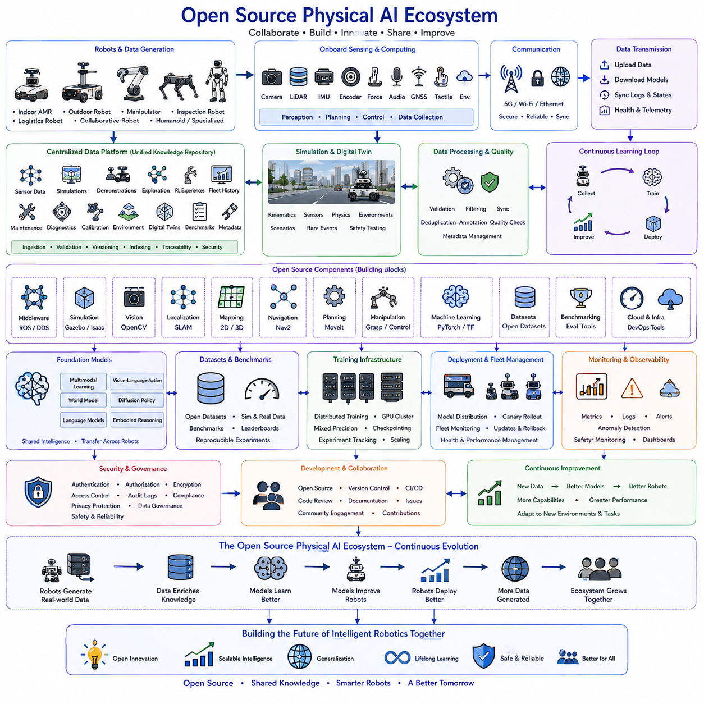{width="7.268055555555556in" height="7.268055555555556in"}

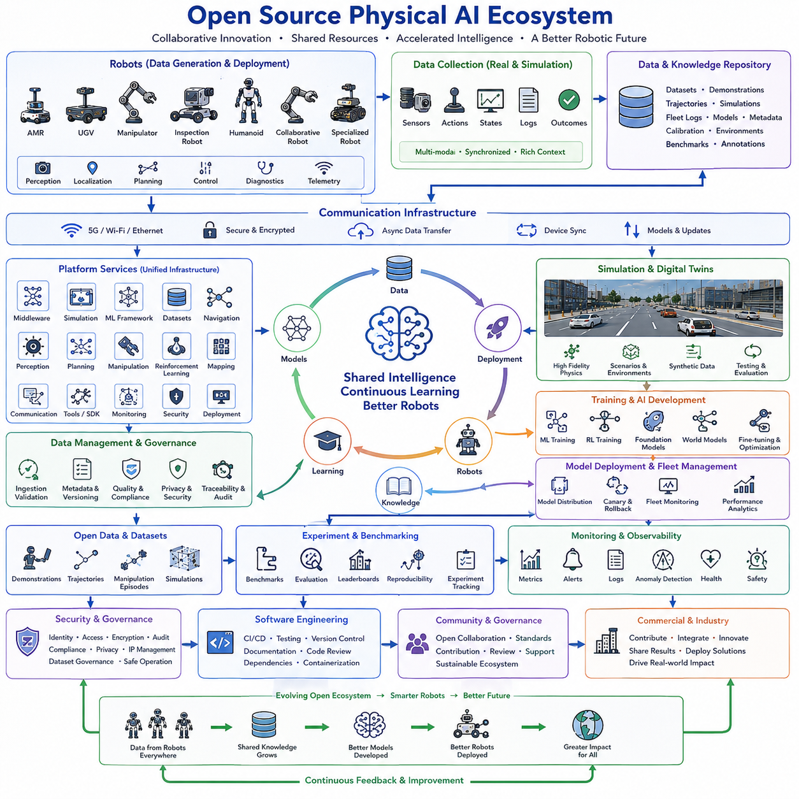{width="7.268055555555556in" height="7.268055555555556in"}

Open-source software has become one of the primary driving forces behind the rapid advancement of Physical AI because it enables researchers, companies, universities, and developer communities to collaborate on common robotic technologies while avoiding unnecessary duplication of engineering effort. Instead of developing every component independently, organizations increasingly build upon mature open-source frameworks that provide reusable implementations of perception, localization, mapping, planning, manipulation, simulation, machine learning, communication, and system integration. This collaborative development model accelerates innovation, improves software quality through community review, and establishes common technical standards that encourage interoperability across diverse robotic platforms.

The open-source Physical AI ecosystem consists of multiple technology layers that collectively support the complete lifecycle of intelligent robotic systems. These layers include robot operating systems, middleware, communication frameworks, simulation environments, computer vision libraries, machine learning frameworks, reinforcement learning platforms, physics engines, mapping systems, navigation stacks, motion planning libraries, manipulation frameworks, cloud infrastructure, development tools, benchmarking environments, and dataset repositories. Each layer provides specialized capabilities while exposing standardized interfaces that allow independent projects to function together as an integrated development ecosystem.

Robot middleware forms the foundation of most open-source robotic software because it enables communication between distributed software components operating on multiple computing devices. Standardized messaging systems, service interfaces, parameter management, hardware abstraction, lifecycle management, logging, diagnostics, and distributed execution frameworks allow developers to integrate perception modules, navigation systems, planning algorithms, control software, and monitoring services without tightly coupling their implementations. This modular architecture greatly simplifies software maintenance while encouraging code reuse across different robot platforms.

Simulation has become an indispensable component of the open-source ecosystem because training and validating intelligent robots entirely in physical environments is both expensive and time consuming. Modern simulation platforms provide realistic representations of robot kinematics, sensor behavior, environmental geometry, physical interactions, lighting conditions, terrain characteristics, and dynamic obstacles. Researchers can rapidly generate millions of training experiences, evaluate new algorithms under controlled conditions, reproduce experiments consistently, and safely investigate dangerous scenarios before transferring validated policies to physical hardware.

Machine learning frameworks provide the computational foundation for training modern Physical AI models. Open-source deep learning libraries support distributed optimization, automatic differentiation, mixed-precision computation, GPU acceleration, model serialization, hardware portability, and scalable deployment across heterogeneous computing environments. Researchers can rapidly prototype new architectures, compare optimization strategies, reproduce published experiments, and integrate emerging foundation models without implementing low-level numerical algorithms from scratch.

Computer vision libraries contribute essential perception capabilities throughout the Physical AI ecosystem. Image processing, feature extraction, camera calibration, object detection, semantic segmentation, visual tracking, three-dimensional reconstruction, optical flow estimation, depth processing, and geometric transformations are implemented through mature software libraries that have been refined by extensive community use. These reusable components significantly reduce engineering complexity while providing reliable perception pipelines for a wide range of robotic applications.

Localization and mapping frameworks enable robots to estimate their positions while constructing representations of surrounding environments. Simultaneous localization and mapping techniques integrate camera observations, LiDAR measurements, inertial sensing, wheel odometry, satellite navigation, and environmental landmarks into continuously updated spatial models. Open-source implementations provide researchers with reproducible reference systems that can be extended, benchmarked, and adapted for indoor, outdoor, industrial, agricultural, and autonomous driving applications.

Navigation frameworks combine localization, environmental mapping, global route planning, local obstacle avoidance, motion control, and recovery behaviors into complete autonomous mobility systems. Rather than developing each capability independently, developers configure modular navigation components according to robot characteristics and application requirements. Standardized navigation architectures support multiple locomotion platforms, sensing modalities, environmental conditions, and planning algorithms while maintaining compatibility across diverse robotic hardware.

Motion planning libraries focus on generating feasible trajectories that satisfy robot kinematic constraints, dynamic limitations, collision avoidance requirements, and task objectives. Sampling-based planning, optimization-based planning, trajectory smoothing, inverse kinematics, constraint solving, and real-time replanning algorithms are implemented within reusable frameworks capable of supporting industrial manipulators, mobile robots, collaborative robots, humanoids, and complex articulated mechanisms. These libraries provide a common foundation upon which higher-level task reasoning systems can build sophisticated manipulation capabilities.

Manipulation frameworks extend motion planning by integrating perception, grasp generation, contact reasoning, force control, object tracking, task sequencing, and execution monitoring into complete robotic manipulation pipelines. Open-source manipulation software enables researchers to investigate dexterous grasping, assembly, bin picking, tool use, deformable object handling, collaborative manipulation, and long-horizon task execution using standardized software interfaces. These modular systems encourage reproducible research while accelerating industrial deployment of advanced manipulation technologies.

Reinforcement learning platforms support autonomous policy optimization through interaction with simulation environments and physical robots. Open-source reinforcement learning ecosystems provide implementations of policy optimization algorithms, experience replay mechanisms, distributed training architectures, reward modeling, curriculum learning, self-play, evaluation benchmarks, and experiment tracking tools. Researchers can compare algorithms under standardized experimental conditions while extending existing implementations to investigate novel learning methodologies for increasingly capable robotic systems.

Foundation model development has introduced new open-source ecosystems dedicated to multimodal representation learning, vision-language-action modeling, world models, diffusion policies, transformer architectures, large language models, and embodied reasoning. Shared pretrained models, benchmark datasets, evaluation protocols, fine-tuning tools, and inference frameworks enable organizations to build sophisticated Physical AI systems without training every model entirely from scratch. Community collaboration accelerates architectural innovation while reducing computational barriers for research institutions and industrial developers.

Open datasets represent another essential component of the ecosystem because large-scale learning depends directly upon diverse training experiences. Public repositories containing robot demonstrations, navigation trajectories, manipulation episodes, autonomous driving data, simulation environments, synthetic images, three-dimensional object models, semantic annotations, and multimodal sensor recordings allow researchers to reproduce published experiments and compare new algorithms using common evaluation standards. Shared datasets encourage scientific transparency while reducing redundant data collection efforts.

Benchmarking frameworks provide standardized procedures for evaluating robotic performance across diverse tasks and environments. Navigation accuracy, manipulation success, localization precision, planning efficiency, simulation fidelity, perception robustness, language understanding, task completion, safety, and generalization capability are measured using common evaluation protocols. Public leaderboards, reproducible benchmark suites, and standardized reporting methodologies facilitate objective comparison between competing approaches while encouraging continuous improvement throughout the research community.

Cloud computing and distributed infrastructure increasingly support open-source Physical AI development by enabling collaborative experimentation at unprecedented computational scale. Shared GPU clusters, distributed storage systems, experiment management platforms, model repositories, continuous integration pipelines, and collaborative software development workflows allow geographically distributed teams to cooperate efficiently. Scalable cloud infrastructure also democratizes access to computational resources that would otherwise remain unavailable to many academic laboratories and small companies.

Software engineering practices play an equally important role within the ecosystem. Continuous integration, automated testing, version control, dependency management, containerization, reproducible builds, documentation generation, code review, issue tracking, and release management collectively improve software reliability and long-term maintainability. Mature engineering workflows transform research prototypes into production-quality robotic software capable of supporting industrial deployment and large-scale collaborative development.

Community governance ensures that open-source ecosystems remain sustainable as they continue expanding. Project maintainers coordinate software architecture, review external contributions, establish coding standards, manage release schedules, resolve compatibility issues, organize documentation, moderate community discussions, and maintain long-term project direction. Transparent governance encourages broad participation while preserving software quality, technical consistency, and organizational stability throughout extended development lifecycles.

Commercial organizations increasingly participate in open-source ecosystems because shared infrastructure allows companies to concentrate proprietary innovation on high-value application layers rather than repeatedly implementing common foundational technologies. Businesses contribute improvements, bug fixes, documentation, benchmark results, datasets, and hardware support while simultaneously benefiting from continuous community-driven improvements. This collaborative relationship accelerates both academic research and commercial product development across the broader Physical AI industry.

The complete open-source Physical AI ecosystem forms a collaborative technological foundation in which software frameworks, simulation environments, datasets, machine learning libraries, robot middleware, benchmarking systems, cloud infrastructure, and global developer communities continuously reinforce one another. Knowledge generated by one project rapidly propagates throughout the ecosystem, enabling increasingly capable robotic systems to emerge through collective innovation rather than isolated development. This open collaborative model has become one of the principal mechanisms driving the rapid evolution of intelligent robotics, scalable robot foundation models, and next-generation Physical AI technologies.

## 9.2 LeRobot HuggingFace Robot Learning Library [w/Code]

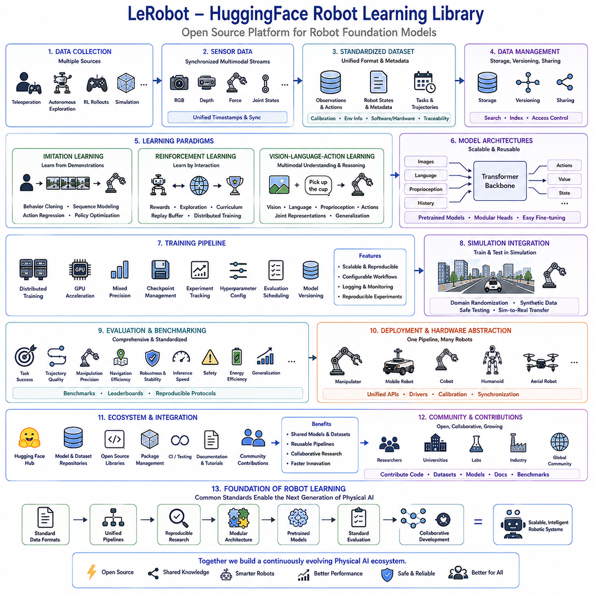{width="7.268055555555556in" height="7.268055555555556in"}

LeRobot is an open-source robot learning library developed to simplify the creation, training, evaluation, and deployment of modern robot foundation models. Rather than functioning as a standalone robotics framework, LeRobot provides a unified research and development platform that integrates datasets, pretrained models, reinforcement learning, imitation learning, simulation, evaluation tools, and hardware interfaces into a consistent software ecosystem. By combining standardized data formats, modular learning pipelines, reusable model architectures, and seamless integration with large-scale machine learning infrastructure, the library significantly reduces the engineering complexity traditionally associated with robot learning research. As a result, researchers can concentrate on algorithmic innovation instead of repeatedly implementing common infrastructure components.

The design philosophy of LeRobot emphasizes reproducibility, modularity, accessibility, and scalability. Every stage of robot learning, including data collection, preprocessing, model training, evaluation, fine-tuning, inference, and deployment, follows standardized workflows that can be reproduced across different laboratories and hardware platforms. Modular software architecture allows perception models, policy networks, datasets, simulation environments, optimization algorithms, and evaluation procedures to be replaced independently without affecting the overall system structure. This flexibility accelerates experimentation while improving software maintainability throughout long-term research projects.

One of the central contributions of LeRobot is the standardization of robot datasets. Historically, robot learning datasets have been collected using different hardware platforms, sensor configurations, annotation methods, storage formats, and communication protocols, making direct comparison between research projects difficult. LeRobot introduces unified dataset structures that organize synchronized observations, actions, robot states, timestamps, calibration parameters, task descriptions, environmental metadata, and demonstration trajectories within consistent data representations. Standardized datasets significantly simplify model training, benchmarking, cross-laboratory collaboration, and long-term dataset maintenance.

Data collection within LeRobot supports multiple acquisition methodologies. Human teleoperation demonstrations, autonomous exploration, reinforcement learning trajectories, scripted robot behaviors, simulation-generated experiences, and manually labeled datasets can all be incorporated into a common storage format. Sensor streams including RGB images, depth images, force measurements, joint positions, end-effector poses, tactile observations, inertial measurements, audio recordings, and language instructions are synchronized through unified timestamp management. Comprehensive metadata preserves hardware configurations, software versions, calibration information, environmental conditions, and collection procedures for complete experimental traceability.

Imitation learning represents one of the primary learning paradigms supported by LeRobot. Expert demonstrations collected from skilled human operators or autonomous systems provide high-quality behavioral examples from which policies learn complex manipulation, navigation, and interaction strategies. Standardized training pipelines support supervised behavior cloning, sequence prediction, action regression, temporal modeling, and policy optimization using consistent experimental procedures. Researchers can compare alternative imitation learning algorithms while sharing identical datasets and evaluation protocols.

Reinforcement learning capabilities extend LeRobot beyond supervised behavioral learning by enabling robots to optimize policies through interaction with simulation environments or physical hardware. The framework supports reward-based optimization, exploration strategies, curriculum learning, replay buffers, distributed experience collection, policy evaluation, and scalable training infrastructure. Reinforcement learning experiments integrate naturally with existing dataset management, model versioning, and experiment tracking systems, allowing hybrid learning strategies that combine demonstrations with autonomous optimization.

Vision-language-action learning has become an increasingly important component of LeRobot as robot foundation models continue evolving toward multimodal intelligence. Models learn joint representations connecting visual observations, natural language instructions, robot states, and continuous actions within unified embedding spaces. Such multimodal learning enables robots to interpret human instructions, understand semantic task descriptions, generalize across previously unseen tasks, and transfer knowledge between different manipulation scenarios using shared representations rather than isolated task-specific policies.

Transformer architectures play a major role in modern LeRobot models because they effectively process long temporal sequences and heterogeneous multimodal observations. Self-attention mechanisms integrate information across camera images, language instructions, robot proprioception, historical trajectories, and environmental context while capturing long-range dependencies throughout complex manipulation tasks. Large transformer-based policies provide scalable representations capable of supporting increasingly diverse robotic behaviors using unified network architectures.

Pretrained foundation models significantly reduce training requirements by transferring previously acquired knowledge into new robotic applications. Rather than initializing models randomly, LeRobot enables researchers to fine-tune pretrained policies using comparatively small task-specific datasets. Knowledge learned from large collections of manipulation demonstrations, navigation experiences, language grounding tasks, or multimodal interactions provides reusable representations that accelerate convergence, improve generalization, and reduce dependence on expensive robot data collection.

Simulation integration enables efficient experimentation before deploying models onto physical robots. Simulated environments generate extensive interaction data under diverse environmental conditions while allowing safe evaluation of new control policies, failure recovery procedures, and exploration strategies. Simulation also supports domain randomization, synthetic data generation, benchmark evaluation, and algorithm verification. Standardized interfaces between simulation and physical robots simplify sim-to-real transfer while minimizing engineering effort required to adapt learned policies across environments.

Model training within LeRobot follows standardized machine learning workflows designed for scalability and reproducibility. Distributed GPU training, mixed-precision optimization, checkpoint management, automatic experiment logging, hyperparameter configuration, evaluation scheduling, and model version control operate through unified software abstractions. Researchers can reproduce published experiments consistently while adapting training pipelines for larger datasets, more complex architectures, or additional robot platforms without restructuring the entire software system.

Experiment management is tightly integrated throughout the development lifecycle. Every training session records configuration files, dataset versions, software revisions, model checkpoints, evaluation metrics, hardware specifications, optimization statistics, and execution logs. Centralized experiment tracking enables systematic comparison across multiple research studies while preserving complete historical records required for reproducibility, debugging, model selection, and long-term scientific validation.

Evaluation within LeRobot extends beyond simple accuracy measurements by considering complete robotic task performance. Standard benchmark procedures evaluate task completion rates, trajectory quality, manipulation precision, navigation efficiency, execution stability, policy robustness, inference speed, safety behavior, energy efficiency, and generalization across unseen environments. Consistent evaluation protocols allow meaningful comparison between competing algorithms while supporting objective measurement of incremental research progress.

Hardware abstraction allows identical learning pipelines to operate across different robotic platforms with minimal software modification. Robot-specific communication drivers, sensor interfaces, actuator controllers, calibration procedures, and synchronization mechanisms remain isolated from high-level learning algorithms through standardized application programming interfaces. This separation enables researchers to transfer policies between manipulators, mobile robots, collaborative robots, humanoids, and experimental platforms while preserving consistent software architecture.

LeRobot integrates naturally with broader machine learning ecosystems by leveraging modern open-source development practices. Standard model repositories, dataset versioning systems, package management, continuous integration, automated testing, documentation generation, and collaborative software development workflows simplify community contributions while maintaining software quality. Shared pretrained models, benchmark datasets, and reusable learning pipelines encourage collaborative research across universities, research laboratories, and industrial organizations.

Community-driven development represents one of the strongest advantages of LeRobot. Researchers continuously contribute new datasets, robot interfaces, policy architectures, optimization algorithms, evaluation benchmarks, documentation, tutorials, and example applications. Open collaboration accelerates innovation while reducing duplicated engineering effort across independent projects. As additional robots, tasks, and learning methodologies become available, the ecosystem naturally expands without requiring fundamental architectural redesign.

The long-term significance of LeRobot extends beyond a single software library because it contributes toward the standardization of robot foundation model development across the broader Physical AI community. Common dataset formats, unified training pipelines, reproducible experiments, modular architectures, shared pretrained models, standardized evaluation procedures, and collaborative software engineering practices collectively establish a common technological foundation upon which future generations of intelligent robotic systems can be developed more efficiently. As robot foundation models continue increasing in scale and capability, libraries such as LeRobot provide the infrastructure necessary to transform isolated research efforts into collaborative, reproducible, and continuously evolving Physical AI ecosystems.

## 9.3 Octo Open Source Robot Foundation Model Usage [w/Code]

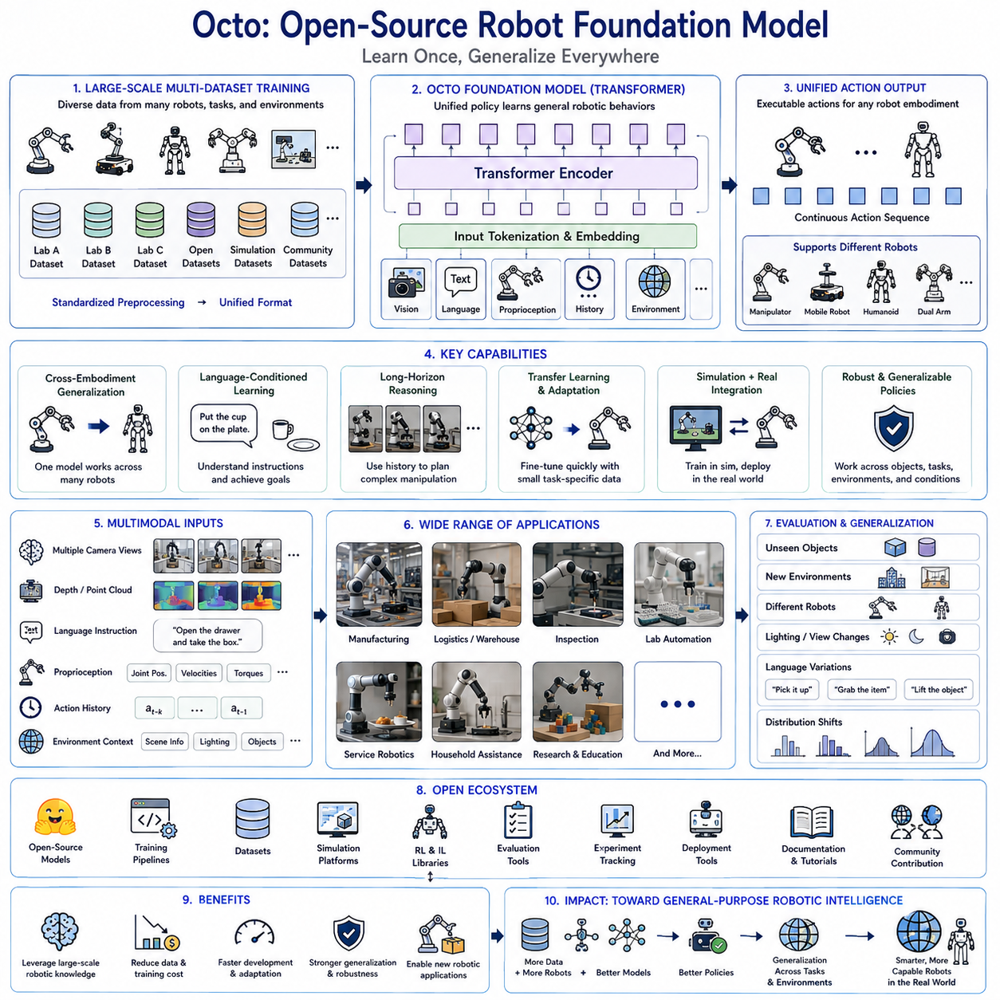{width="7.268055555555556in" height="7.268055555555556in"}

Octo is an open-source robot foundation model designed to demonstrate how large-scale transformer architectures can learn general robotic behaviors from diverse manipulation datasets collected across multiple robots, environments, and tasks. Rather than learning a single manipulation skill for one specific robot, Octo is trained on heterogeneous robot experiences so that a unified policy can generalize across different embodiments, objects, tasks, and operating conditions. This design reflects the emerging trend in Physical AI toward scalable foundation models that acquire broad physical knowledge through large-scale multimodal training instead of relying on narrowly specialized task-specific policies. Octo therefore represents an important milestone in the transition from isolated robot learning toward general-purpose robotic intelligence.

The central philosophy of Octo is that robots should learn universal behavioral representations rather than memorizing individual task solutions. Traditional robot learning often required collecting large demonstration datasets for every new manipulation task, robot platform, or operating environment. Such approaches produced highly capable policies for narrowly defined applications but scaled poorly as task diversity increased. Octo addresses this limitation by jointly learning from many datasets collected by different research groups using multiple robot platforms. Through shared representation learning, the model extracts common physical principles that transfer naturally across different manipulation scenarios while preserving the ability to adapt efficiently to new tasks.

Octo adopts transformer-based sequence modeling as its primary learning architecture. Visual observations, robot proprioceptive states, language instructions, historical action sequences, and environmental context are represented as unified token sequences processed through self-attention mechanisms. Instead of treating perception, reasoning, and control as separate modules, the transformer jointly models relationships among all available information sources across both spatial and temporal dimensions. This unified representation enables the policy to reason about task objectives, object relationships, robot state evolution, and future action consequences within a single scalable neural architecture.

Visual perception serves as one of the most important information sources within Octo. Camera observations provide object appearance, spatial arrangement, scene geometry, environmental context, and interaction outcomes required for manipulation planning. Multiple camera viewpoints may be combined with depth sensing or other perception modalities to improve robustness under varying lighting conditions, occlusions, and object configurations. Large-scale visual pretraining further enhances representation quality by transferring knowledge acquired from general computer vision datasets before robot-specific fine-tuning begins.

Language conditioning significantly expands the flexibility of robot foundation models. Natural language instructions describe desired objectives independently of low-level control commands, allowing the same learned policy to perform many different behaviors using shared physical knowledge. Commands such as grasping, placing, sorting, opening, pressing, stacking, inserting, or organizing objects become semantic goals interpreted jointly with visual observations and robot state information. Language-guided learning therefore enables intuitive human-robot interaction while improving generalization across previously unseen task variations.

Robot proprioception provides internal information describing the physical configuration of the robotic system. Joint positions, joint velocities, actuator torques, end-effector poses, gripper states, force measurements, and other kinematic variables complement visual observations by providing precise information about robot motion and interaction dynamics. Integrating external perception with internal robot state allows the transformer to reason simultaneously about environmental conditions and robot capabilities when selecting appropriate actions throughout manipulation sequences.

Historical action sequences provide temporal context that is essential for long-horizon robotic manipulation. Many physical tasks cannot be solved through instantaneous observations alone because successful behavior depends upon previous actions, object interactions, accumulated state changes, and partially completed task progress. Transformer attention mechanisms maintain long-range temporal dependencies, allowing Octo to interpret current observations within the broader context of entire manipulation episodes rather than isolated decision points.

One of the defining characteristics of Octo is large-scale multi-dataset training. Instead of relying upon demonstrations collected within a single laboratory, the model integrates heterogeneous datasets generated across numerous institutions, robots, environments, sensors, and manipulation tasks. Although these datasets differ substantially in hardware configuration, observation modalities, action spaces, annotation quality, and collection procedures, standardized preprocessing pipelines transform them into compatible representations suitable for unified foundation model training. Data diversity becomes a primary source of improved robustness and generalization.

Cross-embodiment learning represents another major innovation introduced by Octo. Different robot manipulators possess varying kinematic structures, numbers of joints, workspace geometries, gripper designs, payload capacities, sensing capabilities, and control frequencies. Rather than training separate policies for every robot, Octo learns embodiment-aware representations that distinguish robot-specific physical characteristics from higher-level task knowledge. This factorization allows transferable manipulation strategies while respecting each robot\'s unique physical constraints.

Transfer learning enables Octo to adapt rapidly to new robotic applications using comparatively small task-specific datasets. Instead of training entirely new models for every manipulation scenario, researchers initialize policies using pretrained foundation weights and subsequently fine-tune them for specialized industrial, service, laboratory, or research tasks. Because the pretrained model already captures extensive physical interaction knowledge, adaptation typically requires significantly fewer demonstrations, less computation, and shorter development cycles than conventional supervised robot learning.

Simulation provides an effective complement to physical robot data during model development. Synthetic environments generate large numbers of diverse manipulation experiences while enabling safe exploration of rare events, hardware failures, environmental disturbances, and complex task variations that may be impractical or expensive to reproduce physically. Simulation also supports systematic evaluation, domain randomization, algorithm debugging, and policy verification before transferring learned behaviors to real robotic systems through carefully designed sim-to-real adaptation strategies.

Fine-tuning strategies within Octo are designed to preserve previously acquired general knowledge while efficiently incorporating new task-specific behaviors. Parameter-efficient adaptation methods, modular network components, selective optimization, adapter layers, and lightweight policy refinement reduce computational cost while minimizing catastrophic forgetting. These techniques allow organizations to customize foundation models for proprietary applications without sacrificing the broad capabilities acquired during large-scale pretraining.

Evaluation of Octo emphasizes generalization rather than memorization. Performance is measured not only on tasks observed during training but also across novel object combinations, previously unseen environments, different robot embodiments, changing lighting conditions, varying camera viewpoints, distribution shifts, and unfamiliar language instructions. Such evaluation methodologies more accurately reflect practical deployment scenarios in which robots must operate reliably despite continuous environmental variation.

The open-source nature of Octo significantly accelerates research progress throughout the Physical AI community. Public availability of pretrained models, training pipelines, evaluation procedures, software implementations, documentation, and benchmark protocols enables researchers worldwide to reproduce published experiments, investigate architectural improvements, compare learning algorithms, and develop new robotic applications without rebuilding complete infrastructure from the beginning. Community collaboration improves software quality while reducing duplicated engineering effort across independent research groups.

Octo integrates naturally with modern robot learning ecosystems that include standardized datasets, simulation platforms, reinforcement learning libraries, imitation learning frameworks, distributed training infrastructure, experiment tracking systems, and deployment tools. Such interoperability allows organizations to combine Octo with existing software stacks rather than replacing established robotic development workflows. Standard interfaces simplify integration into industrial automation systems, academic research environments, and large-scale robot fleet management platforms.

Industrial deployment of Octo extends beyond laboratory manipulation demonstrations toward real-world manufacturing, logistics, warehouse automation, inspection, laboratory automation, collaborative robotics, and service robotics. Although domain-specific adaptation remains necessary for high-reliability production environments, foundation models substantially reduce engineering effort by providing strong initial policies capable of learning new behaviors efficiently. Organizations can therefore concentrate resources on application-specific optimization instead of repeatedly implementing fundamental manipulation capabilities.

The long-term significance of Octo lies in demonstrating that robot foundation models can learn broadly transferable physical knowledge through collaborative large-scale dataset integration rather than isolated task-specific optimization. Shared multimodal representations, transformer-based reasoning, cross-robot learning, language conditioning, scalable pretraining, and efficient adaptation collectively establish a practical pathway toward increasingly capable general-purpose robotic intelligence. As larger datasets, more diverse robot embodiments, richer multimodal interactions, and increasingly powerful foundation models continue emerging, architectures inspired by Octo are expected to become central components of future Physical AI systems, enabling robots to acquire new capabilities more rapidly, generalize more effectively, and collaborate more naturally across an expanding range of real-world applications.

## 9.4 OpenVLA Fine Tuning on Custom Robot Data [w/Code]

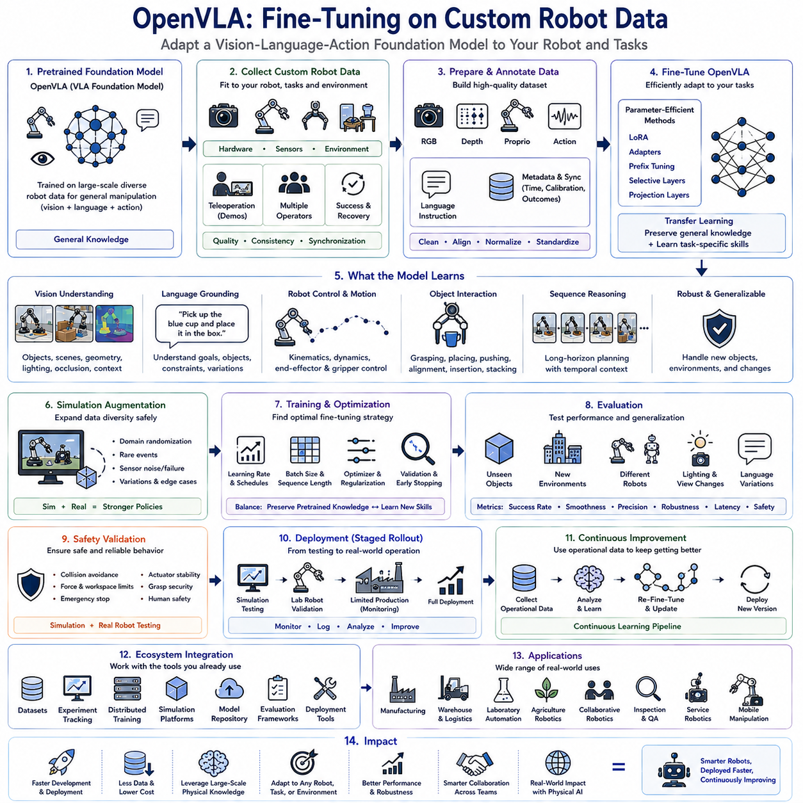{width="7.268055555555556in" height="7.268055555555556in"}

OpenVLA is an open-source Vision-Language-Action (VLA) foundation model designed to enable robots to learn complex manipulation behaviors by jointly understanding visual observations, natural language instructions, and continuous robot actions within a unified neural architecture. Unlike conventional robot learning systems that require task-specific models for individual applications, OpenVLA provides a general-purpose pretrained policy capable of adapting to new robots, environments, and manipulation tasks through efficient fine-tuning. This capability significantly reduces development time and data requirements while allowing organizations to leverage large-scale pretrained physical knowledge acquired from diverse robot experiences. Fine-tuning therefore becomes the primary mechanism for transforming a general foundation model into a highly specialized policy suitable for specific industrial, service, laboratory, or research applications.

The fundamental objective of fine-tuning is to preserve the broad physical knowledge learned during large-scale pretraining while incorporating task-specific behaviors using comparatively small custom datasets. Instead of retraining billions of parameters from random initialization, organizations begin with pretrained OpenVLA weights that already encode rich representations of visual perception, language grounding, robot motion, object interaction, and manipulation dynamics. Fine-tuning modifies only the knowledge necessary for the target application, enabling rapid adaptation while maintaining the model\'s general reasoning capability. This transfer learning strategy substantially improves sample efficiency and reduces computational cost compared with training entirely new robot policies.

Custom robot datasets represent the foundation of successful OpenVLA adaptation. These datasets should capture the unique characteristics of the target robotic system, including hardware configuration, sensor arrangement, kinematic structure, actuator dynamics, end-effector geometry, payload limitations, workspace constraints, control frequency, and operational environment. Because foundation models already possess extensive generic manipulation knowledge, custom datasets do not need to cover every possible situation. Instead, they should focus on representative operational scenarios, domain-specific behaviors, rare edge cases, safety-critical situations, and customer-specific task requirements that distinguish the deployment environment from publicly available training data.

Data collection should prioritize consistency, synchronization, and quality rather than simply maximizing dataset size. Every demonstration should include synchronized RGB images, depth observations when available, robot joint states, end-effector poses, gripper status, action commands, timestamps, language instructions, environmental metadata, calibration parameters, and task outcomes. Accurate temporal synchronization between perception and robot actions is essential because transformer-based policies learn sequential relationships across multimodal observations. High-quality demonstrations from experienced operators generally contribute more to final policy performance than significantly larger quantities of inconsistent or noisy data.

Human teleoperation remains one of the most effective approaches for collecting fine-tuning datasets. Skilled operators naturally demonstrate successful manipulation strategies while implicitly incorporating obstacle avoidance, grasp adjustment, error recovery, object alignment, and adaptive motion planning. Recording both successful executions and carefully managed recovery behaviors allows OpenVLA to learn robust policies capable of handling practical uncertainties encountered during real-world deployment. Multiple operators may also contribute demonstrations that improve behavioral diversity and reduce individual operator bias within the resulting policy.

Language annotations play an essential role throughout the fine-tuning process because OpenVLA learns joint representations connecting language, perception, and robot actions. Every demonstration should therefore include natural language descriptions explaining task objectives, manipulated objects, intended outcomes, environmental conditions, or operational constraints. Multiple linguistic expressions describing equivalent tasks improve semantic robustness by preventing the model from overfitting to a limited instruction vocabulary. Rich language supervision also enables future expansion toward increasingly flexible human-robot interaction without requiring complete retraining.

Visual observations should represent the diversity of realistic deployment environments. Images should include varying lighting conditions, camera viewpoints, backgrounds, object arrangements, clutter levels, material properties, shadows, reflections, partial occlusions, and environmental changes. Capturing substantial visual diversity during fine-tuning improves robustness against distribution shifts encountered after deployment. Data augmentation techniques including cropping, color perturbation, geometric transformations, illumination variation, and synthetic occlusion further enhance visual generalization without requiring proportional increases in physical data collection.

Robot action representations must remain compatible with the pretrained OpenVLA architecture while accurately describing the target platform. Depending upon the robotic system, actions may include joint position commands, joint velocity commands, end-effector Cartesian motion, gripper control, force commands, torque references, or hybrid control representations. When action spaces differ substantially from those used during pretraining, lightweight adaptation layers or action transformation modules can bridge representational differences while preserving the majority of pretrained foundation knowledge.

Simulation provides a valuable supplement to physical demonstrations during fine-tuning. High-fidelity digital twins generate additional experiences covering unusual object configurations, environmental disturbances, hardware variability, sensor failures, and rare operational situations that may be difficult or expensive to reproduce physically. Synthetic demonstrations complement real robot data while improving policy robustness through domain randomization and diverse interaction experiences. Carefully balancing simulated and physical datasets helps maximize generalization while avoiding excessive dependence on either source alone.

Fine-tuning strategies vary according to computational resources and deployment objectives. Full parameter optimization updates every model weight but requires substantial computational resources and increases the risk of catastrophic forgetting. Parameter-efficient techniques including Low-Rank Adaptation (LoRA), adapter layers, prefix tuning, selective layer optimization, and lightweight projection modules modify only small portions of the network while preserving the majority of pretrained parameters. These approaches dramatically reduce memory requirements, shorten training time, and simplify deployment across multiple robot applications.

Hyperparameter optimization strongly influences adaptation quality. Learning rates, batch sizes, sequence lengths, optimizer configurations, weight decay, gradient clipping, warmup schedules, checkpoint intervals, and regularization strategies must be selected carefully to preserve pretrained knowledge while incorporating new behaviors efficiently. Excessively aggressive optimization may destroy valuable general representations, whereas overly conservative updates may fail to capture application-specific requirements. Continuous validation throughout training helps identify appropriate optimization schedules before overfitting occurs.

Evaluation should assess both specialized task performance and preservation of general capabilities. Fine-tuned models should be tested using unseen objects, novel environmental layouts, different lighting conditions, varying camera positions, modified language instructions, and previously unobserved task variations. Task completion rates, trajectory smoothness, manipulation precision, grasp stability, execution efficiency, recovery capability, safety behavior, inference latency, and robustness under uncertainty collectively provide comprehensive measures of deployment readiness. Benchmark evaluation should therefore extend beyond the original training dataset to reflect realistic operational conditions.

Safety validation becomes particularly important before deploying fine-tuned policies onto physical robots. Collision avoidance, workspace boundary enforcement, force limitations, emergency stop behavior, actuator stability, grasp security, object protection, and human interaction safety should all undergo systematic verification within simulation and controlled physical testing environments. Safety supervisors operating independently from learned policies provide additional protection against unexpected behavior during early deployment stages.

Deployment workflows typically follow staged rollout strategies. Fine-tuned policies are first validated in simulation, subsequently evaluated on isolated laboratory robots, then deployed to limited production systems under close monitoring before organization-wide distribution. Continuous logging of robot performance, operator interventions, failure cases, sensor anomalies, and task outcomes generates valuable operational datasets that support future fine-tuning cycles. This iterative deployment methodology establishes a continuous learning pipeline in which operational experience progressively improves policy quality over time.

OpenVLA integrates naturally with broader robot learning ecosystems including standardized datasets, experiment tracking platforms, distributed training infrastructure, simulation environments, model repositories, evaluation frameworks, and deployment tools. Such interoperability allows organizations to incorporate OpenVLA into existing machine learning workflows rather than replacing established software infrastructure. Shared interfaces also simplify collaboration between research teams, industrial developers, and robotics laboratories working on different robot platforms while utilizing common foundation models.

Industrial applications of OpenVLA fine-tuning span manufacturing, warehouse automation, logistics, laboratory automation, agricultural robotics, collaborative manipulation, quality inspection, service robotics, and intelligent mobile manipulation. Every application introduces unique environmental constraints, object characteristics, manipulation strategies, safety requirements, and operational procedures that can be efficiently incorporated through targeted fine-tuning. Organizations therefore avoid repeatedly developing entirely new robot policies while still obtaining highly specialized behaviors optimized for proprietary production environments.

The broader significance of OpenVLA fine-tuning lies in its demonstration that modern robot foundation models can evolve continuously through efficient adaptation rather than complete retraining. Large-scale pretrained physical knowledge serves as a universal starting point, while relatively small, carefully curated custom datasets specialize robot behavior for individual organizations and deployment scenarios. As increasingly capable Vision-Language-Action foundation models continue emerging, fine-tuning methodologies will become a central component of future Physical AI development pipelines, enabling robots to acquire new industrial skills more rapidly, generalize across broader operational domains, and continuously improve throughout their deployment lifecycles.

## 9.5 Lerobot Dataset Format and Collection Tools [w/Code]

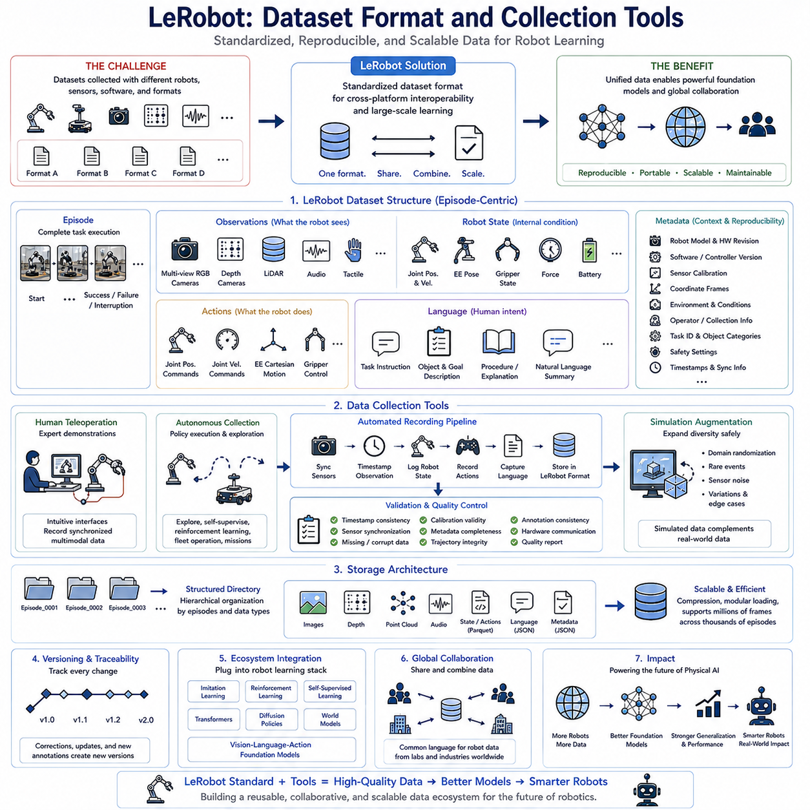{width="7.268055555555556in" height="7.268055555555556in"}

LeRobot introduces a standardized dataset format specifically designed to support large-scale robot learning across multiple hardware platforms, laboratories, and research projects. One of the primary challenges in robot foundation model development is that datasets are often collected using different robot embodiments, sensor configurations, software architectures, communication protocols, and storage formats. These inconsistencies significantly reduce interoperability and make it difficult to combine datasets from different organizations into a unified training pipeline. The LeRobot dataset format addresses this problem by defining a consistent structure that organizes multimodal robot observations, actions, metadata, timestamps, calibration information, and task descriptions into a unified representation suitable for modern robot foundation models.

The design philosophy emphasizes reproducibility, portability, scalability, and long-term maintainability. Every dataset collected using the LeRobot format follows identical organizational principles regardless of robot manufacturer, application domain, or hardware configuration. This standardized organization enables researchers to exchange datasets without implementing custom conversion software for every new robot platform. More importantly, large foundation models can be trained directly on heterogeneous datasets because all observations follow common interfaces, metadata definitions, synchronization rules, and storage conventions. The dataset therefore becomes a reusable scientific asset rather than an isolated project-specific resource.

A LeRobot dataset is organized around episodes representing complete robot task executions. Each episode contains sequential observations beginning from the initial robot state and continuing until successful completion, failure, interruption, or manual termination of the task. Organizing data into episodes preserves temporal relationships that are essential for learning long-horizon robotic behaviors. Every episode records continuous state evolution rather than isolated snapshots, allowing transformer-based foundation models to learn sequential dependencies, recovery behaviors, and task progression across extended manipulation sequences.

Observations form the largest component of the dataset because they describe everything the robot perceives throughout execution. Multiple synchronized RGB cameras provide visual information from different viewpoints, while optional depth cameras contribute geometric scene understanding. LiDAR sensors, tactile arrays, force sensors, microphones, inertial measurement units, wheel encoders, GNSS receivers, environmental sensors, and robot proprioception further expand multimodal perception. Each observation is associated with precise timestamps to ensure accurate temporal alignment across heterogeneous sensing modalities.

Robot state information accompanies every observation to describe the physical configuration of the robotic system during execution. Joint positions, joint velocities, actuator torques, end-effector poses, gripper states, force measurements, controller outputs, battery status, localization estimates, navigation states, and diagnostic variables collectively characterize the robot\'s internal operating condition. Maintaining synchronized robot state information allows learning algorithms to associate external perception with internal physical dynamics, significantly improving policy learning and model interpretability.

Action representations describe the commands executed by the robot after observing the environment. Depending upon the robotic platform, actions may include joint position commands, joint velocity references, Cartesian end-effector motions, mobile robot velocity commands, gripper control signals, force control parameters, or hybrid action representations. Every action is stored together with the corresponding observation that generated it, enabling supervised behavior cloning, sequence prediction, reinforcement learning replay, and trajectory optimization using consistent temporal relationships throughout the dataset.

Language annotations provide semantic descriptions that connect robot behavior with human intent. Each episode may include high-level task instructions, object descriptions, operational goals, environmental constraints, procedural explanations, or natural language summaries of completed actions. Multiple equivalent language expressions describing identical manipulation tasks improve semantic diversity and strengthen multimodal representation learning. Language supervision enables vision-language-action foundation models to associate physical interaction with abstract human instructions, facilitating intuitive human-robot communication during deployment.

Metadata preserves contextual information required for reproducibility and future dataset reuse. Robot model, hardware revision, software version, sensor calibration parameters, camera intrinsic matrices, coordinate frame definitions, operating system configuration, controller versions, environmental conditions, operator identity, collection procedures, task identifiers, object categories, safety settings, and experiment descriptions accompany every recorded episode. Rich metadata allows future researchers to interpret collected data correctly while supporting dataset version management, traceability, and long-term maintenance.

Time synchronization represents one of the most critical design requirements within the LeRobot dataset format. Independent sensors often operate at different frequencies, communication delays, and hardware clocks. Precise timestamp alignment ensures that camera observations, robot states, force measurements, localization estimates, language events, and executed actions correspond accurately to the same physical events. Reliable synchronization significantly improves sequence modeling because temporal inconsistencies introduce ambiguity that degrades policy learning and multimodal representation quality.

The storage architecture emphasizes efficient scalability for extremely large robot datasets. High-resolution images, depth maps, point clouds, robot telemetry, language annotations, calibration files, metadata, evaluation labels, and auxiliary information are organized using structured directory hierarchies that remain efficient even for millions of observations collected across thousands of task episodes. Compression techniques reduce storage requirements without sacrificing information necessary for future foundation model training, while modular organization simplifies partial dataset loading for distributed machine learning pipelines.

LeRobot collection tools automate the complete data acquisition process to minimize operator workload while maximizing data quality. Data recording software automatically synchronizes sensors, timestamps observations, logs robot states, captures control commands, validates hardware communication, stores metadata, monitors recording integrity, and generates standardized dataset structures without requiring manual intervention. Automation reduces human error while ensuring every recorded episode satisfies the consistency requirements necessary for large-scale robot learning.

Human teleoperation interfaces constitute one of the primary data collection methods supported by LeRobot. Operators control robotic manipulators or mobile robots using intuitive interfaces while the software continuously records synchronized multimodal observations together with executed control commands. Teleoperation allows collection of high-quality demonstrations representing successful task execution, adaptive motion planning, obstacle avoidance, recovery behavior, and expert manipulation strategies. These demonstrations subsequently become valuable training resources for imitation learning and robot foundation model development.

Autonomous data collection further expands dataset diversity beyond human demonstrations. Robots executing existing policies generate additional experiences through exploration, reinforcement learning, self-supervised interaction, autonomous navigation, continuous fleet operation, or scheduled industrial missions. Operational data collected during routine deployment provides realistic examples of environmental variation, hardware uncertainty, sensor noise, long-term system behavior, and practical failure cases that rarely appear within carefully controlled laboratory demonstrations.

Data validation tools automatically inspect recorded datasets before permanent storage. Timestamp consistency, sensor synchronization, missing observations, corrupted files, incomplete trajectories, calibration validity, metadata completeness, hardware communication integrity, and annotation consistency are verified through automated quality control procedures. Problematic episodes are identified immediately for correction or removal before entering centralized training repositories. Continuous validation ensures that large foundation models are trained using reliable high-quality datasets rather than accumulating hidden recording errors over extended collection campaigns.

Dataset version management enables continuous expansion while preserving reproducibility. Every modification, correction, annotation update, calibration refinement, preprocessing change, or metadata revision generates a traceable dataset version linked to previous releases. Researchers can reproduce earlier experiments precisely while benefiting from improved dataset quality in subsequent model training. Version control also simplifies collaborative development across multiple laboratories by maintaining consistent references throughout distributed research projects.

LeRobot integrates naturally with robot learning frameworks supporting imitation learning, reinforcement learning, self-supervised learning, multimodal pretraining, transformer architectures, diffusion policies, world models, and vision-language-action foundation models. Standardized dataset interfaces eliminate repeated engineering effort when switching between learning algorithms because identical observations, actions, language annotations, and metadata can be reused throughout multiple research workflows. This interoperability substantially accelerates experimentation while reducing software complexity.

The long-term importance of the LeRobot dataset format extends beyond simple data storage because it establishes a common language through which robot experiences collected worldwide can be shared, combined, and reused for foundation model development. Standardized representations, automated collection tools, synchronized multimodal observations, comprehensive metadata, rigorous validation procedures, and scalable storage architectures collectively transform individual robot demonstrations into reusable scientific resources supporting collaborative Physical AI research. As increasingly diverse robots contribute standardized experiences into common repositories, LeRobot provides a practical foundation for building larger, more capable, and more general robot foundation models capable of learning from the collective experience of the global robotics community.

## 9.6 Open Source Teleoperation System ACT Data [w/Code]

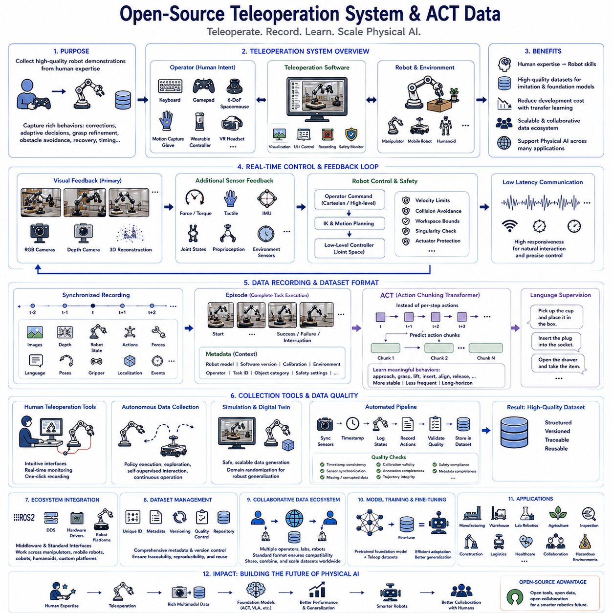{width="7.268055555555556in" height="7.268055555555556in"}

Open-source teleoperation systems have become one of the most important technologies for collecting high-quality robot demonstration datasets that support modern Physical AI and robot foundation model development. Unlike manually scripted robot behaviors, teleoperation allows skilled human operators to solve complex manipulation tasks naturally while robots record synchronized observations, actions, sensor measurements, and environmental context. These demonstrations capture not only successful task execution but also subtle motion corrections, adaptive decision making, grasp refinement, obstacle avoidance, timing adjustments, and recovery behaviors that are difficult to generate through autonomous exploration alone. Consequently, teleoperation provides rich behavioral knowledge that serves as the foundation for imitation learning, Vision-Language-Action models, Action Chunking Transformers, and other large-scale robot learning algorithms.

The primary objective of a teleoperation system is to transfer human intent into robot motion with minimal latency while preserving precision, stability, and natural interaction. Operators should feel as though they are directly manipulating remote objects rather than controlling a machine through an indirect interface. Achieving this objective requires synchronized communication between input devices, robot controllers, sensor systems, visualization software, safety supervisors, and data recording infrastructure. High responsiveness allows operators to produce fluid demonstrations that accurately reflect expert manipulation strategies, resulting in significantly higher-quality datasets for downstream policy learning.

Modern open-source teleoperation systems support multiple input modalities depending on application requirements. Traditional keyboard interfaces remain useful for simple mobile robot control, while game controllers provide intuitive operation for navigation and basic manipulation. Six-degree-of-freedom spacemice enable precise Cartesian end-effector control for manipulation tasks. Motion capture gloves measure finger movements during dexterous grasping, and wearable controllers translate arm motion into robot trajectories. Virtual reality headsets provide immersive telepresence, allowing operators to perceive depth, object geometry, and workspace relationships more naturally than conventional two-dimensional displays. Multiple interfaces may also be combined to maximize operator comfort and task efficiency.

Robot-side control architectures convert human commands into executable low-level robot actions while enforcing physical safety constraints. High-level Cartesian commands received from teleoperation devices are transformed into joint-space trajectories through inverse kinematics and motion planning algorithms. Velocity limits, acceleration constraints, collision avoidance, workspace boundaries, singularity detection, and actuator protection mechanisms operate continuously to ensure safe robot execution even when operator commands become inconsistent or unsafe. Transparent safety supervision allows natural teleoperation while preventing accidental hardware damage or dangerous robot behavior.

Visual feedback represents the most critical information channel during teleoperation because human operators primarily rely upon vision when manipulating objects remotely. Multiple synchronized RGB cameras provide complementary viewpoints covering the workspace, robot end-effector, manipulated objects, and surrounding environment. Depth cameras, stereo vision systems, or three-dimensional scene reconstruction further improve spatial understanding by conveying object geometry and distance information. High frame rates and low communication latency significantly improve operator performance because visual delays directly reduce manipulation precision and increase cognitive workload during complex tasks.

Additional sensor feedback enhances operator situational awareness beyond conventional vision alone. Force sensors report contact interactions during grasping and insertion tasks, tactile sensors provide information about object stability and slipping, joint torque measurements indicate manipulation difficulty, inertial measurements reflect robot motion dynamics, and environmental sensors contribute contextual awareness. Although many open-source teleoperation systems currently emphasize visual feedback, multimodal sensing is becoming increasingly important for collecting rich datasets supporting next-generation robot foundation models capable of reasoning across multiple sensory modalities simultaneously.

Data recording operates continuously throughout every teleoperation session. Every observation, robot state, control command, language instruction, timestamp, calibration parameter, and system event is synchronized and stored using standardized dataset formats. Camera images, depth maps, robot joint positions, end-effector poses, gripper commands, force measurements, localization estimates, operator inputs, environmental metadata, and execution outcomes collectively describe complete manipulation episodes. Accurate temporal synchronization between all recorded signals is essential because transformer-based sequence models depend upon consistent multimodal alignment when learning behavioral policies.

Action Chunking Transformer (ACT) models introduce a new perspective on robot imitation learning by predicting temporally extended action sequences instead of isolated individual control commands. Rather than generating one action at every timestep, ACT learns compact action chunks representing coordinated movement patterns over short temporal horizons. Teleoperation demonstrations naturally contain smooth human motion that can be segmented into meaningful behavioral units such as approaching, grasping, lifting, transporting, inserting, aligning, or releasing objects. Learning these structured action chunks significantly improves policy stability, reduces prediction frequency, and captures long-term temporal dependencies more effectively than traditional frame-by-frame action prediction.

High-quality ACT datasets require carefully structured demonstrations emphasizing smooth continuous behavior rather than fragmented robot control. Human operators should perform complete manipulation sequences without unnecessary interruptions while maintaining consistent execution speed and natural object interaction. Repeated demonstrations covering different object positions, orientations, environmental layouts, and task variations provide diverse action chunks that improve model generalization. Recording both successful task completion and recovery behavior further enables ACT models to learn robust sequential strategies capable of handling uncertainty during real-world deployment.

Language supervision can be incorporated naturally into teleoperation datasets by associating demonstrations with human-readable task descriptions. Commands such as picking, placing, stacking, opening, inserting, tightening, sorting, cleaning, organizing, or inspecting become semantic labels connected directly to recorded manipulation behavior. Multiple natural language descriptions expressing equivalent task objectives increase semantic diversity while improving vision-language-action alignment. Rich language annotations enable foundation models to associate human instructions with physical behavior, supporting intuitive task specification during future robot deployment.

Simulation complements physical teleoperation by generating additional demonstrations covering situations that may be unsafe, expensive, or difficult to reproduce with real hardware. High-fidelity digital twins enable expert operators to teleoperate simulated robots while generating perfectly synchronized multimodal datasets under controlled environmental conditions. Domain randomization introduces variation in lighting, textures, object placement, physics parameters, sensor noise, and environmental complexity, substantially improving policy robustness before transferring learned behavior onto physical robots.

Open-source teleoperation software typically integrates seamlessly with modern robot middleware such as ROS 2 and standardized robot learning frameworks. Communication interfaces exchange robot state information, sensor observations, controller commands, diagnostic messages, and synchronization events using modular software architectures that support heterogeneous hardware platforms. Standardized middleware enables identical teleoperation software to operate across robotic manipulators, mobile robots, collaborative robots, humanoids, and custom research platforms while minimizing implementation effort for new robotic systems.

Dataset management infrastructure plays a central role throughout teleoperation-based data collection. Every demonstration receives unique identifiers together with metadata describing robot configuration, software version, sensor calibration, operator information, environmental conditions, task category, object identifiers, hardware revisions, safety settings, and collection procedures. Automated quality control verifies timestamp consistency, sensor synchronization, missing observations, corrupted recordings, annotation completeness, and calibration validity before demonstrations enter centralized robot learning repositories. Comprehensive metadata ensures long-term dataset traceability and scientific reproducibility.

Distributed data collection enables multiple operators, laboratories, and robotic platforms to contribute demonstrations simultaneously into shared repositories. Standardized dataset formats ensure compatibility despite differences in robot hardware, sensing modalities, geographical locations, and operational environments. As demonstrations accumulate from increasingly diverse sources, robot foundation models acquire broader physical knowledge capable of generalizing across robots, manipulation tasks, object categories, and environmental conditions. Collaborative dataset construction therefore becomes one of the primary mechanisms driving scalable Physical AI development.

Modern teleoperation systems increasingly support shared autonomy rather than purely manual control. Autonomous perception assists human operators by detecting objects, estimating grasp candidates, avoiding collisions, stabilizing trajectories, or suggesting manipulation strategies while leaving high-level decision making under human supervision. Shared autonomy reduces operator workload while preserving demonstration quality, allowing large datasets to be collected more efficiently without sacrificing behavioral diversity or expert decision making. These semi-autonomous demonstrations often represent practical operational strategies likely to appear in future industrial deployments.

Fine-tuning robot foundation models using teleoperation datasets has become considerably more efficient because pretrained multimodal representations already capture broad physical interaction knowledge. Instead of collecting massive demonstration datasets for every application, organizations adapt pretrained policies using comparatively small quantities of carefully curated teleoperation data reflecting proprietary tasks and hardware characteristics. This transfer learning approach substantially reduces development cost while maintaining strong generalization capabilities acquired during large-scale foundation model pretraining.

Industrial applications of open-source teleoperation systems extend across manufacturing, warehouse automation, laboratory robotics, agricultural automation, inspection, construction, logistics, healthcare, collaborative robotics, and hazardous environment operation. Every deployment scenario generates valuable operational demonstrations that continuously improve foundation models through iterative fine-tuning. Operational robots therefore become both productive industrial systems and autonomous data generation platforms supporting future robot intelligence development.

The long-term significance of open-source teleoperation systems extends far beyond remote robot control because they establish a scalable mechanism for converting human expertise into reusable multimodal datasets suitable for training increasingly capable robot foundation models. Standardized recording pipelines, synchronized sensor observations, structured action representations, ACT-compatible demonstrations, language supervision, comprehensive metadata, and collaborative dataset sharing collectively transform expert manipulation into continuously expanding physical knowledge repositories. As larger teleoperation datasets become available worldwide, they will provide one of the most valuable resources for developing future Physical AI systems capable of learning versatile manipulation skills, adapting efficiently to new environments, and collaborating naturally with human operators across an ever-growing range of real-world applications.

## 9.7 Open X Embodiment Dataset Access and Usage [w/Code]

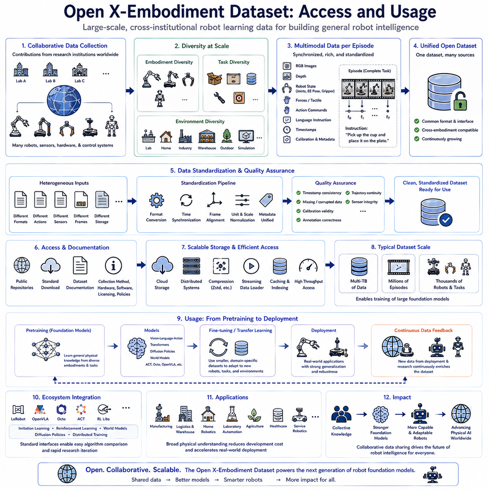{width="7.268055555555556in" height="7.268055555555556in"}

The Open X-Embodiment Dataset represents one of the largest collaborative open robot learning initiatives designed to accelerate the development of robot foundation models through large-scale, cross-institutional data sharing. Rather than relying on demonstrations collected from a single laboratory or robotic platform, the dataset integrates manipulation experiences contributed by numerous research organizations using different robots, sensing systems, hardware configurations, control architectures, and task environments. This collaborative strategy greatly increases behavioral diversity while reducing the cost and time required for individual organizations to construct massive robot datasets independently. By combining heterogeneous demonstrations into a unified training resource, the Open X-Embodiment Dataset provides a practical foundation for learning general robotic representations that transfer across tasks, environments, and robot embodiments.

The central philosophy of the Open X-Embodiment initiative is that robot intelligence should emerge from collective physical experience rather than isolated task-specific optimization. Individual research laboratories typically possess limited hardware resources, unique robot platforms, and relatively small demonstration datasets. While these datasets often contain high-quality manipulation behaviors, they rarely provide sufficient diversity to train large robot foundation models capable of broad generalization. The Open X-Embodiment Dataset addresses this limitation by aggregating data collected worldwide into a common representation, enabling foundation models to learn universal physical knowledge from a significantly wider range of interactions than any single institution could realistically obtain.

One of the defining characteristics of the dataset is cross-embodiment diversity. Participating institutions contribute demonstrations from robotic manipulators, mobile manipulators, collaborative robots, dual-arm systems, mobile robots, research platforms, and custom robotic hardware. These robots differ substantially in kinematic structure, degrees of freedom, payload capacity, end-effector design, sensing configuration, workspace geometry, controller architecture, and actuation technology. Instead of treating these differences as obstacles, foundation models learn to distinguish embodiment-specific physical constraints from transferable manipulation knowledge, allowing behavioral representations to generalize naturally across diverse robotic systems.

Task diversity represents another critical advantage of the Open X-Embodiment Dataset. Demonstrations span object grasping, pick-and-place operations, drawer manipulation, door opening, stacking, sorting, insertion, assembly, tool use, button pressing, container organization, object relocation, household activities, laboratory procedures, industrial manipulation, and many other robotic behaviors. Each task contributes unique interaction patterns that collectively expand the model\'s understanding of physical object relationships, contact dynamics, motion planning, and sequential decision making. Exposure to broad task diversity substantially improves policy robustness while reducing overfitting to narrowly defined manipulation scenarios.

Environmental diversity further strengthens model generalization by exposing learning algorithms to varying operational conditions. Demonstrations are collected in laboratories, homes, industrial facilities, research environments, warehouses, educational institutions, and simulated workspaces. Lighting conditions, object arrangements, backgrounds, workspace layouts, environmental clutter, camera viewpoints, and operating constraints vary naturally across contributors. Such environmental variation teaches foundation models to focus upon invariant physical principles rather than memorizing superficial visual characteristics unique to individual data collection sites.

The Open X-Embodiment Dataset emphasizes multimodal observations that comprehensively describe robot interaction with the physical world. RGB images, depth observations, robot proprioception, joint positions, end-effector poses, gripper states, force measurements, tactile sensing, action commands, language annotations, timestamps, calibration information, and environmental metadata are synchronized throughout complete task episodes. This rich multimodal representation enables modern Vision-Language-Action foundation models to jointly learn perception, language grounding, action prediction, and physical reasoning within unified transformer architectures supporting increasingly capable robotic intelligence.

Language annotations provide semantic descriptions connecting physical behavior with human intent. Natural language instructions specify task objectives, manipulated objects, desired outcomes, operational constraints, or procedural descriptions accompanying robot demonstrations. Multiple linguistic expressions describing equivalent tasks increase semantic diversity while preventing language overfitting. Through joint multimodal learning, foundation models establish meaningful associations between visual observations, robot actions, and human instructions, enabling intuitive language-guided robotic manipulation across previously unseen task variations.

Data standardization represents one of the most important engineering achievements supporting the Open X-Embodiment initiative. Individual datasets originally differ in observation formats, action representations, sensor configurations, coordinate systems, annotation procedures, communication protocols, and storage architectures. Before integration, standardized preprocessing pipelines transform heterogeneous datasets into compatible representations following common interface definitions, synchronization rules, metadata structures, and calibration conventions. Standardization allows large-scale foundation models to process data originating from numerous independent research groups without requiring extensive dataset-specific engineering modifications.

Dataset quality remains critically important despite enormous scale. Automated validation procedures inspect synchronization accuracy, timestamp consistency, missing observations, corrupted recordings, metadata completeness, calibration validity, annotation correctness, trajectory continuity, and sensor integrity before demonstrations become part of centralized repositories. Quality assurance prevents unreliable demonstrations from degrading foundation model performance while preserving scientific reproducibility. Continuous dataset maintenance further improves long-term usability as corrections, annotations, and metadata refinements become available over time.

Access to the Open X-Embodiment Dataset is designed to encourage open scientific collaboration while respecting licensing requirements and contributor policies. Researchers typically obtain datasets through publicly available repositories, standardized download procedures, dataset documentation, and associated metadata describing collection methodology, hardware characteristics, software configurations, and licensing terms. Clear documentation significantly reduces barriers to entry for new research groups while supporting reproducible experimentation across the international robotics community.

Efficient dataset access requires scalable storage infrastructure because multimodal robot demonstrations occupy substantial storage capacity. High-resolution images, depth maps, robot telemetry, language annotations, calibration files, evaluation labels, and metadata collectively generate datasets measuring multiple terabytes. Distributed storage systems, cloud repositories, efficient compression techniques, streaming data loaders, caching mechanisms, and parallel preprocessing pipelines allow organizations to train foundation models without repeatedly duplicating enormous datasets across individual research environments.

Foundation model pretraining represents one of the primary applications of the Open X-Embodiment Dataset. Large transformer architectures learn generalized representations by processing millions of synchronized multimodal observations collected across numerous robots and manipulation tasks. Rather than optimizing for individual benchmark performance alone, pretraining seeks transferable physical understanding supporting downstream adaptation through fine-tuning. Models trained using broad embodiment diversity consistently demonstrate stronger generalization than those relying exclusively upon single-platform demonstration datasets.

Transfer learning significantly increases the practical value of the dataset for industrial deployment. Organizations developing proprietary robotic applications rarely require complete retraining because pretrained foundation models already capture extensive manipulation knowledge acquired from shared datasets. Instead, comparatively small custom datasets reflecting organization-specific hardware, environments, and operational procedures efficiently specialize pretrained policies through fine-tuning. This workflow substantially reduces development cost while preserving broad generalization capabilities inherited from large collaborative pretraining datasets.

Simulation complements physical demonstrations by generating additional interaction experiences unavailable through direct robot operation alone. Synthetic environments provide diverse object configurations, environmental disturbances, rare failure conditions, and safely reproducible edge cases supporting improved policy robustness. Simulation data integrates naturally with physical demonstrations when standardized dataset representations are maintained, enabling balanced training pipelines combining realism with scalable synthetic experience generation.

The Open X-Embodiment Dataset integrates closely with modern open-source robot learning ecosystems including LeRobot, OpenVLA, Octo, ACT, imitation learning frameworks, reinforcement learning libraries, diffusion policies, world models, and distributed machine learning infrastructure. Standardized dataset interfaces enable researchers to evaluate multiple learning algorithms using identical multimodal observations while minimizing engineering effort associated with dataset conversion. This interoperability accelerates comparative research and encourages rapid experimentation across diverse foundation model architectures.

Industrial adoption of models pretrained on the Open X-Embodiment Dataset continues expanding across manufacturing, logistics, warehouse automation, household robotics, laboratory automation, agriculture, healthcare, collaborative robotics, and service robotics. Although application-specific fine-tuning remains necessary for production deployment, broad physical knowledge acquired during collaborative pretraining substantially reduces engineering effort required to develop robust robotic solutions. Organizations therefore benefit simultaneously from shared community experience and customized domain-specific adaptation.

The long-term significance of the Open X-Embodiment Dataset extends beyond its unprecedented size because it demonstrates that collaborative robot data sharing can fundamentally transform the development of Physical AI. Collective multimodal experiences gathered across institutions, robots, environments, and manipulation tasks establish a scalable knowledge foundation that no individual organization could realistically construct independently. As additional contributors continue expanding dataset diversity, future robot foundation models will acquire increasingly comprehensive physical understanding, enabling more capable, adaptable, and intelligent robotic systems that learn efficiently from the shared experience of the global robotics community.

## 9.8 Community Benchmark Participation Strategy

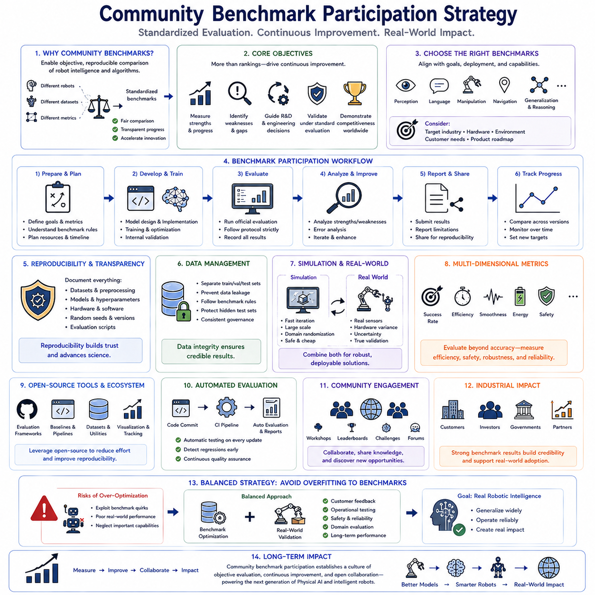{width="7.268055555555556in" height="7.268055555555556in"}

Community benchmarks have become an essential component of modern Physical AI research because they provide standardized evaluation environments that enable objective comparison between robot learning algorithms, foundation models, perception systems, planning architectures, and autonomous manipulation strategies. Without common evaluation criteria, improvements reported by individual research groups often depend upon different datasets, robot platforms, hardware configurations, testing protocols, and success metrics, making direct comparison unreliable. Community benchmark participation establishes reproducible evaluation standards that promote transparent scientific progress while encouraging researchers to develop algorithms capable of generalizing beyond narrowly optimized experimental settings. For organizations developing robot foundation models, benchmark participation serves as both a technical validation process and a mechanism for demonstrating practical competitiveness within the international robotics community.

The primary objective of a benchmark participation strategy is not merely achieving high rankings but establishing continuous improvement through systematic evaluation. Well-designed benchmark participation provides quantitative evidence of model strengths, identifies weaknesses requiring additional research, measures progress across development cycles, and validates whether architectural improvements produce meaningful performance gains under standardized testing conditions. Rather than treating benchmark results as isolated achievements, successful organizations integrate benchmark evaluation into their entire research and development workflow, allowing objective performance measurements to guide future engineering decisions and long-term research priorities.

Selecting appropriate benchmarks represents one of the earliest strategic decisions. Different benchmarks evaluate different aspects of robotic intelligence including visual perception, language grounding, manipulation success, navigation, reinforcement learning, policy generalization, multimodal reasoning, long-horizon planning, dexterous manipulation, simulation performance, and real-world deployment robustness. Organizations should prioritize benchmarks aligned with their long-term research objectives rather than attempting to optimize simultaneously for every available evaluation platform. Benchmark selection should therefore reflect expected deployment environments, target industries, hardware capabilities, customer requirements, and future product roadmaps.

Foundation model development particularly benefits from benchmarks emphasizing generalization rather than memorization. Modern robot foundation models should demonstrate robust performance across unseen objects, unfamiliar environments, novel task combinations, varying language instructions, changing lighting conditions, and different robotic embodiments. Evaluation protocols measuring zero-shot learning, few-shot adaptation, transfer learning, domain generalization, and cross-embodiment performance provide more meaningful indicators of practical deployment capability than narrowly optimized task-specific success rates. Organizations developing large-scale Physical AI systems should therefore emphasize benchmarks evaluating broad robotic intelligence rather than isolated manipulation accuracy alone.

Benchmark participation requires reproducible experimental procedures to ensure scientific credibility. Training datasets, preprocessing pipelines, model architectures, optimization parameters, evaluation scripts, hardware configurations, random seeds, software versions, dependency libraries, and experimental settings should be carefully documented and version controlled throughout development. Reproducibility not only strengthens confidence in reported benchmark results but also simplifies future comparisons as models evolve over successive research iterations. Transparent experimental methodology further facilitates collaboration with external researchers and contributes positively to the open scientific ecosystem.

Data management plays a significant role throughout benchmark preparation. Public benchmark datasets should remain clearly separated from proprietary development datasets to prevent unintended data leakage or evaluation bias. Validation datasets should not influence model optimization beyond officially permitted procedures, while hidden benchmark test sets must remain completely isolated until formal evaluation. Careful dataset governance preserves benchmark integrity while ensuring reported performance reflects genuine model generalization rather than memorization of evaluation examples. Organizations participating in multiple benchmarks should maintain standardized dataset management policies across all evaluation activities.

Simulation benchmarks provide efficient opportunities for large-scale algorithm development before expensive physical robot validation. High-fidelity simulation environments allow rapid experimentation with perception systems, manipulation policies, navigation algorithms, reinforcement learning strategies, world models, and planning architectures under controlled conditions. Domain randomization, physics variation, environmental perturbations, sensor noise, and synthetic edge cases substantially improve policy robustness before transferring algorithms onto physical robots. Simulation benchmarks therefore reduce development cost while accelerating iterative algorithm improvement during early research stages.

Real-world benchmark participation remains essential because simulation alone cannot capture every aspect of physical interaction. Sensor imperfections, actuator variability, hardware wear, environmental uncertainty, calibration drift, unexpected object properties, communication delays, and safety constraints introduce practical challenges absent from simulated environments. Successful benchmark strategies therefore combine simulation evaluation with systematic physical validation, ensuring that improvements demonstrated in virtual environments translate reliably into operational robotic systems deployed under realistic conditions.

Performance metrics should extend beyond simple task completion rates. Execution efficiency, trajectory smoothness, energy consumption, computational latency, inference throughput, safety behavior, failure recovery capability, motion stability, resource utilization, robustness under uncertainty, calibration sensitivity, and long-term operational consistency all contribute valuable insight into real deployment readiness. Multi-dimensional evaluation provides a more comprehensive understanding of system capability while preventing optimization exclusively toward a single benchmark score that may neglect practical operational requirements.

Community benchmark participation also encourages responsible research practices through transparent reporting standards. Organizations should publish not only successful benchmark results but also experimental limitations, known failure cases, computational requirements, hardware dependencies, dataset assumptions, evaluation constraints, and reproducibility information whenever possible. Honest reporting strengthens scientific trust while enabling other researchers to interpret benchmark performance appropriately within broader technological contexts. Transparent communication further accelerates collective progress by allowing the research community to build upon validated findings rather than repeating undocumented engineering efforts.

Open-source software contributes substantially to effective benchmark participation. Standardized evaluation frameworks, publicly available baseline implementations, shared preprocessing pipelines, visualization tools, experiment tracking platforms, dataset management utilities, and automated benchmarking scripts reduce engineering overhead while improving reproducibility across participating institutions. Leveraging established open-source ecosystems allows organizations to concentrate research effort on algorithmic innovation rather than repeatedly implementing supporting infrastructure already available within the community.

Continuous integration and automated evaluation significantly improve benchmark development efficiency. Every substantial model update can automatically trigger benchmark evaluation pipelines that execute standardized experiments, generate performance reports, compare results against previous versions, archive metrics, detect regressions, and notify developers of unexpected performance changes. Integrating benchmark evaluation into routine development workflows transforms benchmarking from an occasional reporting activity into a continuous quality assurance mechanism supporting rapid iterative improvement.

Collaboration with the broader robotics community represents another important strategic benefit of benchmark participation. Shared evaluation protocols encourage communication between academic researchers, industrial developers, open-source contributors, hardware manufacturers, and foundation model developers working toward common scientific objectives. Participation in workshops, benchmark leaderboards, technical forums, collaborative challenges, and open competitions facilitates knowledge exchange while exposing organizations to emerging research directions, novel evaluation methodologies, and potential collaborative opportunities that accelerate future innovation.

Benchmark results also influence industrial credibility beyond academic recognition. Customers, investors, research partners, government agencies, and regulatory organizations increasingly view independently evaluated benchmark performance as evidence supporting technical maturity, engineering quality, and deployment readiness. Although benchmark rankings alone cannot guarantee commercial success, consistently strong performance across respected community benchmarks provides objective external validation that complements internal engineering evaluation during technology commercialization.

Organizations should avoid optimizing exclusively for benchmark performance because excessive specialization may reduce practical deployment capability. Models heavily tuned for specific evaluation protocols sometimes exploit benchmark characteristics without improving genuine robotic intelligence. Maintaining balanced research priorities requires combining benchmark optimization with real-world validation, customer feedback, operational testing, long-term reliability assessment, safety evaluation, and domain-specific performance analysis. Community benchmarks should therefore serve as one component within a broader engineering validation strategy rather than becoming the sole objective of development.

Large robot foundation models particularly benefit from benchmark participation because standardized evaluations reveal whether broad pretraining genuinely improves downstream adaptation across multiple robotic tasks. Benchmarks evaluating zero-shot generalization, few-shot learning, language-conditioned manipulation, cross-embodiment transfer, multimodal reasoning, and long-horizon sequential planning provide valuable evidence supporting architectural design decisions. These evaluations also identify limitations requiring additional data collection, model scaling, algorithm refinement, or representation learning improvements before deployment into production environments.

The long-term significance of a comprehensive community benchmark participation strategy extends beyond achieving competitive performance because it establishes a disciplined engineering culture centered upon objective measurement, reproducible experimentation, collaborative scientific contribution, and continuous technological improvement. Organizations systematically participating in respected community benchmarks develop stronger evaluation methodologies, more reliable foundation models, richer engineering practices, and broader engagement with the global robotics ecosystem. As Physical AI continues evolving toward increasingly capable foundation models and autonomous robotic systems, community benchmark participation will remain one of the most effective mechanisms for validating progress, accelerating innovation, and ensuring that research advances translate into robust real-world robotic intelligence.

## 9.9 Contributing to Open Source Physical AI Projects

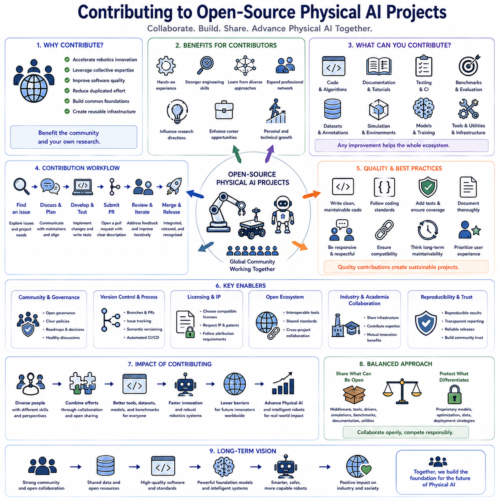{width="7.268055555555556in" height="7.268055555555556in"}

Open-source Physical AI projects have become one of the primary driving forces behind the rapid advancement of modern robotics by enabling researchers, companies, universities, and independent developers to collaborate on shared software, datasets, benchmark environments, robot foundation models, simulation tools, middleware, and learning algorithms. Instead of every organization independently solving identical engineering problems, open-source collaboration encourages the global robotics community to build upon common foundations while focusing individual research efforts on novel innovations. This collaborative development model accelerates technological progress, improves software quality through community review, reduces duplicated engineering effort, and creates reusable infrastructure supporting increasingly capable Physical AI systems.

Contributing to open-source projects provides benefits that extend well beyond simply publishing software. Contributors gain practical experience working within large collaborative development environments while improving software engineering practices, documentation quality, testing methodology, system architecture design, version control workflows, and collaborative communication skills. Participation also exposes developers to diverse implementation approaches proposed by researchers and engineers from different institutions, broadening technical understanding beyond what individual organizations typically experience. These collaborative experiences frequently influence future research directions while strengthening professional networks throughout the international robotics ecosystem.

Physical AI projects encompass a broad spectrum of technologies supporting intelligent robotic systems. Contributions may involve robot operating middleware, perception algorithms, localization systems, mapping software, manipulation frameworks, reinforcement learning libraries, imitation learning pipelines, vision-language-action models, world models, simulation environments, motion planning systems, benchmarking tools, dataset management utilities, distributed training infrastructure, cloud robotics services, or hardware interface drivers. Because modern robotic systems integrate numerous interacting software components, improvements contributed to any individual subsystem often generate positive impact across many downstream applications and research projects.

Software contributions remain among the most visible forms of community participation. Developers implement new algorithms, optimize computational efficiency, improve numerical stability, extend hardware compatibility, eliminate software defects, enhance user interfaces, refactor legacy code, simplify APIs, and increase modularity within existing software architectures. High-quality contributions emphasize maintainability, readability, scalability, and compatibility rather than introducing unnecessary implementation complexity. Successful open-source development therefore requires careful engineering discipline alongside algorithmic innovation.

Documentation represents an equally valuable contribution despite often receiving less attention than software implementation. Comprehensive installation guides, API references, architecture explanations, tutorial notebooks, usage examples, troubleshooting manuals, deployment instructions, hardware configuration guides, and developer onboarding materials significantly improve accessibility for new users. Well-written documentation reduces adoption barriers, accelerates community growth, minimizes repetitive support requests, and encourages broader participation from researchers possessing varying levels of software engineering experience.

Testing infrastructure plays a central role in maintaining reliable open-source robotics software. Contributors develop unit tests, integration tests, hardware validation procedures, simulation-based regression testing, continuous integration pipelines, automated performance evaluation, reproducibility verification, and compatibility testing across multiple operating systems and hardware platforms. Robust testing frameworks detect software regressions before release while increasing confidence that new features maintain compatibility with existing functionality. As Physical AI systems become increasingly complex, automated validation becomes essential for sustaining software quality across rapidly evolving collaborative projects.

Benchmark development provides another important avenue for contribution. Community benchmarks establish standardized evaluation procedures allowing objective comparison between competing algorithms, datasets, and foundation models. Contributors design benchmark tasks, develop evaluation metrics, prepare standardized datasets, implement automated scoring systems, maintain public leaderboards, and document experimental protocols supporting reproducible scientific comparison. High-quality benchmarks encourage meaningful innovation by rewarding genuine improvements in robotic capability rather than optimization toward inconsistent or privately defined evaluation methodologies.

Dataset contributions significantly strengthen robot foundation model development because learning performance depends heavily upon data diversity and quality. Contributors collect robot demonstrations, annotate multimodal observations, verify synchronization accuracy, improve metadata quality, organize standardized dataset structures, remove corrupted recordings, balance task distributions, document collection procedures, and validate annotation consistency. Publicly shared datasets representing diverse robots, manipulation tasks, environmental conditions, and sensing modalities substantially expand opportunities for collaborative research while reducing redundant data collection effort across independent organizations.

Simulation environments provide scalable experimental platforms supporting algorithm development before deployment onto physical hardware. Contributors create realistic robot models, environment assets, physics parameter configurations, object libraries, sensor simulation modules, digital twin frameworks, procedural environment generators, and domain randomization utilities. Improved simulation fidelity increases transferability from virtual experiments to real robotic systems while enabling reproducible evaluation under standardized environmental conditions unavailable through physical experimentation alone.

Robot foundation model research increasingly depends upon collaborative development across multiple institutions. Contributors improve model architectures, optimize distributed training pipelines, develop efficient inference engines, design parameter-efficient fine-tuning strategies, integrate multimodal representations, implement attention optimizations, reduce memory consumption, enhance model compression techniques, and evaluate cross-embodiment generalization. Open collaboration accelerates architectural innovation because researchers collectively analyze strengths and limitations of emerging foundation model approaches rather than repeating isolated engineering efforts.

Community code review represents one of the strongest quality assurance mechanisms within successful open-source projects. Every proposed software modification undergoes technical discussion examining implementation quality, algorithm correctness, software architecture consistency, coding style, computational efficiency, documentation completeness, testing coverage, backward compatibility, and long-term maintainability. Constructive review improves both software quality and contributor expertise while establishing shared engineering standards throughout collaborative development communities.

Version control workflows coordinate contributions originating from numerous independent developers. Distributed development typically relies upon feature branches, pull requests, issue tracking systems, release management procedures, semantic versioning, automated merge validation, and continuous integration infrastructure. Following established contribution guidelines minimizes conflicts while ensuring individual improvements integrate smoothly into rapidly evolving software repositories. Understanding collaborative version control therefore represents a fundamental skill for effective participation within modern Physical AI development communities.

Open governance structures promote sustainable long-term project evolution. Maintainers establish technical roadmaps, define contribution policies, review architectural decisions, coordinate release schedules, moderate technical discussions, resolve conflicting proposals, and balance innovation with software stability. Transparent governance encourages community trust by ensuring development priorities reflect collective project objectives rather than individual organizational interests. Healthy governance structures become increasingly important as successful Physical AI projects attract larger international contributor communities.

Licensing considerations require careful attention throughout open-source contribution. Contributors should understand software licenses governing code reuse, derivative works, commercial deployment, patent implications, attribution requirements, and intellectual property protection. Selecting compatible licenses facilitates collaboration while preventing legal ambiguity that might discourage industrial adoption. Organizations participating in open-source Physical AI projects should therefore establish internal review procedures ensuring contributions remain consistent with institutional intellectual property policies and licensing obligations.

Industrial participation within open-source robotics ecosystems has expanded significantly because collaborative infrastructure reduces development cost while accelerating innovation. Companies increasingly contribute software improvements, hardware drivers, benchmark datasets, simulation environments, documentation, testing frameworks, and deployment experience that simultaneously strengthen community resources and improve their own engineering ecosystems. This mutually beneficial relationship enables organizations to leverage collective innovation while contributing specialized expertise unavailable elsewhere within the community.

Academic research similarly benefits from active open-source contribution because publicly available implementations improve scientific reproducibility and accelerate technology transfer. Publishing executable software alongside research papers allows independent researchers to validate experimental claims, reproduce reported benchmark results, compare competing algorithms fairly, and extend previous work without reimplementing foundational infrastructure. Open implementation therefore transforms scientific publications into reusable engineering resources supporting cumulative technological advancement across the robotics research community.

Successful contributors consistently prioritize collaboration over individual recognition. Effective communication, respectful technical discussion, responsiveness to community feedback, willingness to revise implementations, thorough documentation, comprehensive testing, and long-term maintenance responsibilities contribute substantially to project sustainability. Open-source communities thrive when contributors focus upon collective engineering progress rather than personal visibility, creating collaborative environments where diverse expertise combines to solve increasingly complex Physical AI challenges.

Organizations developing proprietary robotic products can simultaneously benefit from and contribute to open-source ecosystems by strategically separating shared infrastructure from application-specific intellectual property. Generic middleware, hardware abstraction layers, simulation components, benchmarking tools, documentation improvements, and software utilities often provide greater value when developed collaboratively, while proprietary perception models, optimization techniques, or domain-specific deployment strategies remain internal competitive assets. Balanced participation enables organizations to maximize collaborative innovation without compromising commercial differentiation.

The long-term significance of contributing to open-source Physical AI projects extends far beyond individual software repositories because collaborative engineering establishes the common technological foundation supporting future generations of intelligent robotic systems. Shared software infrastructure, standardized datasets, reproducible benchmarks, scalable simulation platforms, foundation model implementations, documentation resources, and community knowledge collectively accelerate global robotics research while lowering barriers for future innovators. As Physical AI continues evolving toward increasingly capable autonomous systems, sustained open-source collaboration will remain one of the most powerful mechanisms for transforming distributed human expertise into shared technological progress benefiting researchers, industries, and society worldwide.

## 9.10 Open Source Physical AI IP and License Strategy

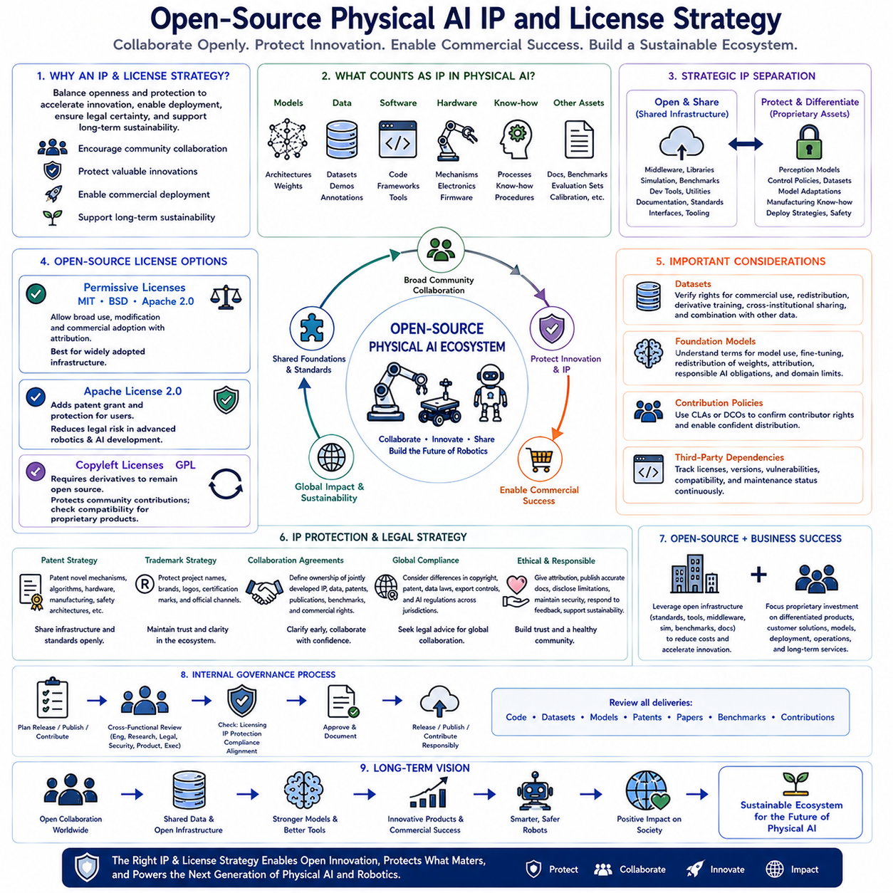{width="7.268055555555556in" height="7.268055555555556in"}

Open-source Physical AI development requires a carefully balanced intellectual property strategy that simultaneously encourages community collaboration, protects valuable innovations, enables commercial deployment, and supports long-term technological sustainability. Unlike purely academic research or fully proprietary software development, Physical AI projects integrate software, hardware, datasets, machine learning models, simulation environments, robot control systems, sensor interfaces, cloud services, and operational knowledge into highly interconnected ecosystems. Every component may follow different licensing requirements, intellectual property ownership models, contribution policies, and commercialization pathways. Consequently, successful Physical AI organizations must design comprehensive IP and licensing strategies that maximize collaborative innovation while preserving strategic competitive advantages and legal certainty throughout the product lifecycle.

Intellectual property within Physical AI extends far beyond source code alone. Valuable assets include robot foundation model architectures, pretrained model parameters, fine-tuned weights, multimodal datasets, teleoperation demonstrations, simulation environments, calibration procedures, hardware interface specifications, mechanical designs, electronics, embedded firmware, software frameworks, benchmark methodologies, evaluation datasets, deployment pipelines, operational know-how, manufacturing processes, safety procedures, documentation, and accumulated engineering expertise. Understanding these diverse intellectual property categories allows organizations to determine which technologies should remain proprietary, which can be openly shared, and which benefit most from collaborative community development.

An effective IP strategy begins by separating shared infrastructure from proprietary differentiation. Generic middleware, communication libraries, hardware abstraction layers, simulation tools, benchmark frameworks, visualization software, deployment utilities, logging systems, configuration managers, documentation templates, and developer tools frequently provide greater value when developed collaboratively as open-source projects. In contrast, proprietary perception models, optimized control policies, customer-specific datasets, specialized foundation model adaptations, manufacturing knowledge, commercial deployment strategies, safety certifications, and application-specific optimization techniques often represent critical competitive advantages deserving stronger intellectual property protection. This balanced separation maximizes innovation while preserving commercial differentiation.

Open-source licenses define how software, datasets, and related assets may be used, modified, redistributed, or integrated into commercial products. Permissive licenses such as MIT, BSD, and Apache License 2.0 encourage widespread adoption by allowing relatively unrestricted commercial use while requiring attribution and preservation of copyright notices. These licenses are particularly suitable for infrastructure software intended to become broadly adopted industry standards because they minimize barriers preventing companies from incorporating community-developed components into proprietary commercial products.

Apache License 2.0 introduces additional patent protections that are especially valuable within advanced robotics and artificial intelligence development. Contributors automatically grant patent rights necessary for using their contributions while protecting users against certain patent disputes arising from collaborative software development. As Physical AI increasingly combines software innovation with patentable hardware technologies, communication protocols, sensing architectures, and machine learning techniques, explicit patent provisions significantly reduce legal uncertainty surrounding collaborative engineering activities. Organizations expecting broad industrial participation often prefer Apache License 2.0 because it balances commercial flexibility with stronger intellectual property clarity.

Copyleft licenses such as the GNU General Public License impose reciprocal obligations requiring derivative software distributed externally to remain under compatible open-source licenses. These licenses encourage continued community contribution by preventing organizations from incorporating open-source software into closed proprietary products without sharing corresponding modifications. While copyleft licensing successfully protects collaborative community development, organizations developing proprietary commercial robotics products must carefully evaluate compatibility before integrating copyleft components into production software architectures. Understanding reciprocal licensing obligations prevents unintended legal conflicts during product commercialization.

Dataset licensing represents an increasingly important consideration because modern robot foundation models depend heavily upon large-scale multimodal training data. Robot demonstrations, sensor recordings, language annotations, simulation trajectories, evaluation datasets, benchmark collections, and teleoperation recordings frequently possess licensing conditions independent of associated software repositories. Organizations must carefully verify whether datasets permit commercial use, derivative model training, redistribution, public publication, cross-institutional sharing, or integration with additional proprietary data. Clear dataset governance prevents licensing conflicts that could restrict future model deployment or commercialization opportunities.

Foundation model licensing introduces additional complexity beyond conventional software licensing. Publicly released pretrained models may restrict commercial deployment, prohibit certain application domains, require attribution, impose responsible AI obligations, or limit redistribution of modified model weights. Organizations fine-tuning publicly available robot foundation models should thoroughly understand licensing conditions governing pretrained parameters before incorporating derived models into commercial products. Likewise, organizations releasing proprietary foundation models must determine whether they intend unrestricted public access, research-only usage, controlled commercial licensing, or hybrid distribution strategies balancing openness with sustainable business objectives.

Contribution policies establish legal clarity regarding ownership of collaboratively developed software. Many mature open-source projects require Contributor License Agreements or Developer Certificate of Origin declarations confirming contributors possess legal authority to submit software under project licensing terms. These agreements reduce future ownership disputes while ensuring maintainers can distribute contributed software confidently. Organizations encouraging employee participation in open-source robotics projects should define internal contribution policies clarifying employer ownership, approval procedures, intellectual property review, and permitted public disclosure of internally developed technologies.

Third-party dependency management represents another critical element of responsible licensing strategy. Modern Physical AI software often incorporates hundreds of external libraries spanning robotics middleware, machine learning frameworks, optimization software, visualization packages, cloud services, operating system utilities, mathematical libraries, communication frameworks, and hardware drivers. Organizations should continuously monitor dependency licenses, software versions, security vulnerabilities, maintenance status, and compatibility requirements throughout product development. Automated software composition analysis tools help maintain visibility into evolving dependency ecosystems while preventing accidental inclusion of incompatible licensed components.

Patent strategy complements open-source licensing rather than replacing it. Organizations should distinguish technologies benefiting from patent protection from infrastructure better shared openly. Novel robot mechanisms, sensing technologies, control algorithms, manufacturing innovations, safety architectures, specialized hardware, energy systems, or commercial deployment methods may warrant patent applications before public disclosure. Meanwhile, supporting infrastructure, interoperability standards, middleware, simulation frameworks, or benchmarking tools frequently create greater long-term value through widespread community adoption than exclusive ownership. Combining selective patent protection with strategic open-source release often maximizes both innovation and commercial opportunity.

Trademark protection also contributes to long-term ecosystem development. Project names, organizational brands, certification marks, product identities, and official distribution channels distinguish authentic software releases from unofficial derivatives. Responsible trademark management preserves community trust while allowing open software collaboration without confusing users regarding official project governance or software quality. Successful open-source robotics ecosystems frequently separate copyright licensing governing software reuse from trademark policies protecting project identity and reputation.

Industrial collaboration requires clearly defined intellectual property boundaries before joint development begins. Research partnerships involving universities, technology companies, hardware manufacturers, cloud service providers, and government agencies should establish ownership of jointly developed software, datasets, patents, publications, benchmark results, and commercial deployment rights through comprehensive collaboration agreements. Early clarification prevents disputes after valuable technologies emerge while enabling all participants to contribute confidently toward shared technical objectives.

International collaboration introduces additional legal complexity because copyright law, patent enforcement, software licensing interpretation, data governance regulations, export controls, and artificial intelligence regulations differ substantially across jurisdictions. Organizations participating in global Physical AI initiatives should consult legal expertise when distributing software internationally, sharing robot datasets across borders, releasing foundation models publicly, or establishing multinational collaborative research programs. International legal awareness minimizes compliance risk while supporting responsible worldwide technology dissemination.

Responsible open-source participation extends beyond legal compliance toward ethical technology stewardship. Organizations should publish accurate documentation, acknowledge external contributions, respect contributor attribution, disclose known software limitations, maintain security updates, respond constructively to community feedback, and support long-term project sustainability whenever possible. Ethical collaboration strengthens community trust while encouraging continued participation from researchers, developers, industrial partners, and educational institutions contributing toward shared technological advancement.

Commercial success and open-source collaboration should not be viewed as opposing objectives. Many successful robotics organizations build profitable products upon open infrastructure while contributing improvements benefiting the broader community. Shared middleware, standardized interfaces, simulation tools, benchmarking frameworks, documentation resources, dataset utilities, and interoperability standards reduce duplicated engineering effort for everyone, allowing organizations to focus proprietary investment upon differentiated products, customer solutions, specialized models, deployment expertise, operational excellence, and long-term service capabilities. Balanced openness therefore frequently strengthens rather than weakens sustainable competitive positioning.

Organizations developing robot foundation models should establish internal governance processes reviewing every planned software release, dataset publication, model distribution, patent filing, research paper, benchmark submission, and community contribution before public disclosure. Cross-functional review involving engineering, research, legal, cybersecurity, product management, and executive leadership ensures licensing consistency, intellectual property protection, regulatory compliance, commercial alignment, and responsible publication practices throughout the technology development lifecycle.

The long-term significance of a well-designed open-source Physical AI intellectual property and licensing strategy extends beyond legal protection because it establishes the governance framework enabling sustainable global collaboration. Carefully balanced licensing policies, selective intellectual property protection, transparent contribution procedures, responsible community engagement, standardized interoperability, and strategic commercialization collectively create an innovation ecosystem where shared technological foundations accelerate worldwide robotics progress while allowing organizations to preserve meaningful competitive differentiation. As Physical AI evolves toward increasingly capable robot foundation models, collaborative development platforms, and autonomous robotic systems, effective IP and licensing strategies will remain essential for transforming open scientific cooperation into sustainable industrial innovation and long-term societal benefit.
