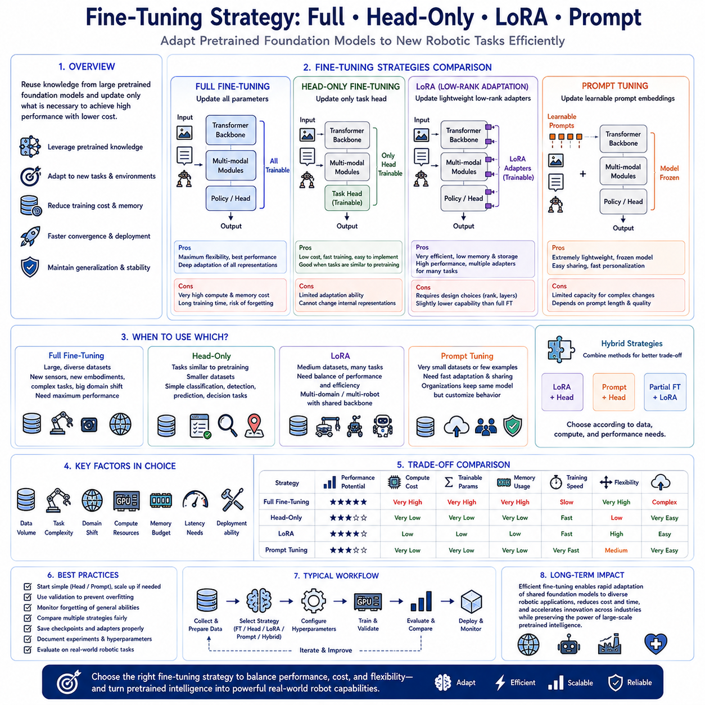
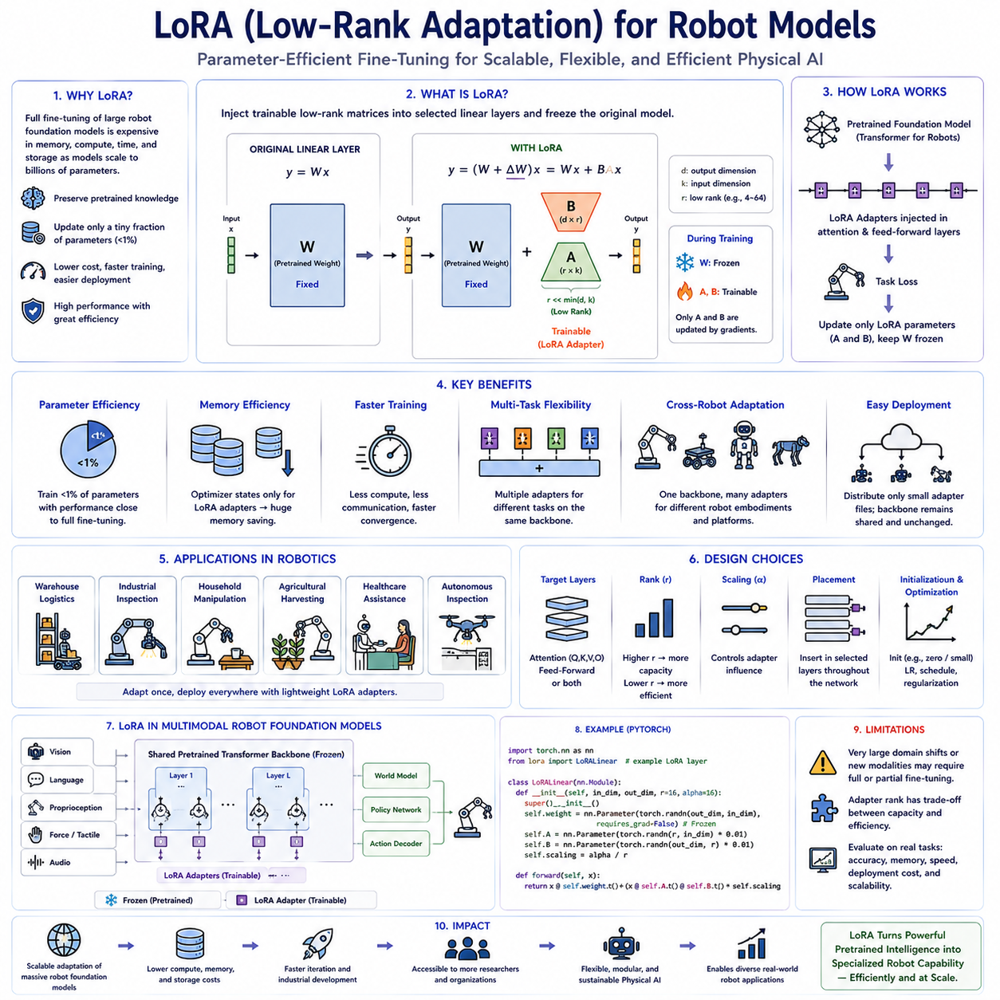
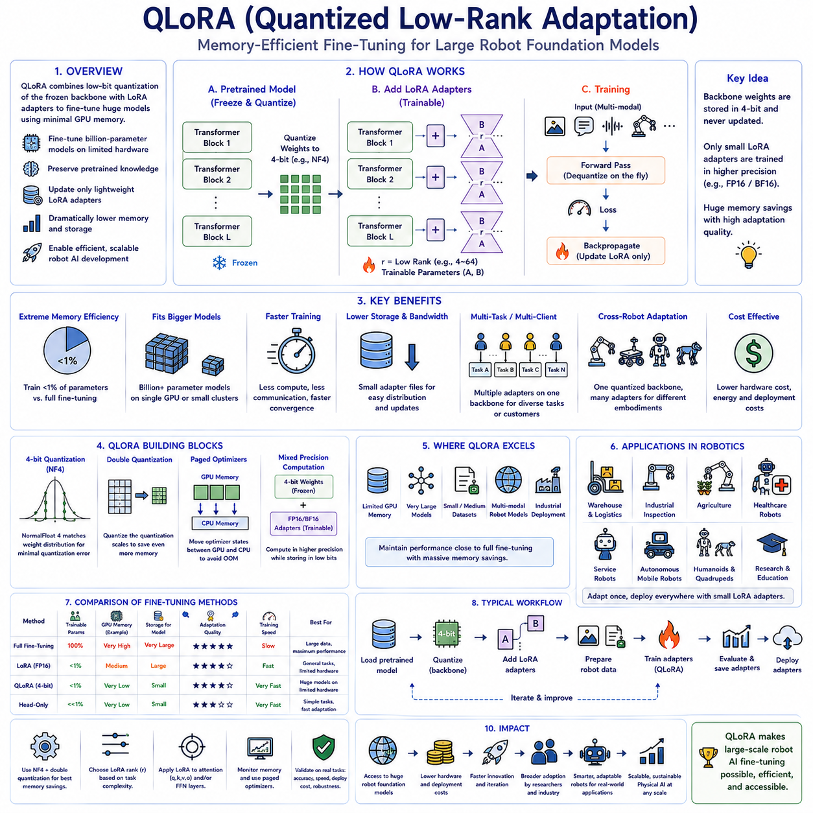
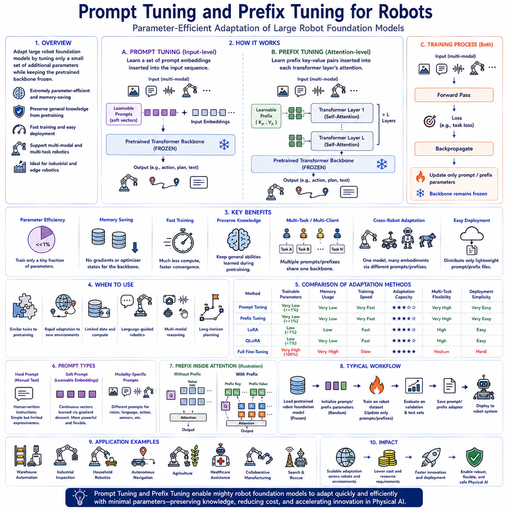
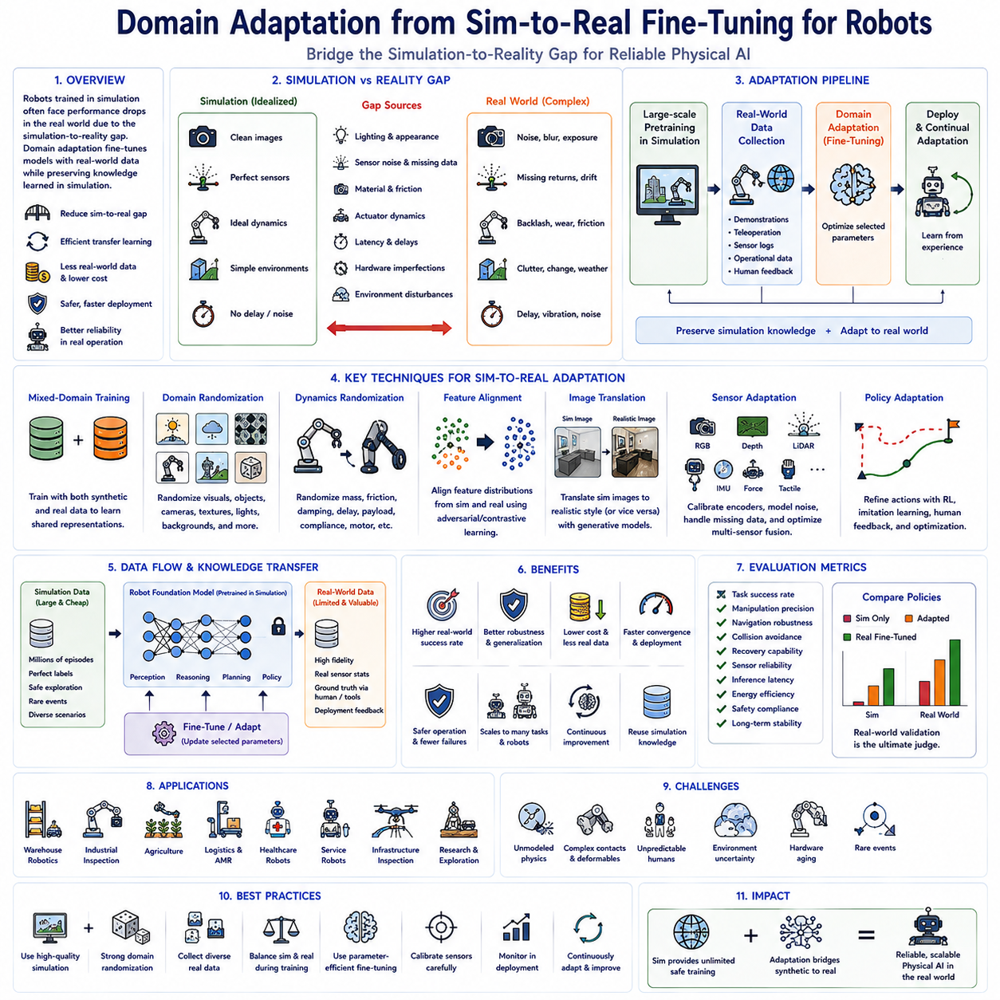
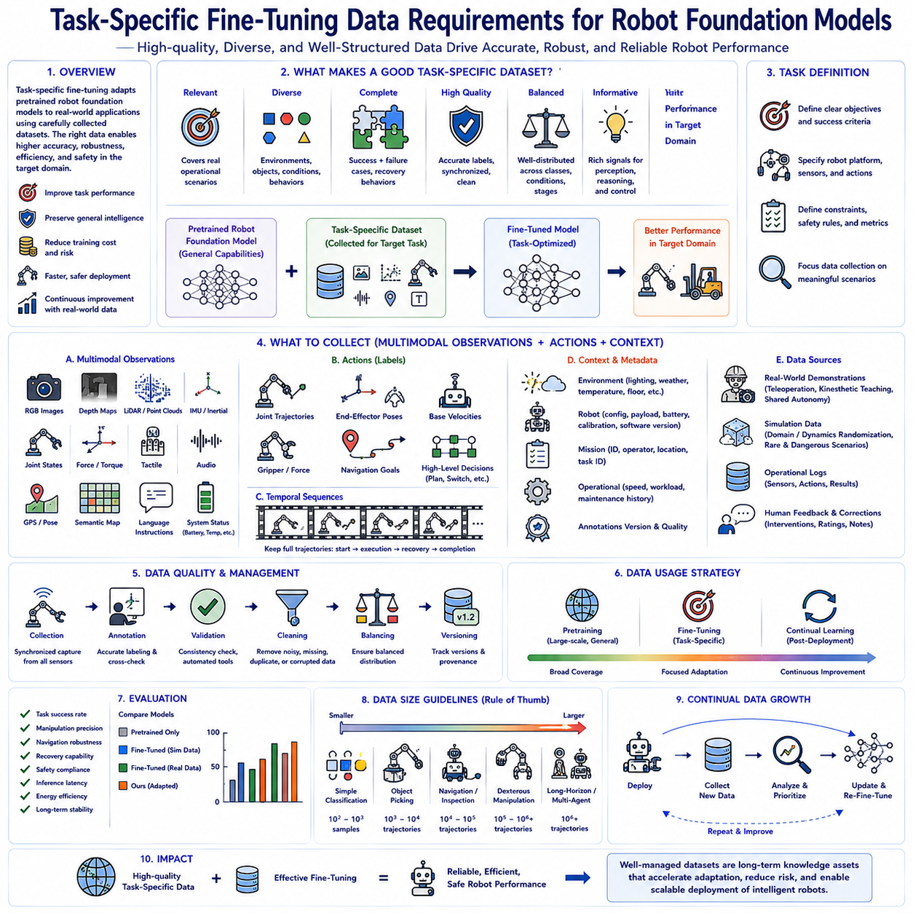
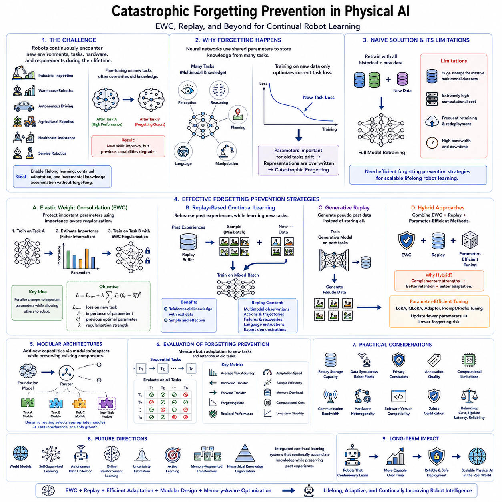
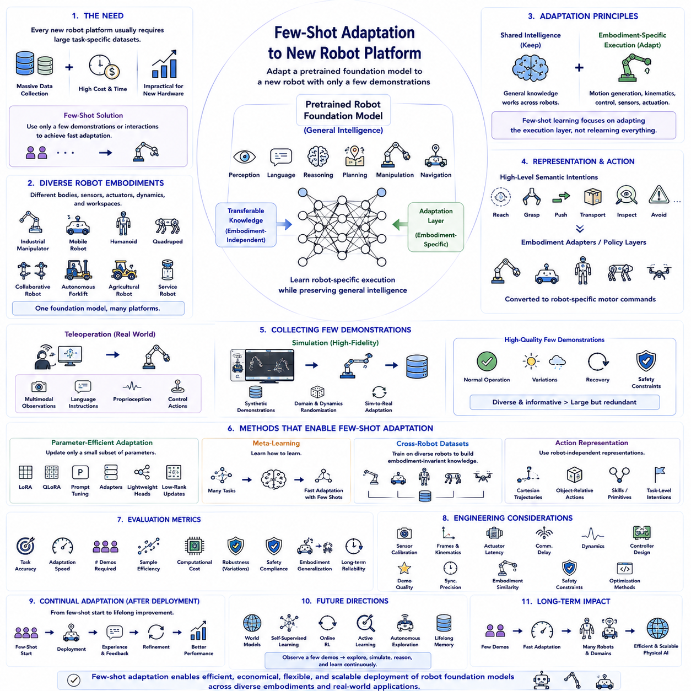
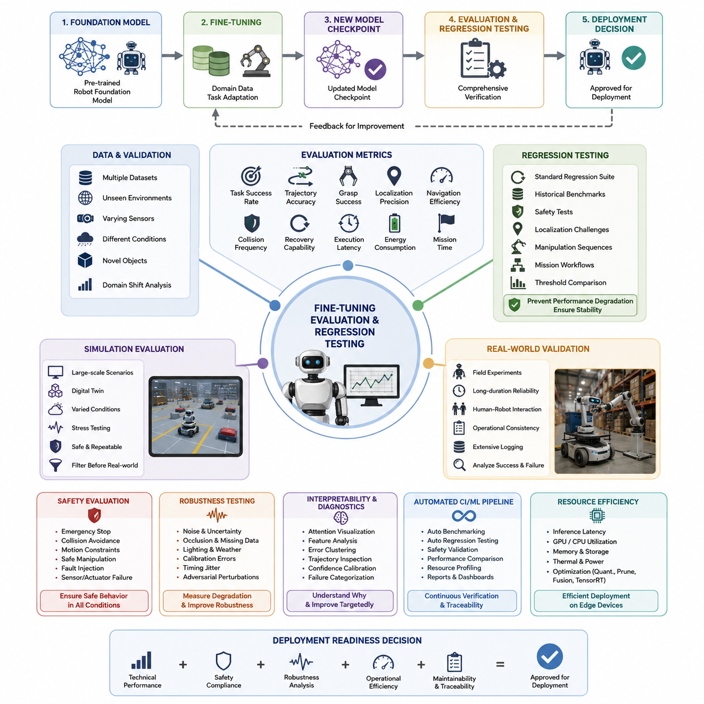
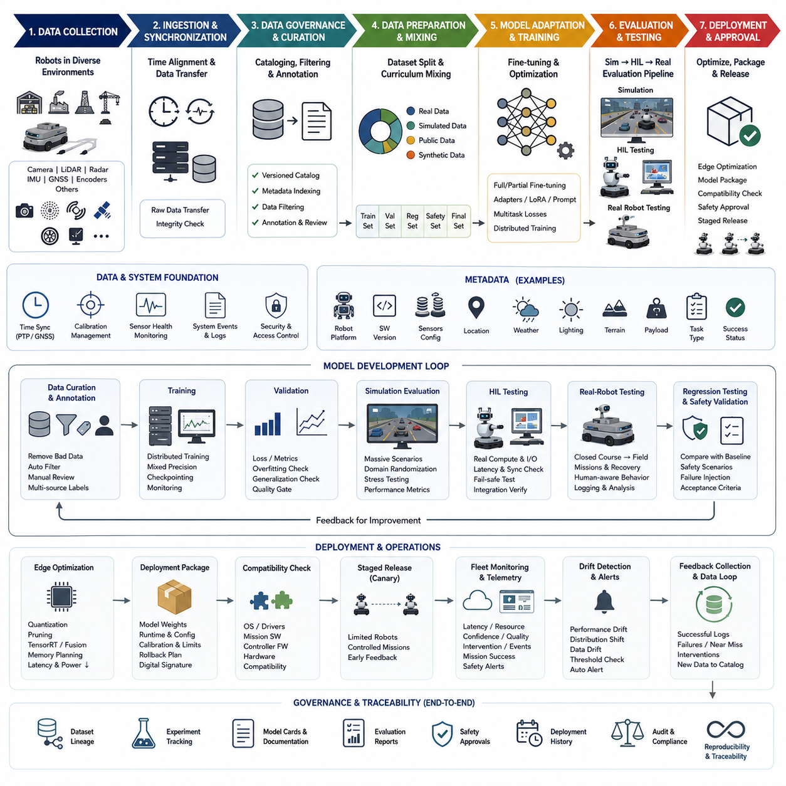

**Volume 18 Physical AI Foundation Models**


# 10. Fine Tuning and Adaptation

##  

## 10.1 Fine Tuning Strategy Full Head Only LoRA Prompt

{width="7.268055555555556in" height="7.268055555555556in"}

Modern Physical AI systems increasingly rely on efficient fine-tuning strategies to adapt large pretrained foundation models to new robotic tasks, environments, hardware platforms, and industrial applications. Training an entire foundation model from scratch requires enormous computational resources, massive multimodal datasets, and extensive engineering effort that are beyond the capabilities of most research laboratories and commercial organizations. Fine-tuning addresses this challenge by reusing the knowledge already learned during large-scale pretraining while updating only selected portions of the model to acquire new capabilities. Depending on available computational resources, dataset size, deployment requirements, and expected performance, organizations may choose among full model fine-tuning, head-only adaptation, Low-Rank Adaptation (LoRA), prompt tuning, or combinations of multiple parameter-efficient adaptation techniques. Selecting the appropriate fine-tuning strategy directly influences training cost, memory consumption, convergence speed, deployment flexibility, and long-term maintainability.

Full model fine-tuning updates every trainable parameter within the pretrained foundation model during optimization. This approach allows complete adaptation of the internal feature representations, attention mechanisms, multimodal fusion layers, reasoning modules, and policy generation components to the target application. Because every layer participates in optimization, the model possesses maximum flexibility to learn new visual concepts, manipulation strategies, language understanding, sequential reasoning, and environment-specific behaviors. Full fine-tuning generally achieves the highest possible task performance when sufficient training data and computational resources are available, particularly when the target domain differs substantially from the original pretraining distribution.

The primary advantage of full fine-tuning lies in its unrestricted learning capacity. Models can modify low-level visual representations, intermediate semantic features, high-level reasoning structures, and action generation policies simultaneously, allowing deep adaptation throughout the network hierarchy. Industrial robotics applications involving novel sensors, unique robot embodiments, specialized manipulation tasks, or unfamiliar environmental conditions frequently benefit from complete parameter optimization because domain-specific information may influence nearly every stage of the perception-to-action pipeline. Large multimodal foundation models trained through comprehensive fine-tuning often exhibit superior accuracy, robustness, and long-term generalization compared with more constrained adaptation strategies.

Despite its advantages, full fine-tuning imposes substantial computational demands. Updating billions of model parameters requires multiple high-memory GPUs, distributed optimization infrastructure, large storage capacity for optimizer states and checkpoints, extensive training time, and carefully tuned optimization schedules. Catastrophic forgetting may also occur when aggressive optimization causes the model to lose valuable capabilities acquired during pretraining while specializing toward a narrower downstream task. Consequently, organizations must balance adaptation performance against computational cost, memory availability, engineering complexity, and preservation of previously learned general knowledge.

Head-only fine-tuning represents one of the simplest adaptation strategies by freezing the pretrained backbone while optimizing only the task-specific prediction head. The backbone continues extracting generic multimodal representations learned during pretraining, whereas newly initialized output layers learn mappings from these representations to target actions, classifications, regression outputs, or policy predictions. Because only a relatively small number of parameters require optimization, head-only fine-tuning significantly reduces memory consumption, computational cost, convergence time, and overfitting risk. This strategy is particularly effective when downstream tasks closely resemble capabilities already represented within the pretrained foundation model.

Head-only adaptation performs especially well for applications requiring modest domain specialization without fundamental changes to learned representations. Object classification, defect detection, manipulation success prediction, anomaly recognition, quality inspection, navigation waypoint selection, or simple robotic decision-making tasks often benefit from efficient head optimization because pretrained feature extractors already encode highly informative visual and semantic representations. Small industrial datasets also favor head-only fine-tuning because limited trainable parameters reduce the likelihood of memorizing training examples while preserving strong generalization inherited from large-scale pretraining.

However, head-only fine-tuning cannot modify internal feature representations when pretrained knowledge becomes insufficient for new applications. If robots encounter entirely new sensing modalities, significantly different manipulation dynamics, unfamiliar object categories, complex physical interactions, or radically different operational environments, frozen backbone representations may prevent effective adaptation regardless of output head optimization. Consequently, organizations should carefully evaluate whether downstream tasks primarily require new decision boundaries or fundamentally different internal representations before selecting head-only adaptation.

Low-Rank Adaptation, commonly known as LoRA, has emerged as one of the most influential parameter-efficient fine-tuning techniques for large foundation models. Rather than updating every pretrained parameter directly, LoRA inserts small trainable low-rank matrices into selected neural network layers while leaving original model weights unchanged. During optimization, only these lightweight adapter matrices receive gradient updates, dramatically reducing trainable parameter count while preserving nearly all pretrained knowledge. After training, LoRA adapters may remain separate from the original model or merge into base weights for simplified deployment depending upon operational requirements.

The fundamental principle underlying LoRA exploits the observation that many downstream adaptations require only low-dimensional modifications to existing parameter spaces. Instead of learning entirely new weight matrices containing millions of parameters, LoRA approximates necessary updates through compact low-rank decompositions capturing dominant adaptation directions. This mathematical formulation significantly decreases GPU memory usage, optimizer storage, communication overhead during distributed training, and checkpoint size without substantially degrading downstream performance. Consequently, organizations can efficiently fine-tune very large robot foundation models using comparatively modest computational infrastructure.

LoRA offers substantial operational flexibility because multiple task-specific adapters may coexist with a single pretrained backbone. Separate adapters can specialize the same foundation model for warehouse logistics, industrial inspection, agricultural robotics, healthcare assistance, laboratory automation, household manipulation, autonomous navigation, or collaborative manufacturing without duplicating complete model weights. Runtime systems dynamically load appropriate adapters according to deployment context, allowing efficient multitask operation while minimizing storage requirements and simplifying model management across diverse robotic applications.

Several LoRA design choices influence adaptation quality. Engineers select insertion layers, adapter rank, scaling coefficients, initialization strategies, target attention modules, feed-forward layers, optimization schedules, and regularization techniques according to available computational resources and task complexity. Higher adapter ranks generally improve adaptation flexibility while increasing computational cost, whereas lower ranks prioritize efficiency but may restrict representational capacity. Careful hyperparameter selection therefore balances adaptation quality against training efficiency for individual deployment scenarios.

Prompt tuning provides an alternative parameter-efficient adaptation strategy by optimizing learnable prompt embeddings rather than modifying model weights directly. Additional trainable vectors are inserted into input sequences, conditioning pretrained transformers toward specific tasks without altering internal parameters. During optimization, only these prompt embeddings receive updates while the entire pretrained model remains frozen. Prompt tuning dramatically reduces trainable parameter count and preserves complete compatibility with original foundation model weights, enabling extremely lightweight adaptation suitable for organizations possessing limited computational resources.

Soft prompt tuning extends this concept by learning continuous embedding vectors rather than manually designed textual prompts. Unlike handcrafted language instructions, optimized prompt embeddings capture latent task-specific information through gradient-based optimization, enabling more expressive conditioning of transformer representations. Vision-language-action foundation models similarly employ learnable multimodal prompts influencing visual perception, language grounding, action generation, or cross-modal attention without modifying underlying transformer architectures. These approaches provide efficient adaptation while maintaining excellent scalability across numerous robotic applications.

Prompt-based adaptation proves particularly valuable when multiple organizations share identical pretrained foundation models but require customized behavior for proprietary tasks. Each organization stores only compact prompt parameters describing its specialized operational requirements while relying upon common pretrained weights distributed across all deployments. This architecture simplifies model maintenance, accelerates software updates, reduces storage requirements, and enables efficient personalization without exposing proprietary training data or modifying shared foundation model parameters.

Hybrid fine-tuning strategies increasingly combine multiple adaptation techniques within unified training pipelines. Organizations may optimize task heads together with LoRA adapters, combine prompt tuning with lightweight classifier updates, or selectively fine-tune only higher transformer layers while freezing lower perception modules. Such hybrid approaches exploit complementary strengths of individual methods, achieving better adaptation than any single strategy while maintaining acceptable computational efficiency. Selecting appropriate hybrid configurations depends upon dataset scale, task complexity, hardware resources, deployment constraints, and desired inference performance.

Fine-tuning strategy selection depends strongly upon available data volume. Large, diverse multimodal datasets generally support full model optimization because sufficient examples prevent severe overfitting while enabling comprehensive representation learning. Medium-scale datasets frequently favor LoRA or partial fine-tuning because parameter-efficient adaptation preserves pretrained knowledge while incorporating task-specific specialization. Small datasets often perform best with head-only optimization or prompt tuning because limited trainable parameters reduce memorization risk while exploiting broad representations acquired during foundation model pretraining.

Hardware resources likewise influence strategy selection. Organizations operating multi-node GPU clusters equipped with large accelerator memory can perform distributed full fine-tuning of billion-parameter models efficiently. Smaller research laboratories possessing limited GPU memory frequently prefer LoRA, prompt tuning, or head-only optimization because these techniques substantially reduce computational requirements while preserving competitive downstream performance. Efficient adaptation methods therefore democratize foundation model development by enabling high-quality customization without requiring hyperscale computing infrastructure.

Evaluation should compare multiple fine-tuning strategies using identical datasets, training procedures, evaluation metrics, computational budgets, and deployment requirements. Model accuracy, generalization capability, inference latency, memory consumption, training duration, energy efficiency, catastrophic forgetting, checkpoint size, deployment complexity, and maintainability collectively determine practical suitability for industrial Physical AI applications. Organizations should avoid selecting strategies solely according to benchmark accuracy because operational constraints often dominate real-world deployment decisions.

The long-term significance of fine-tuning strategies extends beyond computational efficiency because they define how rapidly pretrained robot foundation models can acquire new capabilities while preserving previously learned knowledge. Full fine-tuning, head-only adaptation, LoRA, prompt tuning, and hybrid parameter-efficient approaches each occupy important positions within the modern Physical AI development ecosystem. As robot foundation models continue expanding in scale, multimodal capability, and deployment diversity, efficient fine-tuning methodologies will remain fundamental technologies enabling organizations to adapt shared pretrained intelligence into specialized robotic systems that satisfy increasingly diverse industrial, commercial, and scientific applications without repeatedly training massive models from the beginning.

현대의 피지컬 AI(Physical AI) 시스템은 점점 더 효율적인 미세조정 전략(Fine-tuning Strategies)을 활용하여 대규모 사전학습 파운데이션 모델(Pretrained Foundation Models)을 새로운 로봇 작업(Robotic Tasks), 환경(Environments), 하드웨어 플랫폼(Hardware Platforms), 그리고 산업 응용 분야(Industrial Applications)에 적응시키고 있습니다. 전체 파운데이션 모델을 처음부터 학습하는 것은 막대한 계산 자원(Computational Resources), 대규모 멀티모달 데이터셋(Massive Multimodal Datasets), 그리고 방대한 엔지니어링 노력(Extensive Engineering Effort)을 필요로 하며, 대부분의 연구기관과 기업에서는 이를 수행하기 어렵습니다. 미세조정(Fine-tuning)은 대규모 사전학습(Large-scale Pretraining)을 통해 이미 학습된 지식을 재사용하면서 모델의 일부만 업데이트하여 새로운 능력을 획득하는 방법입니다. 사용 가능한 계산 자원(Computational Resources), 데이터셋 규모(Dataset Size), 배포 요구사항(Deployment Requirements), 그리고 목표 성능(Expected Performance)에 따라 조직은 전체 모델 미세조정(Full Model Fine-tuning), 헤드 전용 미세조정(Head-only Adaptation), 저랭크 적응(Low-Rank Adaptation, LoRA), 프롬프트 튜닝(Prompt Tuning), 또는 여러 파라미터 효율적 적응(Parameter-efficient Adaptation) 기법을 조합하여 사용할 수 있습니다. 적절한 미세조정 전략(Fine-tuning Strategy)의 선택은 학습 비용(Training Cost), 메모리 사용량(Memory Consumption), 수렴 속도(Convergence Speed), 배포 유연성(Deployment Flexibility), 그리고 장기적인 유지보수성(Long-term Maintainability)에 직접적인 영향을 미칩니다.

전체 모델 미세조정(Full Model Fine-tuning)은 사전학습된 파운데이션 모델의 모든 학습 가능한 파라미터(Trainable Parameters)를 최적화 과정에서 업데이트하는 방식입니다. 이 접근법은 내부 특징 표현(Internal Feature Representations), 어텐션 메커니즘(Attention Mechanisms), 멀티모달 융합 계층(Multimodal Fusion Layers), 추론 모듈(Reasoning Modules), 그리고 정책 생성 구성 요소(Policy Generation Components)를 목표 응용 분야(Target Application)에 맞게 완전히 적응시킬 수 있도록 합니다. 모든 계층(All Layers)이 최적화에 참여하기 때문에 모델은 새로운 시각 개념(New Visual Concepts), 조작 전략(Manipulation Strategies), 언어 이해(Language Understanding), 순차 추론(Sequential Reasoning), 그리고 환경 특화 행동(Environment-specific Behaviors)을 학습할 수 있는 최대 수준의 유연성(Maximum Flexibility)을 가집니다. 특히 목표 도메인(Target Domain)이 원래의 사전학습 데이터 분포(Pretraining Distribution)와 크게 다를 경우 충분한 학습 데이터(Sufficient Training Data)와 계산 자원(Computational Resources)이 확보되어 있다면 전체 미세조정은 가장 높은 작업 성능(Task Performance)을 달성하는 경우가 많습니다.

전체 미세조정(Full Fine-tuning)의 가장 큰 장점은 학습 능력(Learning Capacity)에 사실상 제한이 없다는 점입니다. 모델은 저수준 시각 표현(Low-level Visual Representations), 중간 수준 의미 특징(Intermediate Semantic Features), 고수준 추론 구조(High-level Reasoning Structures), 그리고 행동 생성 정책(Action Generation Policies)을 동시에 수정할 수 있어 네트워크 전체(Network Hierarchy)에 걸쳐 깊은 적응(Deep Adaptation)이 가능합니다. 새로운 센서(Novel Sensors), 고유한 로봇 구현체(Unique Robot Embodiments), 특수한 조작 작업(Specialized Manipulation Tasks), 또는 익숙하지 않은 환경 조건(Unfamiliar Environmental Conditions)을 사용하는 산업용 로보틱스 응용 분야(Industrial Robotics Applications)는 거의 모든 인식-행동 파이프라인(Perception-to-action Pipeline)에 도메인 특화 정보(Domain-specific Information)가 영향을 미칠 수 있기 때문에 전체 파라미터 최적화(Complete Parameter Optimization)의 효과를 크게 얻을 수 있습니다. 이러한 포괄적인 미세조정(Comprehensive Fine-tuning)을 거친 대규모 멀티모달 파운데이션 모델(Large Multimodal Foundation Models)은 제한적인 적응 전략보다 더 높은 정확도(Accuracy), 강건성(Robustness), 그리고 장기적인 일반화 성능(Long-term Generalization)을 제공하는 경우가 많습니다.

그러나 전체 미세조정은 매우 높은 계산 비용(Substantial Computational Demands)을 요구합니다. 수십억 개(Billions)의 모델 파라미터를 업데이트하기 위해서는 대용량 메모리를 갖춘 여러 개의 GPU(High-memory GPUs), 분산 최적화 인프라(Distributed Optimization Infrastructure), 옵티마이저 상태(Optimizer States)와 체크포인트(Checkpoints)를 저장하기 위한 대규모 저장 공간(Large Storage Capacity), 긴 학습 시간(Extensive Training Time), 그리고 정교하게 조정된 최적화 일정(Carefully Tuned Optimization Schedules)이 필요합니다. 또한 지나치게 공격적인 최적화(Aggressive Optimization)는 사전학습에서 획득한 일반적인 능력(General Knowledge)을 잃고 특정 작업에만 특화되는 치명적 망각(Catastrophic Forgetting)을 초래할 수 있습니다. 따라서 조직은 적응 성능(Adaptation Performance)과 계산 비용(Computational Cost), 메모리 가용성(Memory Availability), 엔지니어링 복잡성(Engineering Complexity), 그리고 기존 지식(Preserved General Knowledge)의 유지 사이에서 적절한 균형을 찾아야 합니다.

헤드 전용 미세조정(Head-only Fine-tuning)은 사전학습된 백본(Backbone)을 고정(Frozen)한 상태에서 작업 전용 예측 헤드(Task-specific Prediction Head)만 최적화하는 가장 단순한 적응 전략 가운데 하나입니다. 백본은 사전학습 과정에서 학습한 범용 멀티모달 표현(Generic Multimodal Representations)을 그대로 추출하고, 새롭게 초기화된 출력 계층(Output Layers)은 이러한 표현을 목표 행동(Target Actions), 분류(Classifications), 회귀 출력(Regression Outputs), 또는 정책 예측(Policy Predictions)으로 변환하는 역할만 학습합니다. 최적화 대상 파라미터의 수(Number of Trainable Parameters)가 매우 적기 때문에 헤드 전용 미세조정은 메모리 사용량(Memory Consumption), 계산 비용(Computational Cost), 수렴 시간(Convergence Time), 그리고 과적합 위험(Overfitting Risk)을 크게 줄일 수 있습니다. 이러한 전략은 하위 작업(Downstream Tasks)이 사전학습 모델이 이미 보유한 능력과 매우 유사할 때 특히 효과적입니다.

헤드 전용 적응(Head-only Adaptation)은 이미 학습된 표현(Learned Representations)을 크게 변경하지 않고도 제한적인 도메인 특화(Modest Domain Specialization)만 필요한 응용 분야에서 매우 우수한 성능을 제공합니다. 객체 분류(Object Classification), 결함 검출(Defect Detection), 조작 성공 예측(Manipulation Success Prediction), 이상 탐지(Anomaly Recognition), 품질 검사(Quality Inspection), 자율주행 경로 선택(Navigation Waypoint Selection), 또는 단순한 로봇 의사결정(Simple Robotic Decision-making)과 같은 작업은 사전학습 특징 추출기(Pretrained Feature Extractors)가 이미 풍부한 시각적 및 의미적 표현(Highly Informative Visual and Semantic Representations)을 보유하고 있기 때문에 출력 헤드(Output Head)만 효율적으로 최적화해도 충분한 성능을 얻을 수 있습니다. 또한 소규모 산업용 데이터셋(Small Industrial Datasets)에서는 학습 대상 파라미터가 적어 학습 데이터를 암기(Memorizing Training Examples)할 위험이 줄어들면서도 대규모 사전학습(Large-scale Pretraining)으로부터 획득한 일반화 성능(Strong Generalization)을 유지할 수 있습니다.

그러나 헤드 전용 미세조정은 새로운 응용 분야(New Applications)에 필요한 내부 특징 표현(Internal Feature Representations)을 수정할 수 없다는 한계를 가집니다. 로봇이 완전히 새로운 센서(New Sensing Modalities), 크게 다른 조작 동역학(Significantly Different Manipulation Dynamics), 새로운 객체 종류(Unfamiliar Object Categories), 복잡한 물리 상호작용(Complex Physical Interactions), 또는 전혀 다른 운영 환경(Radically Different Operational Environments)을 다루어야 하는 경우에는 고정된 백본(Frozen Backbone)의 표현만으로는 출력 헤드(Output Head)를 아무리 최적화해도 충분한 적응이 이루어지지 않을 수 있습니다. 따라서 조직은 하위 작업이 단순히 새로운 의사결정 경계(New Decision Boundaries)를 필요로 하는지, 아니면 내부 표현(Fundamentally Different Internal Representations) 자체의 변화가 필요한지를 먼저 분석한 후 헤드 전용 적응 전략을 선택해야 합니다.

저랭크 적응(Low-Rank Adaptation, LoRA)은 대규모 파운데이션 모델(Large Foundation Models)을 위한 가장 영향력 있는 파라미터 효율적 미세조정(Parameter-efficient Fine-tuning) 기법 가운데 하나로 자리 잡았습니다. LoRA는 기존의 사전학습 파라미터를 직접 수정하는 대신 선택된 신경망 계층(Selected Neural Network Layers)에 작은 학습 가능한 저랭크 행렬(Trainable Low-rank Matrices)을 추가하고 원래의 모델 가중치(Original Model Weights)는 그대로 유지합니다. 최적화 과정에서는 이러한 가벼운 어댑터 행렬(Lightweight Adapter Matrices)만 업데이트되므로 학습 대상 파라미터 수(Trainable Parameter Count)가 크게 감소하면서도 사전학습 지식(Pretrained Knowledge)은 거의 그대로 유지됩니다. 학습이 완료되면 LoRA 어댑터는 운영 환경(Operational Requirements)에 따라 원래 모델과 별도로 유지하거나 기본 모델(Base Model)에 병합(Merge)하여 배포할 수 있습니다.

LoRA의 핵심 원리(Fundamental Principle)는 대부분의 하위 작업 적응(Downstream Adaptations)이 기존 파라미터 공간(Parameter Spaces)에 대한 저차원 수정(Low-dimensional Modifications)만으로도 충분하다는 관찰에 기반합니다. 수백만 개의 파라미터를 포함하는 새로운 가중치 행렬(New Weight Matrices)을 학습하는 대신 LoRA는 필요한 수정(Update)을 지배적인 적응 방향(Dominant Adaptation Directions)을 표현하는 저랭크 분해(Low-rank Decompositions)로 근사합니다. 이러한 수학적 접근은 GPU 메모리 사용량(GPU Memory Usage), 옵티마이저 저장 공간(Optimizer Storage), 분산 학습 시 통신 비용(Communication Overhead), 그리고 체크포인트 크기(Checkpoint Size)를 크게 줄이면서도 하위 작업 성능(Downstream Performance)을 거의 유지할 수 있도록 합니다. 따라서 조직은 비교적 제한된 계산 인프라(Modest Computational Infrastructure)만으로도 매우 큰 로봇 파운데이션 모델(Large Robot Foundation Models)을 효율적으로 미세조정할 수 있습니다.

LoRA는 하나의 사전학습 백본(Pretrained Backbone)에 여러 개의 작업 전용 어댑터(Task-specific Adapters)를 동시에 사용할 수 있다는 점에서 매우 뛰어난 운영 유연성(Operational Flexibility)을 제공합니다. 동일한 파운데이션 모델을 창고 물류(Warehouse Logistics), 산업 검사(Industrial Inspection), 농업 로보틱스(Agricultural Robotics), 의료 지원(Healthcare Assistance), 실험실 자동화(Laboratory Automation), 가정용 조작(Household Manipulation), 자율주행(Autonomous Navigation), 그리고 협업 제조(Collaborative Manufacturing) 등 다양한 응용 분야에 맞추어 각각 별도의 어댑터(Adapter)를 통해 특화할 수 있으며, 전체 모델 가중치(Complete Model Weights)를 여러 개 저장할 필요가 없습니다. 운영 시스템(Runtime Systems)은 실행 환경(Deployment Context)에 따라 적절한 어댑터를 동적으로 로드(Dynamically Load)함으로써 저장 공간(Storage Requirements)을 최소화하면서도 다양한 로봇 응용 분야(Diverse Robotic Applications)를 효율적으로 지원할 수 있습니다.

LoRA 설계(LoRA Design)에서는 여러 가지 요소가 적응 품질(Adaptation Quality)에 영향을 미칩니다. 엔지니어는 사용 가능한 계산 자원(Computational Resources)과 작업 복잡도(Task Complexity)에 따라 삽입 계층(Insertion Layers), 어댑터 랭크(Adapter Rank), 스케일링 계수(Scaling Coefficients), 초기화 전략(Initialization Strategies), 대상 어텐션 모듈(Target Attention Modules), 피드포워드 계층(Feed-forward Layers), 최적화 일정(Optimization Schedules), 그리고 정규화 기법(Regularization Techniques)을 선택합니다. 일반적으로 높은 랭크(Higher Adapter Ranks)는 적응 능력(Adaptation Flexibility)을 향상시키지만 계산 비용이 증가하고, 낮은 랭크(Lower Ranks)는 효율성을 높이지만 표현 능력(Representational Capacity)에 제한이 생길 수 있습니다. 따라서 적절한 하이퍼파라미터(Hyperparameters)를 선택하여 적응 품질과 학습 효율(Training Efficiency) 사이의 균형을 맞추는 것이 중요합니다.

프롬프트 튜닝(Prompt Tuning)은 모델 가중치(Model Weights)를 직접 수정하지 않고 학습 가능한 프롬프트 임베딩(Learnable Prompt Embeddings)만 최적화하는 또 다른 파라미터 효율적 적응(Parameter-efficient Adaptation) 기법입니다. 추가적인 학습 가능한 벡터(Trainable Vectors)를 입력 시퀀스(Input Sequences)에 삽입하여 내부 파라미터를 변경하지 않은 상태에서 사전학습 트랜스포머(Pretrained Transformers)를 특정 작업(Specific Tasks)에 맞게 조정합니다. 최적화 과정에서는 프롬프트 임베딩(Prompt Embeddings)만 업데이트되고 전체 사전학습 모델은 완전히 고정됩니다. 이러한 방식은 학습 대상 파라미터 수를 극적으로 줄이며 원래의 파운데이션 모델 가중치(Original Foundation Model Weights)와의 완전한 호환성(Complete Compatibility)을 유지하기 때문에 계산 자원이 제한된 조직에서도 매우 가볍게 적용할 수 있습니다.

소프트 프롬프트 튜닝(Soft Prompt Tuning)은 사람이 직접 작성한 텍스트 프롬프트(Textual Prompts) 대신 연속적인 임베딩 벡터(Continuous Embedding Vectors)를 학습한다는 점에서 기존 프롬프트 방식보다 더욱 발전된 형태입니다. 수작업으로 작성된 언어 명령(Handcrafted Language Instructions)과 달리 학습된 프롬프트 임베딩(Optimized Prompt Embeddings)은 그래디언트 기반 최적화(Gradient-based Optimization)를 통해 작업 특화 정보(Task-specific Information)를 잠재 공간(Latent Space)에 효과적으로 표현할 수 있습니다. 비전-언어-행동(Vision-Language-Action) 파운데이션 모델 역시 이러한 학습 가능한 멀티모달 프롬프트(Learnable Multimodal Prompts)를 사용하여 시각 인식(Visual Perception), 언어 이해(Language Grounding), 행동 생성(Action Generation), 그리고 교차 모달 어텐션(Cross-modal Attention)에 영향을 주면서도 기본 트랜스포머 구조(Underlying Transformer Architectures)는 그대로 유지합니다. 이러한 접근은 매우 높은 확장성(Excellent Scalability)을 유지하면서도 효율적인 적응(Efficient Adaptation)을 제공합니다.

프롬프트 기반 적응(Prompt-based Adaptation)은 여러 조직(Multiple Organizations)이 동일한 사전학습 파운데이션 모델(Pretrained Foundation Model)을 공유하면서도 각자의 독자적인 작업(Proprietary Tasks)에 맞춘 맞춤형 동작(Customized Behavior)이 필요한 경우 특히 유용합니다. 각 조직은 자신들의 운영 요구사항(Operational Requirements)을 반영하는 작은 프롬프트 파라미터(Compact Prompt Parameters)만 저장하면 되며, 기본 모델 가중치(Common Pretrained Weights)는 모든 시스템에서 동일하게 사용할 수 있습니다. 이러한 구조는 모델 유지관리(Model Maintenance)를 단순화하고, 소프트웨어 업데이트(Software Updates)를 빠르게 수행하며, 저장 공간(Storage Requirements)을 줄이고, 독자적인 학습 데이터를 공개하지 않으면서도 효율적인 개인화(Efficient Personalization)를 가능하게 합니다.

하이브리드 미세조정 전략(Hybrid Fine-tuning Strategies)은 여러 적응 기법(Adaptation Techniques)을 하나의 학습 파이프라인(Unified Training Pipelines)에서 결합하는 방식으로 점점 더 많이 사용되고 있습니다. 조직은 작업 전용 헤드(Task Heads)와 LoRA 어댑터를 함께 최적화하거나, 프롬프트 튜닝(Prompt Tuning)과 경량 분류기 업데이트(Lightweight Classifier Updates)를 결합하거나, 저수준 인식 모듈(Lower Perception Modules)은 고정한 상태에서 상위 트랜스포머 계층(Higher Transformer Layers)만 선택적으로 미세조정할 수 있습니다. 이러한 하이브리드 접근은 각각의 기법이 가진 장점을 동시에 활용하여 계산 효율(Computational Efficiency)을 유지하면서도 단일 전략보다 더 우수한 적응 성능(Better Adaptation)을 제공합니다. 어떤 조합(Hybrid Configurations)을 사용할지는 데이터셋 규모(Dataset Scale), 작업 복잡도(Task Complexity), 하드웨어 자원(Hardware Resources), 배포 제약(Deployment Constraints), 그리고 목표 추론 성능(Desired Inference Performance)에 따라 결정됩니다.

미세조정 전략(Fine-tuning Strategy)의 선택은 사용 가능한 데이터의 양(Data Volume)에 크게 영향을 받습니다. 크고 다양한 멀티모달 데이터셋(Large, Diverse Multimodal Datasets)은 충분한 학습 예제(Sufficient Examples)를 제공하므로 과적합(Overfitting)을 방지하면서 전체 모델 최적화(Full Model Optimization)를 수행할 수 있습니다. 중간 규모 데이터셋(Medium-scale Datasets)은 LoRA 또는 부분 미세조정(Partial Fine-tuning)이 적합한 경우가 많으며, 사전학습 지식을 유지하면서도 작업 특화 적응(Task-specific Specialization)을 수행할 수 있습니다. 반면 소규모 데이터셋(Small Datasets)은 학습 대상 파라미터가 적은 헤드 전용 최적화(Head-only Optimization) 또는 프롬프트 튜닝(Prompt Tuning)이 더 효과적인 경우가 많으며, 대규모 사전학습으로 얻은 폭넓은 표현(Broad Representations)을 그대로 활용하면서 학습 데이터 암기(Memorization)의 위험을 줄일 수 있습니다.

하드웨어 자원(Hardware Resources) 역시 전략 선택에 매우 중요한 요소입니다. 대용량 GPU 메모리(Large Accelerator Memory)를 갖춘 다중 노드 GPU 클러스터(Multi-node GPU Clusters)를 보유한 조직은 수십억 개의 파라미터(Billion-parameter Models)를 효율적으로 분산 전체 미세조정(Distributed Full Fine-tuning)할 수 있습니다. 반면 GPU 메모리가 제한된 소규모 연구실(Smaller Research Laboratories)은 LoRA, 프롬프트 튜닝, 또는 헤드 전용 최적화(Head-only Optimization)를 선호하는 경우가 많으며, 이러한 기법은 계산 요구사항(Computational Requirements)을 크게 줄이면서도 경쟁력 있는 하위 작업 성능(Competitive Downstream Performance)을 유지할 수 있습니다. 이러한 효율적인 적응 기법(Efficient Adaptation Methods)은 초대규모 컴퓨팅 인프라(Hyperscale Computing Infrastructure)가 없는 조직에서도 고품질 파운데이션 모델 맞춤화(High-quality Foundation Model Customization)를 가능하게 합니다.

평가(Evaluation)는 동일한 데이터셋(Datasets), 학습 절차(Training Procedures), 평가 지표(Evaluation Metrics), 계산 예산(Computational Budgets), 그리고 배포 요구사항(Deployment Requirements)을 사용하여 여러 미세조정 전략(Fine-tuning Strategies)을 공정하게 비교해야 합니다. 모델 정확도(Model Accuracy), 일반화 성능(Generalization Capability), 추론 지연(Inference Latency), 메모리 사용량(Memory Consumption), 학습 시간(Training Duration), 에너지 효율(Energy Efficiency), 치명적 망각(Catastrophic Forgetting), 체크포인트 크기(Checkpoint Size), 배포 복잡성(Deployment Complexity), 그리고 유지보수성(Maintainability)은 실제 산업용 피지컬 AI 응용 분야(Industrial Physical AI Applications)에서 전략의 적합성을 결정하는 중요한 요소입니다. 조직은 단순히 벤치마크 정확도(Benchmark Accuracy)만을 기준으로 전략을 선택해서는 안 되며, 실제 운영 환경에서는 운영 제약(Operational Constraints)이 더욱 중요한 경우가 많습니다.

미세조정 전략(Fine-tuning Strategies)의 장기적인 의미(Long-term Significance)는 단순히 계산 효율(Computational Efficiency)에만 있는 것이 아니라, 사전학습된 로봇 파운데이션 모델(Pretrained Robot Foundation Models)이 기존에 학습한 지식(Previously Learned Knowledge)을 유지하면서도 얼마나 빠르게 새로운 능력(New Capabilities)을 획득할 수 있는지를 결정하는 핵심 기술이라는 점에 있습니다. 전체 미세조정(Full Fine-tuning), 헤드 전용 적응(Head-only Adaptation), LoRA, 프롬프트 튜닝(Prompt Tuning), 그리고 하이브리드 파라미터 효율적 적응(Hybrid Parameter-efficient Approaches)은 모두 현대 피지컬 AI 개발 생태계(Modern Physical AI Development Ecosystem)에서 중요한 역할을 담당합니다. 앞으로 로봇 파운데이션 모델(Robot Foundation Models)이 더욱 대규모화되고, 멀티모달 능력(Multimodal Capability)이 향상되며, 다양한 산업 환경(Diverse Deployment Environments)에 적용될수록 이러한 효율적인 미세조정 기법(Efficient Fine-tuning Methodologies)은 처음부터 거대한 모델을 다시 학습하지 않고도 공유된 사전학습 지능(Shared Pretrained Intelligence)을 다양한 산업(Industrial), 상업적(Commercial), 그리고 과학적(Scientific) 응용 분야에 적합한 특화 로봇 시스템(Specialized Robotic Systems)으로 빠르게 적응시키는 핵심 기술로 계속 활용될 것입니다.

##  

## 10.2 LoRA Low Rank Adaptation for Robot Models [w/Code]

{width="7.268055555555556in" height="7.268055555555556in"}

Large robot foundation models have transformed modern Physical AI by providing powerful pretrained representations that can be adapted efficiently to new robotic platforms, industrial tasks, and operational environments. However, directly fine-tuning every parameter of these increasingly large models often requires enormous GPU memory, extensive computational infrastructure, long optimization time, and substantial storage for optimizer states and checkpoints. As foundation models continue expanding from hundreds of millions to tens of billions of parameters, full fine-tuning becomes impractical for many organizations. Low-Rank Adaptation, commonly known as LoRA, addresses this challenge by enabling parameter-efficient fine-tuning that updates only a very small fraction of model parameters while preserving nearly all pretrained knowledge. This approach significantly reduces computational requirements without sacrificing most of the performance obtained through conventional full-model optimization.

The central idea behind LoRA is that many downstream adaptation tasks require only relatively small modifications to the original pretrained parameter space. Instead of replacing or updating every weight matrix within a transformer network, LoRA inserts lightweight trainable matrices into selected linear transformation layers while freezing the original model parameters. During optimization, only these newly introduced matrices receive gradient updates, whereas the pretrained backbone remains completely unchanged. Because the trainable matrices possess intentionally low rank, they introduce only a small number of additional parameters while still capturing the dominant directions required for task-specific adaptation. This mathematical formulation allows efficient learning while maintaining compatibility with the original foundation model.

Transformer architectures contain numerous large matrix multiplications within attention mechanisms and feed-forward layers. These matrices often contain millions of parameters that are expensive to optimize during conventional fine-tuning. LoRA decomposes the desired parameter update into two much smaller matrices whose product approximates the full adaptation. Instead of directly learning a large weight correction, the model learns compact low-rank representations capable of expressing the most significant task-dependent changes. Since only the adapter matrices require optimization, GPU memory usage decreases substantially while training speed improves due to reduced computational overhead associated with gradient storage and optimizer updates.

One of the greatest advantages of LoRA is its exceptional parameter efficiency. In many practical applications, less than one percent of the original model parameters require training while achieving performance close to that of full fine-tuning. Organizations can therefore adapt billion-parameter robot foundation models using hardware configurations that would otherwise be insufficient for complete model optimization. Smaller GPU clusters, single high-memory accelerators, or even workstation-class systems become capable of supporting sophisticated robot model adaptation, making advanced Physical AI development accessible to a much broader range of research groups and industrial organizations.

Memory efficiency represents another major benefit of LoRA. Since the pretrained foundation model remains frozen, optimizer states exist only for the lightweight adapter parameters rather than the complete neural network. Gradient memory, optimizer memory, checkpoint storage, and communication bandwidth required for distributed training decrease dramatically. These reductions enable larger batch sizes, longer sequence lengths, higher image resolutions, additional multimodal inputs, or multiple concurrent experiments within the same hardware budget. Efficient memory utilization becomes increasingly valuable as multimodal robot foundation models incorporate high-resolution vision, language reasoning, force sensing, audio perception, and temporal sequence modeling simultaneously.

Training speed also improves significantly under LoRA-based optimization. Fewer trainable parameters reduce computational workload during both forward and backward propagation while minimizing optimizer update operations. Distributed synchronization across multiple GPUs transfers only adapter gradients instead of complete model gradients, reducing communication latency during large-scale training. Faster convergence allows researchers to iterate more rapidly through hyperparameter exploration, architecture refinement, dataset validation, and deployment testing. Industrial development cycles therefore shorten substantially because model customization requires fewer computational resources and less engineering time.

LoRA provides remarkable flexibility for multitask robotics because multiple adapter sets can coexist alongside a single pretrained backbone. One adapter may specialize a robot foundation model for warehouse logistics, another for industrial inspection, another for household manipulation, another for agricultural harvesting, and another for healthcare assistance. The underlying pretrained model remains identical across all applications while only lightweight adapter parameters change according to deployment requirements. Runtime systems dynamically load the appropriate adapter based on the current robotic mission, enabling efficient task switching without maintaining multiple copies of extremely large foundation models.

Cross-robot adaptation represents another valuable application of LoRA within Physical AI. A common robot foundation model may support manipulators, mobile robots, humanoids, quadrupeds, service robots, warehouse platforms, or autonomous inspection systems by assigning embodiment-specific adapters to each robot category. Visual perception, language understanding, reasoning capability, and multimodal representations remain largely shared while adapters learn hardware-specific action generation, control dynamics, kinematic constraints, sensor calibration differences, and embodiment-dependent behaviors. Such modular adaptation substantially simplifies large-scale deployment across heterogeneous robotic fleets.

LoRA performs particularly well when adapting pretrained robot foundation models using relatively limited task-specific datasets. Because only a small number of parameters receive updates, the risk of severe overfitting decreases compared with full fine-tuning. The pretrained backbone preserves broad representations learned from massive multimodal datasets while adapters encode specialized knowledge associated with new industrial environments, manipulation tasks, operational procedures, or customer-specific workflows. This balance between preserving general intelligence and learning domain-specific expertise makes LoRA highly attractive for industrial robotics where collecting millions of labeled demonstrations is often impractical.

Several design decisions influence LoRA performance. Engineers must determine which transformer layers should receive adapters, appropriate low-rank dimensions, scaling coefficients, initialization methods, target modules within attention or feed-forward networks, learning rates, optimization schedules, regularization strategies, and adapter placement frequency throughout the network hierarchy. Higher adapter ranks generally improve representational capacity but increase computational cost, whereas lower ranks emphasize efficiency while potentially limiting adaptation flexibility. Hyperparameter selection therefore depends upon task complexity, available hardware resources, dataset diversity, and desired deployment performance.

Attention modules frequently receive LoRA adapters because attention mechanisms play central roles in multimodal reasoning, long-horizon planning, language grounding, and contextual representation learning. Applying LoRA within query, key, value, or output projection matrices allows adaptation of information flow throughout transformer computations without modifying the original pretrained attention parameters. Feed-forward networks may also receive adapters when downstream tasks require stronger semantic specialization. Selecting appropriate insertion points significantly influences adaptation quality while balancing computational efficiency against representational flexibility.

Modern robot foundation models increasingly integrate multiple sensing modalities including RGB images, depth observations, force measurements, joint positions, proprioception, language commands, audio signals, tactile sensing, and environmental state estimation. LoRA naturally supports multimodal adaptation because separate adapter modules may specialize different sensory pathways without disturbing shared multimodal representations. Vision encoders, language transformers, multimodal fusion blocks, world model components, policy networks, and action decoders can each receive independently optimized adapters depending upon application requirements. This modular structure enables precise adaptation of specific subsystems while preserving stable interaction among remaining pretrained components.

Industrial deployment benefits substantially from LoRA because lightweight adapters simplify model distribution and lifecycle management. Instead of transferring complete multi-gigabyte foundation models whenever task updates occur, organizations distribute only compact adapter files while retaining identical pretrained backbones across all deployment sites. New customer requirements, process improvements, additional robot skills, or localized operational adjustments become deployable through small adapter updates requiring minimal storage, network bandwidth, and installation time. Version control likewise becomes easier because adapter revisions remain separate from the stable pretrained model.

Research reproducibility also improves under LoRA-based development. Experimental comparisons may share identical pretrained foundation models while differing only in adapter parameters, training datasets, optimization settings, or deployment objectives. Smaller checkpoint files accelerate experiment sharing, collaborative benchmarking, peer review, and public model release. Academic researchers benefit from reduced storage requirements while industrial organizations gain more efficient internal model management across multiple product lines and development teams.

LoRA integrates naturally with complementary parameter-efficient adaptation techniques. Prompt tuning, prefix tuning, lightweight classification heads, partial layer fine-tuning, adapter fusion, continual learning methods, reinforcement learning optimization, and retrieval-augmented reasoning may all combine with LoRA to create highly flexible adaptation pipelines. Such hybrid architectures allow organizations to balance computational efficiency, model flexibility, adaptation quality, and deployment complexity according to application-specific engineering requirements rather than relying upon a single universal optimization strategy.

Although LoRA provides outstanding efficiency, it does possess practical limitations. Extremely large domain shifts, radically different robot embodiments, entirely new sensing modalities, or tasks requiring fundamental representational changes may exceed the expressive capacity of low-rank adapters. In such situations, partial or full model fine-tuning may become necessary to achieve maximum performance. Engineers should therefore evaluate adaptation quality, computational cost, deployment efficiency, and long-term maintainability together when selecting between LoRA and alternative fine-tuning strategies.

Evaluation of LoRA should extend beyond benchmark accuracy alone. Organizations should compare memory consumption, GPU utilization, training duration, convergence stability, inference latency, checkpoint size, deployment simplicity, catastrophic forgetting resistance, multitask scalability, adapter management complexity, cross-domain generalization, and long-term maintenance cost. These practical engineering metrics frequently determine whether LoRA delivers meaningful advantages within real industrial Physical AI systems rather than only within controlled research benchmarks.

The long-term significance of Low-Rank Adaptation extends far beyond reducing computational cost because it fundamentally changes how robot foundation models are customized, distributed, maintained, and deployed. By separating shared pretrained intelligence from lightweight task-specific adaptation modules, LoRA enables scalable development of specialized robotic capabilities while preserving common multimodal knowledge acquired through large-scale pretraining. As robot foundation models continue increasing in size, capability, and industrial adoption, parameter-efficient adaptation methods such as LoRA will remain foundational technologies supporting flexible, economical, and sustainable Physical AI deployment across increasingly diverse robotic platforms and real-world applications.

대규모 로봇 파운데이션 모델(Large Robot Foundation Models)은 강력한 사전학습 표현(Pretrained Representations)을 제공함으로써 현대 피지컬 AI(Physical AI)를 크게 발전시켰으며, 이를 새로운 로봇 플랫폼(Robotic Platforms), 산업 작업(Industrial Tasks), 그리고 운영 환경(Operational Environments)에 효율적으로 적응시킬 수 있도록 합니다. 그러나 이러한 대규모 모델의 모든 파라미터를 직접 미세조정(Fine-tuning)하는 것은 막대한 GPU 메모리(GPU Memory), 대규모 계산 인프라(Computational Infrastructure), 긴 최적화 시간(Optimization Time), 그리고 옵티마이저 상태(Optimizer States)와 체크포인트(Checkpoints)를 저장하기 위한 상당한 저장 공간(Storage)을 요구합니다. 파운데이션 모델(Foundation Models)이 수억 개(Hundreds of Millions)의 파라미터에서 수백억 개(Tens of Billions)의 파라미터로 계속 확장됨에 따라 전체 미세조정(Full Fine-tuning)은 많은 조직에서 현실적으로 수행하기 어려운 작업이 되었습니다. 저랭크 적응(Low-Rank Adaptation, LoRA)은 사전학습 지식(Pretrained Knowledge)의 대부분을 유지하면서 모델 파라미터의 극히 일부만 업데이트하는 파라미터 효율적 미세조정(Parameter-efficient Fine-tuning)을 가능하게 함으로써 이러한 문제를 해결합니다. 이러한 접근법은 기존의 전체 모델 최적화(Full-model Optimization)에 가까운 성능을 유지하면서도 계산 자원 요구사항(Computational Requirements)을 크게 줄여 줍니다.

LoRA의 핵심 아이디어(Central Idea)는 대부분의 하위 작업 적응(Downstream Adaptation Tasks)이 원래의 사전학습 파라미터 공간(Pretrained Parameter Space)에 대해 비교적 작은 수정만 필요하다는 사실에 기반합니다. LoRA는 트랜스포머 네트워크(Transformer Network)의 모든 가중치 행렬(Weight Matrices)을 교체하거나 업데이트하는 대신 선택된 선형 변환 계층(Selected Linear Transformation Layers)에 작은 학습 가능한 행렬(Trainable Matrices)을 삽입하고 기존 모델 파라미터(Original Model Parameters)는 모두 고정(Frozen)합니다. 최적화 과정에서는 새롭게 추가된 행렬(Newly Introduced Matrices)만 그래디언트 업데이트(Gradient Updates)를 수행하고, 사전학습된 백본(Pretrained Backbone)은 전혀 변경되지 않습니다. 이러한 학습 가능한 행렬은 의도적으로 낮은 랭크(Low Rank)를 가지므로 추가되는 파라미터 수는 매우 적지만 작업 특화 적응(Task-specific Adaptation)에 필요한 주요 변화(Dominant Directions)를 효과적으로 표현할 수 있습니다. 이러한 수학적 구조(Mathematical Formulation)는 원래의 파운데이션 모델(Foundation Model)과의 호환성을 유지하면서도 매우 효율적인 학습(Efficient Learning)을 가능하게 합니다.

트랜스포머 아키텍처(Transformer Architectures)는 어텐션 메커니즘(Attention Mechanisms)과 피드포워드 계층(Feed-forward Layers)에 수많은 대규모 행렬 곱셈(Large Matrix Multiplications)을 포함하고 있습니다. 이러한 행렬은 수백만 개의 파라미터(Millions of Parameters)를 포함하는 경우가 많아 기존의 미세조정(Conventional Fine-tuning)에서는 최적화 비용이 매우 큽니다. LoRA는 필요한 파라미터 업데이트(Parameter Update)를 두 개의 훨씬 작은 행렬(Two Much Smaller Matrices)의 곱(Product)으로 분해하여 전체 적응(Full Adaptation)을 근사합니다. 거대한 가중치 수정(Large Weight Correction)을 직접 학습하는 대신, 모델은 가장 중요한 작업 의존 변화(Task-dependent Changes)를 표현할 수 있는 저랭크 표현(Compact Low-rank Representations)만 학습합니다. 최적화 대상이 어댑터 행렬(Adapter Matrices)뿐이므로 GPU 메모리 사용량(GPU Memory Usage)은 크게 감소하며, 그래디언트 저장(Gradient Storage)과 옵티마이저 업데이트(Optimizer Updates)에 필요한 계산량이 줄어들어 학습 속도(Training Speed)도 향상됩니다.

LoRA의 가장 큰 장점 가운데 하나는 매우 뛰어난 파라미터 효율성(Exceptional Parameter Efficiency)입니다. 실제 응용 분야에서는 원래 모델 파라미터의 1% 미만(Less than One Percent)만 학습해도 전체 미세조정(Full Fine-tuning)에 가까운 성능을 달성하는 경우가 많습니다. 따라서 조직은 원래라면 전체 모델 최적화(Complete Model Optimization)를 수행할 수 없는 하드웨어 환경(Hardware Configurations)에서도 수십억 개의 파라미터(Billion-parameter)를 가진 로봇 파운데이션 모델을 성공적으로 적응시킬 수 있습니다. 소규모 GPU 클러스터(Smaller GPU Clusters), 단일 대용량 메모리 GPU(Single High-memory Accelerators), 또는 워크스테이션급 시스템(Workstation-class Systems)만으로도 고성능 로봇 모델 적응(Robot Model Adaptation)이 가능해져 첨단 피지컬 AI 개발(Advanced Physical AI Development)이 훨씬 더 많은 연구기관과 산업체에서 가능해집니다.

메모리 효율성(Memory Efficiency)은 LoRA의 또 다른 중요한 장점입니다. 사전학습된 파운데이션 모델(Pretrained Foundation Model)은 그대로 고정되어 있으므로 옵티마이저 상태(Optimizer States)는 전체 신경망(Complete Neural Network)이 아니라 가벼운 어댑터 파라미터(Lightweight Adapter Parameters)에 대해서만 유지하면 됩니다. 이에 따라 그래디언트 메모리(Gradient Memory), 옵티마이저 메모리(Optimizer Memory), 체크포인트 저장 공간(Checkpoint Storage), 그리고 분산 학습에 필요한 통신 대역폭(Communication Bandwidth)이 모두 크게 감소합니다. 이러한 절감 효과는 동일한 하드웨어 예산(Hardware Budget) 안에서 더 큰 배치 크기(Larger Batch Sizes), 더 긴 시퀀스 길이(Longer Sequence Lengths), 더 높은 이미지 해상도(Higher Image Resolutions), 추가적인 멀티모달 입력(Additional Multimodal Inputs), 또는 여러 개의 동시 실험(Multiple Concurrent Experiments)을 수행할 수 있도록 합니다. 고해상도 영상(High-resolution Vision), 언어 추론(Language Reasoning), 힘 센싱(Force Sensing), 오디오 인식(Audio Perception), 그리고 시계열 모델링(Temporal Sequence Modeling)을 동시에 포함하는 멀티모달 로봇 파운데이션 모델(Multimodal Robot Foundation Models)에서는 이러한 메모리 효율성이 더욱 큰 가치를 제공합니다.

LoRA 기반 최적화(LoRA-based Optimization)는 학습 속도(Training Speed)도 크게 향상시킵니다. 학습 대상 파라미터 수(Fewer Trainable Parameters)가 적기 때문에 순전파(Forward Propagation)와 역전파(Backward Propagation) 과정의 계산량이 감소하며, 옵티마이저 업데이트(Optimizer Update Operations)도 크게 줄어듭니다. 또한 다중 GPU(Multiple GPUs) 간 분산 학습에서는 전체 모델의 그래디언트가 아니라 어댑터 그래디언트(Adapter Gradients)만 동기화하면 되므로 통신 지연(Communication Latency)도 감소합니다. 이러한 빠른 수렴(Faster Convergence)은 연구자가 하이퍼파라미터 탐색(Hyperparameter Exploration), 아키텍처 개선(Architecture Refinement), 데이터셋 검증(Dataset Validation), 그리고 배포 테스트(Deployment Testing)를 훨씬 빠르게 반복할 수 있도록 합니다. 결과적으로 산업 개발 주기(Industrial Development Cycles)는 더 적은 계산 자원과 더 적은 엔지니어링 노력으로 모델을 맞춤화(Model Customization)할 수 있기 때문에 크게 단축됩니다.

LoRA는 하나의 사전학습 백본(Pretrained Backbone)과 여러 개의 작업별 어댑터(Task-specific Adapters)를 함께 사용할 수 있기 때문에 멀티태스크 로보틱스(Multitask Robotics)에서 매우 뛰어난 유연성(Flexibility)을 제공합니다. 하나의 어댑터는 창고 물류(Warehouse Logistics), 다른 하나는 산업 검사(Industrial Inspection), 또 다른 하나는 가정용 조작(Household Manipulation), 농업 수확(Agricultural Harvesting), 의료 지원(Healthcare Assistance) 등에 각각 특화될 수 있습니다. 기본 파운데이션 모델(Foundation Model)은 모든 응용 분야에서 동일하게 유지되며, 실제 배포 요구사항(Deployment Requirements)에 따라 가벼운 어댑터 파라미터(Adapter Parameters)만 변경됩니다. 실행 환경(Runtime Systems)은 현재의 로봇 임무(Robotic Mission)에 맞는 어댑터를 동적으로 로드(Dynamically Load)하여 매우 큰 파운데이션 모델(Foundation Models)의 여러 복사본을 유지하지 않고도 다양한 작업(Task Switching)을 효율적으로 수행할 수 있습니다.

로봇 간 적응(Cross-robot Adaptation)은 LoRA의 또 다른 중요한 활용 분야입니다. 하나의 공통 로봇 파운데이션 모델(Common Robot Foundation Model)은 조작 로봇(Manipulators), 이동 로봇(Mobile Robots), 휴머노이드(Humanoids), 사족보행 로봇(Quadrupeds), 서비스 로봇(Service Robots), 창고 플랫폼(Warehouse Platforms), 그리고 자율 검사 시스템(Autonomous Inspection Systems)을 모두 지원할 수 있으며, 각 로봇 유형마다 별도의 구현체 특화 어댑터(Embodiment-specific Adapters)를 적용할 수 있습니다. 시각 인식(Visual Perception), 언어 이해(Language Understanding), 추론 능력(Reasoning Capability), 그리고 멀티모달 표현(Multimodal Representations)은 공통적으로 유지되는 반면, 어댑터는 하드웨어 특화 행동 생성(Hardware-specific Action Generation), 제어 동역학(Control Dynamics), 운동학적 제약(Kinematic Constraints), 센서 보정 차이(Sensor Calibration Differences), 그리고 구현체 의존 행동(Embodiment-dependent Behaviors)을 학습합니다. 이러한 모듈형 적응(Modular Adaptation)은 다양한 로봇 플랫폼(Heterogeneous Robotic Fleets)에 대한 대규모 배포(Large-scale Deployment)를 훨씬 단순하게 만들어 줍니다.

LoRA는 비교적 적은 작업 특화 데이터셋(Relatively Limited Task-specific Datasets)을 사용하여 사전학습된 로봇 파운데이션 모델을 적응시키는 경우에도 매우 우수한 성능을 제공합니다. 업데이트되는 파라미터 수(Number of Updated Parameters)가 매우 적기 때문에 전체 미세조정(Full Fine-tuning)에 비해 심각한 과적합(Severe Overfitting)의 위험이 크게 감소합니다. 사전학습된 백본(Pretrained Backbone)은 대규모 멀티모달 데이터셋(Massive Multimodal Datasets)에서 학습한 폭넓은 표현(Broad Representations)을 그대로 유지하고, 어댑터는 새로운 산업 환경(New Industrial Environments), 조작 작업(Manipulation Tasks), 운영 절차(Operational Procedures), 또는 고객 특화 워크플로우(Customer-specific Workflows)에 필요한 전문 지식(Specialized Knowledge)만 학습합니다. 이러한 일반 지능(General Intelligence)의 유지와 도메인 전문성(Domain-specific Expertise)의 균형은 수백만 개의 라벨링된 시연(Millions of Labeled Demonstrations)을 수집하기 어려운 산업용 로보틱스(Industrial Robotics)에서 LoRA를 매우 매력적인 기술로 만듭니다.

LoRA의 성능은 여러 설계 요소(Design Decisions)에 의해 영향을 받습니다. 엔지니어는 어떤 트랜스포머 계층(Transformer Layers)에 어댑터를 삽입할지, 적절한 저랭크 차원(Low-rank Dimensions), 스케일링 계수(Scaling Coefficients), 초기화 방법(Initialization Methods), 어텐션 또는 피드포워드 네트워크(Target Modules) 내의 적용 위치, 학습률(Learning Rates), 최적화 일정(Optimization Schedules), 정규화 전략(Regularization Strategies), 그리고 네트워크 전체에서 어댑터를 배치하는 빈도(Adapter Placement Frequency)를 결정해야 합니다. 일반적으로 높은 어댑터 랭크(Higher Adapter Ranks)는 표현 능력(Representational Capacity)을 향상시키지만 계산 비용(Computational Cost)이 증가하며, 낮은 랭크(Lower Ranks)는 효율성을 높이는 대신 적응 유연성(Adaptation Flexibility)을 제한할 수 있습니다. 따라서 하이퍼파라미터 선택(Hyperparameter Selection)은 작업 복잡도(Task Complexity), 하드웨어 자원(Hardware Resources), 데이터셋 다양성(Dataset Diversity), 그리고 목표 성능(Desired Deployment Performance)에 따라 결정되어야 합니다.

어텐션 모듈(Attention Modules)은 멀티모달 추론(Multimodal Reasoning), 장기 계획(Long-horizon Planning), 언어 이해(Language Grounding), 그리고 문맥 표현 학습(Contextual Representation Learning)에서 핵심적인 역할을 수행하기 때문에 LoRA 어댑터를 가장 많이 적용하는 위치입니다. Query, Key, Value 또는 출력 프로젝션(Output Projection) 행렬에 LoRA를 적용하면 기존의 사전학습 어텐션 파라미터(Pretrained Attention Parameters)를 수정하지 않고도 트랜스포머 내부의 정보 흐름(Information Flow)을 효과적으로 적응시킬 수 있습니다. 또한 피드포워드 네트워크(Feed-forward Networks)도 하위 작업(Downstream Tasks)에 더 강한 의미적 특화(Semantic Specialization)가 필요한 경우 어댑터를 적용할 수 있습니다. 적절한 삽입 위치(Insertion Points)를 선택하는 것은 계산 효율성과 표현 능력 사이의 균형을 유지하면서 적응 품질(Adaptation Quality)에 큰 영향을 미칩니다.

현대의 로봇 파운데이션 모델(Modern Robot Foundation Models)은 RGB 영상(RGB Images), 깊이 정보(Depth Observations), 힘 측정(Force Measurements), 관절 위치(Joint Positions), 고유감각(Proprioception), 언어 명령(Language Commands), 오디오 신호(Audio Signals), 촉각 센싱(Tactile Sensing), 그리고 환경 상태 추정(Environmental State Estimation) 등 다양한 센서 정보를 동시에 통합합니다. LoRA는 서로 다른 감각 경로(Sensory Pathways)에 각각 독립적인 어댑터(Adapter Modules)를 적용할 수 있기 때문에 멀티모달 적응(Multimodal Adaptation)에 매우 적합합니다. 비전 인코더(Vision Encoders), 언어 트랜스포머(Language Transformers), 멀티모달 융합 블록(Multimodal Fusion Blocks), 월드 모델(World Model Components), 정책 네트워크(Policy Networks), 그리고 행동 디코더(Action Decoders)는 응용 분야(Application Requirements)에 따라 각각 독립적으로 최적화된 어댑터를 사용할 수 있습니다. 이러한 모듈형 구조(Modular Structure)는 특정 하위 시스템(Subsystems)만 정밀하게 적응시키면서 나머지 사전학습 구성 요소(Pretrained Components)의 안정적인 상호작용(Stable Interaction)을 그대로 유지할 수 있도록 합니다.

LoRA는 산업 현장 배포(Industrial Deployment)에서도 매우 큰 장점을 제공합니다. 가벼운 어댑터(Lightweight Adapters)를 사용하면 모델 배포(Model Distribution)와 생명주기 관리(Lifecycle Management)가 크게 단순해집니다. 새로운 작업(Task Updates)이 발생할 때마다 수 기가바이트(Multi-gigabyte)의 파운데이션 모델 전체를 다시 배포하는 대신, 조직은 작은 어댑터 파일(Compact Adapter Files)만 배포하고 모든 현장에서 동일한 사전학습 백본(Identical Pretrained Backbone)을 유지할 수 있습니다. 새로운 고객 요구사항(New Customer Requirements), 공정 개선(Process Improvements), 추가적인 로봇 기술(Additional Robot Skills), 또는 지역별 운영 최적화(Localized Operational Adjustments)는 최소한의 저장 공간(Storage), 네트워크 대역폭(Network Bandwidth), 그리고 설치 시간(Installation Time)만으로 배포할 수 있습니다. 또한 버전 관리(Version Control)도 안정적인 사전학습 모델(Stable Pretrained Model)과 어댑터 버전(Adapter Revisions)이 분리되어 있기 때문에 훨씬 쉬워집니다.

LoRA 기반 개발(LoRA-based Development)은 연구 재현성(Research Reproducibility)도 크게 향상시킵니다. 여러 실험은 동일한 사전학습 파운데이션 모델(Identical Pretrained Foundation Model)을 공유하면서 어댑터 파라미터(Adapter Parameters), 학습 데이터셋(Training Datasets), 최적화 설정(Optimization Settings), 또는 배포 목표(Deployment Objectives)만 변경하여 비교할 수 있습니다. 더 작은 체크포인트 파일(Smaller Checkpoint Files)은 실험 공유(Experiment Sharing), 공동 벤치마킹(Collaborative Benchmarking), 동료 평가(Peer Review), 그리고 공개 모델 배포(Public Model Release)를 더욱 빠르게 수행할 수 있도록 합니다. 학계 연구자(Academic Researchers)는 저장 공간(Storage Requirements)을 절약할 수 있으며, 산업 조직(Industrial Organizations)은 여러 제품군(Product Lines)과 개발 팀(Development Teams)에 대한 모델 관리(Model Management)를 더욱 효율적으로 수행할 수 있습니다.

LoRA는 다른 파라미터 효율적 적응 기법(Parameter-efficient Adaptation Techniques)과도 자연스럽게 결합될 수 있습니다. 프롬프트 튜닝(Prompt Tuning), 프리픽스 튜닝(Prefix Tuning), 경량 분류 헤드(Lightweight Classification Heads), 부분 계층 미세조정(Partial Layer Fine-tuning), 어댑터 융합(Adapter Fusion), 지속 학습(Continual Learning), 강화학습 최적화(Reinforcement Learning Optimization), 그리고 검색 증강 추론(Retrieval-augmented Reasoning)은 모두 LoRA와 함께 사용되어 매우 유연한 적응 파이프라인(Adaptation Pipelines)을 구성할 수 있습니다. 이러한 하이브리드 아키텍처(Hybrid Architectures)는 단일 최적화 전략(Single Universal Optimization Strategy)에 의존하지 않고도 계산 효율성(Computational Efficiency), 모델 유연성(Model Flexibility), 적응 품질(Adaptation Quality), 그리고 배포 복잡성(Deployment Complexity)을 응용 분야(Application-specific Engineering Requirements)에 맞추어 최적화할 수 있도록 합니다.

LoRA는 뛰어난 효율성을 제공하지만 몇 가지 실질적인 한계(Practical Limitations)도 존재합니다. 매우 큰 도메인 변화(Extremely Large Domain Shifts), 완전히 다른 로봇 구현체(Radically Different Robot Embodiments), 새로운 센서 방식(Entirely New Sensing Modalities), 또는 근본적인 표현 변화(Fundamental Representational Changes)가 필요한 작업은 저랭크 어댑터(Low-rank Adapters)의 표현 능력(Expressive Capacity)을 초과할 수 있습니다. 이러한 경우에는 최대 성능(Maximum Performance)을 얻기 위해 부분 미세조정(Partial Fine-tuning) 또는 전체 미세조정(Full Model Fine-tuning)이 필요할 수 있습니다. 따라서 엔지니어는 LoRA와 다른 미세조정 전략(Fine-tuning Strategies) 사이에서 적응 품질(Adaptation Quality), 계산 비용(Computational Cost), 배포 효율성(Deployment Efficiency), 그리고 장기 유지보수성(Long-term Maintainability)을 함께 고려하여 적절한 전략을 선택해야 합니다.

LoRA의 평가는 단순한 벤치마크 정확도(Benchmark Accuracy)만으로 이루어져서는 안 됩니다. 조직은 메모리 사용량(Memory Consumption), GPU 활용률(GPU Utilization), 학습 시간(Training Duration), 수렴 안정성(Convergence Stability), 추론 지연(Inference Latency), 체크포인트 크기(Checkpoint Size), 배포 용이성(Deployment Simplicity), 치명적 망각(Catastrophic Forgetting)에 대한 저항성, 멀티태스크 확장성(Multitask Scalability), 어댑터 관리 복잡성(Adapter Management Complexity), 도메인 간 일반화(Cross-domain Generalization), 그리고 장기 유지 비용(Long-term Maintenance Cost)을 종합적으로 비교해야 합니다. 이러한 실제 엔지니어링 지표(Practical Engineering Metrics)는 LoRA가 단순히 연구용 벤치마크(Research Benchmarks)에서뿐 아니라 실제 산업용 피지컬 AI 시스템(Industrial Physical AI Systems)에서도 실질적인 장점을 제공하는지를 결정하는 중요한 기준이 됩니다.

저랭크 적응(Low-Rank Adaptation)의 장기적인 의미(Long-term Significance)는 단순히 계산 비용(Computational Cost)을 줄이는 것을 넘어 로봇 파운데이션 모델(Robot Foundation Models)을 맞춤화(Customization), 배포(Distribution), 유지관리(Maintenance), 그리고 운영(Deployment)하는 방식을 근본적으로 변화시킨다는 점에 있습니다. LoRA는 대규모 사전학습(Large-scale Pretraining)을 통해 획득한 공통 지능(Shared Pretrained Intelligence)과 가벼운 작업 특화 적응(Task-specific Adaptation Modules)을 분리함으로써 다양한 로봇 기능(Specialized Robotic Capabilities)을 효율적으로 개발하면서도 폭넓은 멀티모달 지식(Common Multimodal Knowledge)을 유지할 수 있도록 합니다. 앞으로 로봇 파운데이션 모델(Robot Foundation Models)이 더욱 대규모화되고, 성능(Capability)이 향상되며, 산업 전반(Industrial Adoption)으로 빠르게 확산될수록 LoRA와 같은 파라미터 효율적 적응(Parameter-efficient Adaptation) 기술은 다양한 로봇 플랫폼(Robotic Platforms)과 실제 응용 분야(Real-world Applications)에 유연하고 경제적이며 지속 가능한 피지컬 AI(Physical AI)를 구현하는 핵심 기술로 계속 자리매김할 것입니다.

##  

## 10.3 QLoRA Quantized LoRA for Memory Efficient FT [w/Code]

{width="7.268055555555556in" height="7.268055555555556in"}

Quantized Low-Rank Adaptation, commonly known as QLoRA, extends the advantages of Low-Rank Adaptation by combining parameter-efficient fine-tuning with low-bit quantization techniques, enabling extremely large foundation models to be trained using dramatically reduced GPU memory. While standard LoRA already minimizes the number of trainable parameters by freezing the original model and optimizing only lightweight low-rank adapters, the frozen backbone still occupies substantial memory because it is typically stored using 16-bit floating-point precision. QLoRA addresses this remaining limitation by storing pretrained model weights in low-bit quantized formats, most commonly 4-bit representations, while keeping LoRA adapters trainable in higher precision. This combination enables organizations to fine-tune billion-parameter robot foundation models using hardware that would otherwise be insufficient for conventional LoRA or full fine-tuning, greatly expanding access to advanced Physical AI development.

The fundamental concept of QLoRA is based on separating inference precision from training precision. The original pretrained model remains frozen and is compressed into low-bit numerical representations that require significantly less memory than traditional floating-point formats. During optimization, quantized weights are efficiently reconstructed into higher numerical precision for computation while gradients are applied only to the trainable LoRA adapters. The quantized backbone itself never receives parameter updates, allowing the optimization process to preserve pretrained knowledge while avoiding the enormous memory cost associated with storing gradients and optimizer states for billions of frozen parameters. This architecture maintains excellent adaptation capability while dramatically reducing hardware requirements.

Quantization reduces the number of bits required to represent each numerical weight within a neural network. Traditional deep learning models commonly store parameters using FP32 or FP16 floating-point representations requiring thirty-two or sixteen bits per value. QLoRA instead stores frozen pretrained parameters using four-bit integer-like numerical representations while preserving computational accuracy through carefully designed quantization algorithms. Reducing parameter precision by approximately four times compared with FP16 substantially decreases GPU memory consumption, enabling much larger models to fit within limited accelerator memory without significantly degrading downstream adaptation performance.

One of the most important innovations supporting QLoRA is NormalFloat 4, commonly abbreviated as NF4. Unlike simple uniform quantization methods that assign equal numerical spacing between quantization levels, NF4 is specifically designed to approximate the statistical distribution typically observed within pretrained neural network weights. Because model parameters often follow approximately normal distributions centered around zero, NF4 allocates quantization levels more efficiently where numerical precision matters most. This statistically informed representation minimizes quantization error while preserving nearly the same adaptation quality achieved by higher precision parameter storage. As a result, NF4 has become one of the preferred numerical formats for memory-efficient foundation model fine-tuning.

Double quantization further improves memory efficiency by compressing not only the pretrained model parameters but also the scaling constants required during quantization. Conventional quantization methods store additional floating-point values describing numerical ranges for reconstructing quantized parameters. QLoRA applies secondary quantization to these scaling factors, reducing memory consumption even further without introducing significant computational overhead. Although each individual optimization appears relatively small, cumulative savings become substantial when applied across billions of parameters distributed throughout large transformer architectures. These optimizations collectively enable efficient fine-tuning of models previously considered impractical on commodity hardware.

Paged optimizers represent another important component within practical QLoRA implementations. During optimization, temporary memory spikes occasionally occur due to gradient computation, optimizer state management, or activation storage. Paged optimization techniques intelligently move less frequently accessed optimizer information between GPU memory and host memory, preventing sudden out-of-memory failures while maintaining acceptable computational performance. This dynamic memory management allows organizations to train larger robot foundation models on limited hardware resources without requiring expensive high-memory accelerator configurations. Efficient paging becomes particularly valuable when adapting multimodal Physical AI models incorporating vision, language, force sensing, and temporal reasoning simultaneously.

The combination of quantization and LoRA creates remarkable parameter efficiency. Only lightweight adapter matrices receive gradient updates while the quantized pretrained backbone remains fixed throughout optimization. Since optimizer states exist exclusively for adapter parameters, total GPU memory consumption decreases dramatically compared with full fine-tuning. Organizations can therefore adapt models containing billions of parameters using single workstation GPUs, compact edge servers, or modest research clusters that would otherwise lack sufficient memory capacity. This democratization of large-scale model adaptation enables a wider range of universities, startups, and industrial robotics companies to develop advanced Physical AI solutions without hyperscale computing infrastructure.

QLoRA is particularly attractive for robotics because robot foundation models increasingly integrate multiple high-dimensional sensing modalities including RGB cameras, depth sensors, LiDAR observations, force measurements, joint encoders, tactile sensing, proprioceptive feedback, language instructions, environmental maps, and temporal state histories. Storing these increasingly large multimodal transformer architectures entirely in floating-point precision rapidly exceeds available GPU memory during adaptation. Quantizing the frozen backbone while updating only LoRA adapters allows organizations to preserve rich multimodal reasoning capability without sacrificing practical deployability. Consequently, sophisticated robot models become trainable even within relatively constrained industrial computing environments.

Industrial robotics applications frequently require rapid adaptation to customer-specific manufacturing processes, warehouse layouts, inspection procedures, logistics workflows, agricultural environments, healthcare protocols, or service robot behaviors. QLoRA enables organizations to maintain a shared pretrained robot foundation model while distributing only compact task-specific LoRA adapters for individual deployments. Customers receive specialized adaptation modules without transferring enormous foundation model checkpoints, reducing network bandwidth, storage requirements, software update complexity, and deployment time. Such modular deployment strategies significantly simplify lifecycle management across geographically distributed robotic fleets.

Cross-robot adaptation also benefits from QLoRA. A single quantized robot foundation model may support manipulators, autonomous mobile robots, quadrupeds, humanoids, warehouse robots, agricultural platforms, and industrial inspection systems through embodiment-specific LoRA adapters. General multimodal perception, language understanding, reasoning capability, and world knowledge remain shared across all robots while each adapter captures embodiment-specific kinematics, control dynamics, actuator behavior, calibration parameters, and task execution policies. This modular structure minimizes storage requirements while supporting diverse robotic embodiments through efficient specialization.

Training speed under QLoRA remains highly competitive despite operating on quantized parameters. Since frozen weights never require gradient computation or optimizer updates, computational effort concentrates primarily on lightweight adapter matrices. Quantized weight reconstruction introduces only modest overhead relative to the substantial memory savings achieved. Modern GPU architectures efficiently support mixed-precision arithmetic, allowing QLoRA implementations to maintain practical training throughput while dramatically increasing model scale within fixed hardware constraints. Faster experimentation enables engineers to evaluate multiple datasets, hyperparameter configurations, robot embodiments, and deployment strategies more efficiently.

Several implementation decisions influence QLoRA performance. Engineers must select quantization formats, adapter rank, target transformer layers, scaling coefficients, learning rates, optimizer configuration, batch size, gradient accumulation schedules, checkpoint frequency, activation precision, and regularization strategies according to available hardware resources and downstream task complexity. Higher adapter ranks generally improve adaptation flexibility at the cost of additional trainable parameters, whereas lower ranks prioritize efficiency while reducing representational capacity. Appropriate hyperparameter selection balances memory savings, computational efficiency, adaptation quality, and deployment practicality.

QLoRA integrates naturally with existing transformer architectures because quantization primarily affects parameter storage rather than computational graph structure. Vision encoders, language models, multimodal fusion modules, world models, planning networks, action decoders, and policy transformers can all adopt quantized frozen backbones while receiving trainable LoRA adapters where adaptation is required. This modular compatibility simplifies integration into existing Physical AI training pipelines without requiring extensive architectural redesign. Organizations can therefore upgrade memory efficiency while preserving established development workflows and deployment infrastructure.

Model checkpoint management becomes substantially more efficient under QLoRA. Instead of storing complete copies of enormous pretrained models for every experimental variation, organizations preserve one shared quantized foundation model together with numerous lightweight LoRA adapter checkpoints representing different tasks, customers, robot embodiments, or deployment environments. Storage requirements decrease dramatically while version management becomes simpler because only small adaptation modules change between experiments. Collaborative research also benefits because adapter files can be exchanged rapidly without transferring multi-gigabyte foundation model weights repeatedly.

Evaluation of QLoRA should consider practical engineering metrics in addition to prediction accuracy. Memory consumption, GPU utilization, training throughput, convergence stability, inference latency, storage efficiency, checkpoint size, deployment simplicity, catastrophic forgetting resistance, adapter scalability, energy efficiency, and long-term maintenance cost all influence real-world suitability. Organizations should compare QLoRA with standard LoRA, head-only adaptation, partial fine-tuning, and full fine-tuning under identical experimental conditions to identify the most appropriate strategy for specific robotic applications rather than relying solely on benchmark performance.

Although QLoRA delivers outstanding memory efficiency, certain limitations remain. Quantization inevitably introduces small numerical approximation errors that may accumulate during highly specialized adaptation tasks. Extremely sensitive scientific applications, substantial domain shifts, entirely new sensing modalities, or tasks demanding extensive representational modification may occasionally benefit from higher precision optimization or selective full fine-tuning. Engineers should therefore evaluate memory savings together with adaptation quality, computational cost, deployment constraints, and long-term maintainability before selecting QLoRA as the preferred optimization strategy.

The long-term significance of Quantized Low-Rank Adaptation extends beyond reducing GPU memory requirements because it fundamentally expands access to large-scale robot foundation model adaptation. By combining intelligent quantization with parameter-efficient fine-tuning, QLoRA enables sophisticated multimodal Physical AI systems to be customized using affordable computing infrastructure while preserving nearly all pretrained knowledge. As robot foundation models continue increasing in size, multimodal capability, and industrial deployment, QLoRA will remain a foundational technology supporting scalable, economical, and sustainable development of intelligent robotic systems capable of rapid specialization across diverse real-world environments, applications, and autonomous operational domains.

양자화 저랭크 적응(Quantized Low-Rank Adaptation, QLoRA)은 파라미터 효율적 미세조정(Parameter-efficient Fine-tuning)과 저비트 양자화(Low-bit Quantization) 기술을 결합하여 저랭크 적응(Low-Rank Adaptation, LoRA)의 장점을 확장한 방법으로, 매우 큰 파운데이션 모델(Foundation Models)을 훨씬 적은 GPU 메모리로 학습할 수 있도록 합니다. 표준 LoRA는 원래 모델을 고정하고 경량 저랭크 어댑터(Lightweight Low-rank Adapters)만 최적화하여 학습 대상 파라미터 수를 줄이지만, 고정된 백본(Frozen Backbone)은 일반적으로 16비트 부동소수점 정밀도(16-bit Floating-point Precision)로 저장되므로 여전히 상당한 메모리를 차지합니다. QLoRA는 이러한 한계를 해결하기 위해 사전학습 모델 가중치(Pretrained Model Weights)를 주로 4비트 표현(4-bit Representations)과 같은 저비트 양자화 형식으로 저장하면서 LoRA 어댑터는 더 높은 정밀도에서 학습할 수 있도록 합니다. 이러한 조합은 기존 LoRA나 전체 미세조정(Full Fine-tuning)을 수행하기 어려운 하드웨어에서도 수십억 개의 파라미터를 가진 로봇 파운데이션 모델(Robot Foundation Models)을 미세조정할 수 있게 하여 고급 피지컬 AI(Physical AI) 개발의 접근성을 크게 높입니다.

QLoRA의 핵심 개념은 추론 정밀도(Inference Precision)와 학습 정밀도(Training Precision)를 분리하는 데 있습니다. 원래의 사전학습 모델은 고정된 상태로 유지되며, 기존의 부동소수점 형식보다 훨씬 적은 메모리를 사용하는 저비트 수치 표현(Low-bit Numerical Representations)으로 압축됩니다. 최적화 과정에서는 양자화된 가중치가 계산에 필요한 더 높은 수치 정밀도(Higher Numerical Precision)로 효율적으로 복원되지만, 그래디언트(Gradients)는 학습 가능한 LoRA 어댑터에만 적용됩니다. 양자화된 백본 자체는 파라미터 업데이트(Parameter Updates)를 받지 않으므로, 수십억 개의 고정 파라미터에 대한 그래디언트와 옵티마이저 상태(Optimizer States)를 저장하는 막대한 메모리 비용 없이 사전학습 지식(Pretrained Knowledge)을 유지할 수 있습니다. 이러한 구조는 하드웨어 요구사항을 크게 줄이면서도 매우 우수한 적응 능력(Adaptation Capability)을 제공합니다.

양자화(Quantization)는 신경망의 각 수치 가중치(Numerical Weight)를 표현하는 데 필요한 비트 수를 줄이는 기술입니다. 기존 딥러닝 모델은 일반적으로 파라미터를 FP32 또는 FP16 부동소수점 표현으로 저장하며 각 값에 32비트 또는 16비트를 사용합니다. 반면 QLoRA는 고정된 사전학습 파라미터를 4비트 정수형에 가까운 수치 표현(Integer-like Numerical Representations)으로 저장하면서, 정교하게 설계된 양자화 알고리즘을 통해 계산 정확도를 유지합니다. FP16과 비교하여 파라미터 정밀도를 약 4분의 1 수준으로 줄이면 GPU 메모리 사용량이 크게 감소하므로, 제한된 가속기 메모리(Accelerator Memory)에도 훨씬 큰 모델을 적재할 수 있습니다. 이러한 메모리 절감은 하위 작업 적응 성능(Downstream Adaptation Performance)을 크게 떨어뜨리지 않으면서 이루어집니다.

QLoRA를 가능하게 하는 가장 중요한 기술 가운데 하나는 노멀플로트 4(NormalFloat 4, NF4)입니다. 단순 균등 양자화(Uniform Quantization)는 양자화 단계(Quantization Levels) 사이의 수치 간격을 동일하게 배치하지만, NF4는 사전학습된 신경망 가중치에서 일반적으로 나타나는 통계적 분포(Statistical Distribution)를 근사하도록 특별히 설계되었습니다. 모델 파라미터는 대체로 0을 중심으로 한 정규분포(Normal Distribution)에 가까운 형태를 보이므로, NF4는 수치 정밀도가 가장 필요한 영역에 양자화 단계를 더욱 효율적으로 배치합니다. 이러한 통계 기반 표현(Statistically Informed Representation)은 양자화 오차(Quantization Error)를 최소화하면서 더 높은 정밀도로 가중치를 저장했을 때와 거의 유사한 적응 품질(Adaptation Quality)을 유지합니다. 따라서 NF4는 메모리 효율적인 파운데이션 모델 미세조정(Foundation Model Fine-tuning)에 가장 널리 사용되는 수치 형식 가운데 하나가 되었습니다.

이중 양자화(Double Quantization)는 사전학습 모델의 파라미터뿐 아니라 양자화에 필요한 스케일 상수(Scaling Constants)까지 압축하여 메모리 효율을 더욱 향상시킵니다. 기존 양자화 방식은 양자화된 파라미터를 복원하기 위한 수치 범위(Numerical Ranges)를 설명하는 추가 부동소수점 값을 저장해야 합니다. QLoRA는 이러한 스케일링 값에도 2차 양자화(Secondary Quantization)를 적용하여 큰 계산 오버헤드 없이 메모리 사용량을 추가로 줄입니다. 각각의 절감 효과는 작아 보일 수 있지만, 수십억 개의 파라미터가 분산된 대규모 트랜스포머 아키텍처(Transformer Architectures) 전체에 적용하면 누적 절감량은 매우 커집니다. 이러한 최적화가 결합되면 일반적인 하드웨어에서는 현실적으로 학습하기 어려웠던 대형 모델도 효율적으로 미세조정할 수 있습니다.

페이지드 옵티마이저(Paged Optimizers)는 실제 QLoRA 구현에서 중요한 또 하나의 구성 요소입니다. 최적화 과정에서는 그래디언트 계산, 옵티마이저 상태 관리, 활성값 저장(Activation Storage) 등으로 인해 일시적인 메모리 사용량 급증(Temporary Memory Spikes)이 발생할 수 있습니다. 페이지드 최적화(Paged Optimization)는 자주 접근하지 않는 옵티마이저 정보를 GPU 메모리와 호스트 메모리(Host Memory) 사이에서 지능적으로 이동하여 갑작스러운 메모리 부족(Out-of-memory) 오류를 방지하면서도 실용적인 계산 성능을 유지합니다. 이러한 동적 메모리 관리(Dynamic Memory Management)는 고가의 대용량 메모리 가속기 없이도 더 큰 로봇 파운데이션 모델을 제한된 하드웨어에서 학습할 수 있게 합니다. 특히 비전(Vision), 언어(Language), 힘 센싱(Force Sensing), 시간적 추론(Temporal Reasoning)을 동시에 포함하는 멀티모달 피지컬 AI 모델(Multimodal Physical AI Models)을 적응시킬 때 매우 유용합니다.

양자화(Quantization)와 LoRA의 결합은 뛰어난 파라미터 효율(Parameter Efficiency)을 제공합니다. 경량 어댑터 행렬(Adapter Matrices)만 그래디언트 업데이트를 받고, 양자화된 사전학습 백본은 최적화 과정 전체에서 고정된 상태로 유지됩니다. 옵티마이저 상태는 어댑터 파라미터에 대해서만 존재하므로 전체 미세조정에 비해 총 GPU 메모리 사용량이 크게 감소합니다. 따라서 조직은 단일 워크스테이션 GPU(Single Workstation GPU), 소형 엣지 서버(Compact Edge Server), 또는 제한적인 연구용 클러스터(Modest Research Cluster)를 이용해서도 수십억 개의 파라미터를 가진 모델을 적응시킬 수 있습니다. 이러한 대규모 모델 적응의 대중화(Democratization)는 초대형 컴퓨팅 인프라(Hyperscale Computing Infrastructure)를 보유하지 않은 대학, 스타트업, 산업용 로보틱스 기업도 고급 피지컬 AI 솔루션을 개발할 수 있도록 합니다.

QLoRA는 로봇 파운데이션 모델이 RGB 카메라(RGB Cameras), 깊이 센서(Depth Sensors), 라이다 관측(LiDAR Observations), 힘 측정값(Force Measurements), 관절 엔코더(Joint Encoders), 촉각 센싱(Tactile Sensing), 로봇 고유 감각 피드백(Proprioceptive Feedback), 언어 명령(Language Instructions), 환경 지도(Environmental Maps), 그리고 시간적 상태 이력(Temporal State Histories)과 같은 다양한 고차원 센서 정보를 통합하기 때문에 로보틱스에서 특히 매력적인 방법입니다. 이러한 대규모 멀티모달 트랜스포머 아키텍처를 모두 부동소수점 정밀도로 저장하면 미세조정 과정에서 사용 가능한 GPU 메모리를 빠르게 초과하게 됩니다. 고정된 백본을 양자화하고 LoRA 어댑터만 업데이트하면 풍부한 멀티모달 추론 능력(Multimodal Reasoning Capability)을 유지하면서도 실제 산업용 컴퓨팅 환경에서 학습할 수 있습니다. 결과적으로 제한적인 하드웨어에서도 복잡한 로봇 모델의 적응이 가능해집니다.

산업용 로보틱스 응용 분야(Industrial Robotics Applications)는 고객별 제조 공정(Customer-specific Manufacturing Processes), 창고 배치(Warehouse Layouts), 검사 절차(Inspection Procedures), 물류 워크플로우(Logistics Workflows), 농업 환경(Agricultural Environments), 의료 프로토콜(Healthcare Protocols), 또는 서비스 로봇 행동(Service Robot Behaviors)에 빠르게 적응해야 하는 경우가 많습니다. QLoRA를 이용하면 조직은 하나의 공유 사전학습 로봇 파운데이션 모델(Shared Pretrained Robot Foundation Model)을 유지하면서 각 배치 환경에 필요한 소형 작업 전용 LoRA 어댑터(Task-specific LoRA Adapters)만 배포할 수 있습니다. 고객은 거대한 파운데이션 모델 체크포인트(Foundation Model Checkpoints)를 반복적으로 전송받지 않고도 특화된 적응 모듈(Specialized Adaptation Modules)을 사용할 수 있으므로 네트워크 대역폭(Network Bandwidth), 저장 공간(Storage Requirements), 소프트웨어 업데이트 복잡성(Software Update Complexity), 그리고 배포 시간(Deployment Time)이 크게 줄어듭니다. 이러한 모듈형 배포 전략(Modular Deployment Strategies)은 지리적으로 분산된 로봇 플릿(Robotic Fleets)의 수명주기 관리(Lifecycle Management)를 크게 단순화합니다.

크로스 로봇 적응(Cross-robot Adaptation) 역시 QLoRA의 중요한 활용 분야입니다. 하나의 양자화된 로봇 파운데이션 모델은 로봇 구현체별 LoRA 어댑터(Embodiment-specific LoRA Adapters)를 사용하여 매니퓰레이터(Manipulators), 자율이동로봇(Autonomous Mobile Robots), 사족보행 로봇(Quadrupeds), 휴머노이드(Humanoids), 창고 로봇(Warehouse Robots), 농업용 플랫폼(Agricultural Platforms), 그리고 산업 검사 시스템(Industrial Inspection Systems)을 지원할 수 있습니다. 범용 멀티모달 인식(General Multimodal Perception), 언어 이해(Language Understanding), 추론 능력(Reasoning Capability), 그리고 월드 지식(World Knowledge)은 모든 로봇에서 공유되는 반면, 각 어댑터는 로봇 고유의 운동학(Kinematics), 제어 동역학(Control Dynamics), 액추에이터 동작(Actuator Behavior), 보정 파라미터(Calibration Parameters), 그리고 작업 수행 정책(Task Execution Policies)을 학습합니다. 이러한 모듈형 구조는 저장 공간을 최소화하면서도 다양한 로봇 구현체를 효율적으로 특화할 수 있도록 합니다.

QLoRA 기반 학습은 양자화된 파라미터를 사용하더라도 매우 경쟁력 있는 학습 속도(Training Speed)를 유지합니다. 고정된 가중치는 그래디언트 계산이나 옵티마이저 업데이트를 필요로 하지 않으므로 계산 자원은 주로 경량 어댑터 행렬에 집중됩니다. 양자화된 가중치를 복원하는 과정은 어느 정도의 오버헤드를 추가하지만, 확보되는 막대한 메모리 절감 효과와 비교하면 그 부담은 제한적입니다. 최신 GPU 아키텍처는 혼합 정밀도 연산(Mixed-precision Arithmetic)을 효율적으로 지원하므로 QLoRA는 고정된 하드웨어 자원 안에서 훨씬 큰 모델을 처리하면서도 실용적인 학습 처리량(Training Throughput)을 유지할 수 있습니다. 이러한 빠른 실험 능력은 여러 데이터셋, 하이퍼파라미터, 로봇 구현체, 그리고 배포 전략을 더욱 효율적으로 평가할 수 있도록 합니다.

QLoRA의 성능은 여러 구현 결정(Implementation Decisions)에 따라 달라집니다. 엔지니어는 사용 가능한 하드웨어 자원과 하위 작업 복잡도(Downstream Task Complexity)에 맞추어 양자화 형식(Quantization Formats), 어댑터 랭크(Adapter Rank), 대상 트랜스포머 계층(Target Transformer Layers), 스케일링 계수(Scaling Coefficients), 학습률(Learning Rates), 옵티마이저 설정(Optimizer Configuration), 배치 크기(Batch Size), 그래디언트 누적 일정(Gradient Accumulation Schedules), 체크포인트 저장 주기(Checkpoint Frequency), 활성값 정밀도(Activation Precision), 그리고 정규화 전략(Regularization Strategies)을 선택해야 합니다. 높은 어댑터 랭크는 더 많은 학습 대상 파라미터를 사용하는 대신 적응 유연성(Adaptation Flexibility)을 높이고, 낮은 랭크는 효율성을 우선하지만 표현 능력(Representational Capacity)을 제한할 수 있습니다. 따라서 하이퍼파라미터 선택은 메모리 절감, 계산 효율, 적응 품질, 그리고 배포 실용성(Deployment Practicality) 사이의 균형을 맞추어야 합니다.

QLoRA는 양자화가 주로 파라미터 저장 방식에 영향을 주고 계산 그래프 구조(Computational Graph Structure)는 크게 변경하지 않기 때문에 기존 트랜스포머 아키텍처와 자연스럽게 통합됩니다. 비전 인코더(Vision Encoders), 언어 모델(Language Models), 멀티모달 융합 모듈(Multimodal Fusion Modules), 월드 모델(World Models), 계획 네트워크(Planning Networks), 행동 디코더(Action Decoders), 그리고 정책 트랜스포머(Policy Transformers)는 모두 양자화된 고정 백본을 사용할 수 있으며, 적응이 필요한 위치에는 학습 가능한 LoRA 어댑터를 추가할 수 있습니다. 이러한 모듈형 호환성(Modular Compatibility)은 대규모 아키텍처 재설계 없이도 기존 피지컬 AI 학습 파이프라인에 QLoRA를 통합할 수 있도록 합니다. 따라서 조직은 기존의 개발 워크플로우와 배포 인프라를 유지하면서 메모리 효율을 향상시킬 수 있습니다.

QLoRA를 사용하면 모델 체크포인트 관리(Model Checkpoint Management)도 훨씬 효율적이 됩니다. 모든 실험 변형마다 거대한 사전학습 모델의 전체 복사본을 저장하는 대신, 조직은 하나의 공유 양자화 파운데이션 모델(Shared Quantized Foundation Model)과 작업, 고객, 로봇 구현체, 또는 배포 환경별 소형 LoRA 어댑터 체크포인트를 함께 유지하면 됩니다. 저장 공간 요구량이 크게 감소하고 실험 간에는 작은 적응 모듈만 변경되므로 버전 관리(Version Management)도 단순해집니다. 협업 연구에서도 수기가바이트 규모의 모델 가중치를 반복 전송할 필요 없이 어댑터 파일만 빠르게 공유할 수 있다는 장점이 있습니다.

QLoRA의 평가는 예측 정확도(Prediction Accuracy)뿐 아니라 실제 엔지니어링 지표(Engineering Metrics)도 함께 고려해야 합니다. 메모리 사용량(Memory Consumption), GPU 활용률(GPU Utilization), 학습 처리량(Training Throughput), 수렴 안정성(Convergence Stability), 추론 지연(Inference Latency), 저장 효율(Storage Efficiency), 체크포인트 크기(Checkpoint Size), 배포 단순성(Deployment Simplicity), 치명적 망각 저항성(Catastrophic Forgetting Resistance), 어댑터 확장성(Adapter Scalability), 에너지 효율(Energy Efficiency), 그리고 장기 유지보수 비용(Long-term Maintenance Cost)은 실제 적용 가능성을 결정하는 중요한 요소입니다. 조직은 단순한 벤치마크 점수만을 기준으로 판단하지 말고 동일한 실험 조건에서 QLoRA를 표준 LoRA, 헤드 전용 적응(Head-only Adaptation), 부분 미세조정(Partial Fine-tuning), 그리고 전체 미세조정과 비교하여 특정 로봇 응용 분야에 가장 적합한 전략을 선택해야 합니다.

QLoRA는 뛰어난 메모리 효율을 제공하지만 여전히 몇 가지 한계가 있습니다. 양자화는 필연적으로 작은 수치 근사 오차(Numerical Approximation Errors)를 발생시키며, 이러한 오차는 매우 민감한 특수 작업에서 누적될 수 있습니다. 높은 정밀도를 요구하는 과학적 응용 분야(Scientific Applications), 매우 큰 도메인 변화(Substantial Domain Shifts), 완전히 새로운 센서 방식(New Sensing Modalities), 또는 내부 표현의 광범위한 변경(Extensive Representational Modification)이 필요한 작업은 더 높은 정밀도 최적화(Higher Precision Optimization)나 선택적 전체 미세조정(Selective Full Fine-tuning)의 이점을 얻을 수 있습니다. 따라서 엔지니어는 QLoRA를 선택하기 전에 메모리 절감 효과뿐 아니라 적응 품질, 계산 비용, 배포 제약, 그리고 장기 유지보수성을 함께 평가해야 합니다.

양자화 저랭크 적응(Quantized Low-Rank Adaptation)의 장기적인 의미는 단순히 GPU 메모리를 줄이는 데 그치지 않습니다. 이는 대규모 로봇 파운데이션 모델의 적응에 대한 접근성을 근본적으로 확대합니다. QLoRA는 지능적인 양자화(Intelligent Quantization)와 파라미터 효율적 미세조정을 결합하여 비교적 저렴한 컴퓨팅 인프라(Affordable Computing Infrastructure)에서도 복잡한 멀티모달 피지컬 AI 시스템을 맞춤화할 수 있도록 하면서 사전학습 지식을 거의 그대로 유지합니다. 앞으로 로봇 파운데이션 모델의 크기, 멀티모달 능력, 그리고 산업 적용 범위가 계속 확대될수록 QLoRA는 다양한 실제 환경, 응용 분야, 그리고 자율 운영 영역(Autonomous Operational Domains)에 신속하게 특화할 수 있는 지능형 로봇 시스템을 확장 가능하고(Scalable), 경제적이며(Economical), 지속 가능하게(Sustainable) 개발하기 위한 핵심 기술로 계속 활용될 것입니다.

##  

## 10.4 Prompt Tuning and Prefix Tuning for Robots [w/Code]

{width="7.268055555555556in" height="7.268055555555556in"}

Prompt Tuning and Prefix Tuning have emerged as highly efficient parameter adaptation techniques that enable large robot foundation models to acquire new capabilities without modifying the original pretrained model weights. Unlike conventional fine-tuning methods that update millions or billions of neural network parameters, these approaches optimize only a very small set of additional learnable parameters while keeping the pretrained backbone completely frozen. This dramatically reduces computational cost, memory consumption, storage requirements, and optimization complexity while preserving the general knowledge acquired during large-scale pretraining. As robot foundation models continue increasing in size and complexity, parameter-efficient adaptation methods such as Prompt Tuning and Prefix Tuning have become increasingly important for practical Physical AI deployment across diverse robotic platforms and industrial applications.

The fundamental motivation behind Prompt Tuning is based on the observation that large pretrained transformer models already possess extensive visual, linguistic, reasoning, and decision-making knowledge learned from enormous multimodal datasets. Rather than modifying the internal representations themselves, Prompt Tuning attempts to guide the pretrained model toward new tasks by optimizing only a small number of trainable prompt embeddings inserted into the input sequence. These learned prompts influence how the frozen transformer interprets incoming observations, effectively steering existing knowledge toward specialized robotic applications without altering the original model parameters.

Traditional prompts consist of manually designed natural language instructions intended to influence model behavior during inference. While handcrafted prompts remain useful for general language models, they often lack sufficient expressive power for complex robotic tasks involving multimodal perception, long-horizon planning, manipulation, navigation, and physical interaction. Prompt Tuning replaces manually written instructions with continuous trainable embedding vectors optimized directly through gradient descent. These learned prompts occupy the same embedding space as ordinary input tokens while encoding task-specific knowledge that cannot easily be expressed through natural language alone.

Soft Prompt Tuning extends this concept further by treating prompt vectors as fully learnable continuous parameters independent of human-readable text. Instead of constructing prompts from discrete vocabulary tokens, optimization directly adjusts embedding values according to downstream task objectives. This allows learned prompts to encode highly abstract representations capturing subtle multimodal relationships, robot control strategies, environmental context, sensor calibration characteristics, and task-specific behavioral preferences. Because these optimized embeddings need not correspond to actual language, they provide considerably greater representational flexibility than manually engineered prompts while requiring only a tiny fraction of trainable parameters.

Prompt Tuning provides exceptional parameter efficiency because only the prompt embeddings require optimization. The pretrained transformer backbone remains completely frozen throughout training, eliminating gradient computation and optimizer state storage for billions of original parameters. Memory consumption therefore decreases dramatically compared with full fine-tuning while preserving compatibility with existing pretrained model checkpoints. Organizations can efficiently customize very large robot foundation models even when computational resources remain limited, making Prompt Tuning particularly attractive for industrial deployment, academic research, and edge robotics applications.

Prompt-based adaptation performs particularly well when downstream robotic tasks closely resemble capabilities already represented within the pretrained foundation model. Robots performing warehouse logistics, industrial inspection, household manipulation, service assistance, autonomous navigation, agricultural harvesting, or collaborative manufacturing often require only modest specialization rather than complete representational restructuring. Learned prompts effectively activate appropriate internal knowledge already contained within the pretrained model while requiring minimal computational effort for adaptation. This preserves robust generalization inherited from large-scale pretraining while enabling efficient customization for individual deployment environments.

Prompt Tuning naturally supports multimodal robot foundation models integrating vision, language, proprioception, force sensing, tactile information, depth perception, environmental maps, and temporal observations. Separate prompt embeddings may specialize different sensory modalities while maintaining shared multimodal reasoning across the frozen transformer backbone. Vision prompts can emphasize object recognition, language prompts may improve instruction following, action prompts can influence policy generation, and multimodal prompts may strengthen cross-modal alignment between sensory observations and robot actions. Such modular specialization enables flexible adaptation without disturbing stable interactions among existing pretrained representations.

Prefix Tuning represents a closely related but conceptually distinct parameter-efficient adaptation strategy. Rather than inserting trainable prompt embeddings only at the model input, Prefix Tuning introduces learned continuous vectors directly into the internal attention mechanisms throughout multiple transformer layers. These learned prefixes function as additional key-value memory representations that influence attention computation without modifying original model parameters. Since attention mechanisms govern information flow across transformer architectures, Prefix Tuning provides deeper control over internal reasoning while maintaining computational efficiency comparable to Prompt Tuning.

Within transformer attention modules, queries attend to keys and retrieve corresponding values to generate contextual representations. Prefix Tuning augments these attention computations by adding trainable prefix key-value pairs before ordinary input tokens participate in attention. During optimization, only these prefix representations receive gradient updates while the pretrained attention matrices remain frozen. The prefixes effectively provide additional contextual memory that guides transformer reasoning toward downstream robotic objectives without altering the pretrained network itself. This mechanism allows adaptation to influence every transformer layer rather than only the initial input representation.

Because Prefix Tuning operates throughout multiple transformer layers, it frequently exhibits greater adaptation capacity than shallow Prompt Tuning while still requiring only a small number of trainable parameters. Long-horizon robotic planning, sequential manipulation, multimodal reasoning, language-grounded navigation, and complex decision-making tasks often benefit from deeper contextual influence provided by internal attention prefixes. By modifying information flow across the network hierarchy, Prefix Tuning enables richer task-specific adaptation while preserving nearly all pretrained model knowledge.

Prompt Tuning and Prefix Tuning both support efficient multitask robotics. Multiple independent prompt or prefix parameter sets may coexist alongside a single pretrained robot foundation model. Individual adapters specialize the same backbone for warehouse automation, autonomous inspection, agricultural robotics, healthcare assistance, collaborative manufacturing, household service, laboratory automation, or search-and-rescue operations. Runtime systems dynamically activate appropriate prompt or prefix parameters according to deployment context while sharing identical pretrained model weights across all applications. This architecture minimizes storage requirements while greatly simplifying deployment across diverse robotic fleets.

Cross-robot adaptation similarly benefits from prompt-based parameter-efficient learning. A common multimodal robot foundation model may support humanoids, manipulators, quadrupeds, autonomous mobile robots, industrial inspection platforms, and collaborative robots through embodiment-specific prompt or prefix modules. Shared visual understanding, language grounding, world knowledge, and reasoning remain common across all robot categories while lightweight prompt parameters encode embodiment-dependent motion characteristics, actuator behavior, kinematic constraints, calibration information, and task execution strategies. This modular design enables efficient specialization without duplicating enormous pretrained models.

Industrial deployment becomes considerably more manageable because prompt or prefix checkpoints remain extremely compact compared with complete foundation model weights. Organizations distribute only lightweight prompt parameter files whenever customer requirements evolve, manufacturing procedures change, inspection workflows expand, or robotic capabilities improve. Existing pretrained foundation models remain unchanged across deployment sites, reducing software maintenance complexity, storage overhead, network bandwidth consumption, validation effort, and update time. Efficient version management further supports continuous deployment across geographically distributed industrial robot fleets.

Prompt-based adaptation also provides significant advantages for continual learning. New robotic skills can often be introduced by training additional prompt modules while preserving previously optimized prompts for earlier tasks. Instead of repeatedly modifying a shared model through sequential fine-tuning, organizations accumulate libraries of specialized prompt configurations representing diverse operational capabilities. Robots dynamically select or combine appropriate prompts according to current objectives, enabling scalable lifelong learning while minimizing catastrophic forgetting commonly associated with repeated parameter updates.

Several implementation choices influence adaptation quality. Engineers determine prompt length, embedding dimensionality, initialization strategy, insertion location, optimization schedule, learning rate, batch size, regularization methods, and whether prompts remain task-specific or become partially shared across multiple applications. Prefix Tuning similarly requires decisions regarding transformer layers receiving prefixes, prefix dimensionality, attention integration strategy, and computational tradeoffs between adaptation flexibility and efficiency. Appropriate hyperparameter selection depends upon task complexity, available training data, computational resources, and desired deployment performance.

Evaluation should compare Prompt Tuning, Prefix Tuning, LoRA, QLoRA, head-only adaptation, partial fine-tuning, and full fine-tuning under identical experimental conditions. Prediction accuracy, memory consumption, training speed, inference latency, storage efficiency, catastrophic forgetting resistance, multitask scalability, deployment simplicity, maintenance cost, and cross-domain generalization collectively determine practical suitability. Benchmark accuracy alone rarely captures operational considerations that dominate real industrial Physical AI systems deployed continuously across diverse environments.

Although Prompt Tuning and Prefix Tuning provide remarkable efficiency, certain limitations remain. Extremely large domain shifts, fundamentally new sensing modalities, radically different robot embodiments, or tasks requiring deep representational restructuring may exceed the adaptation capacity provided by lightweight prompt parameters alone. In such situations, LoRA, partial fine-tuning, or full model optimization may produce superior performance despite increased computational cost. Engineers should therefore evaluate adaptation quality, computational efficiency, deployment constraints, maintainability, and expected operational lifetime together when selecting parameter-efficient adaptation strategies.

The long-term significance of Prompt Tuning and Prefix Tuning extends beyond reducing training cost because these methods fundamentally redefine how large robot foundation models are customized for diverse real-world applications. By preserving shared pretrained intelligence while introducing lightweight task-specific adaptation modules, they enable scalable, flexible, and economical deployment of sophisticated Physical AI systems across heterogeneous robots, industrial environments, and autonomous operational domains. As multimodal robot foundation models continue expanding in capability and scale, Prompt Tuning and Prefix Tuning will remain foundational technologies supporting rapid specialization, efficient knowledge reuse, continual learning, and sustainable development of intelligent robotic systems without repeatedly retraining massive neural networks from the beginning.

프롬프트 튜닝(Prompt Tuning)과 프리픽스 튜닝(Prefix Tuning)은 원래의 사전학습 모델 가중치(Pretrained Model Weights)를 수정하지 않고도 대규모 로봇 파운데이션 모델(Robot Foundation Models)에 새로운 능력을 효율적으로 부여할 수 있는 대표적인 파라미터 효율적 적응(Parameter-efficient Adaptation) 기법으로 자리 잡았습니다. 기존의 미세조정(Fine-tuning) 방식이 수백만 개 또는 수십억 개의 신경망 파라미터를 업데이트하는 것과 달리, 이러한 방법은 매우 적은 수의 추가 학습 파라미터(Learnable Parameters)만 최적화하고 사전학습된 백본(Pretrained Backbone)은 완전히 고정된 상태로 유지합니다. 이를 통해 계산 비용(Computational Cost), 메모리 사용량(Memory Consumption), 저장 공간(Storage Requirements), 그리고 최적화 복잡성(Optimization Complexity)을 크게 줄이면서도 대규모 사전학습(Large-scale Pretraining)을 통해 획득한 일반적인 지식(General Knowledge)을 그대로 유지할 수 있습니다. 로봇 파운데이션 모델이 계속해서 대형화되고 복잡해짐에 따라 프롬프트 튜닝과 프리픽스 튜닝은 다양한 로봇 플랫폼(Robotic Platforms)과 산업 응용 분야(Industrial Applications)에 피지컬 AI(Physical AI)를 실용적으로 적용하기 위한 핵심 기술이 되고 있습니다.

프롬프트 튜닝(Prompt Tuning)의 기본 개념은 대규모 사전학습 트랜스포머 모델(Pretrained Transformer Models)이 이미 방대한 멀티모달 데이터셋(Multimodal Datasets)을 통해 시각 인식(Visual Perception), 언어 이해(Language Understanding), 추론(Reasoning), 그리고 의사결정(Decision-making)에 대한 폭넓은 지식을 학습했다는 사실에 기반합니다. 내부 표현(Internal Representations) 자체를 수정하는 대신 프롬프트 튜닝은 입력 시퀀스(Input Sequence)에 삽입되는 소수의 학습 가능한 프롬프트 임베딩(Trainable Prompt Embeddings)만 최적화하여 사전학습 모델이 새로운 작업(New Tasks)을 수행하도록 유도합니다. 이러한 학습된 프롬프트는 고정된 트랜스포머(Frozen Transformer)가 입력 관측값(Incoming Observations)을 해석하는 방식을 조정하여 원래 모델의 파라미터를 변경하지 않고도 기존 지식을 특정 로봇 응용 분야(Specialized Robotic Applications)에 맞게 활용하도록 만듭니다.

기존의 프롬프트(Traditional Prompts)는 일반적으로 자연어(Natural Language)로 작성된 명령어를 사용하여 추론(Inference) 시 모델의 동작을 유도합니다. 이러한 수작업 프롬프트(Handcrafted Prompts)는 일반적인 언어 모델(Language Models)에서는 유용하지만, 멀티모달 인식(Multimodal Perception), 장기 계획(Long-horizon Planning), 조작(Manipulation), 자율주행(Navigation), 그리고 물리적 상호작용(Physical Interaction)이 필요한 복잡한 로봇 작업에서는 표현력이 충분하지 않은 경우가 많습니다. 프롬프트 튜닝은 사람이 작성한 문장을 연속적인 학습 가능한 임베딩 벡터(Continuous Trainable Embedding Vectors)로 대체하며, 이러한 임베딩은 그래디언트 하강법(Gradient Descent)을 통해 직접 최적화됩니다. 학습된 프롬프트는 일반 입력 토큰(Input Tokens)과 동일한 임베딩 공간(Embedding Space)에 존재하면서도 자연어만으로 표현하기 어려운 작업 특화 지식(Task-specific Knowledge)을 효과적으로 인코딩합니다.

소프트 프롬프트 튜닝(Soft Prompt Tuning)은 사람이 이해할 수 있는 텍스트와 독립적으로 프롬프트 벡터(Prompt Vectors)를 완전히 학습 가능한 연속 파라미터(Fully Learnable Continuous Parameters)로 취급함으로써 이 개념을 더욱 발전시킵니다. 이 방법은 불연속적인 어휘 토큰(Discrete Vocabulary Tokens)으로 프롬프트를 구성하는 대신 그래디언트 기반 최적화(Gradient-based Optimization)를 통해 임베딩 값(Embedding Values) 자체를 조정합니다. 그 결과 학습된 프롬프트는 미묘한 멀티모달 관계(Subtle Multimodal Relationships), 로봇 제어 전략(Robot Control Strategies), 환경 맥락(Environmental Context), 센서 보정 특성(Sensor Calibration Characteristics), 그리고 작업별 행동 선호(Task-specific Behavioral Preferences)와 같은 매우 추상적인 표현(Abstract Representations)을 인코딩할 수 있습니다. 이러한 최적화된 임베딩은 실제 언어와 일치할 필요가 없으므로 사람이 작성한 프롬프트보다 훨씬 높은 표현 유연성(Representational Flexibility)을 제공하면서도 학습 대상 파라미터 수는 매우 적게 유지할 수 있습니다.

프롬프트 튜닝은 프롬프트 임베딩(Prompt Embeddings)만 최적화하면 되므로 매우 높은 파라미터 효율(Parameter Efficiency)을 제공합니다. 사전학습된 트랜스포머 백본(Pretrained Transformer Backbone)은 학습 과정 전체에서 완전히 고정되므로 수십억 개의 기존 파라미터에 대해 그래디언트 계산(Gradient Computation)이나 옵티마이저 상태 저장(Optimizer State Storage)이 필요하지 않습니다. 따라서 전체 미세조정(Full Fine-tuning)에 비해 메모리 사용량이 크게 감소하면서도 기존 사전학습 모델 체크포인트(Pretrained Model Checkpoints)와의 완전한 호환성을 유지할 수 있습니다. 계산 자원이 제한된 조직도 매우 큰 로봇 파운데이션 모델을 효율적으로 맞춤화(Customization)할 수 있기 때문에 프롬프트 튜닝은 산업 현장(Industrial Deployment), 학술 연구(Academic Research), 그리고 엣지 로보틱스(Edge Robotics)에서 매우 매력적인 방법입니다.

프롬프트 기반 적응(Prompt-based Adaptation)은 하위 로봇 작업(Downstream Robotic Tasks)이 사전학습 모델이 이미 학습한 능력과 유사한 경우 특히 우수한 성능을 보입니다. 창고 물류(Warehouse Logistics), 산업 검사(Industrial Inspection), 가정용 조작(Household Manipulation), 서비스 지원(Service Assistance), 자율주행(Autonomous Navigation), 농업 수확(Agricultural Harvesting), 그리고 협업 제조(Collaborative Manufacturing)와 같은 응용 분야는 내부 표현(Internal Representations)을 근본적으로 변경하기보다 제한적인 특화(Modest Specialization)만 필요한 경우가 많습니다. 학습된 프롬프트는 사전학습 모델 내부에 이미 존재하는 적절한 지식을 활성화하여 매우 적은 계산 비용으로 새로운 환경에 적응할 수 있도록 합니다. 이 과정에서 대규모 사전학습으로 획득한 강력한 일반화 성능(Robust Generalization)은 그대로 유지되면서도 개별 배포 환경(Individual Deployment Environments)에 맞춘 효율적인 맞춤화가 가능합니다.

프롬프트 튜닝은 비전(Vision), 언어(Language), 고유감각(Proprioception), 힘 센싱(Force Sensing), 촉각 정보(Tactile Information), 깊이 인식(Depth Perception), 환경 지도(Environmental Maps), 그리고 시간적 관측(Temporal Observations)을 통합하는 멀티모달 로봇 파운데이션 모델(Multimodal Robot Foundation Models)을 자연스럽게 지원합니다. 서로 다른 감각 모달리티(Sensory Modalities)에 대해 별도의 프롬프트 임베딩을 사용할 수 있으며, 고정된 트랜스포머 백본(Frozen Transformer Backbone)을 공유하면서도 멀티모달 추론(Multimodal Reasoning)을 유지할 수 있습니다. 예를 들어 비전 프롬프트(Vision Prompts)는 객체 인식(Object Recognition)을 강화하고, 언어 프롬프트(Language Prompts)는 명령 이해(Instruction Following)를 향상시키며, 행동 프롬프트(Action Prompts)는 정책 생성(Policy Generation)에 영향을 주고, 멀티모달 프롬프트(Multimodal Prompts)는 센서 관측(Sensory Observations)과 로봇 행동(Robot Actions) 사이의 교차 모달 정렬(Cross-modal Alignment)을 강화할 수 있습니다. 이러한 모듈형 특화(Modular Specialization)는 기존의 사전학습 표현(Pretrained Representations) 간 안정적인 상호작용을 유지하면서도 유연한 적응을 가능하게 합니다.

프리픽스 튜닝(Prefix Tuning)은 프롬프트 튜닝과 매우 유사하지만 개념적으로는 다른 파라미터 효율적 적응(Parameter-efficient Adaptation) 기법입니다. 입력 부분(Input)에만 학습 가능한 프롬프트 임베딩을 삽입하는 대신 프리픽스 튜닝은 여러 트랜스포머 계층(Transformer Layers)의 내부 어텐션 메커니즘(Attention Mechanisms)에 학습 가능한 연속 벡터(Learned Continuous Vectors)를 추가합니다. 이러한 프리픽스는 추가적인 키-값 메모리(Key-value Memory Representations) 역할을 수행하며, 원래 모델 파라미터를 수정하지 않고도 어텐션 계산(Attention Computation)에 영향을 줍니다. 어텐션 메커니즘은 트랜스포머 내부에서 정보 흐름(Information Flow)을 결정하는 핵심 요소이므로, 프리픽스 튜닝은 프롬프트 튜닝과 유사한 계산 효율을 유지하면서도 내부 추론(Internal Reasoning)을 더욱 깊게 제어할 수 있습니다.

트랜스포머 어텐션 모듈(Transformer Attention Modules)에서는 쿼리(Query)가 키(Keys)를 참조하여 해당 값(Values)을 가져오고 이를 기반으로 문맥 표현(Contextual Representations)을 생성합니다. 프리픽스 튜닝은 일반 입력 토큰(Input Tokens)보다 먼저 학습 가능한 프리픽스 키-값 쌍(Prefix Key-value Pairs)을 추가하여 이러한 어텐션 계산을 확장합니다. 최적화 과정에서는 이러한 프리픽스 표현(Prefix Representations)만 그래디언트 업데이트를 받고, 사전학습된 어텐션 행렬(Pretrained Attention Matrices)은 그대로 유지됩니다. 프리픽스는 추가적인 문맥 메모리(Contextual Memory)를 제공하여 사전학습된 네트워크를 수정하지 않고도 하위 로봇 작업(Downstream Robotic Objectives)에 맞는 추론을 유도합니다. 이러한 메커니즘은 입력 단계뿐 아니라 모든 트랜스포머 계층(Transformer Layers)에 적응 효과를 전달할 수 있습니다.

프리픽스 튜닝은 여러 트랜스포머 계층에 걸쳐 작동하기 때문에 얕은 프롬프트 튜닝(Shallow Prompt Tuning)보다 더 높은 적응 능력(Adaptation Capacity)을 제공하는 경우가 많으며, 여전히 학습 대상 파라미터 수는 매우 적게 유지됩니다. 장기 계획(Long-horizon Planning), 순차 조작(Sequential Manipulation), 멀티모달 추론(Multimodal Reasoning), 언어 기반 자율주행(Language-grounded Navigation), 그리고 복잡한 의사결정(Complex Decision-making)과 같은 로봇 작업은 내부 어텐션 프리픽스(Internal Attention Prefixes)가 제공하는 깊은 문맥 제어(Deeper Contextual Influence)의 이점을 크게 얻을 수 있습니다. 네트워크 계층 전체의 정보 흐름을 조정함으로써 프리픽스 튜닝은 사전학습 모델의 대부분의 지식을 유지하면서도 더욱 풍부한 작업 특화 적응(Task-specific Adaptation)을 제공합니다.

프롬프트 튜닝과 프리픽스 튜닝은 모두 멀티태스크 로보틱스(Multitask Robotics)를 효율적으로 지원합니다. 하나의 사전학습 로봇 파운데이션 모델과 함께 여러 개의 독립적인 프롬프트 또는 프리픽스 파라미터 세트(Prompt or Prefix Parameter Sets)를 동시에 사용할 수 있습니다. 각각의 적응 모듈은 창고 자동화(Warehouse Automation), 자율 검사(Autonomous Inspection), 농업 로보틱스(Agricultural Robotics), 의료 지원(Healthcare Assistance), 협업 제조(Collaborative Manufacturing), 가정용 서비스(Household Service), 실험실 자동화(Laboratory Automation), 또는 수색·구조(Search-and-rescue Operations)와 같은 서로 다른 작업을 담당합니다. 실행 시스템(Runtime Systems)은 현재의 작업 환경(Deployment Context)에 맞는 프롬프트 또는 프리픽스를 동적으로 활성화하면서 모든 응용 분야에서 동일한 사전학습 모델 가중치를 공유합니다. 이러한 구조는 저장 공간을 최소화하면서도 다양한 로봇 플릿(Robotic Fleets)에 대한 배포를 크게 단순화합니다.

크로스 로봇 적응(Cross-robot Adaptation) 역시 프롬프트 기반 파라미터 효율 학습(Parameter-efficient Learning)의 중요한 활용 분야입니다. 하나의 공통 멀티모달 로봇 파운데이션 모델(Common Multimodal Robot Foundation Model)은 휴머노이드(Humanoids), 매니퓰레이터(Manipulators), 사족보행 로봇(Quadrupeds), 자율이동로봇(Autonomous Mobile Robots), 산업 검사 플랫폼(Industrial Inspection Platforms), 그리고 협동로봇(Collaborative Robots)을 구현체별 프롬프트 또는 프리픽스 모듈(Embodiment-specific Prompt or Prefix Modules)을 통해 지원할 수 있습니다. 시각 이해(Visual Understanding), 언어 기반 추론(Language Grounding), 월드 지식(World Knowledge), 그리고 일반적인 추론 능력(Reasoning)은 모든 로봇에서 공유되며, 경량 프롬프트 파라미터(Lightweight Prompt Parameters)는 구현체별 운동 특성(Motion Characteristics), 액추에이터 동작(Actuator Behavior), 운동학 제약(Kinematic Constraints), 보정 정보(Calibration Information), 그리고 작업 수행 전략(Task Execution Strategies)을 인코딩합니다. 이러한 모듈형 설계는 거대한 사전학습 모델을 여러 개 복제하지 않고도 효율적인 특화를 가능하게 합니다.

산업 현장에서의 배포(Industrial Deployment)는 프롬프트 또는 프리픽스 체크포인트(Prompt or Prefix Checkpoints)가 전체 파운데이션 모델보다 매우 작기 때문에 훨씬 간단해집니다. 고객 요구사항(Customer Requirements)이 변경되거나 제조 절차(Manufacturing Procedures)가 수정되고, 검사 워크플로우(Inspection Workflows)가 확장되거나 로봇 기능(Robotic Capabilities)이 향상될 경우 조직은 작은 프롬프트 파라미터 파일(Prompt Parameter Files)만 배포하면 됩니다. 모든 배포 환경에서는 기존 사전학습 파운데이션 모델(Pretrained Foundation Model)을 그대로 유지하므로 소프트웨어 유지보수 복잡성(Software Maintenance Complexity), 저장 공간(Storage Overhead), 네트워크 대역폭(Network Bandwidth Consumption), 검증 노력(Validation Effort), 그리고 업데이트 시간(Update Time)이 크게 감소합니다. 또한 효율적인 버전 관리(Version Management)는 여러 지역에 분산된 산업용 로봇 플릿(Industrial Robot Fleets)의 지속적인 배포(Continuous Deployment)를 효과적으로 지원합니다.

프롬프트 기반 적응(Prompt-based Adaptation)은 지속 학습(Continual Learning)에서도 큰 장점을 제공합니다. 새로운 로봇 기술(New Robotic Skills)은 기존 모델을 반복적으로 수정하는 대신 새로운 프롬프트 모듈(Prompt Modules)을 추가 학습하는 방식으로 도입할 수 있습니다. 공유 모델을 계속 미세조정하는 대신 조직은 다양한 운영 능력(Diverse Operational Capabilities)을 나타내는 특화된 프롬프트 구성(Specialized Prompt Configurations)의 라이브러리(Libraries)를 축적할 수 있습니다. 로봇은 현재의 작업 목적(Current Objectives)에 맞추어 적절한 프롬프트를 선택하거나 조합함으로써 반복적인 파라미터 업데이트에서 흔히 발생하는 치명적 망각(Catastrophic Forgetting)을 최소화하면서 평생 학습(Lifelong Learning)을 수행할 수 있습니다.

프롬프트 및 프리픽스 튜닝의 성능은 여러 구현 요소(Implementation Choices)에 의해 결정됩니다. 엔지니어는 프롬프트 길이(Prompt Length), 임베딩 차원(Embedding Dimensionality), 초기화 전략(Initialization Strategy), 삽입 위치(Insertion Location), 최적화 일정(Optimization Schedule), 학습률(Learning Rate), 배치 크기(Batch Size), 정규화 방법(Regularization Methods), 그리고 프롬프트를 작업별(Task-specific)로 유지할지 또는 여러 작업에서 부분적으로 공유(Partially Shared)할지를 결정해야 합니다. 프리픽스 튜닝 역시 프리픽스를 삽입할 트랜스포머 계층(Transformer Layers), 프리픽스 차원(Prefix Dimensionality), 어텐션 통합 전략(Attention Integration Strategy), 그리고 적응 유연성(Adaptation Flexibility)과 효율성(Efficiency) 사이의 계산적 균형을 고려해야 합니다. 적절한 하이퍼파라미터(Hyperparameters)의 선택은 작업 복잡도(Task Complexity), 사용 가능한 학습 데이터(Training Data), 계산 자원(Computational Resources), 그리고 목표 배포 성능(Deployment Performance)에 따라 달라집니다.

평가(Evaluation)는 프롬프트 튜닝, 프리픽스 튜닝, LoRA, QLoRA, 헤드 전용 적응(Head-only Adaptation), 부분 미세조정(Partial Fine-tuning), 그리고 전체 미세조정(Full Fine-tuning)을 동일한 실험 조건(Identical Experimental Conditions)에서 비교해야 합니다. 예측 정확도(Prediction Accuracy), 메모리 사용량(Memory Consumption), 학습 속도(Training Speed), 추론 지연(Inference Latency), 저장 효율(Storage Efficiency), 치명적 망각 저항성(Catastrophic Forgetting Resistance), 멀티태스크 확장성(Multitask Scalability), 배포 단순성(Deployment Simplicity), 유지보수 비용(Maintenance Cost), 그리고 크로스 도메인 일반화(Cross-domain Generalization)를 함께 고려해야 실제 응용 분야에 적합한 전략을 선택할 수 있습니다. 단순한 벤치마크 정확도(Benchmark Accuracy)만으로는 실제 산업용 피지컬 AI 시스템(Industrial Physical AI Systems)의 운영 특성을 충분히 평가할 수 없습니다.

프롬프트 튜닝과 프리픽스 튜닝은 매우 뛰어난 효율성을 제공하지만 몇 가지 한계도 존재합니다. 매우 큰 도메인 변화(Large Domain Shifts), 완전히 새로운 센서 모달리티(New Sensing Modalities), 근본적으로 다른 로봇 구현체(Radically Different Robot Embodiments), 또는 내부 표현의 광범위한 재구성(Deep Representational Restructuring)이 필요한 작업에서는 경량 프롬프트 파라미터만으로는 충분한 적응이 어려울 수 있습니다. 이러한 경우에는 LoRA, 부분 미세조정, 또는 전체 모델 최적화가 더 높은 성능을 제공할 수 있지만 계산 비용은 증가합니다. 따라서 엔지니어는 적응 품질(Adaptation Quality), 계산 효율(Computational Efficiency), 배포 제약(Deployment Constraints), 유지보수성(Maintainability), 그리고 예상 운영 기간(Expected Operational Lifetime)을 함께 고려하여 가장 적합한 파라미터 효율적 적응 전략(Parameter-efficient Adaptation Strategy)을 선택해야 합니다.

프롬프트 튜닝과 프리픽스 튜닝의 장기적인 의미(Long-term Significance)는 단순히 학습 비용을 줄이는 데 그치지 않습니다. 이러한 기법은 대규모 로봇 파운데이션 모델을 다양한 실제 응용 분야에 맞게 맞춤화(Customization)하는 방식을 근본적으로 변화시키고 있습니다. 공유된 사전학습 지능(Shared Pretrained Intelligence)은 그대로 유지하면서도 경량 작업 특화 적응 모듈(Lightweight Task-specific Adaptation Modules)만 추가함으로써 다양한 로봇(Heterogeneous Robots), 산업 환경(Industrial Environments), 그리고 자율 운영 영역(Autonomous Operational Domains)에 고성능 피지컬 AI 시스템(Physical AI Systems)을 확장 가능하고(Scalable), 유연하며(Flexible), 경제적으로(Economical) 배포할 수 있습니다. 앞으로 멀티모달 로봇 파운데이션 모델(Multimodal Robot Foundation Models)의 성능과 규모가 계속 발전함에 따라 프롬프트 튜닝과 프리픽스 튜닝은 거대한 신경망을 처음부터 반복 학습하지 않고도 빠른 특화(Rapid Specialization), 효율적인 지식 재사용(Efficient Knowledge Reuse), 지속 학습(Continual Learning), 그리고 지속 가능한 지능형 로봇 시스템(Sustainable Intelligent Robotic Systems) 개발을 지원하는 핵심 기술로 계속 활용될 것입니다.

##  

## 10.5 Domain Adaptation from Sim to Real Fine Tuning [w/Code]

{width="7.268055555555556in" height="7.268055555555556in"}

Domain adaptation has become one of the most critical technologies in modern Physical AI because robots trained entirely in simulation often experience significant performance degradation when deployed in the real world. Although simulation environments provide unlimited training data, perfectly synchronized labels, accelerated experimentation, and safe exploration of dangerous scenarios, they cannot fully reproduce the complexity of physical reality. Differences in lighting conditions, sensor noise, material properties, object appearance, actuator dynamics, friction coefficients, environmental disturbances, communication delays, and hardware imperfections create a phenomenon commonly known as the simulation-to-reality gap. Domain adaptation seeks to minimize this discrepancy by enabling robot foundation models trained primarily in simulation to transfer their knowledge effectively into real operational environments through systematic fine-tuning and adaptation.

The simulation-to-reality gap originates from multiple sources across perception, dynamics, sensing, control, and environmental interaction. Simulated cameras typically generate cleaner images with perfectly modeled optics, while real cameras introduce lens distortion, motion blur, exposure variation, sensor noise, compression artifacts, and changing illumination. Simulated LiDAR systems produce ideal point clouds, whereas real sensors suffer from missing returns, reflective surfaces, atmospheric interference, vibration, and calibration drift. Robot actuators behave deterministically in simulation but exhibit backlash, wear, thermal effects, manufacturing tolerances, communication latency, and nonlinear friction in physical systems. These cumulative differences cause policies learned entirely in simulation to perform less reliably when transferred directly to real robots.

Domain adaptation addresses these challenges by gradually aligning feature representations, policy behavior, and control strategies between simulated and real environments. Rather than discarding pretrained simulation models, adaptation techniques preserve valuable knowledge acquired during large-scale simulation while modifying only those components required to accommodate real-world observations. Fine-tuning therefore represents an efficient transfer learning strategy that significantly reduces the quantity of expensive real-world training data required for successful deployment. Instead of learning robotic skills from the beginning, robots refine existing knowledge to account for physical differences encountered during actual operation.

Simulation remains an indispensable training platform because it enables rapid generation of massive multimodal datasets under highly controlled conditions. Millions of robot trajectories, manipulation attempts, navigation episodes, failure cases, collision scenarios, and environmental variations can be produced automatically without risking hardware damage or human safety. Simulation also allows perfect annotation of object poses, semantic labels, depth maps, force interactions, occupancy maps, and state trajectories that would otherwise require extensive manual labeling in physical environments. Consequently, simulation provides the foundation upon which subsequent domain adaptation builds increasingly realistic robot intelligence.

Fine-tuning using real-world data typically begins after large-scale pretraining has been completed within simulation. The pretrained robot foundation model already possesses general visual perception, multimodal reasoning, navigation capability, manipulation strategies, planning behavior, and policy generation learned from simulated experiences. Real-world demonstrations, teleoperation trajectories, sensor recordings, operational logs, and deployment feedback are subsequently introduced to refine these representations. Since much of the underlying knowledge remains valid across domains, only moderate parameter adaptation is generally required, greatly reducing computational cost while accelerating convergence.

One widely adopted strategy combines simulation and real-world data throughout the fine-tuning process rather than relying exclusively upon either source. Mixed-domain training exposes the model simultaneously to synthetic and physical observations, encouraging shared feature representations that generalize across both environments. Simulation continues providing diverse rare events and extensive coverage, whereas real-world data anchors the learned representations to actual sensor characteristics and environmental behavior. Carefully balancing synthetic and physical samples prevents catastrophic forgetting of broadly useful simulation knowledge while ensuring successful adaptation to deployment conditions.

Domain randomization represents another powerful technique supporting simulation-to-real transfer. Instead of attempting to construct perfectly realistic simulators, developers intentionally randomize textures, lighting, object colors, camera positions, sensor noise, physical properties, weather conditions, backgrounds, and environmental layouts throughout simulation. By continuously exposing robot policies to highly diverse synthetic environments, models learn invariant representations that become less sensitive to specific simulation details. When deployed in the real world, physical observations naturally appear as one variation among many encountered during randomized simulation, substantially improving transfer performance.

Dynamics randomization extends this concept beyond perception into robot control. Physical parameters such as mass, inertia, joint damping, actuator delay, friction coefficients, wheel slip, payload variation, compliance, and motor efficiency vary randomly throughout simulated training. Robot policies therefore become robust against uncertainty in mechanical behavior rather than depending upon perfectly accurate physical models. Since real robotic systems inevitably differ slightly from theoretical simulations, dynamics randomization significantly improves control stability and adaptation during deployment without requiring exact identification of every hardware parameter.

Feature-level domain adaptation attempts to learn internal representations that remain consistent across simulated and real observations. Neural networks are optimized so that intermediate feature embeddings extracted from synthetic images closely resemble embeddings generated from corresponding real images despite substantial visual differences. Domain-invariant representations allow downstream planning and control modules to operate consistently regardless of data origin. Adversarial learning, contrastive representation learning, feature alignment objectives, and distribution matching techniques frequently support this process by encouraging shared latent spaces spanning both simulation and reality.

Image translation techniques further reduce perceptual differences between synthetic and real environments. Generative models transform simulated images into realistic visual appearances or convert real observations into synthetic style while preserving semantic content. Photorealistic rendering, neural style transfer, generative adversarial networks, diffusion models, and image-to-image translation frameworks enable robot perception models to experience more realistic training data without requiring manual collection of enormous real-world datasets. These techniques improve visual robustness while maintaining precise simulation annotations unavailable within physical environments.

Sensor adaptation plays an essential role because multimodal robot foundation models increasingly integrate RGB cameras, depth sensors, LiDAR, radar, inertial measurements, tactile sensing, force sensors, microphones, joint encoders, GPS receivers, and environmental state estimation. Each sensing modality exhibits unique statistical differences between simulation and reality. Fine-tuning therefore adjusts sensor encoders individually while preserving shared multimodal reasoning throughout the robot foundation model. Calibration refinement, temporal synchronization, noise modeling, missing data handling, and sensor fusion optimization collectively improve real-world perception without requiring complete model retraining.

Policy adaptation focuses directly on robot behavior rather than only perceptual representations. Even when visual perception transfers successfully, action generation may require refinement due to actuator limitations, control latency, mechanical flexibility, safety constraints, or changing operational objectives. Reinforcement learning, imitation learning, offline reinforcement learning, human feedback, trajectory optimization, and policy regularization may all contribute to behavioral fine-tuning using limited real-world interaction. Such adaptation improves execution reliability while preserving the high-level planning capability learned during simulation.

Human demonstrations provide particularly valuable adaptation signals during simulation-to-real transfer. Expert teleoperation, kinesthetic teaching, corrective interventions, shared autonomy, and human feedback expose robots to realistic manipulation strategies impossible to capture fully through simulation alone. Fine-tuning with these demonstrations enables robot foundation models to incorporate practical operational knowledge including safety awareness, ergonomic motion, environment-specific handling techniques, failure recovery, and human collaboration behaviors. Combining simulated exploration with expert demonstrations frequently accelerates adaptation while improving deployment safety.

Continual adaptation allows deployed robots to improve continuously after initial fine-tuning. Rather than ending optimization following deployment, operational experience, mission logs, successful executions, failure cases, maintenance records, and environmental changes become additional learning resources supporting periodic model updates. Continuous adaptation enables robot foundation models to accommodate changing factory layouts, evolving warehouse inventories, seasonal agricultural conditions, equipment aging, sensor recalibration, and new operational procedures without requiring complete retraining. Careful replay strategies preserve previously learned capabilities while integrating newly acquired knowledge.

Evaluation of domain adaptation extends beyond simulation benchmark accuracy. Performance should be measured using real-world task success rate, manipulation precision, navigation robustness, collision avoidance, recovery capability, sensor reliability, inference latency, energy efficiency, safety compliance, and long-term operational stability across diverse deployment environments. Statistical comparisons between purely simulated policies and progressively adapted models quantify transfer effectiveness while identifying remaining performance gaps requiring further refinement. Real-world validation ultimately determines practical success because simulation metrics alone cannot fully predict deployment performance.

Several engineering considerations influence successful simulation-to-real adaptation. Dataset diversity, simulation fidelity, domain randomization strength, real-world data quantity, adaptation schedule, optimizer selection, parameter-efficient fine-tuning strategy, sensor calibration quality, hardware consistency, evaluation methodology, and deployment monitoring collectively determine transfer effectiveness. Organizations should treat simulation and reality as complementary rather than competing sources of robotic knowledge, leveraging the strengths of both throughout development and deployment.

Despite remarkable progress, simulation-to-real adaptation remains an active research challenge because no simulator perfectly captures every aspect of physical reality. Complex contact dynamics, deformable materials, unpredictable human behavior, environmental uncertainty, hardware degradation, and rare operational events continue limiting complete transfer. Future robot foundation models will increasingly integrate world models, continual learning, self-supervised adaptation, online reinforcement learning, uncertainty estimation, and autonomous data collection to reduce dependence upon manual fine-tuning while improving robustness across changing environments.

The long-term significance of domain adaptation extends far beyond improving transfer accuracy because it fundamentally enables scalable development of intelligent Physical AI systems. Simulation provides virtually unlimited safe training opportunities, while fine-tuning bridges accumulated synthetic knowledge into practical robotic deployment. As robot foundation models continue expanding in multimodal capability, reasoning ability, and autonomous decision-making, domain adaptation from simulation to reality will remain one of the foundational technologies enabling efficient, economical, safe, and reliable deployment of advanced robotic intelligence across manufacturing, logistics, agriculture, healthcare, service robotics, infrastructure inspection, scientific exploration, and countless future real-world applications.

도메인 적응(Domain Adaptation)은 현대 피지컬 AI(Physical AI)에서 가장 중요한 기술 가운데 하나가 되었습니다. 시뮬레이션(Simulation) 환경에서만 학습된 로봇은 실제 환경(Real World)에 배치될 경우 성능이 크게 저하되는 경우가 많기 때문입니다. 시뮬레이션은 무제한의 학습 데이터(Unlimited Training Data), 완벽하게 동기화된 라벨(Perfectly Synchronized Labels), 빠른 실험(Accelerated Experimentation), 그리고 위험한 상황에서도 안전한 탐색(Safe Exploration)을 가능하게 하지만, 실제 물리 환경의 복잡성을 완벽하게 재현하지는 못합니다. 조명 조건(Lighting Conditions), 센서 노이즈(Sensor Noise), 재질 특성(Material Properties), 물체 외형(Object Appearance), 액추에이터 동역학(Actuator Dynamics), 마찰 계수(Friction Coefficients), 환경 교란(Environmental Disturbances), 통신 지연(Communication Delays), 그리고 하드웨어 불완전성(Hardware Imperfections)의 차이는 일반적으로 시뮬레이션-현실 간 격차(Simulation-to-Reality Gap)라고 불리는 현상을 만들어 냅니다. 도메인 적응은 체계적인 미세조정(Fine-tuning)과 적응(Adaptation)을 통해 시뮬레이션에서 주로 학습된 로봇 파운데이션 모델(Robot Foundation Models)이 실제 운영 환경에서도 지식을 효과적으로 활용할 수 있도록 이러한 차이를 최소화하는 것을 목표로 합니다.

시뮬레이션-현실 간 격차(Simulation-to-Reality Gap)는 인식(Perception), 동역학(Dynamics), 센싱(Sensing), 제어(Control), 그리고 환경 상호작용(Environmental Interaction) 등 다양한 요소에서 발생합니다. 시뮬레이션 카메라는 일반적으로 매우 깨끗한 영상과 이상적인 광학 모델(Ideal Optics)을 제공하지만, 실제 카메라는 렌즈 왜곡(Lens Distortion), 모션 블러(Motion Blur), 노출 변화(Exposure Variation), 센서 노이즈(Sensor Noise), 압축 아티팩트(Compression Artifacts), 그리고 변화하는 조명(Illumination)의 영향을 받습니다. 시뮬레이션 라이다(LiDAR)는 이상적인 포인트 클라우드(Point Clouds)를 생성하지만 실제 센서는 반사면(Reflective Surfaces), 누락된 반사(Missing Returns), 대기 간섭(Atmospheric Interference), 진동(Vibration), 그리고 보정 오차(Calibration Drift)의 영향을 받습니다. 또한 시뮬레이션에서는 액추에이터가 결정론적으로 동작하지만 실제 로봇에서는 백래시(Backlash), 마모(Wear), 열 영향(Thermal Effects), 제조 공차(Manufacturing Tolerances), 통신 지연(Communication Latency), 그리고 비선형 마찰(Nonlinear Friction)이 발생합니다. 이러한 차이들이 누적되면서 시뮬레이션에서 학습한 정책(Policies)은 실제 로봇에서 그대로 적용될 경우 신뢰성이 크게 낮아질 수 있습니다.

도메인 적응(Domain Adaptation)은 시뮬레이션과 실제 환경 사이에서 특징 표현(Feature Representations), 정책 행동(Policy Behavior), 그리고 제어 전략(Control Strategies)을 점진적으로 일치시키는 방식으로 이러한 문제를 해결합니다. 시뮬레이션에서 학습한 모델을 버리는 것이 아니라 대규모 시뮬레이션을 통해 획득한 유용한 지식을 유지하면서 실제 환경에 적응하기 위해 필요한 구성 요소만 수정합니다. 따라서 미세조정(Fine-tuning)은 성공적인 실제 배치를 위해 필요한 고비용의 실제 데이터(Real-world Training Data)를 크게 줄일 수 있는 효율적인 전이학습(Transfer Learning) 전략입니다. 로봇은 모든 기술을 처음부터 다시 학습하는 대신 실제 환경에서 발생하는 물리적 차이를 반영하도록 기존 지식을 보완하게 됩니다.

시뮬레이션은 매우 통제된 조건에서 방대한 멀티모달 데이터셋(Massive Multimodal Datasets)을 빠르게 생성할 수 있기 때문에 여전히 필수적인 학습 플랫폼입니다. 수백만 개의 로봇 이동 경로(Robot Trajectories), 조작 시도(Manipulation Attempts), 자율주행 에피소드(Navigation Episodes), 실패 사례(Failure Cases), 충돌 시나리오(Collision Scenarios), 그리고 다양한 환경 변형(Environmental Variations)을 하드웨어 손상이나 인명 위험 없이 자동으로 생성할 수 있습니다. 또한 시뮬레이션은 객체 자세(Object Poses), 의미 라벨(Semantic Labels), 깊이 지도(Depth Maps), 힘 상호작용(Force Interactions), 점유 지도(Occupancy Maps), 그리고 상태 궤적(State Trajectories)에 대한 완벽한 정답 데이터를 제공하며, 이러한 정보는 실제 환경에서는 수작업으로 생성하기 어렵습니다. 따라서 시뮬레이션은 이후의 도메인 적응이 더욱 현실적인 로봇 지능을 구축하는 기반이 됩니다.

실제 데이터(Real-world Data)를 이용한 미세조정은 일반적으로 시뮬레이션 기반의 대규모 사전학습(Large-scale Pretraining)이 완료된 이후에 시작됩니다. 사전학습된 로봇 파운데이션 모델은 이미 시뮬레이션 경험을 통해 일반적인 시각 인식(Visual Perception), 멀티모달 추론(Multimodal Reasoning), 자율주행(Navigation Capability), 조작 전략(Manipulation Strategies), 계획 행동(Planning Behavior), 그리고 정책 생성(Policy Generation)을 학습한 상태입니다. 이후 실제 시연 데이터(Real-world Demonstrations), 텔레오퍼레이션 경로(Teleoperation Trajectories), 센서 기록(Sensor Recordings), 운영 로그(Operational Logs), 그리고 배치 피드백(Deployment Feedback)을 이용하여 이러한 표현을 세밀하게 조정합니다. 대부분의 기본 지식은 두 환경에서 공통적으로 유효하므로 비교적 적은 파라미터만 수정하면 되며, 이는 계산 비용을 크게 줄이고 수렴 속도를 높이는 데 도움이 됩니다.

널리 사용되는 전략 가운데 하나는 시뮬레이션 또는 실제 데이터 중 하나만 사용하는 것이 아니라 미세조정 과정 전체에서 두 가지를 함께 사용하는 것입니다. 혼합 도메인 학습(Mixed-domain Training)은 모델이 합성 데이터(Synthetic Observations)와 실제 데이터(Physical Observations)를 동시에 학습하도록 하여 두 환경 모두에서 일반화할 수 있는 공통 특징 표현(Shared Feature Representations)을 형성하도록 합니다. 시뮬레이션은 다양한 희귀 상황(Rare Events)과 폭넓은 환경을 계속 제공하는 반면, 실제 데이터는 학습된 표현을 실제 센서 특성(Actual Sensor Characteristics)과 환경 동작(Environmental Behavior)에 맞추는 기준 역할을 합니다. 합성 데이터와 실제 데이터를 적절히 균형 있게 사용하는 것은 시뮬레이션에서 학습한 유용한 지식을 잃는 치명적 망각(Catastrophic Forgetting)을 방지하면서도 실제 환경에 성공적으로 적응하도록 합니다.

도메인 랜덤화(Domain Randomization)는 시뮬레이션에서 실제 환경으로의 전이를 지원하는 또 다른 강력한 기법입니다. 완벽하게 현실적인 시뮬레이터를 만드는 대신 개발자는 텍스처(Textures), 조명(Lighting), 물체 색상(Object Colors), 카메라 위치(Camera Positions), 센서 노이즈(Sensor Noise), 물리 특성(Physical Properties), 날씨 조건(Weather Conditions), 배경(Backgrounds), 그리고 환경 배치(Environmental Layouts)를 지속적으로 무작위(Randomized)로 변경합니다. 로봇 정책은 매우 다양한 합성 환경에서 반복적으로 학습되므로 특정 시뮬레이션 환경에 의존하지 않는 불변 표현(Invariant Representations)을 습득하게 됩니다. 따라서 실제 환경은 시뮬레이션에서 이미 경험한 다양한 변형 가운데 하나처럼 인식되어 전이 성능(Transfer Performance)이 크게 향상됩니다.

동역학 랜덤화(Dynamics Randomization)는 이러한 개념을 인식 영역뿐 아니라 로봇 제어까지 확장합니다. 질량(Mass), 관성(Inertia), 관절 감쇠(Joint Damping), 액추에이터 지연(Actuator Delay), 마찰 계수(Friction Coefficients), 휠 슬립(Wheel Slip), 적재 하중 변화(Payload Variation), 순응성(Compliance), 그리고 모터 효율(Motor Efficiency)과 같은 물리 파라미터를 시뮬레이션 동안 지속적으로 무작위화합니다. 결과적으로 로봇 정책은 완벽하게 정확한 물리 모델에 의존하는 대신 기계적 불확실성(Mechanical Uncertainty)에 강인한 제어 전략을 학습합니다. 실제 로봇은 항상 이론적인 시뮬레이션과 약간씩 차이가 있으므로 동역학 랜덤화는 모든 하드웨어 파라미터를 정확히 식별하지 않아도 실제 배치에서 제어 안정성과 적응 성능을 크게 향상시킵니다.

특징 수준 도메인 적응(Feature-level Domain Adaptation)은 시뮬레이션과 실제 환경 모두에서 일관되게 동작하는 내부 특징 표현(Internal Feature Representations)을 학습하는 것을 목표로 합니다. 신경망은 합성 이미지에서 추출한 중간 특징 임베딩(Intermediate Feature Embeddings)이 실제 이미지에서 생성되는 임베딩과 최대한 유사해지도록 최적화됩니다. 이러한 도메인 불변 표현(Domain-invariant Representations)은 하위 계획(Planning) 및 제어(Control) 모듈이 데이터의 출처와 관계없이 동일하게 동작할 수 있도록 합니다. 적대적 학습(Adversarial Learning), 대조 표현 학습(Contrastive Representation Learning), 특징 정렬(Feature Alignment), 그리고 분포 정합(Distribution Matching) 기법이 이러한 공통 잠재 공간(Shared Latent Spaces)을 형성하는 데 자주 활용됩니다.

이미지 변환(Image Translation) 기술은 합성 환경과 실제 환경 사이의 시각적 차이를 더욱 줄여 줍니다. 생성 모델(Generative Models)은 의미 정보(Semantic Content)는 그대로 유지하면서 시뮬레이션 이미지를 현실적인 외형으로 변환하거나 실제 이미지를 합성 스타일로 변환할 수 있습니다. 사실적인 렌더링(Photorealistic Rendering), 신경망 스타일 변환(Neural Style Transfer), 생성적 적대 신경망(Generative Adversarial Networks), 확산 모델(Diffusion Models), 그리고 이미지-투-이미지 변환(Image-to-image Translation)은 방대한 실제 데이터를 직접 수집하지 않고도 현실적인 시각 데이터를 생성할 수 있도록 합니다. 이러한 기술은 실제 환경에서는 얻기 어려운 정확한 시뮬레이션 라벨을 유지하면서 시각적 강건성(Visual Robustness)을 향상시킵니다.

센서 적응(Sensor Adaptation)은 RGB 카메라(RGB Cameras), 깊이 센서(Depth Sensors), 라이다(LiDAR), 레이더(Radar), 관성 측정(Inertial Measurements), 촉각 센싱(Tactile Sensing), 힘 센서(Force Sensors), 마이크(Microphones), 관절 엔코더(Joint Encoders), GPS 수신기(GPS Receivers), 그리고 환경 상태 추정(Environmental State Estimation)과 같은 다양한 센서를 통합하는 현대의 멀티모달 로봇 파운데이션 모델에서 매우 중요한 역할을 합니다. 각각의 센서는 시뮬레이션과 실제 환경에서 서로 다른 통계적 특성(Statistical Differences)을 갖습니다. 따라서 미세조정은 센서 인코더(Sensor Encoders)를 개별적으로 조정하면서도 로봇 파운데이션 모델 전체의 멀티모달 추론(Multimodal Reasoning)은 그대로 유지합니다. 보정 개선(Calibration Refinement), 시간 동기화(Temporal Synchronization), 노이즈 모델링(Noise Modeling), 결측 데이터 처리(Missing Data Handling), 그리고 센서 융합 최적화(Sensor Fusion Optimization)는 전체 모델을 다시 학습하지 않고도 실제 환경에서의 인식 성능을 크게 향상시킵니다.

정책 적응(Policy Adaptation)은 단순한 인식뿐 아니라 실제 로봇의 행동 자체를 개선하는 데 초점을 맞춥니다. 시각 인식이 성공적으로 전이되더라도 액추에이터의 한계(Actuator Limitations), 제어 지연(Control Latency), 기계적 유연성(Mechanical Flexibility), 안전 제약(Safety Constraints), 그리고 변화하는 운영 목표(Operational Objectives) 때문에 행동 생성(Action Generation)은 추가적인 조정이 필요할 수 있습니다. 강화학습(Reinforcement Learning), 모방학습(Imitation Learning), 오프라인 강화학습(Offline Reinforcement Learning), 인간 피드백(Human Feedback), 궤적 최적화(Trajectory Optimization), 그리고 정책 정규화(Policy Regularization)는 모두 제한된 실제 상호작용을 이용한 행동 미세조정에 활용될 수 있습니다. 이러한 적응은 시뮬레이션에서 학습한 고수준 계획 능력을 유지하면서 실제 환경에서의 실행 신뢰성을 향상시킵니다.

사람의 시연(Human Demonstrations)은 시뮬레이션에서 실제 환경으로 전이하는 과정에서 매우 중요한 적응 신호를 제공합니다. 전문가 텔레오퍼레이션(Expert Teleoperation), 키네스테틱 티칭(Kinesthetic Teaching), 수정 개입(Corrective Interventions), 공유 자율성(Shared Autonomy), 그리고 인간 피드백(Human Feedback)은 시뮬레이션만으로는 완전히 얻기 어려운 현실적인 조작 전략을 제공합니다. 이러한 시연 데이터를 이용한 미세조정은 안전 의식(Safety Awareness), 인체공학적 동작(Ergonomic Motion), 환경 특화 처리 기법(Environment-specific Handling Techniques), 실패 복구(Failure Recovery), 그리고 인간 협업 행동(Human Collaboration Behaviors)과 같은 실제 운영 지식을 로봇 파운데이션 모델에 통합할 수 있도록 합니다. 시뮬레이션 기반 탐색과 전문가 시연을 함께 활용하면 적응 속도를 높이는 동시에 실제 배치의 안전성도 향상됩니다.

지속적 적응(Continual Adaptation)은 실제 운영 이후에도 로봇이 계속 발전할 수 있도록 합니다. 배치 이후 학습을 종료하는 대신 운영 경험(Operational Experience), 미션 로그(Mission Logs), 성공 사례(Successful Executions), 실패 사례(Failure Cases), 유지보수 기록(Maintenance Records), 그리고 환경 변화(Environmental Changes)를 추가적인 학습 자원으로 활용하여 주기적으로 모델을 업데이트합니다. 이러한 지속적 적응은 변화하는 공장 배치(Factory Layouts), 진화하는 창고 재고(Warehouse Inventories), 계절에 따른 농업 환경(Seasonal Agricultural Conditions), 장비 노후화(Equipment Aging), 센서 재보정(Sensor Recalibration), 그리고 새로운 운영 절차(New Operational Procedures)에 대응할 수 있도록 합니다. 적절한 리플레이 전략(Replay Strategies)은 기존 능력을 유지하면서 새롭게 획득한 지식을 통합하는 데 중요한 역할을 합니다.

도메인 적응(Domain Adaptation)의 평가는 단순한 시뮬레이션 벤치마크 정확도(Benchmark Accuracy)를 넘어 실제 환경에서의 성능을 중심으로 이루어져야 합니다. 실제 작업 성공률(Task Success Rate), 조작 정밀도(Manipulation Precision), 자율주행 강건성(Navigation Robustness), 충돌 회피(Collision Avoidance), 복구 능력(Recovery Capability), 센서 신뢰성(Sensor Reliability), 추론 지연(Inference Latency), 에너지 효율(Energy Efficiency), 안전 규정 준수(Safety Compliance), 그리고 장기 운영 안정성(Long-term Operational Stability)을 다양한 실제 환경에서 평가해야 합니다. 시뮬레이션 기반 정책과 단계적으로 적응된 모델을 통계적으로 비교하면 전이 효과(Transfer Effectiveness)를 정량적으로 분석할 수 있으며, 추가 개선이 필요한 성능 차이도 확인할 수 있습니다. 최종적으로 실제 환경에서의 검증(Real-world Validation)이 진정한 성공 여부를 결정하며, 시뮬레이션 성능만으로는 실제 배치 결과를 완전히 예측할 수 없습니다.

성공적인 시뮬레이션-현실 적응(Simulation-to-real Adaptation)은 다양한 엔지니어링 요소의 영향을 받습니다. 데이터셋 다양성(Dataset Diversity), 시뮬레이션 정확도(Simulation Fidelity), 도메인 랜덤화 강도(Domain Randomization Strength), 실제 데이터의 양(Real-world Data Quantity), 적응 일정(Adaptation Schedule), 옵티마이저 선택(Optimizer Selection), 파라미터 효율적 미세조정(Parameter-efficient Fine-tuning Strategy), 센서 보정 품질(Sensor Calibration Quality), 하드웨어 일관성(Hardware Consistency), 평가 방법(Evaluation Methodology), 그리고 배치 후 모니터링(Deployment Monitoring)은 모두 전이 성능에 중요한 영향을 미칩니다. 조직은 시뮬레이션과 실제 환경을 서로 경쟁하는 대상이 아니라 상호 보완적인 지식의 원천으로 활용해야 합니다.

많은 발전에도 불구하고 시뮬레이션-현실 적응은 여전히 활발히 연구되는 분야입니다. 어떤 시뮬레이터도 실제 물리 환경의 모든 요소를 완벽하게 재현할 수는 없기 때문입니다. 복잡한 접촉 동역학(Complex Contact Dynamics), 변형 가능한 재료(Deformable Materials), 예측하기 어려운 인간 행동(Unpredictable Human Behavior), 환경 불확실성(Environmental Uncertainty), 하드웨어 열화(Hardware Degradation), 그리고 드문 운영 상황(Rare Operational Events)은 여전히 완전한 전이를 어렵게 만드는 요소입니다. 앞으로의 로봇 파운데이션 모델은 월드 모델(World Models), 지속 학습(Continual Learning), 자기지도 적응(Self-supervised Adaptation), 온라인 강화학습(Online Reinforcement Learning), 불확실성 추정(Uncertainty Estimation), 그리고 자율 데이터 수집(Autonomous Data Collection)을 더욱 적극적으로 통합하여 수작업 미세조정에 대한 의존도를 줄이고 변화하는 환경에서도 높은 강건성을 유지하게 될 것입니다.

도메인 적응(Domain Adaptation)의 장기적인 의미는 단순히 전이 정확도(Transfer Accuracy)를 높이는 것을 넘어 확장 가능한 지능형 피지컬 AI 시스템(Intelligent Physical AI Systems)의 개발을 가능하게 한다는 데 있습니다. 시뮬레이션은 사실상 무제한의 안전한 학습 기회를 제공하며, 미세조정(Fine-tuning)은 시뮬레이션에서 축적된 방대한 지식을 실제 로봇 운영으로 연결하는 핵심 다리 역할을 합니다. 앞으로 로봇 파운데이션 모델이 더욱 강력한 멀티모달 능력(Multimodal Capability), 추론 능력(Reasoning Ability), 그리고 자율 의사결정(Autonomous Decision-making)을 갖추게 될수록 시뮬레이션에서 실제 환경으로의 도메인 적응은 제조(Manufacturing), 물류(Logistics), 농업(Agriculture), 의료(Healthcare), 서비스 로보틱스(Service Robotics), 인프라 검사(Infrastructure Inspection), 과학 탐사(Scientific Exploration), 그리고 미래의 수많은 실제 응용 분야에서 효율적이고(Efficient), 경제적이며(Economical), 안전하고(Safe), 신뢰성 높은(Reliable) 지능형 로봇 시스템을 구축하기 위한 핵심 기반 기술로 계속 발전할 것입니다.

##  

## 10.6 Task Specific Fine Tuning Data Requirements [w/Code]

{width="7.268055555555556in" height="7.268055555555556in"}

Task-specific fine-tuning plays a fundamental role in modern Physical AI because pretrained robot foundation models are designed to provide broad general capabilities rather than optimal performance for every individual application. Large-scale pretraining enables robots to acquire universal knowledge from diverse multimodal datasets, including visual perception, language understanding, manipulation strategies, navigation skills, reasoning, and decision-making. However, industrial deployment almost always requires adaptation to specific operational environments, hardware configurations, customer workflows, safety regulations, sensor characteristics, and task objectives. Task-specific fine-tuning bridges this gap by refining pretrained knowledge using carefully collected application-specific datasets, allowing robots to achieve higher accuracy, robustness, efficiency, and reliability within their intended deployment domains while preserving the general intelligence learned during pretraining.

The quality of a fine-tuned robot model depends far more on the quality and diversity of training data than on the sheer quantity of collected samples. Although increasing dataset size generally improves model performance, poorly curated or biased datasets often limit generalization regardless of scale. Effective task-specific datasets should represent realistic operating conditions, include both successful and unsuccessful executions, capture natural environmental variability, and reflect the full range of situations expected during deployment. Well-designed datasets expose robot foundation models to representative sensory inputs, decision points, action sequences, environmental changes, and recovery behaviors that collectively define successful task execution.

Defining clear task boundaries represents the first step in constructing an effective fine-tuning dataset. Engineers must specify exactly what capability the robot should acquire, which environmental assumptions remain valid, what sensors are available, what actions are permitted, and how success should be evaluated. Tasks may include object picking, warehouse navigation, pallet transportation, industrial inspection, autonomous charging, collaborative assembly, agricultural harvesting, healthcare assistance, service interaction, or infrastructure maintenance. Clearly defined objectives allow data collection to focus on meaningful operational scenarios rather than generating unnecessary observations that contribute little to downstream learning.

Every task-specific dataset should include comprehensive multimodal observations describing the robot, the environment, and the ongoing task. Modern robot foundation models commonly process synchronized RGB images, depth maps, LiDAR scans, force measurements, joint positions, proprioceptive states, tactile sensing, inertial measurements, GPS coordinates, semantic maps, environmental metadata, language instructions, temporal histories, and system status information. Collecting synchronized multimodal data enables the model to learn rich cross-modal relationships that improve perception, planning, reasoning, and action generation under diverse operating conditions. Consistent sensor synchronization and timestamp accuracy are therefore essential for reliable model adaptation.

High-quality action labels represent another critical dataset requirement. Every observation sequence should be paired with corresponding robot actions describing desired behavior throughout task execution. Depending on the learning framework, actions may include joint trajectories, end-effector poses, mobile robot velocities, steering commands, manipulation forces, gripper states, navigation goals, waypoint sequences, motion primitives, or high-level planning decisions. Precise action labeling enables supervised learning, imitation learning, reinforcement learning initialization, behavior cloning, and policy refinement while reducing ambiguity during optimization. Label consistency directly influences policy accuracy and deployment reliability.

Temporal continuity is particularly important because robotic behavior depends strongly on sequential context rather than isolated observations. Single images rarely provide sufficient information for predicting future actions, especially during manipulation, navigation, obstacle avoidance, or collaborative interaction. Fine-tuning datasets should therefore preserve complete trajectories containing continuous observation-action sequences spanning task initiation, execution, completion, interruption, recovery, and termination. Long temporal windows allow robot foundation models to learn dynamic relationships, delayed consequences, motion dependencies, and long-horizon planning strategies that cannot be inferred from individual frames alone.

Task diversity substantially improves model robustness. Rather than repeatedly demonstrating identical procedures, datasets should intentionally include multiple object categories, lighting conditions, weather situations, workspace layouts, camera viewpoints, robot speeds, payload variations, environmental disturbances, obstacle configurations, operator behaviors, and execution styles. Such diversity prevents models from memorizing narrow scenarios while encouraging generalized decision-making applicable across realistic deployment environments. Balanced variation enables robots to remain reliable despite naturally occurring changes encountered during long-term operation.

Failure examples are equally valuable as successful demonstrations. Industrial robots inevitably encounter dropped objects, failed grasps, blocked paths, sensor degradation, communication interruptions, actuator limitations, localization drift, unexpected obstacles, and changing environmental conditions. Fine-tuning datasets should intentionally capture these situations together with appropriate recovery actions, corrective behaviors, safety responses, and operator interventions. Learning from both success and failure enables robot foundation models to recognize abnormal situations, recover autonomously, request assistance when necessary, and maintain safe operation under uncertain conditions.

Human demonstrations remain one of the richest sources of task-specific data. Expert teleoperation, kinesthetic teaching, shared autonomy, remote supervision, and manual guidance allow experienced operators to demonstrate optimal manipulation strategies, efficient navigation behavior, safe interaction patterns, and environment-specific operational knowledge. Human demonstrations naturally encode practical expertise that may be difficult to specify through explicit programming. Fine-tuning robot foundation models using expert demonstrations significantly accelerates skill acquisition while reducing the exploration cost associated with purely autonomous learning methods.

Simulation-generated data complements human demonstrations by providing virtually unlimited examples covering rare situations, dangerous scenarios, extreme environmental conditions, and large-scale parameter variation. Simulation supports automatic annotation of object poses, semantic labels, force interactions, collision events, depth maps, occupancy grids, and system states that would require extensive manual labeling in physical environments. Combining synthetic and real-world datasets allows robot foundation models to leverage broad simulation coverage while refining behavior using realistic operational experience through domain adaptation and selective fine-tuning.

Balanced dataset composition is essential for avoiding undesirable learning bias. If one object category, environment, operator, weather condition, robot speed, or task outcome dominates the dataset, the resulting model may perform well only under those specific conditions while generalizing poorly elsewhere. Engineers should analyze dataset distributions to ensure adequate representation across classes, environments, sensor conditions, temporal stages, and operational scenarios. Statistical balancing improves robustness while reducing unexpected deployment failures caused by insufficient exposure to important situations during training.

Accurate annotation quality directly determines downstream model performance. Object identities, semantic segmentation masks, bounding boxes, keypoints, robot states, force measurements, language descriptions, task boundaries, temporal synchronization, and action labels should all remain internally consistent throughout the dataset. Annotation errors introduce conflicting supervision signals that slow convergence, reduce prediction accuracy, and complicate model evaluation. Automated validation tools, consistency checking, cross-review procedures, and quality assurance pipelines therefore become indispensable components of large-scale robot dataset construction.

Metadata provides valuable contextual information extending beyond raw sensor observations. Environmental temperature, humidity, lighting conditions, floor material, payload weight, battery state, robot configuration, software version, calibration status, operator identity, mission identifier, facility location, weather conditions, and maintenance history may all influence robot behavior during deployment. Recording such metadata enables conditional learning, failure analysis, domain adaptation, dataset filtering, experiment reproducibility, and future continual learning. Rich metadata also simplifies root-cause investigation when unexpected behavior appears during operational deployment.

Data quality management should include systematic filtering of corrupted, incomplete, duplicated, inconsistent, or low-information samples before fine-tuning begins. Sensor synchronization failures, missing observations, communication errors, invalid annotations, extreme measurement noise, hardware malfunctions, and incomplete trajectories should be detected automatically whenever possible. High-quality datasets consistently outperform significantly larger but poorly curated collections because optimization depends upon reliable supervisory information rather than raw sample count alone.

Task-specific fine-tuning datasets should evolve continuously after deployment rather than remaining static. Operational logs, newly observed environmental conditions, rare failure events, customer feedback, operator corrections, maintenance records, software updates, and changing production requirements all generate valuable new learning opportunities. Incrementally expanding datasets through continual collection enables robot foundation models to improve steadily while adapting to evolving operational environments. Active learning strategies further prioritize collection of the most informative new samples, maximizing adaptation efficiency while minimizing labeling effort.

Evaluation datasets should remain separate from training datasets to ensure unbiased measurement of generalization performance. Validation data should represent realistic deployment conditions while including scenarios not encountered during optimization. Performance metrics may include task success rate, trajectory accuracy, manipulation precision, navigation robustness, recovery capability, safety compliance, inference latency, energy efficiency, and long-term operational stability. Careful separation of training, validation, and testing data prevents overfitting while providing trustworthy estimates of real-world deployment capability.

Several engineering factors influence the required dataset size for successful fine-tuning. Task complexity, sensor diversity, environmental variability, robot embodiment, action dimensionality, desired accuracy, foundation model capability, parameter-efficient adaptation method, simulation availability, and deployment risk collectively determine data requirements. Simple classification tasks may require relatively modest datasets, whereas dexterous manipulation, long-horizon planning, collaborative robotics, and multimodal reasoning often demand substantially larger collections. Dataset planning should therefore be driven by task characteristics rather than fixed numerical sample targets.

The long-term significance of task-specific fine-tuning data extends beyond supporting individual model optimization because high-quality datasets become reusable organizational knowledge assets. Carefully curated multimodal datasets preserve operational expertise, customer experience, environmental diversity, safety procedures, and accumulated robotic behavior that continue providing value across multiple generations of robot foundation models. As Physical AI systems become increasingly capable and autonomous, organizations possessing comprehensive, high-quality task-specific datasets will gain substantial advantages in adaptation speed, deployment reliability, continual learning, and scalable development of intelligent robotic systems across diverse industries and real-world applications.

작업별 미세조정(Task-specific Fine-tuning)은 사전학습된 로봇 파운데이션 모델(Robot Foundation Models)이 모든 개별 응용 분야에서 최적의 성능을 제공하도록 설계된 것이 아니라, 폭넓은 범용 능력(General Capabilities)을 제공하도록 설계되었다는 점에서 현대 피지컬 AI(Physical AI)의 핵심 기술입니다. 대규모 사전학습(Large-scale Pretraining)은 시각 인식(Visual Perception), 언어 이해(Language Understanding), 조작 전략(Manipulation Strategies), 자율주행 기술(Navigation Skills), 추론(Reasoning), 그리고 의사결정(Decision-making)을 포함하는 다양한 멀티모달 데이터셋(Multimodal Datasets)으로부터 범용 지식을 학습하도록 합니다. 그러나 실제 산업 환경에서는 특정 운영 환경(Operational Environments), 하드웨어 구성(Hardware Configurations), 고객 워크플로우(Customer Workflows), 안전 규정(Safety Regulations), 센서 특성(Sensor Characteristics), 그리고 작업 목표(Task Objectives)에 맞춘 추가적인 적응이 거의 항상 필요합니다. 작업별 미세조정은 신중하게 수집된 응용 분야별 데이터셋(Application-specific Datasets)을 이용하여 사전학습된 지식을 보완함으로써, 로봇이 기존의 범용 지능(General Intelligence)을 유지하면서도 목표 배치 환경(Target Deployment Domains)에서 더 높은 정확도(Accuracy), 강건성(Robustness), 효율성(Efficiency), 그리고 신뢰성(Reliability)을 달성할 수 있도록 합니다.

미세조정된 로봇 모델(Fine-tuned Robot Model)의 성능은 단순한 데이터 수량보다 데이터의 품질(Quality)과 다양성(Diversity)에 훨씬 더 크게 좌우됩니다. 일반적으로 데이터셋 규모(Dataset Size)가 증가하면 모델 성능도 향상되지만, 품질이 낮거나 편향된(Biased) 데이터셋은 아무리 규모가 커도 일반화 성능(Generalization)을 제한할 수 있습니다. 효과적인 작업별 데이터셋(Task-specific Datasets)은 실제 운영 환경(Realistic Operating Conditions)을 충분히 반영하고, 성공 사례와 실패 사례를 모두 포함하며, 자연스러운 환경 변화(Environmental Variability)를 기록하고, 실제 배치 과정에서 발생할 수 있는 다양한 상황을 모두 포함해야 합니다. 잘 설계된 데이터셋은 로봇 파운데이션 모델이 성공적인 작업 수행(Task Execution)을 위해 필요한 센서 입력(Sensory Inputs), 의사결정 시점(Decision Points), 행동 시퀀스(Action Sequences), 환경 변화(Environmental Changes), 그리고 복구 행동(Recovery Behaviors)을 모두 학습할 수 있도록 합니다.

명확한 작업 범위(Task Boundaries)를 정의하는 것은 효과적인 미세조정 데이터셋(Fine-tuning Dataset)을 구축하는 첫 번째 단계입니다. 엔지니어는 로봇이 어떤 능력을 습득해야 하는지, 어떤 환경 가정(Environmental Assumptions)이 유지되는지, 어떤 센서를 사용할 수 있는지, 어떤 행동이 허용되는지, 그리고 성공을 어떤 기준으로 평가할 것인지를 명확하게 정의해야 합니다. 작업은 물체 집기(Object Picking), 창고 자율주행(Warehouse Navigation), 팔레트 운반(Pallet Transportation), 산업 검사(Industrial Inspection), 자율 충전(Autonomous Charging), 협업 조립(Collaborative Assembly), 농업 수확(Agricultural Harvesting), 의료 지원(Healthcare Assistance), 서비스 상호작용(Service Interaction), 또는 인프라 유지보수(Infrastructure Maintenance) 등 매우 다양할 수 있습니다. 작업 목표가 명확하게 정의될수록 데이터 수집은 실제로 의미 있는 운영 시나리오(Operational Scenarios)에 집중할 수 있으며, 학습에 거의 도움이 되지 않는 불필요한 데이터 수집을 줄일 수 있습니다.

모든 작업별 데이터셋(Task-specific Dataset)은 로봇, 환경, 그리고 현재 수행 중인 작업을 설명하는 포괄적인 멀티모달 관측 정보(Multimodal Observations)를 포함해야 합니다. 현대의 로봇 파운데이션 모델은 일반적으로 RGB 이미지(RGB Images), 깊이 지도(Depth Maps), 라이다 스캔(LiDAR Scans), 힘 측정값(Force Measurements), 관절 위치(Joint Positions), 고유감각 상태(Proprioceptive States), 촉각 정보(Tactile Sensing), 관성 측정(Inertial Measurements), GPS 좌표(GPS Coordinates), 의미 지도(Semantic Maps), 환경 메타데이터(Environmental Metadata), 언어 명령(Language Instructions), 시간 이력(Temporal Histories), 그리고 시스템 상태(System Status Information)를 동시에 처리합니다. 이러한 멀티모달 데이터를 시간적으로 정확하게 동기화하여 수집하면 모델은 서로 다른 센서 간의 관계(Cross-modal Relationships)를 학습할 수 있으며, 이를 통해 인식(Perception), 계획(Planning), 추론(Reasoning), 그리고 행동 생성(Action Generation)의 성능을 크게 향상시킬 수 있습니다. 따라서 정확한 센서 동기화(Sensor Synchronization)와 타임스탬프(Timestamps)의 일관성은 신뢰성 높은 모델 적응을 위해 반드시 필요합니다.

고품질 행동 라벨(Action Labels)은 또 하나의 핵심적인 데이터 요구사항입니다. 모든 관측 시퀀스(Observation Sequences)는 작업 수행 과정에서 로봇이 수행해야 하는 행동을 나타내는 대응되는 행동 정보와 함께 저장되어야 합니다. 학습 방식에 따라 행동은 관절 궤적(Joint Trajectories), 엔드이펙터 자세(End-effector Poses), 이동 로봇 속도(Mobile Robot Velocities), 조향 명령(Steering Commands), 조작 힘(Manipulation Forces), 그리퍼 상태(Gripper States), 자율주행 목표(Navigation Goals), 경유점 시퀀스(Waypoint Sequences), 모션 프리미티브(Motion Primitives), 또는 고수준 계획 결정(High-level Planning Decisions) 등이 될 수 있습니다. 정확하고 일관된 행동 라벨은 지도학습(Supervised Learning), 모방학습(Imitation Learning), 강화학습(Reinforcement Learning)의 초기화, 행동 복제(Behavior Cloning), 그리고 정책 개선(Policy Refinement)에 직접 활용되며, 최적화 과정의 불확실성을 줄여 줍니다. 행동 라벨의 일관성은 정책 정확도(Policy Accuracy)와 실제 배치 신뢰성(Deployment Reliability)에 직접적인 영향을 미칩니다.

시간적 연속성(Temporal Continuity)은 로봇 행동이 단일 관측보다 연속적인 맥락(Sequential Context)에 훨씬 더 크게 의존하기 때문에 매우 중요합니다. 하나의 이미지(Frame)만으로는 특히 조작(Manipulation), 자율주행(Navigation), 장애물 회피(Obstacle Avoidance), 또는 협업 작업(Collaborative Interaction)에서 다음 행동을 예측하기에 충분하지 않은 경우가 많습니다. 따라서 미세조정 데이터셋은 작업 시작(Task Initiation), 실행(Execution), 완료(Completion), 중단(Interruption), 복구(Recovery), 그리고 종료(Termination)에 이르는 전체 연속 궤적(Continuous Trajectories)을 그대로 유지해야 합니다. 긴 시간 구간(Long Temporal Windows)은 로봇 파운데이션 모델이 동적인 관계(Dynamic Relationships), 지연된 결과(Delayed Consequences), 움직임 의존성(Motion Dependencies), 그리고 장기 계획(Long-horizon Planning Strategies)을 학습하도록 도와줍니다.

작업 다양성(Task Diversity)은 모델의 강건성(Robustness)을 크게 향상시킵니다. 동일한 작업만 반복적으로 시연하는 대신, 데이터셋은 다양한 물체 종류(Object Categories), 조명 조건(Lighting Conditions), 날씨 상황(Weather Situations), 작업 공간 배치(Workspace Layouts), 카메라 시점(Camera Viewpoints), 로봇 속도(Robot Speeds), 적재 하중(Payload Variations), 환경 교란(Environmental Disturbances), 장애물 배치(Obstacle Configurations), 작업자 행동(Operator Behaviors), 그리고 작업 수행 방식(Execution Styles)을 의도적으로 포함해야 합니다. 이러한 다양성은 모델이 특정 시나리오를 암기(Memorization)하는 것을 방지하고 실제 운영 환경에서 일반화 가능한 의사결정(Generalized Decision-making)을 수행하도록 만듭니다. 균형 잡힌 다양성(Balanced Variation)은 장기간 운영 과정에서 발생하는 자연스러운 환경 변화에도 안정적인 성능을 유지하도록 합니다.

실패 사례(Failure Examples)는 성공 사례(Successful Demonstrations)만큼이나 중요한 학습 자료입니다. 산업용 로봇은 물체를 떨어뜨리거나(Dropped Objects), 집기에 실패하거나(Failed Grasps), 경로가 막히거나(Blocked Paths), 센서 성능이 저하되거나(Sensor Degradation), 통신이 끊기거나(Communication Interruptions), 액추에이터 한계(Actuator Limitations), 위치 추정 오차(Localization Drift), 그리고 예상하지 못한 장애물(Unexpected Obstacles)과 같은 다양한 문제를 경험하게 됩니다. 따라서 데이터셋은 이러한 상황과 함께 적절한 복구 행동(Recovery Actions), 수정 동작(Corrective Behaviors), 안전 대응(Safety Responses), 그리고 작업자 개입(Operator Interventions)을 함께 포함해야 합니다. 성공과 실패를 모두 학습한 로봇 파운데이션 모델은 비정상 상황을 스스로 인식하고, 자율적으로 복구하며, 필요 시 도움을 요청하고, 불확실한 환경에서도 안전한 운용을 유지할 수 있습니다.

사람의 시연(Human Demonstrations)은 작업별 데이터(Task-specific Data)를 얻을 수 있는 가장 풍부한 정보원 가운데 하나입니다. 전문가 텔레오퍼레이션(Expert Teleoperation), 키네스테틱 티칭(Kinesthetic Teaching), 공유 자율성(Shared Autonomy), 원격 감독(Remote Supervision), 그리고 수동 조작(Manual Guidance)은 숙련된 작업자가 최적의 조작 전략(Optimal Manipulation Strategies), 효율적인 자율주행(Efficient Navigation Behavior), 안전한 상호작용(Safe Interaction Patterns), 그리고 환경 특화 운영 지식(Environment-specific Operational Knowledge)을 자연스럽게 전달할 수 있도록 합니다. 이러한 인간 시연은 명시적인 프로그래밍으로 표현하기 어려운 실무 경험(Practical Expertise)을 포함하고 있으므로, 전문가 시연을 이용한 미세조정은 로봇의 기술 습득(Skill Acquisition)을 빠르게 하고 순수 자율 탐색(Autonomous Learning)에 필요한 탐색 비용(Exploration Cost)을 크게 줄여 줍니다.

시뮬레이션 데이터(Simulation-generated Data)는 사람의 시연을 보완하는 매우 중요한 데이터 소스입니다. 시뮬레이션은 희귀한 상황(Rare Situations), 위험한 시나리오(Dangerous Scenarios), 극한 환경(Extreme Environmental Conditions), 그리고 다양한 파라미터 변화(Large-scale Parameter Variation)를 거의 무제한으로 생성할 수 있습니다. 또한 객체 자세(Object Poses), 의미 라벨(Semantic Labels), 힘 상호작용(Force Interactions), 충돌 이벤트(Collision Events), 깊이 지도(Depth Maps), 점유 격자(Occupancy Grids), 그리고 시스템 상태(System States)를 자동으로 정확하게 라벨링할 수 있습니다. 시뮬레이션 데이터와 실제 데이터를 함께 사용하면 로봇 파운데이션 모델은 시뮬레이션의 폭넓은 범위를 활용하면서도 도메인 적응(Domain Adaptation)과 선택적 미세조정(Selective Fine-tuning)을 통해 실제 운영 경험을 효과적으로 반영할 수 있습니다.

균형 잡힌 데이터셋 구성(Balanced Dataset Composition)은 바람직하지 않은 학습 편향(Learning Bias)을 방지하는 데 매우 중요합니다. 특정 물체 종류(Object Category), 환경(Environment), 작업자(Operator), 날씨 조건(Weather Condition), 로봇 속도(Robot Speed), 또는 작업 결과(Task Outcome)가 데이터셋 대부분을 차지하면 모델은 해당 조건에서는 뛰어난 성능을 보이지만 다른 환경에서는 일반화 능력이 크게 떨어질 수 있습니다. 엔지니어는 데이터 분포(Dataset Distributions)를 분석하여 클래스(Class), 환경(Environments), 센서 조건(Sensor Conditions), 시간 단계(Temporal Stages), 그리고 운영 시나리오(Operational Scenarios)가 충분히 균형 있게 포함되었는지 확인해야 합니다. 이러한 통계적 균형(Statistical Balancing)은 학습 과정에서 충분히 경험하지 못한 상황 때문에 발생하는 실제 배치 실패를 줄여 줍니다.

정확한 어노테이션 품질(Annotation Quality)은 최종 모델 성능을 결정하는 핵심 요소입니다. 객체 식별(Object Identities), 의미 분할(Semantic Segmentation Masks), 바운딩 박스(Bounding Boxes), 키포인트(Keypoints), 로봇 상태(Robot States), 힘 측정값(Force Measurements), 언어 설명(Language Descriptions), 작업 경계(Task Boundaries), 시간 동기화(Temporal Synchronization), 그리고 행동 라벨(Action Labels)은 모두 데이터셋 전체에서 일관성을 유지해야 합니다. 잘못된 어노테이션은 서로 충돌하는 학습 신호(Conflicting Supervision Signals)를 발생시켜 학습 수렴을 늦추고 예측 정확도를 떨어뜨리며 모델 평가를 어렵게 만듭니다. 따라서 자동 검증 도구(Automated Validation Tools), 일관성 검사(Consistency Checking), 교차 검토(Cross-review Procedures), 그리고 품질 보증(Quality Assurance Pipelines)은 대규모 로봇 데이터셋 구축에서 반드시 필요한 구성 요소입니다.

메타데이터(Metadata)는 단순한 센서 데이터 이상의 중요한 맥락 정보를 제공합니다. 환경 온도(Environmental Temperature), 습도(Humidity), 조명 조건(Lighting Conditions), 바닥 재질(Floor Material), 적재 중량(Payload Weight), 배터리 상태(Battery State), 로봇 구성(Robot Configuration), 소프트웨어 버전(Software Version), 보정 상태(Calibration Status), 작업자 정보(Operator Identity), 미션 식별자(Mission Identifier), 시설 위치(Facility Location), 날씨 조건(Weather Conditions), 그리고 유지보수 기록(Maintenance History)은 실제 로봇의 행동에 영향을 줄 수 있습니다. 이러한 메타데이터를 함께 기록하면 조건부 학습(Conditional Learning), 실패 분석(Failure Analysis), 도메인 적응(Domain Adaptation), 데이터 필터링(Dataset Filtering), 실험 재현성(Experiment Reproducibility), 그리고 향후 지속 학습(Continual Learning)을 더욱 효과적으로 수행할 수 있습니다. 또한 풍부한 메타데이터는 실제 운영 과정에서 예상치 못한 문제의 원인을 분석하는 데에도 큰 도움이 됩니다.

데이터 품질 관리(Data Quality Management)는 미세조정을 시작하기 전에 손상된 데이터(Corrupted Data), 불완전한 데이터(Incomplete Data), 중복 데이터(Duplicated Data), 일관성이 없는 데이터(Inconsistent Data), 그리고 정보량이 거의 없는 데이터(Low-information Samples)를 체계적으로 제거하는 과정을 포함해야 합니다. 센서 동기화 실패(Sensor Synchronization Failures), 누락된 관측(Missing Observations), 통신 오류(Communication Errors), 잘못된 어노테이션(Invalid Annotations), 과도한 측정 노이즈(Extreme Measurement Noise), 하드웨어 이상(Hardware Malfunctions), 그리고 불완전한 궤적(Incomplete Trajectories)은 가능한 한 자동으로 탐지되어야 합니다. 잘 정제된 고품질 데이터셋은 단순히 규모만 큰 데이터셋보다 훨씬 뛰어난 학습 결과를 제공하는 경우가 많습니다. 최적화는 데이터 수보다 신뢰할 수 있는 학습 정보(Reliable Supervisory Information)에 더 크게 의존하기 때문입니다.

작업별 미세조정 데이터셋(Task-specific Fine-tuning Datasets)은 실제 배치 이후에도 계속 발전해야 하며, 고정된 상태로 유지되어서는 안 됩니다. 운영 로그(Operational Logs), 새롭게 관찰된 환경 조건(New Environmental Conditions), 희귀 실패 사례(Rare Failure Events), 고객 피드백(Customer Feedback), 작업자 수정(Operator Corrections), 유지보수 기록(Maintenance Records), 소프트웨어 업데이트(Software Updates), 그리고 변화하는 생산 요구사항(Changing Production Requirements)은 모두 새로운 학습 기회를 제공합니다. 지속적인 데이터 수집(Continual Collection)을 통해 데이터셋을 점진적으로 확장하면 로봇 파운데이션 모델도 운영 환경 변화에 맞추어 지속적으로 성능을 향상시킬 수 있습니다. 능동 학습(Active Learning)은 가장 정보 가치가 높은 새로운 데이터를 우선적으로 수집하도록 하여 라벨링 비용(Labeling Effort)을 최소화하면서도 적응 효율(Adaptation Efficiency)을 극대화합니다.

평가 데이터셋(Evaluation Datasets)은 일반화 성능(Generalization Performance)을 객관적으로 평가하기 위해 학습 데이터셋과 반드시 분리되어야 합니다. 검증 데이터(Validation Data)는 실제 배치 환경(Deployment Conditions)을 충분히 반영하면서도 학습 과정에서 사용되지 않은 새로운 상황(New Scenarios)을 포함해야 합니다. 성능 평가는 작업 성공률(Task Success Rate), 궤적 정확도(Trajectory Accuracy), 조작 정밀도(Manipulation Precision), 자율주행 강건성(Navigation Robustness), 복구 능력(Recovery Capability), 안전 규정 준수(Safety Compliance), 추론 지연(Inference Latency), 에너지 효율(Energy Efficiency), 그리고 장기 운영 안정성(Long-term Operational Stability) 등을 포함할 수 있습니다. 학습, 검증, 시험 데이터셋을 명확히 분리하면 과적합(Overfitting)을 방지하고 실제 배치 성능을 보다 신뢰성 있게 예측할 수 있습니다.

성공적인 작업별 미세조정(Task-specific Fine-tuning)에 필요한 데이터 규모는 여러 엔지니어링 요소에 따라 달라집니다. 작업 복잡도(Task Complexity), 센서 다양성(Sensor Diversity), 환경 변화(Environmental Variability), 로봇 구현체(Robot Embodiment), 행동 차원(Action Dimensionality), 요구 정확도(Desired Accuracy), 파운데이션 모델 성능(Foundation Model Capability), 파라미터 효율적 적응(Parameter-efficient Adaptation Methods), 시뮬레이션 활용 가능성(Simulation Availability), 그리고 배치 위험도(Deployment Risk)가 모두 필요한 데이터의 양을 결정합니다. 단순한 분류 작업(Classification Tasks)은 비교적 적은 데이터로도 충분하지만, 정교한 조작(Dexterous Manipulation), 장기 계획(Long-horizon Planning), 협업 로보틱스(Collaborative Robotics), 그리고 멀티모달 추론(Multimodal Reasoning)은 훨씬 더 많은 데이터가 필요합니다. 따라서 데이터셋 계획(Dataset Planning)은 단순한 샘플 개수보다 작업 특성(Task Characteristics)을 기준으로 수립되어야 합니다.

작업별 미세조정 데이터(Task-specific Fine-tuning Data)의 장기적인 가치는 단순히 하나의 모델을 학습하는 데 그치지 않습니다. 고품질 데이터셋은 조직이 축적한 중요한 지식 자산(Knowledge Assets)이 됩니다. 체계적으로 구축된 멀티모달 데이터셋(Multimodal Datasets)은 운영 경험(Operational Expertise), 고객 경험(Customer Experience), 환경 다양성(Environmental Diversity), 안전 절차(Safety Procedures), 그리고 축적된 로봇 행동(Robotic Behavior)을 보존하며, 향후 여러 세대의 로봇 파운데이션 모델에서도 지속적으로 활용될 수 있습니다. 피지컬 AI 시스템이 더욱 지능화되고 자율화될수록 포괄적이고 고품질의 작업별 데이터셋을 보유한 조직은 더 빠른 적응 속도(Adaptation Speed), 더 높은 배치 신뢰성(Deployment Reliability), 지속 학습(Continual Learning), 그리고 다양한 산업 및 실제 응용 분야에서의 확장 가능한 지능형 로봇 시스템 개발(Scalable Development of Intelligent Robotic Systems)에서 큰 경쟁 우위를 확보하게 될 것입니다.

##  

## 10.7 Catastrophic Forgetting Prevention EWC Replay [w/Code]

{width="7.268055555555556in" height="7.268055555555556in"}

Catastrophic forgetting represents one of the most significant challenges in continual learning for Physical AI because robot foundation models frequently require adaptation to new environments, tasks, hardware platforms, and operational requirements throughout their deployment lifetime. During conventional fine-tuning, neural networks optimize parameters primarily for newly introduced tasks, often overwriting representations that previously supported older capabilities. As a result, robots may improve performance on recently learned behaviors while simultaneously degrading their ability to perform tasks mastered during earlier training stages. Preventing catastrophic forgetting is therefore essential for developing intelligent robotic systems capable of lifelong learning, continual adaptation, and incremental knowledge accumulation without repeatedly retraining from the beginning.

The underlying cause of catastrophic forgetting arises from the shared parameter structure of deep neural networks. A single set of model weights simultaneously represents knowledge acquired from numerous perception, reasoning, planning, navigation, manipulation, and language tasks. When optimization updates these shared parameters using only new training data, gradient descent naturally prioritizes minimizing current task loss without explicitly preserving knowledge required for previous tasks. Parameters important for earlier capabilities may therefore drift toward values optimized exclusively for the newest objective, gradually erasing previously learned representations despite the absence of intentional forgetting mechanisms.

Robot foundation models face particularly severe catastrophic forgetting because deployed robots continually encounter changing operational conditions. Industrial inspection systems receive updated inspection procedures, warehouse robots learn new inventory layouts, autonomous vehicles adapt to revised traffic regulations, agricultural robots experience seasonal crop variations, healthcare assistants incorporate new treatment protocols, and service robots expand their interaction capabilities. Each adaptation introduces new training objectives while risking degradation of previously reliable behaviors. Without forgetting prevention mechanisms, continual improvement eventually becomes unsustainable because every new capability potentially weakens existing functionality.

One straightforward solution involves periodically retraining the complete foundation model using all historical datasets together with newly collected data. Although this approach largely avoids catastrophic forgetting, it rapidly becomes computationally impractical as robot experience accumulates over months or years. Storing enormous multimodal datasets, repeatedly executing large-scale optimization, and redistributing updated foundation models across robot fleets require substantial computational resources, storage capacity, network bandwidth, and operational downtime. Consequently, efficient forgetting prevention strategies have become essential for scalable lifelong robot learning.

Elastic Weight Consolidation, commonly abbreviated as EWC, represents one of the earliest and most influential continual learning algorithms designed specifically to preserve previously acquired knowledge during sequential learning. Rather than treating every neural network parameter equally, EWC estimates which parameters contributed most significantly to earlier tasks and selectively discourages substantial modification of those important weights during future optimization. Parameters determined to have little influence upon previous capabilities remain relatively free to adapt toward new objectives, allowing continual learning while preserving critical knowledge accumulated from earlier experiences.

The central insight behind EWC originates from Bayesian learning principles. After completing training on an initial task, the optimized parameter configuration represents a probability distribution reflecting accumulated knowledge. Instead of allowing unrestricted movement away from this solution during subsequent fine-tuning, EWC introduces a regularization term penalizing changes to parameters deemed highly important for previous performance. The optimization objective therefore balances two competing goals simultaneously: improving performance on the new task while maintaining parameter values necessary for preserving previously learned capabilities. This compromise substantially reduces catastrophic forgetting without completely preventing useful adaptation.

Estimating parameter importance forms the foundation of EWC. The algorithm commonly employs the Fisher Information Matrix to approximate how sensitive model performance remains to changes in individual parameters. Parameters producing large performance degradation when perturbed receive high importance scores, whereas parameters exerting relatively little influence receive lower importance estimates. During later fine-tuning, optimization penalizes modifications according to these importance values rather than applying identical constraints across all parameters. This selective protection enables efficient reuse of less critical network capacity while preserving essential knowledge encoded within highly influential weights.

Although the complete Fisher Information Matrix becomes computationally expensive for modern robot foundation models containing billions of parameters, practical implementations typically approximate only its diagonal elements. This diagonal approximation significantly reduces computational complexity while still capturing useful estimates of parameter importance. Consequently, EWC remains feasible even for relatively large transformer-based robot foundation models where full second-order optimization would otherwise become prohibitively expensive. Modern continual learning frameworks frequently incorporate such approximations to balance effectiveness with computational efficiency.

Replay-based continual learning provides another powerful strategy for preventing catastrophic forgetting. Instead of relying solely upon parameter regularization, replay methods periodically expose the model to representative examples drawn from previously encountered tasks while learning new ones. By simultaneously optimizing both historical and newly collected data, the network continually refreshes earlier knowledge rather than allowing previous representations to disappear. Replay therefore transforms sequential learning into a partially interleaved optimization process that naturally reinforces older capabilities while integrating new experiences.

Experience replay stores carefully selected observations from earlier robot deployments inside a replay buffer. During subsequent fine-tuning, each optimization batch contains both newly collected experiences and randomly sampled historical observations. This balanced exposure prevents optimization from focusing exclusively upon recent tasks while preserving diverse operational knowledge accumulated throughout deployment history. Replay buffers commonly include multimodal sensor observations, language instructions, action trajectories, environmental metadata, failure cases, recovery behaviors, and expert demonstrations representing broad operational diversity rather than merely maximizing sample quantity.

Selecting representative replay samples significantly influences continual learning performance. Random sampling provides simplicity but may inadequately preserve rare operational situations or safety-critical behaviors. More sophisticated replay strategies prioritize informative experiences according to novelty, uncertainty, prediction error, temporal diversity, task coverage, or safety importance. Representative replay datasets therefore maximize retained knowledge while minimizing storage requirements. Intelligent sample selection becomes increasingly valuable as long-term robot deployments accumulate enormous operational histories exceeding practical storage capacity.

Generative replay eliminates the need to store large historical datasets explicitly. Instead of preserving raw sensor observations, the system trains generative models capable of synthesizing representative examples from previous tasks whenever continual learning occurs. Diffusion models, variational autoencoders, generative adversarial networks, and world models may all generate realistic replay experiences supporting continual adaptation. Generative replay substantially reduces storage requirements while preserving diverse historical knowledge, although maintaining high synthesis quality remains an active research challenge for multimodal robotic applications.

Hybrid continual learning approaches frequently combine EWC and replay mechanisms to exploit complementary advantages. Parameter regularization protects highly important knowledge embedded within model weights, whereas replay continually reinforces previous representations using representative historical observations. Together these methods generally outperform either approach independently, particularly within complex robot foundation models supporting multimodal perception, long-horizon planning, language understanding, manipulation, and autonomous navigation simultaneously. Hybrid strategies therefore represent practical solutions for real-world continual robot learning.

Parameter-efficient fine-tuning techniques further contribute to forgetting prevention by reducing the extent of parameter modification during adaptation. Methods including LoRA, QLoRA, prompt tuning, prefix tuning, adapter layers, and head-only fine-tuning introduce lightweight task-specific parameters while preserving most pretrained backbone weights unchanged. Since fewer shared parameters receive updates, opportunities for catastrophic forgetting naturally decrease. Combining parameter-efficient adaptation with replay or EWC often produces highly stable continual learning behavior suitable for industrial robot deployment.

Modular architectures provide another complementary strategy. Instead of forcing every capability into one shared parameter space, robots may maintain separate task adapters, policy modules, perception components, or embodiment-specific representations connected through a common foundation model. Newly acquired skills are implemented within additional modules while preserving earlier components intact. Dynamic routing mechanisms activate appropriate modules according to operational context, reducing interference among unrelated capabilities while supporting scalable lifelong expansion.

Evaluation of forgetting prevention requires measuring both adaptation and retention simultaneously. After sequentially learning multiple tasks, robot foundation models should be evaluated on all previously encountered capabilities rather than only the newest objective. Common metrics include average task accuracy, backward transfer, forward transfer, forgetting rate, retained performance, adaptation speed, sample efficiency, memory overhead, computational cost, and long-term deployment stability. Comprehensive evaluation ensures continual learning methods genuinely accumulate knowledge rather than simply replacing older capabilities with newer ones.

Practical deployment introduces additional engineering considerations beyond algorithmic design. Replay storage capacity, synchronization across distributed robot fleets, privacy constraints, annotation quality, computational limitations, communication bandwidth, hardware heterogeneity, software version compatibility, and safety certification all influence continual learning system design. Industrial deployments frequently require balancing forgetting prevention effectiveness against storage cost, update frequency, latency, and operational reliability. Consequently, engineering decisions remain as important as algorithm selection when building scalable lifelong Physical AI systems.

Future robot foundation models will likely integrate continual learning directly into their core architecture rather than treating forgetting prevention as an external optimization technique. World models, self-supervised representation learning, autonomous data collection, online reinforcement learning, uncertainty estimation, active learning, memory-augmented transformers, and hierarchical knowledge organization may collectively support continuous knowledge accumulation without significant degradation of previously acquired capabilities. Such systems will progressively refine their understanding throughout years of deployment while preserving accumulated operational experience across changing environments and evolving task requirements.

The long-term significance of catastrophic forgetting prevention extends far beyond maintaining benchmark accuracy because it fundamentally determines whether intelligent robots can learn continuously throughout their operational lifetime. Techniques such as Elastic Weight Consolidation, replay-based continual learning, parameter-efficient adaptation, modular architectures, and memory-aware optimization collectively enable robot foundation models to accumulate knowledge rather than repeatedly replacing it. As Physical AI systems become increasingly autonomous and operate across diverse real-world environments for extended periods, preventing catastrophic forgetting will remain one of the foundational technologies supporting scalable, reliable, adaptive, and continually improving robotic intelligence.

치명적 망각(Catastrophic Forgetting)은 피지컬 AI(Physical AI)의 지속 학습(Continual Learning)에서 가장 중요한 문제 가운데 하나입니다. 로봇 파운데이션 모델(Robot Foundation Models)은 운영 수명(Lifetime) 동안 새로운 환경(New Environments), 새로운 작업(New Tasks), 새로운 하드웨어 플랫폼(Hardware Platforms), 그리고 변화하는 운영 요구사항(Operational Requirements)에 지속적으로 적응해야 하기 때문입니다. 일반적인 미세조정(Fine-tuning) 과정에서는 신경망이 새롭게 추가된 작업에 맞추어 파라미터를 최적화하면서 기존 능력을 담당하던 내부 표현(Representations)을 덮어쓰는 경우가 자주 발생합니다. 그 결과 로봇은 최근 학습한 작업에서는 성능이 향상되지만 이전에 숙달했던 작업에서는 성능이 점차 저하될 수 있습니다. 따라서 처음부터 다시 학습하지 않고도 평생 학습(Lifelong Learning), 지속적인 적응(Continual Adaptation), 그리고 점진적인 지식 축적(Incremental Knowledge Accumulation)이 가능한 지능형 로봇 시스템을 개발하기 위해서는 치명적 망각을 방지하는 기술이 반드시 필요합니다.

치명적 망각의 근본적인 원인은 심층 신경망(Deep Neural Networks)이 공유 파라미터 구조(Shared Parameter Structure)를 사용한다는 점에 있습니다. 하나의 모델 가중치(Model Weights)는 시각 인식(Perception), 추론(Reasoning), 계획(Planning), 자율주행(Navigation), 조작(Manipulation), 그리고 언어 이해(Language Tasks)를 포함한 다양한 작업의 지식을 동시에 저장합니다. 새로운 작업 데이터(New Training Data)만을 이용하여 최적화를 수행하면 그래디언트 하강법(Gradient Descent)은 현재 작업의 손실(Current Task Loss)을 줄이는 데 집중하며, 이전 작업에 필요한 지식을 유지하는 것은 별도로 고려하지 않습니다. 따라서 기존 능력에 중요했던 파라미터는 새로운 목표에 맞게 점차 변경되고, 의도하지 않았음에도 불구하고 이전에 학습한 표현이 점진적으로 사라지게 됩니다.

로봇 파운데이션 모델은 실제 운영 과정에서 지속적으로 새로운 환경과 요구사항을 경험하기 때문에 치명적 망각의 영향을 특히 크게 받습니다. 산업 검사 시스템(Industrial Inspection Systems)은 새로운 검사 절차(Inspection Procedures)를 추가해야 하고, 창고 로봇(Warehouse Robots)은 변경된 물류 배치(New Inventory Layouts)를 학습해야 하며, 자율주행 차량(Autonomous Vehicles)은 새로운 교통 규정(Traffic Regulations)에 적응해야 합니다. 농업용 로봇(Agricultural Robots)은 계절 변화(Seasonal Crop Variations)를 경험하고, 의료 지원 로봇(Healthcare Assistants)은 새로운 치료 절차(Treatment Protocols)를 반영하며, 서비스 로봇(Service Robots)은 점차 다양한 상호작용 능력을 습득하게 됩니다. 이러한 모든 적응은 새로운 학습 목표(New Training Objectives)를 추가하지만 동시에 기존에 안정적으로 수행하던 작업의 성능 저하 위험도 함께 증가시킵니다. 치명적 망각 방지 기술이 없다면 새로운 능력을 추가할수록 기존 능력이 약화되어 지속적인 발전이 사실상 불가능해질 수 있습니다.

가장 단순한 해결 방법은 새로운 데이터를 추가할 때마다 과거의 모든 데이터셋(Historical Datasets)과 새로운 데이터를 함께 사용하여 전체 파운데이션 모델을 다시 학습하는 것입니다. 이러한 방식은 치명적 망각을 상당 부분 방지할 수 있지만, 로봇의 경험이 수개월 또는 수년에 걸쳐 축적될수록 계산 비용이 급격히 증가하여 현실적으로 적용하기 어렵습니다. 방대한 멀티모달 데이터셋(Multimodal Datasets)을 모두 저장하고, 반복적으로 대규모 최적화(Large-scale Optimization)를 수행하며, 업데이트된 파운데이션 모델을 모든 로봇 플릿(Robot Fleets)에 다시 배포하는 데에는 막대한 계산 자원(Computational Resources), 저장 공간(Storage Capacity), 네트워크 대역폭(Network Bandwidth), 그리고 운영 중단 시간(Operational Downtime)이 필요합니다. 따라서 효율적인 치명적 망각 방지 전략은 확장 가능한 평생 로봇 학습(Scalable Lifelong Robot Learning)을 위한 필수 요소가 되었습니다.

탄성 가중치 통합(Elastic Weight Consolidation, EWC)은 순차 학습(Sequential Learning) 과정에서 기존 지식을 보존하기 위해 제안된 가장 대표적인 지속 학습 알고리즘 가운데 하나입니다. EWC는 모든 신경망 파라미터를 동일하게 취급하지 않고, 이전 작업에서 중요한 역할을 수행했던 파라미터를 먼저 추정한 뒤 이후의 최적화 과정에서 이러한 중요한 가중치의 큰 변화를 제한합니다. 반대로 이전 작업에 거의 영향을 주지 않았던 파라미터는 새로운 목표에 자유롭게 적응할 수 있도록 허용합니다. 이러한 선택적 보호(Selective Protection)는 새로운 작업을 학습하면서도 기존 경험에서 축적된 핵심 지식을 효과적으로 유지할 수 있도록 합니다.

EWC의 핵심 아이디어는 베이지안 학습(Bayesian Learning)의 원리에 기반합니다. 첫 번째 작업 학습이 완료되면 현재의 파라미터 구성(Parameter Configuration)은 해당 작업의 지식을 포함하는 확률 분포(Probability Distribution)를 형성합니다. 이후 새로운 작업을 학습할 때 EWC는 이전 작업에서 중요한 파라미터가 지나치게 변하지 않도록 정규화 항(Regularization Term)을 추가합니다. 따라서 최적화는 새로운 작업의 성능을 향상시키면서도 이전 작업 수행에 필수적인 파라미터 값을 동시에 유지하려고 합니다. 이러한 절충 방식은 유용한 적응을 허용하면서도 치명적 망각을 크게 줄여 줍니다.

파라미터 중요도(Parameter Importance)를 추정하는 과정은 EWC의 핵심입니다. 일반적으로 EWC는 피셔 정보 행렬(Fisher Information Matrix)을 이용하여 각각의 파라미터가 모델 성능에 얼마나 중요한지를 근사적으로 계산합니다. 특정 파라미터가 조금만 변경되어도 성능이 크게 저하된다면 높은 중요도(High Importance)를 부여하고, 거의 영향을 주지 않는 파라미터에는 낮은 중요도(Low Importance)를 할당합니다. 이후 미세조정 과정에서는 모든 파라미터를 동일하게 제한하는 대신 이러한 중요도에 비례하여 변경을 제한합니다. 결과적으로 덜 중요한 네트워크 용량(Network Capacity)은 새로운 작업에 재활용할 수 있고, 핵심 지식은 안정적으로 유지됩니다.

현대의 로봇 파운데이션 모델은 수십억 개의 파라미터를 포함하므로 전체 피셔 정보 행렬(Fisher Information Matrix)을 계산하는 것은 현실적으로 매우 어렵습니다. 따라서 실제 구현에서는 대부분 대각 원소(Diagonal Elements)만 사용하는 대각 근사(Diagonal Approximation)를 적용합니다. 이러한 방법은 계산 복잡도(Computational Complexity)를 크게 줄이면서도 파라미터 중요도(Parameter Importance)를 충분히 정확하게 추정할 수 있습니다. 그 결과 전체 2차 최적화(Second-order Optimization)가 불가능한 대형 트랜스포머 기반 로봇 파운데이션 모델(Transformer-based Robot Foundation Models)에서도 EWC를 효율적으로 사용할 수 있습니다. 오늘날의 지속 학습 프레임워크(Continual Learning Frameworks)는 대부분 이러한 근사 기법을 사용하여 성능과 계산 효율 사이의 균형을 유지합니다.

리플레이 기반 지속 학습(Replay-based Continual Learning)은 치명적 망각을 방지하는 또 다른 강력한 방법입니다. 파라미터 정규화(Parameter Regularization)에만 의존하는 대신 이전 작업에서 수집한 대표적인 데이터(Representative Examples)를 새로운 작업 학습 과정에 지속적으로 함께 사용합니다. 모델은 새로운 데이터뿐 아니라 과거 데이터를 동시에 학습하므로 이전에 학습한 표현(Representations)을 계속 강화하면서 새로운 경험도 함께 통합할 수 있습니다. 결과적으로 순차 학습은 과거와 현재 데이터를 함께 사용하는 부분적 혼합 최적화(Partially Interleaved Optimization)로 바뀌며, 이전 능력을 자연스럽게 유지할 수 있습니다.

경험 리플레이(Experience Replay)는 이전 로봇 운영에서 수집한 중요한 데이터를 리플레이 버퍼(Replay Buffer)에 저장합니다. 이후 새로운 작업을 미세조정할 때마다 각 학습 배치(Batch)는 새롭게 수집된 데이터와 과거 버퍼에서 무작위(Randomly Sampled)로 선택된 데이터를 함께 포함합니다. 이러한 균형 잡힌 학습은 모델이 최근 작업에만 집중하는 것을 방지하고, 장기간 운영에서 축적된 다양한 운영 경험(Diverse Operational Knowledge)을 유지하도록 합니다. 일반적인 리플레이 버퍼에는 멀티모달 센서 데이터(Multimodal Sensor Observations), 언어 명령(Language Instructions), 행동 궤적(Action Trajectories), 환경 메타데이터(Environmental Metadata), 실패 사례(Failure Cases), 복구 행동(Recovery Behaviors), 그리고 전문가 시연(Expert Demonstrations) 등이 포함됩니다.

대표적인 리플레이 샘플(Representative Replay Samples)을 선택하는 방법은 지속 학습 성능에 큰 영향을 줍니다. 단순 무작위 선택(Random Sampling)은 구현이 간단하지만 희귀한 운영 상황(Rare Operational Situations)이나 안전이 중요한 행동(Safety-critical Behaviors)을 충분히 보존하지 못할 수 있습니다. 보다 발전된 리플레이 전략은 새로운 정보량(Novelty), 불확실성(Uncertainty), 예측 오차(Prediction Error), 시간적 다양성(Temporal Diversity), 작업 범위(Task Coverage), 그리고 안전 중요도(Safety Importance)에 따라 우선순위를 결정합니다. 이러한 대표 샘플 선택은 저장 공간(Storage Requirements)을 최소화하면서도 최대한 많은 지식을 유지하도록 합니다. 장기간 운영으로 방대한 운영 기록(Operational Histories)이 축적될수록 이러한 지능적인 샘플 선택은 더욱 중요해집니다.

생성 리플레이(Generative Replay)는 과거 데이터를 직접 저장하지 않는 방식입니다. 대신 이전 작업을 대표하는 데이터를 생성할 수 있는 생성 모델(Generative Models)을 학습해 두고, 지속 학습 시점에 필요한 과거 데이터를 새롭게 생성합니다. 확산 모델(Diffusion Models), 변분 오토인코더(Variational Autoencoders), 생성적 적대 신경망(Generative Adversarial Networks), 그리고 월드 모델(World Models)은 모두 현실적인 리플레이 데이터를 생성하는 데 활용될 수 있습니다. 생성 리플레이는 저장 공간을 크게 줄일 수 있지만, 멀티모달 로봇 응용 분야에서는 생성 품질(Synthesis Quality)을 안정적으로 유지하는 것이 여전히 중요한 연구 과제로 남아 있습니다.

하이브리드 지속 학습(Hybrid Continual Learning)은 EWC와 리플레이를 함께 사용하는 방식으로, 각각의 장점을 동시에 활용합니다. 파라미터 정규화(Parameter Regularization)는 모델 내부의 중요한 지식을 보호하고, 리플레이는 과거 데이터를 반복적으로 학습시켜 기존 표현을 지속적으로 강화합니다. 이러한 결합은 멀티모달 인식(Multimodal Perception), 장기 계획(Long-horizon Planning), 언어 이해(Language Understanding), 조작(Manipulation), 그리고 자율주행(Autonomous Navigation)을 동시에 수행하는 복잡한 로봇 파운데이션 모델에서 각각의 방법을 단독으로 사용하는 것보다 일반적으로 더 우수한 성능을 제공합니다. 따라서 하이브리드 방식은 실제 산업용 지속 학습 로봇 시스템에서 매우 실용적인 해결책으로 평가됩니다.

파라미터 효율적 미세조정(Parameter-efficient Fine-tuning)은 치명적 망각을 줄이는 또 다른 중요한 방법입니다. LoRA, QLoRA, 프롬프트 튜닝(Prompt Tuning), 프리픽스 튜닝(Prefix Tuning), 어댑터 계층(Adapter Layers), 그리고 헤드 전용 미세조정(Head-only Fine-tuning)은 기존 백본(Backbone)을 거의 변경하지 않고 소규모 작업별 파라미터(Task-specific Parameters)만 추가합니다. 공유 파라미터(Shared Parameters)가 거의 수정되지 않으므로 기존 지식이 손상될 가능성도 자연스럽게 줄어듭니다. 이러한 방법을 EWC 또는 리플레이와 함께 사용하면 산업용 로봇에 적합한 매우 안정적인 지속 학습 성능을 얻을 수 있습니다.

모듈형 아키텍처(Modular Architectures)는 또 다른 보완 전략입니다. 모든 능력을 하나의 공유 파라미터 공간(Shared Parameter Space)에 저장하는 대신 작업별 어댑터(Task Adapters), 정책 모듈(Policy Modules), 인식 모듈(Perception Components), 또는 구현체별 표현(Embodiment-specific Representations)을 공통 파운데이션 모델(Common Foundation Model)에 연결하여 관리합니다. 새로운 능력은 기존 모듈을 수정하지 않고 새로운 모듈을 추가하여 구현되므로 기존 기능은 그대로 유지됩니다. 동적 라우팅(Dynamic Routing)은 현재 운영 상황에 맞는 적절한 모듈을 선택하여 사용하므로 서로 다른 작업 간 간섭(Interference)을 줄이면서도 장기간에 걸쳐 새로운 능력을 계속 확장할 수 있습니다.

치명적 망각 방지의 평가는 새로운 작업 성능뿐 아니라 기존 능력을 얼마나 유지했는지도 함께 측정해야 합니다. 여러 작업을 순차적으로 학습한 후에는 가장 최근 작업만 평가하는 것이 아니라 이전에 학습한 모든 작업을 다시 평가해야 합니다. 일반적으로 평균 작업 정확도(Average Task Accuracy), 역전이(Backward Transfer), 순전이(Forward Transfer), 망각률(Forgetting Rate), 유지 성능(Retained Performance), 적응 속도(Adaptation Speed), 샘플 효율(Sample Efficiency), 메모리 사용량(Memory Overhead), 계산 비용(Computational Cost), 그리고 장기 운영 안정성(Long-term Deployment Stability)이 주요 평가 지표로 사용됩니다. 이러한 종합적인 평가는 지속 학습 알고리즘이 기존 지식을 단순히 교체하는 것이 아니라 실제로 새로운 지식을 축적하고 있는지를 확인하는 데 필수적입니다.

실제 산업 현장에서는 알고리즘뿐 아니라 다양한 엔지니어링 요소도 함께 고려해야 합니다. 리플레이 저장 공간(Replay Storage Capacity), 분산된 로봇 플릿(Distributed Robot Fleets) 간 데이터 동기화, 개인정보 보호(Privacy Constraints), 어노테이션 품질(Annotation Quality), 계산 자원 제한(Computational Limitations), 통신 대역폭(Communication Bandwidth), 하드웨어 이질성(Hardware Heterogeneity), 소프트웨어 버전 호환성(Software Version Compatibility), 그리고 안전 인증(Safety Certification)은 모두 지속 학습 시스템 설계에 영향을 줍니다. 실제 산업용 시스템에서는 저장 비용(Storage Cost), 업데이트 주기(Update Frequency), 지연 시간(Latency), 그리고 운영 신뢰성(Operational Reliability) 사이의 균형을 고려해야 하므로, 알고리즘 선택만큼 엔지니어링 설계도 매우 중요합니다.

미래의 로봇 파운데이션 모델은 치명적 망각 방지를 외부 기법으로 추가하는 것이 아니라 지속 학습 기능 자체를 모델 구조에 내장할 것으로 예상됩니다. 월드 모델(World Models), 자기지도 표현 학습(Self-supervised Representation Learning), 자율 데이터 수집(Autonomous Data Collection), 온라인 강화학습(Online Reinforcement Learning), 불확실성 추정(Uncertainty Estimation), 능동 학습(Active Learning), 메모리 확장 트랜스포머(Memory-augmented Transformers), 그리고 계층적 지식 조직(Hierarchical Knowledge Organization)이 결합되어 기존 지식을 유지하면서도 지속적으로 새로운 지식을 축적할 수 있게 될 것입니다. 이러한 시스템은 수년간 운영되는 동안 환경 변화와 새로운 작업 요구사항에 적응하면서도 기존 운영 경험을 안정적으로 유지할 수 있을 것입니다.

치명적 망각 방지(Catastrophic Forgetting Prevention)의 장기적인 의미는 단순히 벤치마크 정확도를 유지하는 것이 아니라, 지능형 로봇이 운영 수명 전체에 걸쳐 지속적으로 학습할 수 있는지를 결정하는 데 있습니다. 탄성 가중치 통합(Elastic Weight Consolidation), 리플레이 기반 지속 학습(Replay-based Continual Learning), 파라미터 효율적 적응(Parameter-efficient Adaptation), 모듈형 아키텍처(Modular Architectures), 그리고 메모리 인식 최적화(Memory-aware Optimization)는 모두 로봇 파운데이션 모델이 기존 지식을 반복적으로 교체하는 대신 지속적으로 축적하도록 지원합니다. 앞으로 피지컬 AI 시스템이 더욱 자율적이고 다양한 실제 환경에서 장기간 운영될수록 치명적 망각 방지는 확장 가능하고(Scalable), 신뢰성 있으며(Reliable), 적응 가능하고(Adaptive), 지속적으로 발전하는(Continually Improving) 지능형 로봇 시스템을 구현하기 위한 핵심 기반 기술로 계속 활용될 것입니다.

##  

## 10.8 Few Shot Adaptation to New Robot Platform [w/Code]

{width="7.268055555555556in" height="7.268055555555556in"}

Few-shot adaptation has emerged as one of the most important capabilities for modern Physical AI because deploying robot foundation models across diverse robotic platforms would otherwise require collecting massive task-specific datasets for every new robot. Traditional robot learning often demands thousands or even millions of demonstrations before achieving reliable performance, making adaptation expensive, time-consuming, and impractical whenever new hardware is introduced. Few-shot adaptation seeks to overcome this limitation by enabling a pretrained robot foundation model to acquire useful behaviors for an unfamiliar robot platform using only a very small number of demonstrations or interaction episodes. Instead of learning every capability from the beginning, the robot transfers previously acquired knowledge and rapidly specializes it for the new embodiment, sensors, actuators, and operational environment.

The motivation behind few-shot adaptation originates from the increasing diversity of robot embodiments deployed across real-world industries. Manufacturing robots, warehouse mobile platforms, humanoids, quadrupeds, collaborative manipulators, autonomous forklifts, agricultural robots, healthcare assistants, inspection systems, and service robots all possess different mechanical structures, sensor configurations, actuator dynamics, control frequencies, payload capacities, and workspace geometries. Although these robots share many high-level reasoning and perception capabilities, their physical execution differs substantially. Building completely independent models for every embodiment would be computationally inefficient and economically unsustainable. Few-shot adaptation enables organizations to reuse one powerful robot foundation model while efficiently customizing it for many hardware platforms.

Robot foundation models provide an ideal starting point because large-scale pretraining has already captured broad knowledge regarding visual perception, language understanding, manipulation principles, navigation strategies, object relationships, physical reasoning, spatial representations, and sequential decision-making. Most of this knowledge remains valid regardless of the specific robot embodiment. When adapting to a new platform, only embodiment-dependent components such as motion generation, inverse kinematics, low-level control behavior, actuator characteristics, and sensor calibration require substantial adjustment. Consequently, few-shot learning focuses primarily on modifying robot-specific execution while preserving universal cognitive knowledge accumulated during large-scale pretraining.

Embodiment differences represent one of the greatest challenges during adaptation. Two robots may observe identical environments and receive identical language instructions while possessing completely different joint structures, degrees of freedom, gripper mechanisms, locomotion systems, sensor placements, and reachable workspaces. A humanoid may manipulate objects using dexterous hands, whereas an industrial manipulator uses rigid end effectors. A wheeled mobile robot navigates differently from a quadruped, while an aerial drone obeys entirely different motion dynamics. Few-shot adaptation therefore requires separating transferable task knowledge from embodiment-specific motor behavior so that common intelligence can generalize despite physical differences.

Learning embodiment-independent representations has become an active research direction supporting cross-platform adaptation. Instead of encoding robot-specific joint trajectories directly, modern robot foundation models increasingly represent actions using higher-level semantic intentions such as reaching, grasping, pushing, transporting, inspecting, avoiding, or following. Individual robots subsequently translate these abstract behavioral representations into platform-specific motor commands through dedicated policy layers or embodiment adapters. Such hierarchical representations greatly simplify few-shot adaptation because only the translation layer requires retraining while the shared reasoning system remains largely unchanged.

High-quality demonstrations become especially valuable when only limited adaptation data are available. Every demonstration should maximize informational value by exposing the robot to representative situations spanning normal operation, environmental variation, recovery behavior, and safety constraints. Rather than collecting redundant trajectories, engineers should intentionally capture diverse manipulation strategies, navigation paths, object configurations, interaction styles, and environmental conditions. Carefully selected demonstrations often provide substantially greater adaptation benefit than significantly larger collections containing repetitive behaviors with limited informational diversity.

Teleoperation provides one of the most practical mechanisms for collecting few-shot adaptation data. Human operators remotely control the new robot while executing representative tasks, allowing synchronized recording of multimodal observations, language instructions, proprioceptive states, environmental context, and corresponding control actions. Since only relatively few demonstrations are required, teleoperation sessions remain manageable even for newly developed robotic platforms. Modern teleoperation systems frequently integrate virtual reality interfaces, force feedback devices, motion capture systems, shared autonomy, and interactive correction mechanisms to maximize demonstration quality while minimizing operator workload.

Simulation also contributes significantly to few-shot adaptation. Before collecting expensive physical demonstrations, developers often adapt foundation models within high-fidelity simulators configured specifically for the new robot embodiment. Synthetic demonstrations covering numerous environmental variations, object arrangements, motion trajectories, and recovery behaviors provide valuable initialization before real-world fine-tuning begins. Domain randomization, dynamics randomization, and simulation-to-real adaptation further improve transfer efficiency by exposing the robot to diverse conditions before deployment on physical hardware. Consequently, only limited real-world demonstrations may be required to bridge the remaining simulation gap.

Parameter-efficient adaptation techniques significantly reduce computational requirements during few-shot learning. Methods including LoRA, QLoRA, prompt tuning, prefix tuning, adapter modules, lightweight policy heads, and low-rank parameter updates modify only a small subset of network parameters while preserving the majority of pretrained foundation weights. Since relatively few parameters require optimization, stable adaptation becomes possible even when only limited demonstrations are available. Parameter-efficient methods also reduce memory consumption, accelerate optimization, simplify deployment, and minimize catastrophic forgetting of previously acquired capabilities.

Meta-learning provides another promising approach for few-shot robot adaptation. During pretraining, the robot foundation model intentionally experiences numerous diverse learning tasks designed to improve its ability to learn new tasks rapidly. Instead of optimizing only task performance, meta-learning optimizes learning efficiency itself. Consequently, when encountering an unfamiliar robot embodiment, only a handful of demonstrations may suffice because the model has already learned general adaptation strategies applicable across many previous learning experiences. This capability closely resembles how humans quickly acquire new motor skills after accumulating extensive prior experience.

Cross-robot datasets substantially improve few-shot adaptation performance because they expose foundation models to diverse embodiments before deployment. Large-scale datasets integrating demonstrations from industrial manipulators, mobile robots, humanoids, quadrupeds, aerial vehicles, collaborative robots, and service platforms encourage the development of embodiment-invariant representations. Learning common behavioral abstractions across multiple robot types enables stronger transfer whenever an entirely new embodiment appears. Projects such as Open X-Embodiment illustrate how broad cross-platform data collection supports increasingly general robot intelligence capable of efficient adaptation.

Action representation plays an essential role during adaptation. Direct joint-space commands often transfer poorly across robots with different kinematic structures, whereas Cartesian end-effector trajectories, object-relative actions, semantic skills, motion primitives, or task-level intentions frequently generalize more effectively. Designing robot-independent action representations therefore reduces the amount of embodiment-specific retraining required during few-shot adaptation. Hierarchical policy architectures commonly separate high-level planning from low-level motor execution, improving both transfer efficiency and long-term maintainability.

Evaluation of few-shot adaptation extends beyond measuring final task accuracy alone. Researchers also evaluate adaptation speed, required demonstration count, sample efficiency, computational cost, energy consumption, robustness under environmental variation, safety compliance, embodiment generalization, and long-term operational reliability. True few-shot capability should enable successful deployment after only a limited number of demonstrations while maintaining stable performance across realistic operational scenarios. Comprehensive evaluation therefore measures both adaptation quality and adaptation efficiency simultaneously.

Several engineering factors determine practical adaptation performance. Sensor calibration accuracy, coordinate frame consistency, actuator latency, communication delay, robot dynamics, environmental diversity, demonstration quality, synchronization precision, embodiment similarity, controller architecture, safety constraints, and parameter-efficient optimization methods collectively influence adaptation success. Careful system integration often contributes as much to successful deployment as the learning algorithm itself. Engineering discipline therefore remains essential even when highly capable robot foundation models are available.

Safety becomes increasingly important when adapting to unfamiliar robotic platforms. Newly adapted policies should initially operate under conservative constraints including limited speed, restricted force output, supervised execution, collision monitoring, workspace boundaries, emergency stopping mechanisms, and uncertainty-aware decision making. Confidence estimation enables robots to recognize unfamiliar situations requiring human intervention rather than attempting unreliable autonomous execution. Progressive deployment gradually expands operational capability as additional experience validates policy reliability under increasingly diverse real-world conditions.

Continual adaptation naturally extends few-shot learning after deployment. Initial demonstrations establish baseline capability, while operational experience continuously refines performance through additional observations, corrective interventions, failure recovery, maintenance records, environmental variation, and user feedback. Rather than representing separate learning paradigms, few-shot adaptation and continual learning complement one another by enabling rapid initial deployment followed by progressive long-term improvement throughout the robot\'s operational lifetime. Efficient knowledge accumulation ultimately transforms isolated demonstrations into increasingly comprehensive robotic expertise.

The future of few-shot adaptation will likely integrate robot foundation models, world models, self-supervised representation learning, multimodal reasoning, online reinforcement learning, active learning, autonomous exploration, and lifelong memory into unified learning systems. Future robots may observe only a handful of demonstrations before autonomously refining their skills through simulation, prediction, interaction, and self-generated experience. Such systems will progressively reduce dependence upon extensive manual data collection while accelerating deployment across increasingly diverse robotic embodiments and application domains.

The long-term significance of few-shot adaptation extends beyond reducing data collection costs because it fundamentally enables scalable deployment of robot foundation models across heterogeneous Physical AI platforms. Organizations will no longer need to construct completely independent learning systems for every new robot design. Instead, a common foundation model can accumulate broad robotic intelligence while rapidly specializing to individual embodiments through only limited demonstrations. As Physical AI continues expanding into manufacturing, logistics, agriculture, healthcare, construction, inspection, transportation, household assistance, and scientific exploration, few-shot adaptation will remain one of the foundational technologies enabling efficient, economical, flexible, and highly scalable robot intelligence across the next generation of autonomous systems.

소수 샷 적응(Few-shot Adaptation)은 현대 피지컬 AI(Physical AI)의 가장 중요한 핵심 기술 가운데 하나로 자리 잡고 있습니다. 만약 이러한 기술이 없다면 새로운 로봇 플랫폼(Robot Platforms)이 추가될 때마다 해당 플랫폼을 위한 방대한 작업별 데이터셋(Task-specific Datasets)을 새롭게 구축해야 하기 때문입니다. 기존의 로봇 학습(Robot Learning)은 안정적인 성능을 얻기 위해 수천에서 수백만 개에 이르는 시연 데이터(Demonstrations)를 필요로 하는 경우가 많았으며, 새로운 하드웨어가 도입될 때마다 이러한 데이터를 다시 수집하는 것은 비용과 시간이 매우 많이 들고 현실적으로도 어려운 작업입니다. 소수 샷 적응은 이러한 문제를 해결하기 위해 사전학습된 로봇 파운데이션 모델(Robot Foundation Models)이 매우 적은 수의 시연(Demonstrations)이나 상호작용 에피소드(Interaction Episodes)만으로도 새로운 로봇 플랫폼에서 필요한 능력을 습득할 수 있도록 하는 기술입니다. 로봇은 모든 능력을 처음부터 다시 학습하는 대신 기존에 습득한 지식을 새로운 구현체(Embodiment), 센서(Sensors), 액추에이터(Actuators), 그리고 운영 환경(Operational Environment)에 빠르게 맞추어 적응하게 됩니다.

소수 샷 적응(Few-shot Adaptation)이 필요한 이유는 실제 산업 현장에서 사용되는 로봇 구현체(Robot Embodiments)의 종류가 매우 다양하기 때문입니다. 제조 로봇(Manufacturing Robots), 창고용 이동 로봇(Warehouse Mobile Platforms), 휴머노이드(Humanoids), 사족 보행 로봇(Quadrupeds), 협동 로봇(Collaborative Manipulators), 자율 지게차(Autonomous Forklifts), 농업용 로봇(Agricultural Robots), 의료 지원 로봇(Healthcare Assistants), 검사 시스템(Inspection Systems), 그리고 서비스 로봇(Service Robots)은 모두 서로 다른 기계 구조(Mechanical Structures), 센서 구성(Sensor Configurations), 액추에이터 특성(Actuator Dynamics), 제어 주기(Control Frequencies), 적재 용량(Payload Capacities), 그리고 작업 공간 구조(Workspace Geometries)를 가지고 있습니다. 이러한 로봇들은 고수준의 추론 능력(Reasoning Capabilities)과 인식 능력(Perception Capabilities)은 서로 공유할 수 있지만 실제 물리적인 실행 방식은 크게 다릅니다. 각각의 로봇마다 독립적인 모델을 구축하는 것은 계산 비용과 경제적인 측면에서 모두 비효율적입니다. 소수 샷 적응은 하나의 강력한 로봇 파운데이션 모델을 여러 하드웨어 플랫폼에서 효율적으로 재사용할 수 있도록 합니다.

로봇 파운데이션 모델은 대규모 사전학습(Large-scale Pretraining)을 통해 시각 인식(Visual Perception), 언어 이해(Language Understanding), 조작 원리(Manipulation Principles), 자율주행 전략(Navigation Strategies), 객체 관계(Object Relationships), 물리 추론(Physical Reasoning), 공간 표현(Spatial Representations), 그리고 순차적 의사결정(Sequential Decision-making)에 대한 폭넓은 지식을 이미 학습한 상태이므로 새로운 플랫폼 적응의 이상적인 출발점이 됩니다. 이러한 지식 대부분은 특정 로봇 구현체와 관계없이 그대로 활용될 수 있습니다. 새로운 플랫폼에 적응할 때에는 움직임 생성(Motion Generation), 역기구학(Inverse Kinematics), 저수준 제어(Low-level Control Behavior), 액추에이터 특성(Actuator Characteristics), 그리고 센서 보정(Sensor Calibration)과 같은 구현체 의존적인 요소만 크게 수정하면 됩니다. 따라서 소수 샷 학습(Few-shot Learning)은 대규모 사전학습에서 축적된 범용 인지 능력(Universal Cognitive Knowledge)을 그대로 유지하면서 로봇별 실행 방식만 효율적으로 수정하는 데 집중합니다.

구현체 차이(Embodiment Differences)는 새로운 플랫폼 적응 과정에서 가장 어려운 문제 가운데 하나입니다. 두 개의 로봇이 동일한 환경을 관찰하고 동일한 언어 명령(Language Instructions)을 받더라도 관절 구조(Joint Structures), 자유도(Degrees of Freedom), 그리퍼 메커니즘(Gripper Mechanisms), 이동 방식(Locomotion Systems), 센서 위치(Sensor Placements), 그리고 작업 가능 공간(Reachable Workspaces)은 서로 크게 다를 수 있습니다. 휴머노이드는 정교한 손(Dexterous Hands)으로 물체를 조작하지만 산업용 로봇은 강성이 높은 엔드이펙터(Rigid End Effectors)를 사용합니다. 바퀴형 이동 로봇(Wheeled Mobile Robot)은 사족 보행 로봇과 전혀 다른 방식으로 이동하며, 드론(Aerial Drone)은 완전히 다른 운동 동역학(Motion Dynamics)을 따릅니다. 따라서 소수 샷 적응은 공통적으로 전이 가능한 작업 지식(Task Knowledge)과 구현체에 의존하는 운동 제어(Motor Behavior)를 분리하여 공통 지능(Common Intelligence)이 다양한 물리적 구조에서도 일반화될 수 있도록 해야 합니다.

구현체 독립 표현(Embodiment-independent Representations)을 학습하는 것은 다양한 플랫폼 간 적응(Cross-platform Adaptation)을 지원하는 중요한 연구 분야입니다. 최신 로봇 파운데이션 모델은 로봇별 관절 궤적(Joint Trajectories)을 직접 표현하는 대신 도달하기(Reaching), 집기(Grasping), 밀기(Pushing), 운반하기(Transporting), 검사하기(Inspecting), 회피하기(Avoiding), 따라가기(Following)와 같은 고수준 의미 행동(Semantic Intentions)을 표현하는 방향으로 발전하고 있습니다. 이후 각 로봇은 정책 계층(Policy Layers)이나 구현체 어댑터(Embodiment Adapters)를 이용하여 이러한 추상적인 행동 표현(Abstract Behavioral Representations)을 자신의 모터 명령(Motor Commands)으로 변환합니다. 이러한 계층적 표현(Hierarchical Representations)은 공유 추론 시스템(Shared Reasoning System)은 그대로 유지한 채 변환 계층(Translation Layer)만 재학습하면 되므로 소수 샷 적응을 크게 단순화합니다.

적응 데이터가 제한적인 상황에서는 고품질 시연(High-quality Demonstrations)이 특히 중요합니다. 각각의 시연은 정상적인 작업 과정(Normal Operation), 다양한 환경 변화(Environmental Variation), 복구 행동(Recovery Behavior), 그리고 안전 제약(Safety Constraints)을 포함하는 대표적인 상황을 최대한 많이 보여 주어야 합니다. 동일한 작업을 반복적으로 기록하기보다는 다양한 조작 전략(Manipulation Strategies), 자율주행 경로(Navigation Paths), 물체 배치(Object Configurations), 상호작용 방식(Interaction Styles), 그리고 환경 조건(Environmental Conditions)을 의도적으로 포함하는 것이 훨씬 효과적입니다. 정보량이 풍부하게 설계된 소수의 시연은 반복적인 대량 데이터보다 훨씬 높은 적응 효과를 제공하는 경우가 많습니다.

텔레오퍼레이션(Teleoperation)은 소수 샷 적응 데이터를 수집하는 가장 실용적인 방법 가운데 하나입니다. 작업자는 원격으로 새로운 로봇을 조종하면서 대표적인 작업을 수행하고, 이 과정에서 멀티모달 관측(Multimodal Observations), 언어 명령(Language Instructions), 고유감각 상태(Proprioceptive States), 환경 정보(Environmental Context), 그리고 대응되는 제어 명령(Control Actions)을 동시에 기록합니다. 필요한 시연 수가 많지 않기 때문에 새롭게 개발된 로봇 플랫폼에서도 데이터 수집 부담이 크지 않습니다. 최신 텔레오퍼레이션 시스템은 가상현실 인터페이스(Virtual Reality Interfaces), 힘 피드백 장치(Force Feedback Devices), 모션 캡처 시스템(Motion Capture Systems), 공유 자율성(Shared Autonomy), 그리고 대화형 수정 기능(Interactive Correction Mechanisms)을 함께 활용하여 작업자의 부담을 줄이면서도 시연 품질을 높이고 있습니다.

시뮬레이션(Simulation)은 소수 샷 적응에서도 매우 중요한 역할을 수행합니다. 개발자는 실제 로봇에서 비용이 많이 드는 시연을 수집하기 전에 새로운 로봇 구현체를 반영한 고정밀 시뮬레이터(High-fidelity Simulators)에서 먼저 파운데이션 모델을 적응시킬 수 있습니다. 다양한 환경 변화(Environmental Variations), 물체 배치(Object Arrangements), 이동 경로(Motion Trajectories), 그리고 복구 행동(Recovery Behaviors)을 포함하는 합성 시연(Synthetic Demonstrations)은 실제 환경에서의 미세조정(Fine-tuning)에 앞서 매우 좋은 초기 모델을 제공합니다. 또한 도메인 랜덤화(Domain Randomization), 동역학 랜덤화(Dynamics Randomization), 그리고 시뮬레이션-현실 적응(Simulation-to-real Adaptation)을 함께 활용하면 실제 하드웨어에서 필요한 시연 수를 더욱 줄일 수 있습니다. 결과적으로 소수의 실제 시연만으로도 시뮬레이션과 현실의 차이를 효과적으로 보완할 수 있습니다.

파라미터 효율적 적응(Parameter-efficient Adaptation)은 소수 샷 학습(Few-shot Learning)의 계산 비용을 크게 줄여 줍니다. LoRA, QLoRA, 프롬프트 튜닝(Prompt Tuning), 프리픽스 튜닝(Prefix Tuning), 어댑터 모듈(Adapter Modules), 경량 정책 헤드(Lightweight Policy Heads), 그리고 저랭크 파라미터 업데이트(Low-rank Parameter Updates)는 사전학습된 대부분의 파운데이션 모델 가중치를 그대로 유지하면서 일부 파라미터만 수정합니다. 최적화해야 할 파라미터 수가 매우 적기 때문에 제한된 시연 데이터만으로도 안정적인 적응이 가능해집니다. 또한 이러한 방법은 메모리 사용량(Memory Consumption)을 줄이고, 최적화 속도를 높이며, 배치를 단순화하고, 기존 능력의 치명적 망각(Catastrophic Forgetting)을 최소화하는 장점도 제공합니다.

메타학습(Meta-learning)은 소수 샷 적응을 위한 또 다른 유망한 접근 방법입니다. 사전학습 단계에서 로봇 파운데이션 모델은 다양한 학습 작업(Learning Tasks)을 반복적으로 경험하면서 새로운 작업을 빠르게 학습하는 능력 자체를 학습합니다. 즉, 단순히 작업 성능(Task Performance)을 최적화하는 것이 아니라 학습 효율(Learning Efficiency)을 최적화합니다. 그 결과 새로운 로봇 구현체를 처음 만나더라도 몇 번의 시연만으로 빠르게 적응할 수 있습니다. 이러한 능력은 사람이 다양한 경험을 쌓은 후 새로운 운동 기술(New Motor Skills)을 빠르게 익히는 과정과 매우 유사합니다.

다양한 로봇을 포함하는 크로스 로봇 데이터셋(Cross-robot Datasets)은 소수 샷 적응 성능을 크게 향상시킵니다. 산업용 로봇(Industrial Manipulators), 이동 로봇(Mobile Robots), 휴머노이드(Humanoids), 사족 보행 로봇(Quadrupeds), 드론(Aerial Vehicles), 협동 로봇(Collaborative Robots), 그리고 서비스 로봇(Service Platforms)의 시연 데이터를 함께 학습하면 구현체에 독립적인 표현(Embodiment-invariant Representations)을 형성할 수 있습니다. 여러 종류의 로봇에서 공통 행동 표현(Common Behavioral Abstractions)을 학습할수록 완전히 새로운 구현체에서도 더 뛰어난 전이 성능(Transfer Performance)을 얻을 수 있습니다. Open X-Embodiment와 같은 프로젝트는 이러한 다양한 로봇 데이터를 이용하여 범용 로봇 지능(General Robot Intelligence)을 구축하는 대표적인 사례입니다.

행동 표현(Action Representation)은 적응 과정에서 매우 중요한 요소입니다. 서로 다른 기구학 구조(Kinematic Structures)를 가진 로봇에서는 관절 공간 명령(Joint-space Commands)의 전이 성능이 낮은 경우가 많습니다. 반면 카르테시안 엔드이펙터 궤적(Cartesian End-effector Trajectories), 물체 기준 행동(Object-relative Actions), 의미 기반 기술(Semantic Skills), 모션 프리미티브(Motion Primitives), 또는 작업 수준 의도(Task-level Intentions)는 훨씬 더 높은 일반화 성능을 보입니다. 따라서 로봇 독립적인 행동 표현(Robot-independent Action Representations)을 설계하면 구현체별 재학습 범위를 크게 줄일 수 있습니다. 계층적 정책 아키텍처(Hierarchical Policy Architectures)는 일반적으로 고수준 계획(High-level Planning)과 저수준 모터 제어(Low-level Motor Execution)를 분리하여 전이 효율과 유지보수성을 동시에 향상시킵니다.

소수 샷 적응(Few-shot Adaptation)의 평가는 최종 작업 정확도(Task Accuracy)만으로 이루어져서는 안 됩니다. 연구자들은 적응 속도(Adaptation Speed), 필요한 시연 수(Demonstration Count), 샘플 효율(Sample Efficiency), 계산 비용(Computational Cost), 에너지 소비(Energy Consumption), 환경 변화에 대한 강건성(Robustness), 안전 규정 준수(Safety Compliance), 구현체 일반화(Embodiment Generalization), 그리고 장기 운영 신뢰성(Long-term Operational Reliability)도 함께 평가합니다. 진정한 소수 샷 능력은 매우 적은 시연만으로 실제 운영 환경에서 안정적으로 동작하는 로봇을 구축할 수 있어야 하며, 따라서 적응 품질(Adaptation Quality)과 적응 효율(Adaptation Efficiency)을 동시에 평가해야 합니다.

실제 적응 성능은 다양한 엔지니어링 요소의 영향을 받습니다. 센서 보정 정확도(Sensor Calibration Accuracy), 좌표계 일관성(Coordinate Frame Consistency), 액추에이터 지연(Actuator Latency), 통신 지연(Communication Delay), 로봇 동역학(Robot Dynamics), 환경 다양성(Environmental Diversity), 시연 품질(Demonstration Quality), 동기화 정확도(Synchronization Precision), 구현체 유사성(Embodiment Similarity), 제어기 구조(Controller Architecture), 안전 제약(Safety Constraints), 그리고 파라미터 효율적 최적화(Parameter-efficient Optimization Methods)가 모두 적응 결과에 영향을 줍니다. 따라서 강력한 로봇 파운데이션 모델뿐 아니라 체계적인 시스템 통합(System Integration)도 성공적인 배치에 매우 중요한 요소입니다.

새로운 로봇 플랫폼(New Robot Platforms)에 적응할 때에는 안전(Safety)이 무엇보다 중요합니다. 새롭게 적응된 정책은 초기에는 제한된 속도(Limited Speed), 제한된 출력 힘(Restricted Force Output), 감독된 실행(Supervised Execution), 충돌 감시(Collision Monitoring), 작업 공간 제한(Workspace Boundaries), 비상 정지(Emergency Stopping Mechanisms), 그리고 불확실성 기반 의사결정(Uncertainty-aware Decision Making)과 같은 보수적인 조건에서 먼저 운영되어야 합니다. 신뢰도 추정(Confidence Estimation)은 로봇이 익숙하지 않은 상황을 스스로 인식하여 무리하게 자율적으로 행동하기보다는 사람의 개입(Human Intervention)을 요청하도록 합니다. 이후 운영 경험이 축적될수록 점진적으로 운용 범위를 확대하여 다양한 실제 환경에서 정책의 신뢰성을 검증하게 됩니다.

지속적 적응(Continual Adaptation)은 실제 배치 이후에도 소수 샷 학습을 계속 발전시키는 역할을 합니다. 초기 시연은 기본 능력을 구축하고, 이후 운영 경험(Operational Experience), 추가 관측(Additional Observations), 수정 개입(Corrective Interventions), 실패 복구(Failure Recovery), 유지보수 기록(Maintenance Records), 환경 변화(Environmental Variation), 그리고 사용자 피드백(User Feedback)은 지속적으로 성능을 향상시키는 새로운 학습 자료가 됩니다. 따라서 소수 샷 적응과 지속 학습은 서로 독립적인 기술이 아니라, 빠른 초기 배치와 장기적인 성능 향상을 동시에 가능하게 하는 상호 보완적인 기술입니다. 이러한 지속적인 지식 축적(Knowledge Accumulation)은 제한된 초기 시연을 점차 풍부한 로봇 전문 지식(Robotic Expertise)으로 발전시키게 됩니다.

미래의 소수 샷 적응은 로봇 파운데이션 모델(Robot Foundation Models), 월드 모델(World Models), 자기지도 표현 학습(Self-supervised Representation Learning), 멀티모달 추론(Multimodal Reasoning), 온라인 강화학습(Online Reinforcement Learning), 능동 학습(Active Learning), 자율 탐색(Autonomous Exploration), 그리고 평생 메모리(Lifelong Memory)를 하나의 통합 학습 시스템(Unified Learning Systems)으로 결합하는 방향으로 발전할 것입니다. 미래의 로봇은 몇 번의 시연만 관찰한 뒤에도 시뮬레이션(Simulation), 예측(Prediction), 상호작용(Interaction), 그리고 자기 생성 경험(Self-generated Experience)을 통해 스스로 능력을 계속 향상시킬 수 있을 것입니다. 이러한 시스템은 대규모 수작업 데이터 수집에 대한 의존도를 줄이면서도 다양한 로봇 구현체와 응용 분야에 훨씬 빠르게 배치될 수 있을 것입니다.

소수 샷 적응(Few-shot Adaptation)의 장기적인 의미는 단순히 데이터 수집 비용(Data Collection Costs)을 줄이는 것에 그치지 않습니다. 이는 다양한 피지컬 AI 플랫폼(Physical AI Platforms)에 하나의 로봇 파운데이션 모델을 확장 가능하게 배치할 수 있도록 하는 핵심 기술입니다. 앞으로는 새로운 로봇이 개발될 때마다 별도의 학습 시스템을 처음부터 구축할 필요가 없어질 것입니다. 하나의 공통 파운데이션 모델(Common Foundation Model)은 점차 방대한 로봇 지능(Robotic Intelligence)을 축적하고, 각 로봇 구현체에는 소수의 시연만을 이용하여 빠르게 특화될 수 있습니다. 피지컬 AI가 제조(Manufacturing), 물류(Logistics), 농업(Agriculture), 의료(Healthcare), 건설(Construction), 검사(Inspection), 운송(Transportation), 가정용 서비스(Household Assistance), 그리고 과학 탐사(Scientific Exploration) 등 다양한 분야로 확대될수록 소수 샷 적응은 효율적이고(Efficient), 경제적이며(Economical), 유연하고(Flexible), 그리고 높은 확장성을 갖춘(Highly Scalable) 차세대 지능형 로봇 시스템을 실현하는 핵심 기반 기술로 자리 잡게 될 것입니다.

##  

## 10.9 Fine Tuning Evaluation and Regression Testing [w/Code]

{width="7.268055555555556in" height="7.268055555555556in"}

Fine-tuning evaluation and regression testing are essential stages that verify whether an adapted robot foundation model has genuinely improved its capabilities without sacrificing previously acquired knowledge. Fine-tuning often produces significant gains for specialized tasks such as industrial inspection, warehouse logistics, service robotics, agricultural automation, or humanoid manipulation. However, performance improvements on one task may unintentionally reduce robustness, generalization, safety, or efficiency in other situations. A systematic evaluation framework therefore measures task-specific improvements while simultaneously validating overall system stability across diverse operational conditions. The objective is not merely to maximize benchmark scores but to ensure that every model update produces measurable, reliable, and deployable improvements for real robotic systems.

Evaluation begins by defining quantitative performance metrics that accurately reflect operational objectives. Task completion rate, trajectory accuracy, object grasp success, localization precision, navigation efficiency, collision frequency, recovery capability, execution latency, energy consumption, and mission completion time are commonly measured together. These metrics are collected under standardized testing protocols so that different model versions can be compared objectively. Confidence intervals, statistical significance tests, repeated trials, and uncertainty estimation help distinguish genuine performance improvements from random variation. Carefully designed evaluation metrics allow development teams to identify strengths, weaknesses, and hidden trade-offs before deployment.

Fine-tuned models should be validated across multiple datasets rather than relying exclusively on the training distribution. Independent validation datasets, unseen environments, different sensor configurations, changing weather conditions, varying illumination, dynamic obstacles, and novel object categories expose weaknesses that may remain hidden during training. Cross-domain evaluation determines whether learned representations transfer effectively to new scenarios while preserving reliable behavior. Domain shift analysis further identifies conditions where adaptation performance begins to degrade, allowing engineers to introduce additional data collection, simulation, or targeted fine-tuning strategies before field deployment.

Simulation-based evaluation provides a safe and highly repeatable environment for large-scale testing. Thousands of navigation episodes, manipulation tasks, multi-agent interactions, recovery scenarios, and safety-critical events can be executed automatically under controlled conditions. Digital twins enable parameter variation across terrain properties, lighting conditions, sensor noise, actuator uncertainty, payload changes, and environmental complexity. Stress testing under extreme situations allows researchers to observe model behavior beyond normal operating ranges while minimizing hardware risks. Simulation therefore serves as an efficient filtering stage before expensive physical validation begins.

Real-world validation complements simulation by exposing practical challenges that virtual environments cannot fully reproduce. Mechanical wear, imperfect calibration, sensor degradation, wireless communication delays, unexpected human behavior, environmental clutter, and hardware limitations frequently introduce uncertainties absent from simulation. Field experiments evaluate long-duration reliability, operational consistency, and human-robot interaction quality under realistic working conditions. Extensive logging captures perception outputs, planning decisions, actuator commands, and environmental observations, enabling detailed post-mission analysis that explains both successful and unsuccessful executions.

Regression testing ensures that new model versions do not unintentionally degrade previously validated capabilities. Every new checkpoint is evaluated against a standardized regression suite containing representative tasks accumulated throughout the development lifecycle. Historical benchmark datasets, previously solved scenarios, safety tests, localization challenges, manipulation sequences, and mission-level workflows are executed automatically after each training iteration. If a newly fine-tuned model performs worse than an approved baseline beyond predefined thresholds, deployment is blocked until the regression is understood and corrected. This continuous verification process prevents gradual quality degradation across multiple development cycles.

Catastrophic forgetting represents one of the most significant risks during fine-tuning, particularly when adapting foundation models to highly specialized robotic domains. Models may improve dramatically on new tasks while losing competence in previously mastered behaviors. Regression testing therefore monitors both newly acquired capabilities and long-established competencies simultaneously. Replay datasets, continual learning strategies, regularization techniques, knowledge distillation, and parameter-efficient adaptation methods help preserve earlier knowledge while incorporating new information. Continuous monitoring ensures that specialization does not compromise the broad generalization expected from foundation models.

Safety evaluation receives special attention because robots directly interact with humans, equipment, and physical environments. Emergency stopping behavior, collision avoidance, obstacle prediction, motion constraint compliance, safe manipulation forces, perception reliability, and recovery from sensor failures are evaluated under both normal and abnormal conditions. Fault injection techniques deliberately introduce sensor failures, communication interruptions, actuator errors, corrupted inputs, and unexpected environmental changes to verify that safety mechanisms remain effective. Robust safety validation increases confidence that autonomous systems will behave predictably even when operating under uncertain or degraded conditions.

Robustness testing investigates how well fine-tuned models tolerate noise, uncertainty, and unexpected disturbances. Synthetic sensor noise, partial occlusions, missing observations, lighting fluctuations, weather effects, calibration errors, timing jitter, and adversarial perturbations are systematically introduced into evaluation pipelines. Performance degradation curves reveal the operational limits of perception, planning, and control components. Engineers use these analyses to strengthen weak modules, improve redundancy, optimize sensor fusion, and design adaptive recovery strategies that maintain acceptable performance even under difficult operating conditions.

Interpretability and diagnostic analysis help developers understand why evaluation results change after fine-tuning. Attention visualization, feature embedding analysis, activation comparisons, trajectory inspection, error clustering, confidence calibration, and failure categorization provide valuable insights into model behavior. Instead of relying solely on aggregate performance metrics, engineers examine representative successes and failures to identify systematic weaknesses. This detailed understanding supports targeted improvements, reduces debugging time, and enables more informed decisions regarding architecture modifications, data augmentation, or additional training objectives.

Continuous integration and automated machine learning pipelines further strengthen evaluation consistency by integrating testing directly into the development workflow. Every model checkpoint automatically triggers benchmark execution, regression testing, safety validation, performance comparison, resource profiling, and report generation. Version control systems maintain complete traceability between datasets, training configurations, model parameters, evaluation metrics, and deployment decisions. Automated dashboards summarize performance trends across successive model versions, allowing development teams to detect gradual improvements or emerging regressions throughout long-term projects.

Resource efficiency is evaluated alongside predictive performance because deployment often occurs on edge computing platforms with strict computational limitations. Inference latency, GPU utilization, CPU load, memory consumption, storage requirements, thermal behavior, and energy efficiency are measured across representative hardware configurations. Optimization techniques such as quantization, pruning, operator fusion, TensorRT acceleration, and efficient runtime scheduling are validated to ensure that computational improvements do not reduce prediction quality or system stability. Balanced optimization enables practical deployment without compromising operational reliability.

Evaluation results ultimately support deployment readiness decisions by combining technical performance, safety compliance, robustness analysis, operational efficiency, and long-term maintainability into a unified assessment framework. Organizations typically establish predefined acceptance criteria that models must satisfy before production deployment. Comprehensive documentation records evaluation procedures, regression histories, benchmark outcomes, identified limitations, corrective actions, and deployment approvals, providing complete traceability throughout the model lifecycle. Fine-tuning evaluation and regression testing therefore function as the final quality assurance process that transforms continuously evolving foundation models into trustworthy robotic intelligence capable of reliable operation in complex real-world environments.

파인튜닝 평가 및 회귀 테스트(Fine-Tuning Evaluation and Regression Testing)는 적응된 로봇 파운데이션 모델(Robot Foundation Model)이 기존에 학습한 지식을 유지하면서 실제로 성능을 향상시켰는지를 검증하는 핵심 단계입니다. 파인튜닝(Fine-Tuning)은 산업 검사(Industrial Inspection), 물류 자동화(Warehouse Logistics), 서비스 로봇(Service Robotics), 농업 자동화(Agricultural Automation), 휴머노이드 조작(Humanoid Manipulation)과 같은 특정 작업에서 큰 성능 향상을 가져올 수 있습니다. 그러나 특정 작업에서의 성능 향상이 다른 환경에서는 강건성(Robustness), 일반화(Generalization), 안전성(Safety), 효율성(Efficiency)을 저하시킬 수도 있습니다. 따라서 체계적인 평가 프레임워크(Evaluation Framework)는 작업별 성능 향상을 측정하는 동시에 다양한 운영 환경에서 전체 시스템의 안정성을 함께 검증해야 합니다. 목표는 단순히 벤치마크(Benchmark) 점수를 높이는 것이 아니라, 모든 모델 업데이트(Model Update)가 실제 로봇 시스템에서 측정 가능하고 신뢰할 수 있으며 배포 가능한 개선을 제공하는지를 확인하는 것입니다.

평가는 운영 목표를 정확하게 반영하는 정량적 성능 지표(Quantitative Performance Metrics)를 정의하는 것에서 시작됩니다. 작업 성공률(Task Completion Rate), 궤적 정확도(Trajectory Accuracy), 물체 파지 성공률(Object Grasp Success), 위치 추정 정확도(Localization Precision), 내비게이션 효율(Navigation Efficiency), 충돌 빈도(Collision Frequency), 복구 능력(Recovery Capability), 실행 지연 시간(Execution Latency), 에너지 소비(Energy Consumption), 임무 완료 시간(Mission Completion Time) 등이 함께 측정됩니다. 이러한 지표는 표준화된 시험 절차(Standardized Testing Protocols)에 따라 수집되어 서로 다른 모델 버전(Model Version)을 객관적으로 비교할 수 있도록 합니다. 신뢰 구간(Confidence Interval), 통계적 유의성 검정(Statistical Significance Test), 반복 실험(Repeated Trials), 불확실성 추정(Uncertainty Estimation)은 실제 성능 향상과 우연한 변동을 구분하는 데 도움을 줍니다. 잘 설계된 평가 지표는 개발팀이 배포 이전에 강점과 약점, 그리고 숨겨진 성능 상충 관계(Trade-off)를 발견할 수 있도록 합니다.

파인튜닝된 모델은 학습 데이터 분포(Training Distribution)만으로 평가해서는 안 되며, 다양한 데이터셋(Dataset)을 활용하여 검증해야 합니다. 독립적인 검증 데이터셋(Validation Dataset), 처음 보는 환경(Unseen Environment), 다양한 센서 구성(Sensor Configuration), 변화하는 기상 조건(Weather Condition), 조명 변화(Illumination), 동적 장애물(Dynamic Obstacle), 새로운 객체 범주(Novel Object Category)는 학습 과정에서는 드러나지 않았던 약점을 찾아냅니다. 교차 도메인 평가(Cross-Domain Evaluation)는 학습된 표현(Representation)이 새로운 환경에서도 효과적으로 전이(Transfer)되는지를 확인하며, 동시에 안정적인 동작을 유지하는지를 검증합니다. 또한 도메인 변화 분석(Domain Shift Analysis)은 성능이 저하되기 시작하는 조건을 식별하여 추가 데이터 수집(Data Collection), 시뮬레이션(Simulation), 또는 목표 지향적 파인튜닝(Targeted Fine-Tuning)을 수행할 수 있도록 지원합니다.

시뮬레이션 기반 평가(Simulation-Based Evaluation)는 대규모 테스트를 안전하고 반복 가능하게 수행할 수 있는 환경을 제공합니다. 수천 번의 내비게이션(Navigation) 수행, 조작 작업(Manipulation Task), 다중 에이전트 상호작용(Multi-Agent Interaction), 복구 시나리오(Recovery Scenario), 안전 필수 상황(Safety-Critical Event)을 자동으로 실행할 수 있습니다. 디지털 트윈(Digital Twin)은 지형 특성(Terrain Property), 조명 조건(Lighting Condition), 센서 잡음(Sensor Noise), 액추에이터 불확실성(Actuator Uncertainty), 탑재 중량(Payload), 환경 복잡도(Environmental Complexity)를 다양하게 변경하여 평가할 수 있도록 합니다. 극한 조건(Extreme Situation)에 대한 스트레스 테스트(Stress Testing)는 실제 하드웨어 위험을 최소화하면서 정상 운용 범위를 넘어서는 모델의 동작을 분석할 수 있게 합니다. 따라서 시뮬레이션은 비용이 많이 드는 실제 환경 검증 이전에 효율적인 선별 단계 역할을 수행합니다.

실제 환경 검증(Real-World Validation)은 시뮬레이션으로는 완전히 재현할 수 없는 현실적인 문제를 드러냅니다. 기계적 마모(Mechanical Wear), 불완전한 보정(Imperfect Calibration), 센서 성능 저하(Sensor Degradation), 무선 통신 지연(Wireless Communication Delay), 예측하기 어려운 인간 행동(Unexpected Human Behavior), 복잡한 환경(Environmental Clutter), 하드웨어 제약(Hardware Limitation) 등은 실제 환경에서만 나타나는 불확실성입니다. 현장 실험(Field Experiment)은 장시간 운용 신뢰성(Long-Duration Reliability), 운영 일관성(Operational Consistency), 인간-로봇 상호작용(Human-Robot Interaction)의 품질을 평가합니다. 또한 인식 결과(Perception Output), 계획 결정(Planning Decision), 액추에이터 명령(Actuator Command), 환경 관측(Environmental Observation)을 모두 기록(Log)하여 성공 사례와 실패 사례를 상세히 분석할 수 있도록 합니다.

회귀 테스트(Regression Testing)는 새로운 모델 버전(Model Version)이 기존에 검증된 기능을 의도치 않게 저하시키지 않았는지를 확인하는 과정입니다. 모든 새로운 체크포인트(Checkpoint)는 개발 과정에서 축적된 대표적인 작업(Task)으로 구성된 표준 회귀 테스트 세트(Standardized Regression Suite)를 통과해야 합니다. 과거 벤치마크(Benchmark) 데이터셋, 이전에 성공했던 시나리오, 안전 테스트(Safety Test), 위치 추정(Localization) 문제, 조작 시퀀스(Manipulation Sequence), 임무 수준 워크플로(Mission-Level Workflow)가 자동으로 실행됩니다. 새롭게 파인튜닝된 모델이 승인된 기준 모델(Baseline)보다 사전에 정의된 임계값(Threshold) 이상 성능이 저하될 경우 배포(Deployment)는 차단되며, 원인이 분석되고 수정될 때까지 승인되지 않습니다. 이러한 지속적인 검증은 반복적인 개발 과정에서도 품질이 점진적으로 저하되는 것을 방지합니다.

파국적 망각(Catastrophic Forgetting)은 특히 특정 로봇 분야에 특화된 파인튜닝 과정에서 발생하는 가장 중요한 위험 요소 가운데 하나입니다. 모델은 새로운 작업에서는 크게 향상될 수 있지만 기존에 습득한 능력을 잃어버릴 수도 있습니다. 따라서 회귀 테스트는 새롭게 획득한 능력과 기존에 확보된 핵심 능력을 동시에 지속적으로 평가합니다. 리플레이 데이터셋(Replay Dataset), 지속 학습(Continual Learning), 정규화 기법(Regularization Technique), 지식 증류(Knowledge Distillation), 파라미터 효율적 적응(Parameter-Efficient Adaptation)과 같은 방법은 기존 지식을 유지하면서 새로운 정보를 학습하도록 지원합니다. 지속적인 모니터링(Monitoring)은 전문화(Specialization)가 파운데이션 모델의 광범위한 일반화 능력을 훼손하지 않도록 보장합니다.

안전성 평가(Safety Evaluation)는 로봇이 사람, 장비, 그리고 물리적 환경과 직접 상호작용하기 때문에 특별히 중요한 비중을 차지합니다. 비상 정지(Emergency Stop), 충돌 회피(Collision Avoidance), 장애물 예측(Obstacle Prediction), 동작 제약 준수(Motion Constraint Compliance), 안전한 조작 힘(Safe Manipulation Force), 인식 신뢰성(Perception Reliability), 센서 고장 복구(Recovery from Sensor Failure)는 정상 상황과 비정상 상황 모두에서 평가됩니다. 고장 주입(Fault Injection) 기법은 센서 고장(Sensor Failure), 통신 중단(Communication Interruption), 액추에이터 오류(Actuator Error), 손상된 입력(Corrupted Input), 예기치 않은 환경 변화(Environmental Change)를 의도적으로 발생시켜 안전 메커니즘(Safety Mechanism)이 제대로 동작하는지를 확인합니다. 이러한 철저한 안전성 검증은 불확실하거나 성능이 저하된 상황에서도 자율 시스템이 예측 가능한 방식으로 동작할 것이라는 신뢰를 제공합니다.

강건성 테스트(Robustness Testing)는 파인튜닝된 모델이 잡음(Noise), 불확실성(Uncertainty), 예기치 않은 외란(Disturbance)을 얼마나 잘 견디는지를 평가합니다. 합성 센서 잡음(Synthetic Sensor Noise), 부분 가림(Partial Occlusion), 누락된 관측(Missing Observation), 조명 변화(Lighting Fluctuation), 기상 영향(Weather Effect), 보정 오차(Calibration Error), 시간 지터(Timing Jitter), 적대적 교란(Adversarial Perturbation)을 체계적으로 주입하여 성능 변화를 측정합니다. 성능 저하 곡선(Performance Degradation Curve)은 인식(Perception), 계획(Planning), 제어(Control) 모듈의 운영 한계를 보여줍니다. 개발자는 이러한 분석을 통해 취약한 모듈을 강화하고, 센서 융합(Sensor Fusion)을 개선하며, 중복성(Redundancy)과 적응형 복구 전략(Adaptive Recovery Strategy)을 설계하여 어려운 환경에서도 허용 가능한 성능을 유지하도록 합니다.

해석 가능성(Interpretability)과 진단 분석(Diagnostic Analysis)은 파인튜닝 이후 평가 결과가 왜 변화했는지를 이해하는 데 중요한 역할을 합니다. 어텐션 시각화(Attention Visualization), 특징 임베딩 분석(Feature Embedding Analysis), 활성화 비교(Activation Comparison), 궤적 분석(Trajectory Inspection), 오류 군집화(Error Clustering), 신뢰도 보정(Confidence Calibration), 실패 유형 분류(Failure Categorization)는 모델 내부 동작을 이해하는 데 유용한 정보를 제공합니다. 단순히 평균 성능 지표만 보는 것이 아니라 대표적인 성공 사례와 실패 사례를 함께 분석함으로써 체계적인 약점을 발견할 수 있습니다. 이러한 이해는 목표 지향적 개선(Targeted Improvement), 디버깅 시간 단축(Debugging Time Reduction), 그리고 아키텍처 수정(Architecture Modification), 데이터 증강(Data Augmentation), 추가 학습 목표(Additional Training Objective)에 대한 의사결정을 더욱 효과적으로 지원합니다.

지속적 통합(Continuous Integration)과 자동화된 머신러닝 파이프라인(Automated Machine Learning Pipeline)은 평가 과정을 개발 워크플로(Development Workflow)에 직접 통합하여 일관성을 강화합니다. 새로운 모델 체크포인트가 생성될 때마다 벤치마크 실행(Benchmark Execution), 회귀 테스트(Regression Testing), 안전성 검증(Safety Validation), 성능 비교(Performance Comparison), 자원 사용량 분석(Resource Profiling), 보고서 생성(Report Generation)이 자동으로 수행됩니다. 버전 관리 시스템(Version Control System)은 데이터셋, 학습 설정(Training Configuration), 모델 파라미터(Model Parameter), 평가 지표(Evaluation Metric), 배포 결정(Deployment Decision) 사이의 완전한 추적성(Traceability)을 유지합니다. 또한 자동화된 대시보드(Automated Dashboard)는 여러 모델 버전에 걸친 성능 추세를 시각화하여 점진적인 개선과 잠재적인 성능 저하를 신속하게 발견할 수 있도록 합니다.

예측 성능(Predictive Performance)뿐 아니라 자원 효율성(Resource Efficiency)도 함께 평가되어야 합니다. 실제 배포는 계산 자원이 제한된 엣지 컴퓨팅 플랫폼(Edge Computing Platform)에서 수행되는 경우가 많기 때문입니다. 추론 지연 시간(Inference Latency), GPU 사용률(GPU Utilization), CPU 부하(CPU Load), 메모리 사용량(Memory Consumption), 저장 공간 요구량(Storage Requirement), 발열 특성(Thermal Behavior), 에너지 효율(Energy Efficiency)이 다양한 하드웨어 구성(Hardware Configuration)에서 측정됩니다. 양자화(Quantization), 가지치기(Pruning), 연산자 융합(Operator Fusion), TensorRT 가속(TensorRT Acceleration), 효율적인 런타임 스케줄링(Runtime Scheduling)과 같은 최적화 기법도 함께 검증되어 계산 효율 향상이 예측 성능이나 시스템 안정성을 저하시켜서는 안 됩니다. 이러한 균형 잡힌 최적화는 운영 신뢰성을 유지하면서도 실제 배포를 가능하게 합니다.

최종적으로 평가 결과는 기술적 성능(Technical Performance), 안전성 준수(Safety Compliance), 강건성 분석(Robustness Analysis), 운영 효율성(Operational Efficiency), 장기 유지보수성(Long-Term Maintainability)을 하나의 통합된 평가 체계(Unified Assessment Framework)로 결합하여 배포 준비 상태(Deployment Readiness)를 판단하는 근거가 됩니다. 조직은 일반적으로 모델이 실제 운영 환경에 배포되기 전에 반드시 충족해야 하는 사전 정의된 승인 기준(Acceptance Criteria)을 설정합니다. 또한 평가 절차(Evaluation Procedure), 회귀 테스트 이력(Regression History), 벤치마크 결과(Benchmark Outcome), 확인된 한계(Identified Limitation), 수정 조치(Corrective Action), 배포 승인(Deployment Approval)을 모두 문서화하여 모델 생명주기(Model Lifecycle) 전반에 걸친 완전한 추적성을 제공합니다. 결과적으로 파인튜닝 평가 및 회귀 테스트(Fine-Tuning Evaluation and Regression Testing)는 지속적으로 발전하는 파운데이션 모델을 복잡한 실제 환경에서도 신뢰성 있게 동작하는 로봇 지능(Robotic Intelligence)으로 완성시키는 최종 품질 보증(Quality Assurance) 단계라고 할 수 있습니다.

##  

## 10.10 Hills Robotics Fine Tuning Pipeline Architecture

{width="7.268055555555556in" height="7.268055555555556in"}

The Hills Robotics fine-tuning pipeline architecture is designed to transform a general-purpose robot foundation model into a reliable intelligence layer for indoor and outdoor autonomous mobile robots. The pipeline connects data collection, dataset governance, model adaptation, simulation validation, hardware-in-the-loop testing, edge optimization, deployment approval, and continuous monitoring within one traceable lifecycle.

The architecture begins with data acquisition from Hills Robotics platforms operating in warehouses, factories, logistics facilities, outdoor roads, construction environments, and controlled test sites. Cameras, LiDAR, radar, ultrasonic sensors, GNSS, IMU, wheel encoders, motor controllers, battery systems, and mission software generate synchronized observations that represent both robot behavior and environmental conditions.

A time-synchronization layer aligns multimodal data using hardware timestamps, Precision Time Protocol, GNSS time references, and trigger signals. Accurate alignment is essential because perception errors may originate from timing differences rather than model weaknesses. The pipeline therefore preserves raw timestamps, synchronization offsets, calibration versions, sensor health information, and communication latency together with every recorded mission.

The ingestion layer transfers recorded data from robot storage to local workstations, network-attached storage, and centralized training infrastructure. Large sensor streams are divided into mission-level packages containing raw observations, robot states, operator commands, system events, and environmental metadata. Integrity checks verify file completeness, timestamp continuity, checksum consistency, and compatibility with the expected data schema.

Dataset governance is implemented through a version-controlled data catalog. Each mission is indexed by robot platform, software version, sensor configuration, location, weather, lighting, terrain, payload, operator, task type, and success status. This metadata allows engineers to construct balanced training mixtures and prevents hidden duplication, uncontrolled data leakage, or accidental use of outdated calibration data.

The data curation stage removes corrupted records, long periods of inactivity, duplicated sequences, invalid sensor packets, and missions affected by unresolved hardware faults. Automated filters identify abnormal frame rates, missing LiDAR scans, unstable GNSS signals, excessive vibration, wheel-slip events, and inconsistent actuator feedback. Human reviewers then inspect representative samples and confirm whether unusual behavior should be excluded or preserved as a valuable failure case.

Annotation combines automated labeling, simulation-derived ground truth, existing detector outputs, operator feedback, and manual verification. Depending on the target model, labels may include object classes, free space, traversability, localization references, trajectories, control actions, collision risks, mission states, manipulation targets, and recovery decisions. Every annotation is connected to its source, confidence level, reviewer status, and revision history.

The pipeline separates data into training, validation, regression, safety, and final acceptance sets. Separation is performed at the mission, location, time, and robot level to prevent nearly identical sequences from appearing in multiple partitions. Rare hazards, difficult weather, sensor failures, emergency stops, and recovery situations are intentionally reserved for robustness testing rather than being absorbed entirely into the training distribution.

A data-mixing controller defines the proportion of real-world, simulated, public, and synthetically generated samples used during fine-tuning. Hills Robotics can increase the weight of platform-specific data while preserving broad capabilities learned from general robot datasets. Curriculum scheduling introduces common operating conditions first and gradually increases the frequency of difficult terrain, dynamic obstacles, incomplete observations, and long-horizon missions.

The model adaptation layer supports full fine-tuning, partial layer unfreezing, adapter modules, low-rank adaptation, prompt tuning, and other parameter-efficient methods. The selected strategy depends on available GPU memory, training cost, dataset size, and the risk of catastrophic forgetting. Safety-critical perception and control components may use conservative adaptation settings, while task-specific heads can be updated more aggressively.

Training objectives are configured according to the deployed capability. Perception models may optimize detection, segmentation, depth, tracking, and uncertainty losses. Navigation models may combine imitation learning, trajectory prediction, collision penalties, progress rewards, and smoothness constraints. Vision-language-action models may optimize action-token prediction, language grounding, temporal consistency, and successful completion of multi-step robot missions.

Distributed training infrastructure manages GPU allocation, mixed-precision computation, gradient accumulation, checkpointing, and recovery from interrupted jobs. Experiment configurations are stored with dataset versions, model weights, hyperparameters, random seeds, software dependencies, and hardware information. This ensures that every result can be reproduced and compared without relying on undocumented manual settings.

During training, monitoring services collect loss curves, validation metrics, gradient statistics, GPU utilization, memory consumption, data-loading speed, and checkpoint quality. Abnormal training behavior such as divergence, overfitting, unstable gradients, class imbalance, or decreasing generalization triggers alerts. Poor checkpoints are automatically rejected, while promising candidates proceed to structured evaluation.

Simulation evaluation is the first major validation gate. Fine-tuned models are tested across digital environments that reproduce Hills Robotics missions, sensor layouts, vehicle dynamics, payload configurations, and navigation constraints. Thousands of scenarios can vary illumination, surface friction, obstacle density, localization drift, communication delay, sensor noise, and pedestrian behavior without placing physical equipment at risk.

Hardware-in-the-loop testing connects the candidate model to real robot computers, controllers, and communication interfaces while some environmental or motion elements remain simulated. This stage verifies inference timing, message compatibility, synchronization, actuator command limits, fail-safe transitions, and computational stability. It also identifies integration problems that cannot be detected through offline dataset evaluation alone.

Real-robot testing proceeds through controlled laboratory trials, closed test areas, and representative operational environments. The model must demonstrate reliable localization, obstacle avoidance, path following, docking, mission execution, recovery, and human-aware behavior under realistic disturbances. All commands and decisions are logged so that engineers can reconstruct the exact sequence leading to success, delay, intervention, or failure.

Regression testing compares every candidate against the currently approved production model. Historical missions, previously solved edge cases, safety scenarios, localization challenges, and performance benchmarks are replayed automatically. Deployment is blocked when improvements in one area cause unacceptable degradation in another, even when the average score appears higher than the existing baseline.

Safety validation operates independently from general performance evaluation. Emergency stopping, speed limitation, restricted-zone compliance, collision avoidance, actuator fault handling, communication loss, sensor degradation, and manual takeover are tested under predefined acceptance criteria. The machine-learning model is never treated as the only safety mechanism, and deterministic safety controllers retain authority over hazardous motion.

Diagnostic tools support failure analysis by comparing input observations, intermediate features, confidence estimates, planned trajectories, control outputs, and final mission outcomes. Engineers can cluster recurring errors by environment, object type, sensor condition, or software version. These findings guide targeted data collection and reduce the need for broad, expensive retraining when a narrow correction is sufficient.

Before deployment, model optimization converts the approved checkpoint into a runtime suitable for Hills Robotics edge computers. Quantization, pruning, TensorRT compilation, operator fusion, memory planning, and batch-size tuning reduce latency and power consumption. The optimized model is re-evaluated because numerical compression can alter confidence values, rare-class performance, or safety margins even when average accuracy remains stable.

The deployment package includes model weights, runtime libraries, configuration files, calibration references, supported hardware definitions, safety limits, rollback instructions, and a digital signature. Version compatibility is checked against the robot operating system, mission software, sensor drivers, and controller firmware. Only approved combinations are allowed to enter field operation.

A staged release strategy limits initial deployment to selected robots and controlled missions. Canary robots provide early operational evidence before the model is distributed across the wider fleet. Telemetry services track inference latency, resource consumption, confidence distributions, intervention frequency, mission success, localization quality, and safety events while respecting data retention and security policies.

Continuous monitoring detects changes between the training environment and actual operations. New facilities, seasonal weather, altered floor conditions, different payloads, sensor aging, and software updates can gradually reduce performance. Drift indicators identify these changes and trigger additional review, data collection, or fine-tuning when operational metrics move beyond accepted thresholds.

Feedback from deployed robots returns to the data catalog as structured learning material. Successful missions improve coverage of normal operation, while failures, near misses, manual interventions, and recovery attempts receive higher review priority. This closed loop enables Hills Robotics to convert field experience into progressively stronger models without losing traceability between observed problems and corrective updates.

The complete architecture is governed by model cards, dataset documentation, experiment records, evaluation reports, safety approvals, and deployment histories. Every production model can therefore be traced back to its source data, training configuration, validation evidence, optimization procedure, and release decision. This traceability supports technical debugging, quality assurance, customer reporting, and future compliance requirements.

By integrating data engineering, model adaptation, simulation, physical testing, safety control, edge deployment, and fleet feedback, the Hills Robotics fine-tuning pipeline creates a repeatable path from raw robot experience to dependable autonomous behavior. The architecture allows specialized capabilities to evolve continuously while maintaining operational stability, computational efficiency, and confidence across different robot platforms and real-world environments.

힐스 로보틱스(Hills Robotics)의 파인튜닝 파이프라인 아키텍처(Fine-Tuning Pipeline Architecture)는 범용 로봇 파운데이션 모델(Robot Foundation Model)을 실내 및 실외 자율주행 모바일 로봇(Autonomous Mobile Robot, AMR)을 위한 신뢰성 높은 지능 계층(Intelligence Layer)으로 변환하기 위해 설계되었습니다. 이 파이프라인은 데이터 수집(Data Collection), 데이터셋 거버넌스(Dataset Governance), 모델 적응(Model Adaptation), 시뮬레이션 검증(Simulation Validation), 하드웨어-인-더-루프 시험(Hardware-in-the-Loop Testing), 엣지 최적화(Edge Optimization), 배포 승인(Deployment Approval), 지속적 모니터링(Continuous Monitoring)을 하나의 추적 가능한 생명주기(Lifecycle)로 연결합니다.

아키텍처는 창고(Warehouse), 공장(Factory), 물류 시설(Logistics Facility), 실외 도로(Outdoor Road), 건설 현장(Construction Environment), 통제된 시험장(Controlled Test Site)에서 운용되는 힐스 로보틱스 플랫폼(Hills Robotics Platform)으로부터 데이터를 수집하는 단계에서 시작됩니다. 카메라(Camera), 라이다(LiDAR), 레이더(Radar), 초음파 센서(Ultrasonic Sensor), GNSS, IMU, 휠 엔코더(Wheel Encoder), 모터 제어기(Motor Controller), 배터리 시스템(Battery System), 미션 소프트웨어(Mission Software)는 로봇의 동작과 주변 환경을 함께 표현하는 동기화된 관측 데이터(Synchronized Observation)를 생성합니다.

시간 동기화 계층(Time-Synchronization Layer)은 하드웨어 타임스탬프(Hardware Timestamp), 정밀 시간 프로토콜(Precision Time Protocol, PTP), GNSS 기준 시간, 트리거 신호(Trigger Signal)를 이용하여 멀티모달 데이터(Multimodal Data)를 정렬합니다. 정확한 동기화는 인식 오류(Perception Error)가 모델 자체의 성능이 아니라 시간 차이(Timing Difference)에서 발생할 수도 있기 때문에 매우 중요합니다. 따라서 파이프라인은 모든 기록된 미션(Mission)에 대해 원본 타임스탬프(Raw Timestamp), 동기화 오프셋(Synchronization Offset), 캘리브레이션 버전(Calibration Version), 센서 상태 정보(Sensor Health Information), 통신 지연 시간(Communication Latency)을 함께 보존합니다.

데이터 수집 계층(Ingestion Layer)은 로봇 내부 저장소(Robot Storage)에 기록된 데이터를 로컬 워크스테이션(Local Workstation), 네트워크 연결 저장장치(Network Attached Storage, NAS), 중앙 학습 인프라(Centralized Training Infrastructure)로 전송합니다. 대용량 센서 데이터(Stream)는 원시 관측 정보(Raw Observation), 로봇 상태(Robot State), 작업자 명령(Operator Command), 시스템 이벤트(System Event), 환경 메타데이터(Environmental Metadata)를 포함하는 미션 단위 패키지(Mission-Level Package)로 구성됩니다. 무결성 검사(Integrity Check)는 파일의 완전성(File Completeness), 타임스탬프 연속성(Timestamp Continuity), 체크섬(Checksum) 일관성, 데이터 스키마(Data Schema) 적합성을 검증합니다.

데이터셋 거버넌스(Dataset Governance)는 버전 관리(Version Control)가 가능한 데이터 카탈로그(Data Catalog)를 통해 구현됩니다. 각 미션은 로봇 플랫폼(Robot Platform), 소프트웨어 버전(Software Version), 센서 구성(Sensor Configuration), 위치(Location), 기상 조건(Weather), 조명(Lighting), 지형(Terrain), 탑재 하중(Payload), 작업자(Operator), 작업 유형(Task Type), 성공 여부(Success Status)를 기준으로 색인(Indexing)됩니다. 이러한 메타데이터(Metadata)는 균형 잡힌 학습 데이터 조합(Training Mixture)을 구성할 수 있도록 하며, 숨겨진 데이터 중복(Data Duplication), 데이터 누출(Data Leakage), 오래된 캘리브레이션 데이터 사용을 방지합니다.

데이터 정제(Data Curation) 단계에서는 손상된 기록(Corrupted Record), 장시간 비활성 구간(Inactivity Period), 중복 시퀀스(Duplicated Sequence), 잘못된 센서 패킷(Invalid Sensor Packet), 해결되지 않은 하드웨어 결함(Hardware Fault)이 포함된 미션을 제거합니다. 자동 필터(Automated Filter)는 비정상 프레임 속도(Frame Rate), 누락된 라이다 스캔(LiDAR Scan), 불안정한 GNSS 신호, 과도한 진동(Vibration), 휠 슬립(Wheel Slip), 비일관적인 액추에이터 피드백(Actuator Feedback)을 탐지합니다. 이후 사람이 대표 샘플을 검토하여 이러한 이상 사례를 제거할지, 아니면 중요한 실패 사례(Failure Case)로 유지할지를 결정합니다.

라벨링(Annotation)은 자동 라벨링(Automated Labeling), 시뮬레이션 기반 정답 데이터(Simulation-Derived Ground Truth), 기존 검출기 출력(Existing Detector Output), 작업자 피드백(Operator Feedback), 수동 검증(Manual Verification)을 결합하여 수행됩니다. 대상 모델(Target Model)에 따라 객체 클래스(Object Class), 자유 공간(Free Space), 주행 가능 영역(Traversability), 위치 기준(Localization Reference), 궤적(Trajectory), 제어 명령(Control Action), 충돌 위험(Collision Risk), 미션 상태(Mission State), 조작 목표(Manipulation Target), 복구 결정(Recovery Decision) 등이 라벨로 생성됩니다. 모든 라벨은 생성 출처(Source), 신뢰도(Confidence Level), 검토 상태(Reviewer Status), 수정 이력(Revision History)과 연결됩니다.

파이프라인은 데이터를 학습 데이터셋(Training Set), 검증 데이터셋(Validation Set), 회귀 테스트 데이터셋(Regression Set), 안전성 데이터셋(Safety Set), 최종 승인 데이터셋(Final Acceptance Set)으로 분리합니다. 이러한 분리는 미션 단위(Mission Level), 위치(Location), 시간(Time), 로봇(Robot)을 기준으로 수행되어 거의 동일한 데이터가 여러 데이터셋에 동시에 포함되는 것을 방지합니다. 또한 희귀 위험 상황(Rare Hazard), 악천후(Severe Weather), 센서 고장(Sensor Failure), 비상 정지(Emergency Stop), 복구 상황(Recovery Situation)은 강건성 시험(Robustness Testing)을 위해 별도로 보존됩니다.

데이터 혼합 제어기(Data-Mixing Controller)는 실제 데이터(Real-World Data), 시뮬레이션 데이터(Simulated Data), 공개 데이터(Public Dataset), 합성 데이터(Synthetic Data)의 비율을 결정합니다. 힐스 로보틱스는 자사 플랫폼 데이터의 비중을 높이면서도 범용 로봇 데이터셋에서 학습한 일반적인 능력을 유지할 수 있습니다. 커리큘럼 스케줄링(Curriculum Scheduling)은 일반적인 운용 환경(Common Operating Condition)부터 시작하여 점차 어려운 지형(Difficult Terrain), 동적 장애물(Dynamic Obstacle), 불완전한 관측(Incomplete Observation), 장기 미션(Long-Horizon Mission)의 비중을 증가시킵니다.

모델 적응 계층(Model Adaptation Layer)은 전체 파인튜닝(Full Fine-Tuning), 부분 계층 해제(Partial Layer Unfreezing), 어댑터 모듈(Adapter Module), 저랭크 적응(Low-Rank Adaptation, LoRA), 프롬프트 튜닝(Prompt Tuning)과 같은 다양한 파라미터 효율적 학습(Parameter-Efficient Method)을 지원합니다. 적용 방식은 GPU 메모리, 학습 비용, 데이터셋 크기, 파국적 망각(Catastrophic Forgetting)의 위험성을 고려하여 결정됩니다. 안전성이 중요한 인식 및 제어 모듈은 보수적인 적응 방식을 사용하고, 작업별 헤드(Task-Specific Head)는 보다 적극적으로 업데이트할 수 있습니다.

학습 목표(Training Objective)는 배포 대상 기능에 따라 구성됩니다. 인식 모델(Perception Model)은 객체 검출(Object Detection), 분할(Segmentation), 깊이 추정(Depth Estimation), 객체 추적(Tracking), 불확실성(Uncertainty) 손실(Loss)을 최적화합니다. 내비게이션 모델(Navigation Model)은 모방 학습(Imitation Learning), 궤적 예측(Trajectory Prediction), 충돌 패널티(Collision Penalty), 진행 보상(Progress Reward), 부드러운 주행(Smoothness Constraint)을 함께 학습합니다. 비전-언어-행동 모델(Vision-Language-Action Model)은 행동 토큰(Action Token) 예측, 언어 정렬(Language Grounding), 시간적 일관성(Temporal Consistency), 다단계 로봇 임무(Multi-Step Robot Mission)의 성공률을 최적화합니다.

분산 학습 인프라(Distributed Training Infrastructure)는 GPU 할당, 혼합 정밀도 계산(Mixed-Precision Computation), 그래디언트 누적(Gradient Accumulation), 체크포인트 저장(Checkpointing), 중단된 학습 작업의 복구(Job Recovery)를 관리합니다. 모든 실험 구성(Experiment Configuration)은 데이터셋 버전(Dataset Version), 모델 가중치(Model Weight), 하이퍼파라미터(Hyperparameter), 랜덤 시드(Random Seed), 소프트웨어 의존성(Software Dependency), 하드웨어 정보(Hardware Information)와 함께 저장됩니다. 이를 통해 모든 결과는 문서화되지 않은 수동 설정에 의존하지 않고 재현(Reproducibility)할 수 있습니다.

학습 과정 동안 모니터링 서비스(Monitoring Service)는 손실 곡선(Loss Curve), 검증 지표(Validation Metric), 그래디언트 통계(Gradient Statistics), GPU 사용률(GPU Utilization), 메모리 사용량(Memory Consumption), 데이터 로딩 속도(Data Loading Speed), 체크포인트 품질(Checkpoint Quality)을 지속적으로 수집합니다. 학습 발산(Divergence), 과적합(Overfitting), 불안정한 그래디언트(Unstable Gradient), 클래스 불균형(Class Imbalance), 일반화 성능 저하(Decreasing Generalization)가 감지되면 경고(Alert)가 발생합니다. 품질이 낮은 체크포인트는 자동으로 제외되며, 우수한 후보만 다음 평가 단계로 이동합니다.

시뮬레이션 평가(Simulation Evaluation)는 첫 번째 주요 검증 단계(Validation Gate)입니다. 파인튜닝된 모델은 힐스 로보틱스의 실제 미션(Mission), 센서 구성(Sensor Layout), 차량 동역학(Vehicle Dynamics), 탑재 구성(Payload Configuration), 내비게이션 제약(Navigation Constraint)을 재현한 디지털 환경(Digital Environment)에서 평가됩니다. 수천 개의 시나리오는 조명(Illumination), 노면 마찰(Surface Friction), 장애물 밀도(Obstacle Density), 위치 오차(Localization Drift), 통신 지연(Communication Delay), 센서 잡음(Sensor Noise), 보행자 행동(Pedestrian Behavior)을 다양하게 변경하면서도 실제 장비에는 위험을 주지 않습니다.

하드웨어-인-더-루프 시험(Hardware-in-the-Loop Testing)은 후보 모델을 실제 로봇 컴퓨터(Robot Computer), 제어기(Controller), 통신 인터페이스(Communication Interface)에 연결한 상태에서 일부 환경이나 움직임만 시뮬레이션으로 대체하여 수행합니다. 이 단계에서는 추론 시간(Inference Timing), 메시지 호환성(Message Compatibility), 동기화(Synchronization), 액추에이터 명령 한계(Actuator Command Limit), 페일세이프 전환(Fail-Safe Transition), 계산 안정성(Computational Stability)을 검증합니다. 또한 오프라인 데이터셋 평가만으로는 발견할 수 없는 통합 문제(Integration Problem)를 식별합니다.

실제 로봇 시험(Real-Robot Testing)은 실험실(Laboratory), 폐쇄형 시험장(Closed Test Area), 실제 운영 환경(Operational Environment)의 순서로 진행됩니다. 모델은 현실적인 외란(Realistic Disturbance) 속에서도 안정적인 위치 추정(Localization), 장애물 회피(Obstacle Avoidance), 경로 추종(Path Following), 도킹(Docking), 미션 수행(Mission Execution), 복구(Recovery), 인간 친화적 행동(Human-Aware Behavior)을 입증해야 합니다. 모든 명령(Command)과 의사결정(Decision)은 기록(Log)되어 성공, 지연, 개입, 실패까지의 과정을 완전하게 재구성할 수 있도록 합니다.

회귀 테스트(Regression Testing)는 모든 후보 모델을 현재 승인된 운영 모델(Production Model)과 비교합니다. 과거 미션(Historical Mission), 이전의 난제(Edge Case), 안전 시나리오(Safety Scenario), 위치 추정 문제(Localization Challenge), 성능 벤치마크(Performance Benchmark)가 자동으로 재실행됩니다. 특정 기능이 향상되었더라도 다른 기능에서 허용할 수 없는 성능 저하가 발생하면 평균 성능이 향상되었더라도 배포는 승인되지 않습니다.

안전성 검증(Safety Validation)은 일반 성능 평가와 독립적으로 수행됩니다. 비상 정지(Emergency Stop), 속도 제한(Speed Limitation), 제한 구역 준수(Restricted-Zone Compliance), 충돌 회피(Collision Avoidance), 액추에이터 고장 처리(Actuator Fault Handling), 통신 손실(Communication Loss), 센서 성능 저하(Sensor Degradation), 수동 인수(Manual Takeover)는 사전에 정의된 승인 기준(Acceptance Criteria)에 따라 평가됩니다. 머신러닝 모델(Machine Learning Model)은 결코 유일한 안전 장치가 아니며, 결정론적 안전 제어기(Deterministic Safety Controller)가 항상 위험한 동작에 대한 최종 제어 권한을 유지합니다.

진단 도구(Diagnostic Tool)는 입력 데이터(Input Observation), 중간 특징(Intermediate Feature), 신뢰도 추정(Confidence Estimate), 계획 궤적(Planned Trajectory), 제어 출력(Control Output), 최종 미션 결과(Mission Outcome)를 비교하여 실패 원인을 분석합니다. 개발자는 반복적으로 발생하는 오류를 환경(Environment), 객체 유형(Object Type), 센서 상태(Sensor Condition), 소프트웨어 버전(Software Version)별로 군집화(Clustering)할 수 있습니다. 이러한 결과는 목표 지향적인 데이터 수집(Targeted Data Collection)을 가능하게 하며, 작은 수정만으로 해결 가능한 문제 때문에 전체 모델을 다시 학습하는 비용을 줄여줍니다.

배포 이전에는 승인된 체크포인트(Checkpoint)를 힐스 로보틱스의 엣지 컴퓨터(Edge Computer)에 적합한 실행 모델(Runtime Model)로 최적화합니다. 양자화(Quantization), 가지치기(Pruning), TensorRT 컴파일(TensorRT Compilation), 연산자 융합(Operator Fusion), 메모리 계획(Memory Planning), 배치 크기 조정(Batch-Size Tuning)을 통해 지연 시간(Latency)과 전력 소비(Power Consumption)를 감소시킵니다. 최적화 이후에도 평균 정확도(Average Accuracy)는 유지되더라도 신뢰도(Confidence), 희귀 클래스 성능(Rare-Class Performance), 안전 여유(Safety Margin)가 달라질 수 있으므로 반드시 다시 평가합니다.

배포 패키지(Deployment Package)는 모델 가중치(Model Weight), 실행 라이브러리(Runtime Library), 구성 파일(Configuration File), 캘리브레이션 정보(Calibration Reference), 지원 하드웨어 정의(Hardware Definition), 안전 제한(Safety Limit), 롤백 절차(Rollback Instruction), 디지털 서명(Digital Signature)을 포함합니다. 또한 로봇 운영체제(Robot Operating System), 미션 소프트웨어(Mission Software), 센서 드라이버(Sensor Driver), 제어기 펌웨어(Controller Firmware)와의 버전 호환성(Version Compatibility)을 검사합니다. 승인된 조합만 실제 운영(Field Operation)에 투입됩니다.

단계적 배포 전략(Staged Release Strategy)은 초기에는 일부 로봇과 제한된 미션에만 모델을 배포합니다. 카나리 로봇(Canary Robot)은 전체 플릿(Fleet)으로 확산되기 전에 초기 운영 성능을 검증하는 역할을 수행합니다. 원격 측정(Telemetry) 시스템은 추론 지연 시간(Inference Latency), 자원 사용량(Resource Consumption), 신뢰도 분포(Confidence Distribution), 개입 빈도(Intervention Frequency), 미션 성공률(Mission Success), 위치 정확도(Localization Quality), 안전 이벤트(Safety Event)를 데이터 보존 정책(Data Retention Policy)과 보안 정책(Security Policy)을 준수하면서 지속적으로 수집합니다.

지속적 모니터링(Continuous Monitoring)은 학습 환경과 실제 운영 환경 사이의 차이를 감지합니다. 새로운 시설(New Facility), 계절 변화(Seasonal Weather), 바닥 상태 변화(Floor Condition), 다른 탑재 하중(Payload), 센서 노화(Sensor Aging), 소프트웨어 업데이트(Software Update)는 시간이 지나면서 성능을 점진적으로 저하시킬 수 있습니다. 드리프트 지표(Drift Indicator)는 이러한 변화를 감지하여 운영 지표(Operational Metric)가 허용 범위를 벗어나면 추가 검토(Review), 데이터 수집(Data Collection), 파인튜닝(Fine-Tuning)을 수행하도록 합니다.

운영 중인 로봇에서 수집된 피드백(Feedback)은 구조화된 학습 데이터(Structured Learning Material)로 데이터 카탈로그(Data Catalog)에 다시 저장됩니다. 성공적인 미션(Successful Mission)은 정상 운용 데이터의 범위를 확대하고, 실패(Failure), 사고 직전 상황(Near Miss), 수동 개입(Manual Intervention), 복구 시도(Recovery Attempt)는 우선적으로 검토됩니다. 이러한 폐쇄 루프(Closed Loop)는 실제 운영 경험(Field Experience)을 지속적으로 더 우수한 모델로 발전시키면서도 문제와 수정 사항 사이의 추적성을 유지하도록 합니다.

전체 아키텍처는 모델 카드(Model Card), 데이터셋 문서(Dataset Documentation), 실험 기록(Experiment Record), 평가 보고서(Evaluation Report), 안전 승인(Safety Approval), 배포 이력(Deployment History)에 의해 관리됩니다. 따라서 모든 운영 모델(Production Model)은 원본 데이터(Source Data), 학습 설정(Training Configuration), 검증 결과(Validation Evidence), 최적화 절차(Optimization Procedure), 배포 결정(Release Decision)까지 완전히 추적할 수 있습니다. 이러한 추적성(Traceability)은 기술적 디버깅(Technical Debugging), 품질 보증(Quality Assurance), 고객 보고(Customer Reporting), 향후 규제 준수(Compliance Requirement)를 지원합니다.

데이터 엔지니어링(Data Engineering), 모델 적응(Model Adaptation), 시뮬레이션(Simulation), 실제 시험(Physical Testing), 안전 제어(Safety Control), 엣지 배포(Edge Deployment), 플릿 피드백(Fleet Feedback)을 하나의 체계로 통합함으로써 힐스 로보틱스의 파인튜닝 파이프라인(Fine-Tuning Pipeline)은 원시 로봇 경험(Raw Robot Experience)을 신뢰성 높은 자율 동작(Dependable Autonomous Behavior)으로 전환하는 반복 가능하고 체계적인 개발 경로를 제공합니다. 이러한 아키텍처는 다양한 로봇 플랫폼(Robot Platform)과 실제 운영 환경(Real-World Environment)에서 운영 안정성(Operational Stability), 계산 효율성(Computational Efficiency), 높은 신뢰성(Confidence)을 유지하면서도 지속적으로 새로운 전문 기능(Specialized Capability)을 발전시킬 수 있도록 지원합니다.
