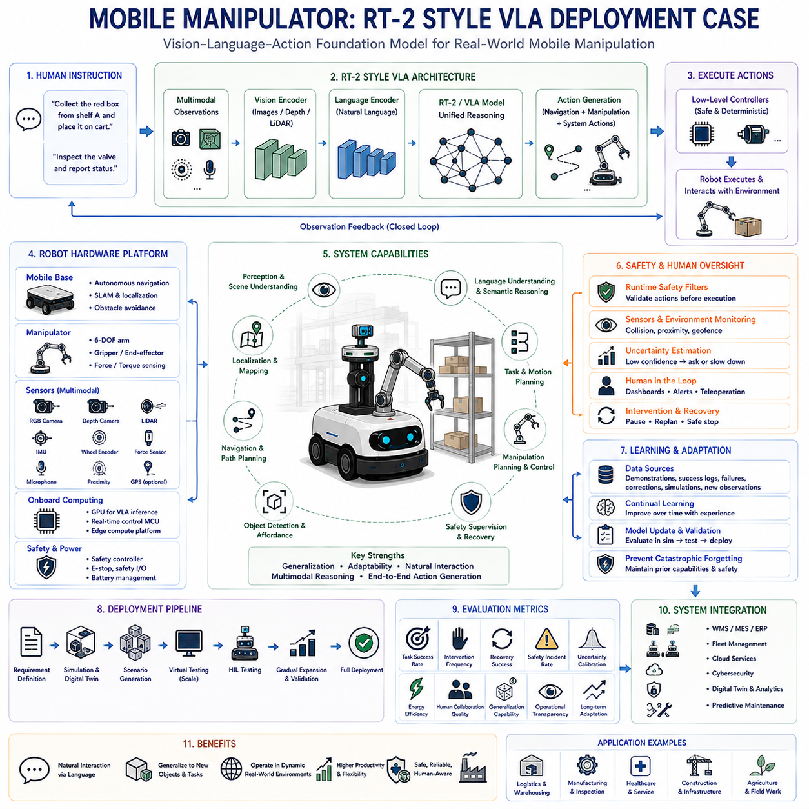
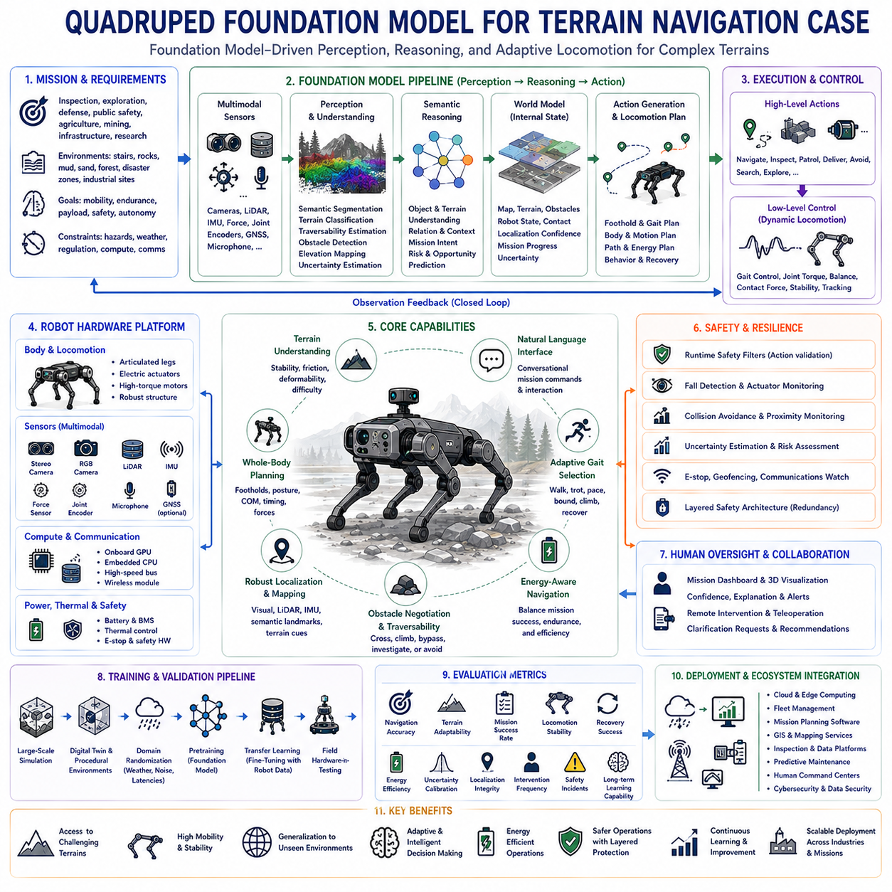
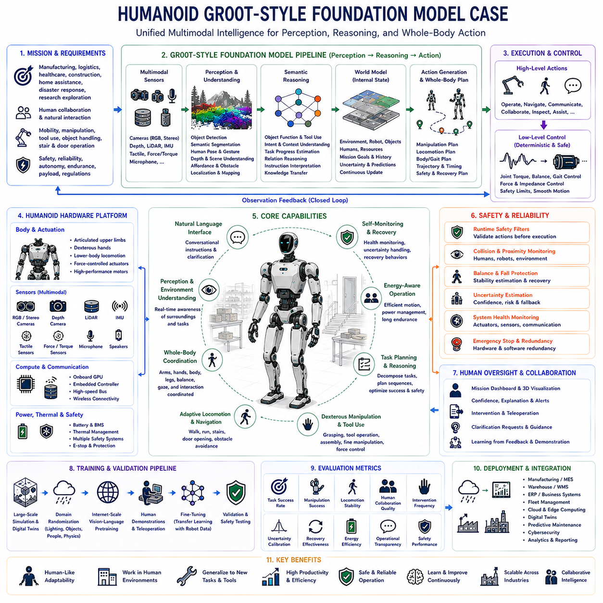
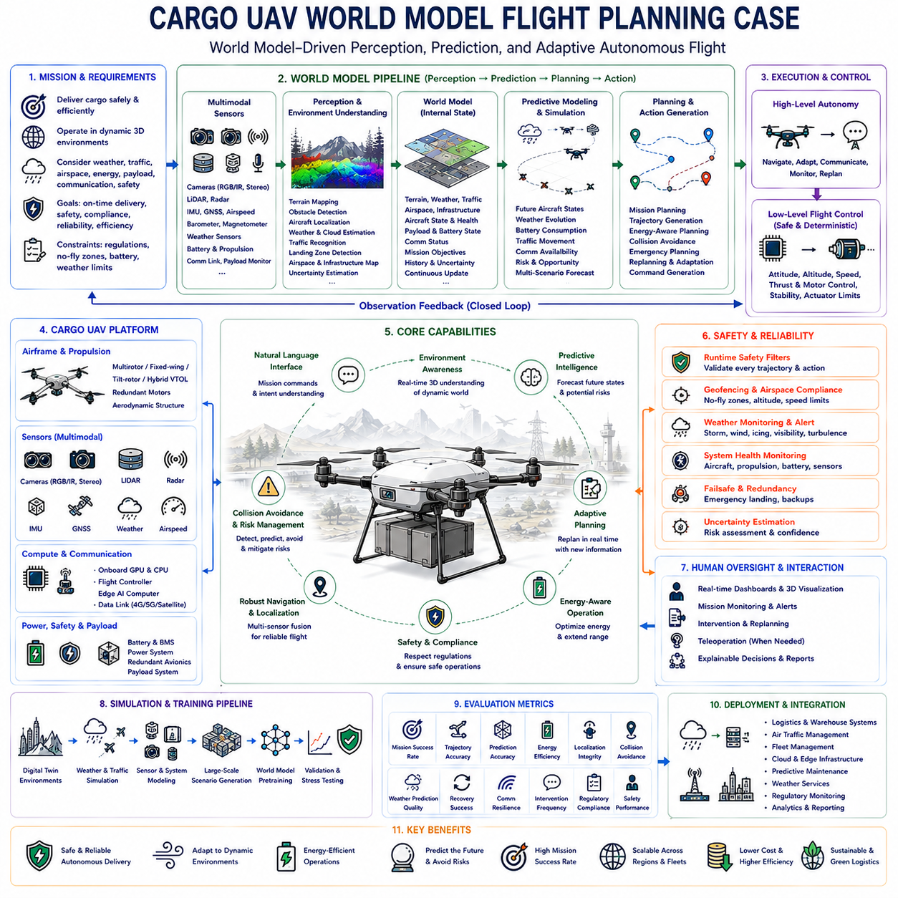
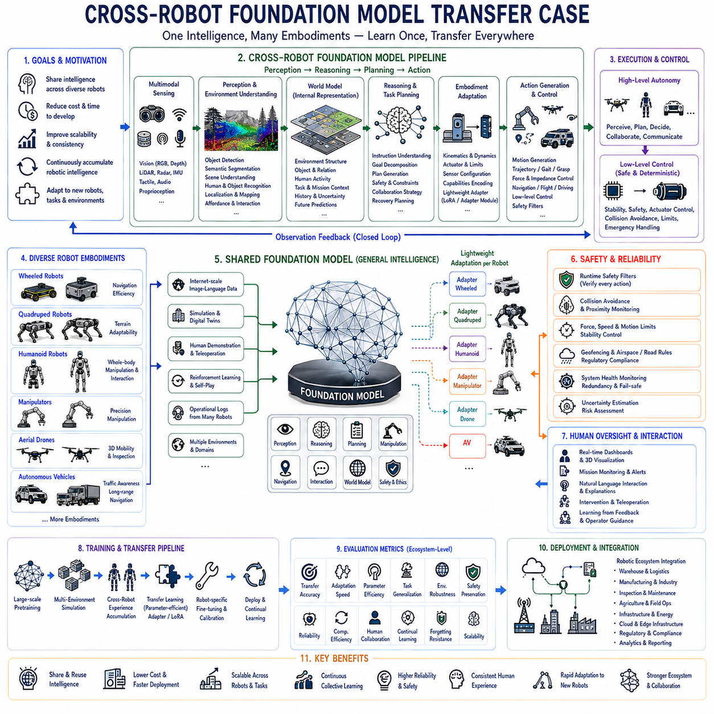
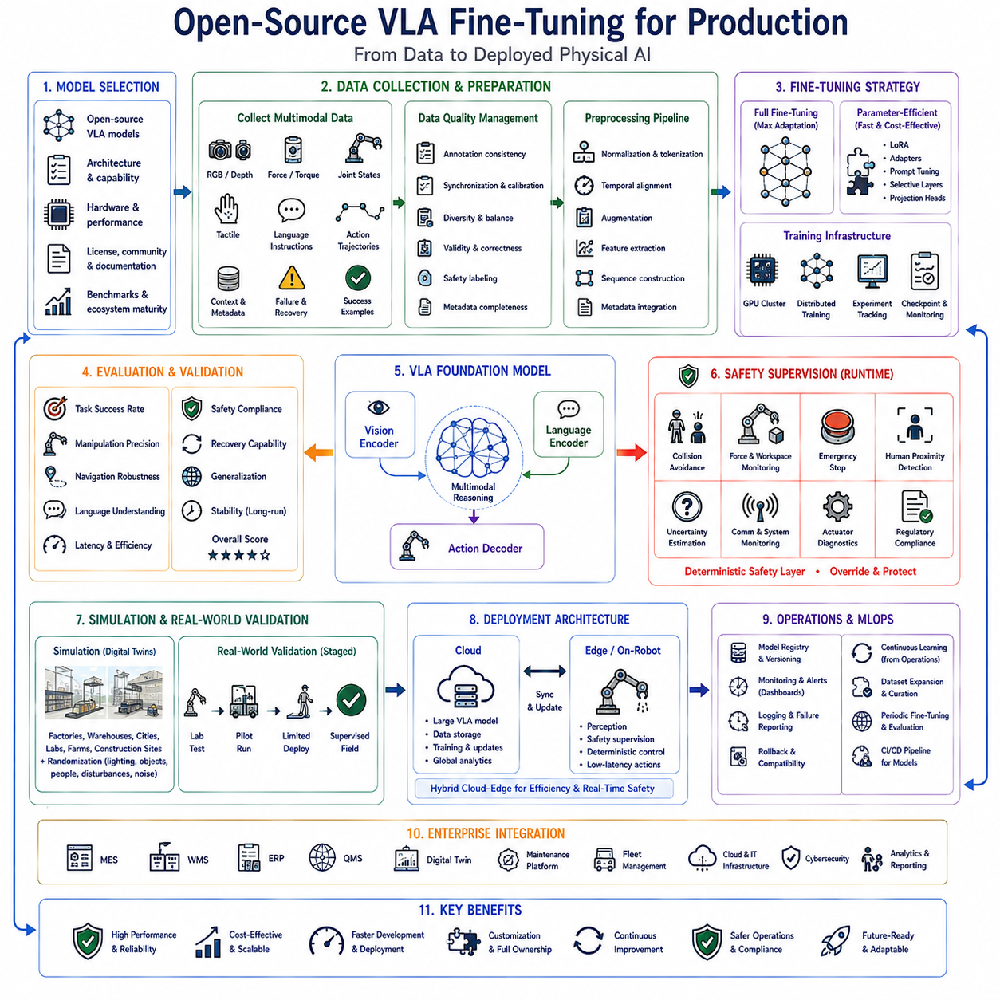
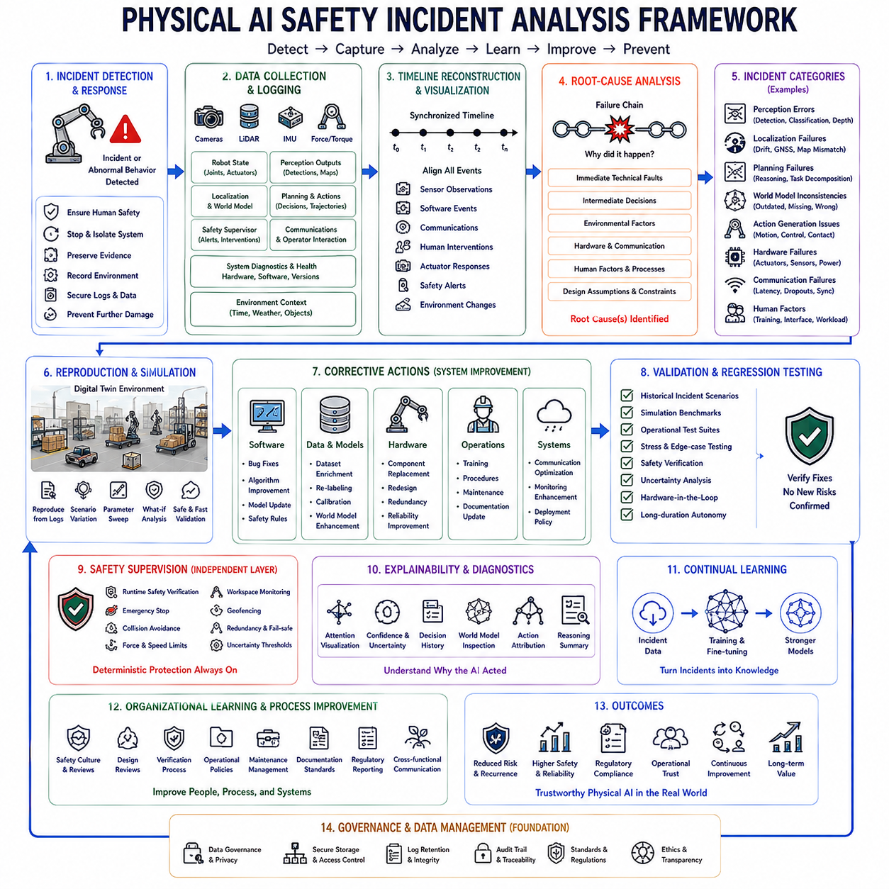
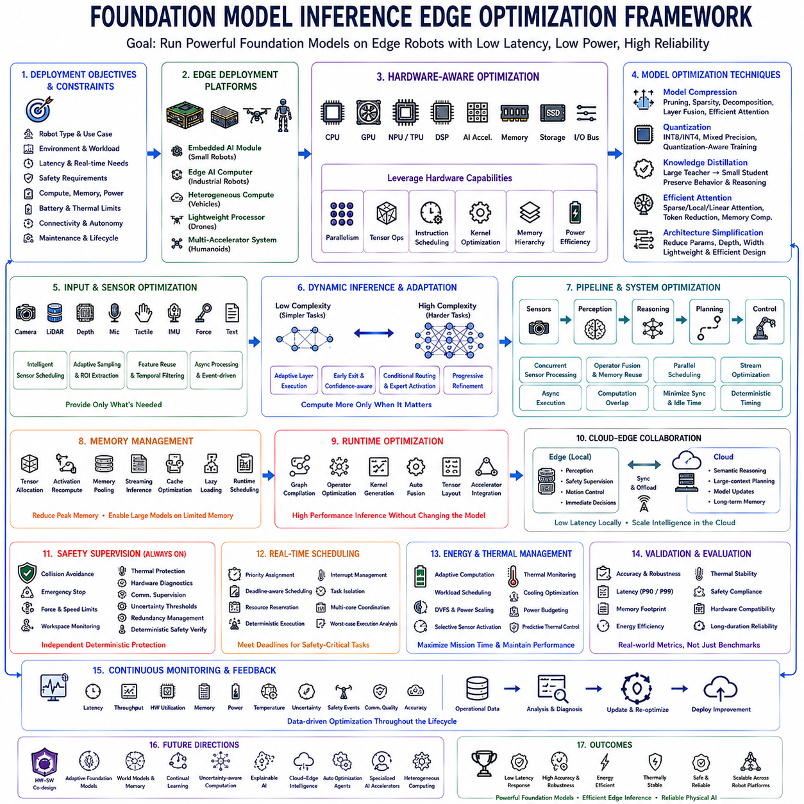
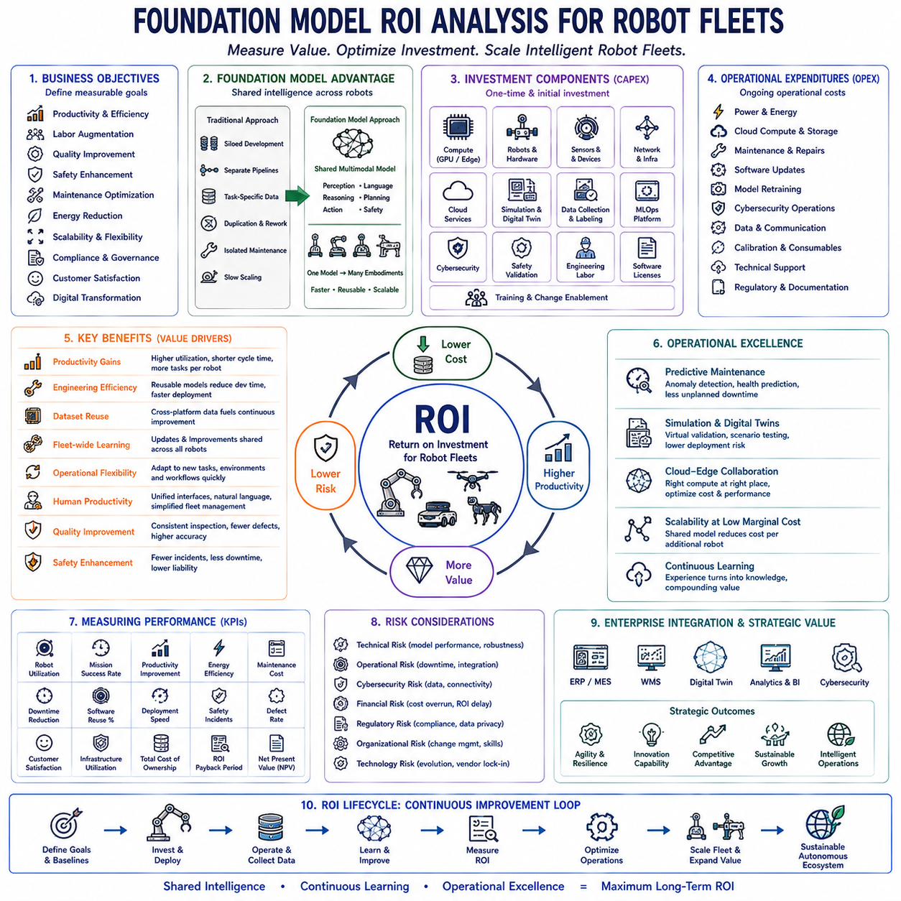
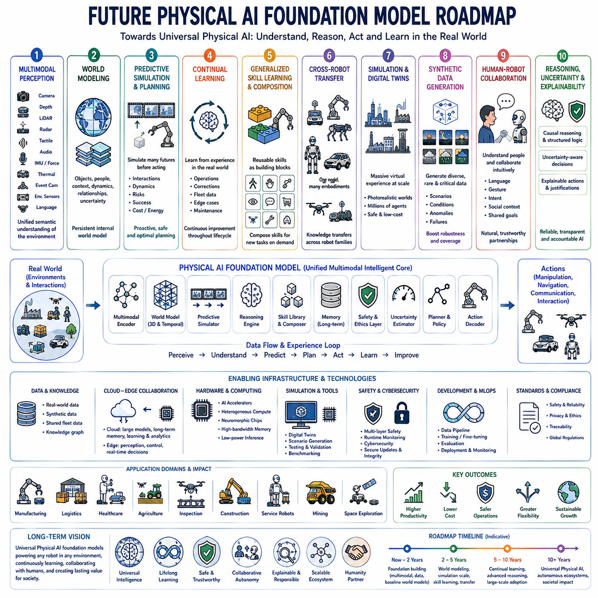

**Volume 18 Physical AI Foundation Models**


# 12. Foundation Model Case Studies

##  

## 12.1 Mobile Manipulator RT-2 Style VLA Deployment Case

{width="7.268055555555556in" height="7.268055555555556in"}

Vision-Language-Action models have transformed autonomous robotics by enabling a single foundation model to connect visual perception, natural language understanding, semantic reasoning, and robot control within one unified architecture. Rather than relying upon multiple independently engineered perception, planning, and control modules, a VLA system directly predicts robot actions from multimodal observations and human instructions. RT-2 demonstrated that internet-scale vision-language knowledge can significantly improve robotic reasoning and generalization, making it an influential reference architecture for modern mobile manipulator deployment.

A mobile manipulator combines an autonomous mobile robot with one or more robotic manipulators, creating a system capable of navigating complex environments while physically interacting with surrounding objects. Unlike stationary industrial robots operating inside predefined work cells, mobile manipulators continuously perceive changing environments, localize themselves, avoid obstacles, plan navigation paths, identify target objects, manipulate them safely, and recover from unexpected situations. These capabilities make them highly suitable for logistics, warehouse automation, healthcare, manufacturing, construction, inspection, agriculture, and service robotics.

Deploying an RT-2-style VLA architecture begins with defining operational objectives rather than selecting machine learning models. Engineers first identify target applications, expected environments, task complexity, manipulation requirements, navigation constraints, safety objectives, available computing resources, communication infrastructure, and acceptable operational risks. These high-level system requirements determine the overall architecture while preventing unnecessary model complexity that exceeds actual deployment needs.

The hardware architecture generally consists of a mobile base, robotic manipulator, multimodal sensor suite, onboard computing platform, communication interfaces, power management system, and safety supervision hardware. The mobile platform provides autonomous navigation, while the robotic arm performs manipulation tasks. RGB cameras, depth sensors, LiDAR, IMUs, wheel encoders, force sensors, microphones, GPS when appropriate, and proximity sensors collectively provide the multimodal observations required by the VLA model.

The onboard computing platform executes perception, reasoning, planning, and control with strict real-time constraints. Edge computing devices equipped with high-performance GPUs frequently host the VLA inference engine while lower-level motor controllers execute deterministic motion control independently. Separating high-level semantic reasoning from real-time control improves safety, latency, computational efficiency, and fault isolation without sacrificing intelligent decision making.

Sensor synchronization plays a critical role because multimodal reasoning requires temporally consistent observations across multiple sensing modalities. Cameras, LiDAR, depth sensors, inertial measurements, wheel odometry, and robot joint states should be synchronized through precise timestamp alignment before entering the perception pipeline. Accurate synchronization enables reliable world modeling while reducing inconsistencies introduced by asynchronous sensor measurements.

The perception pipeline transforms raw sensor observations into structured semantic representations suitable for foundation model reasoning. Object detection, semantic segmentation, depth estimation, scene understanding, human detection, free-space estimation, grasp candidate generation, localization, and environmental mapping collectively describe the robot\'s surroundings. Rather than operating as isolated perception modules, these representations provide contextual information supporting integrated vision-language reasoning.

Natural language instructions become another primary input to the VLA architecture. Human operators specify objectives using conversational commands rather than predefined programming interfaces. Instructions such as collecting packages, organizing shelves, delivering equipment, inspecting machinery, assisting personnel, or retrieving specified objects become semantic goals interpreted jointly with visual observations. The model reasons about both environmental context and linguistic intent before generating executable actions.

Semantic reasoning extends beyond direct object recognition by incorporating broad knowledge acquired during foundation model pretraining. Internet-scale image-language datasets enable robots to recognize unfamiliar objects, infer object affordances, understand contextual relationships, predict likely object locations, interpret human intentions, and generalize beyond explicitly trained robotic demonstrations. This transfer of general knowledge significantly expands operational flexibility compared with conventional task-specific robotics.

The world model continuously integrates observations collected throughout robot operation into an evolving representation of the surrounding environment. Static structures, dynamic obstacles, human motion, object locations, navigable space, manipulation opportunities, and environmental uncertainty become unified within a continuously updated internal state. The VLA model reasons over this evolving world representation when selecting future actions instead of relying solely upon instantaneous sensor observations.

Task planning emerges directly from multimodal reasoning rather than handcrafted symbolic workflows. After understanding environmental observations and human intent, the VLA architecture predicts intermediate objectives, navigation goals, manipulation sequences, safety constraints, and recovery behaviors that collectively maximize successful task completion. Although explicit symbolic planners may still complement deployment, foundation models increasingly perform high-level planning implicitly through learned reasoning.

Navigation planning operates simultaneously with manipulation planning because mobile manipulators continuously alternate between movement and physical interaction. The system predicts collision-free trajectories toward target locations while preserving sufficient workspace accessibility for subsequent manipulation. Dynamic obstacle avoidance, localization uncertainty, battery constraints, traffic management, and safety margins remain integrated within overall mission planning instead of being optimized independently.

Manipulation planning requires accurate estimation of object pose, grasp configuration, reachability, collision avoidance, force control, and execution sequencing. The VLA model predicts grasp strategies conditioned upon visual observations, language instructions, object properties, environmental context, and accumulated task history. Rather than selecting predefined grasp templates, learned manipulation policies adapt continuously to changing operational conditions.

Action generation represents the defining characteristic of VLA architectures because perception and reasoning directly produce executable robot actions. High-level semantic representations become navigation commands, manipulator trajectories, gripper operations, camera positioning, sensor activation, and communication requests. Intermediate symbolic translation layers become significantly simplified compared with traditional robotics software stacks, reducing engineering complexity while increasing behavioral flexibility.

Low-level motion control remains independent from foundation model reasoning despite high-level action generation. Deterministic controllers enforce velocity limits, joint constraints, collision avoidance, actuator protection, emergency stopping, force limitations, and motion smoothness. This layered architecture ensures that learned policies cannot directly violate fundamental safety constraints even if unexpected model predictions occur.

Safety supervision continuously monitors every stage of autonomous execution. Runtime safety filters verify predicted actions before execution while emergency stopping systems, collision detection, geofencing, human proximity monitoring, uncertainty estimation, and operational constraint verification independently supervise robot behavior. Safety mechanisms therefore remain separate from learned intelligence while providing redundant protection against unexpected failures.

Human oversight remains essential throughout deployment because autonomous reasoning inevitably encounters unfamiliar environments and ambiguous objectives. Operators monitor mission progress through visual dashboards, natural language explanations, confidence estimation, intervention interfaces, and remote teleoperation capabilities. The robot requests clarification whenever uncertainty exceeds acceptable operational thresholds, preserving both safety and collaborative human-robot interaction.

Continuous learning enables deployed robots to improve gradually through operational experience without requiring complete retraining after every new task. Human demonstrations, successful execution histories, failure cases, corrective interventions, simulation experience, and new environmental observations become valuable learning resources supporting future adaptation. Carefully controlled continual learning allows deployment performance to improve while minimizing catastrophic forgetting of previously acquired capabilities.

Simulation provides a critical deployment stage before physical operation begins. High-fidelity digital twins reproduce environmental layouts, dynamic obstacles, manipulation tasks, communication latency, sensor noise, lighting variation, weather conditions, and rare operational failures. Thousands of virtual missions validate navigation, manipulation, reasoning, safety supervision, and recovery behavior before real-world deployment, substantially reducing operational risk.

Field deployment proceeds incrementally through controlled operational expansion rather than immediate full-scale autonomy. Initial deployment often restricts operating speed, workspace complexity, task diversity, payload weight, and environmental variability while collecting extensive performance data. As validation evidence accumulates, operational boundaries gradually expand toward fully autonomous production environments with increasing confidence.

Evaluation metrics extend beyond traditional navigation accuracy or manipulation success rates. Task completion reliability, intervention frequency, recovery success, uncertainty calibration, energy efficiency, human collaboration quality, semantic reasoning accuracy, object generalization capability, safety incident rate, operational transparency, and long-term adaptation collectively characterize deployment effectiveness. Balanced evaluation across technical performance, operational safety, and human trust provides a realistic assessment of practical system capability.

Industrial deployment also requires integration with warehouse management systems, manufacturing execution systems, enterprise resource planning platforms, fleet management software, cloud services, cybersecurity infrastructure, digital twins, predictive maintenance systems, and operational analytics. RT-2-style architectures therefore function not as isolated robot controllers but as intelligent components within broader industrial automation ecosystems.

Future mobile manipulators will likely integrate larger foundation models, richer world models, multimodal memory systems, continual learning, collaborative multi-robot reasoning, predictive simulation, uncertainty-aware planning, explainable artificial intelligence, and cloud-edge hybrid computing. These developments will progressively transform robots from specialized automation machines into adaptable physical intelligence capable of understanding natural language, interpreting complex environments, learning from experience, and executing increasingly sophisticated manipulation tasks across diverse operational domains.

Ultimately, the deployment of an RT-2-style Vision-Language-Action architecture demonstrates a fundamental transition in robotics engineering. Instead of constructing independent perception, planning, reasoning, and control modules connected through manually engineered interfaces, modern Physical AI increasingly relies upon unified foundation models that directly transform multimodal observations and human intentions into intelligent actions. Combined with layered safety supervision, deterministic control, continual learning, and comprehensive system validation, this deployment paradigm establishes a scalable foundation for trustworthy mobile manipulation across real-world industrial and service applications.

비전-언어-행동 모델(Vision-Language-Action Model, VLA)은 시각 인식(Visual Perception), 자연어 이해(Natural Language Understanding), 의미 추론(Semantic Reasoning), 그리고 로봇 제어(Robot Control)를 하나의 통합된 아키텍처(Unified Architecture) 안에서 연결함으로써 자율 로봇(Autonomous Robot)의 발전 방향을 크게 변화시켰습니다. 기존의 로봇 시스템이 인식(Perception), 계획(Planning), 제어(Control)를 각각 독립적으로 설계된 여러 모듈(Module)에 의존했다면, VLA 시스템은 멀티모달 관측(Multimodal Observation)과 인간의 명령(Human Instruction)으로부터 직접 로봇의 행동(Action)을 예측합니다. RT-2는 인터넷 규모의 비전-언어 지식(Internet-Scale Vision-Language Knowledge)이 로봇의 추론 능력(Reasoning)과 일반화 성능(Generalization)을 크게 향상시킬 수 있음을 보여주었으며, 현대 모바일 매니퓰레이터(Mobile Manipulator) 배포를 위한 대표적인 참조 아키텍처(Reference Architecture)가 되었습니다.

모바일 매니퓰레이터(Mobile Manipulator)는 자율 이동 로봇(Autonomous Mobile Robot)과 하나 이상의 로봇 매니퓰레이터(Robotic Manipulator)를 결합한 시스템으로, 복잡한 환경을 스스로 이동하면서 주변 물체와 물리적으로 상호작용할 수 있습니다. 미리 정의된 작업 공간에서 동작하는 고정형 산업용 로봇(Stationary Industrial Robot)과 달리 모바일 매니퓰레이터는 변화하는 환경을 지속적으로 인식하고, 자신의 위치를 추정하며, 장애물을 회피하고, 이동 경로를 계획하며, 목표 물체를 인식하고, 안전하게 조작하며, 예상하지 못한 상황에서도 복구해야 합니다. 이러한 능력은 물류(Logistics), 창고 자동화(Warehouse Automation), 의료(Healthcare), 제조(Manufacturing), 건설(Construction), 검사(Inspection), 농업(Agriculture), 서비스 로봇(Service Robotics) 분야에서 매우 높은 활용성을 제공합니다.

RT-2 스타일 VLA 아키텍처(RT-2-Style VLA Architecture)를 실제 시스템에 적용하기 위해서는 머신러닝 모델(Machine Learning Model)을 먼저 선택하는 것이 아니라 운영 목표(Operational Objective)를 먼저 정의해야 합니다. 개발자는 대상 응용 분야(Target Application), 운영 환경(Expected Environment), 작업 복잡도(Task Complexity), 조작 요구사항(Manipulation Requirement), 이동 제약 조건(Navigation Constraint), 안전 목표(Safety Objective), 사용 가능한 컴퓨팅 자원(Computing Resource), 통신 인프라(Communication Infrastructure), 허용 가능한 운영 위험(Acceptable Operational Risk)을 먼저 정의합니다. 이러한 상위 수준 시스템 요구사항(System Requirement)은 실제 운영에 필요 이상의 복잡한 모델을 사용하는 것을 방지하고 전체 시스템 아키텍처를 결정하는 기준이 됩니다.

하드웨어 아키텍처(Hardware Architecture)는 일반적으로 이동 플랫폼(Mobile Base), 로봇 매니퓰레이터(Robotic Manipulator), 멀티모달 센서(Multimodal Sensor), 온보드 컴퓨팅 플랫폼(Onboard Computing Platform), 통신 인터페이스(Communication Interface), 전력 관리 시스템(Power Management System), 안전 감독 하드웨어(Safety Supervision Hardware)로 구성됩니다. 이동 플랫폼은 자율 이동을 담당하며, 로봇 팔은 물체 조작을 수행합니다. RGB 카메라(RGB Camera), 깊이 센서(Depth Sensor), 라이다(LiDAR), 관성 측정 장치(IMU), 휠 엔코더(Wheel Encoder), 힘 센서(Force Sensor), 마이크(Microphone), 필요 시 GPS, 근접 센서(Proximity Sensor)는 VLA 모델이 요구하는 다양한 멀티모달 정보를 제공합니다.

온보드 컴퓨팅 플랫폼(Onboard Computing Platform)은 엄격한 실시간 요구사항(Real-Time Constraint) 아래에서 인식, 추론, 계획, 제어를 수행합니다. 일반적으로 고성능 GPU를 갖춘 엣지 컴퓨팅 장치(Edge Computing Device)가 VLA 추론 엔진(Inference Engine)을 실행하며, 저수준 모터 제어기는 독립적으로 결정론적(Deterministic) 모션 제어를 수행합니다. 이러한 고수준 의미 추론(High-Level Semantic Reasoning)과 저수준 실시간 제어(Real-Time Control)의 분리는 안전성, 지연 시간, 계산 효율성, 결함 격리(Fault Isolation)를 향상시키면서도 지능적인 의사결정을 유지할 수 있도록 합니다.

센서 동기화(Sensor Synchronization)는 멀티모달 추론이 시간적으로 일관된 관측을 요구하기 때문에 매우 중요한 요소입니다. 카메라(Camera), 라이다(LiDAR), 깊이 센서(Depth Sensor), IMU, 휠 오도메트리(Wheel Odometry), 로봇 관절 상태(Robot Joint State)는 모두 정확한 타임스탬프(Time Stamp)를 기반으로 동기화된 이후 인식 파이프라인(Perception Pipeline)에 입력되어야 합니다. 이러한 정확한 동기화는 신뢰성 높은 월드 모델(World Model)을 구축하고 센서 간 시간 차이로 인한 불일치를 줄여 줍니다.

인식 파이프라인(Perception Pipeline)은 원시 센서 데이터(Raw Sensor Observation)를 파운데이션 모델(Foundation Model)이 추론할 수 있는 의미 기반 표현(Semantic Representation)으로 변환합니다. 객체 검출(Object Detection), 의미 분할(Semantic Segmentation), 깊이 추정(Depth Estimation), 장면 이해(Scene Understanding), 사람 검출(Human Detection), 자유 공간 추정(Free-Space Estimation), 파지 후보 생성(Grasp Candidate Generation), 위치 추정(Localization), 환경 지도(Environmental Mapping)는 로봇 주변 환경을 종합적으로 표현합니다. 이러한 정보는 독립적인 모듈이 아니라 통합된 비전-언어 추론(Vision-Language Reasoning)을 위한 상황 정보(Contextual Information)를 제공합니다.

자연어 명령(Natural Language Instruction)은 VLA 아키텍처의 또 다른 핵심 입력입니다. 인간 운영자는 미리 정의된 프로그래밍 인터페이스 대신 대화형 명령(Conversational Command)을 통해 목표를 전달합니다. 예를 들어 물품 수거(Collecting Packages), 선반 정리(Organizing Shelves), 장비 운반(Delivering Equipment), 설비 검사(Inspecting Machinery), 작업자 지원(Assisting Personnel), 특정 물체 가져오기(Retrieving Specified Objects)와 같은 명령은 시각 정보와 함께 의미적으로 해석되어 실행 가능한 목표(Semantic Goal)로 변환됩니다. 모델은 환경 정보(Environmental Context)와 언어적 의도(Linguistic Intent)를 동시에 고려하여 행동을 생성합니다.

의미 추론(Semantic Reasoning)은 단순한 객체 인식(Object Recognition)을 넘어 파운데이션 모델 사전학습(Foundation Model Pretraining)에서 습득한 폭넓은 지식을 활용합니다. 인터넷 규모의 이미지-언어 데이터셋(Image-Language Dataset)을 통해 로봇은 처음 보는 물체(Unfamiliar Object)를 인식하고, 물체의 사용 가능성(Object Affordance)을 추론하며, 상황적 관계(Contextual Relationship)를 이해하고, 물체의 위치를 예측하며, 인간의 의도(Human Intention)를 이해하고, 제한된 로봇 시연(Robotic Demonstration)을 넘어 새로운 상황으로 일반화할 수 있습니다. 이러한 일반 지식의 활용은 기존의 작업 전용(Task-Specific) 로봇보다 훨씬 높은 운영 유연성을 제공합니다.

월드 모델(World Model)은 로봇이 운영 중 수집한 관측 정보를 지속적으로 통합하여 내부 환경 표현(Internal Environment Representation)을 생성합니다. 고정 구조물(Static Structure), 동적 장애물(Dynamic Obstacle), 인간의 움직임(Human Motion), 물체 위치(Object Location), 이동 가능 공간(Navigable Space), 환경 불확실성(Environmental Uncertainty)은 하나의 지속적으로 업데이트되는 내부 상태(Internal State)로 통합됩니다. VLA 모델은 순간적인 센서 입력만이 아니라 이러한 월드 모델을 기반으로 다음 행동을 추론합니다.

작업 계획(Task Planning)은 수작업으로 설계된 기호 기반 워크플로(Symbolic Workflow)가 아니라 멀티모달 추론(Multimodal Reasoning)을 통해 직접 생성됩니다. 환경을 이해하고 인간의 의도를 파악한 이후 VLA 아키텍처는 중간 목표(Intermediate Objective), 이동 목표(Navigation Goal), 조작 순서(Manipulation Sequence), 안전 제약(Safety Constraint), 복구 행동(Recovery Behavior)을 예측하여 작업 성공률(Task Completion)을 최대화합니다. 실제 시스템에서는 기호 기반 계획(Symbolic Planning)이 보조적으로 사용될 수 있지만, 파운데이션 모델은 점차 고수준 계획을 스스로 수행하는 방향으로 발전하고 있습니다.

이동 계획(Navigation Planning)은 조작 계획(Manipulation Planning)과 동시에 수행됩니다. 모바일 매니퓰레이터는 이동과 조작을 반복적으로 수행하기 때문입니다. 시스템은 충돌이 없는 이동 경로(Collision-Free Trajectory)를 예측하면서 이후의 조작 작업을 위한 충분한 작업 공간(Workspace Accessibility)을 확보해야 합니다. 동적 장애물 회피(Dynamic Obstacle Avoidance), 위치 추정 불확실성(Localization Uncertainty), 배터리 제약(Battery Constraint), 교통 관리(Traffic Management), 안전 여유(Safety Margin)는 전체 임무 계획(Mission Planning) 안에서 함께 최적화됩니다.

조작 계획(Manipulation Planning)은 물체 자세(Object Pose), 파지 자세(Grasp Configuration), 도달 가능성(Reachability), 충돌 회피(Collision Avoidance), 힘 제어(Force Control), 작업 순서(Execution Sequencing)를 정확하게 예측해야 합니다. VLA 모델은 시각 정보, 자연어 명령, 물체 특성(Object Property), 환경 정보, 이전 작업 이력을 함께 고려하여 적절한 파지 전략(Grasp Strategy)을 생성합니다. 기존의 미리 정의된 파지 템플릿(Predefined Grasp Template)을 사용하는 방식보다 실제 환경 변화에 더욱 유연하게 적응할 수 있습니다.

행동 생성(Action Generation)은 VLA 아키텍처의 가장 큰 특징입니다. 인식과 추론 결과가 직접 실행 가능한 로봇 행동으로 변환됩니다. 고수준 의미 표현(High-Level Semantic Representation)은 이동 명령(Navigation Command), 매니퓰레이터 궤적(Manipulator Trajectory), 그리퍼 제어(Gripper Operation), 카메라 위치 조정(Camera Positioning), 센서 활성화(Sensor Activation), 통신 요청(Communication Request)으로 변환됩니다. 따라서 기존 로봇 소프트웨어 스택(Robotics Software Stack)에 존재하던 복잡한 중간 변환 계층(Symbolic Translation Layer)이 크게 단순화되며, 엔지니어링 복잡성은 줄어들고 행동의 유연성은 향상됩니다.

저수준 모션 제어(Low-Level Motion Control)는 고수준 행동 생성과 별도로 독립적으로 수행됩니다. 결정론적 제어기(Deterministic Controller)는 속도 제한(Velocity Limit), 관절 제약(Joint Constraint), 충돌 회피(Collision Avoidance), 액추에이터 보호(Actuator Protection), 비상 정지(Emergency Stop), 힘 제한(Force Limitation), 부드러운 움직임(Motion Smoothness)을 보장합니다. 이러한 계층형 구조(Layered Architecture)는 예기치 않은 모델 출력이 발생하더라도 기본적인 안전 제약 조건을 위반하지 않도록 합니다.

안전 감독(Safety Supervision)은 자율 실행의 모든 단계를 지속적으로 모니터링합니다. 실행 전 안전 필터(Runtime Safety Filter)는 생성된 행동을 검증하며, 비상 정지(Emergency Stop), 충돌 감지(Collision Detection), 지오펜싱(Geofencing), 인간 근접 감시(Human Proximity Monitoring), 불확실성 추정(Uncertainty Estimation), 운영 제약 검증(Operational Constraint Verification)은 독립적으로 시스템을 감시합니다. 따라서 안전 메커니즘은 학습 기반 지능과 분리되어 중복 보호(Redundant Protection)를 제공합니다.

인간 감독(Human Oversight)은 자율 시스템이 새로운 환경과 모호한 목표를 계속 만나기 때문에 실제 배포 과정에서도 매우 중요합니다. 운영자는 시각적 대시보드(Visual Dashboard), 자연어 설명(Natural Language Explanation), 신뢰도 추정(Confidence Estimation), 개입 인터페이스(Intervention Interface), 원격 조작(Remote Teleoperation)을 통해 임무를 감독합니다. 로봇은 불확실성이 허용 가능한 수준을 초과하면 인간에게 추가 설명이나 개입을 요청하여 안전성과 협업(Human-Robot Collaboration)을 유지합니다.

지속적 학습(Continuous Learning)은 새로운 작업마다 전체 모델을 다시 학습하지 않고도 운영 경험을 통해 성능을 점진적으로 향상시킵니다. 인간 시연(Human Demonstration), 성공적인 작업 기록(Successful Execution History), 실패 사례(Failure Case), 수정 개입(Corrective Intervention), 시뮬레이션 경험(Simulation Experience), 새로운 환경 데이터(New Environmental Observation)는 모두 새로운 학습 자원(Learning Resource)이 됩니다. 적절하게 제어된 지속적 학습은 기존 능력을 유지하면서 새로운 환경에 적응하도록 지원합니다.

시뮬레이션(Simulation)은 실제 운영 이전의 핵심 검증 단계입니다. 고정밀 디지털 트윈(High-Fidelity Digital Twin)은 환경 구조(Environmental Layout), 동적 장애물(Dynamic Obstacle), 조작 작업(Manipulation Task), 통신 지연(Communication Latency), 센서 잡음(Sensor Noise), 조명 변화(Lighting Variation), 기상 조건(Weather Condition), 희귀 실패(Rare Operational Failure)를 재현합니다. 수천 개의 가상 임무(Virtual Mission)를 통해 이동, 조작, 추론, 안전 감독, 복구 능력을 충분히 검증한 이후 실제 환경에 배포함으로써 운영 위험을 크게 줄일 수 있습니다.

현장 배포(Field Deployment)는 처음부터 완전 자율 운용을 수행하는 것이 아니라 점진적으로 운영 범위를 확대하는 방식으로 이루어집니다. 초기에는 이동 속도(Operating Speed), 작업 공간 복잡도(Workspace Complexity), 작업 종류(Task Diversity), 적재 중량(Payload Weight), 환경 변화(Environmental Variability)를 제한하면서 충분한 운영 데이터를 수집합니다. 검증 결과가 축적될수록 운영 범위를 점차 확대하여 최종적으로 완전 자율 생산 환경(Fully Autonomous Production Environment)으로 발전시킵니다.

평가 지표(Evaluation Metric)는 단순한 이동 정확도(Navigation Accuracy)나 조작 성공률(Manipulation Success Rate)을 넘어 다양한 요소를 포함해야 합니다. 작업 완료 신뢰성(Task Completion Reliability), 인간 개입 빈도(Intervention Frequency), 복구 성공률(Recovery Success), 불확실성 보정(Uncertainty Calibration), 에너지 효율(Energy Efficiency), 인간 협업 품질(Human Collaboration Quality), 의미 추론 정확도(Semantic Reasoning Accuracy), 객체 일반화(Object Generalization Capability), 안전 사고율(Safety Incident Rate), 운영 투명성(Operational Transparency), 장기 적응 능력(Long-Term Adaptation)을 함께 평가해야 실제 시스템 성능을 정확하게 이해할 수 있습니다.

산업 현장 배포(Industrial Deployment)는 창고 관리 시스템(Warehouse Management System), 제조 실행 시스템(Manufacturing Execution System), 전사적 자원 관리 시스템(Enterprise Resource Planning), 플릿 관리 소프트웨어(Fleet Management Software), 클라우드 서비스(Cloud Service), 사이버 보안 인프라(Cybersecurity Infrastructure), 디지털 트윈(Digital Twin), 예지보전 시스템(Predictive Maintenance System), 운영 분석 시스템(Operational Analytics)과의 연동도 필요합니다. 따라서 RT-2 스타일 아키텍처는 독립적인 로봇 제어기가 아니라 산업 자동화 생태계(Industrial Automation Ecosystem)의 지능형 구성 요소(Intelligent Component)로

##  

## 12.2 Quadruped Foundation Model for Terrain Navigation Case

{width="7.268055555555556in" height="7.268055555555556in"}

Quadruped robots have emerged as one of the most versatile Physical AI platforms because their four-legged locomotion enables stable movement across terrains that remain inaccessible to conventional wheeled or tracked robots. Their ability to traverse stairs, rocks, mud, sand, forests, construction sites, disaster areas, industrial facilities, and uneven natural environments makes them valuable for inspection, exploration, defense, public safety, agriculture, mining, infrastructure maintenance, and scientific research. As robotic intelligence advances beyond handcrafted control algorithms, foundation models are becoming increasingly important for enabling adaptive perception, reasoning, navigation, and decision making across diverse terrain conditions.

Traditional quadruped navigation systems typically consist of separate perception, localization, mapping, planning, locomotion, and control modules connected through manually engineered interfaces. Although modular architectures provide flexibility and deterministic behavior, they often struggle to generalize beyond conditions explicitly represented during development. Foundation models introduce a different paradigm by integrating multimodal perception, semantic reasoning, environmental understanding, and action generation within unified architectures capable of transferring knowledge across numerous operating environments.

Deploying a foundation model for quadruped terrain navigation begins by defining operational missions rather than selecting artificial intelligence architectures. Engineers identify expected environments, mobility objectives, payload requirements, operational endurance, communication infrastructure, environmental hazards, weather conditions, safety constraints, regulatory requirements, available computing resources, and expected levels of autonomy. These system-level objectives establish the design boundaries governing every subsequent hardware, software, and learning component throughout deployment.

The robotic hardware platform forms the physical foundation supporting autonomous intelligence. Typical quadruped systems integrate articulated legs, electric actuators, high-bandwidth motor controllers, force sensors, joint encoders, inertial measurement units, stereo cameras, RGB cameras, depth sensors, LiDAR, microphones, GNSS receivers when available, wireless communication modules, onboard GPUs, embedded processors, battery management systems, thermal control, and emergency safety mechanisms. These components collectively provide the sensing and actuation capabilities required for intelligent mobility.

Reliable sensor synchronization becomes particularly important because locomotion decisions depend upon precise temporal alignment between visual observations, inertial measurements, joint states, force sensing, terrain contact information, and environmental perception. Even small synchronization errors may accumulate into localization drift, unstable gait generation, inaccurate terrain estimation, or delayed obstacle avoidance. Accurate timestamp management therefore represents a fundamental engineering requirement supporting trustworthy autonomous navigation.

The perception pipeline continuously transforms multimodal sensor observations into structured environmental understanding. Semantic segmentation, terrain classification, traversability estimation, obstacle detection, free-space analysis, elevation mapping, object recognition, human detection, weather assessment, and environmental uncertainty estimation collectively describe the surrounding world. Rather than producing isolated perception outputs, these representations provide contextual knowledge supporting integrated reasoning throughout autonomous navigation.

Foundation models extend perception beyond recognizing individual objects by interpreting semantic relationships across entire environments. Instead of merely identifying rocks, stairs, vegetation, puddles, or debris independently, the model reasons about how these environmental features collectively influence mobility, stability, safety, mission efficiency, and potential future hazards. This higher-level environmental understanding enables robots to anticipate navigation challenges before encountering them physically.

Natural language interfaces introduce additional flexibility by allowing human operators to specify complex navigation objectives conversationally. Commands such as inspect damaged pipelines, avoid unstable ground, search collapsed structures, patrol designated regions, deliver emergency supplies, or prioritize energy-efficient routes become semantic mission descriptions rather than manually programmed navigation sequences. Foundation models interpret these instructions jointly with environmental observations before generating autonomous behavior.

The internal world model continuously integrates observations collected throughout robot operation into an evolving representation of surrounding terrain and mission context. Static structures, dynamic obstacles, surface properties, elevation changes, weather effects, traversability estimates, localization confidence, mission progress, and uncertainty become unified within a continuously updated environmental model. Future navigation decisions therefore depend not only upon current observations but also upon accumulated operational experience throughout the mission.

Terrain understanding represents one of the defining advantages of foundation-model-based navigation. Rather than classifying terrain using predefined categories alone, foundation models learn continuous semantic representations describing stability, friction, deformability, obstacle complexity, expected energy expenditure, and locomotion difficulty. Similar terrain conditions encountered during pretraining contribute transferable knowledge that improves navigation within previously unseen environments.

Locomotion planning combines semantic reasoning with dynamic robot stability. Instead of generating only geometric paths, the navigation system predicts foothold placement, gait transitions, body posture adaptation, center-of-mass movement, step timing, contact force distribution, and energy-efficient motion sequences appropriate for surrounding terrain. Navigation therefore becomes an integrated whole-body planning problem rather than simple route optimization.

Adaptive gait selection enables quadruped robots to modify locomotion strategies continuously according to changing environmental conditions. Walking, trotting, pacing, bounding, climbing, cautious stepping, obstacle negotiation, slope traversal, and recovery behaviors emerge dynamically according to terrain characteristics rather than remaining fixed throughout an entire mission. Foundation models assist gait selection by reasoning over semantic environmental context rather than relying exclusively upon handcrafted threshold rules.

Energy-aware navigation significantly influences long-duration field operations because battery capacity remains limited. Foundation models estimate terrain difficulty, expected power consumption, mission priorities, environmental uncertainty, and alternative routes before selecting energy-efficient trajectories. Rather than minimizing travel distance alone, autonomous navigation balances mission success, operational endurance, safety margins, and resource utilization simultaneously.

Obstacle negotiation extends beyond simple collision avoidance. Fallen trees, loose rocks, debris fields, collapsed structures, water crossings, unstable soil, narrow passages, moving humans, vehicles, and temporary construction barriers require adaptive decision making rather than deterministic obstacle rejection. Foundation models evaluate whether obstacles should be crossed, avoided, climbed, bypassed, or investigated according to mission objectives and operational risk.

Localization remains challenging because outdoor and disaster environments frequently contain degraded GNSS availability, dynamic terrain, sparse visual features, smoke, dust, darkness, or structural collapse. Foundation models integrate visual odometry, inertial navigation, terrain recognition, semantic landmarks, LiDAR observations, and prior environmental knowledge to improve localization robustness despite uncertain sensing conditions. Multiple complementary information sources reduce dependence upon any individual localization technology.

Safety supervision operates independently from learned navigation policies to guarantee fundamental operational constraints. Runtime safety filters evaluate predicted actions before execution while fall detection, actuator monitoring, thermal protection, communication supervision, emergency stopping, uncertainty estimation, collision prevention, and human proximity monitoring provide redundant protection throughout autonomous operation. Layered safety architecture prevents unsafe behavior even when learned models encounter unfamiliar conditions.

Human oversight remains important despite increasing autonomous capability. Operators supervise missions through visual interfaces, semantic maps, confidence estimates, natural language summaries, remote intervention tools, and teleoperation functions whenever necessary. Foundation models support collaboration by explaining navigation decisions, identifying uncertainty sources, requesting clarification, and recommending alternative mission strategies instead of operating as completely opaque autonomous systems.

Simulation provides extensive opportunities for training and validation before real-world deployment. Large-scale terrain generation, digital twins, procedural environment creation, weather simulation, sensor noise modeling, dynamic obstacle generation, communication latency, actuator degradation, and rare failure scenarios collectively expose foundation models to diverse experiences that would be impractical or dangerous to reproduce exclusively through physical experiments.

Transfer learning bridges simulation and real-world deployment by adapting pretrained foundation models using relatively small quantities of robot-specific operational data. Instead of training navigation intelligence entirely from scratch, organizations fine-tune existing representations using local terrain observations, hardware characteristics, environmental conditions, and mission requirements. This significantly reduces data collection costs while accelerating deployment across new robotic platforms.

Evaluation metrics extend beyond conventional navigation accuracy by measuring terrain adaptability, mission completion reliability, locomotion stability, recovery success, energy efficiency, uncertainty calibration, localization integrity, environmental generalization, operator intervention frequency, safety incidents, operational transparency, and long-term learning capability. Comprehensive evaluation reflects practical deployment performance rather than isolated laboratory benchmarks.

Real-world deployment frequently integrates quadruped robots into broader operational ecosystems including cloud computing platforms, digital twins, fleet management systems, mission planning software, geographic information systems, inspection databases, predictive maintenance platforms, communication infrastructure, and human command centers. Foundation models therefore operate within collaborative intelligent systems rather than isolated robotic platforms.

Future quadruped navigation will increasingly combine foundation models, world models, reinforcement learning, multimodal memory, continual learning, cloud-edge collaboration, uncertainty-aware planning, explainable artificial intelligence, collaborative multi-robot coordination, and predictive simulation into unified Physical AI architectures. These integrated systems will progressively enable robots to understand complex environments, reason about long-term mission objectives, learn continuously from operational experience, and adapt safely to rapidly changing real-world conditions.

Ultimately, deploying foundation models for quadruped terrain navigation represents a significant transition from manually engineered robotic intelligence toward generalized Physical AI capable of understanding and interacting with natural environments through unified multimodal reasoning. By integrating semantic perception, world modeling, adaptive locomotion, safety supervision, continual learning, and human collaboration within a single deployment architecture, quadruped robots become increasingly capable of performing complex field operations safely, efficiently, and autonomously across diverse environments that have historically remained beyond the reach of conventional robotic systems.

4족 보행 로봇(Quadruped Robot)은 네 개의 다리를 이용한 이동 방식(Four-Legged Locomotion)을 통해 기존의 바퀴형(Wheeled Robot)이나 궤도형(Tracked Robot) 로봇이 접근하기 어려운 다양한 지형을 안정적으로 이동할 수 있기 때문에 가장 활용성이 높은 피지컬 AI(Physical AI) 플랫폼 가운데 하나로 자리 잡고 있습니다. 계단(Stairs), 암석 지형(Rocky Terrain), 진흙(Mud), 모래(Sand), 산림(Forest), 건설 현장(Construction Site), 재난 지역(Disaster Area), 산업 시설(Industrial Facility), 울퉁불퉁한 자연 환경(Uneven Natural Environment)을 자유롭게 이동할 수 있는 능력은 검사(Inspection), 탐사(Exploration), 국방(Defense), 공공 안전(Public Safety), 농업(Agriculture), 광업(Mining), 인프라 유지보수(Infrastructure Maintenance), 과학 연구(Scientific Research)와 같은 다양한 분야에서 매우 큰 가치를 제공합니다. 최근에는 수작업으로 설계된 제어 알고리즘(Handcrafted Control Algorithm)을 넘어 파운데이션 모델(Foundation Model)이 다양한 지형에서 적응형 인식(Adaptive Perception), 추론(Reasoning), 이동(Navigation), 의사결정(Decision Making)을 가능하게 하는 핵심 기술로 발전하고 있습니다.

기존의 4족 보행 로봇 항법 시스템(Quadruped Navigation System)은 일반적으로 인식(Perception), 위치 추정(Localization), 지도 생성(Mapping), 경로 계획(Planning), 보행 제어(Locomotion), 제어(Control)를 각각 독립적인 모듈(Module)로 구현하고 수작업 인터페이스(Manually Engineered Interface)를 통해 연결하는 구조를 사용해 왔습니다. 이러한 모듈형 아키텍처(Modular Architecture)는 결정론적 동작(Deterministic Behavior)과 유연성을 제공하지만, 개발 단계에서 경험하지 못한 새로운 환경에 대해서는 일반화 능력(Generalization)이 제한되는 경우가 많습니다. 반면 파운데이션 모델은 멀티모달 인식(Multimodal Perception), 의미 추론(Semantic Reasoning), 환경 이해(Environmental Understanding), 행동 생성(Action Generation)을 하나의 통합 아키텍처(Unified Architecture) 안에서 수행하여 다양한 운영 환경 사이에서 지식을 효과적으로 전이(Transfer Learning)할 수 있도록 합니다.

4족 보행 로봇을 위한 파운데이션 모델 배포(Foundation Model Deployment)는 AI 아키텍처를 먼저 선택하는 것이 아니라 운영 임무(Operational Mission)를 정의하는 것에서 시작됩니다. 개발자는 목표 환경(Expected Environment), 이동 목표(Mobility Objective), 적재 요구사항(Payload Requirement), 운영 시간(Operational Endurance), 통신 인프라(Communication Infrastructure), 환경 위험(Environmental Hazard), 기상 조건(Weather Condition), 안전 제약(Safety Constraint), 규제 요구사항(Regulatory Requirement), 사용 가능한 컴퓨팅 자원(Available Computing Resource), 기대하는 자율성 수준(Expected Level of Autonomy)을 먼저 정의해야 합니다. 이러한 시스템 수준(System-Level)의 목표는 이후의 하드웨어(Hardware), 소프트웨어(Software), 학습(Learning) 구성 요소 전체의 설계 범위를 결정하는 기준이 됩니다.

로봇 하드웨어 플랫폼(Robotic Hardware Platform)은 자율 지능을 실제로 구현하는 물리적 기반입니다. 일반적인 4족 보행 로봇은 다관절 다리(Articulated Leg), 전기 액추에이터(Electric Actuator), 고속 모터 제어기(High-Bandwidth Motor Controller), 힘 센서(Force Sensor), 관절 엔코더(Joint Encoder), 관성 측정 장치(Inertial Measurement Unit), 스테레오 카메라(Stereo Camera), RGB 카메라(RGB Camera), 깊이 센서(Depth Sensor), 라이다(LiDAR), 마이크(Microphone), 필요 시 GNSS 수신기(GNSS Receiver), 무선 통신 모듈(Wireless Communication Module), 온보드 GPU(Onboard GPU), 임베디드 프로세서(Embedded Processor), 배터리 관리 시스템(Battery Management System), 열 제어(Thermal Control), 비상 안전 장치(Emergency Safety Mechanism)를 통합합니다. 이러한 구성 요소는 지능적인 이동을 위한 인식과 구동 기능을 함께 제공합니다.

센서 동기화(Sensor Synchronization)는 보행 의사결정(Locomotion Decision)이 시각 정보(Visual Observation), 관성 정보(Inertial Measurement), 관절 상태(Joint State), 힘 센서 정보(Force Sensing), 지면 접촉 정보(Terrain Contact Information), 환경 인식(Environmental Perception)을 정확한 시간 기준으로 통합해야 하기 때문에 매우 중요합니다. 작은 시간 오차(Synchronization Error)도 위치 추정 드리프트(Localization Drift), 불안정한 보행 생성(Unstable Gait Generation), 잘못된 지형 추정(Inaccurate Terrain Estimation), 지연된 장애물 회피(Delayed Obstacle Avoidance)로 이어질 수 있습니다. 따라서 정확한 타임스탬프 관리(Accurate Timestamp Management)는 신뢰성 있는 자율 이동을 위한 필수 요소입니다.

인식 파이프라인(Perception Pipeline)은 다양한 센서에서 수집된 원시 데이터(Raw Sensor Observation)를 구조화된 환경 이해(Structured Environmental Understanding)로 변환합니다. 의미 분할(Semantic Segmentation), 지형 분류(Terrain Classification), 통과 가능성 추정(Traversability Estimation), 장애물 검출(Obstacle Detection), 자유 공간 분석(Free-Space Analysis), 고도 지도(Elevation Mapping), 객체 인식(Object Recognition), 사람 검출(Human Detection), 기상 평가(Weather Assessment), 환경 불확실성 추정(Environmental Uncertainty Estimation)은 주변 환경을 종합적으로 설명합니다. 이러한 결과는 개별 출력이 아니라 자율 이동을 위한 통합 의미 추론(Integrated Semantic Reasoning)의 기반이 됩니다.

파운데이션 모델은 단순히 개별 객체를 인식하는 것을 넘어 전체 환경의 의미적 관계(Semantic Relationship)를 이해합니다. 예를 들어 바위(Rock), 계단(Stairs), 식생(Vegetation), 웅덩이(Puddle), 잔해(Debris)를 각각 독립적으로 인식하는 것이 아니라, 이러한 요소들이 이동성(Mobility), 안정성(Stability), 안전성(Safety), 임무 효율성(Mission Efficiency), 향후 위험(Potential Future Hazard)에 어떤 영향을 미치는지를 함께 추론합니다. 이러한 고수준 환경 이해(High-Level Environmental Understanding)는 실제 장애물을 만나기 전에 위험을 예측하고 대비할 수 있도록 합니다.

자연어 인터페이스(Natural Language Interface)는 운영자가 복잡한 임무를 대화형 명령(Conversational Command)으로 지정할 수 있도록 합니다. 손상된 파이프라인 검사(Inspect Damaged Pipelines), 불안정한 지면 회피(Avoid Unstable Ground), 붕괴된 구조물 탐색(Search Collapsed Structures), 지정 구역 순찰(Patrol Designated Regions), 긴급 물품 운반(Deliver Emergency Supplies), 에너지 효율적인 경로 선택(Prioritize Energy-Efficient Routes)과 같은 명령은 단순한 이동 경로가 아니라 의미 기반 임무 설명(Semantic Mission Description)으로 해석됩니다. 파운데이션 모델은 이러한 명령과 실제 환경을 함께 이해하여 자율 행동을 생성합니다.

내부 월드 모델(Internal World Model)은 로봇이 이동하면서 수집한 모든 관측 정보를 지속적으로 통합하여 주변 지형과 임무 상황을 표현하는 내부 환경 모델(Environmental Model)을 구축합니다. 고정 구조물(Static Structure), 동적 장애물(Dynamic Obstacle), 지면 특성(Surface Property), 고도 변화(Elevation Change), 기상 영향(Weather Effect), 통과 가능성 추정(Traversability Estimate), 위치 신뢰도(Localization Confidence), 임무 진행 상황(Mission Progress), 환경 불확실성(Environmental Uncertainty)은 하나의 지속적으로 업데이트되는 모델로 통합됩니다. 이후의 이동 결정은 현재 센서 정보뿐 아니라 이러한 누적된 경험을 함께 활용하여 이루어집니다.

지형 이해(Terrain Understanding)는 파운데이션 모델 기반 항법의 가장 큰 장점 가운데 하나입니다. 기존처럼 미리 정의된 지형 분류(Terrain Category)에 의존하는 것이 아니라 안정성(Stability), 마찰력(Friction), 변형 가능성(Deformability), 장애물 복잡도(Obstacle Complexity), 예상 에너지 소비(Expected Energy Expenditure), 이동 난이도(Locomotion Difficulty)를 연속적인 의미 표현(Continuous Semantic Representation)으로 학습합니다. 사전학습 과정에서 경험한 유사한 지형은 처음 보는 새로운 환경에서도 효과적으로 일반화되어 이동 성능을 향상시킵니다.

보행 계획(Locomotion Planning)은 의미 추론(Semantic Reasoning)과 동적 안정성(Dynamic Stability)을 동시에 고려합니다. 단순히 기하학적인 이동 경로를 생성하는 것이 아니라 발 디딤 위치(Foothold Placement), 보행 형태 전환(Gait Transition), 몸체 자세 적응(Body Posture Adaptation), 무게 중심 이동(Center-of-Mass Movement), 보행 타이밍(Step Timing), 접촉 힘 분포(Contact Force Distribution), 에너지 효율적인 움직임(Energy-Efficient Motion Sequence)을 함께 계획합니다. 따라서 이동은 단순한 경로 탐색이 아니라 전신 동작(Whole-Body Planning)을 포함하는 문제로 확장됩니다.

적응형 보행 선택(Adaptive Gait Selection)은 변화하는 환경에 따라 보행 전략을 지속적으로 변경할 수 있도록 합니다. 걷기(Walking), 트로트(Trotting), 페이싱(Pacing), 바운딩(Bounding), 계단 오르기(Climbing), 신중한 보행(Cautious Stepping), 장애물 극복(Obstacle Negotiation), 경사면 이동(Slope Traversal), 복구 행동(Recovery Behavior)은 환경 특성에 따라 동적으로 선택됩니다. 파운데이션 모델은 단순한 임계값 규칙(Threshold Rule)이 아니라 의미 기반 환경 이해를 바탕으로 가장 적합한 보행 방식을 선택합니다.

에너지 기반 이동 계획(Energy-Aware Navigation)은 장시간 현장 운용(Long-Duration Field Operation)에서 매우 중요합니다. 배터리 용량(Battery Capacity)이 제한되어 있기 때문에 파운데이션 모델은 지형 난이도(Terrain Difficulty), 예상 전력 소비(Expected Power Consumption), 임무 우선순위(Mission Priority), 환경 불확실성(Environmental Uncertainty), 대체 경로(Alternative Route)를 함께 고려하여 가장 효율적인 이동 경로를 선택합니다. 단순히 최단 거리만을 최적화하는 것이 아니라 임무 성공률(Mission Success), 운영 시간(Operational Endurance), 안전 여유(Safety Margin), 자원 활용(Resource Utilization)을 동시에 고려합니다.

장애물 극복(Obstacle Negotiation)은 단순한 충돌 회피(Collision Avoidance)를 넘어섭니다. 쓰러진 나무(Fallen Tree), 느슨한 암석(Loose Rock), 잔해 지대(Debris Field), 붕괴된 구조물(Collapsed Structure), 물길(Water Crossing), 불안정한 토양(Unstable Soil), 좁은 통로(Narrow Passage), 이동하는 사람(Moving Human), 차량(Vehicle), 임시 공사 구조물(Temporary Construction Barrier)은 단순히 회피하는 것이 아니라 상황에 따라 통과(Cross), 우회(Bypass), 등반(Climb), 조사(Investigate)를 결정해야 합니다. 파운데이션 모델은 임무 목표와 운영 위험을 함께 고려하여 이러한 결정을 수행합니다.

위치 추정(Localization)은 야외 환경과 재난 지역에서 GNSS 신호 저하(Degraded GNSS), 변화하는 지형(Dynamic Terrain), 적은 시각 특징(Sparse Visual Feature), 연기(Smoke), 먼지(Dust), 어둠(Darkness), 구조물 붕괴(Structural Collapse) 때문에 매우 어려운 문제입니다. 파운데이션 모델은 비전 오도메트리(Visual Odometry), 관성 항법(Inertial Navigation), 지형 인식(Terrain Recognition), 의미 기반 랜드마크(Semantic Landmark), 라이다 관측(LiDAR Observation), 사전 환경 정보(Prior Environmental Knowledge)를 함께 활용하여 다양한 위치 추정 기술을 통합하고 강건성을 향상시킵니다.

안전 감독(Safety Supervision)은 학습 기반 항법 정책(Learned Navigation Policy)과 독립적으로 동작하여 기본적인 운영 제약을 보장합니다. 실행 전 안전 필터(Runtime Safety Filter), 넘어짐 감지(Fall Detection), 액추에이터 모니터링(Actuator Monitoring), 열 보호(Thermal Protection), 통신 감시(Communication Supervision), 비상 정지(Emergency Stopping), 불확실성 추정(Uncertainty Estimation), 충돌 방지(Collision Prevention), 인간 근접 감시(Human Proximity Monitoring)는 중복 안전 계층(Redundant Protection)을 구성하여 예기치 않은 상황에서도 위험한 행동을 방지합니다.

인간 감독(Human Oversight)은 자율성이 향상되더라도 여전히 중요한 요소입니다. 운영자는 시각 인터페이스(Visual Interface), 의미 지도(Semantic Map), 신뢰도 추정(Confidence Estimate), 자연어 요약(Natural Language Summary), 원격 개입(Remote Intervention), 원격 조종(Teleoperation)을 통해 임무를 감독합니다. 파운데이션 모델은 이동 경로를 설명하고, 불확실성의 원인을 제시하며, 추가 설명을 요청하거나 대체 전략을 제안함으로써 완전히 불투명한 자율 시스템이 아니라 협업 가능한 지능형 시스템으로 동작합니다.

시뮬레이션(Simulation)은 실제 배포 이전에 대규모 학습과 검증을 수행할 수 있는 매우 중요한 환경입니다. 대규모 지형 생성(Large-Scale Terrain Generation), 디지털 트윈(Digital Twin), 절차적 환경 생성(Procedural Environment Creation), 기상 시뮬레이션(Weather Simulation), 센서 잡음 모델링(Sensor Noise Modeling), 동적 장애물 생성(Dynamic Obstacle Generation), 통신 지연(Communication Latency), 액추에이터 성능 저하(Actuator Degradation), 희귀 실패 시나리오(Rare Failure Scenario)는 실제 환경에서 수행하기 어려운 다양한 경험을 제공합니다.

전이 학습(Transfer Learning)은 시뮬레이션과 실제 환경을 연결하는 중요한 역할을 수행합니다. 사전학습된 파운데이션 모델(Pretrained Foundation Model)은 소량의 실제 로봇 데이터(Robot-Specific Operational Data)를 이용하여 새로운 플랫폼에 적응할 수 있습니다. 새로운 환경 관측(Local Terrain Observation), 하드웨어 특성(Hardware Characteristic), 환경 조건(Environmental Condition), 임무 요구사항(Mission Requirement)을 이용한 미세조정(Fine-Tuning)은 전체 시스템을 처음부터 다시 학습하는 것보다 훨씬 적은 비용과 시간을 필요로 합니다.

평가 지표(Evaluation Metric)는 단순한 이동 정확도(Navigation Accuracy)를 넘어 지형 적응성(Terrain Adaptability), 임무 완료 신뢰성(Mission Completion Reliability), 보행 안정성(Locomotion Stability), 복구 성공률(Recovery Success), 에너지 효율(Energy Efficiency), 불확실성 보정(Uncertainty Calibration), 위치 추정 무결성(Localization Integrity), 환경 일반화(Environmental Generalization), 운영자 개입 빈도(Operator Intervention Frequency), 안전 사고율(Safety Incident), 운영 투명성(Operational Transparency), 장기 학습 능력(Long-Term Learning Capability)을 함께 평가해야 합니다. 이러한 종합적인 평가가 실제 배포 성능을 올바르게 반영합니다.

실제 운영 환경에서는 4족 보행 로봇이 클라우드 컴퓨팅 플랫폼(Cloud Computing Platform), 디지털 트윈(Digital Twin), 플릿 관리 시스템(Fleet Management System), 임무 계획 소프트웨어(Mission Planning Software), 지리 정보 시스템(Geographic Information System), 검사 데이터베이스(Inspection Database), 예지보전 플랫폼(Predictive Maintenance Platform), 통신 인프라(Communication Infrastructure), 인간 지휘 센터(Human Command Center)와 통합되어 운영됩니다. 따라서 파운데이션 모델은 독립적인 로봇 제어기가 아니라 전체 지능형 운영 시스템(Intelligent Operational System)의 핵심 구성 요소로 동작합니다.

미래의 4족 보행 항법(Future Quadruped Navigation)은 파운데이션 모델(Foundation Model), 월드 모델(World Model), 강화학습(Reinforcement Learning), 멀티모달 메모리(Multimodal Memory), 지속적 학습(Continual Learning), 클라우드-엣지 협업(Cloud-Edge Collaboration), 불확실성 기반 계획(Uncertainty-Aware Planning), 설명 가능한 인공지능(Explainable Artificial Intelligence), 다중 로봇 협업(Collaborative Multi-Robot Coordination), 예측 시뮬레이션(Predictive Simulation)을 하나의 통합된 피지컬 AI 아키텍처(Unified Physical AI Architecture)로 결합하게 될 것입니다. 이러한 시스템은 복잡한 환경을 이해하고, 장기적인 임무 목표를 추론하며, 운영 경험을 통해 지속적으로 학습하고, 급격히 변화하는 실제 환경에도 안전하게 적응하는 능력을 갖추게 될 것입니다.

궁극적으로 4족 보행 로봇을 위한 파운데이션 모델 배포(Foundation Model Deployment)는 수작업으로 설계된 로봇 지능(Manually Engineered Robotic Intelligence)에서 일반화된 피지컬 AI(Generalized Physical AI)로 전환되는 중요한 패러다임 변화입니다. 의미 기반 인식(Semantic Perception), 월드 모델(World Modeling), 적응형 보행(Adaptive Locomotion), 안전 감독(Safety Supervision), 지속적 학습(Continual Learning), 인간 협업(Human Collaboration)을 하나의 통합 아키텍처 안에 결합함으로써, 4족 보행 로봇은 기존 로봇이 접근하기 어려웠던 다양한 실제 환경에서도 안전하고 효율적이며 자율적으로 복잡한 임무를 수행할 수 있는 지능형 시스템(Intelligent Robotic System)으로 발전하게 될 것입니다.

##  

## 12.3 Humanoid GR00T Style Foundation Model Case

{width="7.268055555555556in" height="7.268055555555556in"}

Humanoid robots represent one of the most ambitious embodiments of Physical AI because they combine human-like morphology with advanced perception, reasoning, manipulation, locomotion, and decision-making capabilities. Unlike industrial robots designed for narrowly defined repetitive operations, humanoid systems are expected to function within environments originally created for humans without requiring extensive infrastructure modification. Their ability to operate tools, manipulate common objects, navigate stairs, open doors, communicate naturally, and collaborate with people makes them promising platforms for manufacturing, logistics, healthcare, construction, domestic assistance, disaster response, and scientific exploration. Foundation models inspired by architectures such as NVIDIA GR00T demonstrate how large-scale multimodal intelligence can become the cognitive core enabling these highly adaptable robotic systems.

Traditional humanoid control architectures separate perception, localization, planning, manipulation, locomotion, task scheduling, and language processing into independently developed software modules. Although this modular engineering approach offers deterministic behavior and relatively straightforward debugging, it often struggles to generalize across unfamiliar environments or previously unseen tasks. GR00T-style foundation models introduce a unified learning paradigm in which multimodal perception, semantic reasoning, world understanding, language comprehension, and action generation emerge from a shared representation learned from extremely diverse datasets collected across simulated environments, real robots, internet-scale vision-language resources, and human demonstrations.

Successful deployment begins with defining operational missions instead of selecting machine learning architectures. Engineers first identify expected workplace environments, task diversity, manipulation requirements, mobility expectations, human interaction frequency, safety objectives, computational resources, communication infrastructure, battery endurance, payload capacity, operational regulations, and long-term deployment goals. These system-level requirements determine hardware selection, software architecture, model capacity, sensor configuration, and deployment strategy while ensuring that engineering complexity remains proportional to practical operational needs.

The humanoid hardware platform provides the physical embodiment through which foundation model intelligence interacts with the surrounding world. Typical systems integrate articulated upper limbs, dexterous hands, lower-body locomotion mechanisms, force-controlled actuators, joint encoders, inertial measurement units, stereo cameras, RGB cameras, depth sensors, LiDAR when appropriate, tactile sensing, force-torque sensors, microphones, speakers, wireless communication systems, onboard GPUs, embedded controllers, battery management systems, thermal regulation, and multiple independent safety mechanisms. Together these components provide rich multimodal observations together with precise physical interaction capabilities.

Reliable synchronization across sensing modalities represents a fundamental engineering requirement because humanoid decision making depends upon temporally consistent visual observations, joint states, tactile feedback, inertial measurements, force sensing, language input, and environmental context. Accurate timestamp alignment enables coherent world understanding while reducing inconsistencies caused by asynchronous sensor acquisition. High-quality synchronization becomes particularly important during complex whole-body manipulation where multiple sensor streams continuously influence dynamic control decisions.

The perception pipeline transforms raw multimodal observations into structured semantic understanding of both surrounding environments and ongoing tasks. Object detection, semantic segmentation, human pose estimation, gesture recognition, scene understanding, depth estimation, object affordance prediction, obstacle detection, free-space estimation, localization, and environmental mapping collectively describe operational context. Rather than functioning as isolated perception algorithms, these representations become integrated inputs supporting unified reasoning throughout the foundation model.

Language understanding allows human operators to communicate naturally using conversational instructions instead of predefined command interfaces. Requests such as organize these components, inspect this equipment, assemble the requested product, prepare the workstation, assist the technician, or transport these materials become semantic objectives interpreted jointly with visual observations and environmental context. Natural language therefore becomes a flexible interface connecting human intentions with autonomous robotic behavior.

Foundation models extend perception through semantic reasoning acquired during large-scale multimodal pretraining. Instead of recognizing only explicitly trained objects, humanoid robots infer object functionality, predict human intentions, understand contextual relationships, recognize unfamiliar tools, estimate task progression, interpret ambiguous instructions, and transfer knowledge across domains without requiring extensive task-specific programming. This broad knowledge transfer substantially increases operational adaptability compared with conventional robot software architectures.

The internal world model continuously integrates observations collected throughout operation into an evolving representation describing the robot, surrounding environment, ongoing task, human collaborators, available resources, and mission objectives. Static structures, dynamic obstacles, manipulated objects, human movement, workspace organization, environmental uncertainty, historical observations, and predicted future states become unified within a continuously updated internal representation. Future reasoning therefore depends upon accumulated contextual knowledge rather than isolated instantaneous observations.

Task planning emerges from integrated multimodal reasoning rather than manually engineered symbolic workflows. After interpreting environmental observations and human intentions, the foundation model predicts intermediate objectives, manipulation sequences, navigation goals, safety constraints, collaboration strategies, and recovery procedures that collectively maximize successful task completion. Explicit symbolic planning may continue supporting deployment, but foundation models increasingly perform high-level reasoning directly through learned internal representations.

Whole-body coordination represents one of the defining characteristics of humanoid intelligence because manipulation and locomotion occur simultaneously rather than independently. Arm trajectories, hand configuration, body posture, center-of-mass movement, balance control, foot placement, visual attention, force regulation, and obstacle avoidance remain tightly coupled throughout execution. Foundation models coordinate these multiple degrees of freedom by reasoning over complete body state instead of optimizing isolated subsystems individually.

Dexterous manipulation requires coordinated control of perception, grasp planning, tactile feedback, force regulation, object stability, collision avoidance, and task sequencing. Humanoid foundation models predict manipulation strategies conditioned upon visual observations, object geometry, semantic understanding, language instructions, historical experience, and environmental context. Instead of selecting predefined motion primitives, learned manipulation policies continuously adapt to variations encountered during real-world interaction.

Locomotion planning extends beyond simple navigation by incorporating balance maintenance, terrain adaptation, obstacle negotiation, stair climbing, narrow passage traversal, turning, body stabilization, and coordinated manipulation while walking. Whole-body mobility allows humanoid robots to access workspaces specifically designed for humans without requiring dedicated robotic infrastructure. Foundation models improve locomotion by reasoning about environmental semantics together with physical stability constraints.

Action generation directly transforms multimodal reasoning into executable whole-body behavior. High-level semantic representations become arm trajectories, hand movements, walking commands, gaze direction, body posture adjustments, communication responses, manipulation actions, and collaborative behaviors. Traditional software pipelines requiring numerous intermediate symbolic translation layers become substantially simplified because the foundation model predicts integrated behavioral policies spanning perception through action.

Despite increasingly capable foundation models, deterministic low-level control remains essential for guaranteeing safe physical execution. Joint torque limits, actuator protection, balance controllers, emergency stopping, collision avoidance, force limitations, motion smoothness, thermal protection, and velocity constraints operate independently from learned reasoning. Layered control architecture therefore combines adaptive intelligence with predictable physical safety throughout operation.

Safety supervision continuously evaluates every predicted action before execution. Runtime safety filters verify manipulation feasibility, collision risk, human proximity, balance stability, environmental hazards, actuator integrity, localization confidence, communication health, and operational constraints. Independent monitoring systems ensure that unexpected model outputs cannot directly produce unsafe physical behavior even under unfamiliar operating conditions.

Human oversight remains an essential component of deployment because humanoid robots frequently collaborate directly with people. Operators supervise execution through multimodal dashboards, semantic world visualization, confidence estimation, natural language explanations, intervention interfaces, and teleoperation capabilities. Whenever uncertainty exceeds predefined thresholds, the robot requests clarification, additional observations, or human approval before continuing autonomous operation.

Continual learning enables deployed humanoid robots to improve progressively from operational experience without retraining complete foundation models after every new task. Human demonstrations, corrective interventions, successful execution histories, simulation experience, failure analysis, environmental adaptation, and newly collected multimodal observations provide valuable learning resources supporting continual capability expansion while minimizing catastrophic forgetting of previously acquired knowledge.

Simulation provides an indispensable development environment because safely collecting sufficient humanoid training data entirely through physical experimentation remains impractical. Large-scale digital twins reproduce factories, warehouses, homes, hospitals, offices, disaster environments, and industrial facilities while introducing randomized lighting, object arrangements, human behavior, sensor noise, communication latency, actuator degradation, and rare failure scenarios. Foundation models acquire broad operational experience before transitioning into physical deployment.

Transfer learning significantly accelerates deployment by adapting pretrained foundation models using relatively limited robot-specific datasets. Instead of training perception, reasoning, manipulation, and language capabilities independently, organizations fine-tune unified multimodal representations using local operational data reflecting specific hardware characteristics, workplace environments, task requirements, and organizational workflows. This substantially reduces development cost while improving scalability across multiple humanoid platforms.

Evaluation metrics extend beyond manipulation accuracy or navigation performance by measuring task completion reliability, human collaboration quality, semantic reasoning capability, language understanding, manipulation success, locomotion stability, uncertainty calibration, recovery effectiveness, intervention frequency, operational transparency, energy efficiency, long-term adaptation, and overall safety performance. Balanced multidimensional evaluation provides a realistic assessment of practical deployment readiness rather than emphasizing isolated benchmark scores.

Industrial deployment requires seamless integration with manufacturing execution systems, warehouse management systems, enterprise resource planning platforms, fleet management software, cloud computing infrastructure, cybersecurity services, digital twins, predictive maintenance platforms, quality management systems, and operational analytics. Humanoid foundation models therefore function as intelligent participants within larger industrial ecosystems instead of isolated robotic devices.

Future GR00T-style humanoid foundation models will increasingly integrate larger multimodal architectures, world models, long-term memory, continual learning, collaborative multi-robot reasoning, uncertainty-aware planning, explainable artificial intelligence, cloud-edge hybrid computing, predictive simulation, and autonomous skill acquisition. These advances will progressively enable robots to understand complex environments, acquire new capabilities through experience, communicate naturally with humans, and safely perform increasingly sophisticated physical tasks across diverse industries.

Ultimately, GR00T-style foundation model deployment represents a major transition from manually engineered humanoid control systems toward unified Physical AI capable of integrating perception, language, reasoning, planning, locomotion, manipulation, memory, and collaboration within a single multimodal intelligence architecture. Combined with deterministic safety mechanisms, layered control, continual learning, comprehensive validation, and human oversight, this deployment paradigm establishes a scalable foundation for trustworthy humanoid robotics capable of operating safely, intelligently, and adaptively throughout real-world industrial and human-centered environments.

휴머노이드 로봇(Humanoid Robot)은 인간과 유사한 형태(Morphology)를 기반으로 고도화된 인식(Perception), 추론(Reasoning), 조작(Manipulation), 이동(Locomotion), 의사결정(Decision Making) 능력을 결합한 피지컬 AI(Physical AI)의 가장 대표적인 구현 형태 가운데 하나입니다. 특정 반복 작업만 수행하도록 설계된 산업용 로봇과 달리 휴머노이드 시스템은 인간을 위해 설계된 환경을 별도의 대규모 인프라 변경 없이 그대로 활용할 수 있어야 합니다. 공구를 사용할 수 있고, 일반적인 물체를 조작하며, 계단을 오르고, 문을 열고, 자연스럽게 사람과 의사소통하며 협업할 수 있는 능력은 제조(Manufacturing), 물류(Logistics), 의료(Healthcare), 건설(Construction), 가정 지원(Domestic Assistance), 재난 대응(Disaster Response), 과학 탐사(Scientific Exploration) 등 다양한 분야에서 매우 높은 활용 가능성을 제공합니다. NVIDIA GR00T와 같은 아키텍처에서 영감을 받은 파운데이션 모델(Foundation Model)은 이러한 적응형 휴머노이드 로봇의 인지 엔진(Cognitive Core) 역할을 수행하는 핵심 기술로 주목받고 있습니다.

기존의 휴머노이드 제어 아키텍처(Humanoid Control Architecture)는 인식(Perception), 위치 추정(Localization), 계획(Planning), 조작(Manipulation), 이동(Locomotion), 작업 스케줄링(Task Scheduling), 언어 처리(Language Processing)를 각각 독립적인 소프트웨어 모듈(Software Module)로 구현하는 방식이 일반적이었습니다. 이러한 모듈 기반 엔지니어링(Modular Engineering)은 결정론적 동작(Deterministic Behavior)과 비교적 쉬운 디버깅(Debugging)을 제공하지만, 새로운 환경이나 이전에 경험하지 못한 작업에 대해서는 일반화 능력(Generalization)이 제한되는 경우가 많았습니다. GR00T 스타일 파운데이션 모델은 시뮬레이션 환경(Simulated Environment), 실제 로봇(Real Robot), 인터넷 규모의 비전-언어 데이터(Internet-Scale Vision-Language Resource), 인간 시연(Human Demonstration) 등에서 수집된 방대한 데이터를 이용하여 멀티모달 인식(Multimodal Perception), 의미 추론(Semantic Reasoning), 월드 이해(World Understanding), 언어 이해(Language Comprehension), 행동 생성(Action Generation)을 하나의 통합된 표현(Shared Representation)으로 학습하는 새로운 패러다임을 제시합니다.

성공적인 휴머노이드 배포(Deployment)는 머신러닝 아키텍처를 선택하는 것보다 운영 임무(Operational Mission)를 정의하는 것에서 시작됩니다. 개발자는 예상되는 작업 환경(Expected Workplace Environment), 작업 다양성(Task Diversity), 조작 요구사항(Manipulation Requirement), 이동 요구사항(Mobility Expectation), 인간과의 상호작용 빈도(Human Interaction Frequency), 안전 목표(Safety Objective), 컴퓨팅 자원(Computational Resource), 통신 인프라(Communication Infrastructure), 배터리 사용 시간(Battery Endurance), 적재 능력(Payload Capacity), 운영 규정(Operational Regulation), 장기적인 배포 목표(Long-Term Deployment Goal)를 먼저 정의해야 합니다. 이러한 시스템 수준(System-Level)의 요구사항은 하드웨어 선택(Hardware Selection), 소프트웨어 아키텍처(Software Architecture), 모델 규모(Model Capacity), 센서 구성(Sensor Configuration), 배포 전략(Deployment Strategy)을 결정하는 핵심 기준이 됩니다.

휴머노이드 하드웨어 플랫폼(Humanoid Hardware Platform)은 파운데이션 모델의 지능이 실제 환경과 상호작용하는 물리적 기반입니다. 일반적인 시스템은 다관절 상체(Articulated Upper Limb), 정교한 손(Dexterous Hand), 하체 이동 메커니즘(Lower-Body Locomotion Mechanism), 힘 제어 액추에이터(Force-Controlled Actuator), 관절 엔코더(Joint Encoder), 관성 측정 장치(Inertial Measurement Unit), 스테레오 카메라(Stereo Camera), RGB 카메라(RGB Camera), 깊이 센서(Depth Sensor), 필요 시 라이다(LiDAR), 촉각 센서(Tactile Sensor), 힘-토크 센서(Force-Torque Sensor), 마이크(Microphone), 스피커(Speaker), 무선 통신 시스템(Wireless Communication System), 온보드 GPU(Onboard GPU), 임베디드 제어기(Embedded Controller), 배터리 관리 시스템(Battery Management System), 열 제어(Thermal Regulation), 독립적인 안전 장치(Safety Mechanism)를 포함합니다. 이러한 구성 요소는 풍부한 멀티모달 관측과 정밀한 물리적 상호작용을 동시에 가능하게 합니다.

다양한 센서(Sensing Modality) 사이의 정확한 동기화(Synchronization)는 휴머노이드의 의사결정이 시각 정보(Visual Observation), 관절 상태(Joint State), 촉각 피드백(Tactile Feedback), 관성 정보(Inertial Measurement), 힘 정보(Force Sensing), 언어 입력(Language Input), 환경 정보(Environmental Context)를 시간적으로 일관되게 통합해야 하기 때문에 매우 중요합니다. 정확한 타임스탬프 정렬(Timestamp Alignment)은 일관성 있는 월드 이해(World Understanding)를 가능하게 하며, 비동기적인 센서 획득으로 인해 발생하는 오류를 줄여 줍니다. 특히 전신 조작(Whole-Body Manipulation)과 같이 여러 센서가 동시에 제어에 영향을 주는 작업에서는 더욱 중요한 요소입니다.

인식 파이프라인(Perception Pipeline)은 원시 멀티모달 데이터(Raw Multimodal Observation)를 구조화된 의미 정보(Structured Semantic Understanding)로 변환합니다. 객체 검출(Object Detection), 의미 분할(Semantic Segmentation), 사람 자세 추정(Human Pose Estimation), 제스처 인식(Gesture Recognition), 장면 이해(Scene Understanding), 깊이 추정(Depth Estimation), 물체 기능 예측(Object Affordance Prediction), 장애물 검출(Obstacle Detection), 자유 공간 추정(Free-Space Estimation), 위치 추정(Localization), 환경 지도(Environmental Mapping)는 작업 환경을 종합적으로 설명합니다. 이러한 정보는 독립적인 알고리즘이 아니라 파운데이션 모델 내부에서 통합 추론을 위한 입력으로 활용됩니다.

언어 이해(Language Understanding)는 사람이 미리 정의된 명령 체계 대신 자연스러운 대화형 명령(Conversational Instruction)을 사용할 수 있도록 합니다. 부품을 정리하라(Organize These Components), 장비를 점검하라(Inspect This Equipment), 제품을 조립하라(Assemble the Requested Product), 작업 공간을 준비하라(Prepare the Workstation), 작업자를 지원하라(Assist the Technician), 자재를 운반하라(Transport These Materials)와 같은 명령은 시각 정보와 환경 상황을 함께 고려하여 의미 기반 목표(Semantic Objective)로 해석됩니다. 자연어는 인간의 의도를 자율 로봇 행동으로 연결하는 매우 유연한 인터페이스가 됩니다.

파운데이션 모델은 대규모 멀티모달 사전학습(Large-Scale Multimodal Pretraining)을 통해 획득한 의미 추론(Semantic Reasoning) 능력을 활용하여 단순한 객체 인식을 넘어섭니다. 휴머노이드는 물체의 기능(Object Functionality)을 추론하고, 인간의 의도(Human Intention)를 예측하며, 상황적 관계(Contextual Relationship)를 이해하고, 처음 보는 공구(Unfamiliar Tool)를 사용할 수 있으며, 작업 진행 상황(Task Progression)을 추정하고, 모호한 명령(Ambiguous Instruction)을 해석하며, 별도의 작업 전용 프로그래밍(Task-Specific Programming) 없이도 다양한 분야(Domain)로 지식을 전이할 수 있습니다. 이러한 일반 지식은 기존 로봇 소프트웨어보다 훨씬 높은 적응성을 제공합니다.

내부 월드 모델(Internal World Model)은 운영 과정에서 수집한 모든 관측 정보를 지속적으로 통합하여 로봇 자신, 주변 환경, 진행 중인 작업, 인간 협업자(Human Collaborator), 사용 가능한 자원(Available Resource), 임무 목표(Mission Objective)를 표현하는 내부 상태(Internal Representation)를 생성합니다. 고정 구조물(Static Structure), 동적 장애물(Dynamic Obstacle), 조작 중인 물체(Manipulated Object), 인간의 움직임(Human Movement), 작업 공간 구성(Workspace Organization), 환경 불확실성(Environmental Uncertainty), 과거의 관측(Historical Observation), 미래 상태 예측(Predicted Future State)은 하나의 지속적으로 업데이트되는 모델로 통합됩니다. 따라서 이후의 추론은 단순한 순간 센서 데이터가 아니라 누적된 상황 정보를 기반으로 수행됩니다.

작업 계획(Task Planning)은 수작업으로 작성된 기호 기반 워크플로(Symbolic Workflow)가 아니라 통합된 멀티모달 추론(Multimodal Reasoning)을 통해 생성됩니다. 환경 정보와 인간의 의도를 이해한 이후 파운데이션 모델은 중간 목표(Intermediate Objective), 조작 순서(Manipulation Sequence), 이동 목표(Navigation Goal), 안전 제약(Safety Constraint), 협업 전략(Collaboration Strategy), 복구 절차(Recovery Procedure)를 생성하여 전체 작업 성공률을 극대화합니다. 기호 기반 계획(Symbolic Planning)은 여전히 보조적으로 활용될 수 있지만, 고수준 추론은 점점 파운데이션 모델 내부에서 수행되는 방향으로 발전하고 있습니다.

전신 협조 제어(Whole-Body Coordination)는 휴머노이드 지능(Humanoid Intelligence)의 가장 중요한 특징 가운데 하나입니다. 조작(Manipulation)과 이동(Locomotion)은 독립적으로 수행되는 것이 아니라 동시에 이루어집니다. 팔의 궤적(Arm Trajectory), 손의 자세(Hand Configuration), 몸체 자세(Body Posture), 무게 중심 이동(Center-of-Mass Movement), 균형 제어(Balance Control), 발 위치(Foot Placement), 시선 방향(Visual Attention), 힘 조절(Force Regulation), 장애물 회피(Obstacle Avoidance)는 모두 하나의 통합된 신체 상태(Complete Body State)를 기반으로 조정됩니다.

정교한 조작(Dexterous Manipulation)은 인식, 파지 계획(Grasp Planning), 촉각 피드백(Tactile Feedback), 힘 조절(Force Regulation), 물체 안정성(Object Stability), 충돌 회피(Collision Avoidance), 작업 순서(Task Sequencing)를 동시에 고려해야 합니다. 휴머노이드 파운데이션 모델은 시각 정보, 물체 형상(Object Geometry), 의미 정보(Semantic Understanding), 자연어 명령, 과거 경험(Historical Experience), 환경 정보(Environmental Context)를 종합적으로 고려하여 조작 전략을 생성합니다. 기존처럼 미리 정의된 동작(Motion Primitive)에 의존하는 것이 아니라 실제 환경 변화에 맞추어 행동을 지속적으로 조정합니다.

이동 계획(Locomotion Planning)은 단순한 항법을 넘어 균형 유지(Balance Maintenance), 지형 적응(Terrain Adaptation), 장애물 극복(Obstacle Negotiation), 계단 오르기(Stair Climbing), 좁은 통로 이동(Narrow Passage Traversal), 방향 전환(Turning), 몸체 안정화(Body Stabilization), 이동 중 조작(Coordinated Manipulation)을 포함합니다. 이러한 전신 이동 능력은 인간을 위해 설계된 작업 공간(Human-Oriented Workspace)을 별도의 로봇 전용 인프라 없이 그대로 활용할 수 있도록 합니다. 파운데이션 모델은 환경 의미 정보(Environmental Semantics)와 물리적 안정성(Physical Stability)을 함께 고려하여 이동 계획을 생성합니다.

행동 생성(Action Generation)은 멀티모달 추론을 실행 가능한 전신 행동(Executable Whole-Body Behavior)으로 직접 변환합니다. 고수준 의미 표현(High-Level Semantic Representation)은 팔의 움직임(Arm Trajectory), 손의 동작(Hand Movement), 보행 명령(Walking Command), 시선 방향(Gaze Direction), 자세 조정(Body Posture Adjustment), 대화 응답(Communication Response), 조작 행동(Manipulation Action), 협업 행동(Collaborative Behavior)으로 변환됩니다. 따라서 기존 로봇 시스템에서 필요했던 수많은 중간 기호 변환 계층(Symbolic Translation Layer)이 크게 단순화됩니다.

파운데이션 모델의 성능이 아무리 향상되더라도 결정론적 저수준 제어(Deterministic Low-Level Control)는 안전한 물리적 실행을 위해 반드시 필요합니다. 관절 토크 제한(Joint Torque Limit), 액추에이터 보호(Actuator Protection), 균형 제어기(Balance Controller), 비상 정지(Emergency Stop), 충돌 회피(Collision Avoidance), 힘 제한(Force Limitation), 부드러운 움직임(Motion Smoothness), 열 보호(Thermal Protection), 속도 제한(Velocity Constraint)은 학습 기반 추론과 독립적으로 동작합니다. 이러한 계층형 제어 구조(Layered Control Architecture)는 적응형 지능과 예측 가능한 물리적 안전성을 동시에 보장합니다.

안전 감독(Safety Supervision)은 실행 전에 모든 행동을 지속적으로 검증합니다. 실행 시 안전 필터(Runtime Safety Filter)는 조작 가능성(Manipulation Feasibility), 충돌 위험(Collision Risk), 인간과의 거리(Human Proximity), 균형 안정성(Balance Stability), 환경 위험(Environmental Hazard), 액추에이터 상태(Actuator Integrity),

##  

## 12.4 Cargo UAV World Model Flight Planning Case

{width="7.268055555555556in" height="7.268055555555556in"}

Cargo unmanned aerial vehicles represent one of the most demanding applications of Physical AI because autonomous flight requires continuous perception, prediction, decision making, and control while operating within highly dynamic three-dimensional environments. Unlike ground robots that interact primarily with relatively structured surfaces, cargo UAVs must simultaneously consider terrain elevation, weather conditions, air traffic, restricted airspace, communication availability, battery limitations, payload dynamics, emergency landing opportunities, and rapidly changing atmospheric conditions. As cargo transportation expands toward larger autonomous aircraft, world models are becoming essential cognitive components that enable intelligent flight planning beyond conventional waypoint navigation.

Traditional autonomous flight systems generally separate perception, localization, mapping, trajectory planning, collision avoidance, mission management, and flight control into independent software modules. Although this modular architecture provides deterministic behavior and regulatory transparency, it often struggles to generalize across unfamiliar environments or rapidly changing operational conditions. World-model-based foundation architectures introduce a unified reasoning framework in which multimodal observations, environmental understanding, predictive simulation, and action planning are integrated into continuously evolving internal representations supporting adaptive autonomous flight.

Successful deployment begins by defining operational objectives before selecting artificial intelligence models. Engineers first identify aircraft class, payload capacity, mission duration, cruising altitude, operational range, communication infrastructure, weather tolerance, regulatory restrictions, airspace classification, safety requirements, navigation accuracy, available computational resources, and expected autonomy level. These system-level requirements determine both hardware architecture and world model capability while ensuring that deployment remains aligned with practical operational constraints.

The cargo UAV platform integrates aerodynamic structures, propulsion systems, flight control computers, onboard GPUs, embedded processors, battery management systems, power distribution units, communication equipment, redundant avionics, environmental sensors, safety mechanisms, and payload management systems. Depending upon aircraft size, propulsion may consist of multirotor configurations, fixed-wing systems, tilt-rotor architectures, or hybrid vertical takeoff and landing platforms. Every hardware component contributes observations that collectively support intelligent flight planning throughout mission execution.

Multimodal sensing provides comprehensive situational awareness during autonomous operation. RGB cameras, infrared cameras, stereo vision systems, LiDAR, radar, inertial measurement units, GNSS receivers, airspeed sensors, barometers, magnetometers, weather sensors, propulsion diagnostics, battery monitoring systems, communication quality indicators, and payload monitoring collectively describe both internal aircraft state and surrounding environmental conditions. Sensor synchronization remains essential because predictive reasoning depends upon temporally consistent observations across every sensing modality.

The perception pipeline continuously transforms raw observations into structured environmental understanding. Terrain mapping, obstacle detection, aircraft localization, weather estimation, cloud identification, air traffic recognition, landing zone detection, infrastructure mapping, environmental uncertainty estimation, and semantic scene understanding collectively describe the operational environment. These representations provide meaningful contextual information rather than isolated sensor measurements, allowing subsequent reasoning modules to understand both immediate conditions and broader mission context.

Natural language interfaces enable human operators to communicate high-level mission objectives without manually programming every navigation detail. Commands such as deliver medical supplies to the designated clinic, avoid severe weather systems, prioritize energy efficiency, maintain communication coverage, inspect remote infrastructure during transit, or reroute around restricted airspace become semantic mission descriptions interpreted jointly with environmental observations. Language therefore becomes another information source supporting intelligent flight planning.

The world model functions as the central cognitive representation integrating every available source of information throughout flight. Static terrain, dynamic weather systems, moving aircraft, restricted airspace, communication infrastructure, emergency landing locations, payload condition, battery state, mission objectives, historical observations, environmental uncertainty, and predicted future events become unified within a continuously updated internal model. Autonomous reasoning therefore extends far beyond instantaneous perception by incorporating accumulated operational knowledge and predictive simulation.

Predictive environmental modeling represents one of the defining advantages of world-model-based flight planning. Instead of merely reacting to currently observed conditions, the system continuously predicts future aircraft states, weather evolution, battery consumption, traffic movement, communication availability, payload stability, and environmental changes across multiple possible future trajectories. Anticipating future conditions enables proactive decision making rather than reactive emergency responses after hazards have already developed.

Mission planning becomes a dynamic optimization process integrating operational objectives, environmental conditions, safety constraints, energy consumption, payload priorities, regulatory compliance, and expected uncertainty. Rather than following predetermined waypoint sequences, the world model continuously updates mission strategies according to newly observed information while preserving overall mission intent. Adaptive planning substantially improves robustness within unpredictable operational environments.

Trajectory generation extends beyond shortest-path optimization by considering aircraft performance limitations, aerodynamic efficiency, weather forecasts, obstacle avoidance, no-fly zones, communication reliability, emergency landing accessibility, payload stability, and battery reserve margins simultaneously. Every predicted flight path is evaluated according to multiple competing objectives before selecting the safest and most efficient trajectory consistent with mission requirements.

Weather understanding plays a particularly important role because atmospheric conditions directly influence aerodynamic performance and operational safety. Wind fields, turbulence, precipitation, icing conditions, visibility, temperature gradients, thunderstorms, cloud development, and localized microclimate effects become integrated into world model reasoning rather than remaining isolated weather observations. Predictive weather reasoning enables autonomous aircraft to avoid hazardous atmospheric regions before encountering dangerous conditions.

Energy-aware flight planning continuously estimates battery consumption throughout every candidate mission trajectory. Payload weight, wind resistance, altitude changes, maneuver intensity, propulsion efficiency, reserve requirements, emergency contingencies, and alternative landing opportunities all influence predicted energy expenditure. World models therefore optimize flight according to total mission feasibility rather than minimizing travel distance alone.

Collision avoidance extends beyond detecting nearby obstacles by predicting future interactions among multiple dynamic agents. Other aircraft, birds, drones, helicopters, tall structures, construction cranes, communication towers, and unexpected airborne objects become components within predictive environmental simulation. The world model evaluates alternative avoidance maneuvers while preserving mission objectives and maintaining regulatory compliance throughout autonomous flight.

Localization combines multiple complementary information sources because GNSS alone cannot always provide sufficient reliability. Visual odometry, inertial navigation, terrain matching, map alignment, radar observations, LiDAR localization, semantic landmarks, communication-based positioning, and historical environmental knowledge collectively improve navigation robustness under degraded satellite reception or challenging environmental conditions. Redundant localization significantly increases operational reliability.

Safety supervision operates independently from learned reasoning to guarantee compliance with fundamental aviation constraints. Runtime safety filters verify every predicted trajectory while geofencing, altitude limitations, speed restrictions, aircraft health monitoring, redundancy management, emergency landing planning, communication supervision, propulsion diagnostics, uncertainty estimation, and regulatory constraint verification continuously protect flight operations. Layered safety architecture ensures that adaptive intelligence cannot violate essential operational safety requirements.

Human oversight remains indispensable for cargo aviation despite increasing autonomous capability. Operators monitor missions through real-time dashboards, three-dimensional world visualization, weather forecasts, confidence estimation, explainable decision summaries, fleet management systems, intervention interfaces, and emergency teleoperation capabilities whenever required. The aircraft requests operator confirmation whenever predicted uncertainty exceeds acceptable operational thresholds or regulatory requirements mandate human authorization.

Simulation forms an essential stage of world model development because safely exposing physical aircraft to every hazardous scenario remains impractical. High-fidelity digital twins reproduce terrain, airports, weather systems, communication failures, propulsion degradation, sensor noise, emergency conditions, traffic density, infrastructure, and rare environmental events. Millions of simulated flight hours expose foundation models to operational experiences that would be prohibitively expensive or unsafe to reproduce entirely through physical testing.

Transfer learning accelerates deployment by adapting pretrained world models using relatively limited aircraft-specific operational data. Instead of constructing complete predictive models independently for every aircraft platform, organizations fine-tune shared representations using local weather patterns, propulsion characteristics, payload behavior, regional terrain, operational procedures, and regulatory environments. Knowledge transfer substantially reduces engineering cost while improving scalability across diverse cargo UAV platforms.

Evaluation extends beyond conventional flight accuracy metrics by measuring mission completion reliability, predictive accuracy, localization integrity, weather prediction quality, uncertainty calibration, collision avoidance effectiveness, emergency recovery success, energy efficiency, communication resilience, regulatory compliance, operational transparency, human intervention frequency, and long-term adaptive performance. Comprehensive evaluation provides realistic understanding of operational readiness rather than isolated subsystem performance.

Industrial deployment integrates cargo UAVs into broader logistics ecosystems including warehouse management systems, air traffic management infrastructure, enterprise resource planning platforms, cloud computing services, fleet management systems, predictive maintenance platforms, weather forecasting services, digital twins, communication infrastructure, regulatory monitoring systems, and operational analytics. World-model-based flight planning therefore functions as one intelligent component within large-scale autonomous logistics networks.

Future cargo UAV systems will increasingly integrate foundation models, world models, reinforcement learning, multimodal memory, continual learning, collaborative multi-aircraft coordination, cloud-edge hybrid intelligence, uncertainty-aware reasoning, explainable artificial intelligence, autonomous mission negotiation, and predictive digital twins into unified aviation intelligence architectures. These technologies will progressively enable cargo aircraft to reason about complex operational environments, learn continuously from accumulated experience, coordinate intelligently with other autonomous systems, and safely execute increasingly sophisticated logistics missions with minimal human intervention.

Ultimately, world-model-based cargo UAV flight planning represents a fundamental transition from reactive autonomous navigation toward predictive Physical AI capable of understanding, simulating, and reasoning about the future before executing physical actions. By integrating multimodal perception, semantic environmental understanding, predictive world modeling, adaptive planning, layered safety supervision, continual learning, human oversight, and comprehensive system validation within a unified deployment architecture, cargo UAVs become increasingly capable of delivering reliable, scalable, and trustworthy autonomous air transportation across complex real-world environments.

화물 무인항공기(Cargo Unmanned Aerial Vehicle, Cargo UAV)는 피지컬 AI(Physical AI)의 가장 도전적인 응용 분야 가운데 하나입니다. 자율 비행(Autonomous Flight)은 끊임없이 변화하는 3차원 환경(Three-Dimensional Environment)에서 지속적인 인식(Perception), 예측(Prediction), 의사결정(Decision Making), 제어(Control)를 동시에 수행해야 하기 때문입니다. 비교적 구조화된 지면에서 움직이는 지상 로봇(Ground Robot)과 달리, 화물 UAV는 지형 고도(Terrain Elevation), 기상 조건(Weather Condition), 항공 교통(Air Traffic), 비행 제한 구역(Restricted Airspace), 통신 가용성(Communication Availability), 배터리 한계(Battery Limitation), 화물 동역학(Payload Dynamics), 비상 착륙 가능 지점(Emergency Landing Opportunity), 급격하게 변화하는 대기 환경(Atmospheric Condition)을 동시에 고려해야 합니다. 자율 화물 운송이 점차 대형 항공기로 확대됨에 따라, 월드 모델(World Model)은 기존의 단순한 웨이포인트(Waypoint) 기반 항법을 넘어 지능형 비행 계획(Intelligent Flight Planning)을 가능하게 하는 핵심 인지 구성 요소(Cognitive Component)로 자리 잡고 있습니다.

기존의 자율 비행 시스템(Autonomous Flight System)은 일반적으로 인식(Perception), 위치 추정(Localization), 지도 생성(Mapping), 궤적 계획(Trajectory Planning), 충돌 회피(Collision Avoidance), 임무 관리(Mission Management), 비행 제어(Flight Control)를 각각 독립적인 소프트웨어 모듈(Software Module)로 구성합니다. 이러한 모듈형 아키텍처(Modular Architecture)는 결정론적 동작(Deterministic Behavior)과 규제 준수(Regulatory Transparency)에 유리하지만, 새로운 환경이나 급격하게 변화하는 운영 조건에서는 일반화 성능(Generalization)이 제한되는 경우가 많습니다. 월드 모델 기반 파운데이션 아키텍처(World-Model-Based Foundation Architecture)는 멀티모달 관측(Multimodal Observation), 환경 이해(Environmental Understanding), 예측 시뮬레이션(Predictive Simulation), 행동 계획(Action Planning)을 지속적으로 진화하는 내부 표현(Internal Representation) 안에 통합하여 적응형 자율 비행을 지원하는 새로운 접근 방식입니다.

성공적인 배포(Deployment)는 인공지능 모델을 선택하기 전에 운영 목표(Operational Objective)를 정의하는 것에서 시작됩니다. 개발자는 항공기 종류(Aircraft Class), 적재 용량(Payload Capacity), 임무 시간(Mission Duration), 순항 고도(Cruising Altitude), 운항 거리(Operational Range), 통신 인프라(Communication Infrastructure), 기상 허용 범위(Weather Tolerance), 규제 제한(Regulatory Restriction), 공역 분류(Airspace Classification), 안전 요구사항(Safety Requirement), 항법 정확도(Navigation Accuracy), 사용 가능한 컴퓨팅 자원(Computational Resource), 기대하는 자율성 수준(Expected Autonomy Level)을 먼저 정의해야 합니다. 이러한 시스템 수준(System-Level)의 요구사항은 하드웨어 아키텍처(Hardware Architecture)와 월드 모델(World Model)의 성능을 결정하며, 실제 운영 환경에 적합한 시스템 구성을 가능하게 합니다.

화물 UAV 플랫폼(Cargo UAV Platform)은 공력 구조(Aerodynamic Structure), 추진 시스템(Propulsion System), 비행 제어 컴퓨터(Flight Control Computer), 온보드 GPU(Onboard GPU), 임베디드 프로세서(Embedded Processor), 배터리 관리 시스템(Battery Management System), 전력 분배 장치(Power Distribution Unit), 통신 장비(Communication Equipment), 이중화 항공전자장비(Redundant Avionics), 환경 센서(Environmental Sensor), 안전 장치(Safety Mechanism), 화물 관리 시스템(Payload Management System)을 통합합니다. 항공기의 규모에 따라 멀티로터(Multirotor), 고정익(Fixed-Wing), 틸트로터(Tilt-Rotor), 하이브리드 수직이착륙(Hybrid Vertical Takeoff and Landing) 방식이 사용될 수 있습니다. 이러한 모든 하드웨어는 임무 수행 동안 지능적인 비행 계획을 위한 다양한 관측 정보를 제공합니다.

멀티모달 센서(Multimodal Sensor)는 자율 비행 중 종합적인 상황 인식(Situational Awareness)을 제공합니다. RGB 카메라(RGB Camera), 적외선 카메라(Infrared Camera), 스테레오 비전(Stereo Vision), 라이다(LiDAR), 레이더(Radar), 관성 측정 장치(Inertial Measurement Unit), GNSS 수신기(GNSS Receiver), 대기 속도 센서(Airspeed Sensor), 기압계(Barometer), 자기계(Magnetometer), 기상 센서(Weather Sensor), 추진 시스템 진단(Propulsion Diagnostic), 배터리 모니터링(Battery Monitoring System), 통신 품질 지표(Communication Quality Indicator), 화물 상태 모니터링(Payload Monitoring)은 항공기 내부 상태와 외부 환경을 동시에 설명합니다. 예측 기반 추론(Predictive Reasoning)이 정확하게 이루어지기 위해서는 모든 센서의 정확한 동기화(Sensor Synchronization)가 필수적입니다.

인식 파이프라인(Perception Pipeline)은 원시 센서 데이터(Raw Observation)를 구조화된 환경 이해(Structured Environmental Understanding)로 변환합니다. 지형 지도 생성(Terrain Mapping), 장애물 검출(Obstacle Detection), 항공기 위치 추정(Aircraft Localization), 기상 추정(Weather Estimation), 구름 인식(Cloud Identification), 항공 교통 인식(Air Traffic Recognition), 착륙 가능 지점 탐지(Landing Zone Detection), 인프라 지도(Infrastructure Mapping), 환경 불확실성 추정(Environmental Uncertainty Estimation), 의미 기반 장면 이해(Semantic Scene Understanding)는 현재 운영 환경을 종합적으로 설명합니다. 이러한 정보는 단순한 센서 출력이 아니라 이후의 추론 단계에서 활용되는 의미 기반 상황 정보(Contextual Information)가 됩니다.

자연어 인터페이스(Natural Language Interface)는 운영자가 모든 비행 경로를 직접 프로그래밍하지 않고도 고수준 임무 목표(High-Level Mission Objective)를 전달할 수 있도록 합니다. 예를 들어 지정된 의료 시설에 의료 물품을 배송하라(Deliver Medical Supplies to the Designated Clinic), 악천후를 회피하라(Avoid Severe Weather Systems), 에너지 효율을 우선하라(Prioritize Energy Efficiency), 통신 범위를 유지하라(Maintain Communication Coverage), 이동 중 원격 시설을 점검하라(Inspect Remote Infrastructure During Transit), 비행 제한 구역을 우회하라(Reroute Around Restricted Airspace)와 같은 명령은 환경 정보와 함께 해석되는 의미 기반 임무(Semantic Mission Description)가 됩니다. 자연어는 지능형 비행 계획을 위한 중요한 입력 정보 가운데 하나입니다.

월드 모델(World Model)은 비행 중 수집되는 모든 정보를 통합하는 핵심 인지 표현(Central Cognitive Representation)입니다. 고정 지형(Static Terrain), 변화하는 기상 시스템(Dynamic Weather System), 이동하는 항공기(Moving Aircraft), 비행 제한 구역(Restricted Airspace), 통신 인프라(Communication Infrastructure), 비상 착륙 지점(Emergency Landing Location), 화물 상태(Payload Condition), 배터리 상태(Battery State), 임무 목표(Mission Objective), 과거 관측(Historical Observation), 환경 불확실성(Environmental Uncertainty), 미래 예측(Predicted Future Event)은 하나의 지속적으로 갱신되는 내부 모델(Internal Model)로 통합됩니다. 따라서 자율 추론은 현재의 센서 정보만이 아니라 축적된 운영 경험과 미래 예측까지 함께 활용하게 됩니다.

예측 기반 환경 모델링(Predictive Environmental Modeling)은 월드 모델 기반 비행 계획의 가장 중요한 장점 가운데 하나입니다. 시스템은 현재 관측된 상황에 반응하는 것에 그치지 않고, 미래 항공기 상태(Future Aircraft State), 기상 변화(Weather Evolution), 배터리 소비(Battery Consumption), 항공 교통 변화(Traffic Movement), 통신 가능성(Communication Availability), 화물 안정성(Payload Stability), 환경 변화(Environmental Change)를 다양한 미래 경로(Future Trajectory)에 대해 지속적으로 예측합니다. 이러한 미래 예측 능력은 위험이 실제로 발생하기 전에 선제적으로 대응(Proactive Decision Making)할 수 있도록 합니다.

임무 계획(Mission Planning)은 운영 목표(Operational Objective), 환경 조건(Environmental Condition), 안전 제약(Safety Constraint), 에너지 소비(Energy Consumption), 화물 우선순위(Payload Priority), 규제 준수(Regulatory Compliance), 예상 불확실성(Expected Uncertainty)을 동시에 고려하는 동적 최적화(Dynamic Optimization) 과정입니다. 기존처럼 고정된 웨이포인트(Waypoint)를 따라가는 것이 아니라, 새로운 환경 정보를 반영하여 지속적으로 임무 전략을 수정하면서도 전체 임무 목표를 유지합니다. 이러한 적응형 계획(Adaptive Planning)은 예측하기 어려운 환경에서 훨씬 높은 신뢰성을 제공합니다.

비행 궤적 생성(Trajectory Generation)은 단순한 최단 경로 탐색을 넘어 항공기 성능 제한(Aircraft Performance Limitation), 공력 효율(Aerodynamic Efficiency), 기상 예보(Weather Forecast), 장애물 회피(Obstacle Avoidance), 비행 금지 구역(No-Fly Zone), 통신 신뢰성(Communication Reliability), 비상 착륙 가능성(Emergency Landing Accessibility), 화물 안정성(Payload Stability), 배터리 예비 용량(Battery Reserve Margin)을 동시에 고려합니다. 모든 후보 비행 경로는 여러 가지 목표를 종합적으로 평가한 후 가장 안전하고 효율적인 경로가 선택됩니다.

기상 이해(Weather Understanding)는 대기 환경이 공력 성능(Aerodynamic Performance)과 비행 안전성에 직접적인 영향을 미치기 때문에 매우 중요한 요소입니다. 바람(Wind Field), 난기류(Turbulence), 강수(Precipitation), 결빙(Icing Condition), 시정(Visibility), 온도 변화(Temperature Gradient), 뇌우(Thunderstorm), 구름 형성(Cloud Development), 국지 기후(Local Microclimate)는 단순한 기상 정보가 아니라 월드 모델의 추론 과정에 통합됩니다. 이러한 예측 기반 기상 추론은 위험한 기상 지역을 미리 회피할 수 있도록 합니다.

에너지 기반 비행 계획(Energy-Aware Flight Planning)은 모든 후보 비행 경로에 대해 예상 배터리 소비를 지속적으로 계산합니다. 화물 무게(Payload Weight), 바람 저항(Wind Resistance), 고도 변화(Altitude Change), 기동 강도(Maneuver Intensity), 추진 효율(Propulsion Efficiency), 예비 전력(Reserve Requirement), 비상 상황(Emergency Contingency), 대체 착륙 지점(Alternative Landing Opportunity)은 모두 예상 에너지 소비에 영향을 줍니다. 따라서 월드 모델은 단순히 이동 거리를 최소화하는 것이 아니라 전체 임무의 성공 가능성을 최적화합니다.

충돌 회피(Collision Avoidance)는 단순히 가까운 장애물을 탐지하는 것을 넘어 미래의 상호작용까지 예측합니다. 다른 항공기(Other Aircraft), 조류(Bird), 드론(Drone), 헬리콥터(Helicopter), 고층 구조물(Tall Structure), 크레인(Construction Crane), 통신탑(Communication Tower), 예상하지 못한 공중 물체(Unexpected Airborne Object)는 모두 예측 환경 시뮬레이션(Predictive Environmental Simulation)의 일부가 됩니다. 월드 모델은 여러 회피 경로를 평가하면서도 임무 목표와 규제 준수를 동시에 유지합니다.

위치 추정(Localization)은 GNSS만으로는 충분한 신뢰성을 확보하기 어려운 경우가 많기 때문에 다양한 정보를 함께 활용합니다. 비전 오도메트리(Visual Odometry), 관성 항법(Inertial Navigation), 지형 매칭(Terrain Matching), 지도 정합(Map Alignment), 레이더 관측(Radar Observation), 라이다 기반 위치 추정(LiDAR Localization), 의미 기반 랜드마크(Semantic Landmark), 통신 기반 위치 추정(Communication-Based Positioning), 과거 환경 정보(Historical Environmental Knowledge)를 함께 사용하여 위성 신호가 약한 환경에서도 안정적인 항법을 제공합니다. 이러한 다중 위치 추정은 전체 시스템의 신뢰성을 크게 향상시킵니다.

안전 감독(Safety Supervision)은 학습 기반 추론과 독립적으로 동작하여 항공 안전 규정을 항상 보장합니다. 실행 시 안전 필터(Runtime Safety Filter)는 모든 예측 비행 경로를 검증하며, 지오펜싱(Geofencing), 고도 제한(Altitude Limitation), 속도 제한(Speed Restriction), 항공기 상태 모니터링(Aircraft Health Monitoring), 이중화 관리(Redundancy Management), 비상 착륙 계획(Emergency Landing Planning), 통신 감시(Communication Supervision), 추진 시스템 진단(Propulsion Diagnostic), 불확실성 추정(Uncertainty Estimation), 규제 검증(Regulatory Constraint Verification)을 지속적으로 수행합니다. 이러한 다계층 안전 구조(Layered Safety Architecture)는 적응형 AI가 기본적인 항공 안전 규정을 위반하지 않도록 보장합니다.

인간 감독(Human Oversight)은 자율성이 높아지더라도 화물 항공 운송에서 여전히 필수적인 요소입니다. 운영자는 실시간 대시보드(Real-Time Dashboard), 3차원 월드 시각화(Three-Dimensional World Visualization), 기상 예보(Weather Forecast), 신뢰도 추정(Confidence Estimation), 설명 가능한 의사결정 요약(Explainable Decision Summary), 플릿 관리 시스템(Fleet Management System), 개입 인터페이스(Intervention Interface), 비상 원격 조종(Emergency Teleoperation)을 이용하여 임무를 감독합니다. 예측된 불확실성이 허용 범위를 초과하거나 규정상 인간의 승인이 필요한 경우에는 항공기가 운영자의 확인을 요청합니다.

시뮬레이션(Simulation)은 실제 항공기를 모든 위험 상황에 노출시키는 것이 현실적으로 불가능하기 때문에 월드 모델 개발의 핵심 단계입니다. 고정밀 디지털 트윈(High-Fidelity Digital Twin)은 지형(Terrain), 공항(Airport), 기상 시스템(Weather System), 통신 장애(Communication Failure), 추진 시스템 성능 저하(Propulsion Degradation), 센서 잡음(Sensor Noise), 비상 상황(Emergency Condition), 항공 교통(Traffic Density), 인프라(Infrastructure), 희귀 환경 이벤트(Rare Environmental Event)를 재현합니다. 수백만 시간의 가상 비행(Simulated Flight Hour)은 실제 시험으로는 확보하기 어려운 다양한 경험을 월드 모델에 제공합니다.

전이 학습(Transfer Learning)은 사전학습된 월드 모델을 소량의 항공기 전용 데이터(Aircraft-Specific Operational Data)를 이용하여 빠르게 새로운 기체에 적용할 수 있도록 합니다. 모든 항공기마다 처음부터 예측 모델을 새로 만드는 대신, 지역 기상(Local Weather Pattern), 추진 특성(Propulsion Characteristic), 화물 거동(Payload Behavior), 지역 지형(Regional Terrain), 운영 절차(Operational Procedure), 규제 환경(Regulatory Environment)을 이용하여 기존 모델을 미세조정(Fine-Tuning)합니다. 이러한 지식 전이(Knowledge Transfer)는 개발 비용을 크게 줄이면서도 다양한 화물 UAV 플랫폼으로 쉽게 확장할 수 있도록 합니다.

평가(Evaluation)는 단순한 비행 정확도(Flight Accuracy)만으로는 충분하지 않습니다. 임무 완료 신뢰성(Mission Completion Reliability), 예측 정확도(Predictive Accuracy), 위치 추정 무결성(Localization Integrity), 기상 예측 품질(Weather Prediction Quality), 불확실성 보정(Uncertainty Calibration), 충돌 회피 성능(Collision Avoidance Effectiveness), 비상 복구 성공률(Emergency Recovery Success), 에너지 효율(Energy Efficiency), 통신 복원력(Communication Resilience), 규제 준수(Regulatory Compliance), 운영 투명성(Operational Transparency), 인간 개입 빈도(Human Intervention Frequency), 장기 적응 능력(Long-Term Adaptive Performance)을 함께 평가해야 실제 운영 준비 상태를 정확하게 판단할 수 있습니다.

산업 현장 배포(Industrial Deployment)는 화물 UAV를 창고 관리 시스템(Warehouse Management System), 항공 교통 관리 시스템(Air Traffic Management Infrastructure), 전사적 자원 관리(Enterprise Resource Planning), 클라우드 컴퓨팅 서비스(Cloud Computing Service), 플릿 관리 시스템(Fleet Management System), 예지보전 플랫폼(Predictive Maintenance Platform), 기상 예보 서비스(Weather Forecasting Service), 디지털 트윈(Digital Twin), 통신 인프라(Communication Infrastructure), 규제 모니터링 시스템(Regulatory Monitoring System), 운영 분석 시스템(Operational Analytics)과 통합합니다. 따라서 월드 모델 기반 비행 계획(World-Model-Based Flight Planning)은 대규모 자율 물류 네트워크(Large-Scale Autonomous Logistics Network)를 구성하는 핵심 지능 요소로 동작합니다.

미래의 화물 UAV(Future Cargo UAV)는 파운데이션 모델(Foundation Model), 월드 모델(World Model), 강화학습(Reinforcement Learning), 멀티모달 메모리(Multimodal Memory), 지속적 학습(Continual Learning), 다중 항공기 협업(Collaborative Multi-Aircraft Coordination), 클라우드-엣지 하이브리드 지능(Cloud-Edge Hybrid Intelligence), 불확실성 기반 추론(Uncertainty-Aware Reasoning), 설명 가능한 인공지능(Explainable Artificial Intelligence), 자율 임무 협상(Autonomous Mission Negotiation), 예측 디지털 트윈(Predictive Digital Twin)을 하나의 통합된 항공 지능 아키텍처(Aviation Intelligence Architecture)로 결합하게 될 것입니다. 이러한 기술은 화물 항공기가 복잡한 운영 환경을 이해하고, 경험을 통해 지속적으로 학습하며, 다른 자율 시스템과 협력하고, 최소한의 인간 개입으로도 복잡한 물류 임무를 안전하게 수행하도록 발전시킬 것입니다.

궁극적으로 월드 모델 기반 화물 UAV 비행 계획(World-Model-Based Cargo UAV Flight Planning)은 단순히 현재 상황에 반응하는 자율 항법(Reactive Autonomous Navigation)에서 미래를 이해하고 시뮬레이션하며 예측한 후 행동하는 예측형 피지컬 AI(Predictive Physical AI)로의 근본적인 패러다임 전환을 의미합니다. 멀티모달 인식(Multimodal Perception), 의미 기반 환경 이해(Semantic Environmental Understanding), 예측형 월드 모델링(Predictive World Modeling), 적응형 계획(Adaptive Planning), 다계층 안전 감독(Layered Safety Supervision), 지속적 학습(Continual Learning), 인간 감독(Human Oversight), 포괄적인 시스템 검증(Comprehensive System Validation)을 하나의 통합된 배포 아키텍처(Unified Deployment Architecture)로 결합함으로써, 화물 UAV는 복잡한 실제 환경에서도 신뢰할 수 있고 확장 가능하며 안전한 자율 항공 운송(Autonomous Air Transportation)을 실현할 수 있는 지능형 시스템으로 발전하게 될 것입니다.

##  

## 12.5 Cross Robot Foundation Model Transfer Case

{width="7.268055555555556in" height="7.268055555555556in"}

Cross-robot foundation model transfer represents one of the most significant advances in Physical AI because it enables knowledge acquired by one robotic platform to be efficiently adapted to entirely different robots with minimal additional training. Instead of developing independent artificial intelligence systems for every robot type, organizations increasingly rely on shared foundation models that capture general perception, reasoning, planning, manipulation, navigation, and interaction capabilities. This transfer paradigm dramatically reduces development cost, accelerates deployment, improves scalability, and enables continuous accumulation of robotic intelligence across diverse hardware platforms operating in different environments.

Traditional robotics has typically relied upon task-specific software stacks tightly coupled to individual hardware configurations. Manipulation algorithms, navigation systems, perception pipelines, and control architectures were frequently customized for particular sensors, actuators, kinematic structures, computing platforms, and operational environments. While these specialized systems often achieved excellent performance within narrowly defined applications, transferring capabilities between wheeled robots, quadrupeds, humanoids, manipulators, drones, or autonomous vehicles required extensive redevelopment. Foundation models fundamentally change this engineering paradigm by separating high-level intelligence from platform-specific execution.

The deployment process begins by defining common capabilities that should remain transferable across robotic platforms. Engineers identify perception objectives, semantic reasoning requirements, language understanding, world modeling, task planning, safety constraints, manipulation objectives, navigation behaviors, collaboration strategies, and human interaction requirements independently from individual robot hardware. This abstraction establishes a platform-agnostic intelligence layer capable of supporting multiple embodiments through appropriate adaptation interfaces.

A shared foundation model typically learns from extremely diverse multimodal datasets collected across internet-scale image-language resources, simulation environments, digital twins, human demonstrations, teleoperation sessions, reinforcement learning, operational robot logs, and multiple physical platforms. Exposure to heterogeneous observations enables the model to acquire generalized representations describing objects, environments, human behavior, physical interactions, task structures, semantic relationships, and decision-making strategies applicable across numerous robotic systems.

Platform-specific embodiment introduces substantial variation despite shared high-level intelligence. Wheeled mobile robots emphasize navigation efficiency, quadrupeds prioritize terrain adaptability, humanoids integrate locomotion with dexterous manipulation, stationary manipulators maximize precision, aerial drones optimize three-dimensional mobility, and autonomous vehicles balance traffic awareness with long-range navigation. Cross-robot transfer therefore requires adaptation mechanisms translating common semantic reasoning into hardware-specific motion generation while preserving shared cognitive knowledge.

The perception pipeline remains one of the most transferable components because visual understanding often depends more upon environmental semantics than hardware configuration. Object detection, semantic segmentation, depth estimation, affordance recognition, scene understanding, human recognition, obstacle identification, localization, and environmental mapping can frequently be shared across diverse robotic embodiments despite differences in sensor placement or camera configuration. Transfer learning allows these representations to adapt efficiently using relatively limited robot-specific calibration data.

Natural language understanding provides another highly transferable capability because human instructions remain largely independent of robot morphology. Commands such as inspect this equipment, deliver these supplies, organize these components, follow this person, avoid hazardous areas, or search this environment represent semantic objectives rather than platform-specific control sequences. Shared language models therefore interpret operator intent consistently while downstream adaptation modules translate semantic goals into embodiment-specific action plans.

World models further improve transferability by maintaining abstract representations describing environmental structure, object relationships, human activity, mission context, uncertainty, and future predictions independently from any individual robot body. Rather than encoding detailed actuator commands, the world model captures conceptual understanding of surrounding environments that remains useful whether the executing platform consists of wheels, legs, manipulators, aerial propulsion, or articulated humanoid limbs.

Task planning becomes increasingly platform independent as foundation models separate semantic objectives from physical execution. High-level reasoning predicts task decomposition, intermediate goals, sequencing strategies, collaboration requirements, safety constraints, and recovery procedures before embodiment-specific controllers generate executable motion. Multiple robot types therefore solve equivalent operational problems while employing different locomotion and manipulation strategies appropriate for their physical capabilities.

Embodiment adaptation bridges abstract intelligence and physical execution through dedicated adaptation layers. Kinematic differences, actuator characteristics, joint limits, mobility constraints, payload capacity, sensor placement, force capabilities, balance requirements, and dynamic behavior become encoded within lightweight robot-specific modules rather than requiring complete retraining of the shared foundation model. Parameter-efficient adaptation significantly reduces computational cost while preserving generalized knowledge.

Motion generation remains platform dependent despite shared cognitive reasoning. Wheeled robots generate navigation trajectories, quadrupeds predict foothold placement and gait transitions, humanoids coordinate whole-body movement, manipulators compute grasp trajectories, drones optimize flight paths, and autonomous vehicles plan road trajectories. Although execution differs substantially, every platform benefits from common semantic understanding, environmental reasoning, and mission planning learned within the shared foundation architecture.

Simulation provides an ideal environment for cross-robot transfer because multiple robotic embodiments can interact with identical virtual environments under controlled conditions. Digital twins reproduce factories, warehouses, cities, disaster zones, homes, hospitals, agricultural fields, and industrial infrastructure while exposing wheeled robots, quadrupeds, humanoids, manipulators, drones, and autonomous vehicles to equivalent operational scenarios. Shared simulation experience significantly strengthens transferable representations before physical deployment begins.

Transfer learning strategies typically combine shared pretraining with platform-specific fine-tuning. Rather than optimizing every parameter independently for each robot, organizations freeze large portions of the foundation model while adapting relatively small parameter subsets through techniques such as adapter modules, low-rank adaptation, prompt tuning, or lightweight embodiment encoders. These parameter-efficient methods dramatically reduce training cost while maintaining strong generalization capability.

Continual learning enables cross-robot knowledge accumulation throughout operational deployment. Successful experiences collected by one robot platform become valuable training resources benefiting other robotic embodiments after appropriate adaptation. Improvements achieved by warehouse robots, inspection drones, industrial manipulators, humanoids, or quadrupeds therefore propagate throughout an entire robotic ecosystem rather than remaining isolated within individual products. Shared learning substantially accelerates collective intelligence growth.

Safety supervision remains platform specific despite shared intelligence because physical risk depends strongly upon embodiment characteristics. Collision avoidance, force limitation, emergency stopping, stability control, geofencing, velocity restrictions, aviation regulations, industrial safety standards, and human proximity monitoring differ considerably across robotic systems. Shared cognitive reasoning therefore operates above independent deterministic safety architectures guaranteeing compliance with platform-specific operational constraints.

Human interaction also benefits from shared multimodal intelligence because users generally expect consistent communication regardless of robot embodiment. Natural language dialogue, semantic explanations, confidence estimation, clarification requests, collaborative planning, task reporting, and operator guidance remain largely transferable across diverse platforms. Consistent interaction improves usability while reducing training requirements for human operators supervising heterogeneous robot fleets.

Evaluation extends beyond individual robot performance by measuring knowledge transfer efficiency across multiple embodiments. Transfer accuracy, adaptation speed, parameter efficiency, task generalization, environmental robustness, safety preservation, operational reliability, computational efficiency, human collaboration quality, continual learning performance, catastrophic forgetting resistance, and long-term scalability collectively characterize the effectiveness of cross-robot foundation model deployment. Comprehensive evaluation reflects ecosystem-level intelligence rather than isolated benchmark performance.

Industrial deployment increasingly integrates heterogeneous robotic platforms operating cooperatively within shared digital ecosystems. Warehouse mobile robots transport materials, manipulators perform assembly, quadrupeds inspect hazardous environments, humanoids support human workers, drones monitor infrastructure, and autonomous vehicles manage logistics. Shared foundation models enable these diverse embodiments to exchange knowledge, coordinate missions, understand common semantic representations, and continuously improve collective operational capability.

Cloud-edge hybrid computing further strengthens cross-platform deployment by allowing computationally intensive foundation models to operate collaboratively with lightweight edge adaptation modules. Shared cloud infrastructure continuously aggregates operational experience from multiple robots while local edge systems perform latency-critical perception, control, and safety supervision. This distributed intelligence architecture balances scalability, computational efficiency, communication reliability, and real-time responsiveness throughout large robotic fleets.

Future cross-robot transfer will increasingly integrate foundation models, world models, multimodal memory, continual learning, reinforcement learning, explainable artificial intelligence, uncertainty-aware reasoning, collaborative multi-robot planning, autonomous skill composition, and lifelong knowledge accumulation into unified Physical AI ecosystems. Rather than treating each robot as an isolated intelligent machine, organizations will develop continuously evolving collective intelligence capable of adapting seamlessly across new embodiments, tasks, environments, and operational requirements.

Ultimately, cross-robot foundation model transfer represents a fundamental transition from hardware-specific robotic software toward generalized Physical AI capable of sharing knowledge across fundamentally different embodiments. By separating semantic intelligence from physical execution while integrating multimodal perception, language understanding, world modeling, adaptive planning, parameter-efficient transfer learning, layered safety supervision, continual learning, and collaborative deployment, organizations establish scalable robotic ecosystems in which every deployed platform contributes to continuously expanding collective intelligence that benefits all future robotic systems.

로봇 간 파운데이션 모델 전이(Cross-Robot Foundation Model Transfer)는 하나의 로봇 플랫폼(Robotic Platform)에서 학습한 지식을 최소한의 추가 학습만으로 전혀 다른 형태의 로봇에 효과적으로 적용할 수 있도록 하는 피지컬 AI(Physical AI)의 가장 중요한 발전 가운데 하나입니다. 각각의 로봇마다 독립적인 인공지능 시스템을 개발하는 대신, 조직은 인식(Perception), 추론(Reasoning), 계획(Planning), 조작(Manipulation), 이동(Navigation), 상호작용(Interaction)과 같은 일반적인 능력을 학습한 공통 파운데이션 모델(Shared Foundation Model)을 활용하는 방향으로 발전하고 있습니다. 이러한 전이 패러다임(Transfer Paradigm)은 개발 비용을 크게 절감하고, 배포 속도를 향상시키며, 확장성을 높이고, 다양한 하드웨어 플랫폼에서 축적되는 로봇 지능을 지속적으로 공유할 수 있도록 합니다.

기존의 로봇 시스템은 일반적으로 특정 하드웨어(Hardware)에 강하게 결합된 작업 전용 소프트웨어(Task-Specific Software Stack)를 사용했습니다. 조작 알고리즘(Manipulation Algorithm), 항법 시스템(Navigation System), 인식 파이프라인(Perception Pipeline), 제어 아키텍처(Control Architecture)는 각각의 센서(Sensor), 액추에이터(Actuator), 운동학 구조(Kinematic Structure), 컴퓨팅 플랫폼(Computing Platform), 운영 환경(Operational Environment)에 맞추어 개별적으로 설계되었습니다. 이러한 특화된 시스템은 특정 환경에서는 매우 높은 성능을 제공하지만, 바퀴형 로봇(Wheeled Robot), 4족 보행 로봇(Quadruped Robot), 휴머노이드(Humanoid), 산업용 매니퓰레이터(Manipulator), 드론(Drone), 자율주행차(Autonomous Vehicle) 사이에서 기능을 이전하기 위해서는 대부분의 시스템을 다시 개발해야 했습니다. 파운데이션 모델은 고수준 지능(High-Level Intelligence)과 플랫폼별 실행(Platform-Specific Execution)을 분리함으로써 이러한 구조를 근본적으로 변화시키고 있습니다.

배포 과정은 다양한 로봇 플랫폼에서 공통적으로 유지되어야 하는 능력(Common Capability)을 정의하는 것에서 시작됩니다. 개발자는 개별 하드웨어와 독립적으로 인식 목표(Perception Objective), 의미 추론(Semantic Reasoning), 언어 이해(Language Understanding), 월드 모델링(World Modeling), 작업 계획(Task Planning), 안전 제약(Safety Constraint), 조작 목표(Manipulation Objective), 이동 행동(Navigation Behavior), 협업 전략(Collaboration Strategy), 인간과의 상호작용(Human Interaction)을 먼저 정의합니다. 이러한 추상화(Abstraction)는 다양한 형태의 로봇이 공통의 지능 계층(Platform-Agnostic Intelligence Layer)을 공유할 수 있도록 합니다.

공유 파운데이션 모델(Shared Foundation Model)은 인터넷 규모의 이미지-언어 데이터셋(Internet-Scale Image-Language Dataset), 시뮬레이션(Simulation), 디지털 트윈(Digital Twin), 인간 시연(Human Demonstration), 원격 조작(Teleoperation), 강화학습(Reinforcement Learning), 실제 운영 로그(Operational Robot Log), 다양한 로봇 플랫폼에서 수집된 방대한 멀티모달 데이터(Multimodal Dataset)를 이용하여 학습됩니다. 이러한 다양한 경험은 객체(Object), 환경(Environment), 인간 행동(Human Behavior), 물리적 상호작용(Physical Interaction), 작업 구조(Task Structure), 의미 관계(Semantic Relationship), 의사결정 전략(Decision-Making Strategy)에 대한 일반화된 표현(Generalized Representation)을 학습하도록 합니다.

공통의 고수준 지능을 공유하더라도 로봇의 신체 구조(Embodiment)는 매우 다양한 차이를 가집니다. 바퀴형 로봇은 이동 효율(Navigation Efficiency)을, 4족 보행 로봇은 지형 적응성(Terrain Adaptability)을, 휴머노이드는 이동과 정교한 조작(Dexterous Manipulation)을, 고정형 매니퓰레이터는 정밀 작업(Precision)을, 드론은 3차원 이동성(Three-Dimensional Mobility)을, 자율주행차는 교통 인식(Traffic Awareness)과 장거리 이동(Long-Range Navigation)을 각각 중요하게 고려합니다. 따라서 로봇 간 전이(Cross-Robot Transfer)는 공통 의미 추론(Common Semantic Reasoning)을 각 하드웨어에 적합한 동작(Motion Generation)으로 변환하는 적응 메커니즘(Adaptation Mechanism)을 필요로 합니다.

인식 파이프라인(Perception Pipeline)은 가장 높은 전이 가능성을 가진 구성 요소 가운데 하나입니다. 시각적 이해(Visual Understanding)는 센서 배치나 카메라 위치보다 환경의 의미(Environmental Semantics)에 더 크게 의존하기 때문입니다. 객체 검출(Object Detection), 의미 분할(Semantic Segmentation), 깊이 추정(Depth Estimation), 기능 추론(Affordance Recognition), 장면 이해(Scene Understanding), 사람 인식(Human Recognition), 장애물 인식(Obstacle Identification), 위치 추정(Localization), 환경 지도(Environmental Mapping)는 센서 위치가 달라지더라도 대부분 공유될 수 있습니다. 전이 학습(Transfer Learning)은 소량의 플랫폼 전용 보정 데이터(Calibration Data)를 이용하여 이러한 표현을 빠르게 적응시킵니다.

자연어 이해(Language Understanding)는 또 다른 높은 전이 가능성을 제공합니다. 인간의 명령은 로봇의 형태(Morphology)와 관계없이 대부분 동일한 의미를 갖기 때문입니다. 장비를 점검하라(Inspect This Equipment), 물품을 운반하라(Deliver These Supplies), 부품을 정리하라(Organize These Components), 사람을 따라가라(Follow This Person), 위험 지역을 피하라(Avoid Hazardous Areas), 이 지역을 탐색하라(Search This Environment)와 같은 명령은 특정 로봇의 제어 명령이 아니라 의미 기반 목표(Semantic Objective)입니다. 따라서 공통 언어 모델(Shared Language Model)은 인간의 의도를 일관되게 이해하고, 이후의 적응 계층(Adaptation Layer)이 각 로봇에 맞는 실행 계획을 생성합니다.

월드 모델(World Model)은 로봇의 신체 구조와 무관하게 환경 구조(Environmental Structure), 물체 관계(Object Relationship), 인간 활동(Human Activity), 임무 상황(Mission Context), 불확실성(Uncertainty), 미래 예측(Future Prediction)을 표현하는 추상적인 내부 모델(Abstract Representation)을 유지함으로써 전이 가능성을 더욱 향상시킵니다. 월드 모델은 구체적인 액추에이터 명령(Actuator Command)을 저장하는 것이 아니라 주변 환경에 대한 개념적 이해(Conceptual Understanding)를 유지하기 때문에 바퀴형, 다리형, 비행형, 휴머노이드 등 다양한 플랫폼에서 공통적으로 활용될 수 있습니다.

작업 계획(Task Planning)은 파운데이션 모델이 의미 기반 목표(Semantic Objective)와 실제 물리적 실행(Physical Execution)을 분리함에 따라 점차 플랫폼 독립적인 기능이 되고 있습니다. 고수준 추론은 작업 분해(Task Decomposition), 중간 목표(Intermediate Goal), 작업 순서(Sequencing Strategy), 협업 요구사항(Collaboration Requirement), 안전 제약(Safety Constraint), 복구 절차(Recovery Procedure)를 생성하며, 실제 움직임은 플랫폼 전용 제어기(Platform-Specific Controller)가 담당합니다. 따라서 서로 다른 로봇도 동일한 문제를 각자의 방식으로 해결할 수 있습니다.

신체 적응(Embodiment Adaptation)은 추상적인 지능(Abstract Intelligence)과 실제 물리적 실행(Physical Execution)을 연결하는 핵심 계층입니다. 운동학(Kinematics), 액추에이터 특성(Actuator Characteristic), 관절 제한(Joint Limit), 이동 제약(Mobility Constraint), 적재 능력(Payload Capacity), 센서 배치(Sensor Placement), 힘 생성 능력(Force Capability), 균형 유지(Balance Requirement), 동역학 특성(Dynamic Behavior)은 가벼운 플랫폼 전용 모듈(Lightweight Robot-Specific Module)에 저장됩니다. 이러한 파라미터 효율적 적응(Parameter-Efficient Adaptation)은 공통 파운데이션 모델을 다시 학습하지 않고도 새로운 로봇에 빠르게 적용할 수 있도록 합니다.

동작 생성(Motion Generation)은 공유된 의미 추론과 달리 플랫폼마다 크게 다릅니다. 바퀴형 로봇은 이동 경로(Navigation Trajectory)를, 4족 보행 로봇은 발 디딤 위치(Foothold Placement)와 보행 전환(Gait Transition)을, 휴머노이드는 전신 협조 동작(Whole-Body Movement)을, 매니퓰레이터는 파지 궤적(Grasp Trajectory)을, 드론은 비행 경로(Flight Path)를, 자율주행차는 도로 기반 경로(Road Trajectory)를 생성합니다. 실행 방식은 서로 다르지만 모든 플랫폼은 공통의 의미 이해(Semantic Understanding), 환경 추론(Environmental Reasoning), 임무 계획(Mission Planning)을 공유할 수 있습니다.

시뮬레이션(Simulation)은 다양한 로봇 형태(Embodiment)가 동일한 가상 환경(Virtual Environment)에서 상호작용할 수 있기 때문에 로봇 간 전이를 위한 이상적인 학습 환경입니다. 디지털 트윈(Digital Twin)은 공장(Factory), 창고(Warehouse), 도시(City), 재난 지역(Disaster Zone), 가정(Home), 병원(Hospital), 농업 환경(Agricultural Field), 산업 시설(Industrial Infrastructure)을 재현하며, 바퀴형 로봇, 4족 보행 로봇, 휴머노이드, 매니퓰레이터, 드론, 자율주행차가 동일한 시나리오를 경험하도록 합니다. 이러한 공유된 시뮬레이션 경험은 실제 배포 이전에 전이 가능한 표현을 더욱 강화합니다.

전이 학습 전략(Transfer Learning Strategy)은 일반적으로 공통 사전학습(Shared Pretraining)과 플랫폼 전용 미세조정(Platform-Specific Fine-Tuning)을 결합합니다. 모든 파라미터를 다시 최적화하는 대신, 대부분의 파운데이션 모델은 고정(Freeze)한 상태에서 어댑터 모듈(Adapter Module), 저랭크 적응(Low-Rank Adaptation, LoRA), 프롬프트 튜닝(Prompt Tuning), 경량 신체 인코더(Lightweight Embodiment Encoder)와 같은 기술을 이용하여 일부 파라미터만 조정합니다. 이러한 파라미터 효율적 방법(Parameter-Efficient Method)은 학습 비용을 크게 줄이면서도 우수한 일반화 성능을 유지합니다.

지속적 학습(Continual Learning)은 운영 과정에서 로봇 간 지식을 지속적으로 축적할 수 있도록 합니다. 하나의 로봇 플랫폼에서 얻은 성공적인 경험(Successful Experience)은 적절한 적응 과정을 거쳐 다른 플랫폼의 중요한 학습 데이터가 됩니다. 창고 로봇(Warehouse Robot), 검사 드론(Inspection Drone), 산업용 매니퓰레이터(Industrial Manipulator), 휴머노이드(Humanoid), 4족 보행 로봇(Quadruped)이 얻은 개선 사항은 개별 제품에만 머무르지 않고 전체 로봇 생태계(Robotic Ecosystem)로 전파됩니다. 이러한 공유 학습은 집단 지능(Collective Intelligence)의 성장을 크게 가속화합니다.

안전 감독(Safety Supervision)은 공유 지능과 달리 플랫폼마다 독립적으로 구현되어야 합니다. 충돌 회피(Collision Avoidance), 힘 제한(Force Limitation), 비상 정지(Emergency Stopping), 균형 제어(Stability Control), 지오펜싱(Geofencing), 속도 제한(Velocity Restriction), 항공 규정(Aviation Regulation), 산업 안전 규격(Industrial Safety Standard), 인간 근접 감시(Human Proximity Monitoring)는 로봇 종류마다 크게 다르기 때문입니다. 따라서 공통의 인지 추론(Common Cognitive Reasoning)은 항상 플랫폼 전용 결정론적 안전 구조(Deterministic Safety Architecture) 위에서 동작합니다.

인간과의 상호작용(Human Interaction) 또한 공유 멀티모달 지능(Shared Multimodal Intelligence)의 혜택을 크게 받습니다. 사용자는 로봇 형태와 관계없이 일관된 의사소통(Consistent Communication)을 기대하기 때문입니다. 자연어 대화(Natural Language Dialogue), 의미 설명(Semantic Explanation), 신뢰도 추정(Confidence Estimation), 추가 설명 요청(Clarification Request), 협업 계획(Collaborative Planning), 작업 보고(Task Reporting), 운영자 안내(Operator Guidance)는 대부분 다양한 플랫폼에서 공통적으로 사용할 수 있습니다. 이러한 일관성은 사용자 편의성을 높이고 다양한 로봇을 운영하는 데 필요한 교육 비용도 줄여 줍니다.

평가(Evaluation)는 개별 로봇의 성능뿐 아니라 로봇 간 지식 전이 효율(Knowledge Transfer Efficiency)을 함께 측정해야 합니다. 전이 정확도(Transfer Accuracy), 적응 속도(Adaptation Speed), 파라미터 효율(Parameter Efficiency), 작업 일반화(Task Generalization), 환경 적응성(Environmental Robustness), 안전성 유지(Safety Preservation), 운영 신뢰성(Operational Reliability), 계산 효율(Computational Efficiency), 인간 협업 품질(Human Collaboration Quality), 지속적 학습 성능(Continual Learning Performance), 치명적 망각 저항성(Catastrophic Forgetting Resistance), 장기 확장성(Long-Term Scalability)을 종합적으로 평가해야 합니다. 이러한 종합 평가는 개별 성능이 아니라 전체 로봇 생태계 수준의 지능을 평가하는 기준이 됩니다.

산업 현장 배포(Industrial Deployment)는 서로 다른 로봇 플랫폼이 하나의 디지털 생태계(Digital Ecosystem) 안에서 협력하도록 발전하고 있습니다. 창고 이동 로봇(Warehouse Mobile Robot)은 자재를 운반하고, 산업용 매니퓰레이터는 조립을 수행하며, 4족 보행 로봇은 위험 지역을 점검하고, 휴머노이드는 작업자를 지원하며, 드론은 인프라를 모니터링하고, 자율주행차는 물류를 담당합니다. 공유 파운데이션 모델(Shared Foundation Model)은 이러한 다양한 플랫폼이 지식을 공유하고, 공동 임무를 수행하며, 공통의 의미 표현(Common Semantic Representation)을 이해하고, 집단적인 운영 능력을 지속적으로 향상시킬 수 있도록 합니다.

클라우드-엣지 하이브리드 컴퓨팅(Cloud-Edge Hybrid Computing)은 계산량이 많은 파운데이션 모델과 경량 적응 모듈(Lightweight Edge Adaptation Module)을 결합함으로써 플랫폼 간 전이를 더욱 강화합니다. 공유 클라우드 인프라(Shared Cloud Infrastructure)는 여러 로봇의 운영 경험을 지속적으로 수집하고 통합하며, 각 로컬 엣지 시스템(Local Edge System)은 실시간 인식, 제어, 안전 감독을 수행합니다. 이러한 분산 지능 아키텍처(Distributed Intelligence Architecture)는 확장성, 계산 효율성, 통신 신뢰성, 실시간 응답성을 동시에 만족시킬 수 있습니다.

미래의 로봇 간 전이(Cross-Robot Transfer)는 파운데이션 모델(Foundation Model), 월드 모델(World Model), 멀티모달 메모리(Multimodal Memory), 지속적 학습(Continual Learning), 강화학습(Reinforcement Learning), 설명 가능한 인공지능(Explainable Artificial Intelligence), 불확실성 기반 추론(Uncertainty-Aware Reasoning), 다중 로봇 협업 계획(Collaborative Multi-Robot Planning), 자율 기술 조합(Autonomous Skill Composition), 평생 지식 축적(Lifelong Knowledge Accumulation)을 하나의 통합된 피지컬 AI 생태계(Unified Physical AI Ecosystem)로 발전시킬 것입니다. 각각의 로봇을 독립적인 지능 시스템으로 보는 것이 아니라, 새로운 형태와 새로운 작업, 새로운 환경에도 지속적으로 적응하는 집단 지능(Collective Intelligence)을 구축하는 방향으로 발전하게 될 것입니다.

궁극적으로 로봇 간 파운데이션 모델 전이(Cross-Robot Foundation Model Transfer)는 하드웨어 전용 로봇 소프트웨어(Hardware-Specific Robotic Software)에서 일반화된 피지컬 AI(Generalized Physical AI)로 전환되는 근본적인 패러다임 변화입니다. 의미 기반 지능(Semantic Intelligence)과 물리적 실행(Physical Execution)을 분리하면서도 멀티모달 인식(Multimodal Perception), 언어 이해(Language Understanding), 월드 모델링(World Modeling), 적응형 계획(Adaptive Planning), 파라미터 효율적 전이 학습(Parameter-Efficient Transfer Learning), 다계층 안전 감독(Layered Safety Supervision), 지속적 학습(Continual Learning), 협업 기반 배포(Collaborative Deployment)를 통합함으로써, 모든 배포된 로봇이 집단 지능의 성장에 기여하고 그 지식이 다시 모든 미래 로봇에 공유되는 확장 가능하고 지속적으로 진화하는 로봇 생태계를 구축할 수 있게 됩니다.

##  

## 12.6 Open Source VLA Fine Tuning Production Case

{width="7.268055555555556in" height="7.268055555555556in"}

Open-source Vision-Language-Action models are becoming one of the most practical foundations for deploying Physical AI because they provide powerful multimodal reasoning capabilities while allowing organizations to customize models according to their own robotic platforms, operational environments, safety requirements, and proprietary workflows. Unlike closed commercial systems, open-source VLA models offer transparency, architectural flexibility, community-driven improvements, and full ownership of fine-tuned models. These advantages make them particularly attractive for manufacturing, logistics, service robotics, autonomous inspection, warehouse automation, agricultural robotics, healthcare systems, and intelligent industrial automation where long-term maintainability and deployment flexibility are essential.

Successful production deployment begins by selecting an appropriate open-source foundation model rather than immediately collecting task-specific datasets. Organizations evaluate model architecture, parameter size, multimodal capabilities, supported hardware accelerators, inference efficiency, licensing conditions, community activity, documentation quality, benchmark performance, training framework compatibility, and long-term ecosystem maturity. Model selection significantly influences future scalability, deployment cost, maintenance complexity, and adaptation efficiency throughout the entire production lifecycle.

Production requirements define the engineering objectives guiding every subsequent development activity. Engineers identify robot platforms, operational environments, manipulation complexity, navigation requirements, perception challenges, safety objectives, expected task diversity, latency constraints, computational resources, communication infrastructure, regulatory obligations, and expected operational lifetime. These system-level requirements determine fine-tuning strategy, infrastructure architecture, validation methodology, and deployment policies before implementation begins.

High-quality datasets represent the most valuable resource during production fine-tuning. Organizations collect multimodal demonstrations consisting of synchronized RGB images, depth observations, force sensing, joint states, tactile information, language instructions, action trajectories, environmental context, operational metadata, failure examples, recovery demonstrations, and successful task executions. Dataset diversity generally contributes more to production robustness than simply increasing dataset volume because broad operational coverage improves generalization across unseen conditions.

Data quality management remains essential because production models inherit both strengths and weaknesses from their training data. Engineers verify annotation consistency, temporal synchronization, sensor calibration, demonstration quality, class balance, environmental diversity, action validity, language correctness, safety labeling, and metadata completeness before training begins. Comprehensive dataset validation substantially reduces future deployment failures caused by hidden data quality problems.

Data preprocessing transforms heterogeneous operational logs into standardized training representations compatible with the selected VLA architecture. Image normalization, tokenization, trajectory alignment, temporal segmentation, sensor synchronization, action discretization, language formatting, augmentation, feature extraction, sequence construction, and metadata integration establish consistent multimodal inputs supporting stable optimization during fine-tuning. Reproducible preprocessing pipelines also simplify future dataset expansion.

Fine-tuning strategy depends upon available computational resources, dataset size, production objectives, and acceptable deployment cost. Full-parameter optimization provides maximum adaptation capability but requires substantial computing infrastructure. Parameter-efficient methods such as Low-Rank Adaptation, adapter modules, prompt tuning, selective layer optimization, or lightweight projection heads significantly reduce computational requirements while preserving most pretrained knowledge. Production systems frequently favor parameter-efficient approaches because they accelerate experimentation and reduce maintenance complexity.

Distributed training infrastructure enables organizations to optimize increasingly large VLA models efficiently. GPU clusters, high-speed storage, dataset versioning systems, experiment tracking platforms, checkpoint management, automatic fault recovery, distributed optimization algorithms, mixed precision training, gradient accumulation, and monitoring dashboards collectively support reliable large-scale model development. Robust infrastructure improves engineering productivity while minimizing downtime during extended training processes.

Hyperparameter optimization significantly influences production performance despite using identical datasets and model architectures. Learning rate schedules, batch size, optimizer configuration, weight decay, gradient clipping, sequence length, curriculum learning strategies, warmup schedules, checkpoint intervals, and early stopping criteria collectively determine optimization stability. Systematic experimentation supported by reproducible experiment tracking allows organizations to identify reliable configurations appropriate for production deployment.

Evaluation extends beyond conventional benchmark accuracy because production success depends upon operational reliability rather than isolated laboratory metrics. Engineers evaluate task completion rate, manipulation precision, navigation robustness, semantic reasoning quality, language understanding, inference latency, computational efficiency, uncertainty calibration, safety compliance, recovery capability, environmental generalization, and long-duration operational stability. Comprehensive evaluation provides realistic assessment of production readiness.

Regression testing verifies that newly fine-tuned models preserve previously acquired capabilities while improving target tasks. Historical benchmark suites, standardized operational scenarios, simulation environments, edge cases, safety evaluations, performance baselines, latency measurements, memory utilization, and compatibility testing collectively identify unintended behavioral degradation introduced during optimization. Continuous regression testing therefore protects long-term model reliability throughout repeated production updates.

Simulation provides an efficient environment for validating model behavior before physical deployment. Digital twins reproduce factories, warehouses, logistics centers, laboratories, hospitals, agricultural environments, construction sites, and industrial facilities while introducing randomized lighting, object placement, human activity, environmental disturbances, communication failures, and sensor noise. Broad simulation exposure substantially improves operational robustness while reducing expensive physical testing requirements.

Real-world validation remains indispensable because simulation cannot perfectly reproduce every operational condition. Engineers conduct progressively expanding deployment trials beginning with controlled laboratory experiments before advancing toward pilot production, limited operational deployment, supervised field operation, and finally full autonomous production environments. Staged validation significantly reduces deployment risk while enabling systematic collection of additional operational data supporting continual model improvement.

Safety supervision operates independently from learned VLA reasoning to guarantee deterministic operational constraints. Runtime safety filters continuously evaluate predicted actions while collision avoidance, workspace monitoring, force limitations, emergency stopping, human proximity detection, communication supervision, actuator diagnostics, uncertainty estimation, cybersecurity monitoring, and regulatory verification collectively protect physical operation. Layered safety architecture ensures trustworthy deployment despite adaptive learned behavior.

Human oversight remains essential throughout production because operators continue supervising robotic systems even as autonomy increases. Interactive dashboards, semantic visualization, confidence estimation, natural language explanations, intervention interfaces, teleoperation capabilities, operational logging, failure reporting, and maintenance analytics provide comprehensive operational transparency supporting rapid diagnosis whenever unexpected behavior occurs. Human expertise therefore complements autonomous intelligence instead of being completely eliminated.

Model version management becomes increasingly important as organizations continuously improve deployed systems. Version-controlled datasets, reproducible preprocessing pipelines, experiment tracking, model registries, deployment manifests, rollback capability, compatibility testing, performance history, approval workflows, and release documentation collectively establish reliable machine learning operations throughout long-term production maintenance. Comprehensive version control simplifies auditing while accelerating future upgrades.

Continuous learning enables production systems to improve progressively from operational experience collected after deployment. Successful task executions, operator corrections, rare failure scenarios, environmental changes, newly introduced products, hardware modifications, customer feedback, and evolving operational requirements generate valuable training resources supporting periodic fine-tuning. Organizations therefore transform production operation itself into an ongoing source of knowledge expansion.

Cloud-edge hybrid deployment balances computational efficiency with real-time responsiveness. Large VLA foundation models may operate partially within cloud infrastructure while lightweight adaptation modules, perception pipelines, safety supervision, and deterministic control execute locally on embedded edge computers. Distributed architecture minimizes latency for safety-critical functions while preserving access to large-scale reasoning capabilities unavailable on resource-constrained robotic hardware.

Industrial deployment integrates fine-tuned VLA models into broader enterprise ecosystems including manufacturing execution systems, warehouse management systems, enterprise resource planning platforms, quality management systems, digital twins, predictive maintenance platforms, fleet management software, cloud computing infrastructure, cybersecurity services, operational analytics, and continuous integration pipelines. Successful production deployment therefore depends upon complete system integration rather than model performance alone.

Future production systems will increasingly combine open-source VLA models, world models, multimodal memory, continual learning, reinforcement learning, explainable artificial intelligence, uncertainty-aware planning, collaborative multi-robot learning, autonomous skill composition, parameter-efficient adaptation, and cloud-native machine learning operations into unified Physical AI production platforms. These integrated architectures will continuously expand robotic capability while reducing engineering effort required for deployment across new robotic platforms and industrial applications.

Ultimately, open-source Vision-Language-Action fine-tuning for production represents a transition from isolated research demonstrations toward scalable industrial Physical AI capable of supporting long-term deployment, continual improvement, and organization-specific customization. By integrating high-quality datasets, parameter-efficient optimization, comprehensive validation, layered safety supervision, robust MLOps infrastructure, continual learning, cloud-edge deployment, and enterprise-wide system integration within a unified production architecture, organizations establish trustworthy robotic intelligence that evolves continuously while remaining reliable, maintainable, and economically scalable throughout its operational lifetime.

오픈소스 비전-언어-행동(Open-Source Vision-Language-Action, VLA) 모델은 강력한 멀티모달 추론(Multimodal Reasoning) 능력을 제공하면서도 조직이 자체 로봇 플랫폼(Robotic Platform), 운영 환경(Operational Environment), 안전 요구사항(Safety Requirement), 독자적인 업무 절차(Proprietary Workflow)에 맞추어 모델을 자유롭게 맞춤화(Customize)할 수 있기 때문에 피지컬 AI(Physical AI)를 실제 산업 현장에 배포하기 위한 가장 실용적인 기반 기술 가운데 하나로 자리 잡고 있습니다. 폐쇄형 상용 시스템(Closed Commercial System)과 달리 오픈소스 VLA 모델은 높은 투명성(Transparency), 아키텍처 유연성(Architectural Flexibility), 커뮤니티 기반의 지속적인 개선(Community-Driven Improvement), 미세조정(Fine-Tuning)된 모델에 대한 완전한 소유권(Full Ownership)을 제공합니다. 이러한 장점은 장기적인 유지보수(Long-Term Maintainability)와 배포 유연성(Deployment Flexibility)이 중요한 제조(Manufacturing), 물류(Logistics), 서비스 로봇(Service Robotics), 자율 검사(Autonomous Inspection), 창고 자동화(Warehouse Automation), 농업 로봇(Agricultural Robotics), 의료 시스템(Healthcare System), 산업 자동화(Intelligent Industrial Automation) 분야에서 특히 큰 가치를 제공합니다.

실제 생산 환경(Production Environment)에 성공적으로 배포하기 위해서는 작업 전용 데이터셋(Task-Specific Dataset)을 수집하기 전에 적절한 오픈소스 파운데이션 모델(Open-Source Foundation Model)을 선택하는 것이 우선되어야 합니다. 조직은 모델 아키텍처(Model Architecture), 파라미터 규모(Parameter Size), 멀티모달 기능(Multimodal Capability), 지원되는 하드웨어 가속기(Hardware Accelerator), 추론 효율(Inference Efficiency), 라이선스 조건(Licensing Condition), 커뮤니티 활성도(Community Activity), 문서 품질(Documentation Quality), 벤치마크 성능(Benchmark Performance), 학습 프레임워크 호환성(Training Framework Compatibility), 장기적인 생태계 성숙도(Long-Term Ecosystem Maturity)를 종합적으로 평가합니다. 이러한 모델 선택은 향후의 확장성(Scalability), 배포 비용(Deployment Cost), 유지보수 복잡도(Maintenance Complexity), 적응 효율(Adaptation Efficiency)에 직접적인 영향을 미칩니다.

생산 요구사항(Production Requirement)은 이후의 모든 개발 활동을 이끄는 핵심 엔지니어링 목표(Engineering Objective)를 정의합니다. 개발자는 로봇 플랫폼(Robot Platform), 운영 환경(Operational Environment), 조작 난이도(Manipulation Complexity), 이동 요구사항(Navigation Requirement), 인식 과제(Perception Challenge), 안전 목표(Safety Objective), 예상되는 작업 다양성(Expected Task Diversity), 지연 시간 제한(Latency Constraint), 컴퓨팅 자원(Computational Resource), 통신 인프라(Communication Infrastructure), 규제 의무(Regulatory Obligation), 예상 운영 수명(Expected Operational Lifetime)을 먼저 정의해야 합니다. 이러한 시스템 수준(System-Level)의 요구사항은 미세조정 전략(Fine-Tuning Strategy), 인프라 아키텍처(Infrastructure Architecture), 검증 방법론(Validation Methodology), 배포 정책(Deployment Policy)을 결정하는 기준이 됩니다.

고품질 데이터셋(High-Quality Dataset)은 실제 생산 환경에서 미세조정을 수행할 때 가장 중요한 자산입니다. 조직은 동기화된 RGB 영상(Synchronized RGB Image), 깊이 정보(Depth Observation), 힘 센서 데이터(Force Sensing), 관절 상태(Joint State), 촉각 정보(Tactile Information), 자연어 명령(Language Instruction), 행동 궤적(Action Trajectory), 환경 정보(Environmental Context), 운영 메타데이터(Operational Metadata), 실패 사례(Failure Example), 복구 시연(Recovery Demonstration), 성공적인 작업 수행 기록(Successful Task Execution)을 포함하는 멀티모달 시연(Multimodal Demonstration)을 수집합니다. 단순히 데이터 양을 늘리는 것보다 다양한 운영 환경을 포함하는 데이터 다양성(Dataset Diversity)이 실제 운영 강건성(Robustness) 향상에 훨씬 더 큰 영향을 미칩니다.

데이터 품질 관리(Data Quality Management)는 생산 모델이 학습 데이터의 장점과 단점을 모두 그대로 이어받기 때문에 매우 중요합니다. 개발자는 학습 전에 라벨 일관성(Annotation Consistency), 시간 동기화(Temporal Synchronization), 센서 보정(Sensor Calibration), 시연 품질(Demonstration Quality), 클래스 균형(Class Balance), 환경 다양성(Environmental Diversity), 행동의 유효성(Action Validity), 언어 정확성(Language Correctness), 안전 라벨(Safety Labeling), 메타데이터 완전성(Metadata Completeness)을 철저하게 검증해야 합니다. 이러한 데이터셋 검증(Dataset Validation)은 숨겨진 데이터 품질 문제로 인해 발생하는 배포 실패를 크게 줄여 줍니다.

데이터 전처리(Data Preprocessing)는 서로 다른 형태의 운영 로그(Heterogeneous Operational Log)를 선택한 VLA 아키텍처와 호환되는 표준 학습 데이터(Standardized Training Representation)로 변환합니다. 이미지 정규화(Image Normalization), 토큰화(Tokenization), 궤적 정렬(Trajectory Alignment), 시간 분할(Temporal Segmentation), 센서 동기화(Sensor Synchronization), 행동 이산화(Action Discretization), 언어 포맷(Language Formatting), 데이터 증강(Augmentation), 특징 추출(Feature Extraction), 시퀀스 구성(Sequence Construction), 메타데이터 통합(Metadata Integration)은 안정적인 미세조정을 위한 일관된 멀티모달 입력을 생성합니다. 재현 가능한 전처리 파이프라인(Reproducible Preprocessing Pipeline)은 향후 데이터셋 확장도 훨씬 쉽게 만들어 줍니다.

미세조정 전략(Fine-Tuning Strategy)은 사용 가능한 컴퓨팅 자원, 데이터셋 규모, 생산 목표, 허용 가능한 비용에 따라 달라집니다. 전체 파라미터 최적화(Full-Parameter Optimization)는 가장 높은 적응 능력을 제공하지만 매우 큰 컴퓨팅 인프라를 요구합니다. 반면 저랭크 적응(Low-Rank Adaptation, LoRA), 어댑터 모듈(Adapter Module), 프롬프트 튜닝(Prompt Tuning), 선택적 레이어 최적화(Selective Layer Optimization), 경량 프로젝션 헤드(Lightweight Projection Head)와 같은 파라미터 효율적 방법(Parameter-Efficient Method)은 대부분의 사전학습 지식을 유지하면서도 계산량을 크게 줄일 수 있습니다. 실제 생산 환경에서는 실험 속도와 유지보수 효율을 고려하여 이러한 경량 기법을 선호하는 경우가 많습니다.

분산 학습 인프라(Distributed Training Infrastructure)는 점점 더 커지는 VLA 모델을 효율적으로 학습할 수 있도록 지원합니다. GPU 클러스터(GPU Cluster), 고속 스토리지(High-Speed Storage), 데이터셋 버전 관리(Dataset Versioning), 실험 추적 시스템(Experiment Tracking Platform), 체크포인트 관리(Checkpoint Management), 자동 장애 복구(Automatic Fault Recovery), 분산 최적화 알고리즘(Distributed Optimization Algorithm), 혼합 정밀도 학습(Mixed Precision Training), 그래디언트 누적(Gradient Accumulation), 모니터링 대시보드(Monitoring Dashboard)는 대규모 모델 개발을 안정적으로 수행할 수 있도록 합니다. 견고한 인프라는 엔지니어링 생산성을 높이고 장시간 학습 중 발생할 수 있는 중단을 최소화합니다.

하이퍼파라미터 최적화(Hyperparameter Optimization)는 동일한 데이터셋과 모델을 사용하더라도 최종 성능에 큰 영향을 미칩니다. 학습률 스케줄(Learning Rate Schedule), 배치 크기(Batch Size), 최적화기 설정(Optimizer Configuration), 가중치 감소(Weight Decay), 그래디언트 클리핑(Gradient Clipping), 시퀀스 길이(Sequence Length), 커리큘럼 학습(Curriculum Learning Strategy), 워밍업 스케줄(Warmup Schedule), 체크포인트 간격(Checkpoint Interval), 조기 종료(Early Stopping)는 모두 최적화의 안정성을 결정합니다. 재현 가능한 실험 추적(Reproducible Experiment Tracking)을 기반으로 한 체계적인 실험은 실제 생산 환경에 적합한 최적 구성을 찾는 데 매우 중요합니다.

평가(Evaluation)는 단순한 벤치마크 정확도(Benchmark Accuracy)를 넘어 실제 운영 신뢰성(Operational Reliability)을 중심으로 이루어져야 합니다. 개발자는 작업 완료율(Task Completion Rate), 조작 정확도(Manipulation Precision), 이동 강건성(Navigation Robustness), 의미 추론 품질(Semantic Reasoning Quality), 언어 이해(Language Understanding), 추론 지연(Inference Latency), 계산 효율(Computational Efficiency), 불확실성 보정(Uncertainty Calibration), 안전 규정 준수(Safety Compliance), 복구 능력(Recovery Capability), 환경 일반화(Environmental Generalization), 장시간 운영 안정성(Long-Duration Operational Stability)을 종합적으로 평가해야 합니다. 이러한 포괄적인 평가는 실제 생산 준비 상태를 보다 현실적으로 보여 줍니다.

회귀 테스트(Regression Testing)는 새롭게 미세조정된 모델이 목표 작업의 성능은 향상시키면서도 기존에 학습한 능력을 유지하는지를 검증하는 과정입니다. 과거 벤치마크(Historical Benchmark), 표준 운영 시나리오(Standardized Operational Scenario), 시뮬레이션 환경(Simulation Environment), 예외 상황(Edge Case), 안전성 평가(Safety Evaluation), 성능 기준(Performance Baseline), 지연 시간(Latency Measurement), 메모리 사용량(Memory Utilization), 호환성 테스트(Compatibility Testing)는 최적화 과정에서 발생할 수 있는 의도하지 않은 성능 저하를 찾아냅니다. 지속적인 회귀 테스트는 반복적인 모델 업데이트에서도 장기적인 신뢰성을 유지하도록 지원합니다.

시뮬레이션(Simulation)은 실제 하드웨어에 배포하기 전에 모델의 동작을 효율적으로 검증할 수 있는 환경입니다. 디지털 트윈(Digital Twin)은 공장(Factory), 창고(Warehouse), 물류 센터(Logistics Center), 연구소(Laboratory), 병원(Hospital), 농업 환경(Agricultural Environment), 건설 현장(Construction Site), 산업 시설(Industrial Facility)을 재현하며, 조명 변화(Randomized Lighting), 물체 배치(Object Placement), 인간 활동(Human Activity), 환경 교란(Environmental Disturbance), 통신 장애(Communication Failure), 센서 잡음(Sensor Noise)을 다양하게 생성합니다. 폭넓은 시뮬레이션 경험은 실제 하드웨어 시험 비용을 줄이면서도 운영 강건성을 크게 향상시킵니다.

실제 환경 검증(Real-World Validation)은 시뮬레이션이 모든 현실 상황을 완벽하게 재현할 수 없기 때문에 반드시 필요합니다. 개발자는 통제된 실험실 환경(Controlled Laboratory Environment)에서 시작하여 파일럿 생산(Pilot Production), 제한된 운영(Limited Operational Deployment), 감독하의 현장 운용(Supervised Field Operation), 완전한 자율 생산 환경(Fully Autonomous Production Environment)으로 점진적으로 확대합니다. 이러한 단계적 검증(Staged Validation)은 배포 위험을 줄이고 지속적인 운영 데이터를 수집하여 모델 개선에도 활용할 수 있도록 합니다.

안전 감독(Safety Supervision)은 학습 기반 VLA 추론과 독립적으로 동작하여 결정론적인 운영 제약(Deterministic Operational Constraint)을 보장합니다. 실행 시 안전 필터(Runtime Safety Filter)는 모든 행동을 검증하며, 충돌 회피(Collision Avoidance), 작업 공간 감시(Workspace Monitoring), 힘 제한(Force Limitation), 비상 정지(Emergency Stopping), 인간 근접 감지(Human Proximity Detection), 통신 감시(Communication Supervision), 액추에이터 진단(Actuator Diagnostics), 불확실성 추정(Uncertainty Estimation), 사이버 보안 모니터링(Cybersecurity Monitoring), 규제 검증(Regulatory Verification)을 수행합니다. 이러한 다계층 안전 구조(Layered Safety Architecture)는 학습 기반 모델이 적응적으로 동작하더라도 안전한 운영을 보장합니다.

인간 감독(Human Oversight)은 자율성이 증가하더라도 생산 환경에서 계속 중요한 역할을 수행합니다. 대화형 대시보드(Interactive Dashboard), 의미 기반 시각화(Semantic Visualization), 신뢰도 추정(Confidence Estimation), 자연어 설명(Natural Language Explanation), 개입 인터페이스(Intervention Interface), 원격 조작(Teleoperation), 운영 로그(Operational Logging), 실패 보고(Failure Reporting), 유지보수 분석(Maintenance Analytics)은 운영 상황을 투명하게 제공하며 예상하지

##  

## 12.7 Physical AI Safety Incident Analysis Case

{width="7.268055555555556in" height="7.268055555555556in"}

Physical AI systems operate directly within the real world where every perception error, reasoning mistake, software defect, hardware malfunction, communication failure, or unexpected environmental condition may produce consequences extending beyond computational failure into physical safety incidents. Unlike conventional software systems whose failures often remain confined to digital environments, intelligent robots interact continuously with people, infrastructure, machinery, vehicles, and valuable assets. Consequently, systematic safety incident analysis becomes a fundamental engineering discipline supporting trustworthy deployment, regulatory compliance, continual learning, and long-term operational reliability throughout the complete lifecycle of Physical AI systems.

Safety incident analysis begins by recognizing that incidents rarely result from a single isolated failure. Instead, they typically emerge through complex interactions among perception uncertainty, localization errors, environmental changes, planning mistakes, actuator behavior, software architecture, operator decisions, communication latency, sensor degradation, hardware faults, maintenance deficiencies, and organizational processes. Comprehensive investigation therefore examines complete system interactions rather than attributing responsibility exclusively to individual components.

Effective incident analysis starts immediately after abnormal behavior is detected. The highest priority is ensuring human safety by stopping hazardous operations, isolating affected systems, preserving operational evidence, recording environmental conditions, securing communication logs, protecting sensor data, documenting hardware status, and preventing additional damage. Accurate evidence preservation significantly improves the quality of subsequent engineering analysis while supporting regulatory reporting and legal accountability when required.

Comprehensive operational logging provides the primary information source supporting root-cause investigation. Modern Physical AI systems continuously record synchronized sensor observations, perception outputs, localization estimates, world model updates, planning decisions, actuator commands, safety supervisor interventions, communication traffic, operator interactions, diagnostic information, hardware status, software versions, and environmental context. High-quality logging transforms isolated incidents into reproducible engineering problems rather than anecdotal observations.

Timeline reconstruction organizes collected evidence into a precise chronological sequence describing system behavior before, during, and after the incident. Sensor observations, software events, communication messages, human interventions, actuator responses, safety alerts, localization updates, environmental changes, and mission execution become aligned through accurate timestamps. Temporal reconstruction frequently reveals subtle causal relationships that remain invisible when individual events are examined independently.

Root-cause analysis extends beyond identifying the final observable failure by tracing every contributing factor throughout the operational chain. Immediate technical faults, intermediate software decisions, environmental influences, organizational procedures, maintenance history, operator actions, hardware limitations, and design assumptions collectively explain why unsafe behavior became possible. Effective investigation therefore distinguishes symptoms from underlying engineering deficiencies requiring permanent correction.

Perception-related incidents frequently originate from sensor occlusion, illumination changes, weather effects, reflective surfaces, dynamic obstacles, environmental ambiguity, calibration drift, synchronization errors, or insufficient training data. Misclassification, missed detections, inaccurate depth estimation, semantic misunderstanding, and uncertainty underestimation may propagate through subsequent planning and control systems, eventually producing hazardous physical actions. Perception analysis therefore examines both algorithmic outputs and original sensor observations simultaneously.

Localization failures represent another common incident category because inaccurate position estimates directly influence navigation, manipulation, and collision avoidance. GNSS degradation, visual odometry drift, map inconsistencies, inertial sensor errors, environmental changes, feature scarcity, synchronization problems, and accumulated estimation uncertainty may progressively degrade situational awareness before reaching catastrophic operational thresholds. Investigators evaluate every localization subsystem together rather than isolating individual algorithms.

Planning failures occur when high-level reasoning generates unsafe or inefficient actions despite receiving apparently valid environmental information. Incomplete world models, incorrect task decomposition, optimistic assumptions, inadequate constraint handling, insufficient uncertainty awareness, or unexpected environmental interactions may produce inappropriate navigation routes, manipulation sequences, or collaborative behaviors. Planning analysis therefore investigates internal reasoning processes together with environmental context and operational objectives.

World model inconsistencies increasingly represent important investigation targets because predictive reasoning depends upon accurate internal representations describing both current and future environmental states. Missing obstacles, outdated environmental information, incorrect object relationships, inaccurate human activity predictions, stale semantic maps, or inconsistent uncertainty estimates may cause planning modules to reason about environments that no longer correspond to physical reality. Maintaining synchronized world models therefore becomes essential for reliable autonomous operation.

Action generation incidents frequently involve inappropriate translation of high-level reasoning into executable robot behavior. Motion generation, trajectory optimization, grasp planning, gait selection, force regulation, velocity control, timing synchronization, or actuator coordination may introduce unsafe physical actions despite otherwise correct mission reasoning. Investigators evaluate embodiment adaptation, control architecture, and physical execution independently from higher-level artificial intelligence reasoning.

Hardware failures contribute directly and indirectly to numerous operational incidents. Actuator degradation, battery abnormalities, thermal overload, power instability, sensor malfunction, communication hardware failure, mechanical wear, structural fatigue, connector damage, or embedded controller faults frequently interact with software behavior in unexpected ways. Effective analysis therefore combines electrical, mechanical, software, and systems engineering expertise rather than treating hardware and artificial intelligence independently.

Communication failures become increasingly significant as Physical AI systems integrate cloud computing, fleet coordination, remote supervision, digital twins, and distributed intelligence. Network latency, bandwidth limitations, synchronization loss, packet corruption, authentication failures, cloud service interruptions, or wireless interference may influence perception updates, world model synchronization, operator communication, or collaborative decision making. Communication analysis therefore evaluates complete distributed system behavior rather than isolated network performance.

Human factors remain essential throughout incident investigation because operators, maintenance personnel, supervisors, system designers, and organizational procedures collectively influence operational safety. Inadequate training, ambiguous interfaces, excessive workload, delayed interventions, incorrect maintenance, insufficient documentation, procedural violations, communication misunderstandings, or unrealistic operational expectations may substantially increase accident probability despite technically capable autonomous systems. Human-centered analysis therefore complements technical investigation.

Simulation enables systematic reproduction of many incidents under controlled experimental conditions. Digital twins reconstruct environmental geometry, sensor observations, weather conditions, communication behavior, hardware characteristics, and mission execution using operational logs collected before the incident. Engineers evaluate alternative scenarios, parameter variations, recovery strategies, and software modifications without exposing people or equipment to unnecessary physical risk. Reproducible simulation substantially accelerates engineering validation.

Corrective action extends beyond repairing individual defects by strengthening complete system resilience. Software patches, dataset improvements, sensor recalibration, controller modification, world model enhancement, safety rule refinement, operator training, maintenance procedure revision, hardware redesign, communication optimization, documentation updates, and deployment policy modifications collectively reduce recurrence probability. Effective incident response therefore emphasizes systemic improvement rather than isolated bug fixing.

Regression testing validates every corrective modification before redeployment. Historical incident scenarios, simulation benchmarks, operational test suites, stress testing, edge-case evaluation, safety verification, uncertainty analysis, hardware-in-the-loop testing, environmental variation, and long-duration autonomous operation collectively confirm that corrective actions eliminate identified hazards without introducing new unintended failures elsewhere within the system. Continuous regression testing preserves accumulated operational reliability.

Safety supervisors represent independent deterministic protection layers operating above learned artificial intelligence. Runtime safety verification, emergency stopping, collision avoidance, force limitation, speed regulation, workspace monitoring, geofencing, thermal protection, redundancy management, communication supervision, and uncertainty thresholds continuously constrain autonomous behavior regardless of underlying model predictions. Incident investigations carefully evaluate whether these independent protection mechanisms functioned correctly during hazardous situations.

Explainability significantly improves incident analysis because transparent reasoning allows engineers to understand why artificial intelligence generated specific decisions. Attention visualization, confidence estimation, uncertainty representation, semantic reasoning summaries, action attribution, decision histories, world model inspection, and intermediate prediction analysis provide valuable diagnostic information unavailable from opaque black-box systems. Improved interpretability accelerates both debugging and regulatory compliance.

Continual learning transforms operational incidents into valuable engineering knowledge. Carefully curated incident datasets, failure demonstrations, recovery examples, operator interventions, environmental anomalies, and newly identified edge cases become incorporated into future training processes. Rather than representing isolated operational failures, incidents become opportunities to strengthen perception, reasoning, planning, safety supervision, and overall system robustness across future deployments.

Organizational learning extends beyond technical improvements by refining engineering processes, safety culture, design reviews, deployment procedures, verification methodology, operational policies, maintenance scheduling, documentation standards, regulatory reporting, and cross-functional communication. Mature Physical AI organizations continuously improve institutional knowledge through structured post-incident reviews rather than relying solely upon technical modifications.

Future Physical AI incident analysis will increasingly integrate foundation models, world models, explainable artificial intelligence, uncertainty-aware reasoning, digital twins, predictive simulation, automated log analysis, causal inference, continual learning, collaborative robotics, cloud-edge analytics, and autonomous safety validation into unified safety engineering platforms. These integrated systems will progressively detect emerging risks earlier, explain failures more effectively, accelerate root-cause identification, and continuously improve operational safety throughout increasingly complex autonomous robotic ecosystems.

Ultimately, Physical AI safety incident analysis represents far more than post-accident investigation. It establishes a continuous engineering feedback loop connecting operational experience, system understanding, corrective action, validation, organizational learning, and future deployment improvements. By integrating comprehensive operational logging, root-cause investigation, simulation, deterministic safety supervision, explainable reasoning, continual learning, and enterprise-wide safety governance within a unified analytical framework, organizations create increasingly trustworthy autonomous robotic systems capable of operating safely, transparently, and reliably throughout diverse real-world environments.

피지컬 AI(Physical AI) 시스템은 실제 현실 세계에서 직접 동작하기 때문에, 인식 오류(Perception Error), 추론 오류(Reasoning Mistake), 소프트웨어 결함(Software Defect), 하드웨어 고장(Hardware Malfunction), 통신 장애(Communication Failure), 예상하지 못한 환경 변화(Unexpected Environmental Condition)는 단순한 계산 오류를 넘어 실제 물리적 안전 사고(Physical Safety Incident)로 이어질 수 있습니다. 기존의 소프트웨어 시스템은 대부분의 오류가 디지털 환경 안에서만 머무르는 반면, 지능형 로봇(Intelligent Robot)은 사람(Human), 기반 시설(Infrastructure), 기계(Machinery), 차량(Vehicle), 고가 자산(Valuable Asset)과 지속적으로 상호작용합니다. 따라서 체계적인 안전 사고 분석(Safety Incident Analysis)은 신뢰할 수 있는 배포(Trustworthy Deployment), 규제 준수(Regulatory Compliance), 지속적 학습(Continual Learning), 장기적인 운영 신뢰성(Long-Term Operational Reliability)을 지원하는 핵심 엔지니어링 분야가 됩니다.

안전 사고 분석은 대부분의 사고가 단일한 실패 하나만으로 발생하지 않는다는 사실을 이해하는 것에서 시작됩니다. 실제 사고는 인식 불확실성(Perception Uncertainty), 위치 추정 오류(Localization Error), 환경 변화(Environmental Change), 계획 오류(Planning Mistake), 액추에이터 동작(Actuator Behavior), 소프트웨어 아키텍처(Software Architecture), 운영자 판단(Operator Decision), 통신 지연(Communication Latency), 센서 성능 저하(Sensor Degradation), 하드웨어 결함(Hardware Fault), 유지보수 부족(Maintenance Deficiency), 조직 운영 절차(Organizational Process)가 복합적으로 상호작용하면서 발생하는 경우가 대부분입니다. 따라서 사고 분석은 특정 구성 요소만을 조사하는 것이 아니라 전체 시스템(System Interaction)의 상호작용을 종합적으로 분석해야 합니다.

효과적인 사고 분석은 이상 동작(Abnormal Behavior)이 감지되는 즉시 시작되어야 합니다. 가장 중요한 우선순위는 사람의 안전(Human Safety)을 확보하기 위해 위험한 작업을 즉시 중단하고(Hazardous Operation Stop), 영향을 받은 시스템을 격리(Isolation)하며, 운영 증거(Operational Evidence)를 보존하고, 당시의 환경 조건(Environmental Condition)을 기록하며, 통신 로그(Communication Log)를 확보하고, 센서 데이터(Sensor Data)를 보호하며, 하드웨어 상태(Hardware Status)를 기록하고, 추가적인 피해(Additional Damage)를 방지하는 것입니다. 정확한 증거 보존(Evidence Preservation)은 이후의 원인 분석 품질을 크게 향상시키며, 필요할 경우 규제 보고(Regulatory Reporting)와 법적 책임(Legal Accountability)을 지원합니다.

포괄적인 운영 로그(Comprehensive Operational Logging)는 근본 원인 분석(Root-Cause Investigation)을 위한 가장 중요한 정보원이 됩니다. 최신 피지컬 AI 시스템은 동기화된 센서 관측(Synchronized Sensor Observation), 인식 결과(Perception Output), 위치 추정(Localization Estimate), 월드 모델 갱신(World Model Update), 계획 결과(Planning Decision), 액추에이터 명령(Actuator Command), 안전 감독 개입(Safety Supervisor Intervention), 통신 데이터(Communication Traffic), 운영자 상호작용(Operator Interaction), 진단 정보(Diagnostic Information), 하드웨어 상태(Hardware Status), 소프트웨어 버전(Software Version), 환경 정보(Environmental Context)를 지속적으로 기록합니다. 이러한 고품질 로그는 단순한 사고를 재현 가능한 엔지니어링 문제(Reproducible Engineering Problem)로 변환해 줍니다.

타임라인 재구성(Timeline Reconstruction)은 수집된 증거를 시간 순서대로 정렬하여 사고 이전, 사고 발생 중, 사고 이후의 시스템 동작을 명확하게 재현하는 과정입니다. 센서 데이터(Sensor Observation), 소프트웨어 이벤트(Software Event), 통신 메시지(Communication Message), 인간 개입(Human Intervention), 액추에이터 반응(Actuator Response), 안전 경고(Safety Alert), 위치 정보 갱신(Localization Update), 환경 변화(Environmental Change), 임무 수행(Mission Execution)은 정확한 시간 정보(Timestamp)를 기준으로 정렬됩니다. 이러한 시간 기반 분석은 개별 이벤트만으로는 발견하기 어려운 미세한 인과 관계(Causal Relationship)를 밝혀내는 데 매우 중요합니다.

근본 원인 분석(Root-Cause Analysis)은 최종적으로 나타난 실패 현상만을 조사하는 것이 아니라 전체 운영 과정(Operation Chain)을 따라 모든 원인을 추적합니다. 직접적인 기술적 결함(Immediate Technical Fault), 중간 단계의 소프트웨어 판단(Intermediate Software Decision), 환경 영향(Environmental Influence), 조직 절차(Organizational Procedure), 유지보수 이력(Maintenance History), 운영자 행동(Operator Action), 하드웨어 한계(Hardware Limitation), 설계 가정(Design Assumption)은 모두 사고 발생의 원인을 설명하는 요소입니다. 따라서 증상(Symptom)과 실제 엔지니어링 결함(Underlying Engineering Deficiency)을 구분하는 것이 중요합니다.

인식 관련 사고(Perception-Related Incident)는 센서 가림(Sensor Occlusion), 조명 변화(Illumination Change), 기상 영향(Weather Effect), 반사 표면(Reflective Surface), 동적 장애물(Dynamic Obstacle), 환경의 모호성(Environmental Ambiguity), 보정 오차(Calibration Drift), 동기화 오류(Synchronization Error), 부족한 학습 데이터(Insufficient Training Data) 등에서 발생하는 경우가 많습니다. 객체 오분류(Misclassification), 미검출(Missed Detection), 부정확한 깊이 추정(Inaccurate Depth Estimation), 의미 해석 오류(Semantic Misunderstanding), 불확실성 과소평가(Uncertainty Underestimation)는 이후 계획과 제어 단계로 전파되어 실제 위험 행동으로 이어질 수 있습니다. 따라서 인식 분석은 알고리즘 출력뿐 아니라 원본 센서 데이터까지 함께 조사해야 합니다.

위치 추정 실패(Localization Failure)는 항법(Navigation), 조작(Manipulation), 충돌 회피(Collision Avoidance)에 직접적인 영향을 미치기 때문에 매우 중요한 사고 유형입니다. GNSS 성능 저하(GNSS Degradation), 비전 오도메트리 드리프트(Visual Odometry Drift), 지도 불일치(Map Inconsistency), 관성 센서 오차(Inertial Sensor Error), 환경 변화(Environmental Change), 특징 부족(Feature Scarcity), 동기화 문제(Synchronization Problem), 누적 추정 오차(Accumulated Estimation Uncertainty)는 시간이 지나면서 상황 인식(Situational Awareness)을 점진적으로 악화시키다가 결국 위험 수준에 도달할 수 있습니다. 따라서 조사 과정에서는 개별 알고리즘이 아니라 전체 위치 추정 시스템(Localization Subsystem)을 함께 평가해야 합니다.

계획 실패(Planning Failure)는 환경 정보가 정상적으로 입력되었음에도 불구하고 상위 추론(High-Level Reasoning)이 부적절하거나 위험한 행동을 생성하는 경우를 의미합니다. 불완전한 월드 모델(Incomplete World Model), 잘못된 작업 분해(Incorrect Task Decomposition), 지나치게 낙관적인 가정(Optimistic Assumption), 부족한 제약 조건 처리(Inadequate Constraint Handling), 불충분한 불확실성 고려(Insufficient Uncertainty Awareness), 예상하지 못한 환경 상호작용(Unexpected Environmental Interaction)은 부적절한 이동 경로(Navigation Route), 조작 순서(Manipulation Sequence), 협업 행동(Collaborative Behavior)을 생성할 수 있습니다. 따라서 계획 분석은 내부 추론 과정과 환경 정보를 함께 분석해야 합니다.

월드 모델 불일치(World Model Inconsistency)는 최근 피지컬 AI에서 점점 더 중요한 분석 대상이 되고 있습니다. 예측 기반 추론(Predictive Reasoning)은 현재와 미래의 환경을 정확하게 표현하는 내부 모델(Internal Representation)에 의존하기 때문입니다. 누락된 장애물(Missing Obstacle), 오래된 환경 정보(Outdated Environmental Information), 잘못된 객체 관계(Incorrect Object Relationship), 부정확한 인간 행동 예측(Inaccurate Human Activity Prediction), 오래된 의미 지도(Stale Semantic Map), 일관되지 않은 불확실성 추정(Inconsistent Uncertainty Estimate)은 실제 환경과 다른 가상의 환경을 기반으로 계획을 생성하게 만들 수 있습니다. 따라서 월드 모델의 지속적인 동기화(Synchronized World Model)는 매우 중요합니다.

행동 생성 사고(Action Generation Incident)는 상위 수준의 추론 결과를 실제 로봇 동작으로 변환하는 과정에서 발생하는 문제입니다. 동작 생성(Motion Generation), 궤적 최적화(Trajectory Optimization), 파지 계획(Grasp Planning), 보행 선택(Gait Selection), 힘 제어(Force Regulation), 속도 제어(Velocity Control), 시간 동기화(Timing Synchronization), 액추에이터 협조 제어(Actuator Coordination)는 임무 계획이 올바르더라도 위험한 물리적 행동을 발생시킬 수 있습니다. 따라서 조사 과정에서는 로봇 신체 적응(Embodiment Adaptation), 제어 아키텍처(Control Architecture), 실제 실행 과정(Physical Execution)을 AI 추론과 독립적으로 분석해야 합니다.

하드웨어 고장(Hardware Failure)은 직접적으로 또는 간접적으로 다양한 사고를 발생시킬 수 있습니다. 액추에이터 성능 저하(Actuator Degradation), 배터리 이상(Battery Abnormality), 과열(Thermal Overload), 전원 불안정(Power Instability), 센서 고장(Sensor Malfunction), 통신 장비 오류(Communication Hardware Failure), 기계적 마모(Mechanical Wear), 구조 피로(Structural Fatigue), 커넥터 손상(Connector Damage), 임베디드 제어기 결함(Embedded Controller Fault)은 소프트웨어와 예상하지 못한 방식으로 상호작용할 수 있습니다. 따라서 효과적인 사고 분석은 전기(Electrical Engineering), 기계(Mechanical Engineering), 소프트웨어(Software Engineering), 시스템 공학(System Engineering)을 함께 고려해야 합니다.

통신 장애(Communication Failure)는 클라우드 컴퓨팅(Cloud Computing), 플릿 관리(Fleet Coordination), 원격 감독(Remote Supervision), 디지털 트윈(Digital Twin), 분산 지능(Distributed Intelligence)이 확대되면서 더욱 중요한 사고 요인이 되고 있습니다. 네트워크 지연(Network Latency), 대역폭 부족(Bandwidth Limitation), 동기화 손실(Synchronization Loss), 패킷 손상(Packet Corruption), 인증 실패(Authentication Failure), 클라우드 서비스 장애(Cloud Service Interruption), 무선 간섭(Wireless Interference)은 인식 갱신(Perception Update), 월드 모델 동기화(World Model Synchronization), 운영자 통신(Operator Communication), 협업 의사결정(Collaborative Decision Making)에 영향을 줄 수 있습니다. 따라서 통신 분석은 네트워크 자체가 아니라 전체 분산 시스템(Distributed System)을 함께 분석해야 합니다.

인적 요인(Human Factor)은 안전 사고 분석에서 여전히 매우 중요한 요소입니다. 운영자(Operator), 유지보수 담당자(Maintenance Personnel), 감독자(Supervisor), 시스템 설계자(System Designer), 조직 운영 절차(Organizational Procedure)는 모두 안전성에 영향을 줍니다. 부족한 교육(Inadequate Training), 모호한 사용자 인터페이스(Ambiguous Interface), 과도한 업무 부담(Excessive Workload), 늦은 개입(Delayed Intervention), 잘못된 유지보수(Incorrect Maintenance), 부족한 문서화(Insufficient Documentation), 절차 위반(Procedural Violation), 의사소통 오류(Communication Misunderstanding), 비현실적인 운영 기대(Unrealistic Operational Expectation)는 기술적으로 우수한 자율 시스템이라도 사고 가능성을 크게 증가시킬 수 있습니다. 따라서 인간 중심 분석(Human-Centered Analysis)은 기술 분석과 함께 수행되어야 합니다.

시뮬레이션(Simulation)은 사고를 통제된 환경에서 재현하기 위한 매우 효과적인 도구입니다. 디지털 트윈(Digital Twin)은 사고 이전의 운영 로그를 기반으로 환경 구조(Environmental Geometry), 센서 정보(Sensor Observation), 기상 조건(Weather Condition), 통신 상태(Communication Behavior), 하드웨어 특성(Hardware Characteristic), 임무 수행(Mission Execution)을 재현합니다. 개발자는 다양한 시나리오(Alternative Scenario), 파라미터 변화(Parameter Variation), 복구 전략(Recovery Strategy), 소프트웨어 수정(Software Modification)을 실제 장비를 위험에 노출시키지 않고 안전하게 검증할 수 있습니다. 재현 가능한 시뮬레이션(Reproducible Simulation)은 검증 속도를 크게 향상시킵니다.

시정 조치(Corrective Action)는 단순히 개별 결함을 수정하는 것이 아니라 전체 시스템의 회복력(System Resilience)을 향상시키는 것을 목표로 합니다. 소프트웨어 패치(Software Patch), 데이터셋 개선(Dataset Improvement), 센서 재보정(Sensor Recalibration), 제어기 수정(Controller Modification), 월드 모델 개선(World Model Enhancement), 안전 규칙 보완(Safety Rule Refinement), 운영자 교육(Operator Training), 유지보수 절차 개선(Maintenance Procedure Revision), 하드웨어 재설계(Hardware Redesign), 통신 최적화(Communication Optimization), 문서 갱신(Documentation Update), 배포 정책 수정(Deployment Policy Modification)은 모두 사고 재발 가능성을 줄이는 데 기여합니다. 효과적인 사고 대응은 단순한 버그 수정(Bug Fixing)이 아니라 시스템 전체의 개선(Systemic Improvement)을 목표로 합니다.

회귀 테스트(Regression Testing)는 모든 수정 사항을 실제 재배포 전에 검증하는 과정입니다. 과거 사고 시나리오(Historical Incident Scenario), 시뮬레이션 벤치마크(Simulation Benchmark), 운영 테스트(Operation Test Suite), 스트레스 테스트(Stress Testing), 예외 상황 평가(Edge-Case Evaluation), 안전성 검증(Safety Verification), 불확실성 분석(Uncertainty Analysis), 하드웨어 인더루프 시험(Hardware-in-the-Loop Testing), 환경 변화(Environmental Variation), 장시간 자율 운용(Long-Duration Autonomous Operation)을 수행하여 기존 문제는 해결하면서도 새로운 문제가 발생하지 않았는지를 확인합니다. 지속적인 회귀 테스트는 장기적인 운영 신뢰성을 유지하는 핵심 요소입니다.

안전 감독기(Safety Supervisor)는 학습 기반 인공지능과 독립적으로 동작하는 결정론적 보호 계층(Deterministic Protection Layer)입니다. 실행 시 안전 검증(Runtime Safety Verification), 비상 정지(Emergency Stopping), 충돌 회피(Collision Avoidance), 힘 제한(Force Limitation), 속도 제한(Speed Regulation), 작업 공간 감시(Workspace Monitoring), 지오펜싱(Geofencing), 열 보호(Thermal Protection), 이중화 관리(Redundancy Management), 통신 감시(Communication Supervision), 불확실성 임계값(Uncertainty Threshold)은 AI의 예측과 관계없이 항상 동작합니다. 사고 조사에서는 이러한 독립적인 보호 장치가 실제로 정상적으로 작동했는지를 반드시 평가해야 합니다.

설명 가능성(Explainability)은 AI가 특정한 결정을 내린 이유를 이해할 수 있도록 하여 사고 분석의 효율을 크게 향상시킵니다. 어텐션 시각화(Attention Visualization), 신뢰도 추정(Confidence Estimation), 불확실성 표현(Uncertainty Representation), 의미 기반 추론 요약(Semantic Reasoning Summary), 행동 원인 분석(Action Attribution), 의사결정 이력(Decision History), 월드 모델 분석(World Model Inspection), 중간 예측 결과(Intermediate Prediction Analysis)는 블랙박스(Black-Box) 시스템에서는 얻을 수 없는 중요한 진단 정보를 제공합니다. 이러한 해석 가능성은 디버깅뿐 아니라 규제 준수(Regulatory Compliance)에도 큰 도움이 됩니다.

지속적 학습(Continual Learning)은 실제 운영에서 발생한 사고를 새로운 학습 자산으로 전환합니다. 사고 데이터셋(Incident Dataset), 실패 사례(Failure Demonstration), 복구 사례(Recovery Example), 운영자 개입(Operator Intervention), 환경 이상(Environmental Anomaly), 새롭게 발견된 예외 상황(Newly Identified Edge Case)은 향후 학습 과정에 포함되어 인식(Perception), 추론(Reasoning), 계획(Planning), 안전 감독(Safety Supervision), 시스템 강건성(System Robustness)을 향상시키는 데 활용됩니다. 사고는 단순한 실패가 아니라 미래 시스템을 더 강하게 만드는 중요한 학습 기회가 됩니다.

조직 학습(Organizational Learning)은 기술적인 개선을 넘어 엔지니어링 프로세스(Engineering Process), 안전 문화(Safety Culture), 설계 검토(Design Review), 배포 절차(Deployment Procedure), 검증 방법론(Verification Methodology), 운영 정책(Operational Policy), 유지보수 일정(Maintenance Scheduling), 문서 관리 기준(Documentation Standard), 규제 보고(Regulatory Reporting), 부서 간 협업(Cross-Functional Communication)을 지속적으로 개선하는 과정입니다. 성숙한 피지컬 AI 조직은 체계적인 사고 후 검토(Post-Incident Review)를 통해 조직 전체의 역량을 지속적으로 향상시킵니다.

미래의 피지컬 AI 사고 분석(Future Physical AI Incident Analysis)은 파운데이션 모델(Foundation Model), 월드 모델(World Model), 설명 가능한 인공지능(Explainable Artificial Intelligence), 불확실성 기반 추론(Uncertainty-Aware Reasoning), 디지털 트윈(Digital Twin), 예측 시뮬레이션(Predictive Simulation), 자동 로그 분석(Automated Log Analysis), 인과 추론(Causal Inference), 지속적 학습(Continual Learning), 협업 로보틱스(Collaborative Robotics), 클라우드-엣지 분석(Cloud-Edge Analytics), 자율 안전 검증(Autonomous Safety Validation)을 하나의 통합 안전 엔지니어링 플랫폼(Unified Safety Engineering Platform)으로 결합하게 될 것입니다. 이러한 시스템은 잠재적인 위험을 더욱 조기에 탐지하고, 사고 원인을 보다 효과적으로 설명하며, 근본 원인을 빠르게 분석하고, 점점 더 복잡해지는 자율 로봇 생태계의 안전성을 지속적으로 향상시킬 것입니다.

궁극적으로 피지컬 AI 안전 사고 분석(Physical AI Safety Incident Analysis)은 단순한 사고 이후의 조사(Post-Accident Investigation)가 아닙니다. 이는 실제 운영 경험(Operational Experience), 시스템 이해(System Understanding), 시정 조치(Corrective Action), 검증(Validation), 조직 학습(Organizational Learning), 미래 배포 개선(Future Deployment Improvement)을 연결하는 지속적인 엔지니어링 피드백 루프(Continuous Engineering Feedback Loop)를 구축하는 과정입니다. 포괄적인 운영 로그(Comprehensive Operational Logging), 근본 원인 분석(Root-Cause Investigation), 시뮬레이션(Simulation), 결정론적 안전 감독(Deterministic Safety Supervision), 설명 가능한 추론(Explainable Reasoning), 지속적 학습(Continual Learning), 전사적 안전 거버넌스(Enterprise-Wide Safety Governance)를 하나의 통합 분석 프레임워크(Unified Analytical Framework) 안에서 구현함으로써, 조직은 다양한 실제 환경에서 안전하고 투명하며 신뢰성 있게 동작하는 자율 로봇 시스템을 지속적으로 발전시킬 수 있습니다.

##  

## 12.8 Foundation Model Inference Edge Optimization Case

{width="7.268055555555556in" height="7.268055555555556in"}

Foundation models have dramatically expanded the capabilities of Physical AI by enabling unified perception, language understanding, reasoning, planning, and action generation within a single multimodal architecture. However, the computational requirements of large foundation models often exceed the resources available on embedded robotic hardware. Real-world deployment therefore depends not only on model intelligence but also on efficient inference optimization that enables reliable execution within strict constraints on latency, memory, power consumption, thermal limits, and hardware availability. Edge optimization has consequently become a critical engineering discipline for transforming research-grade foundation models into practical autonomous robotic systems.

The optimization process begins by defining deployment objectives rather than selecting optimization algorithms. Engineers first identify robot type, operational environment, response-time requirements, safety constraints, computational resources, battery capacity, thermal limitations, communication infrastructure, expected autonomy level, workload characteristics, and long-term maintenance requirements. These system-level constraints determine acceptable inference latency, memory footprint, energy consumption, model accuracy, and optimization strategy before implementation begins.

Edge deployment platforms vary significantly depending on application requirements. Small mobile robots may rely on embedded AI modules, industrial manipulators often integrate high-performance edge computers, autonomous vehicles require redundant heterogeneous computing architectures, drones emphasize lightweight energy-efficient processors, while humanoid robots frequently combine multiple heterogeneous accelerators. Platform selection therefore influences every subsequent optimization decision because computational capability directly determines achievable model complexity.

Hardware-aware model optimization begins by analyzing available processing resources including CPUs, GPUs, NPUs, TPUs, DSPs, dedicated AI accelerators, memory bandwidth, cache hierarchy, storage performance, and communication buses. Rather than treating hardware as a passive execution environment, modern optimization strategies exploit hardware-specific parallelism, tensor operations, instruction scheduling, and accelerator capabilities to maximize inference throughput while minimizing latency and power consumption.

Model compression represents one of the most effective approaches for improving inference efficiency. Parameter pruning, structured sparsity, weight sharing, tensor decomposition, layer fusion, architecture simplification, and efficient attention mechanisms collectively reduce computational complexity without significantly degrading prediction quality. Successful compression requires careful balance between model size reduction and preservation of essential reasoning capability required for autonomous robotic decision making.

Quantization further improves deployment efficiency by representing neural network parameters using reduced numerical precision. Floating-point computations are progressively replaced by lower-precision integer or mixed-precision arithmetic compatible with hardware acceleration. Modern quantization-aware optimization maintains competitive model accuracy while substantially reducing memory requirements, computational cost, inference latency, and energy consumption, making large multimodal models increasingly practical for embedded robotic systems.

Knowledge distillation transfers capabilities from large teacher models into smaller student architectures optimized specifically for edge deployment. Instead of reproducing every parameter, compact student models learn behavioral characteristics, semantic representations, reasoning strategies, intermediate feature relationships, and prediction distributions generated by substantially larger foundation models. Distillation therefore preserves much of the original intelligence while dramatically reducing computational requirements appropriate for embedded hardware.

Efficient attention mechanisms address one of the largest computational bottlenecks within transformer-based foundation models. Sparse attention, local attention, hierarchical attention, linear attention approximations, token reduction, adaptive computation, memory compression, and sequence optimization reduce quadratic computational complexity while maintaining effective multimodal reasoning performance. Attention optimization becomes increasingly important as robotic foundation models process high-resolution visual observations together with lengthy contextual information.

Multimodal input optimization minimizes redundant computation before inference begins. Cameras, depth sensors, LiDAR, microphones, tactile sensors, inertial measurements, force sensing, and language inputs frequently produce far more information than necessary for every decision. Intelligent sensor scheduling, adaptive sampling, region-of-interest extraction, feature reuse, asynchronous processing, temporal filtering, and event-driven computation significantly reduce processing requirements while preserving essential environmental understanding.

Dynamic inference enables computational resources to adapt continuously according to operational complexity. Simple navigation through familiar environments requires substantially less computation than dexterous manipulation, human collaboration, or complex reasoning under uncertainty. Adaptive layer execution, early prediction termination, confidence-aware computation, conditional routing, selective expert activation, and progressive refinement allocate computational effort only where additional reasoning meaningfully improves operational performance.

Pipeline optimization reorganizes perception, reasoning, planning, and control into efficient execution graphs minimizing unnecessary synchronization and idle hardware utilization. Concurrent sensor processing, asynchronous execution, operator fusion, memory reuse, parallel scheduling, stream optimization, and computation overlap collectively improve end-to-end throughput while maintaining deterministic timing required for safety-critical robotic applications. Careful pipeline engineering frequently produces larger performance improvements than isolated algorithmic optimization.

Memory management becomes increasingly important as foundation models exceed available embedded memory capacity. Efficient tensor allocation, activation recomputation, memory pooling, streaming inference, cache optimization, parameter sharing, lazy loading, and runtime memory scheduling collectively minimize peak memory consumption without sacrificing computational correctness. Predictable memory behavior significantly improves long-duration operational stability throughout continuous autonomous deployment.

Runtime optimization frameworks translate trained neural networks into hardware-efficient executable representations. Graph compilation, operator optimization, hardware-specific kernel generation, execution scheduling, automatic fusion, tensor layout optimization, and accelerator integration collectively improve inference performance without modifying original model functionality. Production deployment therefore depends heavily upon mature runtime infrastructure in addition to model architecture itself.

Cloud-edge collaborative inference balances local responsiveness with large-scale computational capability. Latency-sensitive perception, safety supervision, motion control, and immediate decision making execute locally, while computationally intensive semantic reasoning, large-context planning, model updating, and long-term memory management may operate through cloud infrastructure whenever communication reliability permits. Hybrid deployment provides scalability while preserving autonomous operation during temporary network disruption.

Safety supervision always remains independent from optimized foundation model inference. Collision avoidance, emergency stopping, workspace monitoring, force limitation, velocity regulation, thermal protection, hardware diagnostics, communication supervision, redundancy management, uncertainty thresholds, and deterministic safety verification continue operating regardless of optimization strategy. Performance optimization therefore never compromises fundamental operational safety or regulatory compliance.

Real-time scheduling guarantees predictable execution despite varying computational workloads. Priority assignment, deadline-aware scheduling, resource reservation, deterministic execution policies, interrupt management, task isolation, multicore coordination, and worst-case execution analysis collectively ensure that perception, planning, and safety-critical control satisfy strict timing constraints throughout autonomous operation. Deterministic scheduling becomes particularly important for robots interacting directly with humans.

Thermal management significantly influences sustained edge inference performance because prolonged high computational utilization frequently produces thermal throttling reducing processing speed unexpectedly. Dynamic frequency scaling, workload balancing, adaptive model selection, power budgeting, cooling optimization, hardware monitoring, and predictive thermal control maintain stable computational performance throughout extended deployment. Thermal engineering therefore directly influences both reliability and available inference capacity.

Energy-aware optimization becomes essential for battery-powered autonomous robots. Every additional inference operation influences mission duration, operational range, charging frequency, payload capability, and long-term system availability. Adaptive computation, workload scheduling, accelerator utilization, dynamic voltage scaling, selective sensor activation, intelligent sleep management, and power-aware model execution collectively maximize operational efficiency without unnecessarily sacrificing autonomous capability.

Validation extends beyond benchmark inference speed because practical deployment requires simultaneously satisfying accuracy, robustness, latency, memory consumption, energy efficiency, thermal stability, safety compliance, communication resilience, hardware compatibility, and long-duration operational reliability. Comprehensive evaluation ensures optimized models continue satisfying real-world engineering requirements rather than merely improving isolated computational metrics.

Continuous monitoring remains essential after deployment because operational environments evolve over time. Runtime performance statistics, latency measurements, hardware utilization, thermal behavior, energy consumption, uncertainty estimation, communication quality, safety events, memory usage, and inference accuracy collectively provide valuable operational feedback supporting future optimization and predictive maintenance. Production optimization therefore continues throughout the operational lifecycle rather than ending after initial deployment.

Future edge optimization will increasingly integrate hardware-software co-design, adaptive foundation models, world models, multimodal memory, continual learning, uncertainty-aware computation, explainable artificial intelligence, collaborative cloud-edge intelligence, autonomous optimization agents, specialized AI accelerators, and heterogeneous computing architectures into unified deployment ecosystems. These technologies will progressively enable increasingly capable foundation models to execute efficiently within compact robotic platforms while maintaining high levels of autonomy and safety.

Ultimately, foundation model inference edge optimization represents the essential bridge connecting advanced multimodal artificial intelligence with practical autonomous robotic deployment. By integrating hardware-aware optimization, model compression, quantization, knowledge distillation, efficient attention, adaptive inference, runtime optimization, cloud-edge collaboration, deterministic safety supervision, real-time scheduling, energy management, and continuous operational monitoring within a unified engineering architecture, organizations can deploy powerful Physical AI systems that remain intelligent, responsive, reliable, energy-efficient, and scalable across diverse real-world robotic platforms.

파운데이션 모델(Foundation Model)은 하나의 멀티모달 아키텍처(Multimodal Architecture) 안에서 인식(Perception), 언어 이해(Language Understanding), 추론(Reasoning), 계획(Planning), 행동 생성(Action Generation)을 통합함으로써 피지컬 AI(Physical AI)의 성능을 획기적으로 향상시켰습니다. 그러나 대규모 파운데이션 모델은 일반적으로 임베디드 로봇 하드웨어(Embedded Robotic Hardware)가 제공하는 계산 자원을 초과하는 연산 성능을 요구합니다. 따라서 실제 환경에서의 배포는 모델 자체의 지능뿐만 아니라 지연 시간(Latency), 메모리(Memory), 전력 소비(Power Consumption), 발열(Thermal Limit), 하드웨어 제약(Hardware Availability) 안에서 안정적으로 동작할 수 있도록 하는 추론 최적화(Inference Optimization)에 크게 의존합니다. 이러한 이유로 엣지 최적화(Edge Optimization)는 연구 수준의 파운데이션 모델을 실제 자율 로봇 시스템으로 전환하는 핵심 엔지니어링 기술이 되고 있습니다.

최적화 과정은 알고리즘을 선택하는 것보다 먼저 배포 목표(Deployment Objective)를 정의하는 것에서 시작됩니다. 개발자는 로봇 종류(Robot Type), 운영 환경(Operational Environment), 응답 시간 요구사항(Response-Time Requirement), 안전 제약(Safety Constraint), 계산 자원(Computational Resource), 배터리 용량(Battery Capacity), 열 설계 한계(Thermal Limitation), 통신 인프라(Communication Infrastructure), 요구되는 자율성 수준(Expected Autonomy Level), 작업 부하 특성(Workload Characteristic), 장기 유지보수 요구사항(Long-Term Maintenance Requirement)을 먼저 분석합니다. 이러한 시스템 수준(System-Level)의 요구사항은 허용 가능한 추론 지연(Inference Latency), 메모리 사용량(Memory Footprint), 에너지 소비(Energy Consumption), 모델 정확도(Model Accuracy), 최적화 전략(Optimization Strategy)을 결정하는 기준이 됩니다.

엣지 배포 플랫폼(Edge Deployment Platform)은 적용 분야에 따라 매우 다양한 형태를 가집니다. 소형 이동 로봇(Small Mobile Robot)은 임베디드 AI 모듈(Embedded AI Module)을 사용하고, 산업용 매니퓰레이터(Industrial Manipulator)는 고성능 엣지 컴퓨터(High-Performance Edge Computer)를 사용하며, 자율주행차(Autonomous Vehicle)는 이중화된 이기종 컴퓨팅 아키텍처(Redundant Heterogeneous Computing Architecture)를 요구합니다. 드론(Drone)은 경량·저전력 프로세서(Lightweight Energy-Efficient Processor)를 우선시하고, 휴머노이드(Humanoid)는 여러 개의 이기종 가속기(Heterogeneous Accelerator)를 함께 사용하는 경우가 많습니다. 따라서 플랫폼 선택은 이후의 모든 최적화 방향을 결정하는 매우 중요한 요소가 됩니다.

하드웨어 인식 최적화(Hardware-Aware Optimization)는 CPU, GPU, NPU, TPU, DSP, 전용 AI 가속기(Dedicated AI Accelerator), 메모리 대역폭(Memory Bandwidth), 캐시 구조(Cache Hierarchy), 저장장치 성능(Storage Performance), 통신 버스(Communication Bus)를 분석하는 것에서 시작됩니다. 최신 최적화 기술은 하드웨어를 단순한 실행 환경으로 보는 것이 아니라, 병렬 처리(Parallelism), 텐서 연산(Tensor Operation), 명령 스케줄링(Instruction Scheduling), 하드웨어 가속기 기능(Accelerator Capability)을 적극적으로 활용하여 추론 처리량(Inference Throughput)을 높이고 지연 시간과 전력 소비를 최소화합니다.

모델 압축(Model Compression)은 추론 효율을 향상시키는 가장 효과적인 방법 가운데 하나입니다. 파라미터 가지치기(Parameter Pruning), 구조적 희소성(Structured Sparsity), 가중치 공유(Weight Sharing), 텐서 분해(Tensor Decomposition), 레이어 융합(Layer Fusion), 아키텍처 단순화(Architecture Simplification), 효율적인 어텐션(Efficient Attention Mechanism)은 계산량을 크게 줄이면서도 예측 성능 저하를 최소화합니다. 성공적인 모델 압축은 모델 크기(Model Size) 감소와 자율 로봇의 핵심 추론 능력(Essential Reasoning Capability) 유지 사이의 균형을 요구합니다.

양자화(Quantization)는 신경망의 파라미터를 더 낮은 정밀도(Reduced Numerical Precision)로 표현하여 배포 효율을 향상시키는 기술입니다. 부동소수점 연산(Floating-Point Computation)은 점차 저정밀 정수 연산(Low-Precision Integer Arithmetic)이나 혼합 정밀도 연산(Mixed-Precision Arithmetic)으로 대체됩니다. 최신 양자화 인식 최적화(Quantization-Aware Optimization)는 모델 정확도를 거의 유지하면서도 메모리 사용량(Memory Requirement), 계산 비용(Computational Cost), 추론 지연(Inference Latency), 에너지 소비(Energy Consumption)를 크게 줄일 수 있어 대규모 멀티모달 모델을 임베디드 로봇에서 실행할 수 있도록 합니다.

지식 증류(Knowledge Distillation)는 대형 교사 모델(Teacher Model)의 능력을 엣지 환경에 적합한 소형 학생 모델(Student Model)로 전달하는 기술입니다. 학생 모델은 단순히 파라미터를 복사하는 것이 아니라 행동 특성(Behavioral Characteristic), 의미 표현(Semantic Representation), 추론 전략(Reasoning Strategy), 중간 특징 관계(Intermediate Feature Relationship), 예측 분포(Prediction Distribution)를 학습합니다. 이를 통해 대부분의 지능을 유지하면서도 계산량을 크게 줄일 수 있습니다.

효율적인 어텐션(Efficient Attention Mechanism)은 트랜스포머 기반 파운데이션 모델(Transformer-Based Foundation Model)의 가장 큰 계산 병목을 해결하는 핵심 기술입니다. 희소 어텐션(Sparse Attention), 지역 어텐션(Local Attention), 계층적 어텐션(Hierarchical Attention), 선형 어텐션 근사(Linear Attention Approximation), 토큰 축소(Token Reduction), 적응형 계산(Adaptive Computation), 메모리 압축(Memory Compression), 시퀀스 최적화(Sequence Optimization)는 계산 복잡도를 크게 줄이면서도 멀티모달 추론 성능을 유지합니다. 특히 고해상도 영상과 긴 문맥 정보를 동시에 처리하는 로봇 파운데이션 모델에서는 이러한 최적화가 매우 중요합니다.

멀티모달 입력 최적화(Multimodal Input Optimization)는 추론 이전 단계에서 불필요한 계산을 줄이는 기술입니다. 카메라(Camera), 깊이 센서(Depth Sensor), 라이다(LiDAR), 마이크(Microphone), 촉각 센서(Tactile Sensor), 관성 센서(Inertial Measurement), 힘 센서(Force Sensor), 언어 입력(Language Input)은 대부분 모든 순간에 필요한 것보다 훨씬 많은 데이터를 생성합니다. 지능형 센서 스케줄링(Intelligent Sensor Scheduling), 적응형 샘플링(Adaptive Sampling), 관심 영역 추출(Region-of-Interest Extraction), 특징 재사용(Feature Reuse), 비동기 처리(Asynchronous Processing), 시간 필터링(Temporal Filtering), 이벤트 기반 계산(Event-Driven Computation)은 필요한 정보만 효율적으로 처리하여 계산량을 크게 줄입니다.

동적 추론(Dynamic Inference)은 작업의 복잡도에 따라 계산량을 실시간으로 조절하는 기술입니다. 단순한 이동(Simple Navigation)은 정교한 조작(Dexterous Manipulation), 인간 협업(Human Collaboration), 불확실성 기반 추론(Reasoning Under Uncertainty)보다 훨씬 적은 계산 자원을 요구합니다. 적응형 레이어 실행(Adaptive Layer Execution), 조기 종료(Early Prediction Termination), 신뢰도 기반 계산(Confidence-Aware Computation), 조건부 경로 선택(Conditional Routing), 선택적 전문가 활성화(Selective Expert Activation), 점진적 정교화(Progressive Refinement)는 필요한 경우에만 추가 계산을 수행하여 전체 효율을 향상시킵니다.

파이프라인 최적화(Pipeline Optimization)는 인식(Perception), 추론(Reasoning), 계획(Planning), 제어(Control)를 효율적인 실행 그래프(Execution Graph)로 재구성하는 과정입니다. 병렬 센서 처리(Concurrent Sensor Processing), 비동기 실행(Asynchronous Execution), 연산 융합(Operator Fusion), 메모리 재사용(Memory Reuse), 병렬 스케줄링(Parallel Scheduling), 스트림 최적화(Stream Optimization), 계산 중첩(Computation Overlap)은 전체 처리량(End-to-End Throughput)을 향상시키면서도 안전이 중요한 로봇 시스템에 필요한 결정론적 실행 시간(Deterministic Timing)을 유지합니다. 실제로 이러한 파이프라인 설계는 단순한 알고리즘 개선보다 더 큰 성능 향상을 가져오는 경우도 많습니다.

메모리 관리(Memory Management)는 파운데이션 모델이 임베디드 장치의 메모리 용량을 초과할수록 더욱 중요해집니다. 효율적인 텐서 할당(Efficient Tensor Allocation), 활성화 재계산(Activation Recomputation), 메모리 풀(Memory Pooling), 스트리밍 추론(Streaming Inference), 캐시 최적화(Cache Optimization), 파라미터 공유(Parameter Sharing), 지연 로딩(Lazy Loading), 런타임 메모리 스케줄링(Runtime Memory Scheduling)은 최대 메모리 사용량을 줄이면서도 정확한 계산을 유지합니다. 예측 가능한 메모리 사용은 장시간 자율 운용(Long-Duration Autonomous Operation)의 안정성을 크게 향상시킵니다.

런타임 최적화 프레임워크(Runtime Optimization Framework)는 학습된 신경망을 하드웨어에 최적화된 실행 형태(Hardware-Efficient Executable Representation)로 변환합니다. 그래프 컴파일(Graph Compilation), 연산자 최적화(Operator Optimization), 하드웨어 전용 커널 생성(Hardware-Specific Kernel Generation), 실행 스케줄링(Execution Scheduling), 자동 연산 융합(Automatic Fusion), 텐서 레이아웃 최적화(Tensor Layout Optimization), 가속기 통합(Accelerator Integration)은 모델 구조를 변경하지 않고도 추론 성능을 크게 향상시킵니다. 따라서 실제 배포는 모델뿐 아니라 성숙한 런타임 인프라(Runtime Infrastructure)에 크게 의존합니다.

클라우드-엣지 협업 추론(Cloud-Edge Collaborative Inference)은 로컬 응답성과 대규모 계산 능력을 동시에 활용하는 방식입니다. 지연 시간이 중요한 인식(Perception), 안전 감독(Safety Supervision), 모션 제어(Motion Control), 즉각적인 의사결정(Immediate Decision Making)은 로컬에서 수행하고, 계산량이 큰 의미 추론(Semantic Reasoning), 장문맥 계획(Large-Context Planning), 모델 업데이트(Model Updating), 장기 기억(Long-Term Memory Management)은 통신이 가능한 경우 클라우드에서 수행합니다. 이러한 하이브리드 구조(Hybrid Deployment)는 네트워크가 일시적으로 끊기더라도 자율성을 유지하면서 확장성을 제공합니다.

안전 감독(Safety Supervision)은 최적화된 파운데이션 모델과 항상 독립적으로 동작합니다. 충돌 회피(Collision Avoidance), 비상 정지(Emergency Stopping), 작업 공간 감시(Workspace Monitoring), 힘 제한(Force Limitation), 속도 제한(Velocity Regulation), 열 보호(Thermal Protection), 하드웨어 진단(Hardware Diagnostics), 통신 감시(Communication Supervision), 이중화 관리(Redundancy Management), 불확실성 임계값(Uncertainty Threshold), 결정론적 안전 검증(Deterministic Safety Verification)은 어떤 최적화가 적용되더라도 반드시 유지됩니다. 따라서 성능 최적화는 절대로 안전성을 희생해서는 안 됩니다.

실시간 스케줄링(Real-Time Scheduling)은 계산 부하가 변화하더라도 예측 가능한 실행 시간을 보장합니다. 우선순위 할당(Priority Assignment), 마감 시간 기반 스케줄링(Deadline-Aware Scheduling), 자원 예약(Resource Reservation), 결정론적 실행 정책(Deterministic Execution Policy), 인터럽트 관리(Interrupt Management), 작업 격리(Task Isolation), 멀티코어 협조(Multicore Coordination), 최악 실행 시간 분석(Worst-Case Execution Analysis)은 인식, 계획, 안전 제어가 항상 요구되는 시간 안에 완료되도록 합니다. 사람과 직접 상호작용하는 로봇에서는 이러한 결정론적 실행이 특히 중요합니다.

열 관리(Thermal Management)는 장시간 엣지 추론 성능을 유지하기 위한 핵심 요소입니다. 계산 부하가 지속되면 열 스로틀링(Thermal Throttling)이 발생하여 처리 속도가 급격히 감소할 수 있습니다. 동적 주파수 조절(Dynamic Frequency Scaling), 작업 부하 분산(Workload Balancing), 적응형 모델 선택(Adaptive Model Selection), 전력 예산 관리(Power Budgeting), 냉각 최적화(Cooling Optimization), 하드웨어 모니터링(Hardware Monitoring), 예측형 열 제어(Predictive Thermal Control)는 장시간 안정적인 성능을 유지하도록 지원합니다. 열 설계(Thermal Engineering)는 시스템의 신뢰성과 실제 사용 가능한 추론 성능을 결정하는 중요한 요소입니다.

에너지 기반 최적화(Energy-Aware Optimization)는 배터리를 사용하는 자율 로봇에서 필수적입니다. 모든 추가 추론 연산은 임무 수행 시간(Mission Duration), 운용 거리(Operational Range), 충전 주기(Charging Frequency), 적재 능력(Payload Capability), 시스템 가용성(System Availability)에 영향을 줍니다. 적응형 계산(Adaptive Computation), 작업 스케줄링(Workload Scheduling), 가속기 활용(Accelerator Utilization), 동적 전압 조절(Dynamic Voltage Scaling), 선택적 센서 활성화(Selective Sensor Activation), 지능형 절전 관리(Intelligent Sleep Management), 전력 인식 모델 실행(Power-Aware Model Execution)은 자율 성능을 유지하면서도 에너지 효율을 극대화합니다.

검증(Validation)은 단순한 추론 속도(Inference Speed) 측정만으로는 충분하지 않습니다. 실제 배포에서는 정확도(Accuracy), 강건성(Robustness), 지연 시간(Latency), 메모리 사용량(Memory Consumption), 에너지 효율(Energy Efficiency), 열 안정성(Thermal Stability), 안전 규정 준수(Safety Compliance), 통신 복원력(Communication Resilience), 하드웨어 호환성(Hardware Compatibility), 장시간 운영 신뢰성(Long-Duration Operational Reliability)을 동시에 만족해야 합니다. 포괄적인 검증은 최적화된 모델이 실제 운영 환경에서도 엔지니어링 요구사항을 만족하는지를 확인합니다.

지속적인 모니터링(Continuous Monitoring)은 운영 환경이 시간이 지남에 따라 변화하기 때문에 배포 이후에도 반드시 필요합니다. 런타임 성능(Runtime Performance), 지연 시간(Latency Measurement), 하드웨어 사용률(Hardware Utilization), 열 상태(Thermal Behavior), 에너지 소비(Energy Consumption), 불확실성 추정(Uncertainty Estimation), 통신 품질(Communication Quality), 안전 이벤트(Safety Event), 메모리 사용량(Memory Usage), 추론 정확도(Inference Accuracy)는 향후 최적화와 예지보전(Predictive Maintenance)을 위한 중요한 데이터를 제공합니다. 따라서 생산 환경의 최적화는 최초 배포에서 끝나는 것이 아니라 운영 기간 전체에 걸쳐 지속됩니다.

미래의 엣지 최적화(Future Edge Optimization)는 하드웨어-소프트웨어 공동 설계(Hardware-Software Co-Design), 적응형 파운데이션 모델(Adaptive Foundation Model), 월드 모델(World Model), 멀티모달 메모리(Multimodal Memory), 지속적 학습(Continual Learning), 불확실성 기반 계산(Uncertainty-Aware Computation), 설명 가능한 인공지능(Explainable Artificial Intelligence), 클라우드-엣지 협업 지능(Cloud-Edge Collaborative Intelligence), 자율 최적화 에이전트(Autonomous Optimization Agent), 전용 AI 가속기(Specialized AI Accelerator), 이기종 컴퓨팅 아키텍처(Heterogeneous Computing Architecture)를 하나의 통합된 배포 생태계(Unified Deployment Ecosystem)로 결합하게 될 것입니다. 이러한 기술은 점점 더 강력한 파운데이션 모델을 소형 로봇 플랫폼에서도 효율적으로 실행할 수 있도록 만들 것입니다.

궁극적으로 파운데이션 모델 추론 엣지 최적화(Foundation Model Inference Edge Optimization)는 첨단 멀티모달 인공지능(Advanced Multimodal Artificial Intelligence)과 실제 자율 로봇 배포(Practical Autonomous Robotic Deployment)를 연결하는 핵심 기술입니다. 하드웨어 인식 최적화(Hardware-Aware Optimization), 모델 압축(Model Compression), 양자화(Quantization), 지식 증류(Knowledge Distillation), 효율적인 어텐션(Efficient Attention), 적응형 추론(Adaptive Inference), 런타임 최적화(Runtime Optimization), 클라우드-엣지 협업(Cloud-Edge Collaboration), 결정론적 안전 감독(Deterministic Safety Supervision), 실시간 스케줄링(Real-Time Scheduling), 에너지 관리(Energy Management), 지속적인 운영 모니터링(Continuous Operational Monitoring)을 하나의 통합 엔지니어링 아키텍처(Unified Engineering Architecture)로 구현함으로써, 조직은 다양한 실제 로봇 플랫폼에서 지능적이고, 빠르며, 신뢰할 수 있고, 에너지 효율적이며, 확장 가능한 피지컬 AI 시스템을 구축할 수 있습니다.

##  

## 12.9 Foundation Model ROI Analysis for Robot Fleets

{width="7.268055555555556in" height="7.268055555555556in"}

Foundation models are transforming autonomous robotics by enabling robot fleets to share generalized perception, language understanding, reasoning, planning, and decision-making capabilities across diverse operational environments. Unlike traditional task-specific software that requires independent development for each robot platform, foundation models establish reusable intelligence that can be continuously adapted to new missions, hardware configurations, and operational requirements. As organizations expand robotic deployments across manufacturing, logistics, healthcare, agriculture, inspection, mining, construction, and service industries, evaluating return on investment becomes increasingly important for justifying large-scale adoption and guiding long-term technology strategy.

Return on investment analysis begins by defining measurable business objectives before considering model architecture or implementation technology. Organizations identify productivity targets, operational efficiency improvements, labor augmentation goals, quality enhancement, safety objectives, maintenance optimization, energy reduction, scalability requirements, regulatory compliance expectations, customer satisfaction, and long-term digital transformation strategies. These business drivers establish quantitative benchmarks against which foundation model deployment can be objectively evaluated throughout its operational lifecycle.

Traditional robotic systems often require separate software development, independent perception pipelines, application-specific datasets, duplicated engineering effort, repeated integration, and isolated maintenance processes for every robot category. Foundation models fundamentally change this economic structure by introducing shared intelligence that supports multiple robotic embodiments through common multimodal representations. Shared development substantially reduces engineering duplication while accelerating deployment across heterogeneous robot fleets operating under different physical constraints.

Initial investment typically includes computing infrastructure, GPU servers, edge computers, robotic hardware, sensors, networking equipment, cloud services, simulation environments, digital twins, data collection systems, labeling infrastructure, MLOps platforms, cybersecurity, safety validation, engineering labor, software licensing, and workforce training. Comprehensive ROI analysis therefore evaluates complete system acquisition costs rather than considering only model development expenses or hardware procurement.

Operational expenditures continue throughout deployment and frequently exceed initial implementation costs over long operational periods. Electricity consumption, cloud computing resources, hardware maintenance, software updates, model retraining, cybersecurity management, storage expansion, communication infrastructure, calibration, preventive maintenance, replacement components, regulatory documentation, and technical support collectively determine total cost of ownership. Long-term financial analysis therefore requires continuous monitoring rather than one-time capital expenditure calculations.

Productivity improvements represent one of the most visible financial benefits associated with foundation model deployment. Intelligent perception, adaptive planning, natural language interaction, autonomous decision making, continual learning, collaborative operation, and generalized task execution enable robots to perform broader mission portfolios with reduced engineering customization. Higher robot utilization directly increases asset productivity while decreasing operational idle time across large fleet deployments.

Engineering efficiency improves substantially because reusable foundation models eliminate repeated algorithm development for every new application. Once perception, reasoning, navigation, manipulation, language understanding, and planning capabilities become standardized, engineering teams primarily adapt embodiment interfaces rather than rebuilding complete artificial intelligence systems. Reduced software complexity accelerates product development while lowering engineering costs throughout successive deployment projects.

Dataset reuse significantly contributes to long-term economic value because multimodal operational data collected by one robot frequently benefits multiple platforms. Warehouse robots, industrial manipulators, mobile inspection systems, quadrupeds, autonomous vehicles, drones, and humanoids collectively generate valuable perception, language, action, and environmental knowledge supporting continual improvement of shared foundation models. Cross-platform knowledge accumulation dramatically increases data return compared with isolated robot-specific learning systems.

Fleet-wide learning provides another major economic advantage because improvements discovered by individual robots become immediately transferable across the entire robotic ecosystem. Software updates, improved perception models, refined planning strategies, optimized manipulation skills, enhanced safety policies, and new operational capabilities propagate rapidly without requiring complete redevelopment for every deployed platform. Shared intelligence therefore scales much more efficiently than conventional application-specific robotics.

Operational flexibility increases significantly because generalized foundation models support changing production requirements without extensive software redesign. New products, modified workflows, relocated facilities, evolving customer requirements, environmental variation, additional sensors, upgraded hardware, or expanded operational missions frequently require only limited adaptation rather than complete system redevelopment. Flexible deployment substantially reduces future engineering investment while extending useful system lifetime.

Human productivity also improves because operators interact with generalized multimodal interfaces instead of managing multiple specialized robotic systems independently. Natural language supervision, unified fleet management, semantic mission planning, intelligent diagnostics, automated reporting, collaborative scheduling, and explainable decision support reduce operational complexity while enabling smaller engineering teams to supervise increasingly large autonomous robot fleets.

Quality improvements generate substantial financial value beyond direct labor savings. Foundation models improve inspection consistency, anomaly detection, process repeatability, defect identification, measurement accuracy, task standardization, documentation quality, and operational traceability across diverse industrial environments. Reduced product defects, improved regulatory compliance, and higher customer satisfaction contribute indirectly but significantly to long-term organizational profitability.

Safety improvements frequently produce the highest long-term economic impact despite being difficult to quantify directly. Enhanced perception, uncertainty estimation, predictive planning, collision avoidance, human awareness, continuous monitoring, autonomous recovery, layered safety supervision, and explainable reasoning reduce accident probability while minimizing operational disruption, equipment damage, regulatory penalties, insurance costs, and reputational risk. Comprehensive ROI analysis therefore incorporates both measurable financial savings and avoided operational losses.

Predictive maintenance supported by foundation models improves equipment utilization while reducing unexpected downtime. Intelligent diagnostics, anomaly prediction, sensor fusion, operational trend analysis, maintenance scheduling, component health estimation, and automated reporting enable organizations to transition from reactive maintenance toward predictive maintenance strategies. Improved equipment availability increases productive operating time while reducing maintenance expenditure across large robotic fleets.

Simulation and digital twins reduce deployment cost by identifying operational issues before physical implementation begins. Virtual validation, synthetic data generation, scenario testing, safety evaluation, performance optimization, operator training, and infrastructure planning collectively reduce expensive physical experimentation while accelerating deployment readiness. Investment in high-quality simulation environments therefore generates long-term financial returns throughout repeated deployment cycles.

Cloud-edge collaborative architectures optimize infrastructure utilization by balancing centralized computational resources with distributed edge intelligence. Large foundation models, continual learning infrastructure, long-term data management, and enterprise analytics operate within cloud environments while latency-sensitive perception, motion control, and safety supervision remain localized. Efficient resource allocation minimizes redundant infrastructure investment while maintaining operational performance.

Scalability represents one of the strongest financial justifications for adopting foundation models. As robot fleets expand from dozens to hundreds or thousands of autonomous systems, traditional software development costs grow approximately linearly with deployment size. Shared foundation models, however, distribute development investment across the entire robotic ecosystem, progressively reducing marginal deployment cost for each additional robot introduced into production.

Risk analysis remains essential because foundation model deployment introduces technical, financial, operational, cybersecurity, regulatory, organizational, and technological uncertainties. Model maintenance requirements, evolving hardware platforms, changing regulations, cybersecurity threats, communication dependencies, workforce adaptation, vendor ecosystems, and technology maturity influence long-term economic outcomes. Balanced ROI evaluation therefore considers both anticipated benefits and associated deployment risks.

Performance measurement requires carefully selected operational metrics supporting continuous financial evaluation. Robot utilization, mission completion rate, productivity improvement, energy efficiency, maintenance cost, downtime reduction, software reuse, deployment speed, engineering effort, safety incidents, defect rate, customer satisfaction, and infrastructure utilization collectively provide quantitative indicators demonstrating long-term return on investment throughout operational deployment.

Continual learning further improves investment efficiency because deployed systems continuously accumulate operational knowledge instead of remaining functionally static. New environmental observations, human interactions, operational failures, successful task demonstrations, maintenance records, and fleet-wide experiences become valuable assets supporting future model improvements. Knowledge therefore becomes an appreciating organizational resource rather than a fixed engineering deliverable.

Enterprise-wide digital transformation increasingly positions foundation models as strategic infrastructure rather than isolated artificial intelligence components. Integration with enterprise resource planning, manufacturing execution systems, warehouse management platforms, digital twins, predictive maintenance, cybersecurity infrastructure, cloud computing, operational analytics, and business intelligence establishes unified data ecosystems supporting continuous optimization across entire industrial organizations.

Future economic analysis will increasingly incorporate autonomous multi-robot collaboration, world models, multimodal memory, adaptive reasoning, continual learning, cloud-edge intelligence, explainable artificial intelligence, specialized AI accelerators, autonomous optimization, and foundation model ecosystems into integrated financial planning. Organizations will evaluate not only immediate operational efficiency but also long-term knowledge accumulation, strategic flexibility, innovation capability, and competitive advantage generated through continuously evolving Physical AI infrastructure.

Ultimately, return on investment analysis for foundation model deployment extends far beyond comparing implementation cost with short-term productivity gains. By integrating infrastructure investment, engineering efficiency, dataset reuse, fleet-wide learning, operational flexibility, predictive maintenance, cloud-edge computing, safety improvement, continual learning, digital transformation, and long-term organizational scalability within a unified financial framework, enterprises establish sustainable autonomous robotic ecosystems whose cumulative economic value increases continuously as operational knowledge expands across increasingly intelligent robot fleets.

파운데이션 모델(Foundation Model)은 다양한 운영 환경(Operational Environment)에서 로봇 플릿(Robot Fleet)이 일반화된 인식(Perception), 언어 이해(Language Understanding), 추론(Reasoning), 계획(Planning), 의사결정(Decision-Making) 능력을 공유할 수 있도록 함으로써 자율 로보틱스(Autonomous Robotics)를 근본적으로 변화시키고 있습니다. 기존의 작업 전용 소프트웨어(Task-Specific Software)는 로봇 플랫폼마다 독립적으로 개발되어야 했지만, 파운데이션 모델은 새로운 임무(Mission), 하드웨어 구성(Hardware Configuration), 운영 요구사항(Operational Requirement)에 지속적으로 적응할 수 있는 재사용 가능한 지능(Reusable Intelligence)을 제공합니다. 제조(Manufacturing), 물류(Logistics), 의료(Healthcare), 농업(Agriculture), 검사(Inspection), 광산(Mining), 건설(Construction), 서비스 로봇(Service Industry) 등 다양한 분야에서 로봇 배치가 확대될수록 투자 대비 수익(Return on Investment, ROI) 분석은 대규모 도입의 타당성을 평가하고 장기적인 기술 전략을 수립하는 핵심 요소가 되고 있습니다.

투자 대비 수익(Return on Investment, ROI) 분석은 모델 아키텍처(Model Architecture)나 구현 기술(Implementation Technology)을 검토하기 전에 측정 가능한 비즈니스 목표(Measurable Business Objective)를 정의하는 것에서 시작됩니다. 조직은 생산성 목표(Productivity Target), 운영 효율 향상(Operational Efficiency Improvement), 노동력 보완(Labor Augmentation), 품질 향상(Quality Enhancement), 안전 목표(Safety Objective), 유지보수 최적화(Maintenance Optimization), 에너지 절감(Energy Reduction), 확장성 요구사항(Scalability Requirement), 규제 준수(Regulatory Compliance), 고객 만족(Customer Satisfaction), 장기적인 디지털 전환(Long-Term Digital Transformation Strategy)을 명확하게 정의합니다. 이러한 비즈니스 목표는 파운데이션 모델 배포 성과를 운영 수명주기 전체에서 객관적으로 평가하기 위한 정량적 기준(Quantitative Benchmark)이 됩니다.

기존 로봇 시스템(Traditional Robotic System)은 로봇 종류마다 별도의 소프트웨어 개발(Separate Software Development), 독립적인 인식 파이프라인(Independent Perception Pipeline), 응용 분야별 데이터셋(Application-Specific Dataset), 중복된 엔지니어링 작업(Duplicated Engineering Effort), 반복적인 시스템 통합(Repeated Integration), 개별 유지보수(Isolated Maintenance Process)가 필요했습니다. 파운데이션 모델은 공통 멀티모달 표현(Common Multimodal Representation)을 기반으로 다양한 로봇 형태(Robotic Embodiment)를 지원하는 공유 지능(Shared Intelligence)을 제공함으로써 이러한 경제 구조를 근본적으로 변화시킵니다. 공유 개발(Shared Development)은 엔지니어링 중복을 줄이고 서로 다른 로봇 플릿(Heterogeneous Robot Fleet)의 배포 속도를 크게 향상시킵니다.

초기 투자(Initial Investment)는 컴퓨팅 인프라(Computing Infrastructure), GPU 서버(GPU Server), 엣지 컴퓨터(Edge Computer), 로봇 하드웨어(Robotic Hardware), 센서(Sensor), 네트워크 장비(Networking Equipment), 클라우드 서비스(Cloud Service), 시뮬레이션 환경(Simulation Environment), 디지털 트윈(Digital Twin), 데이터 수집 시스템(Data Collection System), 라벨링 인프라(Labeling Infrastructure), 머신러닝 운영 플랫폼(MLOps Platform), 사이버 보안(Cybersecurity), 안전 검증(Safety Validation), 엔지니어링 인력(Engineering Labor), 소프트웨어 라이선스(Software Licensing), 인력 교육(Workforce Training)을 포함합니다. 따라서 종합적인 ROI 분석은 모델 개발 비용이나 하드웨어 구매 비용만이 아니라 전체 시스템 구축 비용(System Acquisition Cost)을 모두 고려해야 합니다.

운영 비용(Operational Expenditure)은 시스템이 배포된 이후에도 지속적으로 발생하며, 장기간 운영에서는 초기 투자 비용보다 더 큰 비중을 차지하는 경우가 많습니다. 전력 소비(Electricity Consumption), 클라우드 컴퓨팅 자원(Cloud Computing Resource), 하드웨어 유지보수(Hardware Maintenance), 소프트웨어 업데이트(Software Update), 모델 재학습(Model Retraining), 사이버 보안 관리(Cybersecurity Management), 저장장치 확장(Storage Expansion), 통신 인프라(Communication Infrastructure), 센서 보정(Calibration), 예방 정비(Preventive Maintenance), 부품 교체(Replacement Component), 규제 문서(Regulatory Documentation), 기술 지원(Technical Support)은 모두 총소유비용(Total Cost of Ownership, TCO)을 결정합니다. 따라서 장기적인 재무 분석(Long-Term Financial Analysis)은 일회성 투자 계산이 아니라 지속적인 비용 모니터링을 요구합니다.

생산성 향상(Productivity Improvement)은 파운데이션 모델 배포가 제공하는 가장 눈에 띄는 경제적 효과 가운데 하나입니다. 지능형 인식(Intelligent Perception), 적응형 계획(Adaptive Planning), 자연어 상호작용(Natural Language Interaction), 자율 의사결정(Autonomous Decision Making), 지속적 학습(Continual Learning), 협업 운영(Collaborative Operation), 일반화된 작업 수행(Generalized Task Execution)은 로봇이 별도의 엔지니어링 수정 없이도 더 다양한 임무를 수행할 수 있도록 합니다. 높은 로봇 활용도(Robot Utilization)는 자산 생산성을 향상시키고 대규모 플릿 운영에서 유휴 시간(Operational Idle Time)을 줄여 줍니다.

엔지니어링 효율(Engineering Efficiency)도 크게 향상됩니다. 재사용 가능한 파운데이션 모델은 새로운 응용 분야마다 인공지능 알고리즘을 처음부터 다시 개발할 필요를 제거합니다. 인식(Perception), 추론(Reasoning), 이동(Navigation), 조작(Manipulation), 언어 이해(Language Understanding), 계획(Planning)이 표준화되면 개발팀은 전체 AI 시스템을 다시 만드는 대신 로봇 신체 적응 계층(Embodiment Interface)만 수정하면 됩니다. 이러한 소프트웨어 단순화는 제품 개발 속도를 높이고 연속적인 프로젝트에서 엔지니어링 비용을 절감합니다.

데이터셋 재사용(Dataset Reuse)은 장기적인 경제적 가치 창출에 매우 중요한 역할을 합니다. 하나의 로봇이 수집한 멀티모달 운영 데이터(Multimodal Operational Data)는 여러 플랫폼에서 동시에 활용될 수 있기 때문입니다. 창고 로봇(Warehouse Robot), 산업용 매니퓰레이터(Industrial Manipulator), 이동형 검사 시스템(Mobile Inspection System), 4족 보행 로봇(Quadruped), 자율주행차(Autonomous Vehicle), 드론(Drone), 휴머노이드(Humanoid)는 모두 인식, 언어, 행동, 환경에 대한 귀중한 데이터를 생성하며, 이러한 데이터는 공유 파운데이션 모델(Shared Foundation Model)의 지속적인 성능 향상에 활용됩니다. 플랫폼 간 지식 축적(Cross-Platform Knowledge Accumulation)은 개별 로봇만 학습하는 방식보다 훨씬 높은 데이터 활용 가치를 제공합니다.

플릿 전체 학습(Fleet-Wide Learning)은 또 다른 중요한 경제적 이점을 제공합니다. 하나의 로봇에서 발견된 성능 향상은 전체 로봇 생태계(Robotic Ecosystem)로 즉시 전파될 수 있기 때문입니다. 소프트웨어 업데이트(Software Update), 향상된 인식 모델(Improved Perception Model), 개선된 계획 전략(Refined Planning Strategy), 최적화된 조작 기술(Optimized Manipulation Skill), 강화된 안전 정책(Enhanced Safety Policy), 새로운 운영 기능(New Operational Capability)은 모든 로봇에 공유될 수 있으며, 각각을 다시 개발할 필요가 없습니다. 따라서 공유 지능(Shared Intelligence)은 기존의 응용 프로그램별 로봇(Application-Specific Robotics)보다 훨씬 높은 확장성을 제공합니다.

운영 유연성(Operational Flexibility)도 크게 향상됩니다. 일반화된 파운데이션 모델은 생산 제품(Product), 작업 절차(Workflow), 공장 이전(Relocated Facility), 고객 요구사항(Customer Requirement), 환경 변화(Environmental Variation), 새로운 센서(Additional Sensor), 하드웨어 업그레이드(Upgraded Hardware), 새로운 임무(Expanded Operational Mission)가 발생하더라도 전체 시스템을 다시 개발하지 않고 일부 적응(Adaptation)만으로 대응할 수 있습니다. 이러한 유연성은 장기적인 엔지니어링 투자 비용을 줄이고 시스템의 활용 수명을 연장합니다.

인간의 생산성(Human Productivity)도 함께 향상됩니다. 운영자는 여러 개의 개별 로봇 시스템을 각각 관리하는 대신 일반화된 멀티모달 인터페이스(Generalized Multimodal Interface)를 사용할 수 있습니다. 자연어 기반 감독(Natural Language Supervision), 통합 플릿 관리(Unified Fleet Management), 의미 기반 임무 계획(Semantic Mission Planning), 지능형 진단(Intelligent Diagnostics), 자동 보고(Automated Reporting), 협업 스케줄링(Collaborative Scheduling), 설명 가능한 의사결정 지원(Explainable Decision Support)은 운영 복잡성을 줄이고 적은 인원으로도 대규모 자율 로봇 플릿을 관리할 수 있도록 합니다.

품질 향상(Quality Improvement)은 직접적인 인건비 절감 이상의 경제적 가치를 제공합니다. 파운데이션 모델은 검사 일관성(Inspection Consistency), 이상 탐지(Anomaly Detection), 공정 반복성(Process Repeatability), 결함 검출(Defect Identification), 측정 정확도(Measurement Accuracy), 작업 표준화(Task Standardization), 문서 품질(Documentation Quality), 운영 추적성(Operational Traceability)을 향상시킵니다. 제품 불량 감소(Reduced Product Defect), 규제 준수 향상(Improved Regulatory Compliance), 고객 만족도 향상(Higher Customer Satisfaction)은 장기적인 기업 수익성에 중요한 영향을 미칩니다.

안전 향상(Safety Improvement)은 직접적인 비용으로 환산하기는 어렵지만 가장 큰 장기적 경제 효과를 제공하는 요소 가운데 하나입니다. 향상된 인식(Enhanced Perception), 불확실성 추정(Uncertainty Estimation), 예측 기반 계획(Predictive Planning), 충돌 회피(Collision Avoidance), 인간 인식(Human Awareness), 지속적 모니터링(Continuous Monitoring), 자율 복구(Autonomous Recovery), 다계층 안전 감독(Layered Safety Supervision), 설명 가능한 추론(Explainable Reasoning)은 사고 발생 가능성을 줄이고 운영 중단, 장비 손상, 규제 벌금, 보험 비용, 기업 신뢰도 하락을 예방합니다. 따라서 ROI 분석은 직접적인 비용 절감뿐 아니라 예방된 손실(Avoided Operational Loss)도 함께 고려해야 합니다.

파운데이션 모델이 지원하는 예지보전(Predictive Maintenance)은 장비 활용률을 높이고 예기치 않은 가동 중단(Downtime)을 줄여 줍니다. 지능형 진단(Intelligent Diagnostics), 이상 예측(Anomaly Prediction), 센서 융합(Sensor Fusion), 운영 추세 분석(Operational Trend Analysis), 유지보수 일정 관리(Maintenance Scheduling), 부품 상태 추정(Component Health Estimation), 자동 보고(Automated Reporting)는 사후 유지보수(Reactive Maintenance)를 예측 기반 유지보수(Predictive Maintenance)로 전환하도록 지원합니다. 장비 가용성(Equipment Availability)이 높아질수록 생산 시간은 증가하고 유지보수 비용은 감소합니다.

시뮬레이션(Simulation)과 디지털 트윈(Digital Twin)은 실제 구축 이전에 운영 문제를 발견함으로써 배포 비용을 줄여 줍니다. 가상 검증(Virtual Validation), 합성 데이터 생성(Synthetic Data Generation), 시나리오 테스트(Scenario Testing), 안전성 평가(Safety Evaluation), 성능 최적화(Performance Optimization), 운영자 교육(Operator Training), 인프라 계획(Infrastructure Planning)은 비용이 많이 드는 실제 실험을 줄이고 배포 준비 시간을 단축합니다. 따라서 고품질 시뮬레이션 환경에 대한 투자는 반복적인 프로젝트에서 지속적인 경제적 가치를 제공합니다.

클라우드-엣지 협업 아키텍처(Cloud-Edge Collaborative Architecture)는 중앙 집중식 계산 자원과 분산된 엣지 지능을 적절히 조합하여 인프라 활용도를 높입니다. 대규모 파운데이션 모델(Large Foundation Model), 지속적 학습 인프라(Continual Learning Infrastructure), 장기 데이터 관리(Long-Term Data Management), 전사 분석(Enterprise Analytics)은 클라우드에서 수행되고, 지연 시간이 중요한 인식(Perception), 모션 제어(Motion Control), 안전 감독(Safety Supervision)은 로컬에서 수행됩니다. 이러한 효율적인 자원 배분(Resource Allocation)은 불필요한 인프라 중복 투자를 줄이면서도 높은 운영 성능을 유지합니다.

확장성(Scalability)은 파운데이션 모델을 도입하는 가장 강력한 경제적 이유 가운데 하나입니다. 로봇 플릿이 수십 대에서 수백, 수천 대로 증가할 경우 기존 방식의 소프트웨어 개발 비용은 거의 선형적으로 증가합니다. 반면 공유 파운데이션 모델(Shared Foundation Model)은 개발 비용을 전체 로봇 생태계에 분산시키기 때문에 새로운 로봇 한 대를 추가할 때마다 발생하는 한계 비용(Marginal Deployment Cost)이 지속적으로 감소합니다.

위험 분석(Risk Analysis)은 파운데이션 모델 배포가 기술적(Technical), 재무적(Financial), 운영적(Operational), 사이버 보안(Cybersecurity), 규제(Regulatory), 조직적(Organizational), 기술 성숙도(Technology Maturity)와 관련된 새로운 불확실성을 가져오기 때문에 반드시 수행되어야 합니다. 모델 유지보수(Model Maintenance), 변화하는 하드웨어 플랫폼(Evolving Hardware Platform), 규제 변화(Changing Regulation), 사이버 보안 위협(Cybersecurity Threat), 통신 의존성(Communication Dependency), 인력 적응(Workforce Adaptation), 공급업체 생태계(Vendor Ecosystem)는 모두 장기적인 경제성에 영향을 미칩니다. 따라서 균형 잡힌 ROI 분석은 기대 효과와 위험 요소를 함께 고려해야 합니다.

성과 측정(Performance Measurement)은 지속적인 재무 평가를 지원할 수 있는 운영 지표(Operational Metric)를 기반으로 수행되어야 합니다. 로봇 활용률(Robot Utilization), 임무 완료율(Mission Completion Rate), 생산성 향상(Productivity Improvement), 에너지 효율(Energy Efficiency), 유지보수 비용(Maintenance Cost), 가동 중단 감소(Downtime Reduction), 소프트웨어 재사용률(Software Reuse), 배포 속도(Deployment Speed), 엔지니어링 노력(Engineering Effort), 안전 사고(Safety Incident), 불량률(Defect Rate), 고객 만족(Customer Satisfaction), 인프라 활용도(Infrastructure Utilization)는 장기적인 투자 효과를 정량적으로 평가하는 핵심 지표가 됩니다.

지속적 학습(Continual Learning)은 이미 배포된 시스템이 시간이 지날수록 새로운 지식을 축적할 수 있도록 합니다. 새로운 환경 관측(New Environmental Observation), 인간과의 상호작용(Human Interaction), 운영 실패(Operational Failure), 성공적인 작업 시연(Successful Task Demonstration), 유지보수 기록(Maintenance Record), 플릿 전체의 경험(Fleet-Wide Experience)은 모두 향후 모델 개선을 위한 귀중한 자산이 됩니다. 따라서 지식(Knowledge)은 고정된 개발 결과물이 아니라 시간이 지날수록 가치가 증가하는 조직 자산(Appreciating Organizational Resource)이 됩니다.

전사적 디지털 전환(Enterprise-Wide Digital Transformation)은 파운데이션 모델을 단순한 인공지능 구성 요소가 아니라 핵심 전략 인프라(Strategic Infrastructure)로 자리매김하게 합니다. 전사적 자원 관리(Enterprise Resource Planning), 제조 실행 시스템(Manufacturing Execution System), 창고 관리 시스템(Warehouse Management System), 디지털 트윈(Digital Twin), 예지보전(Predictive Maintenance), 사이버 보안 인프라(Cybersecurity Infrastructure), 클라우드 컴퓨팅(Cloud Computing), 운영 분석(Operational Analytics), 비즈니스 인텔리전스(Business Intelligence)와의 통합은 조직 전체를 지속적으로 최적화하는 통합 데이터 생태계(Unified Data Ecosystem)를 구축합니다.

미래의 경제성 분석(Future Economic Analysis)은 자율 다중 로봇 협업(Autonomous Multi-Robot Collaboration), 월드 모델(World Model), 멀티모달 메모리(Multimodal Memory), 적응형 추론(Adaptive Reasoning), 지속적 학습(Continual Learning), 클라우드-엣지 지능(Cloud-Edge Intelligence), 설명 가능한 인공지능(Explainable Artificial Intelligence), 전용 AI 가속기(Specialized AI Accelerator), 자율 최적화(Autonomous Optimization), 파운데이션 모델 생태계(Foundation Model Ecosystem)를 통합된 재무 계획(Integrated Financial Planning)에 포함하게 될 것입니다. 조직은 단순한 운영 효율뿐 아니라 장기적인 지식 축적(Long-Term Knowledge Accumulation), 전략적 유연성(Strategic Flexibility), 혁신 역량(Innovation Capability), 경쟁 우위(Competitive Advantage)까지 함께 평가하게 될 것입니다.

궁극적으로 로봇 플릿을 위한 파운데이션 모델 투자 대비 수익(Return on Investment, ROI) 분석은 단순히 초기 투자 비용과 단기 생산성 향상을 비교하는 작업이 아닙니다. 인프라 투자(Infrastructure Investment), 엔지니어링 효율(Engineering Efficiency), 데이터셋 재사용(Dataset Reuse), 플릿 전체 학습(Fleet-Wide Learning), 운영 유연성(Operational Flexibility), 예지보전(Predictive Maintenance), 클라우드-엣지 컴퓨팅(Cloud-Edge Computing), 안전 향상(Safety Improvement), 지속적 학습(Continual Learning), 디지털 전환(Digital Transformation), 장기적인 조직 확장성(Long-Term Organizational Scalability)을 하나의 통합된 재무 프레임워크(Unified Financial Framework) 안에서 분석함으로써, 조직은 운영 경험이 축적될수록 경제적 가치가 지속적으로 증가하는 지속 가능한 자율 로봇 생태계(Sustainable Autonomous Robotic Ecosystem)를 구축할 수 있습니다.

##  

## 12.10 Future Physical AI Foundation Model Roadmap

{width="7.268055555555556in" height="7.268055555555556in"}

The future evolution of Physical AI foundation models represents a convergence of artificial intelligence, robotics, embodied cognition, large-scale multimodal learning, world modeling, and autonomous decision-making into unified intelligent systems capable of understanding, reasoning, and interacting with the physical world. Unlike conventional task-specific robotic software, future foundation models will continuously accumulate knowledge from diverse environments, transfer skills across heterogeneous robotic platforms, and adapt autonomously to new tasks with minimal human supervision. This transformation will fundamentally redefine how intelligent machines are developed, deployed, maintained, and improved throughout their operational lifecycles.

The first stage of this roadmap focuses on expanding multimodal perception beyond traditional vision-language integration. Future models will simultaneously process RGB imagery, depth sensing, LiDAR, radar, tactile sensing, force feedback, proprioception, audio, thermal imaging, event cameras, environmental sensors, and natural language into unified semantic representations. Rich multimodal understanding will significantly improve environmental awareness while reducing ambiguity caused by individual sensor limitations.

The second stage emphasizes the evolution from perception-centered intelligence toward comprehensive world modeling. Future foundation models will no longer react only to current observations but will maintain continuously updated internal world models describing objects, people, environmental dynamics, physical relationships, semantic context, uncertainty, and future predictions. Persistent world understanding will allow robots to anticipate environmental changes before they occur instead of merely responding after changes become observable.

World models will progressively incorporate predictive simulation capabilities that enable robots to evaluate alternative future outcomes before executing physical actions. Internal simulation engines will estimate object interactions, human behavior, robot dynamics, environmental evolution, collision probability, energy consumption, mission success, and safety risks under multiple hypothetical scenarios. Planning will therefore become increasingly proactive rather than reactive, reducing operational uncertainty while improving decision quality.

Foundation models will evolve from static pretrained networks into continually learning systems that improve throughout deployment. Operational experiences, successful task demonstrations, human corrections, maintenance records, environmental variations, fleet-wide observations, and newly discovered edge cases will become valuable learning resources supporting periodic model refinement. Rather than separating training from deployment, future Physical AI systems will establish continuous learning loops integrating real-world operational experience directly into model evolution.

Generalized skill learning will replace isolated task programming as robots acquire reusable behavioral primitives applicable across diverse applications. Navigation, grasping, manipulation, inspection, communication, collaboration, transportation, assembly, exploration, and maintenance skills will become modular capabilities that can be composed dynamically according to mission requirements. Skill composition will dramatically reduce engineering effort while increasing operational flexibility throughout heterogeneous robotic ecosystems.

Cross-robot transfer learning will become increasingly efficient as common foundation models support mobile robots, industrial manipulators, quadrupeds, humanoids, autonomous vehicles, drones, underwater robots, agricultural machinery, medical robots, and space exploration systems. Knowledge acquired within one embodiment will transfer naturally to others through shared semantic representations and unified action abstractions, enabling collaborative improvement across previously isolated robotic domains.

Large-scale simulation environments and digital twins will become primary knowledge generation platforms before physical deployment. Millions of autonomous agents will interact continuously within photorealistic virtual environments reproducing factories, warehouses, cities, hospitals, construction sites, forests, agricultural fields, disaster zones, and extraterrestrial environments. Massive simulation-generated experience will substantially accelerate foundation model development while reducing physical experimentation cost and deployment risk.

Synthetic data generation will mature into an essential component of future Physical AI development. Generative world models will automatically produce realistic sensor observations, environmental variations, rare failure scenarios, safety-critical events, human interactions, weather conditions, and operational anomalies unavailable within limited physical datasets. High-quality synthetic experience will complement real-world observations while improving robustness against rare operational conditions.

Human-robot collaboration will evolve from command-based interaction toward natural cooperative intelligence. Foundation models will understand conversational language, gestures, facial expressions, intentions, emotional context, collaborative objectives, organizational policies, and social conventions simultaneously. Shared situational awareness will enable humans and robots to coordinate complex missions through intuitive communication rather than explicit low-level programming.

Reasoning capability will continue advancing beyond pattern recognition toward structured causal understanding. Future models will infer physical causality, temporal dependencies, mechanical relationships, safety implications, operational constraints, resource optimization, and long-term mission consequences using explicit reasoning mechanisms integrated with deep neural representations. Causal reasoning will substantially improve explainability, planning quality, and autonomous decision reliability.

Uncertainty-aware intelligence will become a standard architectural component rather than an optional enhancement. Future foundation models will continuously estimate confidence across perception, localization, planning, manipulation, prediction, communication, and reasoning processes. Decision-making policies will adapt automatically according to quantified uncertainty, selecting conservative behaviors whenever operational confidence becomes insufficient for safe autonomous execution.

Explainable artificial intelligence will become deeply integrated into Physical AI systems rather than existing as external analysis tools. Robots will generate natural language explanations, semantic reasoning summaries, confidence visualization, action justifications, alternative plan comparisons, causal graphs, and operational diagnostics supporting both engineering validation and human trust. Transparent reasoning will become essential for certification, regulation, and collaborative human supervision.

Safety architecture will transition toward multilayer intelligent supervision combining deterministic safety verification with adaptive learning-based reasoning. Runtime monitoring, predictive hazard analysis, behavioral verification, autonomous anomaly detection, formal safety constraints, uncertainty thresholds, emergency intervention policies, and continuous risk assessment will operate cooperatively to maintain safe autonomous behavior despite increasing model complexity.

Foundation models will increasingly integrate cybersecurity awareness throughout their reasoning architecture. Secure communication, authentication, privacy protection, adversarial robustness, anomaly detection, secure software updates, model integrity verification, trusted execution, encrypted collaboration, and cyber-physical threat assessment will become intrinsic capabilities rather than external security layers. Cyber resilience will become indispensable as robotic systems connect across large distributed infrastructures.

Cloud-edge collaborative intelligence will mature into highly adaptive computational ecosystems. Large reasoning models, long-term memory, continual learning infrastructure, global knowledge sharing, and strategic planning will execute within cloud environments, while latency-sensitive perception, safety supervision, motion control, and immediate decision making remain localized on embedded robotic platforms. Dynamic workload allocation will maximize computational efficiency while preserving autonomous operation during communication disruptions.

Hardware evolution will increasingly co-design artificial intelligence architectures with specialized robotic processors. Dedicated AI accelerators, heterogeneous computing platforms, neuromorphic processors, high-bandwidth memory, low-power inference engines, event-driven computing, optical interconnects, and advanced sensor integration will enable increasingly capable foundation models to execute efficiently within compact autonomous robots operating under strict power and thermal constraints.

Enterprise integration will extend foundation models beyond individual robots into complete organizational intelligence systems. Manufacturing execution systems, warehouse management, digital twins, predictive maintenance, enterprise resource planning, quality assurance, fleet management, operational analytics, supply chain optimization, cybersecurity infrastructure, and business intelligence platforms will share semantic knowledge through unified multimodal representations. Organizations will increasingly optimize entire operational ecosystems rather than isolated robotic assets.

Regulatory frameworks will evolve alongside technological capability, requiring foundation models to satisfy explainability, traceability, safety verification, cybersecurity, privacy, reliability, fairness, environmental responsibility, and continuous monitoring requirements throughout operational deployment. Compliance engineering will become an integrated design discipline rather than a post-development certification activity, supporting trustworthy deployment across international markets.

Economic models surrounding Physical AI will shift from hardware-centered purchasing toward continuously improving intelligence platforms. Organizations will invest not only in robotic equipment but also in evolving foundation models, shared operational knowledge, simulation infrastructure, synthetic data generation, continual learning services, cloud-edge intelligence, and autonomous software ecosystems. Knowledge accumulation will become a primary source of competitive advantage and long-term organizational value.

Ultimately, the long-term roadmap envisions universal Physical AI foundation models capable of understanding the physical world with human-level semantic richness while operating across nearly every robotic embodiment. Unified perception, world modeling, predictive reasoning, continual learning, transferable skills, collaborative intelligence, explainable decision-making, adaptive safety supervision, cloud-edge computation, and enterprise-scale knowledge integration will converge into comprehensive intelligent ecosystems. These systems will progressively transform autonomous robots from specialized programmable machines into continuously learning physical partners capable of safely assisting humanity across industrial, commercial, scientific, healthcare, domestic, and exploration environments while continuously expanding their knowledge, capability, and societal value through lifelong interaction with the real world.

미래의 피지컬 AI 파운데이션 모델(Future Physical AI Foundation Model)은 인공지능(Artificial Intelligence), 로보틱스(Robotics), 체화 인지(Embodied Cognition), 대규모 멀티모달 학습(Large-Scale Multimodal Learning), 월드 모델(World Modeling), 자율 의사결정(Autonomous Decision-Making)이 하나의 통합된 지능 시스템(Unified Intelligent System)으로 융합되는 방향으로 발전할 것입니다. 이러한 시스템은 물리 세계를 이해하고, 추론하며, 상호작용할 수 있는 능력을 갖추게 됩니다. 기존의 작업 전용 로봇 소프트웨어(Task-Specific Robotic Software)와 달리 미래의 파운데이션 모델은 다양한 환경에서 지속적으로 지식을 축적하고, 서로 다른 로봇 플랫폼(Heterogeneous Robotic Platform) 간에 기술(Skill)을 이전하며, 최소한의 인간 감독만으로 새로운 작업에 스스로 적응하게 될 것입니다. 이러한 변화는 지능형 기계(Intelligent Machine)의 개발, 배포, 유지보수, 성능 개선 방식을 근본적으로 바꾸게 될 것입니다.

이 로드맵(Roadmap)의 첫 번째 단계는 기존의 비전-언어(Vision-Language) 통합을 넘어서는 멀티모달 인식(Multimodal Perception)의 확장입니다. 미래의 모델은 RGB 영상(RGB Imagery), 깊이 센서(Depth Sensing), 라이다(LiDAR), 레이더(Radar), 촉각 센서(Tactile Sensing), 힘 피드백(Force Feedback), 고유 감각(Proprioception), 오디오(Audio), 열화상(Thermal Imaging), 이벤트 카메라(Event Camera), 환경 센서(Environmental Sensor), 자연어(Natural Language)를 동시에 처리하여 하나의 통합된 의미 표현(Unified Semantic Representation)을 생성하게 됩니다. 이러한 풍부한 멀티모달 이해는 개별 센서의 한계를 보완하면서 환경 인식 능력을 크게 향상시킬 것입니다.

두 번째 단계는 인식 중심 지능(Perception-Centered Intelligence)에서 완전한 월드 모델(World Model) 중심의 지능으로 발전하는 것입니다. 미래의 파운데이션 모델은 현재의 센서 입력에만 반응하는 것이 아니라, 객체(Object), 사람(People), 환경 변화(Environmental Dynamics), 물리적 관계(Physical Relationship), 의미 정보(Semantic Context), 불확실성(Uncertainty), 미래 예측(Future Prediction)을 지속적으로 유지하는 내부 월드 모델(Internal World Model)을 구축하게 됩니다. 이러한 지속적인 환경 이해(Persistent World Understanding)는 변화가 발생한 이후가 아니라 변화가 일어나기 전에 이를 예측하고 대응할 수 있도록 합니다.

월드 모델은 점차 예측 시뮬레이션(Predictive Simulation) 기능을 포함하게 될 것입니다. 로봇은 실제 행동을 수행하기 전에 여러 가지 가능한 미래 결과(Alternative Future Outcome)를 내부적으로 평가할 수 있게 됩니다. 내부 시뮬레이션 엔진(Internal Simulation Engine)은 물체 상호작용(Object Interaction), 인간 행동(Human Behavior), 로봇 동역학(Robot Dynamics), 환경 변화(Environmental Evolution), 충돌 가능성(Collision Probability), 에너지 소비(Energy Consumption), 임무 성공률(Mission Success), 안전 위험(Safety Risk)을 다양한 가상 시나리오(Hypothetical Scenario)에서 예측합니다. 따라서 계획(Planning)은 반응형(Reactive)이 아니라 예측형(Proactive)으로 변화하여 불확실성을 줄이고 의사결정 품질을 향상시키게 됩니다.

파운데이션 모델은 고정된 사전학습 모델(Static Pretrained Network)에서 배포 이후에도 지속적으로 성장하는 지속적 학습 시스템(Continually Learning System)으로 발전할 것입니다. 실제 운영 경험(Operational Experience), 성공적인 작업 시연(Successful Task Demonstration), 인간의 수정(Human Correction), 유지보수 기록(Maintenance Record), 환경 변화(Environmental Variation), 플릿 전체의 관측(Fleet-Wide Observation), 새롭게 발견된 예외 상황(Newly Discovered Edge Case)은 모두 주기적인 모델 개선(Model Refinement)을 위한 새로운 학습 자원이 됩니다. 미래의 피지컬 AI는 학습과 배포를 분리하지 않고 하나의 지속적인 학습 루프(Continuous Learning Loop)로 통합하게 될 것입니다.

일반화된 기술 학습(Generalized Skill Learning)은 기존의 개별 작업 프로그래밍(Task Programming)을 대체하게 됩니다. 이동(Navigation), 파지(Grasping), 조작(Manipulation), 검사(Inspection), 의사소통(Communication), 협업(Collaboration), 운송(Transportation), 조립(Assembly), 탐사(Exploration), 유지보수(Maintenance)는 독립적인 기능이 아니라 다양한 작업에서 재사용 가능한 행동 프리미티브(Reusable Behavioral Primitive)로 학습됩니다. 이러한 기술 조합(Skill Composition)은 엔지니어링 비용을 크게 줄이면서도 다양한 로봇 생태계에서 운영 유연성을 높여 줄 것입니다.

로봇 간 전이학습(Cross-Robot Transfer Learning)은 더욱 효율적으로 발전할 것입니다. 공통 파운데이션 모델(Common Foundation Model)은 이동 로봇(Mobile Robot), 산업용 매니퓰레이터(Industrial Manipulator), 4족 보행 로봇(Quadruped), 휴머노이드(Humanoid), 자율주행차(Autonomous Vehicle), 드론(Drone), 수중 로봇(Underwater Robot), 농업 기계(Agricultural Machinery), 의료 로봇(Medical Robot), 우주 탐사 로봇(Space Exploration System)을 모두 지원하게 됩니다. 하나의 로봇에서 학습한 지식은 공통 의미 표현(Shared Semantic Representation)과 통합 행동 추상화(Unified Action Abstraction)를 통해 다른 로봇으로 자연스럽게 이전되어 서로 다른 로봇 분야가 함께 발전하게 될 것입니다.

대규모 시뮬레이션 환경(Large-Scale Simulation Environment)과 디지털 트윈(Digital Twin)은 실제 배포 이전의 핵심 지식 생성 플랫폼(Knowledge Generation Platform)이 될 것입니다. 수백만 개의 자율 에이전트(Autonomous Agent)가 공장(Factory), 창고(Warehouse), 도시(City), 병원(Hospital), 건설 현장(Construction Site), 산림(Forest), 농업 환경(Agricultural Field), 재난 지역(Disaster Zone), 우주 환경(Extraterrestrial Environment)을 사실적으로 재현한 가상 환경에서 지속적으로 학습하게 됩니다. 이러한 대규모 시뮬레이션 경험은 실제 실험 비용을 줄이면서도 파운데이션 모델 개발 속도를 크게 높일 것입니다.

합성 데이터 생성(Synthetic Data Generation)은 미래 피지컬 AI 개발에서 핵심 기술이 될 것입니다. 생성형 월드 모델(Generative World Model)은 실제 데이터셋에서 얻기 어려운 센서 데이터(Sensor Observation), 환경 변화(Environmental Variation), 희귀 실패 사례(Rare Failure Scenario), 안전이 중요한 상황(Safety-Critical Event), 인간 상호작용(Human Interaction), 기상 조건(Weather Condition), 운영 이상 상황(Operational Anomaly)을 자동으로 생성할 수 있게 됩니다. 이러한 고품질 합성 데이터는 실제 데이터를 보완하며 희귀 상황에 대한 강건성을 크게 향상시킬 것입니다.

인간-로봇 협업(Human-Robot Collaboration)은 명령 기반(Command-Based) 상호작용에서 자연스러운 협력 지능(Cooperative Intelligence)으로 발전하게 됩니다. 파운데이션 모델은 대화형 언어(Conversational Language), 몸짓(Gesture), 얼굴 표정(Facial Expression), 의도(Intention), 감정적 맥락(Emotional Context), 협업 목표(Collaborative Objective), 조직 정책(Organizational Policy), 사회적 규범(Social Convention)을 동시에 이해하게 됩니다. 공유된 상황 인식(Shared Situational Awareness)을 기반으로 사람과 로봇은 복잡한 임무를 자연스럽게 협력하여 수행하게 될 것입니다.

추론 능력(Reasoning Capability)은 단순한 패턴 인식(Pattern Recognition)을 넘어 구조적인 인과 추론(Causal Understanding)으로 발전하게 됩니다. 미래의 모델은 물리적 인과관계(Physical Causality), 시간적 의존성(Temporal Dependency), 기계적 관계(Mechanical Relationship), 안전 영향(Safety Implication), 운영 제약(Operational Constraint), 자원 최적화(Resource Optimization), 장기적인 임무 결과(Long-Term Mission Consequence)를 명시적인 추론 메커니즘(Explicit Reasoning Mechanism)을 통해 이해하게 됩니다. 이러한 인과 추론은 설명 가능성(Explainability), 계획 품질(Planning Quality), 자율 의사결정의 신뢰성을 크게 향상시킬 것입니다.

불확실성 기반 지능(Uncertainty-Aware Intelligence)은 선택적인 기능이 아니라 기본 아키텍처(Standard Architectural Component)가 될 것입니다. 미래의 파운데이션 모델은 인식(Perception), 위치 추정(Localization), 계획(Planning), 조작(Manipulation), 예측(Prediction), 통신(Communication), 추론(Reasoning) 과정 전반에서 자신의 신뢰도(Confidence)를 지속적으로 추정하게 됩니다. 의사결정 정책(Decision-Making Policy)은 정량화된 불확실성에 따라 자동으로 조정되며, 안전한 자율 수행이 어렵다고 판단될 경우 보수적인 행동(Conservative Behavior)을 선택하게 됩니다.

설명 가능한 인공지능(Explainable Artificial Intelligence)은 더 이상 외부 분석 도구가 아니라 피지컬 AI 내부에 깊이 통합되는 핵심 기능이 될 것입니다. 로봇은 자연어 설명(Natural Language Explanation), 의미 기반 추론 요약(Semantic Reasoning Summary), 신뢰도 시각화(Confidence Visualization), 행동 근거(Action Justification), 대안 계획 비교(Alternative Plan Comparison), 인과 그래프(Causal Graph), 운영 진단(Operational Diagnostics)을 생성하여 엔지니어와 운영자의 이해를 돕게 됩니다. 이러한 투명한 추론(Transparent Reasoning)은 인증(Certification), 규제(Regulation), 인간 감독(Human Supervision)의 필수 요소가 될 것입니다.

안전 아키텍처(Safety Architecture)는 결정론적 안전 검증(Deterministic Safety Verification)과 적응형 학습 기반 추론(Adaptive Learning-Based Reasoning)을 결합한 다계층 지능형 감독(Multilayer Intelligent Supervision)으로 발전하게 됩니다. 실행 중 모니터링(Runtime Monitoring), 예측 위험 분석(Predictive Hazard Analysis), 행동 검증(Behavioral Verification), 자율 이상 탐지(Autonomous Anomaly Detection), 형식적 안전 제약(Formal Safety Constraint), 불확실성 임계값(Uncertainty Threshold), 비상 개입 정책(Emergency Intervention Policy), 지속적인 위험 평가(Continuous Risk Assessment)가 협력하여 모델이 점점 복잡해지더라도 안전성을 유지하게 됩니다.

파운데이션 모델은 사이버 보안 인식(Cybersecurity Awareness)을 내부 추론 구조에 통합하게 될 것입니다. 안전한 통신(Secure Communication), 인증(Authentication), 개인정보 보호(Privacy Protection), 적대적 공격 대응(Adversarial Robustness), 이상 탐지(Anomaly Detection), 안전한 소프트웨어 업데이트(Secure Software Update), 모델 무결성 검증(Model Integrity Verification), 신뢰 실행 환경(Trusted Execution), 암호화된 협업(Encrypted Collaboration), 사이버-물리 위협 분석(Cyber-Physical Threat Assessment)은 외부 보안 계층이 아니라 모델 자체의 기본 기능이 됩니다. 로봇이 대규모 네트워크 환경으로 연결될수록 이러한 사이버 복원력(Cyber Resilience)은 필수 요소가 됩니다.

클라우드-엣지 협업 지능(Cloud-Edge Collaborative Intelligence)은 더욱 성숙한 분산 컴퓨팅 생태계로 발전하게 됩니다. 대규모 추론 모델(Large Reasoning Model), 장기 메모리(Long-Term Memory), 지속적 학습 인프라(Continual Learning Infrastructure), 전역 지식 공유(Global Knowledge Sharing), 전략적 계획(Strategic Planning)은 클라우드에서 수행되고, 지연 시간이 중요한 인식(Perception), 안전 감독(Safety Supervision), 모션 제어(Motion Control), 즉각적인 의사결정(Immediate Decision Making)은 로컬 엣지 플랫폼(Embedded Robotic Platform)에서 수행됩니다. 동적인 작업 부하 분산(Dynamic Workload Allocation)은 통신 장애 상황에서도 자율성을 유지하면서 계산 효율을 극대화하게 됩니다.

하드웨어 발전(Hardware Evolution)은 인공지능 아키텍처와 함께 공동 설계(Co-Design)되는 방향으로 발전할 것입니다. 전용 AI 가속기(Dedicated AI Accelerator), 이기종 컴퓨팅 플랫폼(Heterogeneous Computing Platform), 뉴로모픽 프로세서(Neuromorphic Processor), 고대역폭 메모리(High-Bandwidth Memory), 저전력 추론 엔진(Low-Power Inference Engine), 이벤트 기반 컴퓨팅(Event-Driven Computing), 광학 인터커넥트(Optical Interconnect), 고급 센서 통합(Advanced Sensor Integration)은 점점 더 강력한 파운데이션 모델을 작은 로봇에서도 효율적으로 실행할 수 있도록 지원하게 됩니다.

기업 통합(Enterprise Integration)은 파운데이션 모델을 개별 로봇 수준을 넘어 조직 전체의 지능 시스템(Organizational Intelligence System)으로 확장하게 됩니다. 제조 실행 시스템(Manufacturing Execution System), 창고 관리 시스템(Warehouse Management System), 디지털 트윈(Digital Twin), 예지보전(Predictive Maintenance), 전사적 자원 관리(Enterprise Resource Planning), 품질 관리(Quality Assurance), 플릿 관리(Fleet Management), 운영 분석(Operational Analytics), 공급망 최적화(Supply Chain Optimization), 사이버 보안 인프라(Cybersecurity Infrastructure), 비즈니스 인텔리전스(Business Intelligence)는 공통 의미 표현(Unified Multimodal Representation)을 통해 지식을 공유하게 됩니다. 미래에는 개별 로봇이 아니라 조직 전체의 운영 생태계가 최적화될 것입니다.

규제 프레임워크(Regulatory Framework)는 기술 발전과 함께 계속 진화하게 됩니다. 미래의 파운데이션 모델은 설명 가능성(Explainability), 추적 가능성(Traceability), 안전 검증(Safety Verification), 사이버 보안(Cybersecurity), 개인정보 보호(Privacy), 신뢰성(Reliability), 공정성(Fairness), 환경 책임(Environmental Responsibility), 지속적인 모니터링(Continuous Monitoring) 요구사항을 충족해야 합니다. 규제 준수 엔지니어링(Compliance Engineering)은 개발 이후의 인증 절차가 아니라 설계 단계부터 통합되는 핵심 분야가 될 것입니다.

피지컬 AI를 둘러싼 경제 모델(Economic Model)은 하드웨어 중심의 구매 방식에서 지속적으로 발전하는 지능 플랫폼(Intelligence Platform) 중심으로 변화하게 됩니다. 조직은 단순한 로봇 장비뿐 아니라 진화하는 파운데이션 모델(Evolving Foundation Model), 공유 운영 지식(Shared Operational Knowledge), 시뮬레이션 인프라(Simulation Infrastructure), 합성 데이터 생성(Synthetic Data Generation), 지속적 학습 서비스(Continual Learning Service), 클라우드-엣지 지능(Cloud-Edge Intelligence), 자율 소프트웨어 생태계(Autonomous Software Ecosystem)에 투자하게 될 것입니다. 지식 축적(Knowledge Accumulation)은 기업 경쟁력의 핵심 자산이 될 것입니다.

궁극적으로 장기 로드맵(Long-Term Roadmap)은 거의 모든 로봇 형태(Robotic Embodiment)에서 인간 수준의 의미 이해(Human-Level Semantic Understanding)를 제공하는 범용 피지컬 AI 파운데이션 모델(Universal Physical AI Foundation Model)을 목표로 합니다. 통합 인식(Unified Perception), 월드 모델(World Modeling), 예측 추론(Predictive Reasoning), 지속적 학습(Continual Learning), 전이 가능한 기술(Transferable Skill), 협업 지능(Collaborative Intelligence), 설명 가능한 의사결정(Explainable Decision-Making), 적응형 안전 감독(Adaptive Safety Supervision), 클라우드-엣지 컴퓨팅(Cloud-Edge Computation), 전사적 지식 통합(Enterprise-Scale Knowledge Integration)은 하나의 종합적인 지능 생태계(Comprehensive Intelligent Ecosystem)로 융합될 것입니다. 이러한 시스템은 자율 로봇을 단순한 프로그래밍 가능한 기계(Programmable Machine)가 아니라 산업(Industrial), 상업(Commercial), 과학(Scientific), 의료(Healthcare), 가정(Domestic), 탐사(Exploration) 분야에서 인간과 안전하게 협력하며 평생 학습(Lifelong Learning)을 통해 지속적으로 지식과 능력을 확장하는 지능형 파트너(Intelligent Partner)로 발전시키게 될 것입니다.
